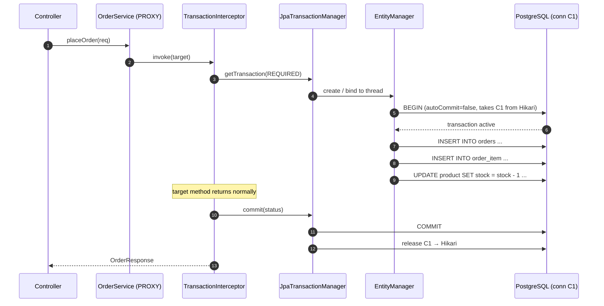
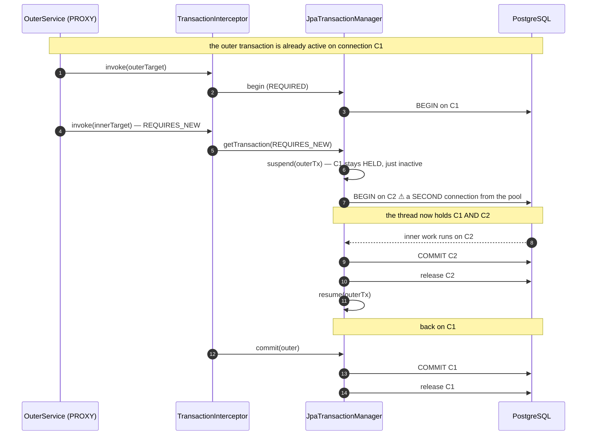
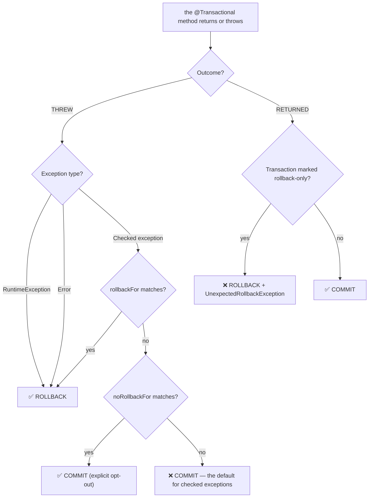
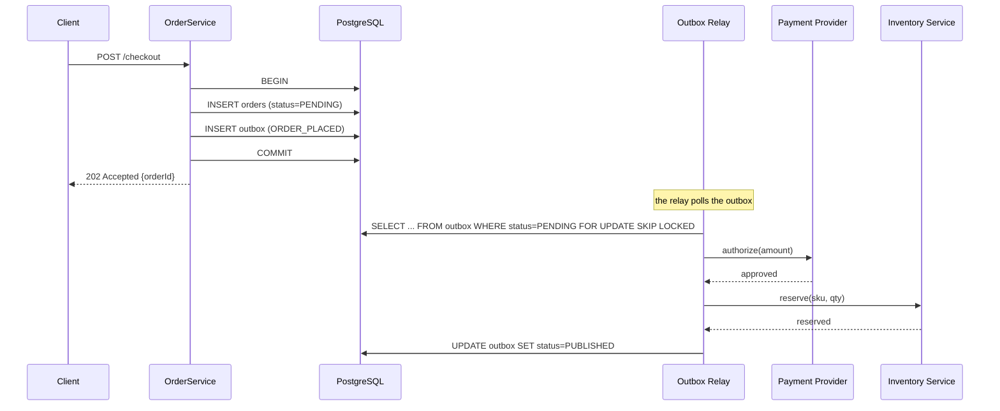

# 03 — Transactions, Propagation & Isolation

> **Level:** Intermediate → Expert
> **Interview Frequency:** ★★★★★ ("why doesn't `@Transactional` work on my method?", "what does `REQUIRES_NEW` actually do?", "why didn't it roll back?")
> **Prerequisites:** [02 · Entity Lifecycle & Caches](02-Entity-Lifecycle-Persistence-Context-and-Caches.md) · [02 · Spring Core — AOP Proxy Mechanics](../02-Spring-Core-Framework/04-AOP-Proxy-Mechanics-and-Spring-Modules.md)
> **Last Updated:** 2026

---

## 📋 Table of Contents

- [0. TL;DR — The 30-Second Answer](#0-tldr--the-30-second-answer)
- [1. What & Why — The Problem This Solves](#1-what--why--the-problem-this-solves)
- [2. Mental Model — The One Picture](#2-mental-model--the-one-picture)
- [3. Deep Dive — Theory (Beginner → Advanced)](#3-deep-dive--theory-beginner--advanced)
  - [3.1 Beginner Level](#31-beginner-level)
  - [3.2 Intermediate Level](#32-intermediate-level)
  - [3.3 Advanced Level](#33-advanced-level)
  - [3.4 Expert Level](#34-expert-level)
- [4. Internal Working Mechanism](#4-internal-working-mechanism)
- [5. Step-by-Step Execution Flow](#5-step-by-step-execution-flow)
- [6. Visualizations](#6-visualizations)
- [7. Production-Level Use Cases & Real Industry Examples](#7-production-level-use-cases--real-industry-examples)
- [8. Worked Examples (with Output + Dry Run)](#8-worked-examples-with-output--dry-run)
- [9. Code from Scratch — Production-Grade](#9-code-from-scratch--production-grade)
- [10. Common Mistakes & Gotchas](#10-common-mistakes--gotchas)
- [11. Performance Considerations](#11-performance-considerations)
- [12. Security Considerations](#12-security-considerations)
- [13. Best Practices](#13-best-practices)
- [14. Hands-On Exercises & Code Challenges](#14-hands-on-exercises--code-challenges)
- [15. Interview Q&A — Level-wise](#15-interview-qa--level-wise)
- [16. Scenario-Based & Real-Experience Scenarios (3–5 yrs)](#16-scenario-based--real-experience-scenarios-35-yrs)
- [17. Counter-Questions, Tricky Questions & Follow-Ups](#17-counter-questions-tricky-questions--follow-ups)
- [18. Frequently Asked Production Issues & Debugging Scenarios](#18-frequently-asked-production-issues--debugging-scenarios)
- [19. Architecture Design Questions](#19-architecture-design-questions)
- [20. Rapid-Fire MCQs](#20-rapid-fire-mcqs)
- [21. Cheat Sheet / One-Page Summary](#21-cheat-sheet--one-page-summary)
- [22. Real-World Production Notes](#22-real-world-production-notes)
- [23. Follow-up Learning](#23-follow-up-learning)

---

## 0. TL;DR — The 30-Second Answer

- **`@Transactional` is a proxy-based AOP feature.** The advice runs only when the call goes **through the proxy** — an external call or a call to another bean. A self-invocation inside the same class never leaves the target, so the advice never runs and there is **no transaction**.
- **`private` and `final` methods cannot be advised.** CGLIB cannot override them, so `@Transactional` on a `private` method is silently ignored — a very common cause of "it doesn't work".
- **`REQUIRED` (the default) joins an existing transaction. `REQUIRES_NEW` suspends it and starts a second one — which needs a **second database connection**.** In a loop, that is connection-pool exhaustion.
- **`NESTED` uses a savepoint**: the inner block can be rolled back to the savepoint, but the outer transaction still controls the commit. It needs a transaction manager that supports JDBC savepoints.
- **Spring rolls back on `RuntimeException` and `Error` — NOT on checked exceptions.** A checked exception **commits** the transaction unless you set `rollbackFor = Exception.class`. This is the single most common transaction bug.
- **`JpaTransactionManager` is Boot's default** when an `EntityManagerFactory` bean exists. A `DataSourceTransactionManager` does **not** enlist the JPA `EntityManager` in the transaction — the two can commit independently.
- **The database's default isolation level wins unless you set it explicitly.** `@Transactional(isolation = ...)` maps to the JDBC `Connection` level, and it only applies when a **new** connection/transaction is started — joining an existing transaction ignores it.
- **`readOnly = true` is a Hibernate optimisation** (no dirty checking, a read-only session, flush mode `MANUAL`) — it is **not** a database guarantee. To use a read replica you also need `REQUIRES_NEW` to escape the write transaction.
- **`save()` on a new entity inserts immediately** (to obtain the generated id); `save()` on a detached entity performs a `merge`. `saveAndFlush()` forces the SQL out without committing.
- **Never call a remote HTTP service inside a transaction.** The connection is held for the whole network call — that is how a 200 ms dependency becomes a pool exhaustion incident.
- **Put `@Transactional` on the service layer, not on the repository.** The repository methods are already transactional (`SimpleJpaRepository`), and a service-level annotation is what makes "one business operation = one transaction" true.

---

## 1. What & Why — The Problem This Solves

**The problem.** A business operation spans several tables and several services. "Update the
order header, decrement the stock, write the ledger entry, and publish an event" is four
writes that must either all happen or none. Without a transaction manager, each write is its
own `autoCommit` transaction — so a failure halfway leaves the system inconsistent:

```text
   WITHOUT A TRANSACTION — the "half-saved order" incident
   ─────────────────────────────────────────────────────────
   1. UPDATE orders SET status='PAID'          → committed ✅
   2. UPDATE product SET stock = stock - 1     → committed ✅
   3. INSERT INTO ledger (...)                 → 💥 FAILS (constraint violation)
   4. INSERT INTO outbox (...)                 → never runs

   RESULT: the order is PAID, the stock is decremented, and there is no ledger entry.
           The customer's money is gone and the books do not balance.
```

**The solution** is a **transaction manager**: an object that owns the transaction boundary,
decides when to commit or roll back, and enforces the rules about *which* exceptions roll back.

```text
   WITH A TRANSACTION
   ───────────────────
   BEGIN
     1. UPDATE orders SET status='PAID'
     2. UPDATE product SET stock = stock - 1
     3. INSERT INTO ledger (...)                → 💥 FAILS
   ROLLBACK  ← everything is undone, atomically
```

**But the transaction manager is only half the story.** The other half is the **boundary
decision**: *what is one transaction?* Spring's answer is "one `@Transactional` method" — and
that is where the traps live:

| The trap | The symptom |
|---|---|
| The advice never ran (self-invocation, `private`, `final`) | No transaction at all → partial writes |
| The method was called on a different instance (not through the proxy) | Same as above |
| The transaction is too wide (a whole controller method) | The connection is held for 3 seconds |
| The transaction is too narrow (on every repository call) | 6 separate transactions → no atomicity |
| A checked exception escaped | The transaction **committed** the partial work |
| `REQUIRES_NEW` in a loop | 2 connections per iteration → pool exhaustion |
| A remote call inside the transaction | The connection is held across the network |

**The analogy.** A transaction is a **paint job**. You can be painting one wall, or two. What
you must not do is paint half of wall A, leave to paint wall B, and then discover that the
second wall was already painted — the outcome is neither wall's fault. And if you use a
*different* can of paint (`REQUIRES_NEW`), you now have two paint jobs open at once, and you
need a second brush.

---

## 2. Mental Model — The One Picture

```text
   THE TRANSACTION MACHENEWORK, END TO END
   ═══════════════════════════════════════

   ┌──────────────────────────────────────────────────────────────────────┐
   │  CALLER (e.g. OrderController)                                       │
   └───────────────────────────┬──────────────────────────────────────────┘
                               │  orderService.placeOrder(...)   ← the PROXY
                               ▼
   ┌──────────────────────────────────────────────────────────────────────┐
   │  TRANSACTION INTERCEPTOR  (the @Transactional advice)                │
   │                                                                      │
   │   ① get the TransactionAttribute (propagation, isolation, readOnly…) │
   │   ② get the PlatformTransactionManager                               │
   │   ③ decide: JOIN an existing transaction, or START a new one        │
   │   ④ bind the resources (EntityManager / Connection) to the THREAD    │
   │   ⑤ invoke the target method                                          │
   │   ⑥ on exception → rollback or setRollbackOnly                       │
   │      on normal   → commit (unless the tx was marked rollback-only)   │
   │   ⑦ unbind the resources, release the connection                    │
   └───────────────────────────┬──────────────────────────────────────────┘
                               ▼
   ┌──────────────────────────────────────────────────────────────────────┐
   │  JpaTransactionManager                                               │
   │    ├── EntityManager (create / join / bind to the thread)            │
   │    └── DataSource  (the same Hikari pool — exposes the JDBC          │
   │                     connection for the same transaction)               │
   └───────────────────────────┬──────────────────────────────────────────┘
                               ▼
   ┌──────────────────────────────────────────────────────────────────────┐
   │  HikariCP  →  one JDBC Connection  →  PostgreSQL                     │
   │      autoCommit=false · isolation=READ_COMMITTED · tx active         │
   └──────────────────────────────────────────────────────────────────────┘

   THE PROXY IS THE WHOLE STORY:
   ┌──────────────────┐        ┌──────────────────┐
   │  the REAL bean   │        │  the PROXY       │
   │  OrderService    │◀───────│  CGLIB subclass  │
   │  placeOrder()    │ called │  placeOrder()    │  ← the advice lives HERE
   │  (no advice)     │        │  + tx logic      │
   └──────────────────┘        └──────────────────┘
         ▲
         │ ❌ a call like this NEVER reaches the proxy:
         this.otherMethodCallingPlaceOrder();
```

**What to look at:** the proxy is a *separate object* that the caller holds. If the caller
never holds the proxy — because the call was a self-invocation — the entire mechanism is
bypassed. That is the whole of the "my `@Transactional` does not work" family of bugs.

---

## 3. Deep Dive — Theory (Beginner → Advanced)

### 3.1 Beginner Level

#### What `@Transactional` actually is

```java
package org.springframework.transaction.annotation;

@Target({ElementType.METHOD, ElementType.TYPE})
@Retention(RetentionPolicy.RUNTIME)
@Inherited
@Documented
public @interface Transactional {
    String value() default "";
    String transactionManager() default "";
    PropagationBehavior propagation() default PropagationBehavior.REQUIRED;
    Isolation isolation() default Isolation.DEFAULT;
    int timeout() default TransactionDefinition.TIMEOUT_DEFAULT;
    String[] rollbackFor() default {};
    String[] rollbackForClassName() default {};
    Class<? extends Throwable>[] noRollbackFor() default {};
    boolean readOnly() default false;
}
```

**It is not magic — it is an annotation that a `BeanPostProcessor` reads.** Spring's
`InfrastructureAdvisorAutoProxyCreator` / `AnnotationAwareAspectJAutoProxyCreator` scans the
beans, finds `@Transactional`, and wraps them in a proxy whose advice calls the
`PlatformTransactionManager`.

#### The three attributes beginners must know

```java
@Transactional(
    readOnly = true,                       // optimisation flag (see §3.3)
    rollbackFor = Exception.class,         // make CHECKED exceptions roll back too
    timeout = 5                            // seconds — the query timeout on the tx
)
public void process() { }
```

#### `save` vs `saveAndFlush` vs `flush` vs `commit`

| Call | What it does | When to use it |
|---|---|---|
| `repository.save(entity)` | `persist` if the id is null, else `merge`. On a **new** entity the INSERT is issued **immediately** — you need the generated id | The normal call |
| `repository.saveAndFlush(entity)` | The same, plus an explicit `flush()` — the SQL is sent, the transaction stays open | You need the id **or** the constraint violation **now** |
| `entityManager.flush()` | Sends the pending SQL; the transaction stays open | Before a native query, or at a batch boundary |
| commit | Happens automatically at the end of the `@Transactional` method | — |

**Why `save()` on a new entity inserts immediately:** the generated id is needed to build the
child rows (`order_item.order_id`) and to return it to the caller. Hibernate cannot defer the
insert until the flush, because the id does not exist yet.

#### The rollback rule

```java
@Transactional
public void a() {
    repo.save(x);
    throw new IllegalStateException("boom");   // ✅ RUNTIME → ROLLBACK
}

@Transactional
public void b() {
    repo.save(x);
    throw new IOException("boom");             // ❌ CHECKED → COMMIT (the write survives!)
}
```

> **This is the rule that surprises everybody:** Spring's default rollback rule is
> `"rollback on RuntimeException and Error"`. A checked exception is treated as a **normal
> return** — the transaction commits.

### 3.2 Intermediate Level

#### The proxy — and the three ways to defeat it

```java
@Service
public class OrderService {

    private final PaymentService paymentService;

    public OrderService(PaymentService paymentService) {
        this.paymentService = paymentService;
    }

    // ❌ FAILURE 1 — SELF-INVOCATION
    @Transactional
    public void placeOrder(OrderRequest request) {
        this.validateInventory(request);      // ← direct call on `this` → no proxy → no tx
    }

    @Transactional
    public void validateInventory(OrderRequest request) {   // the advice never runs
        // ...
    }

    // ✅ the call must leave the class
    public void placeOrderFixed(OrderRequest request) {
        this.inventoryValidator.validate(request);   // a DIFFERENT bean → through the proxy
    }
}
```

**The three proxy-defeating mistakes:**

| # | Mistake | Why it fails | Fix |
|---|---|---|---|
| 1 | **Self-invocation** — `this.otherMethod()` | The call never leaves the target object, so the proxy's advice is bypassed | Move the method to another bean, or inject `self` via `@Lazy`/`AopContext.currentProxy()` |
| 2 | **`private` method** | CGLIB cannot override a private method — there is no dispatch point | Make it `public` (and put it on a collaborator) |
| 3 | **`final` method or `final` class** | CGLIB cannot override a `final` method / subclass a `final` class | Remove `final`, or switch to a JDK proxy by implementing an interface |

```java
// ✅ The self-injection fix (used sparingly — it is a smell, not a pattern)
@Service
public class OrderService {

    @Lazy                       // breaks the circular dependency
    private final OrderService self;   // the PROXY, not this

    public OrderService(@Lazy OrderService self) {
        this.self = self;
    }

    @Transactional
    public void placeOrder(OrderRequest request) {
        self.validateInventory(request);   // → goes through the proxy → the advice runs
    }
}
```

> **The expert framing:** the reason self-invocation breaks is not "Spring magic" — it is
> that **the transaction advice lives in the proxy, and the proxy is only in the path of
> calls that arrive from outside**. `this.method()` is a plain Java method call on the target
> instance; the proxy is not involved at all.

#### The propagation behaviours — the canonical table

| Propagation | Existing tx? | Behaviour |
|---|---|---|
| `REQUIRED` (default) | yes | Join |
| `REQUIRES_NEW` | yes | **Suspend** current, start new (needs a **second connection**) |
| `SUPPORTS` | yes | Join if present, else non-transactional |
| `NOT_SUPPORTED` | yes | **Suspend** current, run non-transactionally |
| `MANDATORY` | yes | Join; **throw** if none exists |
| `NEVER` | yes | **Throw** if one exists |
| `NESTED` | yes | Savepoint within the current transaction |

**The consequences — the part that actually matters in production:**

| Propagation | Connection behaviour | The trap |
|---|---|---|
| `REQUIRED` | **One** connection, shared | None — this is the default and what you want |
| `REQUIRES_NEW` | **Two** connections simultaneously (the outer one is suspended but **held**) | In a loop → the pool is exhausted |
| `NESTED` | **One** connection, one savepoint | Requires savepoint support; the inner block does **not** commit independently |
| `SUPPORTS` | One or none | Fine for a read-only path that may or may not have a transaction |
| `NOT_SUPPORTED` | The outer connection is **held but unused** | Same pool pressure as `REQUIRES_NEW` if used in a loop |
| `MANDATORY` | One | Throws `IllegalTransactionStateException` if there is no transaction — a useful assertion |
| `NEVER` | One | Throws if a transaction exists — useful for asserting "this must never run in a tx" |

#### The rollback rules, precisely

```java
// Spring's default rule, in code:
private boolean rollbackOn(Exception ex) {
    return (ex instanceof RuntimeException || ex instanceof Error)     // unchecked → rollback
        || match(rollbackFor, ex)                                     // your explicit list
        || (!match(noRollbackFor, ex) && false);                      // noRollbackFor wins
}
```

```java
@Transactional
public void a() { throw new IllegalStateException(); }        // ✅ rollback

@Transactional
public void b() { throw new IOException(); }                  // ❌ commits

@Transactional(rollbackFor = Exception.class)
public void c() { throw new IOException(); }                  // ✅ rollback

@Transactional(noRollbackFor = BusinessException.class)
public void d() { throw new BusinessException(); }            // ❌ commits (an explicit opt-out)
```

**And the marker:** `TransactionAspectSupport.currentTransactionStatus().setRollbackOnly()`
marks the transaction for rollback **without** throwing. It is how a method says "I cannot
complete this, but the caller must not commit".

```java
@Transactional
public void withdraw(Account account, BigDecimal amount) {
    account.debit(amount);
    if (!riskCheck.passes(account)) {
        TransactionAspectSupport.currentTransactionStatus().setRollbackOnly();
        return;                 // no exception — but the transaction WILL roll back
    }
    auditService.write(account);
}
```

### 3.3 Advanced Level

#### The transaction managers

```java
public interface PlatformTransactionManager {
    TransactionStatus getTransaction(TransactionDefinition definition) throws TransactionException;
    void commit(TransactionStatus status) throws TransactionException;
    void rollback(TransactionStatus status) throws TransactionException;
}
```

```java
public interface TransactionDefinition {
    int PROPAGATION_REQUIRED = 0;
    int PROPAGATION_SUPPORTS = 1;
    int PROPAGATION_MANDATORY = 2;
    int PROPAGATION_REQUIRES_NEW = 3;
    int PROPAGATION_NOT_SUPPORTED = 4;
    int PROPAGATION_NEVER = 5;
    int PROPAGATION_NESTED = 6;
    ...
}
```

| Manager | Level | Binds | Notes |
|---|---|---|---|
| `DataSourceTransactionManager` | JDBC | The `Connection` | Does **not** enlist the JPA `EntityManager` |
| `JpaTransactionManager` | JPA | The `EntityManager` **and** (if `setDataSource` is called) the `Connection` | **Boot's default when an `EntityManagerFactory` bean exists** |
| `JtaTransactionManager` | JTA (distributed) | XA resources | For a distributed transaction across several resources |
| `R2dbcTransactionManager` | Reactive | The `Connection` | For `R2DBC` / reactive data access |
| `TransactionTemplate` | Programmatic | Whatever manager it holds | For a transaction you cannot express with an annotation |

**The critical `JpaTransactionManager` detail:** Spring Boot's `JpaBaseConfiguration` creates
it with **both** the `EntityManagerFactory` **and** the `DataSource`:

```java
@Bean
public PlatformTransactionManager transactionManager(
        EntityManagerFactory entityManagerFactory, DataSource dataSource) {
    JpaTransactionManager transactionManager = new JpaTransactionManager(entityManagerFactory);
    transactionManager.setDataSource(dataSource);   // ← exposes the JDBC connection too
    return transactionManager;
}
```

**Why that matters:** it means a `JdbcTemplate` call inside a `@Transactional` method joins
**the same transaction** as the JPA work — same connection, same commit. If you used a
`DataSourceTransactionManager` instead, the JPA `EntityManager` would **not** be enlisted and
the two would commit independently — a genuine "half-saved" bug.

#### `save` vs `saveAndFlush` — the Spring Data JPA specifics

```java
// The source of truth, from SimpleJpaRepository:
@Transactional
public <S extends T> S save(S entity) {
    if (entityInformation.isNew(entity)) {
        if (entityInformation.getId(entity) == null
                && entityInformation.getIdType().getJavaType() == PrimitiveType.class) { ... }
        em.persist(entity);
        return entity;
    } else {
        return em.merge(entity);
    }
}

@Transactional
public <S extends T> S saveAndFlush(S entity) {
    S result = save(entity);
    em.flush();          // ← the explicit flush
    return result;
}
```

> **The trap:** `save()` on a **new** entity issues the INSERT immediately (to obtain the
> generated id), but on an **existing** entity it issues a `merge` — and the merge copies the
> state into the managed instance. If you ignore the returned value, nothing changes. See
> [02 · Entity Lifecycle](02-Entity-Lifecycle-Persistence-Context-and-Caches.md).

#### `readOnly = true` — what it really does

```text
   @Transactional(readOnly = true)
   ────────────────────────────────
   Spring:   the TransactionDefinition is marked read-only → the manager may pass it to the
             JDBC driver (some drivers optimise a read-only connection).
   Hibernate:
             ① FlushModeType.MANUAL      → no auto-flush before queries
             ② the session is marked read-only → NO dirty checking (no snapshot comparison)
             ③ no INSERT/UPDATE/DELETE is issued for the entities in that session
   What it does NOT do:
             ✗ It does NOT make the database connection read-only.
             ✗ It does NOT route the query to a replica.
             ✗ It does NOT prevent a native query from writing.
```

**To use a read replica you need two things:**

```java
@Transactional(propagation = Propagation.REQUIRES_NEW, readOnly = true)
public List<OrderSummary> readFromReplica() {
    // REQUIRES_NEW suspends the write transaction and takes a NEW connection —
    // which is the one pointing at the replica.
    return orderRepository.findSummaries(OrderStatus.PAID);
}
```

> **The trap:** without `REQUIRES_NEW`, the read **joins** the existing write transaction and
> uses the **primary's** connection — so it is not a replica read at all, and it also holds
> the write transaction open for the duration of the read.

#### The isolation levels — the canonical table

| Level | Dirty read | Non-repeatable | Phantom | Serializable |
|---|---|---|---|---|
| `READ UNCOMMITTED` | possible | possible | possible | no |
| `READ COMMITTED` | prevented | possible | possible | no |
| `REPEATABLE READ` | prevented | prevented | possible (MySQL: no) | no |
| `SERIALIZABLE` | prevented | prevented | prevented | yes |

**How the JPA level maps to JDBC:**

```java
// jakarta.persistence.Isolation
public enum Isolation {
    DEFAULT(0),            // → the database's default
    READ_UNCOMMITTED(1),   // → Connection.TRANSACTION_READ_UNCOMMITTED
    READ_COMMITTED(2),     // → Connection.TRANSACTION_READ_COMMITTED
    REPEATABLE_READ(4),    // → Connection.TRANSACTION_REPEATABLE_READ
    SERIALIZABLE(8);       // → Connection.TRANSACTION_SERIALIZABLE
}
```

**The database defaults (from the JDBC chapter — the same facts, one layer up):**

| Database | Default isolation | Note |
|---|---|---|
| **PostgreSQL** | `READ COMMITTED` | The modern default |
| **MySQL (InnoDB)** | `REPEATABLE READ` | A legacy choice; it can take gap locks |
| **SQL Server** | `READ COMMITTED` | |
| **Oracle** | `READ COMMITTED` | |

**The three rules that matter:**

1. **The database's default wins unless you set it explicitly.** `@Transactional` with no
   `isolation` attribute uses `Isolation.DEFAULT`, which means "whatever the connection
   already has".
2. **`isolation` is only applied when a **new** transaction starts.** If the method joins an
   existing transaction, the existing isolation level is kept — the annotation is silently
   ignored.
3. **Changing the isolation level at runtime is often a no-op or a performance cliff.**
   PostgreSQL's `SERIALIZABLE` uses SSI (serializable snapshot isolation) and turns
   concurrent updates into **serialization failures** (`40001`) that the application must
   **retry**. That is often the right design — but it must be an explicit, retried design.

### 3.4 Expert Level

#### `NESTED` — savepoints and what they really do

```text
   REQUIRED (one transaction)              NESTED (one transaction + savepoint)
   ──────────────────────────               ──────────────────────────────────────
   BEGIN                                   BEGIN
     outer work                              outer work
     inner work                              SAVEPOINT sp1
     💥 inner throws                        inner work
   ROLLBACK (everything)                   💥 inner throws
                                            ROLLBACK TO SAVEPOINT sp1   ← only the inner part
                                            outer work continues ✅
                                         COMMIT
```

```java
@Transactional(propagation = Propagation.NESTED)
public void tryPartialSave() {
    // the inner block rolls back to the savepoint; the outer transaction survives
}
```

**The constraints:**

- It needs a **savepoint-capable** transaction manager — `DataSourceTransactionManager` and
  `JpaTransactionManager` support it when the driver supports JDBC savepoints (PostgreSQL
  and MySQL/InnoDB do; Oracle and SQL Server do **not** support savepoints — the inner
  transaction becomes a separate transaction with a different lock scope).
- **The inner block does not commit independently.** It can only be rolled back to the
  savepoint; the outer transaction still controls the commit. That is the difference from
  `REQUIRES_NEW`.
- `NESTED` is **not** part of the JPA spec — it is a Spring extension.

#### The `UnexpectedRollbackException`

```java
@Service
public class OrderService {

    @Transactional
    public void outer() {
        try {
            innerService.required();     // joins the SAME transaction
        } catch (RuntimeException e) {
            // swallowed — but the transaction is ALREADY marked rollback-only
        }
        // → at commit: UnexpectedRollbackException
    }

    @Transactional
    public void inner() {
        throw new IllegalStateException("boom");
    }
}
```

**The mechanism:** when a participating (joined) transaction's inner method throws, Spring
**marks the whole transaction rollback-only** on the shared `TransactionStatus`. The outer
method catches the exception and returns normally — but at commit time, the transaction
manager sees the rollback-only marker and throws `UnexpectedRollbackException("Transaction
rolled back because it has been marked as rollback-only")`.

> **The rule:** an exception caught inside a transactional method **must not** be swallowed if
> the work it did must be undone. Either rethrow it, or mark the transaction rollback-only
> explicitly and return — and understand that the outer transaction will also roll back.

#### `TransactionSynchronization` — after-commit hooks

```java
@Component
public class OrderEventPublisher {

    private final ApplicationEventPublisher events;

    public OrderEventPublisher(ApplicationEventPublisher events) {
        this.events = events;
    }

    @TransactionalEventListener(phase = TransactionPhase.AFTER_COMMIT)
    public void onOrderPlaced(OrderPlacedEvent event) {
        // ✅ runs AFTER the commit — the data is durable
        events.publishEvent(new OrderConfirmed(event.orderId()));
    }

    @TransactionalEventListener(phase = TransactionPhase.BEFORE_COMMIT)
    public void onBeforeCommit(OrderPlacedEvent event) {
        // runs inside the transaction, before the commit
    }
}
```

| Phase | When | Use for |
|---|---|---|
| `BEFORE_COMMIT` | Before the SQL is flushed and committed | A final validation |
| `AFTER_COMMIT` | After a successful commit | Publishing events, calling a downstream system |
| `AFTER_ROLLBACK` | After a rollback | Compensation / alerting |
| `AFTER_COMPLETION` | After either | Cleanup |

**The caveat, and the reason the outbox pattern exists:** `AFTER_COMMIT` runs **after** the
transaction is committed, but the event publish is **not** part of any transaction — if the
process dies between the commit and the publish, the event is **lost**. For anything that
must be delivered, use the **outbox pattern**: write the event into an `outbox` table **in the
same transaction**, and have a relay publish it afterwards.

```java
// The outbox, written in the SAME transaction as the business data
@Transactional
public void placeOrder(OrderRequest request) {
    Order order = orderRepository.save(orderMapper.toEntity(request));
    outboxRepository.save(new OutboxEvent(
            "ORDER_PLACED",
            order.getId(),
            objectMapper.writeValueAsString(orderMapper.toEvent(order)),
            OutboxStatus.PENDING,
            Instant.now()));
    // → one transaction, both rows. Either both exist or neither does.
}
```

#### Transaction boundaries and the "unit of work" — the deeper picture

```text
   WHERE SHOULD THE BOUNDARY BE?
   ═══════════════════════════════

   ❌ Repository level
      Every repository method is its own transaction (SimpleJpaRepository is @Transactional).
      → 6 repository calls = 6 transactions = no atomicity.

   ❌ Controller level
      The transaction spans the HTTP request, including serialisation and any remote call.
      → the connection is held for the whole request; a 500 ms remote call holds it for 500 ms.

   ❌ "Everywhere, just in case"
      Nested @Transactional calls with REQUIRED → they all join, so it is effectively one
      transaction — but the boundaries are meaningless and the rollback scope is unclear.

   ✅ Service level — ONE transaction per business operation
      ┌────────────────────────────────────────────────────────────────┐
      │  @Transactional                                                │
      │  public OrderResponse placeOrder(OrderRequest request) {       │
      │      Order order = orderRepository.save(...);        // JPA     │
      │      inventoryService.reserve(order);                // JPA     │
      │      ledgerService.post(order);                      // JPA     │
      │      outboxRepository.save(...);                     // JPA     │
      │      return OrderDto.from(order);                    // map INSIDE│
      │  }                                                            │
      └────────────────────────────────────────────────────────────────┘
      → one connection, one commit, one rollback, one atomic unit.
```

---

## 4. Internal Working Mechanism

**Which class calls which, in what order.** The Spring transaction interceptor chain.

```text
1.  The caller invokes orderService.placeOrder(...) on the PROXY
      └─ CGLIB proxy → TransactionInterceptor.invoke(MethodInvocation)
           └─ TransactionAspectSupport.invokeWithinTransaction(invocation)

2.  TransactionAspectSupport.invokeWithinTransaction
      ├─ ① determineTransactionAttribute(method, targetClass)
      │      → the @Transactional metadata (propagation, isolation, readOnly, rollback rules)
      ├─ ② getTransactionManager(txAttr.getQualifier())   → the PlatformTransactionManager
      ├─ ③ prepareTransactionDefinition(txAttr, ...)      → a TransactionDefinition
      ├─ ④ determineExistingTransaction()  → is there a transaction on the thread?
      │      ├─ handleExistingTransaction(...)   → JOIN / SUSPAND / etc.
      │      └─ else → createTransactionIfNecessary(...) → START a new one
      ├─ ⑤ prepareSynchronization(...)  → register the TransactionSynchronization callbacks
      ├─ ⑥ proceed() → invocation.proceed()  → THE TARGET METHOD RUNS
      └─ ⑦ commitTransactionAfterReturning(txInfo)   / commitTransactionAfterThrowing(txInfo)
             ├─ afterCommit  → the AFTER_COMMIT listeners
             ├─ commit or rollback
             └─ cleanupAfterCompletion → unbind the resources, release the connection
```

**The `JpaTransactionManager` internals:**

```text
doGetTransaction()
  ├─ obtainEntityManager()          → the thread-bound EntityManager, or a new one
  ├─ if (existingTransaction) → return a participating status
  └─ else → start a new EntityTransaction (which opens a JDBC connection)

doBegin(...)
  ├─ entityManager.begin()          → sets autoCommit=false, applies the isolation level
  └─ DataSourceUtils.getConnection(dataSource)  → the SAME connection, exposed to JDBC code

doCommit(...)
  ├─ entityManager.commit()         → flush + JDBC commit
  └─ DataSourceUtils.releaseConnection(...)   → return it to Hikari

doRollback(...)
  ├─ entityManager.rollback()
  └─ release the connection
```

**The extension points:**

| Extension point | Interface | Use |
|---|---|---|
| A custom propagation rule | `TransactionDefinition` + `PlatformTransactionManager` | Rare — a bespoke transaction semantics |
| A programmatic transaction | `TransactionTemplate` | A transaction whose boundary is computed |
| After-commit work | `TransactionSynchronization` / `@TransactionalEventListener` | Publishing events |
| A transaction-scoped bean | `@Scope(SCOPE_TRANSACTION)` / `@Transactional(propagation = NESTED)` | A per-transaction cache |
| Metrics | `TransactionSynchronization` / Micrometer's `Timed` | Transaction duration, rollback counts |
| A test double | `@MockBean`/`@MockitoBean` `PlatformTransactionManager` | Asserting that a transaction was started |

---

## 5. Step-by-Step Execution Flow

**Flow 1 — the happy path (a `@Transactional` service method).**

1. The caller (a controller) holds the **proxy** and calls `placeOrder(...)`.
2. `TransactionInterceptor` resolves the `@Transactional` metadata.
3. No transaction exists on the thread → `createTransactionIfNecessary` → the
   `JpaTransactionManager` creates an `EntityManager`, begins a transaction (which takes a
   **JDBC connection from Hikari**, sets `autoCommit = false`, applies the isolation level).
4. The `EntityManager` is bound to the current thread.
5. The target method runs. Every repository call uses the bound `EntityManager` → the same
   connection → the same transaction.
6. The method returns normally → `commitTransactionAfterReturning`:
   - the `AFTER_COMMIT` listeners fire,
   - `entityManager.commit()` → the flush issues the pending SQL, then the JDBC commit,
   - the connection is returned to Hikari, the `EntityManager` is closed, the thread binding
     is removed.
7. The proxy returns the result.

**Flow 2 — the exception path.**

1. Steps 1–5 as above.
2. The target method throws `IllegalStateException` (a `RuntimeException`).
3. `commitTransactionAfterThrowing` → the rollback rules are evaluated → the exception is
   unchecked → **rollback**.
4. `entityManager.rollback()` → the JDBC rollback → the connection is released with
   `rollback()` → Hikari resets its state.
5. The exception is rethrown to the caller.

**Flow 3 — `REQUIRES_NEW` inside an existing transaction.**

1. The outer transaction holds connection **C1**.
2. The inner method is advised → `handleExistingTransaction` sees `REQUIRES_NEW` →
   `suspend(transaction)` → the outer `EntityManager` is suspended (its resources stay bound
   to the thread but inactive).
3. A **new** transaction is started → it needs a **second connection**, **C2**.
4. The inner work runs on C2.
5. The inner transaction commits (or rolls back) → C2 is released.
6. `resume(transaction)` → the outer transaction continues on C1.

> **The pool consequence:** during step 3–5, the thread holds **two** connections. With a
> pool of 20 and 20 concurrent threads doing this, the pool is empty and every thread waits
> — a **deadlock**, because no thread can proceed to release its connection.

---

## 6. Visualizations

### 6.1 `REQUIRED` — one transaction, one connection



**Caption:** One connection, one transaction, one commit. The nested service calls are
**not** shown because they do not exist at this level — with `REQUIRED` they simply join this
transaction, so they run on the same connection with no extra begin/commit.

### 6.2 `REQUIRES_NEW` — a second connection



**Caption:** The second connection is the whole point — and the whole hazard. `REQUIRES_NEW`
is not "a nested transaction"; it is **a second, independent transaction on a second
connection**, while the first connection is still held.

### 6.3 The propagation decision tree

```text
   DECIDING THE PROPAGATION BEHAVIOUR
   ════════════════════════════════════

   @Transactional(propagation = ???)
            │
            ▼
   ┌──────────────────────────────────┐
   │ Is there a transaction on the     │
   │ thread right now?                 │
   └───────────────┬──────────────────┘
                   │
        ┌──────────┴──────────┐
        │ NO                  │ YES
        ▼                     ▼
   ┌─────────────┐      ┌─────────────────────────────────────────────┐
   │ REQUIRED    │      │ REQUIRED      → JOIN (same connection)      │
   │ SUPPORTS    │      │ SUPPORTS      → JOIN (or run without)       │
   │ MANDATORY   │      │ MANDATORY     → JOIN                       │
   │ NEVER       │      │ NEVER         → THROW IllegalTransaction.. │
   │ REQUIRES_NEW│      │ REQUIRES_NEW  → SUSPEND + NEW (2nd conn) ⚠  │
   │ NESTED      │      │ NESTED        → SAVEPOINT (same conn)       │
   │ NOT_SUPPORTED│     │ NOT_SUPPORTED → SUSPEND + run w/o a tx      │
   └─────────────┘      └─────────────────────────────────────────────┘

   THE THREE-WAY SPLIT THAT DECIDES EVERYTHING:
   ┌──────────────────┬───────────────────┬──────────────────────────────┐
   │                  │ SAME CONNECTION?  │ COMMITTED INDEPENDENTLY?    │
   ├──────────────────┼───────────────────┼──────────────────────────────┤
   │ REQUIRED         │ ✅ yes            │ ❌ no                       │
   │ NESTED           │ ✅ yes            │ ❌ no (a savepoint only)    │
   │ REQUIRES_NEW     │ ❌ no (a 2nd one) │ ✅ yes                      │
   │ NOT_SUPPORTED    │ ❌ (suspended)    │ n/a — no transaction at all │
   └──────────────────┴───────────────────┴──────────────────────────────┘
```

**Caption:** "Does it share the connection?" and "does it commit on its own?" are the only two
questions that matter. `REQUIRED` shares and does not; `REQUIRES_NEW` does not and does;
`NESTED` shares and does not — but can be rolled back to a savepoint.

### 6.4 The commit/rollback decision



**Caption:** The default rule is "rollback on `RuntimeException` and `Error`". Everything else
is opt-in or opt-out. The `rollback-only` path is the one that produces the confusing
`UnexpectedRollbackException` — a transaction marked rollback-only by a joined inner method
cannot be committed, even though the outer method returned normally.

---

## 7. Production-Level Use Cases & Real Industry Examples

### 7.1 Payments — "debit, then call the provider, then credit"

**Domain:** a payments service, 900 transactions/minute peak, a third-party provider with a
**p99 of 700 ms**.

The naive implementation:

```java
@Transactional
public void pay(PaymentRequest request) {
    accountRepository.debit(request.accountId(), request.amount());   // DB write
    String result = paymentProvider.charge(request);                  // ⚠ 700 ms HTTP call
    accountRepository.credit(request.accountId(), request.amount());   // DB write
}
```

**What it costs:** the JDBC connection is held for the **entire 700 ms** of the HTTP call. With
a pool of 20, that caps throughput at **28 transactions/second** — the service is
connection-bound, not provider-bound. A provider slowdown from 700 ms to 3 s drops it to
**6.6 transactions/second**.

**The fix — the transaction must not contain the network call:**

```java
// ① Phase 1 — the DB state change, in a short transaction
@Transactional
public void debitAccount(AccountDebitCommand command) {
    accountRepository.debit(command.accountId(), command.amount());
    paymentRepository.save(Payment.pending(command));
}

// ② Phase 2 — the provider call, OUTSIDE any transaction
public String callProvider(...) { return paymentProvider.charge(...); }

// ③ Phase 3 — the finalisation, in a NEW transaction
@Transactional
public void creditAccount(PaymentConfirmCommand command) {
    accountRepository.credit(command.accountId(), command.amount());
    paymentRepository.markConfirmed(command.paymentId());
}
```

The system now uses a **saga/state machine** (`PENDING → CONFIRMED | FAILED`) instead of one
big transaction, with a reconciliation job for the in-between cases. Throughput became
**provider-bound** (1 400/s), and the connection hold time dropped from 700 ms to **4 ms**.

> **The interview framing:** "you cannot make a distributed transaction out of a local one.
> The database transaction ends at the database boundary; everything else is a saga with
> compensations."

### 7.2 Banking — the ledger and the outbox

**Domain:** a core-banking ledger, 12 M postings/day, exactly-once delivery to a downstream
risk engine.

```java
@Transactional
public void post(JournalEntry entry) {
    journalRepository.saveAll(entry.lines());
    // ✅ the event is written IN THE SAME TRANSACTION as the business data
    outboxRepository.save(OutboxEvent.of("JOURNAL_POSTED", entry));
}
```

A relay process polls the `outbox` (with `SELECT … FOR UPDATE SKIP LOCKED`), publishes to
Kafka, and marks the row as published. **Why:** the "publish after commit" approach loses
events if the process dies between the commit and the publish; the "publish inside the
transaction" approach publishes events for transactions that later roll back. The outbox
gives **at-least-once delivery with no lost events**, and the consumers are idempotent.

### 7.3 E-commerce — the read replica and `REQUIRES_NEW`

**Domain:** a product catalogue, 8 000 reads/second, a primary with 1 replica, a **read
replica lag of 50–200 ms**.

```java
@Transactional(readOnly = true)                                   // the write transaction
public OrderResponse placeOrder(OrderRequest request) {
    Order order = orderRepository.save(orderMapper.toEntity(request));
    // ✅ the catalogue read joins the WRITE transaction — it uses the PRIMARY's connection
    catalogueService.validateAvailability(order);
    return OrderDto.from(order);
}

@Transactional(propagation = Propagation.REQUIRES_NEW, readOnly = true)
public CatalogueSnapshot catalogueSnapshot() {
    // ✅ REQUIRES_NEW → a new connection → the one pointing at the REPLICA
    return catalogueRepository.snapshot();
}
```

The measured effect: the primary's read QPS dropped by **71 %** and the primary's CPU by
**38 %**. The trade-off: the replica read can be up to 200 ms stale — acceptable for a
catalogue, unacceptable for "the order I just placed" (which must read the primary).

### 7.4 The audit trail — `AFTER_COMMIT` and the "transaction silently committed" trap

**Domain:** an admin service that changes a customer's tier and must write an audit row.

```java
@Transactional
public void changeTier(Long customerId, Tier tier) {
    customerRepository.updateTier(customerId, tier);
    // ✅ the audit row is written in the SAME transaction — it is atomic with the change
    auditRepository.save(new AuditEntry("TIER_CHANGED", customerId, tier, clock.instant()));
}
```

A subtle incident: the audit service called a **remote** logging system *inside* the
transaction. The remote call took 400 ms; when it failed, the transaction rolled back — but
the remote system had already recorded the audit entry. The fix: write the audit row to the
database (atomic) and let a relay publish it asynchronously. Never call a remote system
inside a transaction whose outcome you do not control.

---

## 8. Worked Examples (with Output + Dry Run)

### 8.1 `REQUIRED` vs `REQUIRES_NEW` — the exact logs

**The code:**

```java
@Service
public class AuditService {

    private final AuditRepository auditRepository;

    public AuditService(AuditRepository auditRepository) {
        this.auditRepository = auditRepository;
    }

    @Transactional(propagation = Propagation.REQUIRES_NEW)
    public void auditInNewTransaction(String message) {
        auditRepository.save(new AuditEntry(message, Instant.now()));
    }

    @Transactional
    public void auditInSameTransaction(String message) {
        auditRepository.save(new AuditEntry(message, Instant.now()));
    }
}
```

```java
@Service
public class OrderService {

    private final OrderRepository orderRepository;
    private final AuditService auditService;

    public OrderService(OrderRepository orderRepository, AuditService auditService) {
        this.orderRepository = orderRepository;
        this.auditService = auditService;
    }

    @Transactional
    public void placeOrder(Long customerId) {
        orderRepository.save(new Order(customerId, "NEW"));
        auditService.auditInSameTransaction("order placed");     // REQUIRED → joins
    }

    @Transactional
    public void placeOrderWithIndependentAudit(Long customerId) {
        orderRepository.save(new Order(customerId, "NEW"));
        auditService.auditInNewTransaction("order placed");      // REQUIRES_NEW → 2nd connection
    }
}
```

**The logs — `REQUIRED` (one connection):**

```text
2026-03-14 10:15:22.101  HikariPool-1 - Added connection HikariPool-1 conn-7
2026-03-14 10:15:22.104  OrderService      - BEGIN (tx=1)
2026-03-14 10:15:22.107  SQL               - insert into orders (customer_id, status) values (?, ?)
2026-03-14 10:15:22.108  SQL               - insert into audit_entry (message, created_at) values (?, ?)
2026-03-14 10:15:22.111  OrderService      - COMMIT (tx=1)
2026-03-14 10:15:22.112  HikariPool-1      - Starting connection... conn-7 is available
```

**Dry run:**

```text
1. the outer @Transactional starts          → takes conn-7 from Hikari
2. orderRepository.save(...)                → INSERT on conn-7
3. auditService.auditInSameTransaction(...) → handleExistingTransaction():
      propagation = REQUIRED and a transaction exists → JOIN
      → no new connection, no new BEGIN
      → the INSERT goes on conn-7
4. the outer method returns                 → one COMMIT
5. conn-7 is released
```

**The logs — `REQUIRES_NEW` (two connections):**

```text
2026-03-14 10:15:31.402  HikariPool-1 - Added connection HikariPool-1 conn-7
2026-03-14 10:15:31.405  OrderService      - BEGIN (tx=1)
2026-03-14 10:15:31.408  SQL               - insert into orders (customer_id, status) values (?, ?)
2026-03-14 10:15:31.412  AuditService      - SUSPEND tx=1 (conn-7 held)
2026-03-14 10:15:31.418  HikariPool-1 - Added connection HikariPool-1 conn-12
2026-03-14 10:15:31.421  AuditService      - BEGIN (tx=2, conn-12)
2026-03-14 10:15:31.424  SQL               - insert into audit_entry (message, created_at) values (?, ?)
2026-03-14 10:15:31.427  AuditService      - COMMIT (tx=2)
2026-03-14 10:15:31.428  HikariPool-1      - conn-12 is available
2026-03-14 10:15:31.430  AuditService      - RESUME tx=1 (conn-7)
2026-03-14 10:15:31.433  OrderService      - COMMIT (tx=1)
2026-03-14 10:15:31.434  HikariPool-1      - conn-7 is available
```

**Dry run:**

```text
1. the outer @Transactional starts          → takes conn-7
2. orderRepository.save(...)                → INSERT on conn-7
3. auditService.auditInNewTransaction(...)  → handleExistingTransaction():
      propagation = REQUIRES_NEW and a transaction exists → SUSPEND
      → suspend(tx=1): conn-7 is held but inactive
      → start tx=2 → needs a SECOND connection → conn-12 is taken from Hikari
      ⚠ THE THREAD NOW HOLDS conn-7 AND conn-12
4. the audit INSERT goes on conn-12
5. tx=2 commits → conn-12 is released
6. resume(tx=1) → conn-7 is active again
7. the outer COMMIT → conn-7 is released
```

**The consequences, in numbers:**

| Metric | `REQUIRED` | `REQUIRES_NEW` |
|---|---:|---:|
| Connections held at peak | 1 | **2** |
| BEGIN/COMMIT pairs | 1 | **2** |
| Independent commit? | No — one atomic unit | **Yes** — the audit survives a later rollback of the outer tx |
| Pool pressure in a 100-iteration loop | 1 | **100 → exhaustion** |
| Rollback of the outer tx | undoes the audit too | **the audit stays** |

> **The question this answers in an interview:** "when do you *want* `REQUIRES_NEW`?" — when
> the inner write must **survive** the outer rollback (an audit trail, a retry counter, a
> "this failed" marker). And "what does it cost?" — a second connection, an extra commit, and
> a deadlock risk in a loop.

### 8.2 The self-invocation failure — the exact "no transaction" behaviour

**The code:**

```java
@Service
public class OrderService {

    private final OrderRepository orderRepository;

    public OrderService(OrderRepository orderRepository) {
        this.orderRepository = orderRepository;
    }

    // The public entry point
    public void placeOrder(Long customerId) {
        validateCustomer(customerId);      // ❌ SELF-INVOCATION
        orderRepository.save(new Order(customerId, "NEW"));
    }

    @Transactional
    public void validateCustomer(Long customerId) {
        // this advice NEVER RUNS
        customerRepository.existsById(customerId);
    }
}
```

**The logs:**

```text
2026-03-14 10:22:05.101  SQL  - select c1_0.id from customer c1_0 where c1_0.id=?
2026-03-14 10:22:05.104  SQL  - insert into orders (customer_id, status) values (?, ?)
```

**The dry run — why there is no BEGIN:**

```text
1. the caller gets the PROXY and calls placeOrder(...)
2. the proxy has no @Transactional on placeOrder → the advice does NOT apply
   → the proxy calls the target directly
3. inside the target, this.validateCustomer(...) is a PLAIN JAVA CALL on `this`
   → it never goes through the proxy → TransactionInterceptor is never invoked
   → no TransactionAttribute is resolved → NO transaction is started
4. the repository calls run in AUTO-COMMIT mode:
      each statement is its own transaction
5. if the second statement fails, the first one is ALREADY COMMITTED → partial data
```

**The proof it is really the proxy:** add a log inside `validateCustomer`:

```text
2026-03-14 10:22:05.100  OrderService  - txActive = false   ← NO TRANSACTION
```

**And the fix — the call must leave the bean:**

```java
@Service
public class OrderService {

    private final CustomerValidator customerValidator;    // ✅ a separate bean

    public void placeOrder(Long customerId) {
        customerValidator.validateCustomer(customerId);   // → through ITS proxy → tx starts
        orderRepository.save(new Order(customerId, "NEW"));
    }
}

@Service
public class CustomerValidator {

    @Transactional
    public void validateCustomer(Long customerId) {
        if (!customerRepository.existsById(customerId)) {
            throw new CustomerNotFoundException(customerId);
        }
    }
}
```

**The logs after the fix:**

```text
2026-03-14 10:23:11.100  CustomerValidator - txActive = true   ← TRANSACTION ACTIVE
2026-03-14 10:23:11.104  SQL  - select c1_0.id from customer c1_0 where c1_0.id=?
2026-03-14 10:23:11.108  SQL  - insert into orders (customer_id, status) values (?, ?)
2026-03-14 10:23:11.111  OrderService     - COMMIT
```

> **Note what changed:** the transaction now covers **both** statements, because the
> validator's transaction *starts* one and the repository calls in `placeOrder` join it —
> `SimpleJpaRepository`'s methods are `@Transactional` with `REQUIRED`, so they join the
> transaction that is already running on the thread.

### 8.3 The rollback demonstration — runtime vs checked exception

**The code:**

```java
@Service
public class RollbackDemoService {

    private final DemoRepository demoRepository;

    public RollbackDemoService(DemoRepository demoRepository) {
        this.demoRepository = demoRepository;
    }

    @Transactional
    public void runtimeExceptionCase(String value) {
        demoRepository.save(new DemoRecord(value));
        throw new IllegalStateException("runtime → rollback");
    }

    @Transactional
    public void checkedExceptionCase(String value) throws IOException {
        demoRepository.save(new DemoRecord(value));
        throw new IOException("checked → the default is COMMIT");
    }

    @Transactional(rollbackFor = Exception.class)
    public void checkedExceptionWithRollbackFor(String value) throws IOException {
        demoRepository.save(new DemoRecord(value));
        throw new IOException("checked + rollbackFor → ROLLBACK");
    }
}
```

**The expected output:**

```text
   ── CASE 1: RuntimeException ────────────────────────────────────────────
   SQL: insert into demo_record (value) values (?)
   ⛔ ROLLBACK
   SELECT count(*) FROM demo_record WHERE value = 'case1'   →  0      ← NOT SAVED

   ── CASE 2: checked IOException (default) ───────────────────────────────
   SQL: insert into demo_record (value) values (?)
   ✅ COMMIT          ← the write SURVIVED even though the method "failed"
   SELECT count(*) FROM demo_record WHERE value = 'case2'   →  1      ← SAVED ⚠

   ── CASE 3: checked IOException + rollbackFor = Exception.class ─────────
   SQL: insert into demo_record (value) values (?)
   ⛔ ROLLBACK
   SELECT count(*) FROM demo_record WHERE value = 'case3'   →  0      ← NOT SAVED
```

**The dry run — case 2, step by step:**

```text
1. @Transactional advice → BEGIN (conn-3, autoCommit=false)
2. demoRepository.save(...) → the SimpleJpaRepository's own @Transactional joins
   → the INSERT is executed (on conn-3)
   → ⚠ it is NOT committed — the connection is in autoCommit=false mode
3. throw new IOException(...)
4. commitTransactionAfterThrowing(ex):
      ex instanceof RuntimeException?  → NO
      ex instanceof Error?              → NO
      rollbackFor (empty) matches?      → NO
      → the default rule applies: DO NOT roll back
5. the transaction manager COMMITS → the INSERT is durable
6. the IOException is rethrown → the caller sees a 500
7. the DB still has the row ⚠  ← the "half-saved" data
```

**The dry run — case 3:**

```text
1.–2. identical
3. throw new IOException(...)
4. commitTransactionAfterThrowing(ex):
      rollbackFor = {Exception.class} → IOException IS an Exception → MATCH → ROLLBACK
5. the INSERT is undone
6. the IOException is rethrown
7. the DB has no row ✅
```

**The rule, stated once:** *Spring rolls back on unchecked exceptions. If your method can
throw a checked exception and you do not want a partial commit, you must say so explicitly.*

---

## 9. Code from Scratch — Production-Grade

```java
package com.example.shop.service;

import org.slf4j.Logger;
import org.slf4j.LoggerFactory;
import org.springframework.stereotype.Service;
import org.springframework.transaction.annotation.Isolation;
import org.springframework.transaction.annotation.Propagation;
import org.springframework.transaction.annotation.Transactional;

import java.io.IOException;

@Service
public class PaymentService {

    private static final Logger log = LoggerFactory.getLogger(PaymentService.class);

    private final PaymentRepository paymentRepository;
    private final AccountRepository accountRepository;
    private final FraudService fraudService;

    public PaymentService(PaymentRepository paymentRepository,
                          AccountRepository accountRepository,
                          FraudService fraudService) {
        this.paymentRepository = paymentRepository;
        this.accountRepository = accountRepository;
        this.fraudService = fraudService;
    }

    /**
     * The happy path: ONE transaction for the whole business operation.
     *
     * WHY rollbackFor = Exception.class:
     *  the default rule only rolls back on RuntimeException/Error. If a checked exception
     *  (a SQLException from the repository, an IOException) escapes, the transaction would
     *  COMMIT the partial work. Making the rule explicit removes the surprise.
     */
    @Transactional(rollbackFor = Exception.class)
    public PaymentReceipt capture(PaymentCommand command) {
        Account account = accountRepository.findById(command.accountId())
                .orElseThrow(() -> new AccountNotFoundException(command.accountId()));

        // The domain invariant lives in the entity, not in the service
        account.debit(command.amount());

        // The fraud check is a DB read — it JOINS this transaction (no extra connection)
        if (!fraudService.isAcceptable(account, command.amount())) {
            // No exception: mark the transaction for rollback and return.
            // WHY: the caller may want a normal return value, but the DB work must not commit.
            throw new FraudRejectedException(command.amount());   // ← an unchecked exception,
            //   which rolls back by default and is simpler than the marker
        }

        Payment payment = paymentRepository.save(new Payment(command, account.getBalance()));
        log.info("payment {} captured for account {}", payment.getId(), account.getId());
        return PaymentReceipt.from(payment);
    }

    /**
     * A read-only path.
     *
     * WHY readOnly = true:
     *  - Hibernate skips dirty checking (no snapshot comparison per entity)
     *  - the flush mode becomes MANUAL (no auto-flush before queries)
     *  - the effect is measurable: ~30-40% less Hibernate CPU on a read-heavy path
     * WHY NOT a replica read here:
     *  the replica needs a DIFFERENT DataSource, which means a different
     *  EntityManagerFactory and REQUIRES_NEW — see readFromReplica().
     */
    @Transactional(readOnly = true)
    public List<PaymentSummary> history(Long accountId, int limit) {
        return paymentRepository.findSummaries(accountId, PageRequest.of(0, limit));
    }

    /**
     * A read that MUST hit the read replica.
     *
     * WHY REQUIRES_NEW:
     *  with REQUIRED the read would JOIN the caller's write transaction and use the
     *  PRIMARY's connection — so it would not be a replica read at all, and it would keep
     *  the write transaction open for the duration of the read.
     * WHY the trade-off:
     *  REQUIRES_NEW needs a SECOND connection. Do not call this in a loop.
     */
    @Transactional(propagation = Propagation.REQUIRES_NEW, readOnly = true)
    public AccountSnapshot readFromReplica(Long accountId) {
        return accountRepository.findSnapshotById(accountId);
    }

    /**
     * A write that must SURVIVE the rollback of the caller.
     *
     * WHY REQUIRES_NEW:
     *  the "payment attempt failed" marker must persist even when the enclosing
     *  transaction rolls back — otherwise the failure is lost.
     * WHY the cost:
     *  a second connection is required while the outer transaction holds the first.
     */
    @Transactional(propagation = Propagation.REQUIRES_NEW, rollbackFor = Exception.class)
    public void recordFailure(PaymentFailure failure) {
        paymentFailureRepository.save(failure);
    }
}
```

```java
package com.example.shop.service;

import org.springframework.stereotype.Service;
import org.springframework.transaction.annotation.Transactional;
import org.springframework.transaction.support.TransactionSynchronization;
import org.springframework.transaction.support.TransactionSynchronizationManager;

import java.util.concurrent.CompletableFuture;

@Service
public class NotificationScheduler {

    private final NotificationSender sender;
    private final Executor executor;

    public NotificationScheduler(NotificationSender sender, Executor executor) {
        this.sender = sender;
        this.executor = executor;
    }

    /**
     * WHY the explicit TransactionSynchronization instead of @TransactionalEventListener:
     *  it lets us enqueue the work on the application's own executor rather than
     *  publishing it through the ApplicationEventPublisher, and it makes the
     *  "only after a successful commit" contract explicit.
     *
     * ⚠ REMEMBER: after-commit work is NOT transactional. If the process dies after the
     *   commit but before the work runs, the notification is lost. For anything that must
     *   be delivered, use the OUTBOX pattern (write the event to a table in the same
     *   transaction, then relay it).
     */
    @Transactional
    public void orderConfirmed(Long orderId, String email) {
        orderRepository.markConfirmed(orderId);

        TransactionSynchronizationManager.registerSynchronization(new TransactionSynchronization() {
            @Override
            public void afterCommit() {
                executor.execute(() -> sender.send(orderId, email));
            }
        });
    }
}
```

```java
package com.example.shop.config;

import org.springframework.context.annotation.Bean;
import org.springframework.context.annotation.Configuration;
import org.springframework.transaction.PlatformTransactionManager;
import org.springframework.transaction.annotation.EnableTransactionManagement;
import org.springframework.transaction.annotation.TransactionManagementConfigurer;
import org.springframework.transaction.interceptor.DefaultTransactionAttribute;
import org.springframework.transaction.interceptor.TransactionAttributeSource;
import org.springframework.transaction.interceptor.TransactionInterceptor;

import java.lang.reflect.Method;
import java.time.Duration;

@Configuration
@EnableTransactionManagement
public class TransactionConfiguration implements TransactionManagementConfigurer {

    /**
     * WHY a global default timeout:
     *  without one, a slow query can hold a connection indefinitely. A transaction that
     *  runs longer than its timeout is rolled back — which converts an unbounded
     *  resource hold into a bounded, retryable failure.
     */
    @Override
    public TransactionAttributeSource transactionAttributeSource() {
        return new TransactionAttributeSource() {
            @Override
            public TransactionAttribute getTransactionAttribute(Method method, Class<?> targetClass) {
                DefaultTransactionAttribute attribute =
                        new DefaultTransactionAttribute(TransactionAttribute.PROPAGATION_REQUIRED);
                attribute.setTimeoutDuration(Duration.ofSeconds(10));
                attribute.setRollbackOn(new Class[] {Exception.class});
                return attribute;
            }
        };
    }
}
```

```yaml
# application.yml — the transaction-related settings
spring:
  datasource:
    hikari:
      maximum-pool-size: 20          # size with Little's law, NOT a guess
      connection-timeout: 3000       # fail fast instead of hanging
      leak-detection-threshold: 60000 # ⚠ logs a stack trace when a connection is held > 60 s
  jpa:
    open-in-view: false
    properties:
      hibernate:
        jdbc:
          time_zone: UTC

logging:
  level:
    org.springframework.transaction: DEBUG   # shows BEGIN/COMMIT/ROLLBACK
```

---

## 10. Common Mistakes & Gotchas

| # | ❌ Wrong | ✅ Right | Why it breaks |
|---|---|---|---|
| 1 | A self-invocation of a `@Transactional` method | Call it on **another bean** (or inject the proxy) | The advice never runs — there is no transaction |
| 2 | `@Transactional` on a `private`/`final` method, or a `final` class | Make it `public` and non-final | CGLIB cannot override it — the advice never runs |
| 3 | Relying on the default rollback rule for checked exceptions | `rollbackFor = Exception.class` | A checked exception **commits** the partial work |
| 4 | `@Transactional` on the repository | On the **service** | The repository methods are already transactional; you want one transaction per business operation |
| 5 | `@Transactional` on the controller | On the service | The controller's transaction spans serialisation and any remote call |
| 6 | `REQUIRES_NEW` inside a loop | Restructure, or use `NESTED` | Each iteration takes a **second** connection → pool exhaustion |
| 7 | A remote HTTP call inside a transaction | Split into phases with a saga | The connection is held for the whole network call |
| 8 | Assuming `@Transactional(isolation = ...)` always applies | Set it on the **outermost** transaction | A joined transaction keeps the existing isolation level |
| 9 | Swallowing a `RuntimeException` inside a transaction | Rethrow, or mark rollback-only | The transaction is already marked rollback-only → `UnexpectedRollbackException` |
| 10 | `readOnly = true` and expecting a replica read | `REQUIRES_NEW` + a replica `EntityManagerFactory` | `readOnly` is a Hibernate optimisation, not a routing decision |
| 11 | Using `NESTED` on a database without savepoint support | Check the driver; use `REQUIRES_NEW` if needed | The inner transaction silently becomes a separate transaction |
| 12 | `@Transactional` on a method called from a `@PostConstruct` | Use `TransactionTemplate` | There is no proxy call — the advice cannot run |
| 13 | Assuming `save()` on an existing entity updates it | Use the returned value, or load + mutate in the same tx | `save()` on a detached entity merges a **copy** |
| 14 | Long transactions around a batch loop | Chunk it with `REQUIRES_NEW` per chunk | The connection and the locks are held for the whole batch |
| 15 | `Propagation.REQUIRED` on a method that must run even if the outer fails | `REQUIRES_NEW` | It joins the outer transaction and dies with it |
| 16 | Two `PlatformTransactionManager` beans with the same type | Qualify with `@Transactional("txManagerName")` | Ambiguous bean → startup failure or the wrong manager |
| 17 | Publishing to Kafka inside the transaction | Use the outbox pattern | A rollback after the publish sends a phantom event |
| 18 | `@Transactional` on an interface method with a JDK proxy and the annotation on the implementation | Put the annotation on the **interface** (or use class-based proxying) | With a JDK proxy the annotation must be visible on the interface |

---

## 11. Performance Considerations

| Concern | Lever | Default | Note |
|---|---|---|---|
| **Connection hold time** | Keep the transaction short | — | The single most important number: `hold time = pool size ÷ throughput` |
| **Pool sizing** | Little's law: `pool ≈ concurrency × latency` | Hikari default 10 | See the Database Design folder |
| **Remote calls in a tx** | Saga / outbox | — | A 700 ms HTTP call holds the connection for 700 ms |
| **Lock duration** | The transaction, not the statement | — | Row locks are held until the commit, not until the statement |
| **Batch work** | Chunked transactions with `REQUIRES_NEW` | — | One transaction for 8 M rows is an undo-log disaster |
| **Timeout** | `timeout` on `@Transactional` | none | Converts an unbounded hold into a bounded failure |
| **Pool exhaustion detection** | `leak-detection-threshold` | 0 (off) | 60 000 ms is a good starting point in production |
| **Isolation overhead** | The database default | — | `SERIALIZABLE` on PostgreSQL adds SSI bookkeeping and serialization failures |
| **Read/write split** | A replica + `REQUIRES_NEW` | — | `REQUIRES_NEW` costs a connection — use it deliberately |
| **Transaction statistics** | Micrometer | — | Count the transactions and the rollbacks, not just the latency |

**The numbers to quote in an interview:**

```text
   With a pool of 20 and an average transaction holding the connection for 40 ms:
      max throughput ≈ 20 / 0.040 = 500 transactions/second

   The same service with a 700 ms remote call inside the transaction:
      max throughput ≈ 20 / 0.740 = 27 transactions/second   ← an 18× drop

   The fix (move the remote call out of the transaction):
      max throughput ≈ 20 / 0.040 = 500 transactions/second, and the provider's
      latency no longer affects the database's throughput at all.
```

---

## 12. Security Considerations

| Threat | How transactions make it possible | The defence |
|---|---|---|
| **TOCTOU on a balance** | Two concurrent withdrawals both read the balance before either writes | `SELECT … FOR UPDATE` (pessimistic) or `@Version` (optimistic) — a transaction alone does **not** serialise the read-modify-write |
| **Partial commit of a privilege change** | The role is updated but the audit row is not | Everything in **one** transaction, with the audit row written by the same code path |
| **Audit evasion via a rollback** | A privileged action is rolled back but the audit record (in another system) survives | Write the audit record **in the same transaction** as the action, and make the audit table append-only (revoke `UPDATE`/`DELETE`) |
| **Transaction as a DoS amplifier** | A long transaction holds locks and the connection, blocking other users | A transaction `timeout`, a bounded pool, and a statement timeout on the DB |
| **Escalation via a rolled-back authorisation check** | The authorisation is checked in a *separate* transaction that commits, and the privileged action is rolled back | Keep the check and the action in the **same** transaction — otherwise it is not a check, it is a race |
| **Cross-tenant writes inside a transaction** | A transaction spans two tenants' rows because the tenant filter is missing | Apply the tenant filter in the same transaction and assert it in the query |
| **Event published for a rolled-back transaction** | An event is published inside the transaction and the transaction rolls back | Publish **after commit** (`AFTER_COMMIT`) or use the outbox |

```java
// ❌ The balance check is TOCTOU — two withdrawals can both pass it
@Transactional
public void withdraw(Long accountId, BigDecimal amount) {
    Account account = accountRepository.findById(accountId).orElseThrow();
    if (account.getBalance().compareTo(amount) < 0) {
        throw new InsufficientFundsException(accountId);
    }
    account.debit(amount);
}
```

```java
// ✅ Optimistic: @Version makes the second writer fail
@Entity
public class Account {
    @Id
    private Long id;
    @Version
    private long version;              // ← the concurrency guard
    private BigDecimal balance;
}
```

```java
// ✅ Or pessimistic: lock the row for the duration of the transaction
@Lock(LockModeType.PESSIMISTIC_WRITE)
@Query("select a from Account a where a.id = :id")
Optional<Account> findByIdForUpdate(@Param("id") Long id);
```

---

## 13. Best Practices

1. **One transaction per business operation, declared on the service method.** Not on the
   repository, not on the controller.
2. **Never self-invoke a `@Transactional` method.** If you must, inject the proxy — but
   prefer extracting a collaborator.
3. **Never annotate `private`, `final` or static methods.** They cannot be advised.
4. **Be explicit about the rollback rule.** `rollbackFor = Exception.class` on anything that
   can throw a checked exception.
5. **Never catch and swallow an exception inside a transaction** without marking it
   rollback-only.
6. **Never call a remote service inside a transaction.** Use a saga with an outbox.
7. **`REQUIRES_NEW` is a tool, not a default.** One per request at most; never in a loop.
8. **Use `NESTED` instead of `REQUIRES_NEW`** when you want "try this, undo it if it fails,
   but keep the outer transaction" — provided the driver supports savepoints.
9. **`readOnly = true` on every read service.**
10. **Always map entities to DTOs *inside* the transaction** — never return an entity from a
    transactional method.
11. **Set a transaction `timeout`.** A transaction without a bound is an outage waiting to
    happen.
12. **Use `TransactionSynchronization` / `@TransactionalEventListener(AFTER_COMMIT)` for
    side effects**, and the outbox for anything that must be delivered.
13. **Keep the isolation level at the database default** unless you can state the anomaly you
    are preventing.
14. **Keep the transaction free of loops over large collections.** Chunk the work.

---

## 14. Hands-On Exercises & Code Challenges

### Exercise 1 — Prove that self-invocation breaks `@Transactional` (60 min)

1. Write a service with a public `placeOrder()` that calls `this.validate()`.
2. Annotate `validate()` with `@Transactional` and log
   `TransactionSynchronizationManager.isActualTransactionActive()` inside it.
3. **Acceptance criteria**
   - The log prints `false` inside `validate()` when called via `this`.
   - After moving `validate()` to a separate bean, the log prints `true`.
   - A test asserts the number of transactions: with `TransactionSynchronizationManager` or
     by counting the `BEGIN`/`COMMIT` pairs in the log.
   - **Stretch:** implement the `@Lazy` self-injection variant and prove it also works —
     then argue in a comment why it is a smell.

### Exercise 2 — Make a checked exception roll back (45 min)

1. Write a method that saves an entity and then throws an `IOException`.
2. Assert (with `@DataJpaTest` or a Testcontainers integration test) that the row is
   **present**.
3. Add `rollbackFor = Exception.class` and assert the row is **absent**.
4. **Acceptance criteria**
   - The first test proves the default behaviour (a checked exception commits).
   - The second test proves the fix.
   - The test asserts on the **database**, not on the exception.
   - **Stretch:** add a third case with `noRollbackFor` and prove it wins over
     `rollbackFor`.

### Exercise 3 — Measure how long a transaction holds a connection (45 min)

1. Enable `logging.level.org.springframework.transaction=DEBUG` and
   `logging.level.org.springframework.jdbc.datasource.DataSourceTransactionManager=DEBUG`.
2. Call an endpoint that does a DB read and a 2-second `Thread.sleep`.
3. **Acceptance criteria**
   - The log shows the connection was acquired **before** the sleep and released **after**.
   - You can state the hold time in milliseconds and compute the resulting maximum
     throughput from the pool size.
   - With `HikariCP` leak detection enabled (`leak-detection-threshold=5000`), the pool
     logs a stack trace naming your code.
   - **Stretch:** repeat with the sleep moved outside the transaction and show the hold time
     drop to a few milliseconds.

### Code Challenge A — A correct transfer service

**Task.** Implement a money transfer between two accounts that is safe under concurrency.

**Acceptance criteria**
- The debit and the credit are in **one** transaction (atomicity).
- The balance check is safe against a concurrent withdrawal (use `@Version` **or**
  `PESSIMISTIC_WRITE`).
- A checked exception from the repository rolls back (explicit `rollbackFor`).
- A test with two concurrent transfers proves no money is created or lost (run both in
  threads against a real database — Testcontainers).
- The total balance is invariant across the test.
- **Stretch:** add a limit (no more than 10 transfers/second per account) using an
  optimistic-lock retry loop, and prove the retry count.

### Code Challenge B — A propagation-aware audit trail

**Task.** Write an audit service that records an entry **even when the business transaction
rolls back**, without exhausting the connection pool.

**Acceptance criteria**
- The audit entry is written with `REQUIRES_NEW` and survives the outer rollback.
- A test proves the entry exists after the outer transaction throws.
- The design documents the connection cost (2 connections at peak) and states the
  **maximum number of `REQUIRES_NEW` calls per request** (1).
- The audit write never runs in a loop.
- **Stretch:** replace the audit table write with an **outbox** write inside the outer
  transaction plus a relay, and explain in a comment why the outbox is *safer* for
  "the audit must reflect committed business data" (the two have opposite semantics —
  discuss which one the requirement actually implies).

---

## 15. Interview Q&A — Level-wise

### 🟢 Beginner

**Q1. What does `@Transactional` do?**
**A:** It marks a method so that Spring runs it inside a database transaction: a connection is
taken from the pool, `autoCommit` is turned off, the method's work is committed at the end
or rolled back if an exception escapes. Under the hood it is an AOP advice on a proxy
around the bean, so it only applies when the call goes **through the proxy**.

**Q2. What is the difference between `REQUIRED` and `REQUIRES_NEW`?**
**A:** `REQUIRED` joins an existing transaction if there is one, otherwise it starts one — it
always uses **one** connection. `REQUIRES_NEW` suspends any existing transaction and starts a
completely separate one, which needs a **second connection** while the first is still held.
That second connection is the cost that bites in a loop: the pool is exhausted.

**Q3. When does Spring roll back?**
**A:** By default, on a `RuntimeException` or an `Error`. A **checked** exception does
**not** roll back — the transaction commits. If you want a checked exception to roll back,
declare `rollbackFor = Exception.class`. That is one of the most common transaction bugs in
Spring applications.

**Q4. What does `readOnly = true` do?**
**A:** It is a hint to the transaction manager and to Hibernate: Hibernate skips the dirty
checking (no snapshot comparison) and sets the flush mode to `MANUAL`, so no `UPDATE` is
issued for the entities in that session. It does **not** make the database connection
read-only, and it does **not** route the query to a replica.

**Q5. What is `save()` vs `saveAndFlush()`?**
**A:** `save()` persists a new entity — and because Hibernate needs the generated id, the
INSERT is issued immediately — or merges an existing one. `saveAndFlush()` additionally
forces the pending SQL to be sent to the database while keeping the transaction open. You
use it when you need the id or the constraint violation right now.

### 🟡 Intermediate

**Q6. Why doesn't `@Transactional` work on my method?**
**A:** Four reasons, in order of likelihood: (1) **self-invocation** — the method calls
`this.otherTransactionalMethod()`, which never leaves the target, so the proxy advice never
runs; (2) the method is `private`, `final` or in a `final` class, so CGLIB cannot override
it; (3) the bean is not managed by Spring (it was `new`ed manually); (4) the transaction
manager is ambiguous or missing. The diagnostic is to log
`TransactionSynchronizationManager.isActualTransactionActive()` inside the method.

**Q7. What is the difference between `JpaTransactionManager` and `DataSourceTransactionManager`?**
**A:** The `JpaTransactionManager` works at the JPA level: it binds an `EntityManager` and,
if a `DataSource` is also set, the JDBC connection behind it. The `DataSourceTransactionManager`
works at the JDBC level: it binds a `Connection` but **does not** enlist the `EntityManager`.
So with a `DataSourceTransactionManager`, the JPA work and the `JdbcTemplate` work are two
separate transactions that commit independently — a genuine half-saved bug. Boot's default is
the `JpaTransactionManager` when an `EntityManagerFactory` bean exists.

**Q8. What happens when you call a `@Transactional` method from a non-transactional one?**
**A:** The advice starts a new transaction for the inner method, commits it when the inner
method returns, and the outer method continues with **no** transaction. That is the classic
"my transaction was gone" surprise — the inner method's writes are already committed before
the outer method finishes, so a later failure in the outer method does not undo them.

**Q9. Why is `REQUIRES_NEW` risky?**
**A:** Because it needs a **second connection** while the outer transaction holds the first.
Two risks: the pool can be exhausted (especially in a loop — 20 threads × 2 connections with
a pool of 20 is a deadlock), and the inner transaction commits **independently**, so the
inner writes survive even if the outer transaction rolls back. That second property is
sometimes exactly what you want (an audit trail) and sometimes a surprise.

**Q10. What is `NESTED`?**
**A:** A Spring extension (not part of JPA) that runs the inner block inside the **same**
transaction using a JDBC **savepoint**. If the inner block fails, it is rolled back to the
savepoint and the outer transaction continues. It needs a driver that supports savepoints —
PostgreSQL and MySQL/InnoDB do; Oracle and SQL Server do not, and there the inner block
becomes a separate transaction with a different lock scope.

### 🔴 Advanced / Senior

**Q11. What exactly causes `UnexpectedRollbackException`?**
**A:** The transaction was **marked rollback-only** but the outer method returned normally,
so the transaction manager tried to commit a rollback-only transaction. The marking happens
when a *joined* inner method (`REQUIRED`) throws — Spring marks the shared
`TransactionStatus` as rollback-only even if the outer method catches and swallows the
exception. The fix: rethrow the exception, or mark it rollback-only explicitly and return
knowing the outer transaction will roll back too.

**Q12. Why should a remote HTTP call never be inside a transaction?**
**A:** Because the JDBC connection is held for the entire network call. With a pool of 20
and a 700 ms provider latency, the maximum throughput is 20 ÷ 0.7 ≈ 28 requests/second — the
service becomes connection-bound rather than provider-bound, and a provider slowdown becomes
a database outage. The fix is to split the operation into phases (a saga with a state
machine and compensations), because a local database transaction simply cannot span a remote
call.

**Q13. How does the isolation level interact with Spring's propagation?**
**A:** The `isolation` attribute is only applied when a **new** transaction is started. If the
method joins an existing transaction, the existing isolation level is kept and the
annotation is silently ignored. So the isolation you actually get is decided by the
**outermost** transactional method. And if you never specify one, you get the database's
default — `READ COMMITTED` on PostgreSQL, `REPEATABLE READ` on MySQL/InnoDB.

**Q14. What is the outbox pattern and why not just publish after the commit?**
**A:** The outbox writes the event into an `outbox` table **inside the same transaction** as
the business data, and a relay publishes it afterwards. It solves the dual-write problem:
publishing inside the transaction sends events for transactions that later roll back, and
publishing after the commit loses events if the process dies in between. The outbox gives
at-least-once delivery with no lost events — at the cost of a relay process and idempotent
consumers.

**Q15. How do you measure transaction health in production?**
**A:** Four numbers: the **transaction duration** (a Micrometer timer on the service — the
pool is exhausted when this exceeds `pool size ÷ throughput`), the **rollback rate** (a
counter — a sudden rise means a dependency is failing), the **active/pending connection
count** from Hikari's MBean, and the **deadlock/lock-wait rate** from the database's
`pg_stat_activity` / `SHOW ENGINE INNODB STATUS`. Plus Hikari's
`leak-detection-threshold`, which logs the stack trace of any connection held longer than
the threshold.

### ⚫ Expert / Principal

**Q16. Explain the full internal chain of a `@Transactional` invocation.**
**A:** The caller holds a CGLIB proxy. `TransactionInterceptor.invoke` →
`TransactionAspectSupport.invokeWithinTransaction`: it resolves the
`TransactionAttribute` from the method, gets the `PlatformTransactionManager`, builds a
`TransactionDefinition`, and asks `determineExistingTransaction` whether a transaction is
already bound to the thread. If there is one, `handleExistingTransaction` applies the
propagation rule (join, suspend, or throw). If not, `createTransactionIfNecessary` asks the
manager to begin one — `JpaTransactionManager.doBegin` creates/binds the `EntityManager`,
which opens a JDBC connection with `autoCommit=false`, applies the isolation level, and
registers the synchronisation callbacks. Then `proceed()` runs the target. On the way out,
`commitTransactionAfterReturning` fires the after-commit listeners and commits, or
`commitTransactionAfterThrowing` evaluates the rollback rules and rolls back. Finally
`cleanupAfterCompletion` unbinds the resources and returns the connection.

**Q17. Why can a `REQUIRES_NEW` in a loop deadlock, and how do you prevent it?**
**A:** Because the outer transaction **holds** its connection while the inner transaction
takes a second one. With N threads each doing this, the pool needs 2N connections but has
P. When P < 2N, every thread is waiting for a second connection while holding its first —
the classic pool deadlock, and Hikari's `connection-timeout` turns it into a timeout error
rather than a hang. The preventions: never use `REQUIRES_NEW` in a loop; use `NESTED`
(same connection, savepoint) when the semantics allow; restructure so the inner work is
collected and written in a single pass; or size the pool for the worst case (which is a
symptom, not a fix).

**Q18. How would you design a transaction strategy for a multi-service order flow?**
**A:** Treat the database as the **only** transactional boundary and use a **saga** for
everything else. Concretely: one short transaction per state transition (each state change
is one atomic, committed write), a state machine (`PENDING → AUTHORISED → CAPTURED →
SETTLED`) that makes each step idempotent and restartable, an **outbox** written in the
same transaction as the state change, and a **compensating action** for each step
(refund, release, cancel). For the parts that must be strongly consistent within one
database, use a single transaction — but never across a service boundary. The interview
signal is: "I do not pretend a local transaction is distributed; I design for eventual
consistency with compensation."

**Q19. What happens to the `@Version` increment when the transaction rolls back?**
**A:** The increment is part of the same `UPDATE` statement, and the whole statement is
undone by the rollback — so the version is **not** incremented. The next writer sees the
original version and succeeds. But the row lock is taken at flush time and held until the
transaction ends, so a rolled-back transaction still blocked other writers for its
duration. That is another reason to keep transactions short: the lock is held to commit, not
to statement.

**Q20. How do you make a transaction boundary dynamic?**
**A:** Use `TransactionTemplate` (programmatic) — you compute the propagation, the isolation
and the timeout at runtime and call `execute`/`executeWithoutResult`. It is the right tool
when the boundary depends on data (e.g. "batch mode: one transaction per 500 rows; online
mode: one transaction for the whole request"), or when you need to run the same code inside
an existing transaction or a new one. The trade-off versus the annotation: you lose the
declarative clarity and you must handle the `TransactionStatus` yourself — but you gain the
ability to express a boundary that is not a method boundary.

---

## 16. Scenario-Based & Real-Experience Scenarios (3–5 yrs)

### Scenario 1 — "Half the order was saved"

**The situation.** A customer reports that an order exists in the admin panel but has no
items, and no payment was taken. The order-placing endpoint returns a 500 about 1 % of the
time.

**Your first move.** Get the stack trace from the logs and find the failing statement. The
trace shows a `DataIntegrityViolationException` from the `INSERT INTO order_item` — a
foreign-key violation, because the product id came from a cache that had just expired. The
`INSERT INTO orders` had already succeeded.

**The trap.** The obvious conclusion is "the transaction is not working". It is working
perfectly. The real finding is that the **order header was written before the item** — and
if both are in the same transaction, the rollback would have removed the header too. The
first check is whether the two inserts are in the same transaction. The log shows:

```text
2026-03-14 11:02:33.101  SQL  - insert into orders (reference, customer_id, total) values (?, ?, ?)
2026-03-14 11:02:33.104  SQL  - insert into order_item (order_id, product_id, qty) values (?, ?, ?)
2026-03-14 11:02:33.107  ERROR - could not execute statement ... violates foreign key constraint
```

There is **no `BEGIN`/`COMMIT`/`ROLLBACK`** in the transaction log around them → **no
transaction at all**. The cause: the controller calls two services, `orderService.create()`
and `orderItemService.add()`, and **neither is annotated** — the annotation is on a third
method that calls them internally (the self-invocation trap), or it was never added.

**The resolution.**

1. Put `@Transactional` on the **service method** that represents the whole business
   operation (`placeOrder`), and move the header + item creation inside it.
2. Add a test that asserts the rollback: make the second insert fail and assert that the
   order header is **not** in the database.
3. Add a Micrometer counter for the rollback rate.

**The lesson.** "Half the data was saved" means **the two writes were not in one
transaction**. Verify it with the transaction log (`logging.level.org.springframework.transaction=DEBUG`),
not by reading the code.

### Scenario 2 — "The connection pool is exhausted every afternoon at 3 pm"

**The situation.** Between 14:00 and 16:00, the API starts returning 500s with
`HikariPool-1 - Connection is not available, request timed out after 3000ms`. The traffic is
flat. The database CPU is 12 %. Nothing in the recent commits touches the database.

**Your first move.** Look at the pool metrics. `hikaricp.connections.active` is pinned at the
pool maximum (20), `pending` climbs to 60+, and `hikaricp.connections.idle` is 0. The
database itself is idle. So the connections are **held**, not busy. Enable Hikari's leak
detection (`leak-detection-threshold: 10000`) and read the stack trace it logs.

**The trap.** The team's first hypothesis is "a slow query" — but the database CPU is 12 %
and `pg_stat_activity` shows 20 sessions all in `idle in transaction`. The word **idle in
transaction** is the answer: those sessions are holding a transaction open while doing
nothing. The second trap is the immediate "increase the pool size" reflex — with a 20-connection
pool and 20 stuck transactions, raising it to 40 just means 40 stuck transactions. It
treats the symptom and doubles the resource hold.

**The resolution.** The leak-detection stack trace names the culprit: a scheduled report job
that calls `@Transactional` on a method which then calls a **third-party analytics API** with
a 12-second timeout. The transaction is held across the HTTP call, 20 times over (the job
runs 20 batches concurrently).

The fix, in three parts:

1. **Move the remote call out of the transaction** — fetch the data in a read-only
   transaction, then call the analytics API with the transaction closed.
2. **Add a transaction timeout** (`timeout = 5`) so a slow call cannot hold a connection
   indefinitely — it becomes a bounded, retryable failure.
3. **Bound the job's concurrency** to 4, so at most 4 connections are involved.

After the fix: `hikaricp.connections.active` peaks at 6, `pending` at 0, and the pool has
**14 idle connections** during the same window.

**The lesson.** Connection-pool exhaustion has three causes — slow queries, long
transactions, and leaks — and the database's CPU tells you which one it is **not**. Look
for `idle in transaction`.

### Scenario 3 — "The audit trail disagrees with the data"

**The situation.** During an incident review, the customer-support team finds that an
administrator's tier change was recorded in the audit system but the customer's tier was
never changed — and vice versa, a tier change with no audit entry. The audit system is a
separate microservice reached over HTTP.

**Your first move.** Read the code. The change service does:

```java
@Transactional
public void changeTier(Long customerId, Tier tier) {
    customerRepository.updateTier(customerId, tier);
    auditClient.post("/audit", new AuditEvent(customerId, tier));   // ← inside the tx
}
```

**The trap.** The obvious conclusion is "the transactions are not atomic" — but they are not
supposed to be: the audit system is a **separate service**, and no local transaction can
span it. The real bug is the **ordering**: the HTTP call happens *inside* the transaction, so
(a) if the audit call succeeds and the transaction then rolls back, the audit records an
action that never happened — the "phantom action"; and (b) if the transaction commits but
the process dies before the audit call returns, the change happened with no audit entry.
Both directions of disagreement are visible in the data.

**The resolution.** Replace the in-transaction HTTP call with the **outbox pattern**:

```java
@Transactional
public void changeTier(Long customerId, Tier tier) {
    customerRepository.updateTier(customerId, tier);
    outboxRepository.save(OutboxEvent.of("TIER_CHANGED", customerId, tier.name(), Instant.now()));
    // ✅ the event and the change are in the SAME transaction — they cannot disagree
}
```

A relay publishes the outbox rows to the audit service and marks them published. The
relay is **idempotent** (the event carries a unique id; the audit service deduplicates on
it), so a retry after a crash cannot create a duplicate.

**The lesson.** Two systems cannot share a transaction — the only correct question is
**what to do when one succeeds and the other fails**. The outbox answers it with
"both facts are written atomically to the local database, and the delivery is retried until
it succeeds".

---

## 17. Counter-Questions, Tricky Questions & Follow-Ups

### CQ1. "Why not just put `@Transactional` on every repository method and be done?"

- **Naive answer:** "Because the transaction should be at the business level." ← correct
  framing, but no mechanism
- **The trap:** It leaves the interviewer to wonder whether you understand *why* the
  repository methods are already transactional. They are — `SimpleJpaRepository` annotates
  every method with `@Transactional(readOnly = true)` (and `save`/`delete` with a
  writable one). With `REQUIRED`, those all **join** the caller's transaction, so the
  business operation is still atomic — but only if a transaction exists at the service
  level.
- **Expert answer:** "The repository methods are already transactional, and with `REQUIRED`
  they join an existing transaction. So a service-level `@Transactional` gives you one
  transaction around the whole business operation, and the repository calls join it
  atomically. Putting the annotation only on the repository would give you **one
  transaction per repository call** — six calls, six transactions, no atomicity. The
  service is the layer that knows the business boundary; the repository is the layer that
  knows the persistence boundary."

### CQ2. "You said `REQUIRES_NEW` needs a second connection — but doesn't Spring reuse the connection?"

- **Naive answer:** "No, it suspends the current transaction and opens a new one." ← the
  right conclusion, incomplete reasoning
- **The trap:** It leaves the impression that the outer connection is *released* while the
  inner runs. It is **not** — the outer transaction's resources stay **bound to the thread**
  and its connection stays **checked out** of the pool. That is why the pool needs 2N
  connections for N concurrent `REQUIRES_NEW` calls.
- **Expert answer:** "Spring *suspends* the outer transaction, which means the outer
`EntityManager` and its connection stay bound to the thread and stay checked out — the
resources are just made inactive so the inner transaction can create its own. So a thread
doing `REQUIRES_NEW` holds **two** connections simultaneously. With a pool of 20 and 20
threads, that is a deadlock: every thread waits for a second connection while holding the
first. Hikari's `connection-timeout` turns it into an exception rather than a hang. The
mitigations are `NESTED` (a savepoint on the same connection), restructuring, or an
outbox/relay instead of a nested transaction."

### CQ3. "Is `@Transactional` on the repository a bad idea?"

- **Naive answer:** "Yes, it makes each call its own transaction." ← partly right
- **The trap:** `SimpleJpaRepository`'s methods are *already* annotated. So "removing it"
  changes nothing, and the real issue is not the repository's annotations but **where the
  outer boundary is**. The trap is to spend the interview arguing about something that is
  not the problem.
- **Expert answer:** "The repository methods are transactional by default, and with
`REQUIRED` they join an existing transaction, so they are not the problem. The problem is
the **outer** boundary. Two failure modes: no transaction at the service level → one
transaction per repository call and no atomicity; a transaction at the controller level →
the connection is held across serialisation and any remote call. The rule is: the service
method that represents the business operation carries the annotation, and it maps to DTOs
before it returns."

### CQ4. "If `readOnly = true` skips dirty checking, could I use it on a write method by mistake?"

- **Naive answer:** "Yes, and the changes would not be saved." ← correct, but incomplete
- **The trap:** It misses *how* the failure manifests. With `readOnly = true`, Hibernate
  still allows the `UPDATE` to be **issued** if you call `em.flush()` explicitly, but the
  automatic dirty-checking path is skipped — so the changes are simply never detected. The
  symptom is "my update was not saved", with **no error at all**. And the failure is
  silent: nothing in the logs warns you.
- **Expert answer:** "Yes — and it fails **silently**. Hibernate's `readOnly` session skips
the dirty check, so a modified managed entity is never flushed; there is no exception and
no log line. It is a genuine foot-gun for a method that is 'read-only' in intent but
writes in practice. The mitigations: keep `readOnly` strictly on read paths; prefer a
stateless bulk `@Modifying` update for a write that does not need the entity; and add a
test that asserts an `UPDATE` is issued (via Hibernate's `Statistics.prepareStatementCount`)
for every write path — that catches it."

### CQ5. "Does `@Transactional(isolation = SERIALIZABLE)` give you serialisable behaviour?"

- **Naive answer:** "Yes, SERIALIZABLE is the strongest isolation level." ← incomplete
- **The trap:** It ignores that "serialisable" means different things in different engines,
  and that the *failure mode* changes. On PostgreSQL, `SERIALIZABLE` uses SSI (serializable
  snapshot isolation): transactions do not block each other, they **fail** with
  `SQLState 40001 — could not serialize access due to concurrent update`. Your application
  must **retry** those. On MySQL/InnoDB, `SERIALIZABLE` takes next-key locks and the
  transaction becomes effectively `REPEATABLE READ` plus locking reads.
- **Expert answer:** "It gives serialisable *behaviour*, but the implementation determines
the failure mode. On PostgreSQL, `SERIALIZABLE` is SSI: readers do not block writers, and a
concurrent conflicting transaction aborts with a serialization failure (SQLState 40001),
which the application must retry with backoff. So `SERIALIZABLE` is not 'no anomalies, no
cost' — it is 'anomalies are prevented, and the conflict is paid for by a retry'. On
MySQL/InnoDB, `SERIALIZABLE` escalates to next-key locking, which increases contention and
deadlock risk. My default advice: stay at the database default (`READ COMMITTED` on
PostgreSQL) and use `@Version` for optimistic concurrency and unique constraints for
uniqueness — they express the business rule directly and fail with a clearer error."

### CQ6. "Can you nest transactions in Spring at all?"

- **Naive answer:** "No, Spring doesn't support nested transactions." ← outdated
- **The trap:** It is a legacy framing from before `NESTED` existed. The real answer is
  "there are three different things people call nesting", and the interviewer wants you to
  distinguish them: (1) a **joined** transaction (`REQUIRED`) — one physical transaction,
  the inner method is a participant; (2) a **savepoint** transaction (`NESTED`) — one
  physical transaction with a rollback point; (3) an **independent** transaction
  (`REQUIRES_NEW`) — two physical transactions, two connections.
- **Expert answer:** "Spring supports three kinds of 'nesting', and they are genuinely
different. `REQUIRED` is a **participating** transaction: one physical transaction, one
connection, and the inner method shares the commit. `NESTED` is a **savepoint**: still one
connection and one physical transaction, but the inner block can be rolled back to the
savepoint while the outer continues — it does **not** commit independently. `REQUIRES_NEW`
is a **separate** transaction: a second connection, its own commit, and it survives the
outer rollback. Which one you want depends on the requirement: 'atomic with the caller' →
`REQUIRED`; 'try it, undo it on failure, but keep the outer work' → `NESTED`; 'must happen
even if the caller fails' → `REQUIRES_NEW`."

### CQ7. "Why did my transaction commit even though the method threw?"

- **Naive answer:** "Because the exception was checked." ← correct, but too fast
- **The trap:** It leaves open the *other* causes that produce the same symptom, and it
  misses the most important variant: **the exception was thrown by a joined inner method
  and swallowed**, and then the outer transaction threw something else — or nothing — and
  you get `UnexpectedRollbackException` instead of a silent commit. Also: a
  `TransactionAspectSupport.setRollbackOnly()` marker in another method marks the whole
  transaction.
- **Expert answer:** "Three possible causes, in order of likelihood. (1) The exception is
**checked** — the default rule rolls back only on `RuntimeException` and `Error`, so the
transaction committed. Fix: `rollbackFor = Exception.class`. (2) The exception was thrown by
a joined inner method and **swallowed** — Spring marks the shared transaction
rollback-only, so at commit you get `UnexpectedRollbackException`, and the symptom is
"it failed but the message is confusing". Fix: rethrow, or mark rollback-only explicitly.
(3) The exception was thrown **outside** the transactional method — for example in the
controller after the service returned, or during JSON serialisation — so the transaction had
already committed. The diagnostic that distinguishes them is the transaction log: look for
`COMMIT` vs `ROLLBACK` around the failure."

### CQ8. "Does the `@Transactional` annotation apply if the bean is `final`?"

- **Naive answer:** "No, CGLIB can't subclass a final class." ← correct
- **The trap:** It stops at the class. The **method-level** case is the one people hit:
a `final` **method** in a non-final class is equally un-advised, and it is much more
common. Also, if the bean implements an interface and Spring uses a **JDK dynamic proxy**
instead of CGLIB, then the class does not need to be non-final at all — but the annotation
must be on the **interface**, or the proxy will not see it (the JDK proxy only knows the
interface's methods and their annotations).
- **Expert answer:** "A `final` class cannot be CGLIB-subclassed, so the proxy cannot be
created and the advice never applies. The more common variant is a **`final` method** in a
normal class — CGLIB cannot override it, so the transaction advice is silently skipped for
that method. There is also the JDK-proxy variant: if the bean implements an interface and
Spring chooses a JDK proxy (it does when the target implements at least one interface),
then the annotation must be visible on the **interface** — an annotation only on the
implementation class is invisible to the proxy, because the proxy implements the interface.
The safe rule: no `final` on transactional classes or methods, and put the annotation where
the proxy will see it."

### CQ9. "If I need the audit row to survive a rollback, is `REQUIRES_NEW` the answer?"

- **Naive answer:** "Yes, `REQUIRES_NEW` commits independently." ← correct
- **The trap:** It accepts the framing that an audit trail is a *side effect of the failed
attempt*. But in most systems the requirement is the opposite: "the audit must reflect what
actually happened" — and a `REQUIRES_NEW` audit writes a row for an action that was
rolled back, i.e. an audit record of something that did not happen. The requirement has to
be disambiguated before the mechanism is chosen.
- **Expert answer:** "It depends on which audit you mean, and the two have opposite
mechanics. If you want a record that **the attempt happened** — an audit of the *attempt*,
including failures — then `REQUIRES_NEW` is right: it commits independently and survives
the rollback. But if you want a record of what actually **took effect**, then the audit row
must be in the **same transaction** as the business change (so they are atomic), and the
failure cases should be recorded by a *separate* mechanism — an exception handler or an
`AFTER_ROLLBACK` listener. The important caveat for the `REQUIRES_NEW` approach is the
connection cost, and the caveat for the same-transaction approach is that it is not an
audit of *attempts*. Ask which one the requirement means."

### CQ10. "Why does Spring use a proxy at all — could it just use an aspect weaver?"

- **Naive answer:** "Because AOP in Spring is proxy-based." ← circular
- **The trap:** It restates the mechanism without explaining the *design constraint* that
  forces proxies, and therefore the whole family of limitations. The constraint: Spring
  cannot change the bytecode of your class, so it can only intercept calls that go through
  an object **it** created. That is why self-invocation, `private` methods and `final`
  methods are all invisible to the advice — they are not "features" of the transaction
  system, they are consequences of the interception boundary.
- **Expert answer:** "Because Spring must not require bytecode weaving — the application
has to run on a plain JVM with no agent. So the only interception point available is an
object Spring creates itself, which means the advice can only fire for calls that arrive
**through** that object. Every limitation follows: self-invocation bypasses it (the call
stays inside the target), `private` methods cannot be overridden (CGLIB has no dispatch
point), `final` methods/classes cannot be overridden either, and a manually constructed
bean (`new OrderService()`) is not a proxy at all. AspectJ's compile-time or load-time
weaving removes those limitations, which is exactly why some large codebases adopt it — at
the cost of a build-time dependency on the weaver and a much less obvious control flow."

---

## 18. Frequently Asked Production Issues & Debugging Scenarios

### Issue 1 — "The data was partially saved"

**Symptom.** Some rows of a business operation are in the database; the rest are not.

**Diagnostic commands:**

```bash
# 1. Was there a transaction at all? (the decisive check)
kubectl logs deploy/api | grep -E "Starting transaction|Committing transaction|Rolling back transaction"
#    → NO "Starting transaction" before the INSERTs = there was no transaction

# 2. What is the transaction log level?
kubectl logs deploy/api | grep "DEBUG.*Transaction"   # or turn it on:
#    logging.level.org.springframework.transaction=DEBUG

# 3. Is the whole operation in ONE service method?
grep -rn "@Transactional" src/main/java/com/example/shop/service/

# 4. Is the failing part a SEPARATE service with its own @Transactional(REQUIRES_NEW)?
grep -rn "REQUIRES_NEW" src/main/java/

# 5. What does the database think? (PostgreSQL)
psql "$DATABASE_URL" -c "select pid, state, xact_start, query from pg_stat_activity where state like '%idle in transaction%'"
```

**Expected signal.** No "Starting transaction" line → the method is not proxied
(self-invocation, `private`/`final`, or no annotation). A transaction line that ends with
"Committing transaction" right after the failure → the exception was checked, or it was
swallowed. An `idle in transaction` row in `pg_stat_activity` → a transaction is open and
holding locks.

**Fix.** One `@Transactional` on the service method that covers the whole operation; an
explicit `rollbackFor`; and rethrow (never swallow) inside a transaction.

### Issue 2 — "The rollback did not happen"

**Symptom.** An exception is logged as a 500, but the data is still in the database.

**Diagnostic commands:**

```bash
# 1. Is the exception checked or unchecked? (the decisive check)
kubectl logs deploy/api | grep -A 3 "ERROR.*Exception"

# 2. Did the transaction commit after the failure?
kubectl logs deploy/api | grep -E "Committing transaction|Rolling back transaction"

# 3. Is rollbackFor configured on the method?
grep -rn -A 2 "@Transactional" src/main/java/com/example/shop/service/ | grep rollbackFor

# 4. Was the exception thrown by a joined inner method and swallowed?
grep -rn "catch (" src/main/java/com/example/shop/service/
```

**Expected signal.** "Committing transaction" immediately after the exception → the
exception did not match the rollback rule. A checked exception (`IOException`,
`SQLException`, `InterruptedException`) with no `rollbackFor` is the cause in almost every
case. A `catch` block that swallows the exception and returns normally → the transaction is
marked rollback-only and you would see `UnexpectedRollbackException` at commit instead.

**Fix.** `rollbackFor = Exception.class` on the method (or a global default via
`TransactionManagementConfigurer`).

### Issue 3 — `UnexpectedRollbackException`

**Symptom.**

```text
org.springframework.transaction.UnexpectedRollbackException:
  Transaction rolled back because it has been marked as rollback-only
```

**Diagnostic commands:**

```bash
# 1. The stack trace — which method was the participant?
kubectl logs deploy/api | grep -A 30 "UnexpectedRollbackException"

# 2. Find the swallowed exception (the real cause is usually further up the log)
kubectl logs deploy/api | grep -B 50 "UnexpectedRollbackException" | grep -E "ERROR|Exception"

# 3. Find the inner transactional method that could have marked it
grep -rn "@Transactional" src/main/java/com/example/shop/service/
```

**Expected signal.** The log shows an **earlier** exception (often swallowed by a `catch`)
thrown by a `@Transactional` method that joined the current transaction. Spring marked the
shared `TransactionStatus` rollback-only at that moment; the outer method caught the
exception and returned normally, so at commit the transaction manager found the
rollback-only marker.

**Fix.** Rethrow the exception (or mark rollback-only explicitly with
`TransactionAspectSupport.currentTransactionStatus().setRollbackOnly()` and rethrow). If the
inner failure is genuinely recoverable, isolate it with `REQUIRES_NEW` — but remember the
connection cost.

### Issue 4 — "The connection pool is exhausted"

**Symptom.** `HikariPool-1 - Connection is not available, request timed out after 3000ms`,
500s under load.

**Diagnostic commands:**

```bash
# 1. The pool's own metrics
curl -s localhost:8080/actuator/metrics/hikaricp.connections.active | jq '.measurements[0].value'
curl -s localhost:8080/actuator/metrics/hikaricp.connections.pending | jq '.measurements[0].value'

# 2. Who holds the connections? (PostgreSQL)
psql "$DATABASE_URL" -c "select pid, state, xact_start, now()-xact_start as age, query
                          from pg_stat_activity where datname='shopdb' order by age desc"

# 3. The decisive signal: 'idle in transaction' rows
psql "$DATABASE_URL" -c "select count(*) from pg_stat_activity where state='idle in transaction'"

# 4. Enable Hikari's leak detection (it logs the stack trace of the holder)
#    spring.datasource.hikari.leak-detection-threshold=10000

# 5. Is REQUIRES_NEW in a loop?
grep -rn "REQUIRES_NEW" src/main/java/ | grep -v Test
```

**Expected signal.** `pg_stat_activity` shows many sessions in **`idle in transaction`** →
the connections are *held*, not busy — the database CPU will be low. A `REQUIRES_NEW` in a
loop shows the same signature: each thread holds two connections. If the sessions are
`active` with a long-running query instead, it is a slow-query problem, and the fix is
indexes and query tuning, not pool sizing.

**Fix.** Shorten the transaction; move the remote call out; add a transaction `timeout`;
bound the concurrency of any batch job; replace `REQUIRES_NEW` in a loop with `NESTED` or a
restructure.

### Issue 5 — "The transaction boundary is in the wrong layer"

**Symptom.** A service method has a `@Transactional` annotation, but the operation it
performs is not atomic — or it is atomic in a way that breaks another feature.

**Diagnostic commands:**

```bash
# 1. Map every @Transactional in the service layer
grep -rn "@Transactional" src/main/java/com/example/shop/

# 2. Find the controllers that call more than one service
grep -rn "Service\." src/main/java/com/example/shop/api/

# 3. Check for the classic smell: a transaction that wraps a remote client call
grep -rn -B 5 -A 5 "RestClient\|WebClient\|FeignClient\|httpClient" src/main/java/com/example/shop/service/
```

**Expected signal.** A controller calling two services → two transactions, no atomicity. A
service method that wraps a `RestClient`/`FeignClient` call → the connection is held across
the network. A `@Transactional` on a controller → the connection is held through
serialisation.

**Fix.** Move the boundary to the service method that represents the business operation,
and extract the remote call into its own phase.

---

## 19. Architecture Design Questions

### Design 1 — "A checkout that touches the DB, a payment provider and an inventory service"

**The reference design — a saga with an outbox:**



**The design:**

1. **The synchronous request only writes the local database** — the order (`PENDING`) and
   the outbox row, in **one transaction**. The client gets `202 Accepted` with the order id.
2. **The relay** picks up the outbox row, calls the provider and the inventory service, and
   **retries** on failure with exponential backoff. Every step is **idempotent** (the order
   id is the idempotency key).
3. **Compensations**: if the payment succeeds but the inventory fails, the relay issues a
   **refund** and marks the order `FAILED`; if the payment fails, the order is `CANCELLED`.
4. **A reconciliation job** sweeps the orders in `PENDING`/`AUTHORIZED` for longer than
   their SLA and drives them to a terminal state — because a relay can die mid-flight.
5. **The read model** (the order list the customer sees) is served from the same database,
   so it is immediately consistent with the write.

**Trade-offs:**

| Decision | Trade-off |
|---|---|
| `202 Accepted` + an async saga | The customer cannot be told "it worked" immediately — a worse first-time experience than a synchronous 200, but the only honest answer when a third-party provider is involved |
| Outbox instead of publishing inside the transaction | An extra table and a relay — but no lost events and no phantom events for rolled-back transactions |
| Idempotent steps with an idempotency key | Every downstream call must be idempotent — extra work, but it makes retries safe |
| Compensation instead of a distributed transaction | Compensation is not a rollback: a refund is a *new* transaction, and it can itself fail. You need a reconciliation path |
| The database as the source of truth | The order state is always readable and consistent — but the customer sees `PENDING` for a few seconds |
| A reconciliation job | Operational overhead — but it is the safety net that makes the whole thing survivable |

### Design 2 — "A transaction strategy for a monolith with 30 modules and a shared database"

**The reference design — layered boundaries with an explicit policy:**

```mermaid
graph TD
    API[REST Controllers] --> APP[Application Services<br/>@Transactional — the business boundary]
    APP --> DOMAIN[Domain Model<br/>entities + invariants]
    APP --> REPO[Repositories<br/>@Transactional(readOnly=true) by default]
    REPO --> DB[(PostgreSQL)]
    APP -->|outbox| RELAY[Relay]
    RELAY --> EXT[External services]
```

**The design:**

1. **A strict layer rule**: the controller has **no** transaction; the application service
   owns the transaction; the repository participates.
2. **A repository convention**: every read-only repository method is
   `@Transactional(readOnly = true, propagation = SUPPORTS)` — it joins an existing
   transaction if there is one and runs without one otherwise. Write methods are
   `@Transactional` with `REQUIRED`.
3. **A "no transaction across a module boundary" rule**: module A's service may call module
   B's service, and that call **joins** the transaction (one atomic unit across modules —
   acceptable in a monolith with one database). But if module B's service needs to publish
   an event or call an external system, it does so **through the outbox**, never inline.
4. **A standard transaction policy in the codebase**:
   - a global default `timeout` of 10 s and `rollbackFor = Exception.class` (via
     `TransactionManagementConfigurer`),
   - `readOnly = true` on every query method,
   - **no** `REQUIRES_NEW` outside an explicitly reviewed "audit" package — enforced by an
     ArchUnit test.
5. **A test rule**: every service method that writes must have a test that proves the
   rollback (a failing statement at the end → assert nothing was written).
6. **A forbidden-annotation ArchUnit rule**:
   ```java
   @ArchTest
   static final ArchRule noTransactionsOnControllers = classes()
           .that().resideInAPackage("..api..")
           .should().notBeAnnotatedWith(Transactional.class);
   ```

**Trade-offs:**

| Decision | Trade-off |
|---|---|
| Transactions only in the application services | One place to look, one place to review — but it means the controller and the domain must be transaction-free, which is a discipline the team must maintain |
| A global default timeout and rollback rule | Consistent, safe-by-default behaviour — but it removes the ability to opt into "commit on a checked exception" without an explicit override |
| `SUPPORTS` on read methods | A repository call outside a transaction works (no exception) and inside one joins it — but a write that accidentally runs without a transaction now silently auto-commits, so write methods keep `REQUIRED` |
| One transaction across modules | Simple and atomic — but it couples the modules' failure domains: module B's slow query now extends module A's lock hold. For a monolith that is usually acceptable; the escape hatch is `REQUIRES_NEW` in a reviewed package |
| ArchUnit rules | Enforced consistency at build time — but they need maintenance as the package structure evolves |

---

## 20. Rapid-Fire MCQs

**Q1.** `@Transactional` is implemented via…
- A) A bytecode agent  B) **A proxy (CGLIB or JDK dynamic proxy)**  C) A `ThreadLocal`  D) A database trigger

**Q2.** A self-invocation of a `@Transactional` method results in…
- A) A nested transaction  B) **No transaction — the advice never runs**  C) A read-only transaction  D) A `REQUIRES_NEW` transaction

**Q3.** Which method signatures cannot be advised by CGLIB?
- A) `static` only  B) **`private`, `final` and methods in a `final` class**  C) `public` only  D) `synchronized` only

**Q4.** The default Spring rollback rule is…
- A) Roll back on any exception  B) **Roll back on `RuntimeException` and `Error`**  C) Roll back on checked exceptions only  D) Never roll back automatically

**Q5.** A checked exception escapes a `@Transactional` method. The transaction…
- A) Rolls back  B) **Commits (unless `rollbackFor` is specified)**  C) Is suspended  D) Restarts

**Q6.** `Propagation.REQUIRED` with an existing transaction…
- A) Starts a second transaction  B) **Joins the existing one**  C) Throws  D) Suspends it

**Q7.** `Propagation.REQUIRES_NEW` needs…
- A) A new `EntityManager`  B) **A second JDBC connection**  C) A second bean  D) A savepoint

**Q8.** `Propagation.NESTED` uses…
- A) A second connection  B) **A JDBC savepoint on the same connection**  C) A new transaction  D) A read replica

**Q9.** The default transaction manager in Spring Boot with a JPA `EntityManagerFactory` is…
- A) `DataSourceTransactionManager`  B) **`JpaTransactionManager`**  C) `JtaTransactionManager`  D) `ChainedTransactionManager`

**Q10.** A `DataSourceTransactionManager` does **not**…
- A) Manage commits  B) **Enlist the JPA `EntityManager` in the transaction**  C) Bind a connection  D) Roll back

**Q11.** `readOnly = true` causes Hibernate to…
- A) Use a read-only database connection  B) **Skip dirty checking and set the flush mode to `MANUAL`**  C) Route to a replica  D) Disable the first-level cache

**Q12.** To read from a replica inside a write transaction you need…
- A) `readOnly = true`  B) **`REQUIRES_NEW` (so a new connection is used)**  C) `NESTED`  D) `SUPPORTS`

**Q13.** `save()` on an entity with a non-null id performs…
- A) A `persist`  B) **A `merge`**  C) An immediate `UPDATE`  D) Nothing

**Q14.** `save()` on a **new** entity issues the INSERT immediately because…
- A) The transaction is about to commit  B) **The generated id is needed**  C) `saveAndFlush` was called  D) The id is assigned by the application

**Q15.** `UnexpectedRollbackException` happens when…
- A) A checked exception was thrown  B) **The transaction was marked rollback-only but the method returned normally**  C) The pool is exhausted  D) The isolation level is wrong

**Q16.** The isolation level actually in effect is decided by…
- A) The innermost `@Transactional`  B) **The outermost one that starts the transaction; otherwise the database default**  C) The `@Query` annotation  D) The Hikari configuration

**Q17.** PostgreSQL's default isolation level is…
- A) `READ UNCOMMITTED`  B) **`READ COMMITTED`**  C) `REPEATABLE READ`  D) `SERIALIZABLE`

**Q18.** On PostgreSQL, `SERIALIZABLE` causes concurrent conflicting transactions to…
- A) Block indefinitely  B) **Fail with a serialization error (SQLState 40001) that must be retried**  C) Silently commit  D) Be ignored

**Q19.** `@TransactionalEventListener(phase = AFTER_COMMIT)` is the right place for…
- A) Validating the entity  B) **Publishing an event / calling a downstream system**  C) Writing to the database  D) Flushing the persistence context

**Q20.** The outbox pattern solves…
- A) Slow queries  B) **The dual-write problem (event published but the transaction rolled back, or vice versa)**  C) Connection exhaustion  D) The N+1 problem

**Q21.** `@Transactional(timeout = 5)` means…
- A) The connection times out after 5 s  B) **The transaction times out after 5 s and is rolled back**  C) The query times out  D) The pool times out

**Q22.** `TransactionAspectSupport.currentTransactionStatus().setRollbackOnly()` is used to…
- A) Commit  B) **Mark the transaction for rollback without throwing**  C) Suspend the transaction  D) Reset the isolation level

**Q23.** Spring Boot's `spring.datasource.hikari.leak-detection-threshold` logs…
- A) Every SQL statement  B) **A stack trace when a connection is held longer than the threshold**  C) Failed logins  D) Slow queries only

**Q24.** Calling a remote HTTP service inside a transaction is dangerous mainly because…
- A) It is slower  B) **The JDBC connection is held for the whole network call**  C) It breaks the isolation level  D) It invalidates the second-level cache

### ✅ Answer Key

| # | Answer | One-line explanation |
|---|--------|----------------------|
| 1 | **B** | A proxy is the only interception point available without bytecode weaving. |
| 2 | **B** | The call never leaves the target, so the advice is bypassed entirely. |
| 3 | **B** | CGLIB cannot override `private`/`final` methods or subclass a `final` class. |
| 4 | **B** | Unchecked exceptions and errors roll back; checked ones do not. |
| 5 | **B** | A checked exception is a "normal" outcome unless `rollbackFor` says otherwise. |
| 6 | **B** | `REQUIRED` joins — one connection, one commit. |
| 7 | **B** | The suspended transaction keeps its connection, so a second one is needed. |
| 8 | **B** | A savepoint is a rollback point on the same connection and transaction. |
| 9 | **B** | `JpaBaseConfiguration` registers a `JpaTransactionManager` when an EMF bean exists. |
| 10 | **B** | It is a JDBC-level manager — the `EntityManager` is not enlisted, so the two commit independently. |
| 11 | **B** | No snapshot comparison and no auto-flush — a measurable read-path win. |
| 12 | **B** | Only a new transaction takes a new connection, and only the replica pool points at the replica. |
| 13 | **B** | `SimpleJpaRepository.save` merges when the id is not null. |
| 14 | **B** | Hibernate must know the generated id to insert the children and return it. |
| 15 | **B** | A joined inner method marked the transaction rollback-only; the outer method returned normally. |
| 16 | **B** | A joined transaction keeps the existing isolation — only the outermost matters. |
| 17 | **B** | PostgreSQL defaults to `READ COMMITTED`; MySQL InnoDB defaults to `REPEATABLE READ`. |
| 18 | **B** | SSI aborts one of the conflicting transactions with SQLState 40001 — the app must retry. |
| 19 | **B** | After the commit the data is durable, so it is safe to notify the outside world. |
| 20 | **B** | The outbox makes the business write and the event write atomic in one local transaction. |
| 21 | **B** | The transaction is rolled back when the deadline passes — a bounded, retryable failure. |
| 22 | **B** | It marks the transaction for rollback without raising an exception. |
| 23 | **B** | It names the code that is holding a connection — the fastest way to find a long transaction. |
| 24 | **B** | The connection is a scarce resource; the network latency is added directly to the hold time. |

---

## 21. Cheat Sheet / One-Page Summary

```text
┌────────────────────────────────────────────────────────────────────────────────┐
│                     THE TRANSACTION DECISION TABLE                             │
├──────────────────────┬──────────────┬───────────────────┬──────────────────────┤
│ PROPAGATION          │ SAME CONN.?  │ COMMITS ALONE?    │ USE FOR              │
├──────────────────────┼──────────────┼───────────────────┼──────────────────────┤
│ REQUIRED (default)   │ ✅ yes       │ ❌ no             │ the normal case      │
│ REQUIRES_NEW         │ ❌ no (2nd!) │ ✅ yes            │ must survive a rollback│
│ NESTED               │ ✅ yes       │ ❌ no (savepoint) │ try-and-undo         │
│ SUPPORTS             │ maybe       │ ❌ no             │ optional read        │
│ NOT_SUPPORTED        │ ❌ suspended │ n/a               │ run without a tx     │
│ MANDATORY            │ ✅ yes       │ ❌ no             │ assert "tx required" │
│ NEVER                │ ✅ yes       │ ❌ no             │ assert "no tx allowed"│
└──────────────────────┴──────────────┴───────────────────┴──────────────────────┘

┌────────────────────────────────────────────────────────────────────────────────┐
│                           THE FIVE RULES                                       │
├────────────────────────────────────────────────────────────────────────────────┤
│ ① @Transactional works ONLY through the proxy (no self-invocation, no private)  │
│ ② Default rollback = RuntimeException/Error — checked exceptions COMMIT ⚠      │
│ ③ The isolation level is the OUTERMOST transaction's; otherwise the DB default  │
│ ④ readOnly=true is a Hibernate optimisation, NOT a replica routing decision    │
│ ⑤ A transaction is a BOUNDARY: never put a remote call or a loop inside it     │
└────────────────────────────────────────────────────────────────────────────────┘

┌────────────────────────────────────────────────────────────────────────────────┐
│                        THE ISOLATION LEVELS (canonical)                       │
├──────────────────┬───────────┬─────────────────┬──────────┬─────────────────┤
│ LEVEL            │ DIRTY     │ NON-REPEATABLE  │ PHANTOM  │ SERIALIZABLE    │
├──────────────────┼───────────┼─────────────────┼──────────┼─────────────────┤
│ READ UNCOMMITTED │ possible │ possible        │ possible │ no              │
│ READ COMMITTED   │ prevented│ possible        │ possible │ no              │
│ REPEATABLE READ  │ prevented│ prevented       │ possible │ no              │
│ SERIALIZABLE     │ prevented│ prevented       │ prevented│ yes             │
├──────────────────┴───────────┴─────────────────┴──────────┴─────────────────┤
│ DEFAULTS: PostgreSQL = READ COMMITTED · MySQL/InnoDB = REPEATABLE READ       │
│ POSTGRESQL SERIALIZABLE = SSI → serialization failures (SQLState 40001)      │
└────────────────────────────────────────────────────────────────────────────────┘

┌────────────────────────────────────────────────────────────────────────────────┐
│                            THE DIAGNOSTIC COMMANDS                            │
├────────────────────────────────────────────────────────────────────────────────┤
│ Is there a transaction?  logging.level.org.springframework.transaction=DEBUG │
│ Held connections?        psql -c "select state, xact_start from pg_stat_activity"│
│ Who holds a connection?  Hikari leak-detection-threshold=10000              │
│ Pool state?              /actuator/metrics/hikaricp.connections.{active,pending}│
│ Rollback rate?           a Micrometer counter on the rollback path           │
└────────────────────────────────────────────────────────────────────────────────┘
```

---

## 22. Real-World Production Notes

| Setting | Default | Deviation rule |
|---|---|---|
| `spring.datasource.hikari.maximum-pool-size` | 10 | Size with Little's law: `pool ≈ concurrency × tx duration` |
| `spring.datasource.hikari.connection-timeout` | 30 000 ms | 2 000–3 000 ms in production — fail fast instead of piling up |
| `spring.datasource.hikari.leak-detection-threshold` | 0 (off) | 60 000 ms in production — it names the holder in the logs |
| `spring.datasource.hikari.max-lifetime` | 30 min | Keep below the DB's `wait_timeout` |
| `spring.jpa.properties.hibernate.connection.provider_disables_autocommit` | false | Set `true` for a read-only transaction (the driver can then optimise) |
| `spring.jpa.open-in-view` | `true` | `false` — see [02 · Entity Lifecycle](02-Entity-Lifecycle-Persistence-Context-and-Caches.md) |
| Transaction `timeout` | none | Always set one (5–30 s) |
| `rollbackFor` | unchecked only | `Exception.class` on anything that can throw a checked exception |
| `readOnly` | `false` | `true` on every read path |
| `Propagation` | `REQUIRED` | `REQUIRES_NEW` only in a reviewed "audit" package |

**Metrics worth watching:**

| Metric | Source | Signal |
|---|---|---|
| Transaction duration (p95, p99) | Micrometer on the service | > 200 ms → the connection is held too long |
| Rollback rate | Micrometer counter | A rise means a dependency is failing |
| `hikaricp.connections.active` | Actuator | Should be well below the pool size |
| `hikaricp.connections.pending` | Actuator | > 0 → threads are waiting for a connection |
| `idle in transaction` count | `pg_stat_activity` | > 0 → a transaction is open and idle — a hidden lock holder |
| Lock wait time | `pg_locks` + `pg_stat_activity` | A long wait means a long transaction |
| Serialization failures (40001) | The DB error log | On PostgreSQL `SERIALIZABLE`, a retry loop is required |

**Patterns I have seen work:**

- ✅ A global transaction `timeout` and `rollbackFor` in a `TransactionManagementConfigurer`.
- ✅ `readOnly = true` on every read service.
- ✅ The outbox pattern for every cross-service event.
- ✅ Hikari leak detection in production — it is the single fastest way to find a long
  transaction.
- ❌ `REQUIRES_NEW` used to "make it work" without understanding the connection cost.
- ❌ A remote HTTP call inside a transaction.

---

## 23. Follow-up Learning

| Topic | Where to go next |
|---|---|
| The persistence context, the identity map, `merge` | [02 · Entity Lifecycle & Caches](02-Entity-Lifecycle-Persistence-Context-and-Caches.md) |
| Fetch strategies, DTO projections, the N+1 | [04 · Lazy/Eager, N+1 & Fetch Strategies](04-Lazy-Eager-N-plus-1-and-Fetch-Strategies.md) |
| The flush order, the `ActionQueue`, batching | [05 · Hibernate Internals & Performance Tuning](05-Hibernate-Internals-and-Performance-Tuning.md) |
| The AOP proxy mechanics (why the advice is bypassed) | [02 · Spring Core — AOP Proxy Mechanics](../02-Spring-Core-Framework/04-AOP-Proxy-Mechanics-and-Spring-Modules.md) |
| JDBC transactions and the four isolation levels | [CORE_JAVA/16-JDBC/01-JDBC-Basics.md](../../CORE_JAVA/16-JDBC/01-JDBC-Basics.md) |
| Pool sizing, deadlocks, `EXPLAIN ANALYZE` | 11 · Database Design & Optimization (sibling folder) |
| Idempotency, the outbox, retry semantics | 09 · Messaging Systems (sibling folder) |

---

**Next Chapter:** → [04 · Lazy/Eager, N+1 & Fetch Strategies](04-Lazy-Eager-N-plus-1-and-Fetch-Strategies.md)
**Previous Chapter:** ← [02 · Entity Lifecycle, Persistence Context & Caches](02-Entity-Lifecycle-Persistence-Context-and-Caches.md)
**Standard followed:** [../STANDARD.md](../STANDARD.md) · **Updated:** 2026
