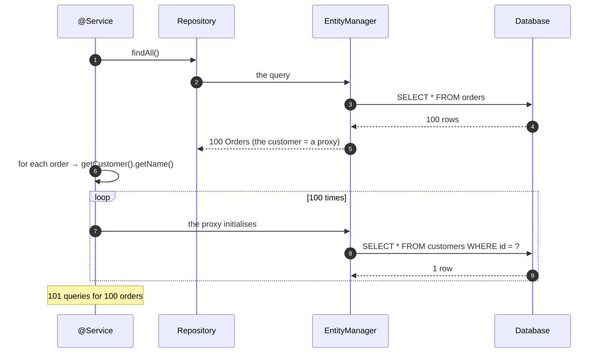
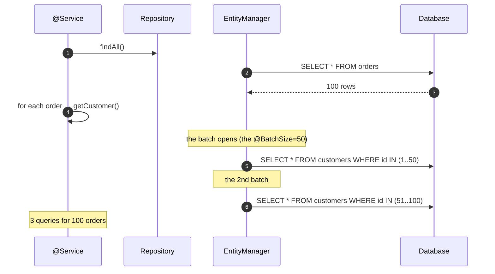
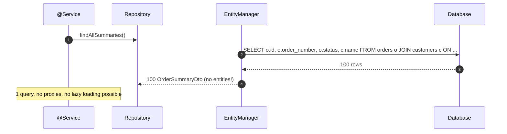

# 04 · Caching, Fetch Strategies & the N+1 Problem

> **Level:** Intermediate → Advanced
> **Interview Frequency:** ★★★★★ ("How do you fix the N+1?" is asked in **every** interview)
> **Prerequisite:** [03 · Entity Lifecycle & Mappings](./03-Entity-Lifecycle-and-Mappings.md)
> **Last Updated:** 2026

---

## 📋 Table of Contents
- [0. TL;DR — The 30-Second Answer](#0-tldr--the-30-second-answer)
- [1. What & Why](#1-what--why)
- [2. Mental Model — Where Does the Data Come From?](#2-mental-model--where-does-the-data-come-from)
- [3. Deep Dive — Theory](#3-deep-dive--theory)
- [4. Internal Working Mechanism](#4-internal-working-mechanism)
- [5. Step-by-Step Execution Flow](#5-step-by-step-execution-flow)
- [6. Architecture Diagrams](#6-architecture-diagrams)
- [7. Production-Level Use Cases](#7-production-level-use-cases)
- [8. Code Examples — Production-Grade](#8-code-examples--production-grade)
- [9. Common Mistakes & Gotchas](#9-common-mistakes--gotchas)
- [10. Performance Considerations](#10-performance-considerations)
- [11. Security Considerations](#11-security-considerations)
- [12. Best Practices — The Checklist](#12-best-practices--the-checklist)
- [13. Hands-On Exercises](#13-hands-on-exercises)
- [14. Code Challenges](#14-code-challenges)
- [15. Scenario-Based Questions](#15-scenario-based-questions)
- [16. Interview Q&A — Level-wise](#16-interview-qa--level-wise)
- [17. Counter-Questions & Traps](#17-counter-questions--traps)
- [18. Tricky Interview Questions](#18-tricky-interview-questions)
- [19. Follow-Up Questions Asked by Interviewers](#19-follow-up-questions-asked-by-interviewers)
- [20. Real 3–5 Year Experience Scenarios](#20-real-35-year-experience-scenarios)
- [21. Frequently Asked Production Issues](#21-frequently-asked-production-issues)
- [22. Debugging Scenarios](#22-debugging-scenarios)
- [23. Architecture Design Questions](#23-architecture-design-questions)
- [24. Rapid-Fire MCQs](#24-rapid-fire-mcqs)
- [25. Cheat Sheet — One-Page Summary](#25-cheat-sheet--one-page-summary)
- [26. Real-World Production Notes](#26-real-world-production-notes)
- [27. Follow-up Learning](#27-follow-up-learning)

---

## 0. TL;DR — The 30-Second Answer

- **The N+1:** one query to load the parents + one query per parent for the children. The
  classic symptom: **the response time grows linearly with the number of rows**.
- **The causes:** the **lazy loading** accessed in a loop, the **serialisation of the entities**
  (not the DTOs), the **to-one** associations accessed per row, the **Specification** queries
  (the fetch isn't controlled), the **DTO mapping** that touches the lazy fields.
- **The fixes (in the order of preference):**
  1. **The DTO projection** (the interface/record projection) — the best: no entities, no
     proxies, one query.
  2. **The `@EntityGraph`** (the attributePaths) — one query with the join.
  3. **`join fetch` in the JPQL** — one query with the join (the pagination caveat).
  4. **The `@BatchSize`** / `hibernate.default_batch_fetch_size` — the batched lazy loading
     (1 + 1 instead of 1 + N).
  5. **`@Fetch(FetchMode.SUBSELECT)`** — one subselect for all the parents.
  6. **The entity graphs** (the Hibernate 6.3+ programmatic API) — the dynamic fetch plans.
- **The three cache levels:**
  - **L1** — the persistence context (the transaction scope): the identity map + the dirty
    checking. Not a performance cache you control.
  - **L2** — the Hibernate region cache (the `SessionFactory` scope): the entities and the
    query results. Off by default; the invalidation is **not cluster-aware**.
  - **L3** — the app-level cache (the Redis): the cross-instance, the explicit invalidation.
- **The L2 is risky:** the stale data in a cluster (the invalidation doesn't cross the
  instances), the memory, the serialisation cost. **The Redis with the explicit invalidation**
  is the modern answer.
- **The `@Cacheable`/`@CacheEvict`** (the Spring's cache abstraction) sits at the **service**
  layer — the clean boundary for the application caching.
- **The query cache** (the L2's query cache) caches the **query results** (the ids) — the
  combined with the entity cache, it can return the **stale entities**.

---

## 1. What & Why

The N+1 is the most common performance problem in a JPA application and the most commonly
misdiagnosed. It's also the one where the **interview answer matters the most**, because the
good candidates don't just say "use `join fetch`" — they explain **why** it happened, **how to
detect** it, **how to fix** it properly, and **what the trade-offs** are.

---

## 2. Mental Model — Where Does the Data Come From?

```text
  A request needs 10 orders + their customers + their lines.

  ┌───────────────────────────────────────────────────────────────────┐
  │ THE DATA SOURCE LADDER (from the cheapest to the most expensive) │
  └───────────────────────────────────────────────────────────────────┘

  ① The persistence context (L1)
       → the same transaction, the same id → 0 queries
       ⚠ only within a transaction

  ② The Hibernate L2 region
       → the entity was cached → 0 queries
       ⚠ the invalidation isn't cluster-aware

  ③ The app cache (Redis) / the Spring @Cacheable
       → the whole response/DTO is cached → 0 queries
       ✓ the explicit invalidation, the cross-instance

  ④ The join fetch / the entity graph
       → 1 query, the joined data

  ⑤ The batched lazy loading (@BatchSize)
       → 1 + 1 queries

  ⑥ The plain lazy loading
       → 1 + N queries  ← the N+1
```

> **Caption:** Every fix is essentially "move the data one rung up the ladder". The best fix is
> the one that also makes the **code** simpler (the DTO projection).

---

## 3. Deep Dive — Theory

### 3.1 The N+1 — the anatomy

```java
@Entity
class Order {
    @ManyToOne(fetch = LAZY) Customer customer;
    @OneToMany(mappedBy = "order") List<OrderLine> lines;
}
```

```java
List<Order> orders = orderRepository.findAll();   // 1 query
for (Order order : orders) {
    order.getCustomer().getName();                 // +1 query per order
    order.getLines().size();                       // +1 query per order
}
```

**The SQL:**
```sql
select ... from orders;                    -- 1
select ... from customers where id = 1;     -- 2
select ... from order_lines where order_id = 1;  -- 3
select ... from customers where id = 2;     -- 4
select ... from order_lines where order_id = 2;  -- 5
...                                        -- 1 + 2N queries
```

**The complexity:** for N orders with 2 lazy collections → **1 + 2N** queries. For 1000 orders
→ 2001 queries. The round trips dominate the latency (each ~0.5–2ms) → the 1000 orders take
2 seconds, while the actual data transfer is 50ms.

**The key insight:** the N+1 is a **round-trip** problem, not a CPU problem. The DB does the
work fast; the **network latency** kills you.

### 3.2 The most common causes

| # | The cause | The symptom |
|---|-----------|-------------|
| 1 | **The entity serialised directly** (not the DTO) | The Jackson serialisation triggers the lazy loading (the `getX()` calls) |
| 2 | **The lazy access in the service loop** | The obvious one |
| 3 | **The `Specification`/the `Example`** | The fetch isn't controlled → the N+1 stays |
| 4 | **The `Page` with the `join fetch`** | The in-memory pagination (and the N+1 for the second level) |
| 5 | **The `to-one` association** | One query per row (the classic) |
| 6 | **The `@ElementCollection`** | Eager by default → the always-expensive query |
| 7 | **The `Map`/`Set` collection** | The N+1 for the collection load |
| 8 | **The batch endpoints** (the N entities in a loop, each with the associations) | The "the API takes 5 seconds for 100 items" |
| 9 | **The `toString()`/`equals()`/`hashCode()`** | The lazy load in the `equals` (the `Set` membership check!) |
| 10 | **The logging of the entity** (`log.info("order: {}", order)`) | The `toString` → the lazy load (and the huge logs) |

### 3.3 The DTO projection — the best fix

```java
public interface OrderSummary {
    Long getId();
    String getOrderNumber();
    OrderStatus getStatus();
    BigDecimal getTotalAmount();
    String getCustomerName();       // the nested property → the join
}
```

```java
public interface OrderRepository extends JpaRepository<Order, Long> {

    @Query("""
           select new com.acme.dto.OrderSummaryDto(
               o.id, o.orderNumber, o.status, o.totalAmount, c.name)
           from Order o
           join o.customer c
           """)
    List<OrderSummaryDto> findAllSummaries();
}
```

**The interface projection (the Spring Data "the proxy over the result set"):**
```java
@Query("select o.id as id, o.orderNumber as orderNumber, c.name as customerName from Order o join o.customer c")
List<OrderSummary> findAllProjected();
```
> The interface projection uses a **proxy** that reads the values from the result set lazily
(the `getCustomerName()` triggers the row read) — the **DTO record** projection is the
recommended one (the values are extracted eagerly, no proxy).

**Why the projection is the best fix:**
1. **One query**, no N+1.
2. **No entities loaded** → no proxies, no snapshots, no dirty checking → less memory, less CPU.
3. **Only the needed columns** → less I/O, less network.
4. **The DTO is the API contract** → the entity changes don't break the API.

### 3.4 The `@EntityGraph` — the declarative fetch plan

```java
@EntityGraph(attributePaths = {"customer", "lines"})
List<Order> findByStatus(OrderStatus status);
```

**The entity graph vs the `join fetch`:**
| The aspect | The `@EntityGraph` | The `join fetch` |
|-----------|---------------------|------------------|
| The placement | On the repository method | In the JPQL |
| The reuse | The named graph (a constant) | The query |
| The pagination | **Safe** (it uses a second query for the data) | **Broken** (the in-memory pagination) |
| The joins | The optimiser decides (the join fetch for the to-one, the select for the to-many) | Always a join |
| The filter | The graph applies to the query's conditions | n/a |

**The named (the reusable) entity graph:**
```java
@Entity(name = "Order.customerGraph")
public class Order { ... }

@EntityGraph(attributePaths = "customer", name = "Order.customerGraph")
List<Order> findByStatus(OrderStatus status);
```

**The dynamic (the programmatic) entity graph (Hibernate 6.3+):**
```java
EntityGraph<Order> graph = em.createEntityGraph(Order.class);
graph.addAttributeNodes("customer");
Subgraph<OrderLine> lines = graph.addSubgraph("lines");
lines.addAttributeNodes("product");

Map<String, Object> hints = new HashMap<>();
hints.put("jakarta.persistence.fetchgraph", graph);
em.find(Order.class, 1L, hints);
```

**The `fetchgraph` vs the `loadgraph`:**
- The **fetchgraph** = "load **only** these attributes" (the others are lazy) — the precise
  control.
- The The **loadgraph** = "load these attributes **eagerly**" (the others keep their mapping
defaults).

### 3.5 The `join fetch` — and the pagination trap

```java
@Query("select distinct o from Order o join fetch o.lines where o.status = :status")
List<Order> findByStatusWithLines(@Param("status") OrderStatus status);
```

**The pagination trap:**
```java
@Query("select o from Order o join fetch o.lines")
Page<Order> findAllWithLines(Pageable pageable);   // ⚠ BROKEN
```
**What happens:** the DB applies the limit to the **joined** rows (the order × lines) → the
pagination is over the rows, not the orders → the page returns fewer/more orders and the count
is wrong. Hibernate logs the `HHH000104: firstResult/maxResults specified with collection
fetch; applying in memory` and does the pagination **in memory** (a full result set in the heap
→ the OOM risk).

**The fixes:**
1. **The `@EntityGraph`** (the two-query approach: the count + the data with the join) —
   **the recommended**.
2. **The two-step pagination** (the ids first, then the fetch):
   ```java
   @Query("select o.id from Order o where o.status = :status")
   Page<Long> findIdsByStatus(@Param("status") OrderStatus status, Pageable pageable);

   @Query("select distinct o from Order o join fetch o.lines where o.id in :ids")
   List<Order> findWithLinesByIds(@Param("ids") List<Long> ids);
   ```
3. **The subquery pagination** (the JPA 3.1's `treat`/the CTE):
   ```java
   @Query("""
          select o from Order o
          where o.id in (
              select o2.id from Order o2 where o2.status = :status
          )
          """)
   ```

**The `distinct`:** the `join fetch` of a to-many **duplicates the parent rows** (one per
child) → the `distinct` is needed (in the JPQL). The **SQL** does the `distinct` on the
selected columns — but with the pagination, the `distinct` + the limit in the SQL is the
problem (the DB applies the limit to the distinct rows... it depends on the DB: Postgres applies
the limit after the distinct → it's actually correct in Postgres, but the join fetch + the
pagination in Hibernate still triggers the in-memory warning).

### 3.6 The `@BatchSize` — the batched lazy loading

```java
@OneToMany(mappedBy = "order")
@BatchSize(size = 50)
private List<OrderLine> lines;
```

**Or globally:**
```properties
spring.jpa.properties.hibernate.default_batch_fetch_size=50
```

**The SQL:**
```sql
select ... from orders;                                    -- 1
select ... from order_lines where order_id in (?,?,?,...);  -- 2 (50 ids)
```

**The trade-offs:**
- The `IN` clause with 50 parameters (the DB's parameter limit — the Oracle's 1000, the SQL
  Server's 2100).
- The batched query loads the entities that **might not be needed** (if only 3 of the 50
  parents' collections are accessed, the other 47 are loaded too — the over-fetching).
- The `@BatchSize` only works for the **direct** associations (the "the nested path" needs
  `@BatchSize` on each level or the `@Fetch(SUBSELECT)`).

**The `@BatchSize` on a nested path:**
```java
@OneToMany(mappedBy = "order")
@BatchSize(size = 50)
private List<OrderLine> lines;

@ManyToOne
@BatchSize(size = 50)
private Product product;
```

### 3.7 The `@Fetch(FetchMode.SUBSELECT)`

```java
@OneToMany(mappedBy = "order")
@Fetch(FetchMode.SUBSELECT)
private List<OrderLine> lines;
```

**The SQL:**
```sql
select ... from orders;                                     -- 1
select ... from order_lines where order_id in (select id from orders);  -- 2
```

**The difference from the `@BatchSize`:** the subselect loads the children for **all** the
parents in the session (not just the accessed ones) → the over-fetching is bigger, but the
query count is always 2 (even if the collections aren't accessed). The `@BatchSize` is the
better default in Hibernate 6 (the smarter batching).

### 3.8 The Hibernate 6.3+ entity graphs — the "the stateless session"

```java
StatelessSession session = sf.openStatelessSession();
session.setJdbcFetchSize(100);

List<Order> orders = session.createQuery("from Order", Order.class)
                              .setHint("jakarta.persistence.fetchgraph", graph)
                              .getResultList();
```

**The `StatelessSession` + the entity graph** = the **bulk read** without the persistence
context overhead: no dirty checking, no identity map, one query, the fetch plan applied.

### 3.9 The L1 — the persistence context (the "first-level cache")

**What it is:** the entities loaded in the current session.

**What it does:**
- The **identity map** (the same id → the same object).
- The **dirty checking** (the automatic updates).
- The **de-duplication**: the repeated `findById` in the same transaction → one query.

**Why it's not a "cache" you can rely on:**
- The scope is the **transaction** — a new transaction = a new context = a fresh load.
- It **doesn't** help across the requests.
- It can **hide** the N+1 in the tests: the same transaction loads the entity once → the
  second access is free → the query count in the test looks better than in production.

**The trap in the tests:** a `@DataJpaTest` is transactional → the test's transaction rolls
back → the N+1 is masked. **The fix:** the `TestTransaction`/`@Commit`/the
`@Transactional(propagation = NOT_SUPPORTED)` for the performance tests.

### 3.10 The L2 — the Hibernate region cache

```properties
spring.jpa.properties.hibernate.cache.use_second_level_cache=true
spring.jpa.properties.hibernate.cache.region.factory_class=org.hibernate.cache.ehcache.EhCacheRegionFactory
```

```java
@Entity
@Cacheable
@Cache(usage = CacheConcurrencyStrategy.READ_WRITE)
public class Product { ... }
```

**The strategies:**
| The strategy | The behaviour | The use |
|-------------|---------------|---------|
| `READ_ONLY` | The immutable entities (never updated) | The reference data, the catalogue |
| `NONSTRICT_READ_WRITE` | The soft lock on the update | Rare |
| `READ_WRITE` | The soft lock (the read lock on the miss, the write lock on the update) | The general case |
| `TRANSACTIONAL` | The JTA-aware (the full invalidation) | The JTA, the strict consistency |

**The query cache** (a separate flag):
```properties
spring.jpa.properties.hibernate.cache.use_query_cache=true
```
It caches the **query results** (the entity ids + the timestamps) → the query returns the ids
from the cache → the entities come from the entity cache (or the DB). **The danger:** the
**stale timestamp** check (the query cache's `TimestampsCache`) — the query's result is
considered fresh if none of the tables' timestamps changed. With the **bulk JPQL updates** (which
don't update the timestamps), the query cache returns the **stale** results.

**The L2's problems:**
1. **The cluster-awareness**: the invalidation is **per JVM** — instance A updates the entity
   and evicts its own cache; instance B still has the stale entry → **the inconsistent reads
   across the instances**. (The fix: the distributed cache (the Infinispan/JCache/Terracotta)
   or the Redis with the manual invalidation, or the "the TTL" as the safety net.)
2. **The memory**: the entities are stored in the heap (the serialised form) — the eviction
   policy, the `maxBytesLocalHeap`.
3. **The serialisation cost**: the entities are serialised/deserialised → the CPU.
4. **The observability**: the cache hit ratio per region.

**The modern recommendation:** the L2 for the **truly static reference data** (the countries,
the currency rates — with a `READ_ONLY` strategy and a TTL) and the **Redis** for everything
else.

### 3.11 The app-level cache — the Redis

```java
@Service
@RequiredArgsConstructor
public class ProductService {

    private final ProductRepository productRepository;
    private final ProductCache productCache;   // the Redis wrapper

    @Transactional(readOnly = true)
    public ProductResponse get(Long id) {
        return productCache.get(id)
                .orElseGet(() -> {
                    Product product = productRepository.findById(id)
                            .orElseThrow(() -> new ProductNotFoundException(id));
                    ProductResponse response = mapper.toResponse(product);
                    productCache.put(id, response);
                    return response;
                });
    }
}
```

**The cache-aside pattern:**
```text
  ① Read the cache
  ② The miss → read the DB → write the cache → return
  ③ The write → update the DB → invalidate (or update) the cache
```

**The invalidation** — the hard part:
- **The TTL only** (the simple, the eventual consistency). E.g. 5 minutes.
- **The event-driven invalidation** (the domain events → the cache eviction).
- **The versioned keys** (the "the cache key includes the entity's version" → the old entries
  expire naturally).
- **The write-through** (the cache is updated with the write).

### 3.12 The Spring's `@Cacheable` — the service-level cache

```java
@Service
public class ProductService {

    @Cacheable(value = "products", key = "#id")
    @CacheEvict(value = "products", key = "#product.id")
    @Transactional
    public Product update(Product product) { ... }
}
```

**The options:**
- `key` — the SpEL expression (the default: the method's arguments).
- `unless` — a condition (the null result isn't cached: `unless = "#result == null"`).
- `condition` — a condition on the input.
- `@Caching` — multiple the operations.
- **`sync = true`** — the cache stampede protection (a single loader thread; the others wait).
- The `CacheManager` — the Redis (the `RedisCacheManager`), the Caffeine (the local), the
  composite (the local L1 + the Redis L2).

**The Spring Boot 3.x setup:**
```java
@Bean
public RedisCacheManagerBuilderCustomizer cacheManagerCustomizer() {
    return builder -> builder
            .withCacheConfiguration("products",
                RedisCacheConfiguration.defaultCacheConfig()
                    .entryTtl(Duration.ofMinutes(5))
                    .disableCachingNullValues()
                    .serializeValuesWith(RedisSerializationContext.SerializationPair
                        .fromSerializer(new GenericJackson2JsonRedisSerializer())));
}
```

**The pitfalls:**
- **The self-invocation** — `@Cacheable` on a method called from within the same bean → the
  proxy isn't applied → **no caching**. (The same proxy problem as the `@Transactional`.)
- **The cache stampede** — the key expires under the load → the thundering herd → `sync = true`
  or the distributed lock.
- **The stale data** — the eviction is missing for a write path.
- **The `@Cacheable` on a method with a `@Transactional`** — the order of the proxies matters
  (the cache is populated **before** the commit → the cache holds the uncommitted data; and
  with the `sync=true`, the transaction holds the lock).

---

## 4. Internal Working Mechanism

### 4.1 The loader selection (Hibernate 6)

```text
  the entity load
    │
    ├─ the entity is in the persistence context? → RETURN (no SQL)
    │
    ├─ the association is EAGER and the optimiser chose a join?
    │     → the join in the parent's query
    │
    ├─ the association has @BatchSize and a batch is "open"?
    │     → SELECT ... WHERE id IN (the batch)
    │
    ├─ the association has @Fetch(SUBSELECT)?
    │     → SELECT ... WHERE parent_id IN (the loaded parents)
    │
    └─ otherwise → the single load (the N+1)
```

**The "batch window":** the `@BatchSize` uses a **"the batch is open"** heuristic: the batch is
opened when a load happens and closed at the end of the transaction (or after the batch's
"timeout"). Hibernate 6.2+ improved this (the "the batch is closed when the query space
changes").

### 4.2 The `LoadEventListener` — the internals

```text
  DefaultLoadEventListener
    ├─ onLoad(LoadEvent)
    │     ├─ the "load from the cache" (the L2)
    │     ├─ the "load from the persistence context" (the L1)
    │     ├─ the "load from the second-level cache" (again)
    │     └─ the "load from the DB" (the Loader)
    │           ├─ the single loader
    │           ├─ the batch loader (the IN query)
    │           ├─ the collection loader
    │           └─ the subselect loader
    └─ the proxy creation (the lazy, for the to-one)
```

### 4.3 The query plan cache

```text
  HQL/JPQL
     │  (the HQL → the AST)
     ▼
  the QueryPlanCache
     ├─ the SQM tree (the semantic model)
     ├─ the SQL (the translated)
     ├─ the loader plan (the joins, the fetches, the batch sizes)
     └─ the "the query space" (the tables the query touches — the auto-flush's decision)
```

**The "the query space"** is why the auto-flush can decide whether to flush before a query.

### 4.4 The statistics — the N+1 detector

```java
Statistics stats = sessionFactory.getStatistics();
stats.setStatisticsEnabled(true);
stats.clear();

// ... the operation ...

stats.getQueryExecutionCount();        // the total
stats.getEntityLoadCount();            // the entity loads (the N+1's signature)
stats.getCollectionLoadCount();        // the collection loads
stats.getEntityFetchCount();           // the eager fetches
stats.getFlushCount();
stats.getQueryExecutionMaxTime();
```

**The N+1's signature in the statistics:** `queryExecutionCount` grows with the row count
while `entityLoadCount` is high.

### 4.5 The `@BatchSize`'s batch management

```text
  the BatchSizeHelper
    ├─ the current batch (the list of the pending ids for the entity type)
    ├─ the batch size (from the annotation or the global setting)
    └─ the "the batch is closed":
         ├─ the batch is full (the size reached)
         ├─ the query space changes (a different table)
         ├─ the transaction ends
         └─ the "the batch timeout" (Hibernate 6.2+: the idle time)
```

---

## 5. Step-by-Step Execution Flow

### 5.1 The N+1 flow



### 5.2 The batched flow



### 5.3 The DTO projection flow



---

## 6. Architecture Diagrams

### 6.1 The caching architecture (the full picture)

```text
   ┌──────────────┐
   │   Client     │
   └──────┬───────┘
          ▼
   ┌──────────────────────────────────────────────────────────────┐
   │  THE APP LAYER                                               │
   │  ┌────────────────┐   ┌────────────────┐   ┌──────────────┐  │
   │  │ @Cacheable     │   │ The service    │   │ The DTO      │  │
   │  │ (the Redis)    │   │                │   │ mapping      │  │
   │  └───────┬────────┘   └───────┬────────┘   └──────────────┘  │
   │          │                    │                               │
   │  ┌───────▼────────────────────▼─────────┐                     │
   │  │  THE PERSISTENCE CONTEXT (L1)         │                     │
   │  │  the identity map + the dirty check   │                     │
   │  └───────┬────────────────────┬─────────┘                     │
   │          │                    │                               │
   │  ┌───────▼─────────┐  ┌───────▼──────────┐                   │
   │  │ THE L2 REGION   │  │  THE DB          │                   │
   │  │ (the Hibernate) │  │  (the buffer     │                   │
   │  │ ⚠ not cluster- │  │   cache = L3)    │                   │
   │  │   aware        │  └──────────────────┘                   │
   │  └─────────────────┘                                        │
   └──────────────────────────────────────────────────────────────┘
```

### 6.2 The fix decision tree

```text
  "There's an N+1"
        │
        ▼
  ┌─────────────────────────────────────────────┐
  │ Do I need the entities, or just the data?   │
  └───────────┬───────────────────┬─────────────┘
              │                   │
       just the data          the entities
              │                   │
              ▼                   ▼
   ┌────────────────────┐  ┌──────────────────────────┐
   │ THE DTO PROJECTION │  │ Is it a single entity     │
   │ (the best fix)     │  │ (findById)?              │
   │ - one query        │  └────┬────────────────┬────┘
   │ - no proxies       │       │                │
   │ - no snapshots     │    single            a list
   │ - less I/O         │       │                │
   └────────────────────┘       ▼                ▼
                          ┌───────────┐   ┌─────────────────────┐
                          │@EntityGraph│   │ Is the collection   │
                          │ (the join) │   │ needed for the list?│
                          └───────────┘   └────┬────────────┬────┘
                                               │            │
                                           yes │            │ no
                                               ▼            ▼
                                      ┌─────────────┐  ┌──────────────┐
                                      │ @EntityGraph │  │ the plain    │
                                      │ + the paging │  │ query (the   │
                                      │ (the 2-query)│  │ lazy is fine)│
                                      └─────────────┘  └──────────────┘
```

### 6.3 The cache consistency matrix

```text
  ┌──────────────────┬────────────┬──────────────┬──────────────┬───────────┐
  │ The mechanism    │ The scope  │ The cross-   │ The staleness │ The ops   │
  │                  │            │ instance     │              │           │
  ├──────────────────┼────────────┼──────────────┼──────────────┼───────────┤
  │ The L1 (the ctx) │ the txn    │ n/a          │ none (the    │ free      │
  │                  │            │              │ session)     │           │
  ├──────────────────┼────────────┼──────────────┼──────────────┼───────────┤
  │ The L2 (Hibernate)│ the app   │ ⚠ NO        │ until the    │ free      │
  │                  │            │              │ eviction     │           │
  ├──────────────────┼────────────┼──────────────┼──────────────┼───────────┤
  │ The Redis        │ the cluster│ ✓ YES       │ the TTL /    │ 1 network │
  │                  │            │              │ the explicit │ per op    │
  │                  │            │              │ invalidation │           │
  ├──────────────────┼────────────┼──────────────┼──────────────┼───────────┤
  │ The CDN          │ the world  │ ✓ YES       │ the TTL      │ 1 edge    │
  │                  │            │              │              │ request   │
  └──────────────────┴────────────┴──────────────┴──────────────┴───────────┘
```

---

## 7. Production-Level Use Cases

| Use case | The technique |
|----------|---------------|
| **A list endpoint with the associations** | The DTO projection (one query) |
| **A detail endpoint with the deep graph** | The `@EntityGraph` or the `join fetch` |
| **A paginated list with a collection** | The `@EntityGraph` (the 2-query) — never the `join fetch` + the `Pageable` |
| **A hot reference data** (the countries, the categories) | The L2 `READ_ONLY` or the Redis |
| **A high-read product page** | The Redis with the event-driven invalidation |
| **A bulk export** | The DTO projection + the `StatelessSession` |
| **A hot config** | The `@ConfigurationProperties` + the refresh (the Spring Cloud's `@RefreshScope`) |
| **A static frontend asset** | The CDN (not the app) |
| **A search result** | The Elasticsearch (a different data model — the denormalised) |
| **A dashboard's aggregate** | The pre-computed table (the materialised view) |

---

## 8. Code Examples — Production-Grade

### 8.1 The DTO projection (the recommended fix)

```java
public record OrderSummaryDto(
        Long id,
        String orderNumber,
        OrderStatus status,
        BigDecimal totalAmount,
        String customerName,
        int lineCount) {
}
```

```java
public interface OrderRepository extends JpaRepository<Order, Long> {

    @Query("""
           select new com.acme.dto.OrderSummaryDto(
               o.id,
               o.orderNumber,
               o.status,
               o.totalAmount,
               c.name,
               (select count(l) from OrderLine l where l.order = o)
           )
           from Order o
           join o.customer c
           where o.status = :status
           """)
    List<OrderSummaryDto> findSummariesByStatus(@Param("status") OrderStatus status);
}
```

> **The interface projection** (the alternative — the Spring Data's proxy):
> ```java
> public interface OrderSummary {
>     Long getId();
>     String getOrderNumber();
>     String getCustomerName();
> }
>
> @Query("select o.id as id, o.orderNumber as orderNumber, c.name as customerName from Order o join o.customer c")
> List<OrderSummary> findAllSummaries();
> ```
> The **DTO record** is preferred (the values are extracted eagerly, no proxy overhead).

### 8.2 The `@EntityGraph` with the pagination (the safe combination)

```java
public interface OrderRepository extends JpaRepository<Order, Long> {

    @EntityGraph(attributePaths = {"customer", "lines"})
    @Query("select o from Order o where o.status = :status")
    Page<Order> findByStatus(@Param("status") OrderStatus status, Pageable pageable);

    @EntityGraph(attributePaths = {"customer"})
    @Query("select o from Order o")
    Slice<Order> findAllSlice(Pageable pageable);
}
```

**The rule:** the `@EntityGraph` + the `Pageable` is **safe** (Hibernate uses the two-query
approach: the count + the data with the join). The `join fetch` + the `Pageable` is **not**.

### 8.3 The global batch size

```properties
spring.jpa.properties.hibernate.default_batch_fetch_size=50
spring.jpa.properties.hibernate.jdbc.batch_size=50
spring.jpa.properties.hibernate.order_inserts=true
spring.jpa.properties.hibernate.order_updates=true
```

### 8.4 The service with the cache-aside + the event-driven invalidation

```java
@Service
@RequiredArgsConstructor
public class ProductService {

    private static final String KEY = "product::";

    private final ProductRepository productRepository;
    private final StringRedisTemplate redis;
    private final ApplicationEventPublisher eventPublisher;

    @Transactional(readOnly = true)
    public ProductResponse getById(Long id) {
        String cached = redis.opsForValue().get(KEY + id);
        if (cached != null) {
            return deserialize(cached);
        }

        Product product = productRepository.findById(id)
                .orElseThrow(() -> new ProductNotFoundException(id));

        ProductResponse response = ProductResponse.from(product);
        redis.opsForValue().set(KEY + id, serialize(response), Duration.ofMinutes(10));
        return response;
    }

    @Transactional
    public ProductResponse update(UpdateProductCommand command) {
        Product product = productRepository.findById(command.id())
                .orElseThrow(() -> new ProductNotFoundException(command.id()));

        product.update(command.name(), command.price());

        // The invalidation is published after the commit (see below)
        eventPublisher.publishEvent(new ProductChangedEvent(product.getId()));
        return ProductResponse.from(product);
    }
}
```

### 8.5 The transactional event listener (the invalidation after the commit)

```java
@Component
@RequiredArgsConstructor
public class CacheInvalidationListener {

    private final StringRedisTemplate redis;

    @TransactionalEventListener(phase = TransactionPhase.AFTER_COMMIT)
    public void onProductChanged(ProductChangedEvent event) {
        redis.delete("product::" + event.productId());
    }
}
```

> **The critical detail:** the invalidation happens **after the commit** — if the transaction
rolls back, the cache isn't invalidated (and the stale data is correct). The
`@TransactionalEventListener` with the `AFTER_COMMIT` phase is the production pattern.
(For the distributed case: the event is published to a message broker, and each instance
invalidates its local cache.)

### 8.6 The Spring's `@Cacheable` with the stampede protection

```java
@Service
public class CategoryService {

    @Cacheable(value = "categories", key = "#id", sync = true,
               unless = "#result == null")
    public CategoryResponse get(Long id) {
        return categoryRepository.findById(id)
                                .map(CategoryResponse::from)
                                .orElse(null);
    }

    @CacheEvict(value = "categories", key = "#id")
    @Transactional
    public void update(Long id, UpdateCategoryCommand command) { ... }
}
```

### 8.7 The `StatelessSession` for the bulk export (no N+1 possible)

```java
@Component
@RequiredArgsConstructor
public class OrderExporter {

    private final EntityManagerFactory emf;

    public void export(Writer writer) throws IOException {
        SessionFactory sf = emf.unwrap(SessionFactory.class);
        try (StatelessSession session = sf.openStatelessSession()) {
            session.setJdbcFetchSize(500);

            ScrollableResults<Order> results = session
                    .createQuery("""
                            select o from Order o
                            join fetch o.customer
                            """, Order.class)
                    .scroll(ScrollMode.FORWARD_ONLY);

            while (results.next()) {
                writer.write(toCsv(results.get()));
            }
        }
    }
}
```

### 8.8 The N+1 detector in the tests (the query-count assertion)

```java
@DataJpaTest
class OrderRepositoryQueryCountTest {

    @Autowired OrderRepository orderRepository;
    @Autowired EntityManagerFactory emf;

    @Test
    @Transactional(propagation = Propagation.NOT_SUPPORTED)   // ⚠ no transaction → no L1 masking
    void findSummaries_doesNotTriggerNPlusOne() {
        orderRepository.saveAll(seedOrders(50));

        Statistics stats = emf.getSessionFactory().getStatistics();
        stats.setStatisticsEnabled(true);
        stats.clear();

        List<OrderSummaryDto> summaries = orderRepository.findSummariesByStatus(OrderStatus.PAID);

        assertThat(summaries).hasSize(50);
        assertThat(stats.getQueryExecutionCount())
                .as("the query count must not scale with the row count")
                .isEqualTo(1);
    }
}
```

> **The critical detail:** `@DataJpaTest` is transactional → the test's transaction rolls back
→ the **L1 masks the N+1** (the second access to the entity is free). The
`propagation = NOT_SUPPORTED` (or the `TestTransaction`) removes the transaction → the test
reflects the production behaviour.

### 8.9 The `datasource-proxy` in the dev profile (the query count per request)

```yaml
# application-dev.yml
spring:
  datasource:
    url: jdbc:postgresql://localhost:5432/app
  jpa:
    properties:
      hibernate:
        format_sql: true

# The net.ttddyy:datasource-proxy (the starter)
datasource-proxy:
  enabled: true
  log-format: "%d %t %m"
  query-count-enabled: true
```

### 8.10 The Redis cache configuration (Spring Boot 3.x)

```java
@Configuration
@EnableCaching
public class CacheConfig {

    @Bean
    public RedisCacheManagerBuilderCustomizer cacheManagerCustomizer() {
        return builder -> builder
                .withCacheConfiguration("products",
                        RedisCacheConfiguration.defaultCacheConfig()
                                .entryTtl(Duration.ofMinutes(10))
                                .disableCachingNullValues()
                                .prefixCacheNameWith("app:")
                                .serializeValuesWith(
                                    RedisSerializationContext.SerializationPair.fromSerializer(
                                        new GenericJackson2JsonRedisSerializer())))
                .withCacheConfiguration("categories",
                        RedisCacheConfiguration.defaultCacheConfig()
                                .entryTtl(Duration.ofHours(24)));
    }
}
```

### 8.11 The N+1 fix for a "the batch endpoint"

```java
// ❌ The N+1 version
@GetMapping("/orders")
public List<OrderResponse> getOrders() {
    return orderRepository.findAll().stream()
            .map(o -> new OrderResponse(o.getId(), o.getCustomer().getName()))
            .toList();
}

// ✅ The projection version
@GetMapping("/orders")
public List<OrderSummaryDto> getOrders() {
    return orderRepository.findSummariesByStatus(OrderStatus.PAID);
}
```

---

## 9. Common Mistakes & Gotchas

| # | ❌ Wrong | ✅ Right | Why |
|---|----------|----------|-----|
| 1 | The `join fetch` + the `Pageable` | The `@EntityGraph` | The in-memory pagination |
| 2 | The entity serialised directly | The DTO | The lazy loading during the serialisation |
| 3 | The `Specification` without the fetch control | The projection or the `@EntityGraph` | The N+1 stays |
| 4 | The `EAGER` on the one-to-one/element collection | The `LAZY` explicitly | The always-expensive queries |
| 5 | The `@Cacheable` on a self-invoked method | The proxy-safe design (the separate bean) | The proxy isn't applied |
| 6 | The cache invalidation before the commit | The `@TransactionalEventListener(AFTER_COMMIT)` | The stale/rolled-back data |
| 7 | The L2 for the volatile data | The Redis with the explicit invalidation | The cluster-inconsistent reads |
| 8 | The query cache with the bulk updates | Off (or the manual eviction) | The stale results |
| 9 | The `log.info("{}", entity)` | The DTO or the ids | The lazy load + the log bloat |
| 10 | The `@BatchSize` = 1000 | 50–100 | The parameter limits |
| 11 | The N+1 test in a `@DataJpaTest` (the transaction) | The `NOT_SUPPORTED` propagation | The L1 masks the N+1 |
| 12 | The `distinct` forgotten with the to-many join fetch | The `select distinct` | The duplicated rows |
| 13 | The `join fetch` on a paginated list in a `@Query` | The `@EntityGraph` or the two-step | The pagination bug |
| 14 | The cache without a TTL | The TTL + the eviction | The permanent staleness |
| 15 | The `equals`/`hashCode` using the lazy association | The business key | The lazy load (and the N+1!) |
| 16 | The `@Cacheable` on a method with the parameters | The `key` expression | The cache-key collision |
| 17 | The cache of the whole entity (the JPA entity in the Redis) | The DTO | The serialisation + the staleness |
| 18 | The `@BatchSize` on the nested path only | On each level | The N+1 at the deeper level |

---

## 10. Performance Considerations

| Aspect | Impact | Guidance |
|--------|--------|----------|
| **The N+1** | 1 + N queries (the latency dominates) | The projections, the entity graphs, the batching |
| **The round trips** | ~0.5–2ms each (the network) | The batching, the projections |
| **The L1's memory** | The entity + the snapshot per row | The projections (no entities), the `clear()` |
| **The L2's memory** | The serialised entities in the heap | The `maxBytesLocalHeap`, the `READ_ONLY` for the small data |
| **The L2's serialisation cost** | The CPU per hit | The `READ_ONLY` (no serialisation), the Redis's serialisation is explicit |
| **The Redis's latency** | ~0.5ms per op (the network) | The local cache in front (the two-level), the batching (`multiGet`) |
| **The cache stampede** | The DB overload on the expiry | `sync = true`, the distributed lock, the jittered TTL |
| **The over-fetching** | The `@BatchSize` loads the unneeded rows | The right batch size, the projections |
| **The query cache's timestamps** | The extra table updates | Off by default |

---

## 11. Security Considerations

| Risk | Mitigation |
|------|-----------|
| **The cached data crossing the tenants/users** | The tenant/user id in the **cache key** (`product::{tenantId}:{id}`); the cache namespace per environment |
| **The stale authorisation** (the cached entity after the role change) | The short TTL for the permission-sensitive data; the eviction on the role change; don't cache the authorisation decisions for long |
| **The cached PII** | The Redis with the encryption at rest, the access control, the TTL; don't log the cached values |
| **The cache poisoning** (a user caches a huge value) | The value size limits, the serialisation allow-list |
| **The L2's stale authorisation** | The L2 only for the data, not for the decisions; the authorisation is checked after the cache |
| **The Redis's unauthenticated access** | The ACLs, the network isolation, the TLS |

---

## 12. Best Practices — The Checklist

- [ ] **The DTO projections** for the list endpoints (the default).
- [ ] **The `@EntityGraph`** for the detail endpoints (not the `join fetch` + the pagination).
- [ ] **The global `default_batch_fetch_size`** (50).
- [ ] **Everything lazy** by default (the explicit `LAZY` on the one-to-one/element collection).
- [ ] **The DTO mapping inside the transaction** (the service, never the controller).
- [ ] **The query-count assertions** in the tests (the N+1 regression guard).
- [ ] **The `NOT_SUPPORTED` propagation** in the performance tests.
- [ ] **The Redis with the TTL + the `AFTER_COMMIT` invalidation.**
- [ ] **The local (Caffeine) cache in front of the Redis** for the hot keys (the two-level).
- [ ] **The `sync = true`** (or the lock) on the hot cache entries.
- [ ] **The L2 only for the immutable reference data.**
- [ ] **The cache key includes the tenant and the version.**
- [ ] **The `@Cacheable` on a public method of a separate bean** (the proxy).
- [ ] **The never serialise the entity** (the architectural rule).

---

## 13. Hands-On Exercises

**🧪 Lab 1 — Reproduce the N+1**
1. Create an `Order` with a `customer` and 3 `lines`.
2. Save 100 orders.
3. Write a service method that maps the orders to the DTOs, touching the customer and the lines.
4. Enable the SQL logging → count the queries.
5. Fix it with the projection → count again.

**🧪 Lab 2 — The pagination trap**
1. Write `@Query("select o from Order o join fetch o.lines") Page<Order> findAll(Pageable p)`.
2. Look for the `HHH000104` warning in the log.
3. Replace it with the `@EntityGraph` → the warning is gone, the count is correct.

**🧪 Lab 3 — The cache stampede**
1. Configure the Redis cache with a 10-second TTL on a hot key.
2. Fire 200 concurrent requests for the same key just after the expiry.
3. Count the DB queries (the `datasource-proxy`).
4. Add `sync = true` → the count drops to 1.

**🧪 Lab 4 — The L2 staleness**
1. Enable the L2 with the `READ_WRITE` strategy on a `Product`.
2. Start two Spring contexts (two "instances") sharing the DB.
3. Update the product in instance A.
4. Read it in instance B → the stale value (the cluster-unaware invalidation).

---

## 14. Code Challenges

### Challenge 1 — A generic N+1 detector (medium-hard)
**Goal:** A test utility that runs a repository method and asserts the query count doesn't
scale with the data size.
**Requirements:** the Hibernate statistics, the `NOT_SUPPORTED` propagation, the
`@DataJpaTest` base class, the seeding, the assertion helper, and the documentation.

### Challenge 2 — A two-level cache (medium-hard)
**Goal:** A `CacheManager` with the Caffeine in front of the Redis.
**Requirements:** the TTLs (the local is shorter), the invalidation (the local is evicted on the
Redis's event), the stampede protection, the metrics (the hit ratios per level), and the test.

### Challenge 3 — A cache coherence layer (hard)
**Goal:** A generic, event-driven invalidation for the cached aggregates.
**Requirements:** the domain events, the transactional listeners, the outbox (the reliable
publishing), the message broker, the per-instance invalidation, the versioning (the stale
detection), and the test.

---

## 15. Scenario-Based Questions

**S1.** *"The list endpoint takes 3 seconds for 200 items. The DB is idle. Where do you look?"*
>
> **Ideal answer:** (1) **The hypotheses**: (a) the **N+1** (the most likely — the DB is idle
because it's waiting on the round trips, not computing); (b) the **serialisation** of the
entities (the lazy loading during the JSON serialisation); (c) the **chatty DB** (the
connection pool's contention — the pool of 10 with 200 concurrent-ish queries... but the DB is
idle, so no); (d) the **slow query** (the DB is idle → not the DB); (e) the **external calls**
in the mapping (an HTTP call per item!). (2) **The diagnosis**: (a) the **SQL log** (the query
count and the repeated queries — the smoking gun); (b) the **APM's trace** (the spans: the
DB time vs the total — the gap is the network/serialisation); (c) the `datasource-proxy` in
the dev (the query count per request). (3) **The fix**: the **DTO projection** (one query);
if the entities are needed, the `@EntityGraph`; the `@BatchSize` as the quick mitigation. (4)
**The prevention**: (a) the **query-count assertions** in the tests; (b) the **DTO-only**
responses; (c) the **APM's DB span count** as a dashboard metric (the alert on the query count
per request). (5) The senior framing: "the DB is idle + a slow endpoint = a **round-trip
problem**, not a compute problem. The N+1 is the default hypothesis, and the fix is the
**fetch plan** (the projection), not the DB's tuning."

**S2.** *"We enabled the Hibernate L2 cache and now users occasionally see stale prices."*
>
> **Ideal answer:** (1) **The diagnosis**: the L2's invalidation is **per JVM** — instance A
updates the price and evicts its own cache; instance B's cache still holds the old entity →
the **stale read** (the cluster-unaware invalidation). Also: the **query cache** (the stale
timestamps with the bulk updates). (2) **The fix**: (a) **remove the L2 for the mutable
data** — it's the wrong tool; (b) use the **Redis with the explicit invalidation** (the
`AFTER_COMMIT` event listener, the message broker for the multi-instance); (c) the **TTL** as
the safety net (a short TTL bounds the staleness); (d) the **distributed cache** (Infinispan
with the invalidation across the cluster) if the L2 must stay — but the operational complexity
(the network, the partition behaviour) is high. (3) **The deeper analysis**: (a) why was the L2
enabled? (the performance? the "the DB is slow"?) — the goal must be clear before the solution;
(b) the **cache-aside with the explicit invalidation** is the standard production pattern for
the mutable data; (c) the **versioned keys** (the "the price:{id}:v{version}" — the version
comes from the DB) — the old key is never read again. (4) **The prevention**: (a) the
**consistency tests** (the "the update in instance A, the read in instance B" test); (b) the
**monitoring** (the cache hit ratio per key, the staleness incidents); (c) the **documented
staleness SLA** per cache (the business must know "the price can be 30 seconds stale"). (5)
The senior framing: "the L2 is a **local, unaware cache** — using it for the mutable data in a
clustered deployment is an **architectural error**. The Redis with the event-driven
invalidation gives you the **cross-instance coherence** with an explicit, testable contract."

**S3.** *"The cache stampede took down the pricing service. 50k requests hit the DB at once."*
>
> **Ideal answer:** (1) **The diagnosis**: the **thundering herd** — a hot key expires (or is
evicted) and the concurrent requests all miss simultaneously → all query the DB → the DB
saturates → the latency explodes → the retries make it worse (the retry storm). (2) **The
immediate mitigation**: (a) the **jittered TTL** (the random offset) so the keys don't expire
together; (b) the **distributed lock** (the Redis's `SETNX` with a TTL) — one loader, the
others wait; (c) the `sync = true` (the Spring's local single-loader — but it's per JVM, so
it's not enough alone); (d) the **stale-while-revalidate** (the serve the stale value, refresh
in the background); (e) the **circuit breaker** (the Resilience4j) to protect the DB. (3) **The
root cause**: (a) the **no jitter** (all the keys expire at the same instant — the "the
thundering herd at the TTL boundary"); (b) the **no single-flight**; (c) the **the cache
stampede on the eviction** (the same key, the same instant). (4) **The permanent fix**: the
**single-flight** (the lock) + the **jittered TTL** + the **stale-while-revalidate** (the
serving the stale while one request refreshes) + the **the pre-warming** (the refresh before
the expiry) + the **the rate limiting** on the DB path. (5) **The prevention**: (a) the **load
test** with the cache expiry (the "the cold start" scenario — a very common test gap); (b) the
**the monitoring** (the cache hit ratio, the DB's QPS, the "the miss spike" alert); (c) the
**the capacity plan** (the DB can handle the cold-start burst). (6) The senior framing: "a
cache is a **distributed system** — the expiry, the miss, and the refill need the same
rigour as the data path. The stampede is a **capacity** event, not a bug."

---

## 16. Interview Q&A — Level-wise

### 🟢 Beginner
**Q: What is the N+1 problem?**
**A:** When a query loads a list of entities and then, for each entity, another query is issued
to load an associated entity. N+1 queries for N rows — the performance degrades linearly. The
classic example: the list of orders, then one query per order for the customer.

**Q: What is the difference between the `LAZY` and the `EAGER`?**
**A:** `LAZY` → a proxy, the query on the first access. `EAGER` → the association is fetched
with the owner. The default: the `@ManyToOne`/`@OneToOne` → lazy; the `@OneToMany`/
`@ManyToMany` → eager.

**Q: What is the `@BatchSize`?**
**A:** It makes the lazy loading **batched**: instead of one query per parent, the parents'
ids are collected and one `IN` query loads them. It turns 1+N queries into 1+1 (per batch).

### 🟡 Intermediate
**Q: How do you fix the N+1?**
**A:** (1) The **DTO projection** (the best — one query, no entities, no proxies); (2) the
**`join fetch`** / the **`@EntityGraph`** (one query with the join); (3) the **`@BatchSize`**
(the batched lazy loading — 1+1); (4) the **`@Fetch(SUBSELECT)`**. The choice depends on
whether you need the entities or just the data, and on the pagination.

**Q: What is the first-level cache?**
**A:** The persistence context — the entities loaded in the current session. It provides the
**identity map** (the same id → the same object) and the **dirty checking**. Its scope is the
transaction, so it doesn't help across the requests.

**Q: What is the second-level cache?**
**A:** The Hibernate's region cache (in the `SessionFactory` scope) — it stores the entities
(and optionally the query results) beyond the session. It's off by default. The strategies:
`READ_ONLY` (the immutable data), `READ_WRITE` (the general), `TRANSACTIONAL` (the JTA).
The caveats: the **memory**, the **serialisation**, and the **cluster-unawareness** (the
invalidation is per JVM).

**Q: What is the difference between the `join fetch` and the `@EntityGraph`?**
**A:** The `join fetch` is in the JPQL (ad-hoc, always a join). The `@EntityGraph` is
declarative (on the repository method), reusable (the named graphs), and — crucially —
**safe with the pagination** (it uses the two-query approach), while the `join fetch` with a
`Pageable` breaks the pagination (the in-memory pagination).

### 🔴 Advanced / Senior
**Q: Explain the Hibernate's caching levels and when you'd use each.**
**A:** (1) **L1 (the persistence context)** — the transaction scope; the identity map + the
dirty checking; you don't control it; it hides the N+1 in the tests. (2) **L2 (the region
cache)** — the `SessionFactory` scope; the entities + the query results; the strategies
(`READ_ONLY` for the immutable reference data, `READ_WRITE` generally); the caveats: the
memory, the serialisation, the **cluster-unaware invalidation** (the stale reads across the
instances), the query cache's stale timestamps with the bulk updates. (3) **The app cache (the
Redis)** — the cross-instance, the explicit invalidation (the `AFTER_COMMIT` events), the TTL
as the safety net, the stampede protection. (4) **The CDN** — the static content, the
stale-while-revalidate. The recommendation: the L1 (free), the Redis for the mutable data, the
L2 only for the tiny immutable reference data, the CDN for the assets.

**Q: Why does `join fetch` + `Pageable` break the pagination?**
**A:** The `join fetch` of a to-many **multiplies the rows** (the order × its lines). The DB
applies the `LIMIT` to the **joined rows**, not to the distinct orders → the page returns the
wrong number of entities and the count is wrong. Hibernate detects it and falls back to the
**in-memory pagination** (loading everything into the heap → the `HHH000104` warning, the OOM
risk, the huge result set). The fixes: the **`@EntityGraph`** (the two-query approach: the
count query + the data query with the join), the **two-step pagination** (the ids first, then
the fetch by the ids), or the **subquery pagination** (the `where id in (subquery)`).

**Q: How do you detect the N+1 in production?**
**A:** (1) The **SQL logging** (the repeated queries with the different parameters) — the dev
and the staging; (2) the **`datasource-proxy`** (the query count per request, visible in the
logs); (3) the **Hibernate statistics** (the `getQueryExecutionCount` vs the
`getEntityLoadCount` — the ratio is the N+1's signature); (4) the **APM** (the New Relic /
the Datadog — the DB span count per request; the alert on the query count); (5) the
**test assertions** (the query-count assertions in the integration tests — the CI guard). The
best practice: the **test assertion** (the prevention) + the **APM metric** (the detection).

**Q: How do you handle the cache invalidation?**
**A:** The **cache-aside** with the **explicit invalidation**:
(1) the write path publishes a **domain event** **after the commit** (the
`@TransactionalEventListener(phase = AFTER_COMMIT)` — the invalidation must not happen before
the commit, or the rollback leaves the cache with the uncommitted data); (2) for the
multi-instance, the event goes to a **message broker** (the outbox pattern for the reliable
delivery) and each instance evicts its local cache; (3) the **TTL** is the safety net (the
bounded staleness — the business must agree to the SLA); (4) the **versioned keys** (the
"the price:{id}:v{version}" — the stale key is never read again) — the elegant solution for the
read-mostly data; (5) the **write-through** (the cache is updated with the write) — the
stronger consistency, the more coupling. The rule: **the invalidation must be part of the
write path** — if it's a manual step, it will be forgotten.

### ⚫ Expert / Principal
**Q: Design the caching strategy for a high-traffic product catalogue.**
> **Answer structure:** (1) **The access patterns** — the product list (the browse, the
search), the product detail, the price, the stock; the read/write ratio. (2) **The tiering** —
the **CDN** (the images, the static), the **local cache** (the Caffeine, the 1–5 min TTL, the
top-N keys), the **Redis** (the shared, the 10 min TTL, the event-driven invalidation), the
**JVM L2** (the tiny reference data only), the **DB** (the source of truth). (3) **The
consistency** — the catalogue is **read-mostly** → the eventual consistency with a bounded
staleness (the SLA: the price ≤ 60s); the **event-driven invalidation** (the outbox → the
broker → the consumers); the **versioned keys**. (4) **The stampede** — the jittered TTL, the
single-flight (the lock), the stale-while-revalidate, the pre-warming. (5) **The invalidation
at scale** — the **"the key-based invalidation"** (the tag-based eviction: the "the product:{id}"
tag → the eviction of all the related keys) — the Spring's cache `@Caching` with the tags
doesn't exist natively; the Redis's tag-based eviction pattern. (6) **The read model** — the
denormalised read model (the search index) for the browse, so the hot path doesn't touch the
transactional DB. (7) **The observability** — the hit ratio per tier, the miss latency, the
DB's QPS (the guard), the stampede detection. (8) **The failure modes** — the Redis's outage
(the fallback to the DB, the circuit breaker, the degraded mode), the cache's cold start (the
pre-warming), the hot key's rebuild.

---

## 17. Counter-Questions & Traps

### CQ1. "Is the first-level cache a performance optimisation?"
- **Naive answer:** "Yes, it avoids the repeated queries."  ← the trap
- **The trap:** The L1 is a **correctness** feature (the identity map) first; its performance
  benefit is **limited to the transaction** and it **hides** the N+1 in the tests.
- **Expert answer:** It's the **identity map** — the correctness guarantee (the same row → the
same object). The performance benefit is real but narrow: the repeated `findById` for the same
id within a transaction. The important caveat: because the tests are transactional, the L1
**masks** the N+1 → the test's query count looks better than production's. The N+1 is a
**production** problem that the **test** must be designed to catch (the `NOT_SUPPORTED`
propagation, the query-count assertions).

### CQ2. "Does the `@EntityGraph` solve the N+1 completely?"
- **Naive answer:** "Yes, it joins everything."  ← the trap
- **The trap:** The entity graph with a **nested** collection (the order → the lines → the
product) can still produce a N+1 for the **third level** — the join fetches the order and the
lines, but the product (the third level) is a separate lazy load per line → the N+1 at the
second level!
- **Expert answer:** No — the entity graph fetches the **specified** paths. The nested
collections can trigger a **second-level N+1** (the "the cartesian product" problem: the
`join fetch` of two collections → the cartesian product → the `distinct` → the memory). The
solutions: (1) the **DTO projection** (the flattened query, the aggregation in SQL — the best);
(2) the `@BatchSize` on the deeper level; (3) the `@Fetch(SUBSELECT)`; (4) the careful graph
design (don't fetch the two collections at once).

### CQ3. "Should I use the second-level cache for performance?"
- **Naive answer:** "Yes, it's the fastest."  ← the trap
- **The trap:** The interviewer wants the **staleness** and the **cluster** implications.
- **Expert answer:** Only for the **immutable, small, read-mostly** data (the countries, the
static categories) with the `READ_ONLY` strategy and a TTL. The reasons: (1) the
**cluster-unaware invalidation** → the stale reads across the instances (the correctness risk in
a multi-instance deployment); (2) the **memory** (the entities in the heap); (3) the
**serialisation cost**; (4) the **operational complexity** (the eviction tuning, the
monitoring). For the mutable data, the **Redis with the explicit invalidation** is the better
tool: the cross-instance coherence, the controlled invalidation, the observable hit ratio. The
L2 is a **JVM-local** tool.

### CQ4. "Is the `@Cacheable` safe in a multi-instance deployment?"
- **Naive answer:** "Yes, the cache is shared (the Redis)."  ← partially right
- **The trap:** The **local** cache (the Caffeine) isn't shared, and the invalidation must
reach every instance.
- **Expert answer:** With the **Redis** (the shared cache) and the **event-driven
invalidation** (the event broadcast to all the instances), yes. Without the event-driven
invalidation, no — the instances have their own local copies. And the **local cache in front**
(the Caffeine) is the same problem at a smaller scale (the invalidation must reach the local
caches too — the broker's message consumer evicts the local entry). The **TTL** is the
ultimate safety net (the bounded staleness).

### CQ5. "Does the DTO projection always win?"
- **Naive answer:** "Yes, always."  ← the trap
- **The trap:** The projection can't express everything (the complex graphs, the lazy logic).
- **Expert answer:** For the **read models** (the lists, the reports), yes — it's the fastest
(one query, the minimum data, no entities, no proxies, no snapshots). But: (1) the **complex
domain logic** that lives in the entity's methods (the computed fields, the business rules)
isn't available in a projection — the DTO's mapping duplicates it (the risk of the drift); (2)
the **polymorphic queries** (the "the all the subtypes") are harder; (3) the **write model**
needs the entities anyway. The recommendation: the projections for the **read-heavy** paths
(the lists, the reports, the exports) and the entities for the **write paths** and the
**small, complex graphs** (the detail endpoint with the `@EntityGraph`).

### CQ6. "Why does the query count grow with the data size in my test?"
- **Naive answer:** "The N+1."  ← right, but the interviewer wants the test-specific cause
- **The trap:** The developer adds the query-count assertion to a `@DataJpaTest` and it
**passes** (the L1 masks it) — or it fails for the wrong reason.
- **Expert answer:** The `@DataJpaTest` is **transactional** → the test's transaction rolls back
→ the **L1** caches the entities → the second access is free → the query count looks constant
even with the N+1. The fix: the `@Transactional(propagation = Propagation.NOT_SUPPORTED)` (or
the `TestTransaction` + the `end()`/`start()`) → the test behaves like production. Also: the
statistics must be enabled and cleared around the measured operation only (the seeding's
queries would pollute the count).

### CQ7. "What's the difference between the `join fetch` and the `@EntityGraph` for the
collection?"
- **Naive answer:** "They're the same."  ← the trap
- **The trap:** The pagination and the cartesian product.
- **Expert answer:** The `join fetch` is a JPQL clause → it always joins → with the pagination
it breaks (the in-memory pagination); with two collections it produces the **cartesian
product** (the rows multiply: 10 orders × 5 lines × 3 products = 150 rows) → the memory and
the `distinct`. The `@EntityGraph` lets the optimiser choose (it may use a `select` for the
second collection instead of a join) and it handles the pagination with the **two-query**
approach. The recommendation: the `@EntityGraph` for the repository methods (and the
`Pageable`), the `join fetch` for the explicit, hand-written queries where you need the exact
SQL shape.

---

## 18. Tricky Interview Questions

**T1. "Why does the entity's `toString()` cause a performance problem?"**
> Because a `toString` that prints the associations (`"Order{" + customer + "}"`) triggers the
**lazy loading** → the N+1 (and the huge logs). The rules: the `toString` prints the **id and
the scalar fields only**; the entities are never logged directly (the DTO, or the ids).

**T2. "What happens if a `HashSet<Order>` is used in a loop?"**
> The `hashCode()` is computed on the `add` → if the `hashCode` uses the lazy association
(the customer), it triggers the load → the N+1 (and the lazy initialisation outside the
transaction → the `LazyInitializationException`). The fix: the `hashCode` on the immutable
scalar (the id or the business key).

**T3. "What is the 'the cartesian product' problem with the entity graphs?"**
> Fetching **two** to-many associations in one query multiplies the rows (10 orders × 5 lines ×
3 items = 150 rows for 10 orders) → the memory, the transfer, and the `distinct` (the DB's
`distinct` on all the columns is expensive). The fixes: the **DTO projection** (the
aggregation in SQL), the **separate queries** (the two `@EntityGraph`s), the `@Fetch(SUBSELECT)`
(the separate queries under the hood).

**T4. "What is the difference between the `fetchgraph` and the `loadgraph`?"**
> The **`fetchgraph`** = "load **only** the specified attributes" (the others become lazy —
the precise control, the recommended). The **`loadgraph`** = "load the specified attributes
**eagerly**" (the others keep their mapping defaults — the eager ones are still eager).

**T5. "Does the `@EntityGraph` work with the `Specification`?"**
> Not directly — the `JpaSpecificationExecutor`'s `findAll(spec)` has no place for the graph.
The solutions: (1) a **custom repository method** with the `@EntityGraph` and the
`Specification` parameter (the `JpaSpecificationExecutor` + a redeclared method with the
graph); (2) the **DTO projection** (the recommended — the specification is applied to the
projection query); (3) the `Specification` with the `query.fetch()` (the Criteria API can
fetch — the `JpaSpecificationExecutor` doesn't expose it, but a custom implementation can).

**T6. "What is the 'the N+1 in the test vs the production'?"**
> The transactional test's **rollback** and the **L1** mask the N+1 — the test passes, the
production fails. The fixes: the `NOT_SUPPORTED` propagation, the query-count assertion, the
**integration test against the real DB** (the Testcontainers) — and the **load test** (the
data volume matters: the N+1 with 10 rows is invisible; with 10,000 it's a timeout).

**T7. "How does the `@BatchSize` interact with the `@Fetch(SUBSELECT)`?"**
> The `SUBSELECT` takes precedence for that association (it's the more specific setting). The
`@BatchSize` applies to the other associations. The rule: don't mix them for the same
association.

**T8. "What is the 'the cache stampede' and how do you prevent it?"**
> The concurrent misses on the same (or the same-expiring) keys → the herd. The prevention: the
**single-flight** (`sync = true` / the distributed lock), the **jittered TTL**, the
**stale-while-revalidate**, the **pre-warming**, the **the rate limiting** on the origin.

**T9. "Does the `Redis` cache need a serialiser configured?"**
> Yes — the default is the JDK serialisation (the `Serializable` requirement, the security
concern with the deserialisation of untrusted data, the verbosity). The production setup: the
`GenericJackson2JsonRedisSerializer` (or the `Jackson2JsonRedisSerializer` with the
`ObjectMapper` for the type information) — but the JSON serialiser has the **type-erasure**
issue (the `List<Object>`) → the `GenericJackson2JsonRedisSerializer` writes the `@class`
(the type info) → the deserialisation risk if the cache is poisoned. The safer pattern: the
**explicit DTO** (a concrete class, not a generic) and the Jackson's `activateDefaultTyping`
with the `PolymorphicTypeValidator` (the allow-list).

**T10. "What is the difference between the `redis` cache and the `caffeine` cache?"**
> The Caffeine is **in-process** (the nanosecond latency, no network, no serialisation, but
per-JVM — the invalidation doesn't cross the instances, the memory is the heap). The Redis is
**shared** (the cross-instance coherence, the persistence, the 0.5ms network, the serialisation).
The production pattern: the **two-level** (the Caffeine in front, a short TTL; the Redis
behind, the source of truth for the shared data).

---

## 19. Follow-Up Questions Asked by Interviewers

**F1** (after "the N+1") → *"How would you detect it in a running production system?"*
→ The **APM's DB span count per request** (the anomaly detection), the **SQL log** in the
staging, the `datasource-proxy` in the dev, the **Hibernate statistics** (the
`getQueryExecutionCount` vs the row count), and the **query-count assertions** in the CI.

**F2** (after "the caches") → *"Which one would you use for the product price?"*
→ The **Redis with the explicit invalidation** + the TTL (the price must be fresh within the
SLA, the write path publishes the event after the commit) + a short local cache (the Caffeine,
30s) in front for the hottest reads. Not the L2 (the cluster-unawareness).

**F3** (after "the entity graph") → *"What if the entity graph fetches two collections?"*
→ The **cartesian product** (the row multiplication) → the `@EntityGraph` with the two
collections is a bad idea → use the **DTO projection** (the aggregation in SQL) or two
separate queries.

**F4** (after "the batch size") → *"How do you choose the number?"*
→ The trade-off: the bigger the batch, the fewer the round trips (the latency win), but the
more the over-fetching (the memory + the transfer) and the closer to the DB's parameter
limits. The rule of thumb: **50–100**, then measure (the p95 latency, the rows fetched vs
the rows used). The `IN` clause's parameter limit: the Postgres (the high), the Oracle
(1000), the SQL Server (2100).

**F5** (after "the stampede") → *"What if the lock holder crashes?"*
→ The lock has a **TTL** (the lease) — the lock expires and another request takes over (the
stale lock risk: the double-load, which is harmless if the load is idempotent — which is why
the loads should be idempotent). The distributed locks need the **fencing token** for the
strict correctness (the write path checks the token).

---

## 20. Real 3–5 Year Experience Scenarios

**R1. "The product page got slow after we added the reviews. The DB is fine."**
>
> **Ideal answer:** (1) **The diagnosis**: the new `reviews` collection on the product → the
N+1 in the product list (the review count per product) and the **eager default** (the
`@OneToMany` is eager → every product query now joins the reviews → the row multiplication
with the other collections). (2) **The proof**: the SQL log (the joined reviews in every
query) and the response time. (3) **The fix**: (a) the **`LAZY`** on the reviews (the
explicit) + the `@BatchSize`; (b) the **DTO projection** for the list (the review count as a
subquery — `select count(r) ... group by`), and for the detail, the **`@EntityGraph`** with the
reviews; (c) the **the review count in a separate column** (a denormalised counter, updated
by the events) if it's on the hot path — the "the read model" for the count. (4) **The
prevention**: the **query-count assertions**, the **DTO-only** responses, the **APM's query
count per endpoint** dashboard. (5) The senior framing: "**a new association is a query-shape
change** — the N+1 isn't a bug in the new feature, it's the **absence of a fetch plan**. The
fetch plan is a **design artifact** that must be reviewed and tested (the query-count
assertions) like any other contract."

**R2. "The users see the old price for up to 10 minutes after a price update. The support
escalated."**
>
> **Ideal answer:** (1) **The diagnosis**: the cache with the **10-minute TTL** and no
explicit invalidation → the bounded staleness is 10 minutes (the design's fault, not a bug).
(2) **The fix**: (a) the **event-driven invalidation** — the price update publishes a domain
event → the `@TransactionalEventListener(AFTER_COMMIT)` evicts the key; (b) the **TTL
reduction** (the safety net, e.g. 60s); (c) the **versioned keys** — the "the price:{id}:v{version}"
— the update writes the new version's key and the old key is never read again (the elegant
solution: no invalidation needed, the TTL cleans up). (3) **The deeper question**: *what is the
business's staleness requirement?* The price for the checkout must be fresh (the DB read at the
checkout — the source of truth), while the **displayed** price can be a few seconds stale. The
**requirement analysis** comes first: the SLA per field, and the **different policies for the
different paths** (the browse: the cached; the checkout: the DB). (4) **The prevention**: (a)
the **documented staleness SLA** per cache; (b) the **monitoring** (the cache age, the hit
ratio); (c) the **the stale-read detection** (a periodic reconciliation job comparing the cache
with the DB). (5) The senior framing: "a cache without a **staleness contract** and an
**invalidation path** is a bug waiting for the support ticket. The contract is: *the field, the
SLA, the invalidation trigger, the fallback*."

**R3. "The CI is slow — the integration test suite takes 40 minutes. The team wants to split it
or delete some tests."**
>
> **Ideal answer:** (1) **The diagnosis**: first, **where does the time go?** The breakdown:
the **Spring context startup** (the repeated context per test class — the context caching
helps, but the different configurations cost), the **Testcontainers** (the container startup
per class — the reusable containers), the **the database reset** (the `@Transactional`
rollback vs the `TRUNCATE`/the migration per test), the **the slow tests** (the sleeps, the
`Thread.sleep`, the timeouts, the external calls), the **the serial execution**. (2) **The
fixes**: (a) the **one container for the whole suite** (the singleton container pattern — the
static container, the reuse across the classes); (b) the **the migrations once** (the
Flyway's migrate once, the reuse of the schema); (c) the **the context caching** (the same
`@SpringBootTest` configuration → the context is reused); (d) the **the parallelism** (the
JUnit 5's parallel execution — with the per-class DB isolation, e.g. the Testcontainers'
`reuse`/the separate schemas per class); (e) the **the removal of the sleeps** (the
`Awaitility` instead); (f) the **the test classification** (the "the fast tests" in the PR
pipeline, the "the slow tests" in the nightly); (g) the **the profiling** (the build-scan or a
simple timing report — find the actual slow tests, don't guess). (3) **The don'ts**: don't
delete the coverage (the risk); prefer the **the parallelisation** and the **the isolation**
fixes. (4) The senior framing: "the slow test suite is a **feedback-loop problem** — the fix is
the **measurement** (which tests are slow), the **isolation** (the parallel execution), and the
**the fixture reuse** (the container + the migrations), not the deletion."

---

## 21. Frequently Asked Production Issues

| Symptom | Cause | Diagnosis | Fix |
|---------|-------|-----------|-----|
| The endpoint is slow, the DB is idle | The N+1 (the round trips) | The SQL log / the APM | The projection / the entity graph |
| The `HHH000104` warning | The `join fetch` + the pagination | The log | The `@EntityGraph` / the two-step |
| The `LazyInitializationException` in the serialisation | The entity serialised directly | The stack trace | The DTO mapping in the service |
| The stale data across the instances | The L2's cluster-unawareness | The reproduction | The Redis + the event invalidation |
| The DB overload on the cache expiry | The stampede | The DB's QPS spike | `sync = true`, the jitter, the lock |
| The high memory with the L2 | The entities in the heap | The heap dump | The `maxBytesLocalHeap`, the L2 off |
| The `@Cacheable` never hits | The self-invocation | The debug | The separate bean / the proxy |
| The cache is stale after a rollback | The invalidation before the commit | The reproduction | The `AFTER_COMMIT` listener |
| The `LazyInitializationException` in the `equals` | The `equals` on the lazy association | The stack trace | The business key |
| The query count grows with the data | The N+1 in the test (masked by the L1) | The statistics | The `NOT_SUPPORTED` propagation |

---

## 22. Debugging Scenarios

**D1. "How many queries did this request make?"**
```java
Statistics stats = emf.getSessionFactory().getStatistics();
stats.setStatisticsEnabled(true);
stats.clear();
// ... the operation ...
log.info("queries={} entityLoads={} collectionLoads={} flushes={}",
    stats.getQueryExecutionCount(), stats.getEntityLoadCount(),
    stats.getCollectionLoadCount(), stats.getFlushCount());
```

**D2. "Which query is the N+1?"**
The SQL log — look for the **same query** repeated with **different parameters**. The
`datasource-proxy` shows the count per request.

**D3. "Is the association initialised?"**
```java
Hibernate.isInitialized(order.getCustomer());
Persistence.getPersistenceUtil().isLoaded(order.getCustomer());
```

**D4. "Which query space does the query touch?"** (the auto-flush's decision)
```text
  set the "hibernate.show_sql" + look for the flush before the query
```

**D5. "What's the cache hit ratio?"**
```java
CacheManager cm = ...;
CaffeineCache cache = (CaffeineCache) cm.getCache("products");
cache.getNativeCache().stats();   // the hitRate, the evictionCount
```

---

## 23. Architecture Design Questions

**Q1. 🏗️ Design the caching layer for a high-traffic product API (1000 rps).**
> **Answer structure:** (1) The **access patterns** (the detail, the list, the price, the
reviews) and the read/write ratio. (2) The **tiers** — the CDN (the images), the Caffeine (the
local, 30s, the top-N), the Redis (the shared, 5min, the event invalidation), the DB. (3) The
**consistency** — the staleness SLA per field; the versioned keys for the price; the
event-driven invalidation. (4) The **stampede** — the single-flight, the jitter, the
stale-while-revalidate, the pre-warming on the deploy. (5) The **failure modes** — the Redis's
outage (the circuit breaker → the DB, the degraded mode), the cold start (the pre-warm), the
hot key's rebuild. (6) The **observability** — the hit ratio per tier per key, the miss
latency, the DB's QPS (the origin's health), the stampede detection. (7) The **the security** —
the tenant in the key, the encryption, the TTL.

**Q2. 🏗️ Design the read path for a catalogue with 50M products and a complex filter.**
> **Answer structure:** (1) The **read model** — the denormalised `product_search` (the
Elasticsearch, or a Postgres table with the search vectors) updated by the events (the CQRS) →
the complex filters, the relevance ranking, the facets. (2) The **the source** — the
transactional Postgres (the write model). (3) The **cache** — the Redis (the query results, the
short TTL) + the CDN for the assets. (4) The **pagination** — the cursor (the keyset) for the
deep pages; the search-after (the Elastic). (5) The **consistency** — the eventual (the
read model's lag, the SLA). (6) The **the fallback** — if the search is down, the DB's simpler
query (the degraded mode). (7) The **the cost** — the double-write, the reindexing, the
storage.

**Q3. 🏗️ Design a "read your writes" guarantee in a cached system.**
> **Answer structure:** (1) The **problem** — the cache shows the pre-update value after the
client's own write. (2) The **solutions**: (a) the **write-through** (the cache is updated
with the write — the strongest, the tightest coupling); (b) the **the version/token** (the
client sends the ETag; the server compares → the 412 if stale); (c) the **the bypass** (the
write path sets a "bypass the cache" flag in the session/header — the next read hits the DB);
(d) the **the short TTL** (the eventual, the simplest); (e) the **the write-to-read
forwarding** (the write is queued and the reads are served from the pending state — the
complex). (3) The **the choice** — the consistency requirement vs the performance; the
financial data → the write-through or the bypass; the likes/counters → the eventual. (4) The
**the invalidation** — the after-commit event. (5) The **testing** — the
"write then read" test.

---

## 24. Rapid-Fire MCQs

**1.** The N+1 is caused by:
A) The eager loading  B) The lazy loading in a loop  C) The indexing  D) The transactions
**✅ B**

**2.** The best fix for a list endpoint:
A) The `join fetch`  B) The DTO projection  C) The `EAGER`  D) The L2 cache
**✅ B**

**3.** The `join fetch` + `Pageable` causes:
A) A deadlock  B) The in-memory pagination  C) A stale data  D) A deadlock-free infinite loop
**✅ B**

**4.** The `@BatchSize(50)` turns 1+N queries into:
A) 1  B) 1 + 1 per batch  C) N  D) 0
**✅ B**

**5.** The first-level cache's scope:
A) The transaction  B) The app  C) The cluster  D) The JVM
**✅ A**

**6.** The second-level cache's scope:
A) The transaction  B) The `SessionFactory`  C) The request  D) The table
**✅ B**

**7.** The L2's invalidation across the instances:
A) Works  B) Doesn't work (it's cluster-unaware)  C) Only with the query cache  D) Only in the JTA
**✅ B**

**8.** The `@EntityGraph` + the `Pageable`:
A) Breaks the pagination  B) Is safe (the two-query approach)  C) Is ignored  D) Throws
**✅ B**

**9.** The default `FetchType` for a `@OneToMany`:
A) LAZY  B) EAGER  C) Depends  D) N/A
**✅ B**

**10.** The `@Cacheable` on a self-invoked method:
A) Works  B) Doesn't work (the proxy isn't applied)  C) Throws  D) Caches partially
**✅ B**

**11.** The cache invalidation should happen:
A) Before the transaction  B) Inside the transaction  C) After the commit  D) Never
**✅ C**

**12.** The `READ_ONLY` cache strategy is for:
A) The mutable data  B) The immutable data  C) The collections  D) The queries
**✅ B**

**13.** The `sync = true` in the `@Cacheable`:
A) Makes the cache faster  B) Prevents the stampede (the single loader)  C) Disables the cache  D) Syncs the instances
**✅ B**

**14.** The `default_batch_fetch_size`:
A) The JDBC batch size  B) The batched lazy loading size  C) The pool size  D) The fetch size of the JDBC
**✅ B**

**15.** The `hibernate.jdbc.batch_size`:
A) The lazy loading batch  B) The JDBC statement batching  C) The connection pool  D) The cache size
**✅ B**

**16.** The N+1 in a `@DataJpaTest` is masked by:
A) The L2 cache  B) The L1 (the test's transaction)  C) The connection pool  D) The DDL
**✅ B**

**17.** The `fetchgraph` vs the `loadgraph`:
A) Identical  B) The fetchgraph loads only the specified attributes  C) The loadgraph is faster  D) The loadgraph is deprecated
**✅ B**

**18.** The "the cartesian product" happens when:
A) Two to-many associations are fetched in one query  B) The batch size is too big  C) The cache is cold  D) The transactions are nested
**✅ A**

---

## 25. Cheat Sheet — One-Page Summary

```text
┌──────────────────────────────────────────────────────────────────────────────┐
│  THE N+1 — THE FIX LADDER (in the order of preference)                       │
│    ① The DTO PROJECTION      — one query, no entities, no proxies           │
│    ② The @EntityGraph         — one query with the join (the paging-safe)   │
│    ③ The join fetch            — the ad-hoc join (⚠ the pagination trap)    │
│    ④ The @BatchSize(50)       — 1 + 1 queries (the batched lazy)           │
│    ⑤ The @Fetch(SUBSELECT)    — 1 + 1 (the subselect)                      │
├──────────────────────────────────────────────────────────────────────────────┤
│  THE THREE CACHE LEVELS                                                      │
│    L1 — the persistence context (the txn): the identity map (free)          │
│    L2 — the Hibernate region (the app): ⚠ NOT cluster-aware                 │
│    L3 — the Redis (the cluster): the explicit invalidation, the TTL         │
├──────────────────────────────────────────────────────────────────────────────┤
│  THE COMMON CAUSES                                                            │
│    the entity serialised directly (not the DTO)                             │
│    the lazy access in the loop                                               │
│    the Specification/Example (the fetch isn't controlled)                    │
│    the join fetch + the Pageable (the in-memory pagination)                  │
│    the equals/hashCode/toString on the lazy association                      │
├──────────────────────────────────────────────────────────────────────────────┤
│  ⚠ The @Cacheable needs the proxy (no self-invocation)                       │
│  ⚠ The invalidation after the commit (@TransactionalEventListener)           │
│  ⚠ The stampede: sync=true + the jitter + the lock + the SWR                │
│  ⚠ The query-count assertions in the CI (the N+1's regression guard)        │
│  ⚠ The test's transaction masks the N+1 (use NOT_SUPPORTED)                  │
└──────────────────────────────────────────────────────────────────────────────┘
```

---

## 26. Real-World Production Notes

- **The N+1 is the most common performance bug in a JPA codebase and the most common interview
  question.** The strong answer names the cause, the detection, the fix ladder, and the
  trade-offs.
- **The DTO projection is the default answer** for the reads. It's the fastest and the cleanest.
- **The cache without a staleness contract and an invalidation path is a production incident
  waiting to happen.** Write the contract down.
- **The cache stampede is a capacity problem.** Test the cold start.

---

## 27. Follow-up Learning

- → [05 · Transactions & Query Optimisation](./05-Transactions-and-Query-Optimization.md) — the
  query tuning.
- → [10 · Caching & Performance](../10-Caching/README.md) — the Redis, the Spring Cache, the
  distributed patterns.
- → [13 · Testing](../13-Testing/README.md) — the Testcontainers, the integration tests.

---
**Next Chapter:** → [05 · Transactions & Query Optimisation](./05-Transactions-and-Query-Optimization.md)
**Previous Chapter:** ← [03 · Entity Lifecycle & Mappings](./03-Entity-Lifecycle-and-Mappings.md)
