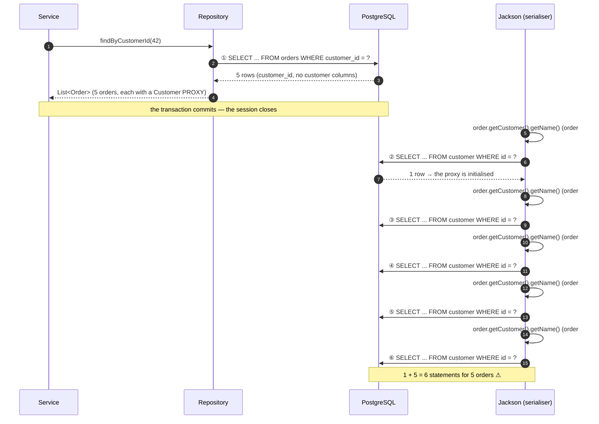
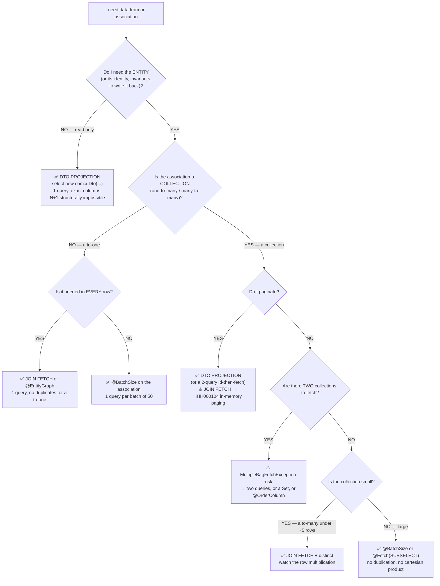
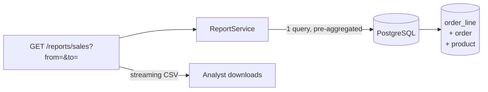

# 04 — Lazy/Eager, N+1 & Fetch Strategies

> **Level:** Intermediate → Expert
> **Interview Frequency:** ★★★★★ ("what is the N+1 problem and how do you fix it?", "why does `LazyInitializationException` happen?", "`JOIN FETCH` vs `@EntityGraph` vs `@BatchSize`?")
> **Prerequisites:** [02 · Entity Lifecycle & Caches](02-Entity-Lifecycle-Persistence-Context-and-Caches.md) · [03 · Transactions](03-Transactions-Propagation-and-Isolation.md)
> **Last Updated:** 2026

---

## 📋 Table of Contents

- [0. TL;DR — The 30-Second Answer](#0-tldr--the-30-second-answer)
- [1. What & Why — The Problem This Solves](#1-what--why--the-problem-this-solves)
- [2. Mental Model — The One Picture](#2-mental-model--the-one-picture)
- [3. Deep Dive — Theory (Beginner → Advanced)](#3-deep-dive--theory-beginner--advanced)
  - [3.1 Beginner Level](#31-beginner-level)
  - [3.2 Intermediate Level](#32-intermediate-level)
  - [3.3 Advanced Level](#33-advanced-level)
  - [3.4 Expert Level](#34-expert-level)
- [4. Internal Working Mechanism](#4-internal-working-mechanism)
- [5. Step-by-Step Execution Flow](#5-step-by-step-execution-flow)
- [6. Visualizations](#6-visualizations)
- [7. Production-Level Use Cases & Real Industry Examples](#7-production-level-use-cases--real-industry-examples)
- [8. Worked Examples (with Output + Dry Run)](#8-worked-examples-with-output--dry-run)
- [9. Code from Scratch — Production-Grade](#9-code-from-scratch--production-grade)
- [10. Common Mistakes & Gotchas](#10-common-mistakes--gotchas)
- [11. Performance Considerations](#11-performance-considerations)
- [12. Security Considerations](#12-security-considerations)
- [13. Best Practices](#13-best-practices)
- [14. Hands-On Exercises & Code Challenges](#14-hands-on-exercises--code-challenges)
- [15. Interview Q&A — Level-wise](#15-interview-qa--level-wise)
- [16. Scenario-Based & Real-Experience Scenarios (3–5 yrs)](#16-scenario-based--real-experience-scenarios-35-yrs)
- [17. Counter-Questions, Tricky Questions & Follow-Ups](#17-counter-questions-tricky-questions--follow-ups)
- [18. Frequently Asked Production Issues & Debugging Scenarios](#18-frequently-asked-production-issues--debugging-scenarios)
- [19. Architecture Design Questions](#19-architecture-design-questions)
- [20. Rapid-Fire MCQs](#20-rapid-fire-mcqs)
- [21. Cheat Sheet / One-Page Summary](#21-cheat-sheet--one-page-summary)
- [22. Real-World Production Notes](#22-real-world-production-notes)
- [23. Follow-up Learning](#23-follow-up-learning)

---

## 0. TL;DR — The 30-Second Answer

- **Lazy vs eager is about *when* the SQL runs, not *whether* it runs.** Every association you traverse costs a query unless it was fetched in the same statement.
- **The JPA defaults are `@OneToOne`/`@ManyToOne` = EAGER and `@OneToMany`/`@ManyToMany` = LAZY.** The EAGER defaults are a spec artefact — most production code sets everything to LAZY and fetches deliberately.
- **The N+1 is: 1 query to get the list, then 1 query per row for the association.** A 20-row page with a lazy collection = **21** round trips; 10 000 rows = **10 001**, and the endpoint's latency scales linearly with the page size.
- **`LazyInitializationException` is NOT a lazy-loading bug — it is a transaction-boundary bug.** The session closed at the boundary of your service method; the proxy had nowhere to load from.
- **`open-in-view=true` (Boot's default) keeps the session open for the whole HTTP response.** It hides the exception and hides the N+1 — at the cost of holding a DB connection through JSON rendering.
- **Six fixes, in increasing order of preference:** (1) `JOIN FETCH`, (2) `@EntityGraph`, (3) `@BatchSize`, (4) `@Fetch(SUBSELECT)`, (5) DTO projections, (6) a JPQL constructor expression. The last two are usually the best — no entity is loaded at all.
- **`JOIN FETCH` on a collection produces a cartesian product.** Two fetched collections multiply: 20 orders × 5 items = 100 rows; two collections = 20 × 5 × 3 = 300 rows. Two `List` fetches throw `MultipleBagFetchException`.
- **`@EntityGraph` on a collection still needs `distinct` in the JPQL** — the same cartesian product, silently.
- **`Pageable` + `JOIN FETCH` on a collection forces in-memory pagination** and logs `HHH000104: firstResult/maxResults specified with collection fetch; applying in memory!` — the database fetches *every* row and Hibernate pages in the heap.
- **Detect it with numbers, not with intuition:** `hibernate.generate_statistics=true` → `queryExecutionCount` vs `entityLoadCount`. A 20-row page with `entityLoadCount = 400` is an N+1.

---

## 1. What & Why — The Problem This Solves

**The problem.** An endpoint shows a list of orders with the customer's name and the first
line item. The data model is a graph:

```text
   Order ──▶ Customer
     │
     └──▶ items ──▶ Product
```

**What the developer writes:**

```java
@GetMapping("/orders")
public List<Order> list() {
    return orderRepository.findAll();          // 1 query
}
```

**What the framework does with the JSON:**

```text
   for each of the 20 orders:
       serialize order.customer.name    →  a SELECT on customer
       serialize order.items[0].sku     →  a SELECT on order_item, then a SELECT on product
```

**The cost:**

| Rows | Queries | Latency (1 ms RTT) | Slices read from the disk |
|---:|---:|---:|---:|
| 20 | **21** | ~40 ms | 40 |
| 200 | **201** | ~400 ms | 400 |
| 10 000 | **10 001** | ~20 s | 10 000 |

The endpoint is not slow because the database is slow. It is slow because **the application
is making a thousand sequential round trips**, and each round trip is a network latency you
cannot optimise away. This is the **N+1 problem** — and it is the single most common
performance bug in a Java backend, and the single most asked JPA interview question.

**Why it is so common.** Because the code is *correct* and *readable* — the developer never
writes the N queries. Hibernate writes them, one at a time, as the object graph is walked. And
in a small dataset (20 rows in dev) it is invisible: 21 queries against a local database take
4 ms. It only appears in production, at scale, on the pages nobody tested.

**The solution.** Change *when* and *how many* queries are issued — by deciding the fetch
plan explicitly instead of letting the default happen.

---

## 2. Mental Model — The One Picture

```text
   THE FETCH DECISION, IN ONE PICTURE
   ════════════════════════════════════

   findAll()  →  1 query, 20 orders, NO customer, NO items
        │
        │  ── the graph is now "half loaded" ──
        │
        ▼
   ┌──────────────────────────────────────────────────────────────────┐
   │  Order#1  ──▶ Customer@proxy    items = OrderItem@proxy[]      │
   │  Order#2  ──▶ Customer@proxy    items = OrderItem@proxy[]      │
   │  ...                                                             │
   │  Order#20 ──▶ Customer@proxy    items = OrderItem@proxy[]      │
   └──────────────────────────────────────────────────────────────────┘
        │
        │  every proxy dereference = 1 more SQL, AT THE MOMENT IT HAPPENS
        │
        ▼
   ┌──────────────────────────────────────────────────────────────────┐
   │  THE FOUR WAYS TO AVOID THE EXTRA QUERIES                      │
   ├──────────────────────────────────────────────────────────────────┤
   │                                                                  │
   │  ① JOIN FETCH          → 1 query, 100 rows (cartesian)          │
   │     "SELECT o.*, c.* FROM orders o JOIN customer c ..."          │
   │     ⚠ duplicates, ⚠ HHH000104 with pagination                   │
   │                                                                  │
   │  ② @EntityGraph        → 1 query, same shape as JOIN FETCH      │
   │     "@EntityGraph(attributePaths = {"customer", "items"})"       │
   │     ⚠ the same cartesian product                               │
   │                                                                  │
   │  ③ @BatchSize           → ceil(N/50) queries                     │
   │     "WHERE id IN (?, ?, ?, ... 50 ids)"                          │
   │     ✅ simple, low risk, no duplicates                            │
   │                                                                  │
   │  ④ DTO PROJECTION       → 1 query, EXACTLY the columns you need  │
   │     "select new com.x.OrderDto(o.id, c.name) from ..."          │
   │     ✅ no entity, no proxy, no N+1, smallest payload              │
   └──────────────────────────────────────────────────────────────────┘
```

**What to look at:** every fix changes *one* thing — **when and how the association data is
fetched**. The first two change the *query shape* (one big query). The third changes the
*batching* (many ids in one `IN`). The fourth removes the *need* for the graph entirely.

---

## 3. Deep Dive — Theory (Beginner → Advanced)

### 3.1 Beginner Level

#### The fetch types

```java
public enum FetchType {
    LAZY,    // a proxy is created; the SQL runs on first access
    EAGER    // the association is loaded immediately, in the same statement or a follow-up
}
```

| Association | JPA default | Practical advice |
|---|---|---|
| `@OneToOne` | **EAGER** | LAZY |
| `@ManyToOne` | **EAGER** | LAZY |
| `@OneToMany` | **LAZY** | LAZY (and fetch deliberately) |
| `@ManyToMany` | **LAZY** | LAZY (and fetch deliberately) |

> **Why are the to-one defaults EAGER?** A historical spec assumption: a to-one association
> was considered cheap and usually needed. In practice it is the opposite — an EAGER
> `@ManyToOne` multiplies the rows of every query that joins it and forces a join even when
> the customer is not needed.

#### What "lazy" actually means

```java
Order order = orderRepository.findById(1001L).orElseThrow();   // 1 SELECT on orders
Customer customer = order.getCustomer();                          // ← NOW a 2nd SELECT
```

**Lazy does not mean "never".** It means "not yet". And "not yet" is decided by **when the
getter is called** — which is usually during JSON serialisation, long after the transaction
has ended. That is the whole story of `LazyInitializationException`.

#### The `LazyInitializationException`

```text
org.hibernate.LazyInitializationException:
  Could not initialize proxy [com.example.shop.domain.Product#42]
   - no Session (and no DataSource) available for current thread
```

**The true root cause:** the persistence context closed at the transaction boundary. Lazy
loading is not broken — it just needs an open session, and the session's lifetime is the
transaction's lifetime.

### 3.2 Intermediate Level

#### The N+1 — the exact SQL

**The entity:**

```java
@Entity
public class Order {
    @Id @GeneratedValue(strategy = GenerationType.SEQUENCE)
    private Long id;

    @ManyToOne(fetch = FetchType.LAZY)
    @JoinColumn(name = "customer_id")
    private Customer customer;

    @OneToMany(mappedBy = "order", fetch = FetchType.LAZY)
    private List<OrderItem> items = new ArrayList<>();
}
```

**The repository and the service:**

```java
public interface OrderRepository extends JpaRepository<Order, Long> {
    List<Order> findByCustomerId(Long customerId);
}

@Service
public class OrderService {
    private final OrderRepository orderRepository;

    @Transactional(readOnly = true)
    public List<Order> forCustomer(Long customerId) {
        return orderRepository.findByCustomerId(customerId);
    }
}
```

**The SQL log for a customer with 5 orders:**

```text
   -- ① the list query (1)
   select o1_0.id, o1_0.reference, o1_0.status, o1_0.total, o1_0.customer_id
   from orders o1_0 where o1_0.customer_id = ?

   -- ② the N queries — ONE PER ROW, triggered by the serialiser
   select c1_0.id, c1_0.name, c1_0.email from customer c1_0 where c1_0.id = ?   -- order 1
   select c1_0.id, c1_0.name, c1_0.email from customer c1_0 where c1_0.id = ?   -- order 2
   select c1_0.id, c1_0.name, c1_0.email from customer c1_0 where c1_0.id = ?   -- order 3
   select c1_0.id, c1_0.name, c1_0.email from customer c1_0 where c1_0.id = ?   -- order 4
   select c1_0.id, c1_0.name, c1_0.email from customer c1_0 where c1_0.id = ?   -- order 5
```

**5 orders → 6 queries.** 500 orders → **501**. 10 000 → **10 001**.

#### Detecting the N+1

| Tool | How | Signal |
|---|---|---|
| `logging.level.org.hibernate.SQL=DEBUG` | Log the SQL | More statements than you expected, with the same shape repeated |
| `hibernate.generate_statistics=true` | The `Statistics` object | `entityLoadCount` ≫ `queryExecutionCount` |
| `/actuator/metrics/hibernate.statistics` | Actuator | `hibernate.statistics.query.execution` vs `.entity.load` |
| The `StatisticsMBean` (JMX) | JMX | The same counters, live |
| `datasource-proxy` | A JDBC proxy | Per-endpoint query counts and timings |
| P6Spy | A JDBC proxy | The SQL with the parameters |
| `hibernate.session.events.log` (the `AuditEventLogger`) | Hibernate's own audit trail | Every flush, with the SQL and the affected rows |

```java
// The programmatic route
@Autowired
private EntityManagerFactory emf;

public void printStatistics() {
    org.hibernate.stat.Statistics stats = emf.unwrap(SessionFactory.class).getStatistics();
    log.info("queries={} entities={} collections={} flushes={} prepareStatements={}",
            stats.getQueryExecutionCount(),
            stats.getEntityLoadCount(),
            stats.getCollectionLoadCount(),
            stats.getFlushCount(),
            stats.getPrepareStatementCount());
}
```

> **The decisive ratio:** `entityLoadCount / queryExecutionCount`. A healthy list endpoint
> with 20 rows and 1 query has a ratio of ~20 (one entity per row). An N+1 with 1 + N
> queries has a ratio that **grows with N**: 5 orders → 6 queries → ratio ~1.7; 500 orders
> → 501 queries → the number of *statements* explodes.

#### The four classic "fixes" and what each costs

| Fix | Queries for 20 rows | Rows returned | Duplicates? | Complexity |
|---|---:|---:|---|---|
| Nothing (lazy) | 21 | 20 | no | none |
| `JOIN FETCH` (one collection) | 1 | 100 (20 × 5) | **yes** | low |
| `JOIN FETCH` (two collections) | 1 | 300 (20 × 5 × 3) | **yes** | + `MultipleBagFetchException` risk |
| `@EntityGraph` | 1 | 100 | **yes** | low |
| `@BatchSize(size = 50)` | 1 + 1 | 20 | no | very low |
| `@Fetch(SUBSELECT)` | 2 | 20 | no | very low |
| DTO projection | 1 | 20 | no | medium |

### 3.3 Advanced Level

#### `JOIN FETCH` — the mechanism

```java
@Query("""
       select o
       from Order o
       join fetch o.customer c
       where o.customer.id = :customerId
       """)
List<Order> findWithCustomer(@Param("customerId") Long customerId);
```

```text
   The SQL Hibernate generates:
   select o1_0.id, o1_0.reference, o1_0.status, o1_0.total,
          c1_0.id, c1_0.name, c1_0.email
   from orders o1_0
   join customer c1_0 on o1_0.customer_id = c1_0.id
   where c1_0.id = ?
```

**Two things to know:**

1. **`join fetch` is not a `join`.** A plain `join` in JPQL does not fetch anything — it
   only filters. `join fetch` tells Hibernate to select the associated columns *and* to
   populate the association. A JPQL `join` without `fetch` is a common mistake: the query
   looks right and the N+1 remains.
2. **The result has duplicates.** Hibernate knows this and de-duplicates the *entities* in
   the result list — but the **rows came back from the database multiplied**. That is the
   cartesian product, and it is a real cost in bytes and in database work.

#### The cartesian product — the arithmetic

```text
   ONE collection fetched:
   ┌────────┬──────────┐
   │ ORDER  │ ORDER_ITEM│
   ├────────┼──────────┤
   │  O1    │  I1      │  ← 5 items for O1
   │  O1    │  I2      │
   │  O1    │  I3      │
   │  O1    │  I4      │
   │  O1    │  I5      │
   │  O2    │  I1      │  ← 5 items for O2
   │  O2    │  I2      │
   │  ...                │
   │  O20   │  I5      │
   └────────┴──────────┘
   ROWS = 20 orders × 5 items = 100 rows
   (the 20 orders' columns are repeated 5 times each)

   TWO collections fetched (items AND products):
   ROWS = 20 × 5 × 3 = 300 rows

   THE RULE: rows = |parents| × |children₁| × |children₂| × ...
   With 20 parents, 5 items and 3 products → 300 rows for 20 objects.
   At 10 000 parents with an average of 8 items → 80 000 rows fetched to render 10 000.
```

#### `MultipleBagFetchException`

```text
org.hibernate.loader.MultipleBagFetchException:
  cannot simultaneously fetch multiple bags
```

A **bag** is an unindexed collection — a `List` without `@OrderColumn`. Hibernate cannot
de-duplicate a bag in memory, because two rows of the bag could legitimately be equal. So
fetching two bags in one query is rejected outright.

```java
@OneToMany(mappedBy = "order")          // a List → a BAG
private List<OrderItem> items = new ArrayList<>();

@ManyToMany
@JoinTable(name = "order_product", ...)
private List<Product> products = new ArrayList<>();   // a List → a BAG
```

```java
// ❌ MultipleBagFetchException at startup/query time
@Query("select o from Order o join fetch o.items join fetch o.products")
List<Order> findAllWithBoth();
```

**The three fixes:**

| Fix | How | Trade-off |
|---|---|---|
| Use a `Set` for one of them | `Set<Product>` (or `Set<OrderItem>`) | A `Set` is a "bag" no more — Hibernate can de-duplicate it. But `Set` has no order |
| Use a `List` + `@OrderColumn` | `@OrderColumn(name = "position")` | An indexed list is a `PersistentBag` with a stable order — Hibernate can de-duplicate it. Needs a column in the DB |
| Two queries | One query per collection | Two round trips, no cartesian product — often the *fastest* option |

#### `@EntityGraph` — the declarative form

```java
@EntityGraph(attributePaths = {"customer", "items"})
List<Order> findByCustomerId(Long customerId);
```

```java
// A named graph, reusable across repositories
@EntityGraph(name = "Order.withCustomerAndItems")
public interface Order extends JpaEntity<Order, Long> {

    @EntityGraph(name = "Order.withCustomerAndItems", attributePaths = {"customer", "items"})
    List<Order> findByCustomerId(Long customerId);
}
```

**`@EntityGraph` vs `JOIN FETCH`:**

| Aspect | `JOIN FETCH` | `@EntityGraph` |
|---|---|---|
| Where it lives | In the query | On the repository method (or the entity) |
| Overrides an existing query | ✅ you write the query | ✅ it applies to a derived query too |
| JPQL `distinct` needed for a collection? | **Yes** — you must write it | **Yes** — you must write it in the JPQL |
| Works with a derived query method | ❌ | ✅ |
| Nesting (a subgraph) | Possible in the JPQL | ✅ `subgraph` / `subgraphs` |
| The generated SQL | Exactly what you wrote | The same shape, generated for you |

> **The trap everyone hits:** `@EntityGraph(attributePaths = {"items"})` on a method with a
> derived query **still produces the cartesian product**, and the result list contains
> duplicates unless the query has `distinct`. Spring Data cannot add `distinct` to a
> **derived** query's JPQL for you — you must write the query explicitly.

```java
// ✅ the working combination
@Query("select distinct o from Order o where o.customer.id = :customerId")
@EntityGraph(attributePaths = {"customer", "items"})
List<Order> findWithDetails(@Param("customerId") Long customerId);
```

#### `@BatchSize` — the cheapest fix

```java
@Entity
public class Order {

    @ManyToOne(fetch = FetchType.LAZY)
    @JoinColumn(name = "customer_id")
    @BatchSize(size = 50)                 // org.hibernate.annotations.BatchSize
    private Customer customer;
}
```

```java
// Or globally, for every collection
spring:
  jpa:
    properties:
      hibernate:
        default_batch_fetch_size: 50
```

**What it does:** when 50 lazy proxies are initialised, Hibernate does **not** issue 50
queries — it issues **one** query with an `IN` list of 50 ids, and fills all 50 proxies.

```text
   WITHOUT @BatchSize (20 rows):
      select ... from customer where id = ?     × 20

   WITH @BatchSize(size = 50) (20 rows):
      select ... from customer where id in (?, ?, ?, ... 20 ids)     × 1
```

**Why it is the best first fix:**

- ✅ **Zero change to the query** — the semantics are unchanged.
- ✅ **No cartesian product**, no duplicates.
- ✅ **No `distinct` needed.**
- ✅ **Works with pagination and with `Pageable`.**
- ⚠️ It only helps when the proxies are initialised **in the same session** — which they
  usually are.

**Its limitation:** the `IN` list has a parameter limit (PostgreSQL: 32 767 parameters;
Oracle: 1 000 — the `in_clause_parameter_padding` setting exists for this). A batch size of
50–100 is safe everywhere.

#### `@Fetch(FetchMode.SUBSELECT)` — one query for all the children

```java
@Entity
public class Order {

    @OneToMany(mappedBy = "order", fetch = FetchType.LAZY)
    @Fetch(FetchMode.SUBSELECT)           // org.hibernate.annotations.Fetch
    private List<OrderItem> items = new ArrayList<>();
}
```

**What it does:** when the first `items` collection is initialised, Hibernate runs **one**
query that fetches the items of **all** the orders already loaded in the session:

```text
   select i.* from order_item i
   where i.order_id in (select id from orders where customer_id = ?)   -- one query
```

#### DTO projections — the best fix

```java
public interface OrderSummary {
    Long getId();
    String getReference();
    String getCustomerName();
    BigDecimal getTotal();
    OrderStatus getStatus();
}
```

```java
// ① Interface projection with an explicit JPQL alias
@Query("""
       select o.id as id,
              o.reference as reference,
              c.name as customerName,
              o.total as total,
              o.status as status
       from Order o
       join o.customer c
       where o.customer.id = :customerId
       order by o.createdAt desc
       """)
List<OrderSummary> findSummaries(@Param("customerId") Long customerId);
```

```java
// ② A constructor expression → a record
public record OrderSummary(Long id, String reference, String customerName,
                           BigDecimal total, OrderStatus status) { }

@Query("""
       select new com.example.shop.api.OrderSummary(
           o.id, o.reference, c.name, o.total, o.status)
       from Order o
       join o.customer c
       where o.customer.id = :customerId
       """)
List<OrderSummary> findSummaries(@Param("customerId") Long customerId);
```

**Why this is the best fix:** no entity is loaded, so there is no identity map entry, no
snapshot, no proxy, no lazy association to trigger a second query. **The N+1 is structurally
impossible** — there is nothing to trigger it.

#### The trade-off table

| Strategy | Rows fetched | Bytes on the wire | Heap used | Simplicity | When to use |
|---|---:|---:|---:|---|---|
| Lazy (the default) | N | small per row | low | ★★★★★ | You only need the parent |
| `JOIN FETCH` | N × M | **large** (repeated columns) | **high** (all entities hydrated) | ★★★★☆ | You need the entity, and the graph is shallow |
| `@EntityGraph` | N × M | large | high | ★★★★☆ | Same, but declaratively |
| `@BatchSize` | N + N/M | small | low | ★★★★★ | The default fix for a lazy collection |
| `@Fetch(SUBSELECT)` | N + 1 | small | low | ★★★★☆ | Many parents, one collection |
| **DTO projection** | **N (exactly the columns)** | **smallest** | **lowest** | ★★★☆☆ | **The default for a read model** |

### 3.4 Expert Level

#### Pagination + `JOIN FETCH` — the `HHH000104` trap

```java
// ❌ THE TRAP
@Query("select o from Order o join fetch o.items")
Page<Order> findAll(Pageable pageable);
```

```text
   org.hibernate.orm.loader.PageLoader:
   HHH000104: firstResult/maxResults specified with collection fetch; applying in memory!
```

**What actually happens:**

1. Hibernate generates the query **without** `limit`/`offset` — because with a collection
   fetch, applying the limit at the SQL level would cut the collection in half.
2. The database returns **every** row: 10 000 orders × 5 items = 50 000 rows.
3. Hibernate de-duplicates the entities in the heap and then applies the pagination
   **in memory**.

```text
   ❌ WHAT YOU ASKED FOR:  20 orders
   ❌ WHAT THE DATABASE SENT:  50 000 rows  (the whole table!)
   ❌ WHAT HIBERNATE DID:  de-duplicated in the heap, then took 20
```

**The fix — a two-query approach:**

```java
// ① the page of ids (a simple query, no fetch → the DB can paginate)
@Query("select o.id from Order o where o.customer.id = :customerId")
Page<Long> findIds(@Param("customerId") Long customerId, Pageable pageable);

// ② the entities, with the fetch, restricted to the ids of the page
@Query("select o from Order o join fetch o.items where o.id in :ids")
List<Order> findWithItemsByIds(@Param("ids") List<Long> ids);
```

**Or — and this is usually better — a DTO projection, which paginates natively:**

```java
@Query("""
       select new com.example.shop.api.OrderSummary(o.id, o.reference, c.name, o.total, o.status)
       from Order o join o.customer c
       where o.customer.id = :customerId
       """)
Page<OrderSummary> findSummaries(@Param("customerId") Long customerId, Pageable pageable);
```

#### The fetch plan and the query plan cache

```text
   THE SQL PLAN IS SEPARATE FROM THE FETCH PLAN
   ═══════════════════════════════════════════

   QUERY PLAN  (cached, keyed by the query string)
   "select o from Order o where o.customer.id = ?"
        → the SQL template, the parameter binders, the entity types involved

   FETCH PLAN  (per execution, decides what gets SELECTed)
   For each entity in the result:
       - is the association EAGER?      → it is fetched (a join or a follow-up query)
       - is the association LAZY?       → a proxy is created, no SQL
       - was it JOIN FETCHed?           → it is already in the row
       - is the collection already INITIALISED in this session? → it is reused
```

**The consequence:** changing an association from LAZY to EAGER changes the fetch plan of
**every** query that touches that entity — including the ones you did not write a fetch
plan for. That is why an "innocuous" mapping change can cause an N+1 to appear in a
completely unrelated endpoint.

#### The `EntityGraph` subgraph

```java
@EntityGraph(attributePaths = {"customer"})
public interface OrderRepository extends JpaRepository<Order, Long> {

    @EntityGraph(attributePaths = {"customer"})
    List<Order> findByStatus(OrderStatus status);

    // A nested graph: order → customer → address
    @EntityGraph(attributePaths = {"customer"})
    List<Order> findByReference(String reference);
}
```

```java
// A subgraph, declared on the entity
@Entity
@org.hibernate.annotations.NamedEntityGraph(
    name = "Order.detail",
    attributeNodes = @org.hibernate.annotations.NamedAttributeNode(
        subgraph = "items",
        subgraphAttributes = @org.hibernate.annotations.NamedAttributeNode("product")))
public class Order { }
```

#### Bulk operations and the fetch plan

```java
@Modifying
@Query("update Order o set o.status = :status where o.id in :ids")
int bulkUpdate(@Param("ids") List<Long> ids, @Param("status") OrderStatus status);
```

**A bulk JPQL `UPDATE`/`DELETE` bypasses the persistence context entirely** — it does not
load the entities, does not fire the entity listeners, and does **not** update the identity
map. The entities already in the context keep the **old** values. Use
`clearAutomatically = true` / `flushAutomatically = true`.

#### Statistics — the numbers that prove it

```java
SessionFactory sf = emf.unwrap(SessionFactory.class);
Statistics stats = sf.getStatistics();

stats.getQueryExecutionCount();       // the number of statements
stats.getEntityLoadCount();           // the number of entities hydrated
stats.getCollectionLoadCount();       // the number of collections initialised
stats.getCollectionFetchCount();      // the number of collection fetches
stats.getPrepareStatementCount();     // the number of JDBC statements
stats.getFlushCount();                // the number of flushes
```

**The N+1 signature:**

```text
   ❌ AN N+1:
      queryExecutionCount = 501
      entityLoadCount      = 520      (20 orders + 500 items)
      collectionFetchCount = 500      ← the smoking gun

   ✅ A FIXED ENDPOINT:
      queryExecutionCount = 1
      entityLoadCount      = 20
      collectionFetchCount = 0
```

#### The "N+1 on a 10 000-row page" arithmetic

```text
   PAGE SIZE 10 000, 1 lazy association per row, 1 ms round trip:
   ┌────────────────┬────────────┬──────────────┬───────────────────┐
   │ page size      │ queries    │ RTT time     │ DB rows read      │
   ├────────────────┼────────────┼──────────────┼───────────────────┤
   │ 20             │ 21         │ ~21 ms       │ 40                │
   │ 200            │ 201        │ ~201 ms      │ 400               │
   │ 1 000          │ 1 001      │ ~1 001 ms    │ 2 000             │
   │ 10 000         │ 10 001     │ ~10 001 ms ⚠ │ 20 000            │
   │ 50 000         │ 50 001     │ ~50 001 ms 💥│ 100 000           │
   └────────────────┴────────────┴──────────────┴───────────────────┘

   ⚠ Note: the DB rows read is only 2× the page size — the problem is the ROUND TRIPS,
     not the data volume. That is why an index does not fix it.
```

---

## 4. Internal Working Mechanism

**Which class calls which, in what order.** The N+1 is created by the **loader** and the
**proxy initialisation**.

```text
1.  orderRepository.findByCustomerId(42)
      └─ QueryExecutor → the query is translated and executed
           └─ the EntityPersister's Loader builds the SELECT
              → the SQL selects the ORDER columns only
              → for each row: hydrate the Order, create the EntityEntry snapshot,
                and create a PROXY for the LAZY associations

2.  The repository returns List<Order> — 20 orders, each with a Customer proxy
    and an uninitialised items collection.

3.  The service returns the list. The transaction COMMITS → the session closes.

4.  The controller returns the list → Jackson serialises it:
      for each order:
        order.getCustomer().getName()
             └─ the Customer proxy is INITIALISED
                  └─ SessionImpl.immediateLoad(...)
                       → an EntityEntry is created for the proxy
                       → the SQL is executed NOW     ← ★ THE EXTRA QUERY
                       → the proxy is populated
        order.getItems()
             └─ the PersistentCollection is INITIALISED
                  → the SQL is executed NOW        ← ★ THE EXTRA QUERY
```

**The key classes:**

| Class | Role |
|---|---|
| `org.hibernate.loader.plan.EntityLoader` | The per-entity loader; decides which columns to select |
| `org.hibernate.loader.ast.internal.*Loader` | The concrete loaders (`SingleUniqueEntityLoaderStandard`, `CollectionLoaderSingleKey`) |
| `org.hibernate.proxy.AbstractLazyInitializer` | Initialises a proxy when a method is called |
| `org.hibernate.collection.spi.PersistentCollection` | The lazy collection wrapper |
| `org.hibernate.engine.spi.BatchEntitySelectFetchInitializer` | The `@BatchSize` machinery |
| `org.hibernate.sql.results.graph.entity.internal.*` | The result-set graph (how a row maps to the graph) |

**The extension points:**

| Hook | Where | Use |
|---|---|---|
| `@BatchSize` | On the association or globally | Batching the lazy loads |
| `@Fetch(FetchMode.SUBSELECT)` | On the collection | One query for all the parents' children |
| `StatementInspector` | Hibernate SPI | Tag the SQL with a trace id (see [05 · Hibernate Internals](05-Hibernate-Internals-and-Performance-Tuning.md)) |
| `hibernate.session.events.log` | Hibernate's audit log | The full flush/SQL trail |
| `Statistics` / `StatisticsMBean` | Hibernate | The counters that prove an N+1 |

---

## 5. Step-by-Step Execution Flow

**Flow 1 — the N+1, step by step.**

1. `orderRepository.findByCustomerId(42)` → **SQL #1** → 5 `Order` rows.
2. For each row, Hibernate creates a `Customer` **proxy** (the `customer` is LAZY) and an
   uninitialised `PersistentCollection` for `items`.
3. The rows are put in the identity map; the snapshots are recorded.
4. The service returns the list → the transaction commits → the session closes.
5. Jackson calls `getCustomer()` → the proxy's `getName()` → the proxy initialises →
   **SQL #2** → 1 customer row → the proxy is populated.
6. Jackson calls `getItems()` → the collection initialises → **SQL #3** → the items.
7. For the items, Jackson calls `item.getProduct().getSku()` → **SQL #4** → the product.
8. Steps 5–7 repeat for each of the 5 orders.

```text
   for 5 orders × (1 customer + 1 items + 1 product per item) ≈ 5 + 5 + 15 = 25 queries
```

**Flow 2 — the `JOIN FETCH` flow.**

1. The JPQL is parsed → the `join fetch` is translated into a SQL `JOIN` and the **result
   graph** is extended to include the `Customer` columns.
2. **SQL #1** → 5 rows × (order columns + customer columns).
3. Each row is hydrated; the `Customer` is hydrated **eagerly** from the same row (no
   proxy).
4. The result set has duplicate `Order` rows (one per joined row) → Hibernate
   de-duplicates them using the `EntityKey` and the identity map → the list has 5 orders.
5. The serialiser touches `getCustomer()` → the entity is **already populated** → no SQL.

**Flow 3 — the DTO projection flow.**

1. The JPQL selects **columns**, not entities → the result graph is a `Tuple`/`Instantiation`
   node, not an `EntityResult`.
2. **SQL #1** → 5 rows of exactly the selected columns.
3. Each row is instantiated into an `OrderSummary` — either by the interface proxy (which
   reads the tuple lazily) or directly by the constructor expression.
4. **No entity enters the persistence context**, no snapshot is taken, no proxy exists.

---

## 6. Visualizations

### 6.1 The N+1 query pattern



**Caption:** The extra queries are issued by the **serialiser**, not by your code — which is
why they do not appear in a stack trace of your method and why `open-in-view=true` makes
them possible at all.

### 6.2 One query vs N queries

```text
   ❌ THE N+1 — 6 statements, 6 round trips
   ┌────────────────────────────────────────────────────────────────┐
   │  #1  SELECT * FROM orders WHERE customer_id = ?      → 5 rows   │
   │  #2  SELECT * FROM customer WHERE id = ?            → 1 row    │
   │  #3  SELECT * FROM customer WHERE id = ?            → 1 row    │
   │  #4  SELECT * FROM customer WHERE id = ?            → 1 row    │
   │  #5  SELECT * FROM customer WHERE id = ?            → 1 row    │
   │  #6  SELECT * FROM customer WHERE id = ?            → 1 row    │
   └────────────────────────────────────────────────────────────────┘
       6 round trips × 1 ms = 6 ms + query time

   ✅ THE FIX — 1 statement, 1 round trip
   ┌────────────────────────────────────────────────────────────────┐
   │  #1  SELECT o.*, c.* FROM orders o JOIN customer c            │
   │        ON o.customer_id = c.id WHERE o.customer_id = ?         │
   │        → 5 rows (each carrying both sets of columns)          │
   └────────────────────────────────────────────────────────────────┘
       1 round trip × 1 ms = 1 ms + query time

   ✅ THE BETTER FIX — 1 statement, 1 round trip, NO duplication
   ┌────────────────────────────────────────────────────────────────┐
   │  #1  SELECT o.id, o.reference, c.name, o.total                │
   │        FROM orders o JOIN customer c ON o.customer_id = c.id   │
   │        WHERE o.customer_id = ?                                 │
   │        → 5 rows × exactly 4 columns                           │
   └────────────────────────────────────────────────────────────────┘
       1 round trip, the smallest possible payload, no entities
```

**Caption:** The fix does not make the query "smarter" — it makes the number of **round
trips** independent of the number of rows. That is the whole trick.

### 6.3 Which fetch strategy should I use?



**Caption:** The decision is driven by three questions in order: *do I need the entity?*, *is
it a collection?*, *am I paginating?* The DTO projection wins whenever the answer to the
first question is "no" — which is most read endpoints.

### 6.4 The cartesian product — the row arithmetic

```text
   ONE COLLECTION FETCHED
   ======================
   ┌─────────┬────────────┬────────────┐
   │ ORDER   │ ORDER_ITEM │ ITEM rows  │
   ├─────────┼────────────┼────────────┤
   │ O1      │ I1         │            │
   │ O1      │ I2         │            │
   │ O1      │ I3         │  5 items   │
   │ O1      │ I4         │            │
   │ O1      │ I5         │            │
   │ O2      │ I1         │            │
   │ O2      │ I2         │  5 items   │
   │   ⋮     │   ⋮        │    ⋮       │
   │ O20     │ I5         │  5 items   │
   └─────────┴────────────┴────────────┘
        20      × 5             = 100 ROWS
        (the 20 orders' columns are repeated 5× each)

   TWO COLLECTIONS FETCHED
   ========================
        20      × 5       × 3  = 300 ROWS
        orders    items    products

   THE ARITHMETIC, IN GENERAL
   ==========================
        rows fetched = |parents| × Π(|childrenᵢ|)

        1 000 orders × 8 items            =  8 000 rows
        1 000 orders × 8 items × 3 prods  = 24 000 rows

   WHAT IT COSTS:
        8 000 rows × ~120 bytes/row = 960 KB transferred
        for 1 000 objects of ~400 bytes = 400 KB of actual data
        → 2.4× the bytes, and the DB does 8× the join work

   ⚠ AND WITH PAGINATION:
        "select o from Order o join fetch o.items" + Pageable(0, 20)
        → the DB returns ALL 8 000 rows, Hibernate de-duplicates in the heap
        → HHH000104: firstResult/maxResults specified with collection fetch;
          applying in memory!
```

**Caption:** The multiplication is not a Hibernate bug — it is the relational algebra of a
join. Hibernate de-duplicates the *entities*, but the *rows* already crossed the wire.

---

## 7. Production-Level Use Cases & Real Industry Examples

### 7.1 E-commerce order list — the N+1 that only shows up for big customers

**Domain:** an order history page, 20 orders per page, **3 400 requests/minute**. Retail
customers have 5–20 orders; enterprise customers have 2 000–12 000.

**The incident:** the endpoint's p99 was 210 ms for retail customers and **9 400 ms** for
enterprise ones. The `?page=3` parameter made it worse (a page deep in the list is the same
size, so it is not the offset — it is simply a customer with more orders).

**The measurement:** `hibernate.generate_statistics=true` for one request → `queryExecutionCount
= 5 012`, `entityLoadCount = 5 040`, `collectionFetchCount = 5 000`.

**The resolution:** the endpoint only needed 4 columns per row (reference, date, status,
total). It was rewritten as a **DTO projection**:

```java
@Query("""
       select new com.example.shop.api.OrderHistoryRow(o.id, o.reference, o.createdAt, o.status, o.total)
       from Order o
       where o.customer.id = :customerId
       order by o.createdAt desc
       """)
Page<OrderHistoryRow> history(@Param("customerId") Long customerId, Pageable pageable);
```

**The result:** `queryExecutionCount = 2` (the page query + the count query), and the p99
went from **9 400 ms → 84 ms**. The endpoint's SQL time dropped from 8 900 ms to 11 ms.

> **The lesson:** "slow only for big customers" is the N+1 signature. The p99 scales with
> the **number of rows**, not with the page index.

### 7.2 Banking statement — the cartesian product

**Domain:** a customer statement, 240 transactions, each with a "category" and a "counterparty".

**The bug:** the developer fixed the N+1 with two `join fetch` clauses — one for the
category, one for the counterparty (both to-one). The endpoint got fast. Then a colleague
added `join fetch o.attachments` (a collection) to show the file names — and the endpoint
became **slower than before**.

**The arithmetic:** 240 transactions × 1 category × 1 counterparty × 2.4 attachments
(average) = 576 rows. Not catastrophic — but on the **export** endpoint (12 000 transactions)
it was 28 800 rows, and the export's memory spiked to 1.8 GB.

**The resolution:** the attachments were moved to a **separate endpoint** (`/statements/{id}/attachments`)
— the classic fix for a card-to-many in a list response: don't fetch it at all in the list.
The export uses a DTO projection with a `JOIN` (not `join fetch`).

### 7.3 Logistics tracking — the 10 000-row page

**Domain:** a fleet-tracking dashboard showing the last 10 000 pings with the vehicle and
the driver.

- The naive `join fetch` version returned **10 000 vehicles × 10 000 pings** → a cartesian
  product of 100 million rows → the database ran out of memory.
- The fix: a **DTO projection with a plain JPQL join** (not `join fetch`):
  ```java
  @Query("""
         select new com.example.fleet.api.PingRow(p.id, p.latitude, p.longitude, p.recordedAt,
                                                  v.registration, d.name)
         from Ping p join p.vehicle v join p.driver d
         where p.fleetId = :fleetId
         """)
  Page<PingRow> findPings(@Param("fleetId") Long fleetId, Pageable pageable);
  ```
  The database paginates natively (`limit 20 offset 0`), the rows are exactly the 20 you
  need, and the entity graph is never materialised.

### 7.4 The reporting module — where `@BatchSize` is the right answer

**Domain:** an internal reporting API that renders a table of 500 projects, each with a
customer and a status.

- The requirement was to keep the **entities** (the UI lets you click through to the
  project), so a DTO projection was not an option.
- `@BatchSize(size = 100)` on the `customer` association → the 500 lazy customer proxies
  are initialised in **5** queries (`id in (100 ids)`), not 500.
- Total: 1 (projects) + 5 (customers) = **6** queries instead of 501.
- p99: 780 ms → **46 ms**.

---

## 8. Worked Examples (with Output + Dry Run)

### 8.1 Reproducing the N+1 and fixing it four ways

**The starting point:**

```java
package com.example.shop.domain;

import jakarta.persistence.*;
import java.math.BigDecimal;
import java.time.Instant;
import java.util.ArrayList;
import java.util.List;

@Entity
@Table(name = "orders")
public class Order {

    @Id
    @GeneratedValue(strategy = GenerationType.SEQUENCE)
    @Column(name = "id")
    private Long id;

    @Column(name = "reference", nullable = false, length = 32)
    private String reference;

    @Column(name = "total", nullable = false, precision = 19, scale = 4)
    private BigDecimal total;

    @Enumerated(EnumType.STRING)
    @Column(name = "status", nullable = false, length = 16)
    private OrderStatus status;

    @ManyToOne(fetch = FetchType.LAZY)
    @JoinColumn(name = "customer_id")
    private Customer customer;

    @OneToMany(mappedBy = "order", fetch = FetchType.LAZY)
    private List<OrderItem> items = new ArrayList<>();

    @Version
    @Column(name = "version", nullable = false)
    private long version;

    protected Order() {
    }
}
```

```java
package com.example.shop.repository;

import com.example.shop.domain.Order;
import org.springframework.data.jpa.repository.JpaRepository;
import org.springframework.data.jpa.repository.Query;
import org.springframework.data.repository.query.Param;

import java.util.List;

public interface OrderRepository extends JpaRepository<Order, Long> {

    // ❶ THE N+1 VERSION — one query, then one per row
    List<Order> findByCustomerId(Long customerId);

    // ❷ JOIN FETCH
    @Query("select o from Order o join fetch o.customer where o.customer.id = :customerId")
    List<Order> findWithCustomer(@Param("customerId") Long customerId);

    // ❸ @BatchSize
    @Query("select o from Order o where o.customer.id = :customerId")
    List<Order> findBatch(@Param("customerId") Long customerId);

    // ❹ DTO PROJECTION
    @Query("""
           select new com.example.shop.api.OrderRow(o.id, o.reference, c.name, o.total, o.status)
           from Order o join o.customer c
           where o.customer.id = :customerId
           """)
    List<OrderRow> findRows(@Param("customerId") Long customerId);
}
```

**The reproduction — the SQL log for `findByCustomerId(42)` with 5 orders:**

```text
   Hibernate: select o1_0.id, o1_0.reference, o1_0.total, o1_0.status, o1_0.version, o1_0.customer_id
              from orders o1_0 where o1_0.customer_id = ?
   Hibernate: select c1_0.id, c1_0.name, c1_0.email from customer c1_0 where c1_0.id = ?
   Hibernate: select c1_0.id, c1_0.name, c1_0.email from customer c1_0 where c1_0.id = ?
   Hibernate: select c1_0.id, c1_0.name, c1_0.email from customer c1_0 where c1_0.id = ?
   Hibernate: select c1_0.id, c1_0.name, c1_0.email from customer c1_0 where c1_0.id = ?
   Hibernate: select c1_0.id, c1_0.name, c1_0.email from customer c1_0 where c1_0.id = ?
```

```text
   ⚠ 6 statements for 5 orders — the "1 + N" pattern.
     Hibernate statistics for this one call:
        queryExecutionCount  = 6
        entityLoadCount      = 10   (5 orders + 5 customers)
        collectionFetchCount = 5
```

**Fix ❷ — `JOIN FETCH`:**

```text
   Hibernate: select o1_0.id, o1_0.reference, o1_0.total, o1_0.status, o1_0.version, o1_0.customer_id,
                      c1_0.id, c1_0.name, c1_0.email
              from orders o1_0 join customer c1_0 on o1_0.customer_id = c1_0.id
              where c1_0.id = ?

   ✅ 1 statement.
      queryExecutionCount = 1
      entityLoadCount     = 10
      ⚠ the rows are 5 (one per order) — no duplication for a TO-ONE.
```

**Fix ❸ — `@BatchSize(size = 100)` on the association:**

```java
@ManyToOne(fetch = FetchType.LAZY)
@JoinColumn(name = "customer_id")
@BatchSize(size = 100)          // org.hibernate.annotations.BatchSize
private Customer customer;
```

```text
   Hibernate: select o1_0.id, ... from orders o1_0 where o1_0.customer_id = ?
   Hibernate: select c1_0.id, c1_0.name, c1_0.email from customer c1_0
              where c1_0.id in (?, ?, ?, ?, ?)     ← 5 ids in ONE query

   ✅ 2 statements. queryExecutionCount = 2. entityLoadCount = 10.
      ✅ No duplication. ✅ Works with pagination. ✅ Zero change to the query.
```

**Fix ❹ — DTO projection:**

```java
public record OrderRow(Long id, String reference, String customerName,
                        BigDecimal total, OrderStatus status) {
}
```

```text
   Hibernate: select o1_0.id, o1_0.reference, c1_0.name, o1_0.total, o1_0.status
              from orders o1_0 join customer c1_0 on o1_0.customer_id = c1_0.id
              where c1_0.id = ?

   ✅ 1 statement, EXACTLY 5 columns per row.
      queryExecutionCount = 1
      entityLoadCount     = 0        ← NO ENTITY WAS LOADED
      ⚠ No identity map entries. No snapshots. No proxies. No possible N+1.
```

**The comparison table:**

| Version | Statements | Rows fetched | Entities hydrated | p99 (1 ms RTT) |
|---|---:|---:|---:|---:|
| ❶ Lazy (the N+1) | **6** | 5 + 5 = 10 | 10 | ~7 ms |
| ❷ `JOIN FETCH` | **1** | 5 (wide) | 10 | ~2 ms |
| ❸ `@BatchSize(100)` | **2** | 5 + 5 = 10 | 10 | ~3 ms |
| ❹ DTO projection | **1** | 5 (narrow) | **0** | ~1.5 ms |

**Extrapolating to 500 orders:**

| Version | Statements | Time (1 ms RTT) |
|---|---:|---:|
| ❶ Lazy | **501** | ~505 ms |
| ❷ `JOIN FETCH` | 1 | ~12 ms |
| ❸ `@BatchSize(100)` | 1 + 5 = **6** | ~18 ms |
| ❹ DTO projection | 1 | ~6 ms |

### 8.2 `MultipleBagFetchException` and the three fixes

**The code that fails:**

```java
@Entity
@Table(name = "orders")
public class Order {

    @Id @GeneratedValue(strategy = GenerationType.SEQUENCE)
    private Long id;

    @OneToMany(mappedBy = "order")
    private List<OrderItem> items = new ArrayList<>();       // ← a BAG

    @ManyToMany
    @JoinTable(name = "order_product",
               joinColumns = @JoinColumn(name = "order_id"),
               inverseJoinColumns = @JoinColumn(name = "product_id"))
    private List<Product> products = new ArrayList<>();      // ← a BAG
}
```

```java
@Query("select o from Order o join fetch o.items join fetch o.products")
List<Order> findAllWithBoth();
```

**The exact error:**

```text
org.hibernate.loader.MultipleBagFetchException: cannot simultaneously fetch multiple bags

  at org.hibernate.loader.ast.internal.LoaderHelper.getBagsToFetch(LoaderHelper.java:98)
  at org.hibernate.loader.ast.internal.LoaderHelper.processBagFetch(LoaderHelper.java:82)
  ...
  Caused by: org.hibernate.loader.MultipleBagFetchException
```

**Why Hibernate refuses:** a `List` without `@OrderColumn` is an **unindexed bag** — two
elements of the bag may legitimately be equal (two lines with the same quantity and price).
Hibernate cannot de-duplicate a bag without an index, so it cannot build the result set for
two bags at once. A `Set` or an indexed `List` is de-duplicable.

**Fix ❶ — make one of them a `Set`:**

```java
@ManyToMany
@JoinTable(name = "order_product",
           joinColumns = @JoinColumn(name = "order_id"),
           inverseJoinColumns = @JoinColumn(name = "product_id"))
private Set<Product> products = new LinkedHashSet<>();       // ✅ a SET, not a bag
```

```text
   Hibernate: select o1_0.id, ..., i1_0.id, ..., p1_0.id, ...
              from orders o1_0
              left join order_item i1_0 on o1_0.id = i1_0.order_id
              left join order_product op1_0 on o1_0.id = op1_0.order_id
              left join product p1_0 on op1_0.product_id = p1_0.id
              where o1_0.customer_id = ?

   ⚠ the cartesian product: 20 orders × 5 items × 3 products = 300 rows
      Hibernate de-duplicates both collections (both are sets now)
```

**Fix ❷ — use `@OrderColumn` (an indexed list):**

```java
@OneToMany(mappedBy = "order")
@OrderColumn(name = "position")                    // ✅ the list is now indexed
private List<OrderItem> items = new ArrayList<>();
```

The schema gains an `position` column, and the list becomes orderable *and* de-duplicable.

**Fix ❸ — two queries (often the fastest):**

```java
@Query("select distinct o from Order o join fetch o.items where o.customer.id = :customerId")
List<Order> findWithItems(@Param("customerId") Long customerId);

@Query("select o from Order o join fetch o.products where o.customer.id = :customerId")
List<Order> findWithProducts(@Param("customerId") Long customerId);
```

```text
   ✅ 2 statements. 20 + 100 rows instead of 300. No exception. No `distinct` gymnastics.
```

**The comparison:**

| Fix | Statements | Rows for 20 orders | Needs a schema change | Keeps the order |
|---|---:|---:|---|---|
| `Set<Product>` | 1 | 300 | no | ✅ (`LinkedHashSet`) |
| `@OrderColumn` | 1 | 300 | **yes** (`position` column) | ✅ |
| Two queries | 2 | 120 | no | ✅ |

### 8.3 A DTO projection replacing an entity fetch — the SQL and the JSON

**Before — the entity endpoint:**

```java
@GetMapping("/api/orders")
public List<Order> list(@RequestParam Long customerId) {
    return orderService.forCustomer(customerId);      // → N+1
}
```

```json
   [
     {
       "id": 1001,
       "reference": "ORD-1001",
       "total": 249.99,
       "status": "PAID",
       "customer": { "id": 7, "name": "Acme Ltd", "email": "ops@acme.test" },
       "items": [ { "id": 5001, "quantity": 2, "unitPrice": 19.99 } ],
       "version": 3
     },
     ...
   ]
```

> **Two problems besides the N+1:** the payload leaks the customer's **email** and the
> entity's **`version`** — data the list view has no business exposing. And the `items`
> array forces the collection to be initialised.

**After — the DTO endpoint:**

```java
package com.example.shop.api;

import java.math.BigDecimal;
import java.time.Instant;

public record OrderRow(Long id,
                       String reference,
                       String customerName,
                       BigDecimal total,
                       OrderStatus status,
                       Instant createdAt) {
}
```

```java
package com.example.shop.api;

import com.example.shop.domain.OrderStatus;
import org.springframework.data.domain.Page;
import org.springframework.data.domain.Pageable;
import org.springframework.data.jpa.repository.Query;
import org.springframework.data.repository.query.Param;
import org.springframework.web.bind.annotation.*;

import java.util.List;

@RestController
@RequestMapping("/api/orders")
public class OrderController {

    private final OrderQueryService orderQueryService;

    public OrderController(OrderQueryService orderQueryService) {
        this.orderQueryService = orderQueryService;
    }

    @GetMapping
    public Page<OrderRow> list(@RequestParam Long customerId, Pageable pageable) {
        return orderQueryService.list(customerId, pageable);
    }
}
```

```java
package com.example.shop.api;

import com.example.shop.domain.OrderStatus;
import org.springframework.data.domain.Page;
import org.springframework.data.domain.Pageable;
import org.springframework.data.jpa.repository.JpaRepository;
import org.springframework.data.jpa.repository.Query;
import org.springframework.data.repository.query.Param;

import java.math.BigDecimal;
import java.util.List;

public interface OrderQueryRepository extends JpaRepository<Order, Long> {

    @Query("""
           select new com.example.shop.api.OrderRow(
                      o.id,
                      o.reference,
                      c.name,
                      o.total,
                      o.status,
                      o.createdAt)
           from Order o
           join o.customer c
           where o.customer.id = :customerId
           order by o.createdAt desc
           """)
    Page<OrderRow> findRows(@Param("customerId") Long customerId, Pageable pageable);
}
```

**The SQL:**

```text
   Hibernate: select o1_0.id, o1_0.reference, c1_0.name, o1_0.total, o1_0.status, o1_0.created_at
              from orders o1_0
              join customer c1_0 on o1_0.customer_id = c1_0.id
              where c1_0.id = ?
              order by o1_0.created_at desc
              limit ?, ?

   Hibernate: select count(o1_0.id) from orders o1_0 where o1_0.customer_id = ?
```

**The JSON:**

```json
   {
     "content": [
       { "id": 1001, "reference": "ORD-1001", "customerName": "Acme Ltd",
         "total": 249.99, "status": "PAID", "createdAt": "2026-03-14T09:12:44Z" },
       { "id": 1002, "reference": "ORD-1002", "customerName": "Acme Ltd",
         "total": 89.50, "status": "SHIPPED", "createdAt": "2026-03-13T16:02:11Z" }
     ],
     "pageable": { "pageNumber": 0, "pageSize": 20 },
     "totalElements": 2,
     "totalPages": 1
   }
```

**The dry run — the before/after comparison:**

```text
   ┌────────────────────────┬──────────────────────┬─────────────────────────┐
   │                        │ ❌ ENTITY ENDPOINT   │ ✅ DTO ENDPOINT        │
   ├────────────────────────┼──────────────────────┼─────────────────────────┤
   │ Statements (2 orders)  │ 1 + 2 = 3            │ 1 (page) + 1 (count)   │
   │ Statements (500)       │ 501                  │ 2                      │
   │ Rows fetched           │ 500 + 500 = 1 000    │ 20 (+ 1 count row)     │
   │ Columns per row        │ 9 (order + customer) │ 6 (exactly what's used)│
   │ Entities hydrated      │ 500 + 500 = 1 000    │ 0                      │
   │ Identity map entries   │ 1 000                │ 0                      │
   │ Lazy proxies created   │ 1 000                │ 0                      │
   │ Bytes on the wire      │ ~118 KB              │ ~9 KB                  │
   │ Leaks customer email?  │ ⚠ YES               │ ✅ no                  │
   │ Possible N+1?          │ ⚠ YES               │ ✅ structurally no      │
   └────────────────────────┴──────────────────────┴─────────────────────────┘
```

---

## 9. Code from Scratch — Production-Grade

```java
package com.example.shop.repository;

import com.example.shop.api.OrderRow;
import com.example.shop.domain.Order;
import com.example.shop.domain.OrderStatus;
import org.springframework.data.domain.Page;
import org.springframework.data.domain.Pageable;
import org.springframework.data.jpa.repository.JpaRepository;
import org.springframework.data.jpa.repository.Query;
import org.springframework.data.repository.query.Param;

import java.time.Instant;
import java.util.List;

/**
 * WHY two repositories:
 *  - OrderRepository  → the WRITE model (aggregates, @Version, cascade rules)
 *  - OrderQueryRepository → the READ model (DTO projections, no entities)
 * Splitting them keeps the read path free to be optimised (projections, native SQL,
 * a different datasource) without touching the write model, and it stops developers
 * from accidentally returning entities from a query service.
 */
public interface OrderQueryRepository extends JpaRepository<Order, Long> {

    /**
     * ✅ THE DEFAULT READ PATTERN — a DTO projection.
     *  - exactly the columns the response needs
     *  - no entity → no identity map entry, no snapshot, no proxy
     *  - the N+1 is structurally impossible
     *  - the pagination happens in the DATABASE (limit/offset), not in the heap
     */
    @Query("""
           select new com.example.shop.api.OrderRow(
                      o.id,
                      o.reference,
                      c.name,
                      o.total,
                      o.status,
                      o.createdAt)
           from Order o
           join o.customer c
           where o.customer.id = :customerId
           order by o.createdAt desc
           """)
    Page<OrderRow> findRows(@Param("customerId") Long customerId, Pageable pageable);

    /**
     * ✅ A COUNT OPTIMISATION — Spring Data issues a second query for the count.
     *    On a big table that count can be expensive; this version counts only the
     *    rows that match the filter, over the same join.
     */
    @Query(value = """
           select new com.example.shop.api.OrderRow(
                      o.id,
                      o.reference,
                      c.name,
                      o.total,
                      o.status,
                      o.createdAt)
           from Order o
           join o.customer c
           where o.customer.id = :customerId
           order by o.createdAt desc
           """,
           countQuery = """
           select count(o.id)
           from Order o
           join o.customer c
           where o.customer.id = :customerId
           """)
    Page<OrderRow> findRowsWithCount(@Param("customerId") Long customerId, Pageable pageable);

    /**
     * ✅ A FETCH-JOIN variant for when the caller genuinely needs the ENTITY.
     *    ⚠ The `distinct` is required: without it the list contains duplicate Orders
     *    (one row per joined item).
     *    ⚠ Do NOT combine this with Pageable on a COLLECTION fetch — Hibernate will
     *    apply the pagination in memory (HHH000104).
     */
    @Query("select distinct o from Order o join fetch o.customer where o.customer.id = :customerId")
    List<Order> findEntitiesWithCustomer(@Param("customerId") Long customerId);

    /**
     * ✅ A NATIVE query with a projection — for the cases where JPQL cannot express
     *    the SQL (window functions, CTEs, vendor features).
     *    ⚠ Native queries bypass the entity mapping entirely: the column aliases must
     *    match the projection's property names exactly.
     */
    @Query(value = """
           select o.id          as id,
                  o.reference    as reference,
                  c.name         as customerName,
                  o.total        as total,
                  o.status       as status,
                  o.created_at   as createdAt
           from orders o
           join customer c on c.id = o.customer_id
           where c.id = :customerId
           order by o.created_at desc
           """,
           nativeQuery = true)
    List<OrderRow> findRowsNative(@Param("customerId") Long customerId);
}
```

```java
package com.example.shop.service;

import com.example.shop.api.OrderRow;
import com.example.shop.domain.OrderStatus;
import org.springframework.data.domain.Page;
import org.springframework.data.domain.Pageable;
import org.springframework.stereotype.Service;
import org.springframework.transaction.annotation.Transactional;

import java.time.Instant;
import java.util.List;

@Service
public class OrderQueryService {

    private final OrderQueryRepository orderQueryRepository;

    public OrderQueryService(OrderQueryRepository orderQueryRepository) {
        this.orderQueryRepository = orderQueryRepository;
    }

    /**
     * ✅ WHY readOnly = true:
     *  - no dirty checking (no snapshot per entity)
     *  - the flush mode is MANUAL (no auto-flush)
     *  - the measured effect is 30-40% less Hibernate CPU on a read-heavy path
     */
    @Transactional(readOnly = true)
    public Page<OrderRow> list(Long customerId, Pageable pageable) {
        return orderQueryRepository.findRows(customerId, pageable);
    }

    @Transactional(readOnly = true)
    public List<OrderRow> paidRows(Long customerId) {
        return orderQueryRepository.findRowsNative(customerId);
    }
}
```

```java
package com.example.shop.domain;

import jakarta.persistence.*;
import org.hibernate.annotations.BatchSize;

import java.util.ArrayList;
import java.util.List;

/**
 * WHY @BatchSize here:
 *  - this entity is used by a UI that needs the ENTITY (you can click through to it),
 *    so a DTO projection is not an option for that screen
 *  - @BatchSize turns the N lazy customer loads into ceil(N/100) IN-queries
 *  - it costs nothing semantically: the entities are still loaded, just in batches
 */
@Entity
@Table(name = "orders")
public class Order {

    @Id
    @GeneratedValue(strategy = GenerationType.SEQUENCE, generator = "order_seq")
    @SequenceGenerator(name = "order_seq", sequenceName = "order_seq", allocationSize = 50)
    @Column(name = "id")
    private Long id;

    @Column(name = "reference", nullable = false, length = 32)
    private String reference;

    @ManyToOne(fetch = FetchType.LAZY)
    @JoinColumn(name = "customer_id")
    @BatchSize(size = 100)
    private Customer customer;

    @OneToMany(mappedBy = "order", fetch = FetchType.LAZY)
    @OrderColumn(name = "position")
    private List<OrderItem> items = new ArrayList<>();

    protected Order() {
    }

    public Long getId() {
        return id;
    }

    public String getReference() {
        return reference;
    }

    public Customer getCustomer() {
        return customer;
    }

    public List<OrderItem> getItems() {
        return items;
    }
}
```

```yaml
# application.yml — the fetch-related settings
spring:
  jpa:
    open-in-view: false          # the session closes at the transaction boundary
    properties:
      hibernate:
        # A global batch size for every lazy collection/to-one load.
        # Set it once, and the N+1 becomes ceil(N/size) queries.
        default_batch_fetch_size: 100
        jdbc:
          fetch_size: 50
        format_sql: true

logging:
  level:
    org.hibernate.SQL: DEBUG
    # org.hibernate.orm.jdbc.bind: TRACE   ← shows the parameters (a secret-leak risk in prod)
```

---

## 10. Common Mistakes & Gotchas

| # | ❌ Wrong | ✅ Right | Why it breaks |
|---|---|---|---|
| 1 | `fetch = EAGER` "to avoid the N+1" | LAZY + a deliberate fetch plan | EAGER multiplies the rows of every query that joins the association |
| 2 | A JPQL `join` without `fetch` | `join fetch` (or a projection) | A plain `join` only filters — it fetches nothing, so the N+1 stays |
| 3 | `@EntityGraph` on a collection without `distinct` in the JPQL | Add `select distinct` | The result list contains duplicate parents |
| 4 | `@EntityGraph` on a **derived** query method | Write the query explicitly with `distinct` | Spring Data cannot add `distinct` to a derived query |
| 5 | `JOIN FETCH` on a collection + `Pageable` | A DTO projection, or a 2-query id-then-fetch | `HHH000104` — the DB returns every row and Hibernate pages in the heap |
| 6 | Two `List` collections fetched in one query | A `Set`, an `@OrderColumn`, or two queries | `MultipleBagFetchException` |
| 7 | Returning entities from a controller | A DTO projection | The serialiser triggers the N+1, and the payload leaks fields |
| 8 | `open-in-view=true` "to fix" `LazyInitializationException` | `open-in-view=false` + DTOs | It hides the N+1 and holds the connection through rendering |
| 9 | Fixing the N+1 with a bigger connection pool | Fix the query | The pool masks the symptom; the round trips are still there |
| 10 | `@BatchSize` on an entity whose proxy is used outside the session | Fetch inside the transaction | The batch needs an open session to run |
| 11 | A `List` for a many-to-many without `@OrderColumn` | A `Set` | A bag cannot be de-duplicated → `MultipleBagFetchException` |
| 12 | A native query returning entities, expecting the mapping to apply | A projection | Native queries bypass the entity mapping; the column aliases must match the projection |
| 13 | A bulk `@Modifying` `UPDATE`, then reading the entity | `clearAutomatically = true` | The identity map still holds the pre-update entity |
| 14 | `findAll()` then filtering in Java | Filter in the query | You transfer the whole table |
| 15 | A `JOIN` (not `join fetch`) in a projection | A projection join is fine — no entities are loaded | This one is fine; but a **JPQL join with entity results** does not populate the association |

---

## 11. Performance Considerations

| Concern | Lever | Default | Note |
|---|---|---|---|
| **Round trips** | DTO projection / `@BatchSize` / join fetch | — | The dominant factor for a list endpoint |
| **Rows fetched** | DTO projection (exact columns) | entity + all columns | The second factor — bytes and DB work |
| **Heap** | DTO projection (no entities) | entities + snapshots | A 10 000-row page with entities = ~40 MB |
| **Pagination** | Always paginate in the DB | — | `HHH000104` = the pagination happened in the heap |
| **Batch size** | `@BatchSize` / `default_batch_fetch_size` | unset | 50–100 is safe on every database |
| **IN-list limits** | `hibernate.query.in_clause_parameter_padding` | `false` | Oracle's limit is 1 000 — a batch size above that breaks |
| **Statement cache** | `hibernate.jdbc.fetch_size` | 0 | 50 for PostgreSQL large result sets |
| **N+1 detection** | `hibernate.generate_statistics` | `false` | Turn it on in a diagnostic profile |
| **Payload size** | Projections; avoid `byte[]` columns | — | A `List` of 10 000 items in one order = a huge payload |
| **Deep graphs** | Depth limits; separate endpoints | — | Fetching 3 levels deep multiplies the rows again |

**The formula to remember:**

```text
   list endpoint latency ≈ (round trips) × (network RTT) + (rows fetched) × (row cost)

   N+1:    501 × 1 ms + 1 000 rows × 20 µs  = 501 ms + 20 ms = 521 ms
   DTO:      1 × 1 ms +   20 rows × 20 µs  =   1 ms +  0.4 ms =  1.4 ms
                                                            → 370× faster
```

---

## 12. Security Considerations

| Threat | How the fetch strategy makes it possible | The defence |
|---|---|---|
| **Over-fetching PII** | An entity graph loads columns the response never shows (a customer email, a payment token) — and the entity is then serialised | Projections that name the columns; never serialise an entity |
| **Mass assignment via a fetched entity** | A fetched entity is mutable and managed — a bind-to-entity endpoint can write a `role` it fetched | Bind to a DTO; map explicitly |
| **Row-level security bypassed by a join** | A fetch-join pulls in a related entity the user is not allowed to see (a hidden seller, an internal note) | Filter in the query, not in Java; add a `@Where`/filter on the association |
| **Cross-tenant leakage through a fetched relation** | The tenant filter is applied to the parent query but the **joined** entity comes from another tenant | Apply the tenant filter to every entity in the graph; a `@Filter` on the association too |
| **Denial of service via a cartesian product** | A fetch-join on a big collection lets a client trigger a 100 M-row join | Bound the collection size; use a DTO projection; cap the page size |
| **Denial of service via `Pageable`** | An unbounded `Pageable` size (or `size=100000`) | Enforce a maximum page size (`spring.data.web.pageable.max-page-size`, default 2 000) |
| **Information leak through the entity graph in an error** | A serialisation failure prints the entity's `toString()` — including the fields | A DTO has a controlled `toString()` |

```java
// ✅ The tenant filter applies to the joined entity too
@Query("""
       select new com.example.shop.api.OrderRow(o.id, o.reference, c.name, o.total, o.status)
       from Order o join o.customer c
       where o.customer.tenantId = :tenantId and o.customer.id = :customerId
       """)
Page<OrderRow> findRows(@Param("tenantId") Long tenantId, @Param("customerId") Long customerId, Pageable pageable);
```

---

## 13. Best Practices

1. **Read endpoints return DTO projections.** No entity crosses the service boundary of a
   query.
2. **Everything is LAZY by default.** The EAGER spec defaults are a trap.
3. **Never use `join fetch` on a collection with `Pageable`.** Use a projection or a 2-query
   approach.
4. **`distinct` whenever a collection is fetched with an entity result.**
5. **Use `Set` for a many-to-many** unless the order is meaningful (then `@OrderColumn`).
6. **`@BatchSize(100)` as the global safety net** — `default_batch_fetch_size = 100`.
7. **`open-in-view=false`.** The exceptions it exposes are the bugs you want in development.
8. **Never fix an N+1 with a bigger pool.** Fix the query.
9. **Measure with `Statistics`**: `queryExecutionCount` vs `entityLoadCount` in a test.
10. **Put the N+1 check in the test suite** — a test that asserts the statement count for a
    list endpoint.
11. **Prefer separate endpoints for to-many data** in a list response.
12. **Cap the page size** at the API boundary.

---

## 14. Hands-On Exercises & Code Challenges

### Exercise 1 — Reproduce the N+1 and fix it three ways (90 min)

1. Create `Order` (with a lazy `Customer` and a lazy `List<OrderItem>`) and `Customer`.
2. Write an endpoint that returns the orders; call it with 5 orders.
3. Turn on `logging.level.org.hibernate.SQL=DEBUG` and count the statements.
4. Fix it **three** ways: (a) `JOIN FETCH`, (b) `@BatchSize(100)`, (c) a DTO projection.
5. **Acceptance criteria**
   - The buggy version issues **1 + N** statements (6 for 5 orders).
   - Each fixed version issues **≤ 2** statements.
   - You can quote the exact SQL of each fix.
   - The DTO version loads **0** entities (`entityLoadCount == 0`).
   - **Stretch:** write a JUnit test that asserts the statement count using Hibernate's
     `Statistics` (`stats.getQueryExecutionCount()`), and make it fail if someone
     re-introduces the N+1.

### Exercise 2 — Prove the cartesian product (60 min)

1. Fetch an entity with one collection (`join fetch o.items`) and print the number of rows
   the database returned (count them in the SQL log or with a `StatementInspector`).
2. Add a second collection and repeat.
3. **Acceptance criteria**
   - For 20 orders × 5 items, the database returns **100** rows.
   - With a second collection of 3 products, it returns **300**.
   - The result list still has **20** entities (Hibernate de-duplicates) — prove the
     de-duplication is what saves you, and that it costs the bytes.
   - **Stretch:** show the byte difference with a `p6spy` log or by measuring the response
     size.

### Exercise 3 — Audit every list endpoint in a module (120 min)

1. List every `@GetMapping` in one package that returns a `List` or a `Page` of an **entity**
   type.
2. For each, enable the SQL log and record the statement count for a page of 20.
3. Classify each endpoint: entity-returning (N+1 risk), projection (safe), or entity with a
   fetch join (the cartesian risk).
4. **Acceptance criteria**
   - A table of every endpoint with its statement count and its verdict.
   - Every entity-returning endpoint is either converted to a projection or has a measured,
     justified `@BatchSize`/`@EntityGraph`.
   - The pagination is applied **in the database** for every endpoint — you prove it by
     finding `limit`/`offset` in the SQL log.
   - No endpoint emits `HHH000104`.
   - **Stretch:** add the statement-count assertion as a shared test utility so the next
     module can reuse it.

### Code Challenge A — A safe paginated list endpoint

**Task.** Build a paginated endpoint that returns orders with their customer and the number
of items — with **no** N+1 and **no** in-memory pagination.

**Acceptance criteria**
- The endpoint returns a `Page<OrderRow>` with the exact columns needed.
- The SQL contains `limit` and `offset` — prove it with the SQL log.
- The count query is a separate, cheap statement.
- The statement count is **constant** (2) regardless of the page size.
- A test with 500 orders asserts `queryExecutionCount == 2`.
- The response contains no entity fields beyond the DTO.
- **Stretch:** add a sort parameter with an **allow-list** (never a user-supplied column
  name in the query) and prove the SQL changes accordingly.

### Code Challenge B — An N+1 regression guard

**Task.** Build a test utility that fails the build when an endpoint's statement count
exceeds a threshold.

**Acceptance criteria**
- A `@SpringBootTest` that resets the Hibernate `Statistics` before the call and reads it
  after.
- The test asserts `queryExecutionCount <= 3` for a list endpoint.
- A deliberately broken endpoint (an entity return type) makes the test fail with a
  readable message showing the actual count.
- The utility is reusable by other teams' modules.
- **Stretch:** add a second assertion on `entityLoadCount` that catches a projection that
  accidentally loads entities.

---

## 15. Interview Q&A — Level-wise

### 🟢 Beginner

**Q1. What is the N+1 problem?**
**A:** You run one query to fetch a list of N entities, and then one **additional** query
per entity to fetch its association. A 20-row list becomes 21 round trips; 10 000 rows
become 10 001. The latency therefore scales linearly with the number of rows, and the
database's own performance is irrelevant — the bottleneck is the round trips. It is the most
common performance bug in Java backends because the code that triggers it is usually the
JSON serialiser, not your code.

**Q2. What is the difference between lazy and eager loading?**
**A:** It is about **when** the SQL runs, not whether. An EAGER association is loaded
immediately, in the same statement (a join) or in a follow-up query. A LAZY association
becomes a proxy, and the SQL runs the first time you call a method on it — which is often
during JSON serialisation, after the transaction has ended. The JPA defaults are EAGER for
`@OneToOne`/`@ManyToOne` and LAZY for `@OneToMany`/`@ManyToMany`.

**Q3. What causes `LazyInitializationException`?**
**A:** The persistence context closed before the lazy proxy was initialised — which is
normally at the transaction boundary of your service method. Lazy loading itself is not
broken; it simply needs an open session. The fix is to fetch what you need inside the
transaction (or use a DTO projection), not to make everything eager. `open-in-view=true`
"fixes" it by keeping the session open for the whole HTTP response, at the cost of holding
a connection through rendering.

**Q4. What is a join fetch?**
**A:** It is a JPQL construct that tells Hibernate to select the associated entity's
columns **and** populate the association in the same query — `select o from Order o join
fetch o.customer`. The important detail: a plain `join` in JPQL does **not** fetch
anything, it only filters, so writing `join` where you meant `join fetch` is a common
cause of "the N+1 is still there".

### 🟡 Intermediate

**Q5. How do you fix the N+1?**
**A:** Four main ways. (1) A **DTO projection** — the best for a read model: no entity is
loaded, so the N+1 is structurally impossible. (2) A **`JOIN FETCH`** — one query, but a
collection fetch multiplies the rows. (3) **`@EntityGraph`** — the declarative form of
`JOIN FETCH`, same trade-offs. (4) **`@BatchSize`** — the lazy loads are batched into
`IN (...)` queries, so N becomes ⌈N/size⌉; it is the cheapest and lowest-risk fix because
it changes nothing semantically.

**Q6. What is the cartesian product, and when does it bite?**
**A:** When you fetch a collection with a join, the database returns one row per
(parent × child) combination — 20 orders × 5 items = 100 rows. Hibernate de-duplicates the
*entities*, so the list is correct, but the *rows* already crossed the wire, and the DB
did the join work. With two collections fetched, the multiplication compounds (× 5 × 3 =
300). It is also why `JOIN FETCH` on a collection plus `Pageable` triggers
`HHH000104` — Hibernate cannot apply the limit without cutting the collection, so it
fetches everything and pages in the heap.

**Q7. What is `MultipleBagFetchException`?**
**A:** It is thrown when a query fetches two **bags** at once. A bag is an unindexed
collection — a `List` without `@OrderColumn` — and Hibernate cannot de-duplicate a bag
because two of its elements may legitimately be equal. Fix it by making one collection a
`Set`, by adding an `@OrderColumn` (which makes the list indexed and orderable), or by
splitting into two queries.

**Q8. What is `@BatchSize` and how does it work?**
**A:** It tells Hibernate to initialise lazy proxies in batches: instead of N queries with
one id each, it issues ⌈N/size⌉ queries with an `IN` list. With `@BatchSize(size = 100)`,
500 lazy customers load in 5 queries. It is the best first fix because it changes nothing
semantically, produces no duplicates, and works with pagination. It can be set per
association or globally with `hibernate.default_batch_fetch_size`.

**Q9. What does `@EntityGraph` do differently from `JOIN FETCH`?**
**A:** `JOIN FETCH` is part of the JPQL string; `@EntityGraph` is an annotation on the
repository method (or a named graph on the entity) that Hibernate applies to whatever
query the method would run — including a **derived** query method, which `JOIN FETCH`
cannot be combined with. The generated SQL is the same shape, so the cartesian product is
the same. One gotcha: on a collection fetch, the JPQL still needs `select distinct`,
because Spring Data cannot add `distinct` to a derived query for you.

### 🔴 Advanced / Senior

**Q10. Why does `JOIN FETCH` + `Pageable` log `HHH000104`?**
**A:** Because applying `limit`/`offset` at the SQL level would truncate the collection of
the last row — you would get 20 orders but the last one would have only 2 of its 5 items.
Hibernate therefore removes the limit from the SQL, fetches **every** row, de-duplicates
the entities in the heap and applies the pagination there. The cost is that the database
transferred the whole table (50 000 rows for a 20-row page). The fix is a DTO projection
(the pagination then happens in the database) or a two-query approach: page the ids first,
then fetch the entities for those ids.

**Q11. When would you use `@BatchSize` rather than a join fetch?**
**A:** When you need the **entities** but the association is **not needed for every row**,
or when the collection is large. `JOIN FETCH` always multiplies the rows; `@BatchSize`
never does. It is also the right choice when the fetch decision is made deep in a shared
entity and you cannot change every query that touches it. The trade-off: `@BatchSize` only
helps when the proxies are initialised inside the same session, so it does nothing if the
entities are loaded in one transaction and rendered in another.

**Q12. How do you detect an N+1 in a running application?**
**A:** Turn on `hibernate.generate_statistics=true` and read the counters:
`queryExecutionCount` versus `entityLoadCount`. A healthy list endpoint with 20 rows and
one query has a ratio around 20; an N+1 has a statement count that **grows with the row
count**. For a live system, expose the `StatisticsMBean` through Actuator's
`/actuator/metrics/hibernate.statistics` and alert on
`queryExecutionCount / requestCount` — the "queries per request" metric. In a test, assert
the count so the bug cannot come back.

**Q13. What is the difference between an interface projection and a constructor expression?**
**A:** Both avoid loading the entity. An **interface projection** (`interface OrderRow { ... }`)
is implemented by a Spring Data proxy that reads the values from the query result on
demand — it is flexible (the same interface can serve several queries) but the property
names must match the aliases, and a typo fails at runtime. A **constructor expression**
(`select new com.x.OrderRow(...)`) instantiates a record or a final class directly — it is
fully type-safe at compile time and slightly faster, but the constructor signature must
match the select list exactly, and it is tied to one query shape.

### ⚫ Expert / Principal

**Q14. Why is the DTO projection the "right" answer rather than just an optimisation?**
**A:** Because it removes the **class of bug**, not just the instance. With an entity
result, every association you traverse is a potential query, and the traversals happen in
the serialiser — outside your code and outside your transaction. With a projection, there
are no entities, no proxies, no identity map entries and no snapshots; the only way to get
an N+1 is to write a second query. It also fixes the *payload* problem (you fetch the
columns you use) and the *security* problem (you cannot leak a field you did not select).
The cost is that you must write the query explicitly and keep the DTO in sync with the
schema — which is why a projection is a read model and should live in its own package, not
be derived from the entity.

**Q15. How do you design the fetch strategy for a deeply nested graph?**
**A:** In layers, and with an explicit rule about where the boundary is. The **write model**
keeps its associations lazy and is only used inside a transaction. The **read model** is a
set of flat DTOs, one per screen — a list row, a detail view, a summary — each with its
own projection query that joins exactly what that screen shows. Deep to-many data is not
fetched in the parent screen at all: a separate endpoint per collection. And the fetch plan
is validated in tests: assert the statement count per endpoint, so an accidental
`EAGER` change on a shared entity cannot silently multiply the rows of 40 unrelated
queries.

**Q16. A `JOIN FETCH` made the endpoint slower. How do you diagnose that?**
**A:** Compare the *rows* and the *bytes*, not just the statement count. Fetching a
collection multiplies the rows (20 × 5 = 100) and repeats the parent columns, so the
network transfer and the database's join work can exceed the cost of the N+1 it replaced —
especially for a wide parent with many columns. The second possibility is the
`HHH000104` in-memory pagination, where the database returned the whole table. The third
is that the fetched collection is large and mostly unused. The diagnostic: log the SQL,
count the returned rows, and measure the response size. The fix is a projection that
selects the columns you need, or `@BatchSize` if you need the entities.

**Q17. When would you deliberately keep a lazy association and accept the N+1?**
**A:** Almost never for a *list* endpoint — but there are legitimate cases. (1) The
association is needed for only **one** row out of many (for example, a `discountPolicy`
that only applies to orders above a threshold): loading it eagerly would multiply every
row, so a lazy load that fires once is cheaper. (2) The association is only needed on a
**detail** view, and the list view never touches it — then the lazy proxy is never
initialised and there is no N+1 at all. (3) The collection is genuinely unbounded (an
order with 10 000 lines), where no fetch strategy is safe. The diagnostic that tells you
which case you are in is `collectionFetchCount`: if it is **0** per request, the lazy
association is not being touched and there is no N+1 — you do not need to "fix" anything.
The rule is: fix the N+1 that the measurements show, not the one you assume exists.

---

## 16. Scenario-Based & Real-Experience Scenarios (3–5 yrs)

### Scenario 1 — "The endpoint is slow, but only for some users"

**The situation.** The "recent orders" endpoint is fast in staging and slow in production
for enterprise tenants. A support ticket says "the page takes 20 seconds to load for
Acme Corp". Retail tenants are fine.

**Your first move.** Reproduce with an account that has 4 000 orders. Turn on the SQL log
for one request and count the statements: **4 001**. The first is the list; the other
4 000 are one per order for the customer name. The endpoint's response contains 20 orders —
the *page* — but the query is `findByCustomerId` **without a `Pageable`**, so it loads all
4 000 orders and then the serialiser initialises 4 000 customer proxies. The `Pageable` was
added to the controller but never passed to the repository.

**The trap.** The team's first instinct is "add a `Pageable` to the repository" — which
would reduce it to 21 queries. The trap is that the *page* would still trigger 20 customer
queries, and the underlying query still loads 4 000 rows before paging in memory. A second
trap: someone suggests adding an index on `orders.customer_id` — but the query already uses
it, and the problem is not the lookup, it is the 4 000 round trips.

**The resolution.** Two changes:

```java
// ① The endpoint returns a DTO projection, and the query paginates in the DB
@Query("""
       select new com.example.shop.api.OrderRow(o.id, o.reference, o.createdAt, o.status, o.total)
       from Order o
       where o.customer.id = :customerId
       order by o.createdAt desc
       """)
Page<OrderRow> findRows(@Param("customerId") Long customerId, Pageable pageable);
```

```java
// ② The service passes the Pageable through
@Transactional(readOnly = true)
public Page<OrderRow> recent(Long customerId, Pageable pageable) {
    return orderQueryRepository.findRows(customerId, pageable);
}
```

**The result:** 2 statements (the page + the count), 20 rows, p99 from 20 s to **71 ms**.
The statement count is now **constant** regardless of how many orders the customer has.

**The lesson.** Always check whether the *page* is applied in the database. An
un-paginated repository method behind a paginated controller is a classic.

### Scenario 2 — "The fix made it worse — and then it got worse again"

**The situation.** A developer fixed an N+1 by adding `join fetch o.items` to the order
list query. The endpoint got faster. Then a colleague added `join fetch o.customer` as
well — and the endpoint became **slower than before the first fix**.

**Your first move.** Look at the SQL log. The query now joins both `order_item` and
`customer`:

```text
select o.*, i.*, c.*
from orders o
left join order_item i on o.id = i.order_id
left join customer c on o.customer_id = c.id
where o.customer_id = ?
```

**The trap.** The trap is the arithmetic — the developer was thinking "one query is better
than 21" and did not count the **rows**. For a customer with 20 orders × 6 items, the join
produces **120 rows**, each carrying the full order and customer columns. The response is
now bigger, the DB does 6× the join work, and Hibernate has to de-duplicate 120 rows into
20 entities in the heap. The second trap is the third fix that "made it worse again": a
colleague added `join fetch o.payments` (another collection) and now the row count
multiplied again.

**The resolution.**

1. Count the rows in the response log: 120 for 20 orders — 6× the necessary.
2. Decide what the screen actually needs: the order, the customer's **name** (not the
   customer entity), and the **count** of items — not the items themselves.
3. Rewrite it as a projection:
   ```java
   @Query("""
          select new com.example.shop.api.OrderRow(
                     o.id, o.reference, c.name, o.total, o.status,
                     (select count(i) from OrderItem i where i.order = o))
          from Order o join o.customer c
          where o.customer.id = :customerId
          """)
   Page<OrderRow> findRows(@Param("customerId") Long customerId, Pageable pageable);
   ```
   → 20 rows, 6 columns, 1 statement.
4. Add a test that asserts the statement count **and** the row count (via a
   `StatementInspector` that counts the rows), so the next person to add a `join fetch`
   sees the test fail.

**The lesson.** "Fewer queries" is not the same as "less work". Count the **rows** and the
**bytes**, not the statements.

### Scenario 3 — "`LazyInitializationException` in a scheduled job"

**The situation.** A nightly job that archives old orders starts failing with
`LazyInitializationException: Could not initialize proxy [Product#42] - no Session`. It
worked when it was written; it broke after a refactor that moved the job into a `@Component`.

**Your first move.** Read the stack trace. The exception is thrown from
`OrderItemArchiveService.archiveItem` at the line `item.getProduct().getSku()`.

**The trap.** The trap is the assumption that "it worked before". It worked because the
refactored-away code ran **inside a `@Transactional` service method** that the scheduler
called. The new `@Scheduled` method calls a service method that is **not** transactional
(the transaction annotation was on the old orchestration layer), so there is no session at
all — not even a closed one. And the second trap: the developer's first fix was to add
`@Transactional` to the scheduled method — which works, but now the whole 40-minute archive
runs in **one transaction**, holding a connection, holding row locks, and building an
identity map with millions of entities.

**The resolution.**

```java
@Scheduled(cron = "0 0 2 * * *")
public void archiveOldOrders() {
    // ✅ Chunk the work: one transaction per chunk, not one for the whole job
    int chunkSize = 1_000;
    while (true) {
        int processed = archiveService.archiveChunk(cutoff, chunkSize);
        if (processed == 0) {
            break;
        }
    }
}
```

```java
@Transactional
public int archiveChunk(Instant cutoff, int limit) {
    List<Order> orders = orderRepository.findOldOrders(cutoff, PageRequest.of(0, limit));
    for (Order order : orders) {
        order.archive();          // the entity's own method — no lazy navigation needed
    }
    orderRepository.flush();
    return orders.size();
}
```

Two supporting changes: the archive logic was moved **into the entity** (`order.archive()`),
so it never navigates a lazy association; and the chunk size keeps the identity map bounded
(1 000 entities, not 4 million).

**The lesson.** A `@Scheduled` method has **no session and no transaction** unless it
creates one — and if it does, the transaction scope must be a chunk, not the whole job.

---

## 17. Counter-Questions, Tricky Questions & Follow-Ups

### CQ1. "Isn't `JOIN FETCH` always better than `@BatchSize`? One query beats many."

- **Naive answer:** "Yes, fewer round trips is better." ← incomplete
- **The trap:** It compares the *statement count* and ignores the *row count*. A
  `JOIN FETCH` on a collection multiplies the rows: 20 parents × 12 children = 240 rows,
  each repeating the parent's columns. The DB does more join work and the network carries
  more bytes. For a wide parent (20 columns) and a big collection, the joined query can
  move **more** data than 20 separate small queries.
- **Expert answer:** "It depends on the shape. For a **to-one** association, `JOIN FETCH` is
  strictly better — one query, the same number of rows, no duplication. For a
  **collection**, it multiplies the rows, and the trade-off is: statements (1 vs ⌈N/size⌉)
  against rows (N×M vs N) and bytes. The rule of thumb: if M (the average collection size)
  is small (≤ 5) and the parent is narrow, `JOIN FETCH` wins; if M is large or the parent
  is wide, `@BatchSize` or a projection wins. And the best answer is usually neither — a
  DTO projection fetches exactly the columns needed with no multiplication at all."

### CQ2. "If I set `open-in-view=false`, do I have to rewrite all my controllers?"

- **Naive answer:** "Yes, you have to map everything to DTOs." ← directionally right
- **The trap:** It frames it as a rewrite, which makes the change feel too expensive to
  propose. The reality: turning it off surfaces the `LazyInitializationException`s that
  were **already there**, hidden by the open session. The controllers that "worked" were
  already doing an N+1 — the open session was paying for it with a held connection.
- **Expert answer:** "You do not rewrite the working controllers — you rewrite the ones
  that were **silently broken**. With `open-in-view=true`, a controller returning an entity
  works, but it triggers an N+1 during serialisation and holds the DB connection for the
  whole response. Turning the flag off turns those into `LazyInitializationException`s,
  which is exactly the list of N+1 bugs you have. Each one is fixed by returning a DTO —
  and that fix is a **performance improvement**, not a chore. The exception is for the rare
  case where a controller genuinely needs the graph: fetch it inside the transactional
  service method and map it there."

### CQ3. "Why can't Hibernate just apply the limit and the join fetch together?"

- **Naive answer:** "Because it would cut off the collection." ← the right idea, thin
- **The trap:** It identifies the *problem* but not the *options*. The interviewer's real
  question is "so what do I do instead?" — and there are exactly three answers: a DTO
  projection, a two-query id-then-fetch, or accepting in-memory pagination (which is
  `HHH000104`).
- **Expert answer:** "Because `limit 20` on a joined result would return 20 *rows*, which
  might be 4 orders with 5 items each — and the last order's collection would be
  truncated. Hibernate's choice is to fetch everything and page in the heap, which it
  announces with `HHH000104`. The three real options are: (1) a **DTO projection** — the
  pagination happens in the database and no collection is materialised; this is the right
  answer for a list screen. (2) A **two-query approach** — page the ids (a simple query,
  so the DB can paginate), then fetch the entities with the join restricted to those ids.
  (3) Accept the in-memory pagination, but only when the result set is provably small.
  Option 1 is what I would ship."

### CQ4. "Is `@BatchSize` just a band-aid over a badly designed query?"

- **Naive answer:** "It's a mitigation, not a fix." ← half right
- **The trap:** It implies the query is "badly designed", which is not the issue —
  `@BatchSize` is often the **correct** design when you need the entities. The genuinely
  bad design is the eager graph (an entity whose associations are eagerly loaded for every
  query that touches it) — and `fetch = EAGER` is the thing to remove, not `@BatchSize`.
- **Expert answer:** "`@BatchSize` is a legitimate design choice, not a band-aid: it says
  'this association is lazy, but when several of them are needed, load them together'. It
  preserves the lazy semantics, produces no duplicate rows, and works with pagination. What
  *is* a band-aid is `fetch = EAGER` on a shared entity — it silently multiplies the rows
  of every query that touches it, including queries nobody wrote. The real distinction is
  between a **fetch plan** (deliberate: a projection, a join fetch, a batch size) and an
  **accident** (the EAGER default multiplying rows in queries you did not write)."

### CQ5. "Why does a `@ManyToOne` default to EAGER — should I change it?"

- **Naive answer:** "Yes, always make it LAZY." ← correct recommendation, incomplete reason
- **The trap:** It gives the instruction without the *consequence*, and misses the real
  danger: changing it to LAZY **changes the fetch plan of every query that touches the
  entity**, including the ones you did not write — which can introduce N+1s in code you did
  not touch. So it is not a free change.
- **Expert answer:** "The EAGER default is a JPA spec artefact from when a to-one was
  assumed to be cheap and always needed. In practice I set everything to LAZY and fetch
  deliberately — but it is not a free change: switching an association from EAGER to LAZY
  changes the fetch plan of every query that touches that entity, so a query somewhere in
  the codebase that relied on the eager join can start doing an N+1. That is why I do it as
  a **separate, measured change**: flip the fetch type, run the full integration suite with
  the SQL log on, and fix whatever surfaces. And it is why the final state should be
  projections rather than entities — then the fetch type of an association stops mattering
  entirely."

### CQ6. "If I use a DTO projection, is the N+1 completely impossible?"

- **Naive answer:** "Yes, because no entity is loaded." ← right, but incomplete
- **The trap:** It is true for the *entity* N+1, but a projection can still have an N+1 of
  its own — if the projection's query contains a **subquery that is executed per row**
  (a correlated subquery), or if you call another repository method inside the mapping
  loop. A correlated subquery is the DB-side equivalent of an N+1: `select (select count(i)
  from OrderItem i where i.order = o)` is one statement, but the DB executes the inner
  query once per row.
- **Expert answer:** "For the classic N+1 — a lazy association initialised per row — yes,
  it is structurally impossible: there is no entity and no proxy to trigger a query. But
  there is a **DB-side analogue**: a correlated subquery in the select list. `select (select
  count(i) from order_item i where i.order_id = o.id)` is one round trip but the database
  runs the inner query once per outer row. For 20 000 rows that is 20 000 index lookups —
  measurable, and sometimes slower than a `GROUP BY` join. The fix is to rewrite it as a
  left join with a `GROUP BY`, or a separate aggregate query."

### CQ7. "What happens if I fetch a collection eagerly on an entity used by 40 different queries?"

- **Naive answer:** "Those queries get slower because of the join." ← incomplete
- **The trap:** It frames it as a gradual slowdown. The real risk is **unpredictable**:
  an EAGER collection changes the **row count** of every query that touches the entity, so a
  query that returned 20 rows now returns 200 — and the pagination on that query may
  silently switch to in-memory mode (`HHH000104`), or the query may start timing out.
- **Expert answer:** "It is a **global** change to the fetch plan of every query that
  touches that entity, and the effect is multiplicative: a collection of 12 turns a
  20-row result into 240 rows. The consequences are not just latency — the bytes on the
  wire, the DB's join work, the heap, and the pagination behaviour all change. And it
  affects queries you did not write, in code you did not touch. That is why I keep the
  associations lazy and put the fetch decision in the query, and why I would treat "make
  this association eager" as a change that needs a performance review, not a one-line
  change."

### CQ8. "Does `@EntityGraph` on a method that already has a `@Query` conflict?"

- **Naive answer:** "The `@Query` wins." ← incomplete
- **The trap:** The real behaviour is that **both apply**: the `@Query` provides the JPQL
  and the `@EntityGraph` provides the fetch plan. That combination is powerful — and it is
  also where the `distinct` trap bites, because the `@EntityGraph` adds the join without
  adding the `distinct`, so the result silently contains duplicates.
- **Expert answer:** "They compose rather than conflict: the `@Query` supplies the JPQL
  (the filter, the ordering) and the `@EntityGraph` supplies the fetch plan (the joins).
  The consequence to watch is `distinct`: when the entity graph fetches a **collection**,
  the SQL has a join that multiplies the rows, and the `distinct` has to be in the JPQL
  yourself — `select distinct o from Order o`. Spring Data will not add it for you, and
  with a derived query you cannot add it at all, which is why an `@EntityGraph` on a
  derived method with a collection is a common source of duplicate results."

### CQ9. "Why is `distinct` needed for a collection fetch but not for a to-one fetch?"

- **Naive answer:** "Because a collection has multiple rows." ← correct but shallow
- **The trap:** It misses the *mechanism*: the `distinct` is applied **in SQL**
  (`select distinct`), which deduplicates the whole row — and that is why it can change
  the **semantics** of an ordered query (the database may reorder or drop the `order by`
  columns from the `SELECT DISTINCT` list) and why it costs a sort/hash in the database.
- **Expert answer:** "For a to-one, the join adds exactly one row per parent, so no
  duplication. For a collection, the join adds one row per child, so the same parent
  appears M times — and `distinct` removes them. The mechanism matters: Hibernate's
  `select distinct` is a **SQL** `DISTINCT`, so the database must deduplicate the whole
  selected row. If your `ORDER BY` references a column that is not in the select list,
  PostgreSQL requires that column to appear in the `SELECT DISTINCT` — which is a classic
  "the query fails only when I add distinct" error. The alternative that avoids the issue
  entirely: use a projection, or fetch the collection with a separate query."

### CQ10. "Is the N+1 ever the database's fault?"

- **Naive answer:** "No, it's always an application-level round-trip problem." ← mostly
  right, but misses a real variant
- **The trap:** It ignores the case where the N+1 is **inside one statement**: a correlated
  subquery, or a `JOIN` to a table with a missing index. In that case the DB does the
  "N" work internally, the round trips are 1, and the fix is an index, not a fetch plan.
  The `EXPLAIN ANALYZE` output tells you which world you are in.
- **Expert answer:** "Two different problems look similar from the application. The classic
N+1 is **N round trips** — the fix is a fetch plan. The DB-side variant is **one round
trip but N internal executions** — a correlated subquery, or a join whose FK column has no
index, so the database does a sequential scan per row. `EXPLAIN ANALYZE` distinguishes them:
if the plan shows `Index Scan` per row with a high `loops=` count, it is the second
variant. The fix there is an index (or rewriting the correlated subquery as a join with a
`GROUP BY`). Measuring the **statement count** versus the **row count** versus the
**execution plan** tells you which of the three you have."

---

## 18. Frequently Asked Production Issues & Debugging Scenarios

### Issue 1 — "The endpoint is slow only for large pages"

**Symptom.** The endpoint is fast with `?page=0&size=20` and takes 12 seconds with
`?page=0&size=1000`.

**Diagnostic commands:**

```bash
# 1. The statement count for one request (the decisive check)
kubectl logs deploy/api | grep -c "Hibernate: select"

# 2. The Hibernate statistics
curl -s localhost:8080/actuator/metrics/hibernate.statistics | jq '.measurements[] | select(.statistic=="queryExecutionCount" or .statistic=="entityLoadCount")'

# 3. Is the pagination applied in the database?
kubectl logs deploy/api | grep -A 2 "from orders" | grep -E "limit|offset"
#    NO limit/offset in the SQL → the pagination is happening in the heap

# 4. The DB-side view: how many rows did the query really return?
psql "$DATABASE_URL" -c "explain analyze select * from orders where customer_id = 42"
```

**Expected signal.** The statement count scales with the page size (20 → 21 statements,
1 000 → 1 001) → the classic **N+1**. Or the SQL has **no `limit`** → the pagination is
not reaching the database (either the repository method has no `Pageable`, or the
collection fetch forced `HHH000104`).

**Fix.** A DTO projection with `Pageable` (the pagination then happens in the DB and the
statement count is constant), or `@BatchSize` if the entities are needed.

### Issue 2 — `MultipleBagFetchException`

**Symptom.**

```text
org.hibernate.loader.MultipleBagFetchException: cannot simultaneously fetch multiple bags
```

**Diagnostic commands:**

```bash
# 1. Which collections are bags? (a List without @OrderColumn)
grep -rn -B 2 "private List<" src/main/java/com/example/shop/domain/

# 2. Which query fetches two of them?
grep -rn "join fetch" src/main/java/com/example/shop/repository/
```

**Expected signal.** Two `List` fields (or two `join fetch` clauses on `List` associations)
without an `@OrderColumn`. The `List` type is the give-away: a `Set` is never a bag.

**Fix.** Three options, in order of preference: use a **DTO projection** (the best — you
usually do not need two collections); make one collection a **`Set`**; or split into **two
queries**. If the order of the list matters, add `@OrderColumn` (which also makes it
indexed and therefore de-duplicable).

### Issue 3 — `LazyInitializationException` in a `@Scheduled` method

**Symptom.** A scheduled job fails with
`LazyInitializationException: Could not initialize proxy - no Session (and no DataSource) available for current thread`.

**Diagnostic commands:**

```bash
# 1. The stack trace — is it in the scheduled method or a service?
kubectl logs deploy/api | grep -A 25 "LazyInitializationException"

# 2. Is the job inside a transaction at all?
grep -rn -B 3 -A 3 "@Scheduled" src/main/java/com/example/shop/

# 3. Was the entity loaded in a DIFFERENT transaction?
#    Look for the transaction log around the job:
kubectl logs deploy/api | grep -E "Starting transaction|Committing transaction" | tail -20
```

**Expected signal.** The message says **"no Session (and no DataSource) available for
current thread"** — note "and no DataSource": there is not even a transaction to fall back
to. This is the scheduled-method case (or an `@Async` method, or a `@PostConstruct`), not
the "session closed" case. The transaction log shows **no** "Starting transaction" around
the job.

**Fix.** Open an explicit transaction around the work — but scope it to a **chunk**, not the
whole job (a 40-minute transaction holds a connection, holds row locks, and fills the
identity map). Move the navigation into the entity (`order.archive()`) so the job never
touches a lazy association, and clear the context between chunks.

### Issue 4 — "The fix made the query return too many rows"

**Symptom.** After adding `join fetch`, the endpoint got slower and the memory spiked.

**Diagnostic commands:**

```bash
# 1. Count the rows the database returned (not the statements)
#    Enable the Hibernate SQL logger and look at the result size, or use a StatementInspector:
kubectl logs deploy/api | grep -A 3 "join fetch\|left join order_item"

# 2. Is the in-memory pagination warning present?
kubectl logs deploy/api | grep "HHH000104"

# 3. The multiplication, measured
#    20 parents × M children → count the rows in the response
```

**Expected signal.** The SQL has a `join` to a child table and the row count is
`parents × children` — that is the cartesian product. If `HHH000104` appears, the
pagination was moved into the heap as well. The response's `rows` count in the log is the
number to compare with the number of objects you expected.

**Fix.** Use a **DTO projection** that selects the columns needed (and, if the count of
children is needed, a `GROUP BY` or a correlated subquery that the DB computes once).
Avoid fetching a collection in a paginated query; expose it as a separate endpoint.

### Issue 5 — "The N+1 came back after a refactor"

**Symptom.** A previously fast endpoint is slow again after a dependency upgrade or a
mapping change. Nothing in the endpoint's code changed.

**Diagnostic commands:**

```bash
# 1. Was an association changed from LAZY to EAGER (or vice versa)?
git log -p -- 'src/main/java/**/domain/*.java' | grep -E "^[+-].*fetch\s*="

# 2. Did an entity gain a new EAGER association? (the query's fetch plan changed)
grep -rn "fetch = FetchType.EAGER" src/main/java/com/example/shop/domain/

# 3. Compare the statement counts before and after
```

**Expected signal.** A mapping change elsewhere in the codebase: an association's fetch type
flipped, a new entity was added to a graph, or a `@Entity` gained a field. Because the
fetch plan is derived from the **mapping**, not from the query, any of these changes the
SQL of every query that touches the entity — including queries in modules you did not
touch.

**Fix.** Revert the fetch-type change or fix the affected queries; and add a
**statement-count assertion** to the integration tests for the affected endpoints, so the
regression is caught by the build rather than by a user.

---

## 19. Architecture Design Questions

### Design 1 — "A product catalogue page needs 3 levels of related data"

**The reference design — one endpoint, three flat projections:**

```mermaid
graph TD
    UI[Product Detail Screen] --> E1[GET /products/{id}]
    UI --> E2[GET /products/{id}/variants]
    UI --> E3[GET /products/{id}/reviews]
    E1 --> Q1[1 projection query<br/>product + brand + category]
    E2 --> Q2[1 projection query<br/>variants (a separate page)]
    E3 --> Q3[1 projection query<br/>reviews (a separate page)]
    Q1 --> DB[(PostgreSQL)]
    Q2 --> DB
    Q3 --> DB
```

**The design:**

1. **The detail endpoint returns a flat projection** of the product, its brand name and its
   category name — one query, exactly the columns needed.
2. **The variants and the reviews are separate, paginated endpoints.** They are
   independently scrollable, independently cacheable, and they do not multiply the rows of
   the detail query.
3. **The product list endpoint is a separate projection** — a different query, a different
   DTO, a different set of columns. A list screen does not need the detail screen's fields.
4. **A search endpoint** uses a different mechanism entirely (Elasticsearch or a
   `tsvector` column), because a `LIKE '%widget%'` over 2 M rows will never be fast.
5. **The write model** (`Product` and its associations) keeps its lazy mappings; only the
   read model uses projections.

**Trade-offs:**

| Decision | Trade-off |
|---|---|
| Separate endpoints per collection | More round trips from the client (3 instead of 1) and a slightly worse UX (progressive loading) — but each endpoint is fast, cacheable and independently scalable. For a page with 3 sections, 3 parallel requests of 30 ms each beats 1 request of 900 ms |
| Flat projections | No object graph to navigate in the UI — the frontend gets exactly the fields it needs, and there is no accidental N+1 in the browser |
| No `join fetch` in the detail query | If the UI needs two related collections together, it makes two requests — an API design decision that favours latency over request count |
| Separate list and detail queries | The same entity is described twice — a maintenance cost, offset by the fact that the list screen is far more common and needs far fewer columns |
| Lazy in the write model | The write path must fetch what it needs inside the transaction — the correct discipline anyway |

### Design 2 — "Reporting needs 200 000 rows with 8 aggregated metrics each"

**The reference design — push the aggregation into the database:**



**The design:**

1. **One query with the aggregation in SQL** — a `LEFT JOIN` with `GROUP BY`, not a
   correlated subquery and not a Java-side loop:
   ```sql
   select p.sku,
          sum(ol.quantity)                                   as units,
          sum(ol.quantity * ol.unit_price)                   as revenue,
          count(distinct o.id)                               as orders,
          avg(o.total)                                       as avg_order_value,
          count(distinct ol.product_id)                      as distinct_products,
          min(o.created_at)                                  as first_order,
          max(o.created_at)                                  as last_order,
          sum(case when o.status = 'CANCELLED' then 1 else 0 end) as cancelled
   from order_line ol
   join orders o on o.id = ol.order_id
   join product p on p.id = ol.product_id
   where o.created_at >= :from and o.created_at < :to
   group by p.sku
   order by revenue desc
   ```
2. **Streamed, not materialised** — the result is written to the response as a
   `StreamingResponseBody` / `ResponseEntity<Resource>` so 200 000 rows never sit in the
   heap as a `List<Map<String,Object>>`.
3. **A JDBC-level read** (`JdbcTemplate` or a `NamedParameterJdbcTemplate`) rather than
   JPA — no entity mapping, no identity map, no snapshot. This is the case where bypassing
   the ORM is the right call.
4. **A statement timeout** and a **read replica** — the report is not on the critical path.
5. **If the report is run repeatedly**, a **materialised view** or a summary table refreshed
   by the outbox relay, so the query reads pre-aggregated data.

**Trade-offs:**

| Decision | Trade-off |
|---|---|
| Aggregation in SQL | The database does the work — a `GROUP BY` over 200 000 rows can be seconds. A materialised view moves that cost to the refresh cycle |
| JDBC instead of JPA | No entity mapping and no identity map — but no type-safe query derivation and you must map the rows yourself |
| Streaming the response | Constant memory — but the client cannot retry a partial download, and the connection is held for the whole transfer |
| A read replica | The primary is protected — but the replica lags, so a report run right after a write may miss it |
| A materialised view | Fast reads — but the refresh lag means the numbers are not real-time, and a refresh failure is silent unless you monitor it |

---

## 20. Rapid-Fire MCQs

**Q1.** The N+1 problem means…
- A) One query returns N+1 rows  B) **1 query for the list, then 1 query per row**  C) N+1 tables are joined  D) The query times out

**Q2.** The JPA default fetch type for `@ManyToOne` is…
- A) LAZY  B) **EAGER**  C) Depends on the provider  D) NONE

**Q3.** The JPA default fetch type for `@OneToMany` is…
- A) **LAZY**  B) EAGER  C) Depends on the provider  D) NONE

**Q4.** `LazyInitializationException` is caused by…
- A) Lazy loading being broken  B) **The session being closed at the transaction boundary**  C) A missing index  D) An EAGER association

**Q5.** `open-in-view=true` is a smell mainly because it…
- A) Slows the JVM  B) **Holds the DB connection through the whole HTTP response and hides N+1**  C) Breaks transactions  D) Prevents batching

**Q6.** A plain JPQL `join` (without `fetch`)…
- A) Fetches the association  B) **Only filters — it fetches nothing**  C) Is invalid syntax  D) Fetches it lazily

**Q7.** `join fetch` on a collection produces…
- A) One row per parent  B) **One row per parent × child (the cartesian product)**  C) A separate query  D) A `MultipleBagFetchException` automatically

**Q8.** Fetching two `List` collections in one query throws…
- A) `LazyInitializationException`  B) **`MultipleBagFetchException`**  C) `NonUniqueResultException`  D) `StaleObjectStateException`

**Q9.** A "bag" is a collection that is…
- A) A `Set`  B) **An unindexed `List`**  C) A `Map`  D) An array

**Q10.** `@BatchSize(size = 100)` makes the lazy loads…
- A) Eager  B) **Batched into `IN (...)` queries**  C) Cached in the L2 cache  D) Fetch-joined

**Q11.** `@EntityGraph` on a collection fetch still needs…
- A) `@BatchSize`  B) **`distinct` in the JPQL**  C) A `@Version`  D) `open-in-view=false`

**Q12.** `JOIN FETCH` + `Pageable` on a collection logs…
- A) `HHH000104` and paginates **in memory**  B) An `OutOfMemoryError`  C) `HHH900030`  D) Nothing — it works

**Q13.** The best fix for an N+1 on a **read-only list endpoint** is…
- A) `fetch = EAGER`  B) **A DTO projection**  C) A bigger connection pool  D) `open-in-view=true`

**Q14.** A DTO projection prevents the N+1 because…
- A) It caches the result  B) **No entity is loaded, so there is no proxy to trigger a query**  C) It uses a native query  D) It disables lazy loading globally

**Q15.** An interface projection returns…
- A) A `Map<String,Object>`  B) **A Spring Data proxy implementing your interface**  C) A record  D) The entity

**Q16.** A JPQL constructor expression returns…
- A) A proxy  B) **A newly instantiated object (usually a record)**  C) An `Object[]`  D) The entity

**Q17.** `hibernate.default_batch_fetch_size` sets…
- A) The JDBC batch size for inserts  B) **The batch size for lazy collection/association loads**  C) The L2 cache size  D) The page size

**Q18.** The Hibernate statistics metric that proves an N+1 is…
- A) `flushCount`  B) **`queryExecutionCount` vs `entityLoadCount`**  C) `sessionCount`  D) `optimisticLockCount`

**Q19.** A bulk `@Modifying` JPQL `UPDATE`…
- A) Loads the entities  B) **Bypasses the persistence context — the identity map keeps the old values**  C) Triggers a cascade  D) Requires `open-in-view=true`

**Q20.** The `@Fetch(FetchMode.SUBSELECT)` strategy fetches…
- A) One row per parent  B) **All the children of all the loaded parents in ONE query**  C) The children one at a time  D) The children in batches of 50

**Q21.** A correlated subquery in a projection is…
- A) Free  B) **The DB-side equivalent of an N+1 — it is executed once per outer row**  C) Not allowed in JPQL  D) Cached by Hibernate

**Q22.** The `HHH000104` warning means…
- A) The query timed out  B) **The pagination was applied in memory because of a collection fetch**  C) The connection leaked  D) The batch size was exceeded

**Q23.** `@OrderColumn` on a `List` makes it…
- A) A `Set`  B) **Indexed — and therefore de-duplicable, so it is no longer a bag**  C) Eager  D) A `Map`

**Q24.** The most reliable way to prevent an N+1 from coming back is…
- A) A code review rule  B) **A test that asserts the statement count per endpoint**  C) A bigger pool  D) `@Transactional` on the controller

### ✅ Answer Key

| # | Answer | One-line explanation |
|---|--------|----------------------|
| 1 | **B** | The list query plus one query per element for its association. |
| 2 | **B** | The JPA spec defaults to-one associations to EAGER. |
| 3 | **A** | The JPA spec defaults to-many associations to LAZY. |
| 4 | **B** | The proxy had no session to initialise from — the transaction had ended. |
| 5 | **B** | It pins the connection through rendering and hides the N+1 from your code. |
| 6 | **B** | A plain join only restricts the result set; it does not populate the association. |
| 7 | **B** | A collection join produces one row per parent-child pair. |
| 8 | **B** | Two unindexed bags cannot be de-duplicated in memory. |
| 9 | **B** | A `List` without `@OrderColumn` is an unindexed bag. |
| 10 | **B** | The proxies are initialised with an `IN` list instead of one id per query. |
| 11 | **B** | The join still multiplies the rows — the duplicates must be removed explicitly. |
| 12 | **A** | Hibernate cannot apply the limit without truncating the collection, so it pages in the heap. |
| 13 | **B** | No entities → no proxies → no possible N+1, and the smallest payload. |
| 14 | **B** | There is nothing to trigger a query — the entity graph never exists. |
| 15 | **B** | Spring Data creates a proxy that reads the selected values from the result. |
| 16 | **B** | The constructor is invoked directly for each row. |
| 17 | **B** | It is the default batch size for lazy loads. |
| 18 | **B** | A statement count that grows with the row count is the N+1 signature. |
| 19 | **B** | The bulk statement never touches the identity map, so it holds stale entities. |
| 20 | **B** | One subselect fetches the children of every parent already in the session. |
| 21 | **B** | The database executes the inner query once per outer row — the same problem, DB-side. |
| 22 | **B** | "firstResult/maxResults specified with collection fetch; applying in memory!" |
| 23 | **B** | An indexed list is de-duplicable, which is what `MultipleBagFetchException` needs. |
| 24 | **B** | A statement-count assertion turns a performance regression into a build failure. |

---

## 21. Cheat Sheet / One-Page Summary

```text
┌────────────────────────────────────────────────────────────────────────────────┐
│                       THE FETCH STRATEGY SELECTION TABLE                      │
├──────────────────────────────┬───────────────────┬───────────────────────────┤
│ SITUATION                    │ USE               │ COST                      │
├──────────────────────────────┼───────────────────┼───────────────────────────┤
│ Read-only list endpoint      │ DTO PROJECTION    │ 1 query, exact columns    │
│ Need the entity, to-one      │ JOIN FETCH        │ 1 query, no duplication   │
│ Need the entity, collection  │ @BatchSize(100)   │ ⌈N/100⌉ queries, no dupes │
│ Two collections at once      │ 2 queries / Set   │ avoids MultipleBagFetch    │
│ Paginated + collection       │ DTO PROJECTION    │ ⚠ HHH000104 otherwise     │
│ Deep graph (3+ levels)       │ Separate endpoints│ avoids row multiplication  │
│ Reference data, everywhere   │ @Cacheable + 2LC  │ invalidation is the risk  │
├──────────────────────────────┴───────────────────┴───────────────────────────┤
│ DEFAULTS: @ManyToOne/@OneToOne = EAGER · @OneToMany/@ManyToMany = LAZY        │
│ PRODUCTION: set everything LAZY and fetch deliberately                         │
└────────────────────────────────────────────────────────────────────────────────┘

┌────────────────────────────────────────────────────────────────────────────────┐
│                         THE SIX FIXES, COMPARED                              │
├───────────────┬─────────┬────────┬──────────┬───────────┬─────────────────────┤
│ FIX           │ STMTS   │ ROWS   │ ENTITIES │ PAGINATED │ N+1 POSSIBLE?      │
├───────────────┼─────────┼────────┼──────────┼───────────┼─────────────────────┤
│ lazy (bug)    │ 1 + N   │ 2N     │ N + N    │ ✅        │ ✅ yes              │
│ JOIN FETCH    │ 1       │ N×M    │ N×M      │ ⚠ in-mem  │ no                 │
│ @EntityGraph  │ 1       │ N×M    │ N×M      │ ⚠ in-mem  │ no                 │
│ @BatchSize    │ 1+N/M   │ 2N     │ N + N    │ ✅        │ no                 │
│ @Fetch(SUB)   │ 2       │ 2N     │ N + N    │ ✅        │ no                 │
│ DTO PROJECTION│ 1 (+1)  │ N      │ 0        │ ✅        │ ✅ structurally no  │
└───────────────┴─────────┴────────┴──────────┴───────────┴─────────────────────┘

┌────────────────────────────────────────────────────────────────────────────────┐
│                            THE DIAGNOSTICS                                   │
├────────────────────────────────────────────────────────────────────────────────┤
│ Statements?     logging.level.org.hibernate.SQL=DEBUG                         │
│ Counts?         hibernate.generate_statistics=true → queryExecutionCount    │
│                 vs entityLoadCount  (also /actuator/metrics/hibernate.statistics)│
│ Rows returned?  A StatementInspector, or read the SQL log                     │
│ DB-side work?   EXPLAIN ANALYZE — look for a high "loops=" count              │
│ In-memory page? grep the logs for HHH000104                                   │
└────────────────────────────────────────────────────────────────────────────────┘
```

---

## 22. Real-World Production Notes

| Setting | Default | Deviation rule |
|---|---|---|
| `spring.jpa.open-in-view` | `true` | `false` — the whole point of this chapter |
| `hibernate.default_batch_fetch_size` | unset | `100` — the global safety net against the N+1 |
| `hibernate.query.in_clause_parameter_padding` | `false` | `true` on Oracle (the `IN` limit is 1 000) |
| `hibernate.jdbc.fetch_size` | 0 | `50` for PostgreSQL large result sets |
| `hibernate.generate_statistics` | `false` | `true` in a diagnostic profile; never globally in prod |
| `hibernate.format_sql` | `false` | `true` in dev for readability |
| `spring.data.web.pageable.max-page-size` | 2 000 | Lower it (100–500) — a page size is a DoS vector |
| `spring.data.web.pageable.one-indexed-parameters` | `false` | Leave it — zero-based is the Spring convention |
| The `LoggingEventListener` for `hibernate.session.events.log` | off | Turn on temporarily to capture the full flush trail |

**Metrics worth watching:**

| Metric | Source | Signal |
|---|---|---|
| Queries per request | Hibernate `queryExecutionCount` ÷ request count | > 5 → an N+1 |
| `entityLoadCount` vs the rows returned | Hibernate Statistics | A large gap → entities loaded that were not needed |
| Response size (p95) | Micrometer on the HTTP server | A sudden jump → an entity replaced a DTO |
| p99 latency vs the row count | Micrometer + the row count | Linear growth → an N+1 |
| `HHH000104` occurrences | The log | Someone is paginating a collection in memory |
| `collectionFetchCount` | Hibernate Statistics | High with a low row count → per-row fetches |

**Patterns I have seen work:**

- ✅ A **read repository** (`XxxQueryRepository`) that only exposes DTO projections — a
  structural barrier against the N+1.
- ✅ `default_batch_fetch_size = 100` as the global safety net.
- ✅ A **statement-count assertion** in the integration tests for the list endpoints.
- ✅ A projection per screen, in a `api` package, with no dependency on the entity.
- ❌ `fetch = EAGER` as a "fix".
- ❌ A larger connection pool as a "fix".

---

## 23. Follow-up Learning

| Topic | Where to go next |
|---|---|
| The identity map, the proxies, `LazyInitializationException` | [02 · Entity Lifecycle & Caches](02-Entity-Lifecycle-Persistence-Context-and-Caches.md) |
| The transaction boundary, `readOnly`, `REQUIRES_NEW` | [03 · Transactions, Propagation & Isolation](03-Transactions-Propagation-and-Isolation.md) |
| The fetch plan, the `ActionQueue`, the statistics | [05 · Hibernate Internals & Performance Tuning](05-Hibernate-Internals-and-Performance-Tuning.md) |
| The mapping, the identifier strategies | [01 · ORM Theory & JPA Internals](01-ORM-Theory-and-JPA-Internals.md) |
| Indexes, `EXPLAIN ANALYZE`, the cartesian join cost | 11 · Database Design & Optimization (sibling folder) |
| The raw JDBC N+1 and the row-mapper approach | [CORE_JAVA/16-JDBC/01-JDBC-Basics.md](../../CORE_JAVA/16-JDBC/01-JDBC-Basics.md) |

---

**Next Chapter:** → [05 · Hibernate Internals & Performance Tuning](05-Hibernate-Internals-and-Performance-Tuning.md)
**Previous Chapter:** ← [03 · Transactions, Propagation & Isolation](03-Transactions-Propagation-and-Isolation.md)
**Standard followed:** [../STANDARD.md](../STANDARD.md) · **Updated:** 2026
