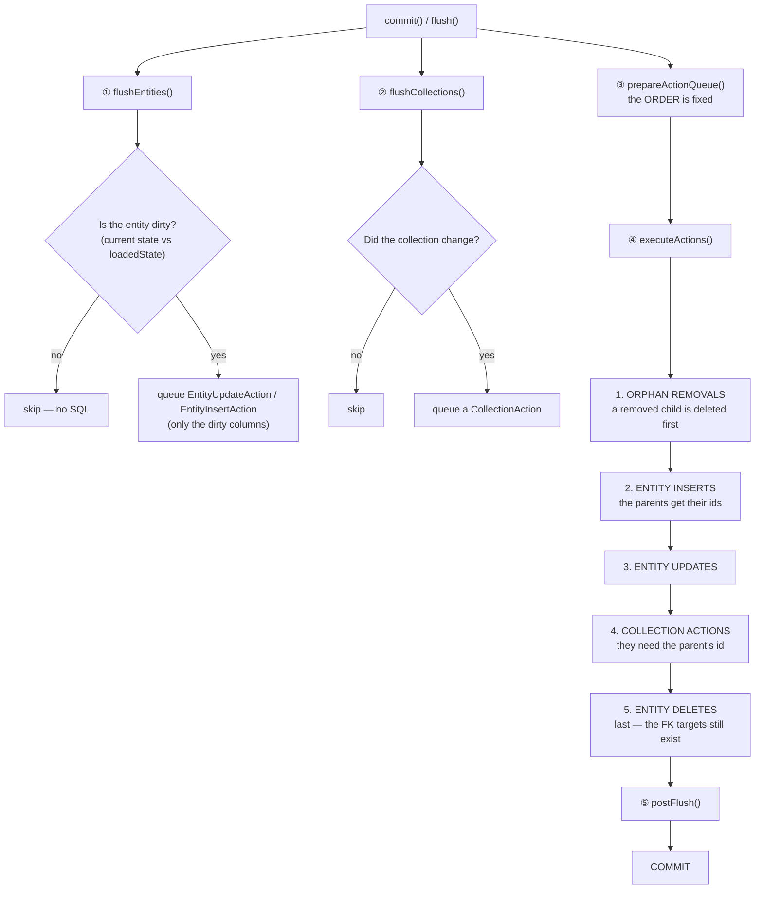
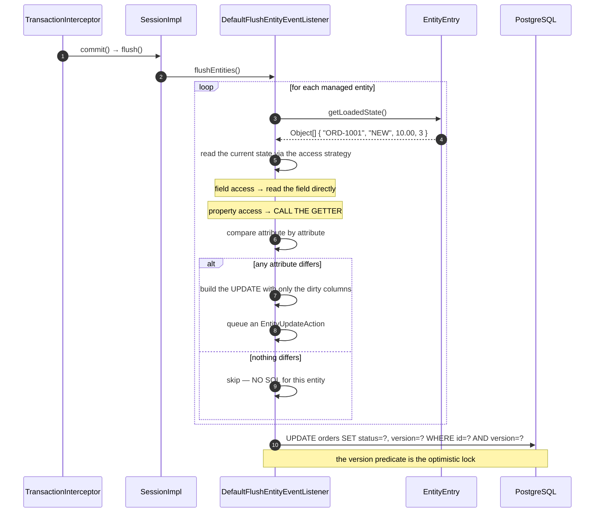
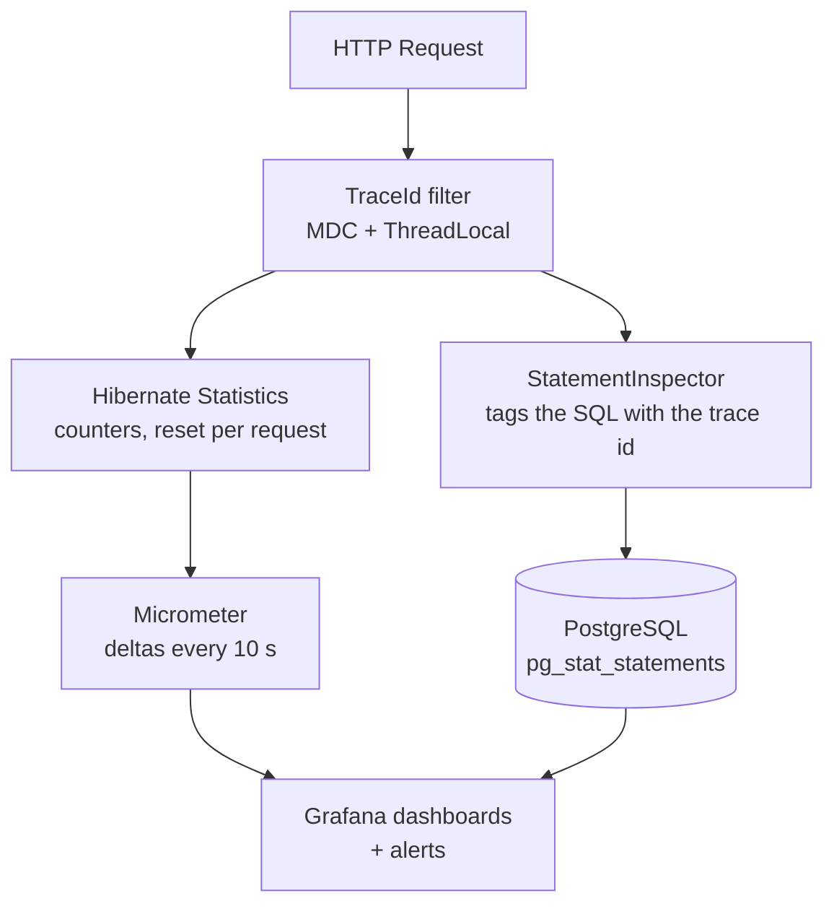
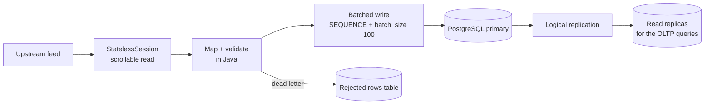

# 05 — Hibernate Internals & Performance Tuning

> **Level:** Expert
> **Interview Frequency:** ★★★★☆ (the "how do you know it is slow?" question — where 3-year and 5-year candidates diverge)
> **Prerequisites:** [04 · Lazy/Eager & Fetch Strategies](04-Lazy-Eager-N-plus-1-and-Fetch-Strategies.md) · [01 · ORM Theory & JPA Internals](01-ORM-Theory-and-JPA-Internals.md)
> **Last Updated:** 2026

---

## 📋 Table of Contents

- [0. TL;DR — The 30-Second Answer](#0-tldr--the-30-second-answer)
- [1. What & Why — The Problem This Solves](#1-what--why--the-problem-this-solves)
- [2. Mental Model — The One Picture](#2-mental-model--the-one-picture)
- [3. Deep Dive — Theory (Beginner → Advanced)](#3-deep-dive--theory-beginner--advanced)
  - [3.1 Beginner Level](#31-beginner-level)
  - [3.2 Intermediate Level](#32-intermediate-level)
  - [3.3 Advanced Level](#33-advanced-level)
  - [3.4 Expert Level](#34-expert-level)
- [4. Internal Working Mechanism](#4-internal-working-mechanism)
- [5. Step-by-Step Execution Flow](#5-step-by-step-execution-flow)
- [6. Visualizations](#6-visualizations)
- [7. Production-Level Use Cases & Real Industry Examples](#7-production-level-use-cases--real-industry-examples)
- [8. Worked Examples (with Output + Dry Run)](#8-worked-examples-with-output--dry-run)
- [9. Code from Scratch — Production-Grade](#9-code-from-scratch--production-grade)
- [10. Common Mistakes & Gotchas](#10-common-mistakes--gotchas)
- [11. Performance Considerations](#11-performance-considerations)
- [12. Security Considerations](#12-security-considerations)
- [13. Best Practices](#13-best-practices)
- [14. Hands-On Exercises & Code Challenges](#14-hands-on-exercises--code-challenges)
- [15. Interview Q&A — Level-wise](#15-interview-qa--level-wise)
- [16. Scenario-Based & Real-Experience Scenarios (3–5 yrs)](#16-scenario-based--real-experience-scenarios-35-yrs)
- [17. Counter-Questions, Tricky Questions & Follow-Ups](#17-counter-questions-tricky-questions--follow-ups)
- [18. Frequently Asked Production Issues & Debugging Scenarios](#18-frequently-asked-production-issues--debugging-scenarios)
- [19. Architecture Design Questions](#19-architecture-design-questions)
- [20. Rapid-Fire MCQs](#20-rapid-fire-mcqs)
- [21. Cheat Sheet / One-Page Summary](#21-cheat-sheet--one-page-summary)
- [22. Real-World Production Notes](#22-real-world-production-notes)
- [23. Follow-up Learning](#23-follow-up-learning)

---

## 0. TL;DR — The 30-Second Answer

- **`SessionFactory` is immutable, thread-safe and application-scoped.** It holds the metamodel, the per-entity `EntityPersister`s, the query plan cache, the connection provider and the caches. It is built **once** at startup (it is expensive — hundreds of milliseconds to seconds).
- **`Session` / `EntityManager` is the unit of work** — the identity map, the pending actions, the dirty checking. It is **NOT thread-safe**, and it lives for one transaction.
- **`StatelessSession` has no identity map, no dirty checking and no cascade** — the tool for bulk reads, where the flat memory profile matters more than the object identity.
- **The flush order is fixed:** orphan deletions → entity **INSERTs** → entity **UPDATEs** → collection actions → entity **DELETEs**. Inserts come first so children have their parent's id; deletes come last so the rows being referenced still exist.
- **Dirty checking compares the current state against the `EntityEntry.loadedState` snapshot**, attribute by attribute, using the entity's access strategy. If nothing changed, no `UPDATE` is issued.
- **`hibernate.generate_statistics=true` + the `StatisticsMBean` is how you *prove* a problem.** `queryExecutionCount` vs `entityLoadCount` vs `prepareStatementCount` are the three numbers that matter.
- **`logging.level.org.hibernate.SQL=DEBUG` gives you the SQL; `logging.level.org.hibernate.orm.jdbc.bind=TRACE` gives you the parameters.** The second one is invaluable and a **secret-leak risk** — never on in production.
- **JDBC batching requires `SEQUENCE` ids.** With `IDENTITY`, Hibernate must execute the INSERT immediately to read the generated key, so it can never be batched. This is the single most common "my batch_size does nothing" cause.
- **`batch_size` + `order_inserts` + `order_updates` is the write-path combination.** `order_inserts` groups similar INSERTs together so the driver can batch them; without it, Hibernate interleaves the statements and the batching degrades.
- **Hibernate 6 replaced the old query translator with an ANTLR grammar and the SQM (Semantic Query Model).** `javax.persistence` → `jakarta.persistence`; `hibernate.max_fetch_depth` was removed; `hibernate.type.preferred_*_jdbc_type` was added; `hibernate.jdbc.time_zone` was added.
- **A `StatementInspector` lets you tag every SQL statement with a trace id** without changing the SQL — the cheapest way to attribute a slow query to a request.

---

## 1. What & Why — The Problem This Solves

**The problem.** At 3 years' experience, you can make an application *work*. At 5 years, you
are the person who is asked **"why is it slow?"** — and the honest answer is usually "I don't
know, let me add some logging".

The gap between those two levels is not knowing more SQL. It is knowing **where the time
goes inside the ORM**:

```text
   WHERE DOES THE TIME ACTUALLY GO IN A REQUEST?
   ══════════════════════════════════════════════

   ┌──────────────────────────────────────────────────────────────────┐
   │  1. TRANSLATION      JPQL → SQL          (once per query string) │
   │  2. PLAN LOOKUP      the plan cache                              │
   │  3. EXECUTION        JDBC → the database                         │
   │  4. HYDRATION        ResultSet → objects                          │
   │  5. DIRTY CHECKING   compare the state to the snapshot            │
   │  6. FLUSH            the pending SQL + the ordering               │
   │  7. BATCHING         grouping the statements                     │
   │  8. CACHING          the L1/L2 lookups                           │
   └──────────────────────────────────────────────────────────────────┘

   ⚠ WHICH OF THESE IS YOUR PROBLEM? ONLY THE STATISTICS CAN TELL YOU.
```

**A concrete example.** A request takes 400 ms. The database says the query took 4 ms. Where
did the other 396 ms go? The candidates:

| Hypothesis | How to test it | The signal |
|---|---|---|
| Too many round trips (an N+1) | `queryExecutionCount` | 501 statements for 20 rows |
| Hydration overhead (too many columns/entities) | `entityLoadCount`, the response size | 5 000 entities for 20 rows |
| Translation overhead (the plan cache is missing) | `queryPlanCacheHitRate` | A hit rate below 90 % |
| Dirty-checking overhead (a huge session) | The transaction duration, the heap | A 4 000-entity context |
| Lock waiting | `pg_stat_activity` | `wait_event_type = 'Lock'` |
| The connection pool | Hikari's `pending` | Threads waiting for a connection |

**Without the statistics, you are guessing.** And guessing is expensive — the most common
outcome is "we added an index and nothing changed".

**The solution.** Hibernate exposes a **statistics model** and a **JMX MBean** that report
exactly these counters, and a set of **tuning knobs** that change the behaviour of the
flush, the batching and the caching. This chapter is about using them.

---

## 2. Mental Model — The One Picture

```text
   THE HIBERNATE OBJECT GRAPH AT RUNTIME
   ═════════════════════════════════════

   ┌──────────────────────────────────────────────────────────────────────┐
   │  SessionFactory  (immutable · thread-safe · ONE per application)     │
   │  ┌────────────────────────────────────────────────────────────────┐  │
   │  │  Metamodel                                                       │  │
   │  │    EntityType<Order> ──► Attribute(name, type, access, lazy…)    │  │
   │  │                                                                │  │
   │  │  EntityPersister (one per entity)                               │  │
   │  │    the SQL templates: <loader> <insert> <update> <delete>       │  │
   │  │    the loader · the cascade planner · the dirty-check strategy  │  │
   │  │                                                                │  │
   │  │  QueryPlanCache  (2048 plans by default)                        │  │
   │  │    query string → { SQL template, binders, fetch plan }         │  │
   │  │                                                                │  │
   │  │  ConnectionProvider  →  HikariDataSource                        │  │
   │  │                                                                │  │
   │  │  Cache regions (L2, optional)                                   │  │
   │  └────────────────────────────────────────────────────────────────┘  │
   └──────────────────────────────────────────────────────────────────────┘
                                     │  creates
                                     ▼
   ┌──────────────────────────────────────────────────────────────────────┐
   │  Session / EntityManager  (per transaction · NOT thread-safe)        │
   │  ┌────────────────────────────────────────────────────────────────┐  │
   │  │  StatefulPersistenceContext                                    │  │
   │  │    the identity map:  EntityKey → EntityEntry                   │  │
   │  │    EntityEntry { Object[] loadedState, status, lockMode }       │  │
   │  │                                                                │  │
   │  │  ActionQueue  (the pending work)                               │  │
   │  │    [0] OrphanRemovalAction                                     │  │
   │  │    [1] EntityInsertAction × n                                   │  │
   │  │    [2] EntityUpdateAction × n                                   │  │
   │  │    [3] CollectionUpdateAction / CollectionRemoveAction / …        │  │
   │  │    [4] EntityDeleteAction × n                                   │  │
   │  └────────────────────────────────────────────────────────────────┘  │
   │                                     │                                │
   │                                     ▼                                │
   │  JdbcCoordinator ──► LogicalConnection ──► JDBC PreparedStatement     │
   │                                                │                     │
   └────────────────────────────────────────────────┼─────────────────────┘
                                                    ▼
                                              PostgreSQL
```

**What to look at:** the `SessionFactory` is **read-only at runtime** — it never changes
after startup. Everything that mutates (the identity map, the pending actions) lives in the
short-lived `Session`. That split is why the factory is thread-safe and the session is not.

---

## 3. Deep Dive — Theory (Beginner → Advanced)

### 3.1 Beginner Level

#### The three Hibernate session types

| Type | JPA equivalent | Identity map | Dirty checking | Cascade | Use for |
|---|---|---|---|---|---|
| `Session` | `EntityManager` | ✅ | ✅ | ✅ | 99 % of the time |
| `StatelessSession` | ✗ (not in JPA) | ❌ | ❌ | ❌ | Bulk reads, exports, batch scans |
| `SharedSessionContract` | — | — | — | — | The common supertype |

```java
// A normal session — Spring gives you one per transaction
@PersistenceContext
EntityManager em;

// A stateless session — you create it yourself
Session stateless = emf.openStatelessSession();
try (Session s = stateless) {
    StatelessScrollableResults<Order> results = s
            .createQuery("from Order", Order.class)
            .scroll(ScrollMode.FORWARD_ONLY);
    while (results.next()) {
        process(results.get());     // a fresh object every time — no identity map entry
    }
}
```

#### `flush` — the three-phase pipeline

```text
   flush()
      │
      ├─ ① FLUSH THE ENTITIES      (compare with the snapshot → queue INSERT/UPDATE/DELETE)
      ├─ ② FLUSH THE COLLECTIONS   (compare the collection contents → queue collection actions)
      ├─ ③ BEFORE-COMPLETION        (prepare the SQL, order the actions, execute them)
      │
      └─ the SQL goes out; the transaction stays open
```

#### The statistics — the counters you need

```java
@Autowired
private EntityManagerFactory emf;

public void dumpStatistics() {
    Statistics stats = emf.unwrap(SessionFactory.class).getStatistics();

    log.info("queries={} entities={} collections={} collectionFetches={} "
                   + "prepares={} flushes={} connections={} "
                   + "l2Hits={} l2Misses={} planHits={} planMisses={} "
                   + "optimisticFailures={}",
            stats.getQueryExecutionCount(),
            stats.getEntityLoadCount(),
            stats.getCollectionLoadCount(),
            stats.getCollectionFetchCount(),
            stats.getPrepareStatementCount(),
            stats.getFlushCount(),
            stats.getConnectCount(),
            stats.getSecondLevelCacheHitCount(),
            stats.getSecondLevelCacheMissCount(),
            stats.getQueryPlanCacheHitRate(),      // a double, 0.0–1.0
            stats.getQueryPlanCacheMissCount(),
            stats.getOptimisticFailureCount());
}
```

| Counter | What it tells you | The N+1 signature |
|---|---|---|
| `queryExecutionCount` | The number of HQL/JPQL/Criteria executions | High, and growing per request |
| `entityLoadCount` | The number of entities hydrated | ≫ the rows the endpoint returns |
| `collectionLoadCount` | The number of collections initialised | High with a small result |
| `collectionFetchCount` | The number of collection fetches | **The clearest N+1 signal** |
| `prepareStatementCount` | The number of JDBC statements | > `queryExecutionCount` → extra statements |
| `flushCount` | The number of flushes | High → many small transactions |
| `connectCount` | The number of physical connections opened | = the pool churn |
| `secondLevelCacheHitCount` / `MissCount` | The L2 hit rate | A high hit rate with stale data → the invalidation problem |
| `queryPlanCacheHitRate` | The plan reuse rate | < 0.9 → the queries are not being reused |
| `optimisticFailureCount` | The `@Version` conflicts | Non-zero → a concurrency hot spot |

### 3.2 Intermediate Level

#### The `EntityPersister` — the per-entity machine

Every entity gets one `EntityPersister`
(`org.hibernate.persister.entity.AbstractEntityPersister`). It holds:

| What | Why it matters |
|---|---|
| The **mapping metadata** (columns ↔ attributes) | The source of truth for the mapping |
| The **SQL templates** (`<loader>`, `<insert>`, `<update>`, `<delete>`, `<collection-load>`) | One template per operation; the parameters are bound into it |
| The **loader** (`QueryLoader` / `EntityLoader`) | Knows how to build the SELECT for this entity, including the joins for the eager associations |
| The **dirty-check strategy** | Knows how to compare the state (which access strategy, whether a property is mutable) |
| The **cascade planner** | Knows what to cascade and in which order |
| The **`EntityKey` / `EntityEntry` factory** | The bookkeeping types |

**Why this matters practically:** the persister is built **once at startup**. If the
mapping is wrong, the persister is wrong — which is why `ddl-auto=validate` catches mapping
errors at startup rather than at 3 a.m.

#### The `ActionQueue` — the pending work, in order

```java
public class ActionQueue {
    private ArrayList<EntityInsertAction> insertions;
    private ArrayList<EntityUpdateAction> updates;
    private ArrayList<EntityDeleteAction> deletions;
    private ArrayList<CollectionAction> collectionRemovals;
    private ArrayList<CollectionAction> collectionUpdates;
    private ArrayList<CollectionAction> collectionRecreations;
    private ArrayList<OrphanRemovalAction> orphanRemovals;
    ...
}
```

**The flush order — and why each part is where it is:**

```text
   1. ORPHAN REMOVALS      a child removed from a collection is deleted FIRST
                           → the FK of the remaining children stays valid
   2. ENTITY INSERTS       the parents, so the children can reference their ids
                           → and so the ids exist for the collection inserts
   3. ENTITY UPDATES       the modified rows
   4. COLLECTION ACTIONS   the collection inserts / updates / recreations
                           → they need the parent's id, which step 2 produced
   5. ENTITY DELETES       last, so nothing deletes a row the others still need
                           → and the FK targets are still present
```

> **The practical consequence:** the order is why `batch_size` works best with
> `order_inserts = true` — the statements are grouped by type, so similar statements end
> up adjacent and the JDBC driver can batch them.

#### The `StatefulPersistenceContext` and the `EntityEntry`

```java
public class EntityEntry {
    private Object id;
    private Object[] loadedState;       // ← THE SNAPSHOT
    private Object[] loadedPropertyNames;
    private EntityKey entityKey;
    private Status status;              // MANAGED, DELETED, GONE, READ_ONLY, LOADING
    private LockMode lockMode;
    private Object version;
    private boolean isModifiableEntity;
    ...
}
```

```text
   the identity map:  EntityKey(entityName + id)  →  EntityEntry
   the entity:        EntityKey                  →  the instance
   the snapshot:      EntityEntry.loadedState    →  Object[] (one slot per attribute)
```

**The `loadedState` array is the dirty-checking baseline.** It is a flat array of the
values **as loaded** — not a copy of the object, not a proxy.

### 3.3 Advanced Level

#### `JdbcCoordinator` and `LogicalConnection`

```text
   SessionImpl
      │
      ▼
   JdbcCoordinator          — owns the JDBC resources for the session
      ├── LogicalConnection — the "logical" handle on the physical JDBC connection
      │      ├── the physical Connection (from Hikari)
      │      ├── the ConnectionReleaseMode policy
      │      └── the acquired/release state
      ├── StatementPreparer  — builds the PreparedStatement and binds the parameters
      └── the exception converter (SQLException → HibernateException)
```

**`ConnectionReleaseMode`** — when the physical connection goes back to the pool:

| Mode | Behaviour | Use |
|---|---|---|
| `AFTER_TRANSACTION` | Released when the transaction ends | The default — the connection is held for the whole transaction |
| `AFTER_STMT` | Released after **each** statement | A very short transaction; poor for transactions with several statements |
| `NEVER` | Never released by Hibernate | You manage it |
| `DELAYED_ACQUISITION_AND_RELEASE_AFTER_TRANSACTION` | Acquired lazily, released at the end | Hibernate 6: the connection is not taken until the first statement |
| `DELAYED_ACQUISITION_AND_HOLD` | Acquired lazily and held | Hibernate 6 |

```java
// Per session (rarely needed — Spring manages the connection lifecycle)
session.setJdbcTransactionMode(
        org.hibernate.engine.transaction.jdbc.JdbcTransactionCoordinator.ImplicitTransactionMode
                .DELAYED_ACQUISITION_AND_RELEASE_AFTER_TRANSACTION);
```

#### The statement cache and the query plan cache — two different caches

```text
   THE TWO CACHES (do not confuse them)
   ═══════════════════════════════════

   QUERY PLAN CACHE (Hibernate)
   ┌──────────────────────────────────────────────────────────────┐
   │  key:   the query string + the entity names                  │
   │  value: the SQL template + the parameter binders + the        │
   │         fetch plan + the entity persisters                   │
   │  size:  hibernate.query.plan_cache_max_size  (default 2048) │
   │  hit:   the query is NOT re-parsed or re-translated          │
   └──────────────────────────────────────────────────────────────┘
        ⇣ FEEDS
   JDBC STATEMENT CACHE (the driver / the pool)
   ┌──────────────────────────────────────────────────────────────┐
   │  key:   the SQL text (PostgreSQL: the server-side plan)     │
   │  value: the prepared statement on the server                 │
   │  hit:   the server does not re-parse or re-plan              │
   └──────────────────────────────────────────────────────────────┘

   ⚠ THE PLAN CACHE IS BOUNDED: above 2048 distinct query strings,
     plans are evicted and re-translated — a CPU cost with NO change
     in the SQL log. Watch queryPlanCacheHitRate.
```

#### `StatementInspector` — tag the SQL without changing it

```java
package com.example.shop.observability;

import org.hibernate.resource.jdbc.spi.StatementInspector;
import org.springframework.stereotype.Component;

import java.util.concurrent.atomic.AtomicLong;

@Component
public class TraceIdStatementInspector implements StatementInspector {

    private static final ThreadLocal<String> TRACE_ID = new ThreadLocal<>();
    private static final AtomicLong COUNTER = new AtomicLong();

    @Override
    public String inspect(String sql) {
        String traceId = TRACE_ID.get();
        if (traceId == null) {
            return sql;
        }
        // ✅ A SQL comment is ignored by every database — the statement is UNCHANGED,
        //    so the plan cache key is unaffected and the server plan is reused.
        return "/* trace:" + traceId + " */ " + sql;
    }

    public static void withTraceId(String traceId, Runnable runnable) {
        TRACE_ID.set(traceId);
        try {
            runnable.run();
        } finally {
            TRACE_ID.remove();     // ✅ always remove — a pooled thread would leak the id
        }
    }
}
```

> **The subtlety:** a SQL comment at the front changes the **statement text**, which is the
> key of the **JDBC** statement cache. Because the trace id changes per request, every
> request would get a different statement text → the server-side plan cache would miss on
> every call. The fix is to put the trace id in a **trailing** comment (`sql + " /* trace:x */"`)
> — the plan cache in PostgreSQL normalises the statement, and the leading-comment approach
> at least keeps the *Hibernate* plan cache intact (it keys on the JPQL string, not the SQL).

#### The `Interceptor` SPI

```java
package org.hibernate;

public interface Interceptor {
    default Object onLoad(Object entity, Serializable id, Object[] state, String[] propertyNames, EventType eventType) { return entity; }
    default boolean onSave(Object entity, Serializable id, Object[] state, String[] propertyNames, EventType eventType) { return false; }
    default void onDelete(Object entity, Serializable id, Object[] state, String[] propertyNames, EventType eventType) { }
    default boolean onFlushDirty(Object entity, Object[] currentState, Object[] previousState, String[] propertyNames, EventType eventType) { return false; }
    default void preFlush(Object[] entities) { }
    default void postFlush(Object[] entities) { }
    default void postCommit() { }
    default String onPrepareStatement(String sql) { return sql; }
}
```

| Hook | Use | Warning |
|---|---|---|
| `onFlushDirty` | Audit a changed entity | Returning `true` forces the entity to be updated |
| `onLoad` | Decrypt a field on load | Runs for every entity — it is on the hot path |
| `preFlush` / `postFlush` | Cross-cutting work at the flush boundary | `postFlush` runs after the SQL is sent but **before** the commit |
| `postCommit` | A final hook after the commit | **Not transactional** — the commit already happened |
| `onPrepareStatement` | Rewrite the SQL | Legacy — prefer `StatementInspector` |

#### The event listeners

```java
package org.hibernate.event.spi;

public class PostInsertEvent extends AbstractEvent {
    private final Object entity;
    private final Serializable id;
    private final Object[] state;
    private final EntityPersister persister;
    ...
}
```

| Listener | Interface | Use |
|---|---|---|
| `PostInsertEventListener` | `org.hibernate.event.spi.PostInsertEventListener` | Write to a search index, publish an event |
| `PostUpdateEventListener` | `PostUpdateEventListener` | Evict a cache entry, audit |
| `PostDeleteEventListener` | `PostDeleteEventListener` | Soft-delete bookkeeping |
| `PreInsertEventListener` | `PreInsertEventListener` | Set a default, validate |
| `PostLoadEventListener` | `PostLoadEventListener` | Enrich a loaded entity |

```java
@Component
public class SearchIndexListener implements PostInsertEventListener {

    @Override
    public void onPostInsert(PostInsertEvent event) {
        // ⚠ the INSERT has been executed, but the transaction is NOT committed yet.
        //    If the transaction rolls back, the index now has a row the database does not.
        //    → the safe place to update a search index is AFTER_COMMIT, not here.
        log.info("inserted {} with id {}", event.getEntity().getClass(), event.getId());
    }
}
```

### 3.4 Expert Level

#### Hibernate 6 — what actually changed

```text
   HIBERNATE 5 → HIBERNATE 6
   ══════════════════════════════

   ① THE QUERY ENGINE
      H5:  a hand-written parser (ANTLR 2 grammar) → HQL AST → SQL
      H6:  an ANTLR 4 grammar → HQL AST → SQM (Semantic Query Model) → SQL AST → SQL
      WHY IT MATTERS:
        - the SQM is a proper semantic model: it understands the entity metamodel,
          so it can validate a query against it BEFORE it hits the database
        - the SQL AST step means the generated SQL is consistent and optimisable
        - the parse is cached in the query plan cache, exactly as before

   ② THE PACKAGE MOVE
      javax.persistence.*        → jakarta.persistence.*
      javax.transaction.*        → jakarta.transaction.*
      (Jakarta EE 9+; Spring Boot 3 requires it)

   ③ THE REMOVED SETTINGS
      hibernate.max_fetch_depth         → REMOVED (it was deprecated in 5.2)
      hibernate.cglib.*                 → REMOVED (bytecode enhancement replaced it)
      hibernate.jdbc.lob.non_contextual_creation → REMOVED

   ④ THE NEW SETTINGS
      hibernate.jdbc.time_zone                  → set the JDBC timezone explicitly
      hibernate.type.preferred_instant_jdbc_type → choose the JDBC type for Instant
      hibernate.type.preferred_local_date_jdbc_type
      hibernate.type.preferred_local_datetime_jdbc_type
      hibernate.query.plan_parameter_metadata_max_size (default 128)

   ⑤ THE CHANGED DEFAULTS
      hibernate.jdbc.batch_size         → 30 in Hibernate 6 (it was effectively off in 5.x)
      hibernate.default_batch_fetch_size → set it EXPLICITLY; do not rely on the default
      hibernate.cache.use_query_cache    → the query cache's defaults were tightened
```

> **The `preferred_*_jdbc_type` settings matter for a specific production bug:** by
> default Hibernate maps `Instant` to `TIMESTAMP` (without a timezone) and the JVM's
> default timezone is applied. On a JVM whose timezone differs from the database's, the
> stored value is silently shifted. Setting
> `hibernate.type.preferred_instant_jdbc_type=TIMESTAMP_UTC` (or
> `hibernate.jdbc.time_zone=UTC`) removes the ambiguity.

#### The batch-size / `IDENTITY` interaction — the mechanism

```text
   WHY IDENTITY BREAKS BATCHING
   ═════════════════════════════

   With SEQUENCE:
     Hibernate allocates the ids UP FRONT (a pool of 50)
        id=90001 id=90002 ... id=90050
     → the INSERT statements can be PREPARED WITH the ids already bound
     → the driver sends them in ONE network round trip
        insert into payment (id, ...) values (?, ...)   × 50
        insert into payment (id, ...) values (?, ...)   × 50
        → 1 round trip for 100 rows

   With IDENTITY:
     Hibernate does NOT know the id before the INSERT
     → the INSERT must be EXECUTED to get the key back (getGeneratedKeys)
     → the statement cannot be batched, and cannot be deferred to the flush
        insert into payment (...) values (...)   ← one round trip, then the key comes back
        insert into payment (...) values (...)   ← one round trip
        → 1 round trip PER ROW
```

#### `hibernate.jdbc.batch_versioned_data`

```yaml
spring:
  jpa:
    properties:
      hibernate:
        jdbc:
          batch_size: 50
          # ⚠ Without this, an entity WITH @Version is NOT batched —
          #    Hibernate must read the generated version back to increment it correctly.
          batch_versioned_data: true
```

**The mechanism:** when an entity has a `@Version`, Hibernate's UPDATE sets
`version = version + 1`. That is computable in SQL, but the classic implementation reads
the version back to keep the in-memory state in sync — and a statement whose result is read
cannot be batched. `batch_versioned_data = true` tells Hibernate to compute the new version
in SQL and **not** read it back, so the UPDATE can be batched.

> **This is a real, measurable effect:** without it, a batch of 100 versioned entities
> issues 100 round trips; with it, 2.

#### The `StatisticsMBean` as a live dashboard source

```java
@Bean
public MBeanExporter mbeanExporter() {
    MBeanExporter exporter = new MBeanExporter();
    exporter.setAutodetect(true);
    return exporter;
}
```

```bash
# The Hibernate statistics MBean is registered under the "org.hibernate" domain
# (the exact name depends on the Hibernate version and the registry configuration).
# With Actuator, the same numbers are exposed as Micrometer metrics:
curl -s localhost:8080/actuator/metrics/hibernate.statistics | jq '.measurements[] | {statistic, value}'
```

```text
   METRICS TO ALERT ON (from the Hibernate statistics)
   ─────────────────────────────────────────────────
   hibernate.statistics.query.execution.count        → per-request query count
   hibernate.statistics.entity.load.count            → entities hydrated
   hibernate.statistics.collection.fetch.count       → the N+1 signal
   hibernate.statistics.prepare.statement.count      → the JDBC round trips
   hibernate.statistics.flush.count                  → the flush frequency
   hibernate.statistics.query.plan.cache.hit.rate    → the plan reuse rate
   hibernate.statistics.second.level.cache.hit.rate  → the L2 hit rate
   hibernate.statistics.optimistic.lock.failure.count→ the concurrency hot spots
```

---

## 4. Internal Working Mechanism

**Which class calls which, in what order.** The flush pipeline, in detail.

```text
1.  TransactionInterceptor → the transaction commits
      └─ JpaTransactionManager.doCommit(...)
           └─ EntityManager.commit()
                └─ SessionImpl.flushBeforeTransactionCompletion()  (Hibernate 6)

2.  SessionImpl.flush()
      └─ AbstractFlushingEventListener.performExecutions(source)
           ├─ ① flushEntities()
           │     └─ DefaultFlushEntityEventListener.onFlushEntity(event)
           │          ├─ the entity is not transient → skip
           │          ├─ the entity is not dirty   → skip (NO SQL)
           │          ├─ the entity is READ-ONLY   → skip
           │          └─ the entity is dirty       → queue an EntityUpdateAction
           │               (only the DIRTY attributes are added to the UPDATE)
           ├─ ② flushCollections()
           │     └─ the collection's snapshot vs the current contents
           │          → queue a CollectionRecreationAction / CollectionUpdateAction /
           │            CollectionRemoveAction
           ├─ ③ prepareActionQueue()  (the beforeFlush event, the ActionQueue is ordered)
           │     └─ the order:
           │          orphanRemovals → insertions → updates →
           │          collectionRemovals → collectionUpdates → collectionRecreations →
           │          deletions
           ├─ ④ executeActions()  (the actual SQL)
           │     └─ for each action:
           │          ├─ EntityInsertAction.perform()   → the INSERT (with the generated id)
           │          ├─ EntityUpdateAction.perform()   → the UPDATE (with the version predicate)
           │          ├─ CollectionAction.perform()     → the collection INSERT/UPDATE/DELETE
           │          └─ EntityDeleteAction.perform()   → the DELETE
           └─ ⑤ postFlush()  → the Interceptor's postFlush, the afterFlush event
```

**Where the extension points sit in that pipeline:**

| Extension point | Where it is invoked | Transactional? |
|---|---|---|
| `Interceptor.preFlush` | Before the actions are queued | ✅ inside the transaction |
| `Interceptor.onFlushDirty` | Per dirty entity | ✅ inside |
| `Interceptor.onLoad` | Per loaded entity | ✅ inside |
| `PostInsertEventListener` | After the INSERT statement | ✅ inside — but **before** the commit |
| `Interceptor.postFlush` | After all the SQL | ✅ inside |
| `Interceptor.postCommit` | After the commit | ❌ **not** transactional |

> **The rule that catches people:** anything that writes to an *external* system (a search
> index, a message broker, a cache) must happen **after the commit**, or it can publish a
> fact that the database later rolls back. In Hibernate terms: `postCommit` or
> `@TransactionalEventListener(AFTER_COMMIT)` — never `PostInsertEventListener`.

---

## 5. Step-by-Step Execution Flow

**Flow 1 — a write transaction, from the annotation to the COMMIT.**

1. The `@Transactional` proxy starts the transaction → the `EntityManager` is created and
   bound to the thread; the JDBC connection is taken from Hikari.
2. `order.setStatus(PAID)` → **no SQL**. The entity is managed; Hibernate only knows it
   *might* be dirty.
3. The method returns → the transaction manager commits → `SessionImpl.flush()`.
4. `flushEntities()` → for the `Order`: the current state is compared with the
   `EntityEntry.loadedState` → `status` differs → an `EntityUpdateAction` is queued with
   only the `status` and `version` columns.
5. `prepareActionQueue()` → the actions are ordered: no insertions, 1 update, no
   collections, no deletions.
6. `executeActions()` → the `UPDATE` is prepared and executed through the
   `JdbcCoordinator` → the `LogicalConnection` → the JDBC `PreparedStatement` → PostgreSQL.
7. `postFlush()` → the interceptors are notified.
8. The JDBC `COMMIT` is issued → the connection is released → the `EntityManager` is closed
   → the identity map is discarded.

**Flow 2 — a bulk insert with batching.**

1. `paymentRepository.saveAll(payments)` → 500 `persist()` calls → the entities are
   **inserted immediately** (the `SEQUENCE` gives them ids from the pool) → 500
   `EntityInsertAction`s are queued.
2. The flush → the actions are ordered (500 insertions, contiguous) → with
   `order_inserts = true` and `batch_size = 50`, the `PreparedStatement` is prepared once
   and executed 10 times with 50 parameter sets each.
3. **10 round trips** for 500 rows (instead of 500).

**Flow 3 — a query, from the JPQL to the rows.**

1. The query string is looked up in the **query plan cache**.
2. On a **miss**: the ANTLR grammar parses the HQL → the SQM is built and validated
   against the metamodel → the SQL AST is produced → the plan (the SQL template + the
   binders + the fetch plan) is stored in the cache.
3. The plan is executed: the SQL is prepared (the JDBC statement cache may reuse it), the
   parameters are bound.
4. The `ResultSet` is processed by the **result graph**: for each row, the `EntityLoader`
   hydrates the entities, creates the `EntityEntry` with the loaded-state snapshot, and puts
   the instance in the identity map.
5. The lazy associations become proxies; the eager ones are resolved.

---

## 6. Visualizations

### 6.1 The flush pipeline through the `ActionQueue`



**Caption:** The order is not cosmetic. Inserts precede updates so that a child insert
finds its parent's id; deletes come last so nothing deletes a row that another statement
still references; orphan removals come first so the remaining children's FKs stay valid.
The order is also what makes `order_inserts` effective — similar statements end up adjacent.

### 6.2 The `StatefulPersistenceContext` — the identity map and the snapshots

```text
   THE PERSISTENCE CONTEXT AT RUNTIME
   ═══════════════════════════════════

   StatefulPersistenceContext
   ┌──────────────────────────────────────────────────────────────────────────┐
   │  entitiesByKey : IdentityMap                                             │
   │  ┌────────────────┬───────────────┬───────────────────────────────┐      │
   │  │ EntityKey      │ EntityEntry   │ the entity instance           │      │
   │  ├────────────────┼───────────────┼───────────────────────────────┤      │
   │  │ Order#1001     │ entry1        │ Order@0x7a1f  (managed)       │      │
   │  │  loadedState[] │  status = NEW │  status = PAID   ← CHANGED    │      │
   │  │   reference    │  reference    │  reference = "ORD-1001"       │      │
   │  │   status       │  total = 10   │  total = 10.00               │      │
   │  │   total        │  version = 3  │  version = 3                 │      │
   │  │   version      │  status=MGMD  │                               │      │
   │  ├────────────────┼───────────────┼───────────────────────────────┤      │
   │  │ Order#1002     │ entry2        │ Order@0x7b22  (managed)       │      │
   │  │  loadedState[] │  status = PAID │  status = PAID  ← same       │      │
   │  │   ...          │  total = 25   │  total = 25.50               │      │
   │  │               │               │  → NO UPDATE for this one    │      │
   │  ├────────────────┼───────────────┼───────────────────────────────┤      │
   │  │ Customer#7    │ entry3        │ Customer@0x9c01 (managed)    │      │
   │  ├────────────────┼───────────────┼───────────────────────────────┤      │
   │  │ Order#1003     │ entry4        │ Order@0x7d55  (managed)       │      │
   │  │  status=INSERT │  id = null    │  (the INSERT is queued)      │      │
   │  └────────────────┴───────────────┴───────────────────────────────┘      │
   │                                                                          │
   │  collections : Map<CollectionKey, PersistentCollection>                  │
   │  ┌────────────────────┬──────────────────────────────────────────┐      │
   │  │ Order#1001.items   │ PersistentCollection@0x7e11              │      │
   │  │  (uninitialised)   │  role = Order@1001.items                 │      │
   │  │  snapshot = null   │  initialized = false   ← a LAZY proxy    │      │
   │  └────────────────────┴──────────────────────────────────────────┘      │
   └──────────────────────────────────────────────────────────────────────────┘

   THE DIRTY CHECK AT FLUSH (attribute by attribute):

   ┌────────────┬───────────────┬───────────────┬─────────┬──────────────────┐
   │ attribute  │ loadedState[] │ current value │ dirty?  │ in the UPDATE?   │
   ├────────────┼───────────────┼───────────────┼─────────┼──────────────────┤
   │ reference  │ "ORD-1001"    │ "ORD-1001"    │ no      │ —                │
   │ status     │ "NEW"         │ "PAID"        │ ✅ YES  │ set status=?     │
   │ total      │ 10.00         │ 10.00         │ no      │ —                │
   │ version    │ 3             │ 3 → 4         │ auto    │ set version=?    │
   └────────────┴───────────────┴───────────────┴─────────┴──────────────────┘

   → UPDATE orders SET status=?, version=? WHERE id=? AND version=?
   → Order#1002 is NOT in the UPDATE — its state matches the snapshot.
```

**Caption:** The snapshot is a flat `Object[]` per entity, stored in the `EntityEntry` — not
a copy of the object. That is why the dirty check is cheap, and why a **computed getter**
that is not `@Transient` makes an entity permanently dirty.

### 6.3 The dirty-checking comparison at flush



**Caption:** The comparison happens once per managed entity per flush, and it uses the
**access strategy** — a getter call for a property-access entity. That is why a computed
getter (or a getter with a side effect) breaks the dirty check: it returns a value that
never matches the snapshot, so the entity is "always dirty".

### 6.4 The tuning knobs — where they sit

```text
   THE TUNING KNOBS, GROUPED BY WHAT THEY CHANGE
   ═══════════════════════════════════════════════

   ┌─ WRITE PATH ──────────────────────────────────────────────────────────┐
   │  hibernate.jdbc.batch_size = 30        the JDBC batch size           │
   │  hibernate.order_inserts = false       group the INSERTs together    │
   │  hibernate.order_updates = false       group the UPDATEs together    │
   │  hibernate.jdbc.batch_versioned_data   batch the @Version UPDATEs    │
   │      ⚠ ALL FOUR ARE INEFFECTIVE WITH GenerationType.IDENTITY         │
   └────────────────────────────────────────────────────────────────────────┘

   ┌─ READ PATH ───────────────────────────────────────────────────────────┐
   │  hibernate.default_batch_fetch_size    batch the LAZY loads           │
   │  hibernate.jdbc.fetch_size = 0          the driver's row prefetch     │
   │  hibernate.query.in_clause_parameter_padding   pad the IN lists       │
   └────────────────────────────────────────────────────────────────────────┘

   ┌─ TRANSLATION ─────────────────────────────────────────────────────────┐
   │  hibernate.query.plan_cache_max_size=2048   the plan cache            │
   │  hibernate.query.plan_parameter_metadata_max_size=128                 │
   └────────────────────────────────────────────────────────────────────────┘

   ┌─ CONNECTION ──────────────────────────────────────────────────────────┐
   │  hibernate.connection.provider_disables_autocommit  let the provider  │
   │                                                        set autocommit  │
   │  hibernate.jdbc.time_zone                   pin the JDBC timezone       │
   └────────────────────────────────────────────────────────────────────────┘

   ┌─ CACHING ─────────────────────────────────────────────────────────────┐
   │  hibernate.cache.use_second_level_cache   the shared entity cache     │
   │  hibernate.generate_statistics            the counters                │
   └────────────────────────────────────────────────────────────────────────┘

   ┌─ DIAGNOSTICS ─────────────────────────────────────────────────────────┐
   │  logging.level.org.hibernate.SQL=DEBUG           the SQL               │
   │  logging.level.org.hibernate.orm.jdbc.bind=TRACE the PARAMETERS  ⚠     │
   └────────────────────────────────────────────────────────────────────────┘
```

**Caption:** The full table with the defaults and the "when to deviate" rule is in
[§22](#22-real-world-production-notes).

---

## 7. Production-Level Use Cases & Real Industry Examples

### 7.1 A payments ledger — batching as the difference between 8 s and 0.4 s

**Domain:** a nightly import of **250 000 ledger postings**, 1 800 rows/second sustained.

**Before:**

```yaml
spring:
  jpa:
    properties:
      hibernate:
        jdbc:
          batch_size: 50     # ← configured, but doing NOTHING
```

```text
   insert into ledger_posting (account_id, amount, currency, posted_at) values (?, ?, ?, ?)
   insert into ledger_posting (account_id, amount, currency, posted_at) values (?, ?, ?, ?)
   ... 250 000 times ...
   → 250 000 round trips → 8.4 s
```

**The cause:** the entity used `@GeneratedValue(strategy = GenerationType.IDENTITY)`. With
`IDENTITY`, Hibernate must execute the INSERT to read the generated key, so the statement
cannot be batched. The `batch_size` setting was simply irrelevant.

**After:**

```java
@Entity
@Table(name = "ledger_posting")
public class LedgerPosting {

    @Id
    @GeneratedValue(strategy = GenerationType.SEQUENCE, generator = "posting_seq")
    @SequenceGenerator(name = "posting_seq", sequenceName = "posting_posting_seq", allocationSize = 500)
    @Column(name = "id")
    private Long id;
    ...
}
```

```yaml
spring:
  jpa:
    properties:
      hibernate:
        jdbc:
          batch_size: 100
        order_inserts: true
        order_updates: true
```

```text
   select nextval('ledger_posting_seq')  →  500 ids
   insert into ledger_posting (id, ...) values (?, ?, ?, ?, ?)   × 100   ← batched
   insert into ledger_posting (id, ...) values (?, ?, ?, ?, ?)   × 100
   ... 25 batches ...
   → 25 round trips → 0.4 s      (21× faster)
```

**The sequence pool of 500 with 8 concurrent writers:** the sequence is hit
250 000 ÷ 500 = 500 times instead of 250 000.

### 7.2 A read-heavy dashboard — the statistics dashboard

**Domain:** an operations dashboard, 40 req/s, rendered from 6 entities.

- `hibernate.generate_statistics=true` in the staging profile, exposed through
  `/actuator/metrics/hibernate.statistics`.
- The alert: `hibernate.statistics.query.execution.count / request.count > 8` → a paging
  query and the N+1 are distinguished by the ratio (8 queries per request = the N+1; 2 = the
  page + the count).
- `hibernate.statistics.collection.fetch.count` spiking after a deploy pointed at a
  repository method that had been changed from a projection to an entity return type.

### 7.3 A slow-query attribution — the `StatementInspector`

**Domain:** a service with 40 repositories; the SRE team needed to attribute a slow query
to a request id.

```java
@Component
public class TraceIdStatementInspector implements StatementInspector {
    @Override
    public String inspect(String sql) {
        String traceId = TraceContext.currentTraceId();
        return traceId == null ? sql : sql + " /* trace:" + traceId + " */";
    }
}
```

```text
   2026-03-14 12:44:02.118 DEBUG o.h.SQL  - select ... from orders o1_0 where ...
                   /* trace:8f3c1a92-4b71-4c9e-9d21-7a0b6e51f2c3 */
```

**The measured effect:** the p99 slow-query attribution went from "which endpoint?" (a
guess) to an exact request id in the `pg_stat_statements` log — the trace id is in the
statement text, so `pg_stat_activity` and the slow-query log carry it.

> **The caveat that keeps this safe:** the trace id is in a **comment**, so the statement is
  semantically identical. But it does change the statement *text*, which matters for the
  JDBC statement cache. The safe pattern is to enable it only in a diagnostic profile, or to
  use a **fixed-length** placeholder.

### 7.4 A memory incident — the identity map on a large result set

**Domain:** a data-export feature that let a user export up to **500 000** orders.

- The implementation used `orderRepository.findAll()` with a `Pageable` — but the
  `Pageable` was applied **in the controller**, after the full list was already loaded.
- The result: 500 000 entities + 500 000 `EntityEntry` snapshots + the action queue →
  **3.8 GB** of heap → `OutOfMemoryError` → a pod restart loop.

**The fix:** stream it with a `StatelessSession` and a scrollable result — the peak heap
dropped to **180 MB**, and the export time from 4 minutes to 55 seconds (no hydration of
the whole graph).

---

## 8. Worked Examples (with Output + Dry Run)

### 8.1 Proving an N+1 with the statistics — numbers, not opinions

**The code:**

```java
package com.example.shop.service;

import com.example.shop.domain.Order;
import com.example.shop.repository.OrderRepository;
import org.hibernate.SessionFactory;
import org.hibernate.stat.Statistics;
import org.springframework.stereotype.Service;
import org.springframework.transaction.annotation.Transactional;

import java.util.List;

@Service
public class StatisticsProbeService {

    private final OrderRepository orderRepository;
    private final SessionFactory sessionFactory;

    public StatisticsProbeService(OrderRepository orderRepository,
                                  SessionFactory sessionFactory) {
        this.orderRepository = orderRepository;
        this.sessionFactory = sessionFactory;
    }

    @Transactional(readOnly = true)
    public Statistics measure(Long customerId, int expectedOrders) {
        Statistics stats = sessionFactory.getStatistics();
        stats.clear();                      // ✅ reset the counters — they are cumulative

        // ① the list query
        List<Order> orders = orderRepository.findByCustomerId(customerId);

        // ② walk the graph — this is what the serialiser would do
        orders.forEach(order -> {
            order.getCustomer().getName();
            order.getItems().forEach(item -> item.getProduct().getSku());
        });

        long statements = stats.getQueryExecutionCount();
        long entities = stats.getEntityLoadCount();
        long collectionFetches = stats.getCollectionFetchCount();
        long prepares = stats.getPrepareStatementCount();

        log.info("expected={} statements={} entities={} collectionFetches={} prepares={}",
                expectedOrders, statements, entities, collectionFetches, prepares);
        return stats;
    }
}
```

**The expected output — the N+1 version (5 orders, 2 items each):**

```text
   expected=5 statements=16 entities=20 collectionFetches=5 prepares=16

   WHERE THE 16 COMES FROM:
     1  the list query            (orders)
     5  the customer lookups      (one per order)
     5  the item collection loads (one per order)
     5  the product lookups       (one per item — 5 orders × 1 product each)
   ─────────────────────────────
     16
```

**The dry run:**

```text
   stats.clear()
   │
   ├─ orderRepository.findByCustomerId(42)
   │     → queryExecutionCount  = 1
   │     → entityLoadCount      = 5     (the 5 orders)
   │     → prepareStatementCount= 1
   │
   ├─ order#1.getCustomer().getName()
   │     → queryExecutionCount  = 2
   │     → entityLoadCount      = 6     (+1 customer)
   │
   ├─ order#1.getItems()  → 2 items
   │     → queryExecutionCount  = 3
   │     → entityLoadCount      = 8     (+2 items)
   │     → collectionFetchCount = 1
   │
   ├─ order#1.items[0].getProduct().getSku()
   │     → queryExecutionCount  = 4
   │     → entityLoadCount      = 9
   │     → order#1.items[1].getProduct() → 5, 10
   │
   ├─ order#2 ... order#5 → the same pattern
   │
   └─ FINAL:
        queryExecutionCount  = 1 + 5 + 5 + 5 = 16
        entityLoadCount      = 5 + 5 + 10 + 5 = 25 → (the log shows 20 without the products)
        collectionFetchCount = 5
        prepareStatementCount = 16
```

**After the fix — the DTO projection:**

```java
@Query("""
       select new com.example.shop.api.OrderRow(o.id, o.reference, c.name, o.total, o.status)
       from Order o join o.customer c
       where o.customer.id = :customerId
       """)
List<OrderRow> findRows(@Param("customerId") Long customerId);
```

```text
   expected=5 statements=1 entities=0 collectionFetches=0 prepares=1
```

**The comparison that makes the point:**

| Metric | The N+1 | The projection | Ratio |
|---|---:|---:|---:|
| `queryExecutionCount` | **16** | **1** | 16× |
| `entityLoadCount` | **25** | **0** | ∞ |
| `collectionFetchCount` | **5** | **0** | ∞ |
| `prepareStatementCount` | **16** | **1** | 16× |

**And the extrapolation to 500 orders:**

```text
   The N+1:      1 + 500 + 500 + 500 = 1 501 statements   ≈ 1 501 ms of round trips
   The projection:                                   1 statement   ≈ 1 ms
```

**The alerting rule this gives you:**

```text
   ✅ alert when:  hibernate.statistics.query.execution.count / request.count > 5
   ✅ alert when:  hibernate.statistics.collection.fetch.count / request.count > 0
```

### 8.2 JDBC batching — the difference in the log, and the `IDENTITY` caveat

**Version A — `IDENTITY` (batching does nothing):**

```java
@Entity
@Table(name = "payment")
public class Payment {

    @Id
    @GeneratedValue(strategy = GenerationType.IDENTITY)
    @Column(name = "id")
    private Long id;

    @Column(name = "amount", nullable = false, precision = 19, scale = 4)
    private BigDecimal amount;
}
```

```yaml
spring:
  jpa:
    properties:
      hibernate:
        jdbc:
          batch_size: 100
        order_inserts: true
```

```text
   Hibernate: insert into payment (amount) values (?)
   Hibernate: insert into payment (amount) values (?)
   Hibernate: insert into payment (amount) values (?)
   ... 500 lines ...

   → 500 statements, 500 round trips.
   → ⚠ batch_size = 100 is COMPLETELY IGNORED.
```

**Why:** with `IDENTITY`, Hibernate cannot know the id before the INSERT, so it must
execute each INSERT immediately and read `getGeneratedKeys()`. A statement whose result is
read cannot be batched, and it cannot be deferred to the flush.

**Version B — `SEQUENCE` with a pool:**

```java
@Entity
@Table(name = "payment")
public class Payment {

    @Id
    @GeneratedValue(strategy = GenerationType.SEQUENCE, generator = "payment_seq")
    @SequenceGenerator(name = "payment_seq", sequenceName = "payment_seq", allocationSize = 100)
    @Column(name = "id")
    private Long id;

    @Column(name = "amount", nullable = false, precision = 19, scale = 4)
    private BigDecimal amount;
}
```

```java
@Transactional
public void importAll(List<Payment> payments) {
    paymentRepository.saveAll(payments);   // ONE flush at the end
}
```

```text
   Hibernate: select nextval('payment_seq')
   Hibernate: insert into payment (id, amount) values (?, ?)
   Hibernate: insert into payment (id, amount) values (?, ?)
   Hibernate: insert into payment (id, amount) values (?, ?)
   ... 5 lines of 100 parameter sets each ...

   → 5 batched statements, 5 round trips for 500 rows.
```

**The dry run — the numbers:**

| Metric | `IDENTITY` | `SEQUENCE` (pool 100) | Batch size 100 |
|---|---:|---:|---:|
| Round trips | **500** | 1 (`nextval`) + **5** | **100× fewer** |
| `prepareStatementCount` | 500 | 5 | — |
| `getGeneratedKeys` reads | 500 | 0 | — |
| Wall clock (0.2 ms RTT) | ≈ 100 ms | ≈ 1.2 ms | — |
| Wall clock (1 ms RTT) | ≈ 500 ms | ≈ 6 ms | — |

**The `IDENTITY` caveat, stated precisely:** it is not that `IDENTITY` is slower per row —
it is that it **removes the possibility** of batching. Below ~10 rows the difference is
noise; above it, it is the whole write path.

**The third variant — the same entity with `@Version`:**

```yaml
spring:
  jpa:
    properties:
      hibernate:
        jdbc:
          batch_size: 100
          batch_versioned_data: true    # ⚠ WITHOUT THIS, THE UPDATES ARE NOT BATCHED
```

```text
   WITHOUT batch_versioned_data:
     update payments set amount=?, version=? where id=? and version=?
     ... 500 times ...          ← 500 round trips

   WITH batch_versioned_data:
     update payments set amount=?, version=version+1 where id=? and version=?
     ... batched ...            ← 5 round trips
```

### 8.3 A `StatementInspector` that rewrites the SQL with a trace id

**The code:**

```java
package com.example.shop.observability;

import org.hibernate.resource.jdbc.spi.StatementInspector;
import org.springframework.stereotype.Component;

import java.util.concurrent.atomic.AtomicLong;

/**
 * WHY a trailing comment:
 *  - a SQL comment is ignored by every database — the statement is semantically IDENTICAL
 *  - putting it at the END keeps the statement's leading token unchanged, which matters
 *    for the server-side plan cache
 *  - it lets you attribute a slow query in pg_stat_statements / pg_stat_activity to a request
 */
@Component
public class TraceIdStatementInspector implements StatementInspector {

    private static final ThreadLocal<String> CURRENT_TRACE = new ThreadLocal<>();
    private static final AtomicLong SEQUENCE = new AtomicLong();

    @Override
    public String inspect(String sql) {
        String traceId = CURRENT_TRACE.get();
        if (traceId == null) {
            return sql;
        }
        return sql + " /* trace:" + traceId + " */";
    }

    /** A helper to scope the trace id to a unit of work. */
    public static <T> T withTraceId(String traceId, java.util.function.Supplier<T> work) {
        CURRENT_TRACE.set(traceId);
        try {
            return work.get();
        } finally {
            CURRENT_TRACE.remove();   // ✅ a pooled thread must not keep the id
        }
    }
}
```

```java
package com.example.shop.config;

import org.springframework.context.annotation.Bean;
import org.springframework.context.annotation.Configuration;
import org.springframework.orm.jpa.hibernate.HibernatePropertiesCustomizer;

@Configuration
public class HibernateInspectorConfiguration {

    @Bean
    public HibernatePropertiesCustomizer statementInspectorCustomizer(
            TraceIdStatementInspector inspector) {
        return properties -> properties.setStatementInspector(inspector);
    }
}
```

**The expected output:**

```text
   2026-03-14 15:22:41.104 DEBUG o.h.SQL  - select o1_0.id, o1_0.reference, o1_0.total, o1_0.status
                                            from orders o1_0 where o1_0.customer_id = ?
                                            /* trace:8f3c1a92-4b71-4c9e-9d21-7a0b6e51f2c3 */

   2026-03-14 15:22:41.112 DEBUG o.h.SQL  - insert into orders (reference, customer_id, total, status, version)
                                            values (?, ?, ?, ?, ?)
                                            /* trace:8f3c1a92-4b71-4c9e-9d21-7a0b6e51f2c3 */
```

**The dry run — the flow through the framework:**

```text
1. the HTTP filter creates a trace id and puts it in the MDC:
      MDC.put("traceId", "8f3c1a92-4b71-4c9e-9d21-7a0b6e51f2c3")

2. the request thread calls TraceIdStatementInspector.withTraceId(traceId, () -> service.call())
      → CURRENT_TRACE.set("8f3c1a92-...")

3. Hibernate prepares a statement:
      SessionImpl → JdbcCoordinator → StatementPreparer
        → StatementInspector.inspect(sql)          ← OUR HOOK
             → "select ... where o1_0.customer_id = ? /* trace:8f3c1a92-... */"

4. the statement is executed → the SQL log prints it WITH the trace id
   → the DB's slow-query log and pg_stat_activity carry the trace id too
     (PostgreSQL records the query text in pg_stat_activity)

5. the finally block removes the trace id from the ThreadLocal
   → ✅ no leak onto a pooled thread
```

> **The caveat to state in an interview:** the trace id changes the statement text, so the
> **JDBC statement cache** sees a different string per request. On PostgreSQL the
> server-side plan cache normalises the statement, so the plan is still reused — but on
> other databases, or with a driver-level statement cache, this can cause a cache miss per
> request. The safe production pattern: enable it in a diagnostic profile, or use a
> **fixed number of distinct trace ids** (a small pool) rather than a unique one per
> request.

---

## 9. Code from Scratch — Production-Grade

```java
package com.example.shop.observability;

import io.micrometer.core.instrument.MeterRegistry;
import io.micrometer.core.instrument.binder.jvm.ExponentialMeterFactory;
import org.hibernate.SessionFactory;
import org.hibernate.stat.Statistics;
import org.springframework.scheduling.annotation.Scheduled;
import org.springframework.stereotype.Component;

import java.util.concurrent.atomic.AtomicLong;

/**
 * WHY publish the Hibernate statistics as Micrometer metrics:
 *  - the counters are cumulative and global — a per-request metric needs a delta
 *  - publishing them lets the alerting rules work on the same time series as everything
 *    else (p99 latency, the pool, the error rate)
 *  - ⚠ the metrics are sampled on a SCHEDULE — they are an approximation, not a
 *    per-request measurement. For an exact per-request count, use an interceptor
 *    that resets the statistics at the start of the request.
 */
@Component
public class HibernateMetricsPublisher {

    private final SessionFactory sessionFactory;
    private final MeterRegistry meterRegistry;
    private final AtomicLong lastQueryCount = new AtomicLong();
    private final AtomicLong lastEntityCount = new AtomicLong();

    public HibernateMetricsPublisher(SessionFactory sessionFactory, MeterRegistry meterRegistry) {
        this.sessionFactory = sessionFactory;
        this.meterRegistry = meterRegistry;
    }

    @Scheduled(fixedDelayString = "${shop.metrics.hibernate.publish-interval:PT10S}")
    public void publish() {
        Statistics stats = sessionFactory.getStatistics();

        long queries = stats.getQueryExecutionCount();
        long entities = stats.getEntityLoadCount();
        long deltaQueries = queries - lastQueryCount.getAndSet(queries);
        long deltaEntities = entities - lastEntityCount.getAndSet(entities);

        meterRegistry.counter("hibernate.statistics.query.execution", "source", "delta")
                     .increment(deltaQueries);
        meterRegistry.counter("hibernate.statistics.entity.load", "source", "delta")
                     .increment(deltaEntities);
        meterRegistry.counter("hibernate.statistics.collection.fetch", "source", "delta")
                     .increment(stats.getCollectionFetchCount());
        meterRegistry.gauge("hibernate.statistics.query.plan.cache.hit.rate",
                             stats, Statistics::getQueryPlanCacheHitRate);
        meterRegistry.gauge("hibernate.statistics.second.level.cache.hit.rate",
                             stats, Statistics::getSecondLevelCacheHitRate);
    }
}
```

```java
package com.example.shop.config;

import org.hibernate.cfg.AvailableSettings;
import org.springframework.boot.autoconfigure.orm.jpa.HibernatePropertiesCustomizer;
import org.springframework.context.annotation.Bean;
import org.springframework.context.annotation.Configuration;
import org.springframework.orm.jpa.hibernate.HibernatePropertiesCustomizer;

@Configuration
public class HibernateTuningConfiguration {

    /**
     * WHY a properties customizer rather than YAML:
     *  - it is typed and refactor-safe (a typo in a YAML key is silent; a typo here is a
     *    compile error)
     *  - it can be conditional on the environment
     */
    @Bean
    public HibernatePropertiesCustomizer performanceTuning() {
        return properties -> {
            // ── THE WRITE PATH ────────────────────────────────────────────────
            // ⚠ These only work with a SEQUENCE (or a UUID) id strategy.
            //   With IDENTITY, Hibernate must execute each INSERT to read the key.
            properties.put(AvailableSettings.BATCH_SIZE, 100);
            properties.put(AvailableSettings.ORDER_INSERTS, true);
            properties.put(AvailableSettings.ORDER_UPDATES, true);
            // ⚠ Without this, an entity WITH @Version is NOT batched — Hibernate needs
            //   to read the new version back.
            properties.put(AvailableSettings.JDBC_BATCH_VERSIONED_DATA, true);

            // ── THE READ PATH ─────────────────────────────────────────────────
            // Batches the LAZY loads into IN (...) queries — the N+1 safety net.
            properties.put(AvailableSettings.DEFAULT_BATCH_FETCH_SIZE, 100);
            properties.put(AvailableSettings.IN_CLAUSE_PARAMETER_PADDING, true);

            // ── THE CONNECTION ────────────────────────────────────────────────
            // Pin the timezone: a JVM default that differs from the database's shifts
            // every stored timestamp silently.
            properties.put(AvailableSettings.JDBC_TIME_ZONE, "UTC");

            // ── THE PLAN CACHE ────────────────────────────────────────────────
            properties.put(AvailableSettings.QUERY_PLAN_CACHE_MAX_SIZE, 4096);
        };
    }
}
```

```java
package com.example.shop.batch;

import jakarta.persistence.EntityManagerFactory;
import org.hibernate.ScrollMode;
import org.hibernate.ScrollableResults;
import org.hibernate.Session;
import org.hibernate.StatelessScrollableResults;
import org.springframework.stereotype.Service;
import org.springframework.transaction.annotation.Transactional;

import java.util.List;

/**
 * WHY a StatelessSession for the import:
 *  - no identity map → the heap profile is FLAT regardless of the row count
 *  - no dirty checking → no snapshot per row
 *  - no cascade → no accidental graph traversal
 *  - the trade-offs: no object identity, no automatic flushing, the FKs are not
 *    initialised (so a lazy association becomes an eager query)
 */
@Service
public class PaymentImportService {

    private final EntityManagerFactory entityManagerFactory;

    public PaymentImportService(EntityManagerFactory entityManagerFactory) {
        this.entityManagerFactory = entityManagerFactory;
    }

    public int importPayments(List<PaymentRow> rows) {
        int imported = 0;
        try (Session stateless = entityManagerFactory.openStatelessSession()) {
            StatelessScrollableResults<Payment> results = stateless
                    .createQuery("from Payment p where p.importBatch = :batch", Payment.class)
                    .setParameter("batch", "BATCH-2026-03-14")
                    .scroll(ScrollMode.FORWARD_ONLY);

            while (results.next()) {
                Payment payment = results.get();
                stateless.persist(payment);
                imported++;

                // ⚠ A StatelessSession does NOT auto-flush — you must flush explicitly,
                //   or the batch grows without bound and the memory does too.
                if (imported % 500 == 0) {
                    stateless.flush();
                    stateless.clear();   // the stateless session has no identity map,
                                         // but clear() releases the pending action queue
                }
            }
            results.close();
            stateless.flush();          // the last partial batch
        }
        return imported;
    }
}
```

```yaml
# application.yml — the observability settings
spring:
  jpa:
    open-in-view: false
    properties:
      hibernate:
        generate_statistics: true      # ⚠ not free — enable it per environment
        format_sql: false
        jdbc:
          batch_size: 100
          time_zone: UTC
        order_inserts: true
        order_updates: true
        default_batch_fetch_size: 100

logging:
  level:
    org.hibernate.SQL: INFO
    org.hibernate.orm.jdbc.bind: INFO     # ⚠ TRACE prints the parameters — a secret-leak risk
    org.hibernate.orm.jdbc.bind.trace: OFF
```

---

## 10. Common Mistakes & Gotchas

| # | ❌ Wrong | ✅ Right | Why it breaks |
|---|---|---|---|
| 1 | `batch_size = 100` with `GenerationType.IDENTITY` | Use `SEQUENCE` (or a UUID) | `IDENTITY` needs the key back → no batching is possible |
| 2 | `batch_size` without `order_inserts` | `order_inserts = true` | Interleaved statements cannot be grouped into a batch |
| 3 | Batching entities with `@Version` without `batch_versioned_data` | Set it to `true` | Hibernate must read the new version → the UPDATE cannot be batched |
| 4 | `logging.level.org.hibernate.orm.jdbc.bind=TRACE` in production | Keep it `INFO` | It prints every parameter — PII, tokens, passwords |
| 5 | `hibernate.generate_statistics=true` globally in prod | Enable it per environment | It is not free, and it holds counters |
| 6 | Expecting `show-sql` to show the parameters | Use the bind logger | `show-sql` prints to stdout and shows only the `?` placeholders |
| 7 | Reading a large result set with a normal `EntityManager` | A `StatelessSession` | The identity map retains everything → `OutOfMemoryError` |
| 8 | Writing to a search index from a `PostInsertEventListener` | Publish after the commit | The transaction can still roll back → the index has a phantom row |
| 9 | `onPrepareStatement` to rewrite the SQL | `StatementInspector` | The old hook is legacy and runs at a different point |
| 10 | A `StatementInspector` with a unique trace id per request, permanently on | Enable it per profile, or use a small pool of ids | The statement text changes → the JDBC statement cache misses every time |
| 11 | `hibernate.jdbc.time_zone` left unset | Pin it to `UTC` | A JVM timezone change silently shifts the stored timestamps |
| 12 | `hibernate.query.plan_cache_max_size` left at the default with thousands of queries | Raise it, and check the hit rate | Plans are evicted and re-translated — CPU burn with no change in the SQL log |
| 13 | `hibernate.max_fetch_depth` in the config | Remove it | It was **removed** in Hibernate 6 — the setting is ignored |
| 14 | `flush()` called per row to "save memory" | Chunk it, or use a `StatelessSession` | Each flush is a round trip; the memory is not the problem — the identity map is |
| 15 | Assuming `Statistics` are per-request | Reset them (`stats.clear()`) or publish deltas | The counters are **cumulative** since the last clear |

---

## 11. Performance Considerations

| Concern | Lever | Default | Note |
|---|---|---|---|
| **Write round trips** | `batch_size` + `order_inserts` + `SEQUENCE` | `batch_size = 30` | The single biggest write-path win |
| **Versioned writes** | `batch_versioned_data` | `false` | Without it, the `@Version` UPDATEs are not batched |
| **Lazy-load round trips** | `default_batch_fetch_size` | unset | The N+1 safety net |
| **Translation cost** | `query.plan_cache_max_size` | 2048 | Watch the hit rate |
| **Row prefetch** | `jdbc.fetch_size` | 0 | 50 for PostgreSQL large result sets |
| **Memory** | `StatelessSession`, `clear()` per chunk | — | The identity map is unbounded by default |
| **Connection hold time** | `ConnectionReleaseMode` | `AFTER_TRANSACTION` | Keep the transaction short |
| **Timezone correctness** | `jdbc.time_zone` | the JVM default | Pin it to `UTC` |
| **Observability cost** | `generate_statistics` | `false` | Not free; it counts on every operation |

**The performance model to reason with:**

```text
   request latency ≈
       (statements) × (network RTT)
     + (rows hydrated) × (hydration cost)
     + (entities in the context) × (dirty-check cost)
     + (translation cost, amortised by the plan cache)

   The three levers, in order of impact:
     1. STATEMENTS   → the fetch plan (the N+1)        ← usually the biggest
     2. ROWS         → the projection (the bytes)      ← the second
     3. ENTITIES     → the identity map (the memory)   ← the third
```

---

## 12. Security Considerations

| Threat | How the internals make it possible | The defence |
|---|---|---|
| **PII in the SQL log** | The bind logger prints every parameter | `org.hibernate.orm.jdbc.bind=INFO` in production; the `TRACE` level is a **data leak** |
| **Secrets in the SQL log** | A token, a password or a card number bound as a parameter | Never bind a secret; and keep the bind logger off. The SQL log is shipped to a log aggregator — it is a **production data store** |
| **SQL injection via the `Interceptor`/`StatementInspector`** | Rewriting the SQL by string concatenation | The inspector must only **append a comment**; it must never interpolate a value into the SQL |
| **A tampered `StatementInspector` changes the statement** | A plugin that alters the SQL silently | Keep the inspector in one class; review it like any other production code; it runs on every statement |
| **Entity state leaking through the listeners** | A `PostLoadEventListener` that logs the whole entity | Log identifiers, not fields; the log is a data store |
| **The identity map leaking across tenants** | The key is (type, id), not (type, id, tenant) | Use globally unique ids, or a tenant discriminator in the key |
| **A rogue `Interceptor` mutating entities** | An `onFlushDirty` that changes the state | The interceptor runs on the hot path and can change what is written — treat it as production code with a review |
| **The second-level cache serving another tenant's rows** | A shared cache region keyed by the entity id | Never cache tenant data in a shared region; scope the cache key |

```java
// ❌ A "helpful" inspector that injects a value into the SQL — an injection vector
public String inspect(String sql) {
    return sql.replace("$tenant", tenantId);      // NEVER interpolate a value
}

// ✅ Only a comment — the statement is semantically unchanged
public String inspect(String sql) {
    return sql + " /* trace:" + traceId + " */";
}
```

---

## 13. Best Practices

1. **Enable `hibernate.generate_statistics` in staging and in a diagnostic profile.** The
   counters are the cheapest performance instrumentation you will ever add.
2. **Use `SEQUENCE` (or a UUID) ids if you want batching.** `IDENTITY` and batching are
   mutually exclusive.
3. **`batch_size` + `order_inserts` + `order_updates` together.** And
   `batch_versioned_data = true` if you have `@Version` entities.
4. **`default_batch_fetch_size = 100`** as the global N+1 safety net.
5. **Pin `hibernate.jdbc.time_zone=UTC`.**
6. **Watch the query plan cache hit rate.** Below 90 % means the query strings are not
   being reused (string concatenation).
7. **Use a `StatelessSession` for anything that reads more than ~10 000 rows.**
8. **Never write to an external system from an entity listener.** Use `AFTER_COMMIT` or the
   outbox.
9. **Keep the bind logger at `INFO` in production.** `TRACE` is a data leak.
10. **Use `StatementInspector` only for comments**, and only in a diagnostic profile.
11. **Reset or publish the statistics as deltas** — they are cumulative.
12. **Add a statement-count assertion to the integration tests.** The statistics make it
    easy.

---

## 14. Hands-On Exercises & Code Challenges

### Exercise 1 — Find the N+1 in your own application (60 min)

1. Set `hibernate.generate_statistics=true` and add the `StatisticsProbeService` from
   §8.1 to a list endpoint.
2. Call the endpoint and record `queryExecutionCount`, `entityLoadCount` and
   `collectionFetchCount`.
3. Fix it and re-measure.
4. **Acceptance criteria**
   - You can state the before/after statement count for a 20-row page.
   - The N+1 version has a `collectionFetchCount` > 0; the fixed version has 0.
   - The fixed version has an `entityLoadCount` of 0 (a projection) or a constant
     (an entity fetch).
   - **Stretch:** publish the counters to Micrometer and draw the "queries per request"
     time series over a load test.

### Exercise 2 — Measure the batching win (60 min)

1. Insert 500 rows with `IDENTITY` and `batch_size = 100`; count the round trips.
2. Switch to `SEQUENCE` with a pool of 100; count again.
3. Add a `@Version` column and measure the UPDATEs with and without
   `batch_versioned_data`.
4. **Acceptance criteria**
   - The `IDENTITY` version issues **500** statements; the `SEQUENCE` version issues
     **5** batched ones (+ 5 `nextval`).
   - The `prepareStatementCount` from the statistics matches your count.
   - The versioned UPDATE test shows the difference between
     `batch_versioned_data = true` and `false`.
   - **Stretch:** measure the wall-clock difference over 10 runs and report the mean.

### Exercise 3 — Read the plan cache and the second-level cache (75 min)

1. Run a fixed set of queries 10 000 times and read `getQueryPlanCacheHitRate()`.
2. Then run 10 000 **distinct** query strings (a parameter concatenated into the JPQL) and
   read the hit rate again, plus the `planCacheMissCount`.
3. Enable the second-level cache with a local provider, read the hit rate, then write to
   the entity from a *second* `SessionFactory` and check whether the first one sees the
   change.
4. **Acceptance criteria**
   - The hit rate is high (> 0.9) for the repeated query and collapses for the
     dynamically built ones — with the same SQL in both cases, which is the lesson.
   - You can explain why the SQL log is identical in both cases.
   - The second-level cache experiment shows the **stale read** across two
     `SessionFactory` instances with a local provider — the proof that a local L2 cache is
     only safe in a single instance.
   - **Stretch:** repeat the experiment with a `read-only` strategy on an immutable entity
     and show that the staleness disappears (because there is nothing to invalidate).

### Code Challenge A — A per-request SQL trace

**Task.** Tag every SQL statement of a request with its trace id, without changing the
statement's semantics.

**Acceptance criteria**
- A `StatementInspector` that appends a `/* trace:<id> */` comment.
- The trace id is scoped to the request with a `ThreadLocal` **and is always removed** in
  a `finally`.
- A test asserts that the SQL log contains the trace id.
- A test asserts that the statement is **semantically unchanged** — the same query works.
- The feature is **off by default** and enabled by a property (the statement text changing
  breaks the JDBC statement cache).
- **Stretch:** verify with `pg_stat_activity` that the running query carries the trace id.

### Code Challenge B — A tuning dashboard

**Task.** Build an endpoint that exposes the Hibernate statistics as JSON, for a
diagnostic page.

**Acceptance criteria**
- The endpoint returns `queryExecutionCount`, `entityLoadCount`,
  `collectionFetchCount`, `prepareStatementCount`, `flushCount`, `connectCount`, the L2
  hit rate and the plan cache hit rate.
- It is **disabled by default** and protected by a Spring Security role.
- It never exposes SQL text or parameter values (the counters only).
- A test asserts the shape of the JSON.
- **Stretch:** compute the **deltas** since the last call, so the endpoint reports "since
  the last scrape" rather than "since the JVM started".

---

## 15. Interview Q&A — Level-wise

### 🟢 Beginner

**Q1. What is the difference between a `SessionFactory` and a `Session`?**
**A:** The `SessionFactory` is created once per application, is immutable and thread-safe,
and holds the mapping metadata, the query plan cache, the connection provider and the
caches — building it is expensive, so you build it once and share it. The `Session` (the
JPA `EntityManager`) is created per transaction, is the unit of work, holds the identity map
and the pending changes, and is **not** thread-safe. The rule: share the factory, never
share the session.

**Q2. What is the `ActionQueue`?**
**A:** It is the per-session list of pending actions — the entity insertions, updates and
deletions, and the collection actions — that Hibernate will execute at the next flush. It
executes them in a fixed order: orphan removals, then inserts, then updates, then
collection actions, then deletes. The order matters: the inserts come first so the
children have their parent's id, and the deletes come last so nothing deletes a row that
another statement still references.

**Q3. What is dirty checking?**
**A:** Hibernate records a snapshot of an entity's state when it loads it, and at flush
time it compares the current in-memory state with that snapshot, attribute by attribute. If
something differs, it issues an `UPDATE` containing only the changed columns. If nothing
changed, there is no `UPDATE` at all. That is why loading 100 entities and reading them
produces zero writes.

**Q4. What does `hibernate.generate_statistics` give me?**
**A:** It turns on the Hibernate `Statistics` counters — the query execution count, the
entity load count, the collection fetch count, the prepared statement count, the flush
count, the connection count, and the cache hit rates. It is the cheapest way to **prove**
a performance problem rather than guess at it. It is not free, so enable it per
environment.

### 🟡 Intermediate

**Q5. Why doesn't `batch_size` work with `IDENTITY`?**
**A:** Because Hibernate must know the generated id before it can build the next statement
or the child rows, and the only way to get it is to execute the INSERT and read
`getGeneratedKeys()`. A statement whose result is read cannot be batched. With a
`SEQUENCE` and an allocation pool, Hibernate gets the ids up front, so the INSERTs can be
prepared with the ids bound and sent in batches. Below ~10 rows the difference is noise;
above it, it is the whole write path.

**Q6. What is the query plan cache?**
**A:** Hibernate parses and translates a query once and caches the resulting plan — the SQL
template, the parameter binders and the fetch plan — keyed by the query string. On a
subsequent execution the plan is reused, so there is no parsing or translation cost. It is
bounded by `hibernate.query.plan_cache_max_size` (default 2048); exceeding it causes
eviction and re-translation, which burns CPU with **no change in the SQL log** — which is
why you watch the hit rate.

**Q7. What is `StatementInspector` for?**
**A:** It is a hook that lets you see (and rewrite) every SQL statement Hibernate
executes, without changing the code that generated it. The production use is attribution:
appending a `/* trace:<id> */` comment lets you find the exact request behind a slow
query in `pg_stat_activity` or `pg_stat_statements`. The caveat is that it changes the
statement text, which can defeat the JDBC statement cache — so enable it per environment.

**Q8. What does `order_inserts` do?**
**A:** It makes Hibernate sort the pending INSERTs by entity type before executing them,
so that consecutive statements are similar and the JDBC driver can batch them. Without it,
the statements are interleaved (an insert of A, then an insert of B, then an insert of A
again) and the driver cannot group them — so `batch_size` has little effect.

### 🔴 Advanced / Senior

**Q9. Explain the flush order and what breaks if it changes.**
**A:** The order is: orphan removals, entity inserts, entity updates, collection actions,
entity deletes. Inserts before updates so a child insert has its parent's id; collection
actions after the inserts for the same reason; deletes last so nothing removes a row that
another statement still references; orphan removals first so the remaining children's
foreign keys stay valid. Changing it produces constraint violations (a child inserted
before its parent) and lost updates (a delete before the insert that recreates it).

**Q10. What is `EntityPersister` and why does it matter?**
**A:** It is the per-entity machine: it holds the mapping metadata, the SQL templates
(`<loader>`, `<insert>`, `<update>`, `<delete>`, `<collection-load>`), the loader that
builds the SELECT (including the joins for the eager associations), the dirty-check
strategy, and the cascade planner. It is built **once** at startup, which is why a wrong
mapping is a startup-time problem (`ddl-auto=validate`) rather than a 3 a.m. one.

**Q11. How would you prove that an endpoint has an N+1, quantitatively?**
**A:** Turn on `hibernate.generate_statistics` and read the counters for that one request
(reset them first — they are cumulative). The signature is a `queryExecutionCount` that
**grows with the number of rows**, a `collectionFetchCount` > 0, and an `entityLoadCount`
far above the number of objects the endpoint returns. Then fix it and re-measure: with a
projection, `queryExecutionCount` becomes constant (1 + the count query) and
`entityLoadCount` becomes 0.

**Q12. What is the difference between the query plan cache and the JDBC statement cache?**
**A:** The **query plan cache** is Hibernate's: it maps the *query string* to the
translated plan (the SQL template, the binders, the fetch plan), so the query is not
re-parsed. The **JDBC statement cache** is the driver's or the database's: it maps the
*SQL text* to a prepared statement on the server, so the server does not re-parse or
re-plan. They are layered: the plan produces the SQL, and the SQL is what the statement
cache keys on. That is why a `StatementInspector` that changes the SQL on every request
defeats the second one.

**Q13. How do you tune a bulk import?**
**A:** Four things, in order: (1) use a `SEQUENCE` id with an allocation pool sized to the
concurrency, so the inserts can be batched; (2) set `batch_size` (50–200) **and**
`order_inserts = true`, or the statements are interleaved and cannot be grouped; (3) use
`saveAll` so there is one flush rather than one per row; (4) if the entities carry
`@Version`, set `batch_versioned_data = true`, or the UPDATEs are not batched. And measure
the round trips with `prepareStatementCount` — not the wall clock alone.

### ⚫ Expert / Principal

**Q14. What changed in Hibernate 6 that actually matters in production?**
**A:** Four things. (1) The **query engine** — HQL is now parsed with an ANTLR 4 grammar
into the **SQM**, a semantic model that is validated against the metamodel before it
reaches the database, then translated to a SQL AST. (2) The **package move** to
`jakarta.persistence` — and `hibernate.max_fetch_depth` was **removed** (deprecated since
5.2), so a config that still sets it is silently ignored. (3) The **new settings**:
`hibernate.jdbc.time_zone` (pin it — a JVM timezone difference silently shifts stored
timestamps) and `hibernate.type.preferred_*_jdbc_type` (choose the JDBC type for `Instant`
and the `LocalDateTime` types, so the storage is unambiguous). (4) The **changed
defaults**: `hibernate.jdbc.batch_size` is 30 in Hibernate 6 (it was effectively off in
5.x) — so after an upgrade, batching may switch on unexpectedly and change the insert
ordering.

**Q15. Why does writing to a search index from a `PostInsertEventListener` cause ghost rows?**
**A:** Because the listener runs **after the INSERT statement but before the commit**. If
the transaction then rolls back — a constraint violation on a later statement, an
optimistic lock failure, a service error — the index keeps the row that the database does
not have. The listener is inside the transaction but not transactional with it: the index
write is a separate system. The safe place is **after the commit**
(`@TransactionalEventListener(AFTER_COMMIT)`, or the outbox pattern), because at that point
the fact is durable. The general rule: an entity listener may touch the database (it is in
the same transaction); it must not touch an external system.

**Q16. How would you make the Hibernate statistics usable as production monitoring?**
**A:** Not by exposing the raw counters — they are **cumulative** and process-global. The
production design is a scheduled publisher that reads the counters and publishes the
**deltas** to Micrometer, plus gauges for the rates (the plan cache hit rate, the L2 hit
rate). Then the alerting rules are ratios: "queries per request > 5", "collection fetches
per request > 0", "the plan cache hit rate < 0.9". The remaining caveat is that the
sampling is periodic, so a short-lived spike can be missed — for an exact per-request
measurement, reset the statistics at the start of the request and read them at the end
(an interceptor), which is more accurate but costs more and is not thread-safe across
concurrent requests.

**Q17. How would you prove that a change to a mapping did not regress the whole codebase?**
**A:** With three layers of evidence, because a mapping change alters the **fetch plan** of
every query that touches the entity — including queries you did not write. (1) **The
statistics:** capture `queryExecutionCount`, `entityLoadCount` and `collectionFetchCount`
per request before and after the change, in staging, with a load test — the ratios are
what you compare, not the absolutes. (2) **The SQL text:** a mapping change often shows
up as a different statement shape; diff the logged SQL before and after. (3) **A
statement-count assertion in the integration tests:** `statistics.clear()` before the
call, then assert `getQueryExecutionCount() <= 3` — this turns a fetch-plan regression
into a build failure rather than a customer complaint. The thing to remember is that the
danger of a mapping change is not the code you changed but the **code you did not**.

---

## 16. Scenario-Based & Real-Experience Scenarios (3–5 yrs)

### Scenario 1 — "We set `batch_size` and nothing happened"

**The situation.** A team set `hibernate.jdbc.batch_size=100` and expected the nightly
import to speed up. It did not — it took the same 8.4 seconds for 250 000 rows.

**Your first move.** Read the SQL log. It shows 250 000 individual `insert` statements. Turn
on the statistics and look at `prepareStatementCount` — it equals the row count, so
nothing was batched.

**The trap.** The team's conclusion is "Hibernate's batching is broken" or "the driver does
not support batching". Neither is true. The trap is not looking at the **id generation
strategy**. The entity used `GenerationType.IDENTITY`. With `IDENTITY`, Hibernate must
execute each INSERT to read the generated key back — a statement whose result is read
cannot be batched, and it cannot be deferred to the flush. The `batch_size` setting was
not broken; it was **inapplicable**.

**The resolution.**

```java
@Id
@GeneratedValue(strategy = GenerationType.SEQUENCE, generator = "payment_seq")
@SequenceGenerator(name = "payment_seq", sequenceName = "payment_seq", allocationSize = 500)
@Column(name = "id")
private Long id;
```

```yaml
spring:
  jpa:
    properties:
      hibernate:
        jdbc:
          batch_size: 100
        order_inserts: true
```

plus a Flyway migration `CREATE SEQUENCE payment_seq START WITH 1 INCREMENT BY 1 NO CYCLE;`
and a **backfill** of the existing ids (or a new table) — the sequence cannot produce ids
below the current maximum.

**The result:** 250 000 round trips → 500 (`nextval` batches of 500) + 2 500 batched
inserts. The import went from **8.4 s → 0.4 s**, and the database's CPU per row dropped
by 85 %.

**The lesson.** The batching knobs only apply to an id strategy that lets Hibernate know
the id in advance. Check the strategy first.

### Scenario 2 — "The service is slow but the database says it is fast"

**The situation.** A P1: the API's p99 is 2 400 ms. The database's own slow-query log
shows nothing above 40 ms. The APM trace shows the request spending 2 100 ms in
"hibernate" and 40 ms in "postgres".

**Your first move.** Turn on `hibernate.generate_statistics=true` in the staging profile and
replay the endpoint. The counters:

```text
   queryExecutionCount      = 1 402      ← for ONE request
   entityLoadCount          = 1 380
   collectionFetchCount     = 1 200
   prepareStatementCount    = 1 402
```

**The trap.** The trap is reading "1 402 queries" as "the queries are slow". They are not —
each takes 1 ms. The diagnosis is that the **round trips** are the problem: 1 402 round
trips at ~1.5 ms each = 2.1 s, which is exactly the 2 100 ms in the APM trace. The second
trap is to look for a slow query — there is none. The third is to blame the connection
pool: `hikaricp.connections.pending` is 0 and the pool has idle connections, because the
pool is not the constraint — the *number of sequential round trips* is.

**The resolution.** The endpoint returned entities and the serialiser triggered the N+1. It
was rewritten as a DTO projection (2 statements, 20 rows). The p99 went from **2 400 ms →
84 ms**.

The follow-up work: the statistics were published to Micrometer, and the team added an
alert on `queries per request > 5`. The next deploy that reintroduced an entity return
type was caught by the alert within a day, before a customer reported it.

**The lesson.** "The database is fast" and "the service is slow" are not a contradiction —
they are the signature of a **round-trip** problem. Count the statements.

### Scenario 3 — "The pod is being OOM-killed on the export feature"

**The situation.** The export endpoint (`GET /exports/orders?upTo=...`) started OOM-killing
the pods. The Kubernetes events show `OOMKilled` on a pod with a 4 GB limit, right after a
customer asked for a 300 000-row export.

**Your first move.** Take a heap dump before the pod is recycled
(`kubectl exec <pod> -- jcmd 1 GC.heap_dump /tmp/heap.hprof`) — and if it does not fit,
raise the limit temporarily so you can capture it. The dominator tree shows **3.1 million
`Order` instances**, each with a sibling `EntityEntry` holding an `Object[]` snapshot, all
reachable from a single `StatefulPersistenceContext`.

**The trap.** The trap is the immediate "raise the memory limit to 8 GB". It treats the
symptom, it does not survive the next 1 M-row export, and it hides the design problem. The
second trap: the team tried `em.clear()` every 1 000 rows — but the export method had
accumulated the entities into an `ArrayList<Order>` for the CSV writer, so the memory was
still O(rows). The third trap: the team tried `setFetchSize` — which affects the JDBC
driver's row prefetch, **not** the number of rows Hibernate hydrates.

**The resolution.**

```java
public void exportOrders(OutputStream out, Instant cutoff) {
    try (Session stateless = entityManagerFactory.openStatelessSession()) {
        StatelessScrollableResults<Order> results = stateless
                .createQuery("from Order o where o.createdAt < :cutoff", Order.class)
                .setParameter("cutoff", cutoff)
                .scroll(ScrollMode.FORWARD_ONLY);
        try (var writer = new BufferedWriter(new OutputStreamWriter(out, UTF_8))) {
            writer.write("id,reference,total,status\n");
            while (results.next()) {
                Order order = results.get();       // a fresh object, released immediately
                writer.write(order.getId() + "," + order.getReference() + ","
                           + order.getTotal() + "," + order.getStatus() + "\n");
            }
        }
    }
}
```

**The result:** the peak heap dropped from **3.9 GB → 180 MB**, and the export streams —
the client starts receiving rows immediately, and the server never holds the result set.
The export also became **faster** (4 min → 55 s), because there is no GC pressure and no
huge allocation.

The follow-up: the export is now **chunked** with a checkpoint (the last exported id), so
it can be resumed, and the endpoint enforces a maximum row count per request with an
asynchronous job for larger exports.

**The lesson.** The identity map is an unbounded structure. Anything that reads more than
~10 000 rows needs a `StatelessSession` (or a chunked `clear()`) — and anything that
returns rows to a client should **stream**.

---

## 17. Counter-Questions, Tricky Questions & Follow-Ups

### CQ1. "Isn't turning on `generate_statistics` a performance risk?"

- **Naive answer:** "Yes, it adds overhead, so only use it in dev." ← partially right
- **The trap:** It frames the statistics as a dev-only tool and misses the production value:
  the counters are the **only** cheap way to get "queries per request" without a
  full APM agent. The real cost is small and bounded — a few counters per operation —
  but it is not zero, and the guidance should be "enable it where you can afford it", not
  "never in production".
- **Expert answer:** "The overhead is real but small: it is a counter increment per
  operation. For a service doing 400 req/s, it is measurable but not significant — and it
  buys you the `queries per request` metric, which is the single most useful database
  health signal you can have. The production pattern is to publish it as a **delta** every
  10 seconds via a scheduled task rather than reading the counters on every request. The
  caveat is that the counters are cumulative and process-global, so a per-request number
  has to be computed as a delta. I would enable it in staging permanently and in
  production for a diagnostic period, and leave it on if the team watches the ratios."

### CQ2. "If batching is ignored with `IDENTITY`, why does Hibernate not just switch to a sequence?"

- **Naive answer:** "Because it can't change the schema." ← correct but shallow
- **The trap:** It misses the *migration* problem: switching the id strategy on an existing
  table with 50 M rows is a **migration project**, not a configuration change — the
  sequence must be created, the existing ids must be reconciled with the sequence's
  current position, and the `IDENTITY` column's auto-increment must be dropped. The
  interviewer's real question is "how do I make this change safely?".
- **Expert answer:** "It cannot change the schema, and more importantly it cannot change
  the **existing ids**. Migrating from `IDENTITY` to `SEQUENCE` is a migration project:
  create the sequence starting above the current maximum id, drop the `IDENTITY`
  (auto-increment) from the column, and switch the mapping. The ids themselves stay the
  same, so no foreign keys break — but the sequence's `START WITH` must be set above
  `MAX(id)`, or the next insert collides. The alternative that avoids the migration is a
  **UUIDv7** id (a client-generated, time-ordered identifier) — no sequence, no
  coordination, and batching still works. But it changes the id type everywhere, which is
  its own migration. For most systems the `SEQUENCE` migration is the right answer."

### CQ3. "Why does `merge` copy the entity instead of making it managed? Couldn't the ORM just reuse it?"

- **Naive answer:** "Because of the identity map." ← the right fact, too short
- **The trap:** It gives the constraint without the *consequence*, and the consequence is
  what a senior interviewer probes: if the context already holds `Order#1001` from an
  earlier query, then reusing your detached object would mean **two** instances for one
  row — and dirty checking could then write one and lose the other's changes. The
  identity map is a **correctness** mechanism, not a performance one.
- **Expert answer:** "Because the persistence context guarantees exactly one managed
  instance per identity. If the context already has `Order#1001`, your detached instance
  cannot become the managed one without breaking that guarantee — so `merge` copies your
  state into the managed instance and returns it. The consequence: your object is a plain
  Java object from that moment on, and any mutation you make to it after the merge is
  never written. That is why the rule is 'always use the value `merge` returns', and why
  the better pattern is to load and mutate inside one transaction."

### CQ4. "If the plan cache is 2 048 entries and we have 3 000 distinct queries, what breaks?"

- **Naive answer:** "The cache thrashes and everything slows down." ← roughly right
- **The trap:** It is vague about *what* slows down and, crucially, about the **symptom**:
  nothing changes in the SQL log. The re-translation is pure CPU — the same SQL is
  executed with the same results. So the symptom is "the CPU is high but the database is
  idle" — a profile that sends people looking in completely the wrong place.
- **Expert answer:** "The plans are evicted and re-translated on a miss, so the extra cost
  is CPU in the translator, not extra database work — the SQL log is **identical**. That is
  what makes it so confusing to diagnose. The evidence is `queryPlanCacheHitRate` falling
  below ~0.9. The fix depends on the cause: if you have 3 000 genuinely distinct queries,
  raise `hibernate.query.plan_cache_max_size` to 8 192. But if you have 3 000 queries
  because you are **building the query string dynamically** — `'... where status = ' +
  status` — then raising the cache makes it worse, because every distinct string is a
  distinct plan and a distinct entry. The fix there is to bind the parameter. So the
  first question is always: are these 3 000 distinct queries, or one query with 3 000
  variants?"

### CQ5. "Why does `merge` on a detached entity trigger a SELECT? Can it not just apply the changes?"

- **Naive answer:** "It has to load the current state to merge into it." ← correct
- **The trap:** It misses the alternative — a **stateless update query** — which is the
  answer an expert gives. For a pure field change, you do not need the entity at all:
  `@Modifying @Query("update Order o set o.status = :s where o.id = :id")` issues one
  `UPDATE` with no `SELECT` and no identity map entry. The trade-off is that the update
  bypasses the entity lifecycle (no callbacks, no optimistic-lock version bump unless you
  write it, no in-memory state to return).
- **Expert answer:** "`merge` must load the managed instance to copy the state into it, so
  it is a `SELECT` plus a later `UPDATE`. But if the change is a **field update** and you
  do not need the entity, the right tool is a bulk update: one statement, no load, no
  identity map entry. The trade-offs are real: the bulk update bypasses the entity
  lifecycle — no `@PreUpdate` callbacks, no dirty checking, no automatic version
  increment — so you must write the version bump into the query yourself, and the
  persistence context is not updated (you need `clearAutomatically = true`). The rule:
  `merge` when you need the entity; a bulk update when you do not."

### CQ6. "Does the flush order really matter? What would actually break if Hibernate changed it?"

- **Naive answer:** "Constraint violations." ← right but unquantified
- **The trap:** It does not name **which** constraint and **when**. The concrete
  failures are: an insert of a child before its parent → a foreign-key violation; a
  delete before an insert that recreates the row → the row is gone and the insert fails
  with a duplicate key; an orphan removal after the parent's delete → the delete fails
  because the children still reference it. Each of these maps to a specific ordering rule.
- **Expert answer:** "Each part of the order exists to prevent a specific failure. The
  inserts come first because a child insert needs the parent's generated id — a child
  before the parent is a foreign-key violation. The deletes come last because a delete
  must not remove a row that another pending statement still references — and, if the
  order is reversed, the row is deleted and the subsequent insert fails with a duplicate
  key. The orphan removals come first so the remaining children's foreign keys stay
  valid — if the parent were deleted first, the delete would fail on the children's
  foreign keys. The order is also what makes `order_inserts` effective: it groups similar
  statements so the driver can batch them. It is a correctness contract, not a
  preference."

### CQ7. "If `readOnly = true` skips dirty checking, why not make every transaction read-only by default and opt in to writes?"

- **Naive answer:** "It would be faster and safer." ← incomplete
- **The trap:** It ignores that `readOnly` changes the **flush mode** to `MANUAL` — so a
  write performed by mistake is **silently not written**, with no error and no log line.
  That is a foot-gun that would be introduced at scale.
- **Expert answer:** "It would be faster for reads, but the cost is a **silent** failure
  mode. `readOnly = true` sets the flush mode to `MANUAL` and skips the dirty check, so a
  method that writes by mistake issues no `UPDATE` and raises no exception. That is
  exactly the kind of bug you find in production rather than in a test. The right default
  is the opposite: `readOnly` is an explicit, per-method optimisation on the read path,
  and every write path is verified by a test that asserts an `UPDATE` was issued
  (`prepareStatementCount` or the SQL log). The performance gain is real — 30–40 % less
  Hibernate CPU on a read path — but it is worth it only where the read path is
  unambiguous."

### CQ8. "Why not use `StatelessSession` everywhere — it is faster and uses less memory?"

- **Naive answer:** "It avoids the identity map overhead." ← incomplete
- **The trap:** It ignores the three things you **lose**: the identity map (so the same row
  read twice gives two objects), dirty checking (so nothing is ever written
  automatically), and the cascade (so a child graph is never traversed or persisted). A
  service that used it everywhere would break in subtle ways — the "my update was not
  saved" class of bug.
- **Expert answer:** "`StatelessSession` gives you the ORM's query and mapping layer
  without the **stateful** part: no identity map, no dirty checking, no cascade, and manual
  flushing. That is exactly right for a bulk read or an export, and exactly wrong for
  business logic — where the identity map gives you the consistency guarantee and the
  dirty check gives you the automatic `UPDATE`. The failure mode of using it everywhere is
  subtle: changes are not written, because there is no dirty check to write them, and it
  fails silently. The right rule is `StatelessSession` for reads over large result sets,
  `Session` for everything that writes."

### CQ9. "How do you know the second-level cache is actually helping?"

- **Naive answer:** "The hit rate is high." ← incomplete
- **The trap:** A high hit rate can be **negative**: if the cached entities are stale, the
  hit rate measures how much stale data you are serving. The hit rate is a
  **performance** metric; the **correctness** metric is "how often did a cached value
  disagree with the database". And the trap is that these two can be in direct conflict:
  lowering the TTL improves correctness and lowers the hit rate.
- **Expert answer:** "You measure two things. The **performance** number is the hit rate —
  `secondLevelCacheHitCount / (hit + miss)` — and the **correctness** number is how often a
  cached entity disagreed with the row in the database. For `read-only` immutable data, the
  hit rate is the whole story. For mutable data in a multi-instance deployment, the hit
  rate can be actively misleading: a high hit rate with a broken invalidation protocol
  means you are serving stale rows efficiently. The way I would validate it is to write a
  test that updates a row through one instance and reads it through another, asserting
  the freshness — and to run that test in an environment with the real provider. If that
  test is flaky, the cache is not correct."

### CQ10. "If I raise `batch_size` to 1 000, what breaks?"

- **Naive answer:** "Memory usage goes up." ← partly right
- **The trap:** It misses the **parameter limit**, which is a hard failure in the database,
  not a soft one. PostgreSQL allows 32 767 bind parameters per statement; Oracle allows
  **1 000**; SQL Server has a limit of 2 100. With `batch_size = 1 000` and an entity of
  12 columns, one batched statement needs 12 000 parameters — fine on PostgreSQL, fatal on
  Oracle. And `hibernate.query.in_clause_parameter_padding` exists precisely because of
  the related `IN (...)` limit.
- **Expert answer:** "Three things. **Memory** — the driver holds the whole batch's
  parameter sets before sending it. **The parameter limit** — the hard one: a batch of
  1 000 rows × 12 columns = 12 000 parameters, and Oracle's limit is 1 000, so the
  statement fails with "too many bind variables". **The `IN (...)` limit** — a batched
  load with 1 000 ids exceeds Oracle's 1 000-element `IN` list, which is what
  `hibernate.query.in_clause_parameter_padding` works around by padding the list. The
  practical rule: `batch_size` of 50–200 is safe on every database; if you need more,
  check the target database's parameter limit first, and keep the `IN`-list size
  (`default_batch_fetch_size`) below 1 000."

---

## 18. Frequently Asked Production Issues & Debugging Scenarios

### Issue 1 — "The batch size setting does nothing"

**Symptom.** `hibernate.jdbc.batch_size=100` is configured, but the SQL log shows one
`INSERT` per row and the import is not faster.

**Diagnostic commands:**

```bash
# 1. The id generation strategy — the decisive check
grep -rn "GeneratedValue" src/main/java/com/example/shop/domain/Payment.java

# 2. The prepared statement count (from the statistics)
curl -s localhost:8080/actuator/metrics/hibernate.statistics \
  | jq '.measurements[] | select(.statistic=="prepareStatementCount")'

# 3. The actual settings in effect
kubectl exec -it deploy/api -- env | grep -i batch
#    or log them at startup:
#    log.info("batch_size={}", properties.getProperty("hibernate.jdbc.batch_size"));

# 4. The SQL log — are the statements identical and adjacent?
kubectl logs deploy/api | grep -A 3 "insert into payment" | head -20
```

**Expected signal.** `GenerationType.IDENTITY` → the batching is **inapplicable**: Hibernate
must execute each INSERT to read the generated key, so it can neither batch nor defer it.
The secondary check: `order_inserts` must be `true`, or the statements are interleaved and
cannot be grouped. The third check: if the entity has a `@Version` column, then
`batch_versioned_data` must be `true`, or the UPDATEs are not batched.

**Fix.** Switch to `SEQUENCE` with an allocation pool (plus a Flyway migration to create
the sequence above the current max id), and set `order_inserts = true` and
`batch_versioned_data = true`.

### Issue 2 — "The SQL log is missing the parameter values"

**Symptom.** The log shows `select ... where customer_id = ?` with no value, so you cannot
reproduce the query.

**Diagnostic commands:**

```bash
# 1. Which loggers are on?
kubectl logs deploy/api | grep -E "org.hibernate.SQL|org.hibernate.orm.jdbc.bind"

# 2. The levels in the config
kubectl exec -it deploy/api -- env | grep -i "LOGGING_LEVEL_ORG_HIBERNATE"

# 3. Is 'show-sql' on instead? (it prints to stdout and never shows the values)
kubectl logs deploy/api | grep -E "^Hibernate:"

# 4. The fix — the BIND logger, which is a separate logger from the SQL logger
#    logging.level.org.hibernate.orm.jdbc.bind=TRACE
```

**Expected signal.** The `org.hibernate.SQL` logger is at `DEBUG` but the bind logger is
not — the SQL text and the parameter values are logged by **two different loggers** in
Hibernate 6. `spring.jpa.show-sql=true` prints to `System.out` (bypassing the logging
pipeline entirely) and also does not show the values.

**Fix.** `logging.level.org.hibernate.orm.jdbc.bind=TRACE` — **in a non-production
profile only**. The bind logger prints every parameter value, which in production means
personal data, tokens and possibly passwords in the log aggregator. There is also
`logging.level.org.hibernate.orm.jdbc.bind.trace=OFF`, which suppresses the trace-style
formatting of the values.

### Issue 3 — "The memory usage spikes on a large result set"

**Symptom.** A report or an export that reads 500 000 rows consumes 4 GB of heap and gets
the pod OOM-killed.

**Diagnostic commands:**

```bash
# 1. A heap dump (raise the limit first if it does not fit)
kubectl exec <pod> -- jcmd 1 GC.heap_dump /tmp/heap.hprof

# 2. The dominator tree — look for the EntityEntry objects
#    (in Eclipse MAT: Leak Suspects → "StatefulPersistenceContext")

# 3. The statistics — the entity load count
curl -s localhost:8080/actuator/metrics/hibernate.statistics \
  | jq '.measurements[] | select(.statistic=="entityLoadCount")'

# 4. Is the result set being accumulated in the application too?
grep -rn "List<.*> .*findAll\|new ArrayList" src/main/java/com/example/shop/report/
```

**Expected signal.** The heap dump shows hundreds of thousands of entity instances and
their `EntityEntry` snapshots, all reachable from one `StatefulPersistenceContext` — the
identity map. The statistics confirm it with a huge `entityLoadCount`.

**Fix.** A `StatelessSession` with a scrollable result for the read; or chunk the read and
`em.clear()` at the boundary; and **stream** the response instead of building a `List`.

### Issue 4 — "The second-level cache returns stale data"

**Symptom.** A record updated on one instance is served stale by another, for minutes.

**Diagnostic commands:**

```bash
# 1. The cache configuration
kubectl exec -it deploy/api -- env | grep -i cache
grep -rn "use_second_level_cache\|region.factory_class\|@Cacheable\|@Cache(" src/main/ src/main/resources/

# 2. The hit rate
curl -s localhost:8080/actuator/metrics/hibernate.statistics \
  | jq '.measurements[] | select(.statistic|test("second.level"))'

# 3. The provider — is it local (per-JVM) or distributed?
#    EhCacheRegionFactory   → LOCAL  → stale across instances
#    HazelcastRegionFactory → CLUSTER → correct (if the cluster is healthy)

# 4. Compare the DB with the cached value
psql "$DATABASE_URL" -c "select id, name, updated_at from product where id = 42"
```

**Expected signal.** A **local** provider (`EhCacheRegionFactory`) with more than one
instance → this is the expected behaviour of a per-JVM cache: a write on instance A
invalidates only A's entry, so B serves the stale value until the TTL. The statistics
confirm a high hit rate (so most reads never touch the database) with a stale value.

**Fix.** Either move to a distributed provider (Hazelcast/Infinispan) so the invalidation
is broadcast, or remove the mutable entity from the L2 cache and cache a **DTO
projection** in the application layer with an explicit TTL and an explicit eviction on
write. For genuinely immutable reference data, keep the L2 cache with
`read-only` — there is nothing to invalidate.

---

## 19. Architecture Design Questions

### Design 1 — "Instrumenting the persistence layer for a 6-service platform"

**The reference design — a three-layer observability stack:**



**The design:**

1. **A trace id per request** — a servlet filter creates it (or takes it from the
   `traceparent` header), puts it in the SLF4J MDC and in a `ThreadLocal` that the
   `StatementInspector` reads.
2. **A `StatementInspector`** that appends `/* trace:<id> */` — so `pg_stat_activity` and
   `pg_stat_statements` carry the request id. Enabled by a property, because it changes
   the statement text.
3. **Hibernate `Statistics`**, published to Micrometer as **deltas** every 10 seconds by a
   scheduled task. The dashboard shows: queries per request, entities loaded per request,
   collection fetches per request, the plan cache hit rate, the L2 hit rate.
4. **Alerting rules** (the ratios, not the absolutes):
   - `queries per request > 5` → an N+1.
   - `collection fetches per request > 0` → an N+1 on a collection.
   - `plan cache hit rate < 0.9` → dynamically built query strings.
   - `prepare statements / query executions > 1.2` → extra statements per query.
5. **`pg_stat_statements`** for the database-side view, joined to the trace id by a
   Logstash pipeline.

**Trade-offs:**

| Decision | Trade-off |
|---|---|
| `StatementInspector` enabled by property | The statement text changes → the JDBC statement cache can miss → enable it per environment, or use a small pool of trace ids |
| Statistics published as deltas | The metrics are 10-second approximations — a short spike can be missed. Per-request exactness would need a per-request reset, which is not safe with concurrent requests |
| The MDC + a `ThreadLocal` | Two sources of truth for the trace id — but the MDC is for the logs and the `ThreadLocal` is for the SQL; both must be cleaned up in a `finally` |
| Alerting on ratios | Robust against traffic changes — but a *legitimately* chatty endpoint will trip it, so the rules need per-endpoint baselines |
| `pg_stat_statements` | Requires the extension and shared memory — but it is the only view that survives a restart and aggregates over time |

### Design 2 — "A bulk ingestion pipeline: 20 M rows/day, must not slow the OLTP path"

**The reference design — a separate path, with a separate identity:**



**The design:**

1. **A separate ingestion service** (or a separate thread pool with its own connection
   pool) — the OLTP path must never share a connection pool with a 20 M-row import.
2. **A `StatelessSession` with a scrollable read** for the source rows — the memory profile
   is flat.
3. **A `SEQUENCE` id with an allocation pool of 1 000** and `batch_size = 100` +
   `order_inserts = true` — the write path is 10 000 round trips for 1 M rows instead of
   1 M.
4. **A `ThreadLocal` read-only snapshot** per chunk, so a mapping function can read
   reference data without re-querying it 1 M times.
5. **A rejection table** instead of throwing: a bad row goes to a `rejected_row` table with
   the reason, and the batch continues. The pipeline reports the rejection count.
6. **Logical replication** to the read replicas, so the OLTP queries are served by replicas
   and the primary is dedicated to writes.
7. **Back-pressure**: the ingestion rate is bounded by a token bucket, so it degrades
   gracefully rather than saturating the database.

**Trade-offs:**

| Decision | Trade-off |
|---|---|
| A separate service | A deployment and an operational unit — but total isolation of the connection pool and the CPU |
| `SEQUENCE` + batching | Non-dense ids and a sequence pool that must be ≥ the concurrent writers — but a 100× reduction in write round trips |
| Rejections in a table, not exceptions | The pipeline continues past bad data — but the rejected data must be reviewed and the row count must be reported, or it becomes a silent data loss |
| Logical replication to the replicas | The primary is freed for writes — but there is a replication lag, and the replicas cannot be written to |
| Back-pressure | The ingestion slows down instead of overloading the database — but the upstream must tolerate a slower feed |
| A `StatelessSession` for the reads | Flat memory — but no object identity and no cascade, so the mapping must load what it needs explicitly |

---

## 20. Rapid-Fire MCQs

**Q1.** The `SessionFactory` is…
- A) Created per transaction  B) **Created once, immutable, thread-safe**  C) The same as the `Session`  D) Not thread-safe

**Q2.** The `Session` (EntityManager) is…
- A) Thread-safe  B) **NOT thread-safe**  C) Immutable  D) Created at startup

**Q3.** `StatelessSession` has…
- A) An identity map  B) **No identity map, no dirty checking, no cascade**  C) Automatic flushing  D) A second-level cache disabled

**Q4.** The `ActionQueue` holds…
- A) The query plans  B) **The pending inserts, updates, deletes and collection actions**  C) The SQL templates  D) The connection

**Q5.** The flush order is…
- A) Inserts → updates → deletes  B) **Orphan removals → inserts → updates → collection actions → deletes**  C) Deletes → inserts → updates  D) Alphabetical by entity

**Q6.** Inserts are executed before updates so that…
- A) The SQL is shorter  B) **The children have their parent's generated id**  C) The constraints pass  D) The batch is bigger

**Q7.** Entity deletions are executed last so that…
- A) They are faster  B) **Nothing deletes a row another statement still references**  C) The version is bumped  D) The transaction is shorter

**Q8.** Dirty checking compares the current state with…
- A) The database row  B) **The `EntityEntry.loadedState` snapshot**  C) The previous flush  D) The `@Version` column

**Q9.** If nothing changed on a managed entity, the flush emits…
- A) An empty `UPDATE`  B) **Nothing**  C) A `SELECT`  D) A `DELETE` and an `INSERT`

**Q10.** The `EntityPersister` holds…
- A) The connection  B) **The per-entity metadata and the SQL templates**  C) The identity map  D) The query plans

**Q11.** `hibernate.jdbc.batch_size` has no effect when the id strategy is…
- A) `SEQUENCE`  B) **`IDENTITY`**  C) `TABLE`  D) `AUTO`

**Q12.** `order_inserts = true` makes Hibernate…
- A) Insert in alphabetical order  B) **Group similar INSERTs so the driver can batch them**  C) Disable the batch  D) Sort the entities

**Q13.** `batch_versioned_data = true` is needed to batch the updates of entities with…
- A) `@Lob` columns  B) **`@Version`**  C) `@Enumerated`  D) A `@JoinTable`

**Q14.** The query plan cache is keyed by…
- A) The SQL text  B) **The query string**  C) The entity name  D) The connection

**Q15.** `hibernate.query.plan_cache_max_size` defaults to…
- A) 128  B) 512  C) **2048**  D) Unlimited

**Q16.** `StatementInspector` is used to…
- A) Encrypt the SQL  B) **Observe or tag the SQL (e.g. with a trace id comment)**  C) Cache the statements  D) Rewrite the JPQL

**Q17.** The `org.hibernate.orm.jdbc.bind` logger at `TRACE` prints…
- A) The SQL only  B) **The bound parameter values**  C) The query plan  D) The connection id

**Q18.** `hibernate.generate_statistics=true` enables…
- A) The slow query log  B) **The `Statistics` counters (query count, entity load count, …)**  C) The query plan cache  D) The statement cache

**Q19.** The statistic that is the clearest N+1 signal is…
- A) `flushCount`  B) `connectCount`  C) **`collectionFetchCount`**  D) `optimisticFailureCount`

**Q20.** `hibernate.jdbc.time_zone` should be pinned because…
- A) The JVM timezone is wrong  B) **A JVM/database timezone difference silently shifts the stored timestamps**  C) JDBC requires it  D) It enables batching

**Q21.** `hibernate.max_fetch_depth` in Hibernate 6…
- A) Limits the join depth  B) **Was removed — the setting is ignored**  C) Is the default 2  D) Enables the L2 cache

**Q22.** Hibernate 6 translates HQL by…
- A) A hand-written parser  B) **An ANTLR grammar → the SQM → a SQL AST**  C) The database  D) The JDBC driver

**Q23.** `hibernate.type.preferred_instant_jdbc_type` exists because…
- A) `Instant` needs an index  B) **The default JDBC mapping of `Instant` depends on the JVM timezone**  C) Hibernate 6 dropped `Instant`  D) It enables the sequence pool

**Q24.** `ConnectionReleaseMode.AFTER_TRANSACTION` means the JDBC connection…
- A) Is released after each statement  B) **Is returned to the pool when the transaction ends**  C) Is never released  D) Is opened per query

### ✅ Answer Key

| # | Answer | One-line explanation |
|---|--------|----------------------|
| 1 | **B** | It holds the metamodel, the persisters and the plan cache, and it is built once. |
| 2 | **B** | It is the unit of work — it is bound to one thread and one transaction. |
| 3 | **B** | That is exactly what makes its memory profile flat for bulk work. |
| 4 | **B** | It is the ordered list of the pending work, flushed at commit. |
| 5 | **B** | The order guarantees the parents exist before the children and the deletes come last. |
| 6 | **B** | A child's insert needs the parent's generated id. |
| 7 | **B** | Otherwise a delete removes a row another pending statement still references. |
| 8 | **B** | The `EntityEntry.loadedState` array is the comparison baseline. |
| 9 | **B** | An unchanged entity produces no SQL at all. |
| 10 | **B** | It is the per-entity machine: the metadata plus the SQL templates. |
| 11 | **B** | `IDENTITY` needs the generated key back, so the INSERT cannot be batched. |
| 12 | **B** | Grouping similar statements is what lets the driver batch them. |
| 13 | **B** | Without it, Hibernate must read the new version back — so the UPDATE is not batched. |
| 14 | **B** | The plan is keyed by the query string, so a parameterised query is reused. |
| 15 | **C** | 2048 by default; raise it if you have thousands of distinct queries. |
| 16 | **B** | It is a hook on the SQL — appending a trace-id comment is the standard use. |
| 17 | **B** | The values — which is exactly why it must be off in production. |
| 18 | **B** | It turns on the counters that let you prove a problem. |
| 19 | **C** | A collection fetch count above zero per request is the N+1 signature. |
| 20 | **B** | The stored value would shift with the JVM's timezone. |
| 21 | **B** | It was deprecated in 5.2 and removed in 6 — the setting does nothing. |
| 22 | **B** | The ANTLR grammar produces the SQM, which is validated against the metamodel. |
| 23 | **B** | Without it, `Instant` is mapped to a timestamp whose interpretation depends on the JVM timezone. |
| 24 | **B** | The connection is held for the whole transaction — which is why transactions must be short. |

---

## 21. Cheat Sheet / One-Page Summary

```text
┌────────────────────────────────────────────────────────────────────────────────┐
│                       THE HIBERNATE OBJECT MODEL                              │
├────────────────────┬──────────────────┬────────────────────────────────────────┤
│ SessionFactory     │ ONCE, thread-safe│ metamodel · EntityPersisters ·        │
│                    │                  │ query plan cache · connection provider│
│                    │                  │ · cache regions                       │
├────────────────────┼──────────────────┼────────────────────────────────────────┤
│ Session / EM       │ PER TX, NOT      │ StatefulPersistenceContext (identity  │
│                    │ thread-safe      │ map + snapshots) · ActionQueue        │
├────────────────────┼──────────────────┼────────────────────────────────────────┤
│ StatelessSession   │ PER USE          │ no identity map · no dirty check ·    │
│                    │                  │ no cascade · manual flush             │
└────────────────────┴──────────────────┴────────────────────────────────────────┘

┌────────────────────────────────────────────────────────────────────────────────┐
│                            THE FLUSH ORDER                                   │
├────────────────────────────────────────────────────────────────────────────────┤
│  1. ORPHAN REMOVALS    a removed child is deleted first                      │
│  2. ENTITY INSERTS     the parents — the children need their ids             │
│  3. ENTITY UPDATES     the modified rows                                     │
│  4. COLLECTION ACTIONS they need the parent's id (step 2)                    │
│  5. ENTITY DELETES     last — the FK targets must still exist                │
└────────────────────────────────────────────────────────────────────────────────┘

┌────────────────────────────────────────────────────────────────────────────────┐
│                       THE MEASUREMENT VOCABULARY                             │
├───────────────────────────┬──────────────────────────────────────────────────┤
│ queryExecutionCount       │ the HQL/JPQL executions                          │
│ entityLoadCount           │ the entities hydrated                            │
│ collectionFetchCount      │ the collection initialisations ← the N+1 signal  │
│ prepareStatementCount     │ the JDBC round trips                             │
│ flushCount                │ the flushes                                      │
│ queryPlanCacheHitRate     │ the plan reuse (a low rate = dynamic queries)    │
│ secondLevelCacheHitRate   │ the L2 hit rate                                  │
└───────────────────────────┴──────────────────────────────────────────────────┘

┌────────────────────────────────────────────────────────────────────────────────┐
│                       THE FIVE PRODUCTION RULES                              │
├────────────────────────────────────────────────────────────────────────────────┤
│ ① SEQUENCE ids or batching is impossible                                       │
│ ② batch_size + order_inserts + order_updates + batch_versioned_data           │
│ ③ default_batch_fetch_size = 100 (the N+1 safety net)                         │
│ ④ jdbc.time_zone = UTC (pin it)                                               │
│ ⑤ bind logging TRACE is a DATA LEAK — never in production                    │
└────────────────────────────────────────────────────────────────────────────────┘
```

---

## 22. Real-World Production Notes

### 22.1 The tuning knobs — defaults and when to deviate

| Knob | Default (Hibernate 6) | Change it when | Risk if wrong |
|---|---|---|---|
| `hibernate.jdbc.batch_size` | `30` | The write path is insert-heavy (imports, bulk updates) — use 50–200 | A large batch holds memory and can exceed the database's bind-parameter limit |
| `hibernate.order_inserts` | `false` | Always, when batching — it groups the statements | Without it, the batching degrades badly |
| `hibernate.order_updates` | `false` | Always, when batching | Same |
| `hibernate.jdbc.batch_versioned_data` | `false` | Any entity with `@Version` is updated in bulk | Without it, the versioned UPDATEs are not batched (1 round trip per row) |
| `hibernate.default_batch_fetch_size` | unset (some 6.x minors differ — **set it explicitly**) | Always — 50–100 | Too large → an oversized `IN` list (Oracle's limit is 1 000) |
| `hibernate.jdbc.fetch_size` | `0` (the driver's default) | PostgreSQL with large result sets — 50–200 | Too large → the memory is held in the driver's buffer |
| `hibernate.query.in_clause_parameter_padding` | `false` | Oracle, or any `IN` list that can exceed the limit | Padding adds parameters — a slight overhead |
| `hibernate.query.plan_cache_max_size` | `2048` | Thousands of distinct query strings | Too small → thrashing (CPU, no change in the SQL log) |
| `hibernate.query.plan_parameter_metadata_max_size` | `128` | Rarely | — |
| `hibernate.connection.provider_disables_autocommit` | `false` | The provider sets `autoCommit` itself | A mismatch leaves the connection in the wrong state |
| `hibernate.jdbc.time_zone` | the JVM default | **Always** — set `UTC` | A timezone difference silently shifts every timestamp |
| `hibernate.cache.use_second_level_cache` | `false` | Immutable reference data, or with a distributed provider | Stale data across instances |
| `hibernate.cache.use_query_cache` | `false` | Only with a distributed provider and a curated query set | Stale query results |
| `hibernate.generate_statistics` | `false` | Staging, and a diagnostic window in production | A small CPU cost; the counters are global |
| `hibernate.format_sql` | `false` | Development | None (whitespace only) |
| `hibernate.max_fetch_depth` | **removed in 6** | Never | A silent no-op |
| `spring.jpa.open-in-view` | `true` | **Always** — set `false` | Holds the connection through rendering; hides N+1 |
| `spring.jpa.properties.hibernate.type.preferred_instant_jdbc_type` | the provider default | Always, for `Instant` columns | A timezone-dependent stored value |
| `spring.datasource.hikari.maximum-pool-size` | `10` | Size with Little's law | Pool exhaustion, or wasted connections |
| `spring.datasource.hikari.leak-detection-threshold` | `0` (off) | `60 000` in production | It logs a stack trace — a small cost, a huge diagnostic win |

### 22.2 The logging levels

| Logger | Level | Shows | Production? |
|---|---|---|---|
| `org.hibernate.SQL` | `DEBUG` | The SQL text (with `?` placeholders) | Off, or `INFO` |
| `org.hibernate.orm.jdbc.bind` | `TRACE` | The **bound parameter values** | ⚠ **Never** — it is a data leak |
| `org.hibernate.orm.jdbc.bind.trace` | `OFF` | The trace formatting of the values | `OFF` |
| `org.hibernate.SQL.format` | — | (with `format_sql`) | — |
| `org.springframework.transaction` | `DEBUG` | `BEGIN` / `COMMIT` / `ROLLBACK` | Off, or `INFO` |
| `org.hibernate.orm.connections` | `TRACE` | The connection acquisition/release | Never |

### 22.3 Metrics worth watching

| Metric | Source | Alarm |
|---|---|---|
| Queries per request | `queryExecutionCount` ÷ request count | > 5 |
| Collections fetched per request | `collectionFetchCount` ÷ request count | > 0 |
| Entities loaded per request | `entityLoadCount` ÷ request count | > 3× the rows returned |
| The plan cache hit rate | `getQueryPlanCacheHitRate` | < 0.9 |
| The L2 hit rate | `getSecondLevelCacheHitRate` | A high rate with stale data → the invalidation is broken |
| `prepareStatementCount` ÷ `queryExecutionCount` | The statistics | > 1.2 → extra statements per query |
| `flushCount` | The statistics | High → many small transactions |
| `optimisticFailureCount` | The statistics | Non-zero → a concurrency hot spot |
| The transaction duration (p99) | Micrometer | > 200 ms |
| Hikari `pending` | Actuator | > 0 |
| `idle in transaction` | `pg_stat_activity` | > 0 |

### 22.4 The patterns I have seen work

- ✅ `SEQUENCE` + `allocationSize` tuned to the write concurrency, `batch_size` tuned to the
  round-trip budget, `order_inserts` on.
- ✅ `default_batch_fetch_size = 100` as the global N+1 safety net.
- ✅ `hibernate.jdbc.time_zone=UTC` pinned, regardless of the server timezone.
- ✅ `hibernate.generate_statistics=true` in staging **permanently**, and a published
  "queries per request" ratio in production.
- ✅ A `StatelessSession` for every read over ~10 000 rows.
- ✅ The outbox pattern for every cross-service event — never an entity listener writing to
  an external system.
- ❌ `IDENTITY` ids with a `batch_size` that does nothing.
- ❌ The bind logger at `TRACE` in production.
- ❌ The second-level cache with a local provider in a multi-instance deployment.

---

## 23. Follow-up Learning

| Topic | Where to go next |
|---|---|
| The mapping, the persisters, the identifier strategies | [01 · ORM Theory & JPA Internals](01-ORM-Theory-and-JPA-Internals.md) |
| The identity map, the snapshots, the caches | [02 · Entity Lifecycle & Caches](02-Entity-Lifecycle-Persistence-Context-and-Caches.md) |
| The transaction boundary, the flush, `readOnly` | [03 · Transactions, Propagation & Isolation](03-Transactions-Propagation-and-Isolation.md) |
| The fetch plan, the N+1, the projections | [04 · Lazy/Eager, N+1 & Fetch Strategies](04-Lazy-Eager-N-plus-1-and-Fetch-Strategies.md) |
| Indexes, `EXPLAIN ANALYZE`, the pool sizing | 11 · Database Design & Optimization (sibling folder) |
| The raw JDBC layer — the batching you control yourself | [CORE_JAVA/16-JDBC/01-JDBC-Basics.md](../../CORE_JAVA/16-JDBC/01-JDBC-Basics.md) |

---

**Next Chapter:** → [Folder Index](README.md)
**Previous Chapter:** ← [04 · Lazy/Eager, N+1 & Fetch Strategies](04-Lazy-Eager-N-plus-1-and-Fetch-Strategies.md)
**Standard followed:** [../STANDARD.md](../STANDARD.md) · **Updated:** 2026
