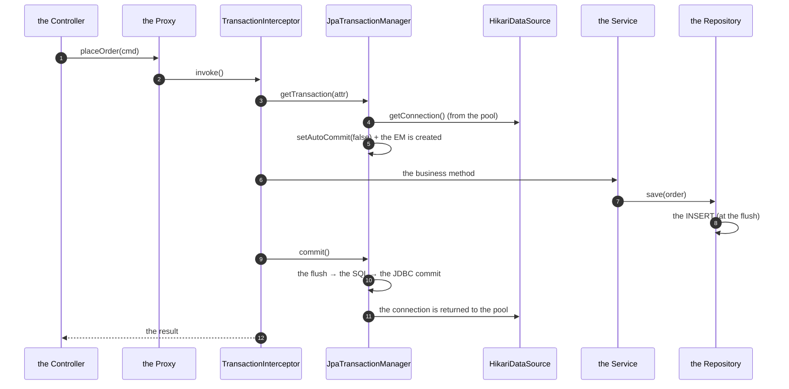
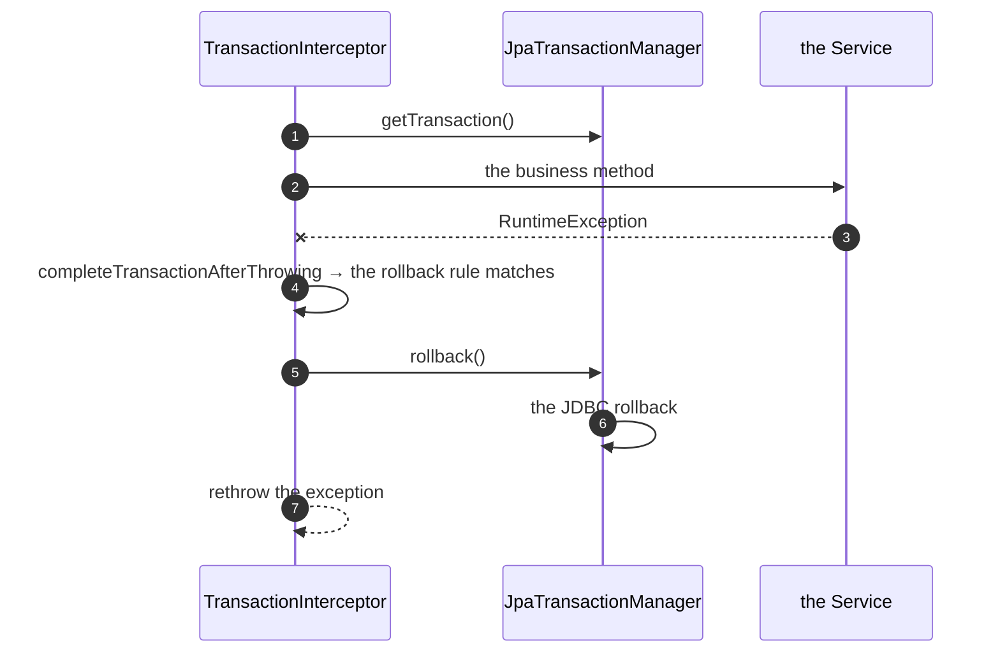
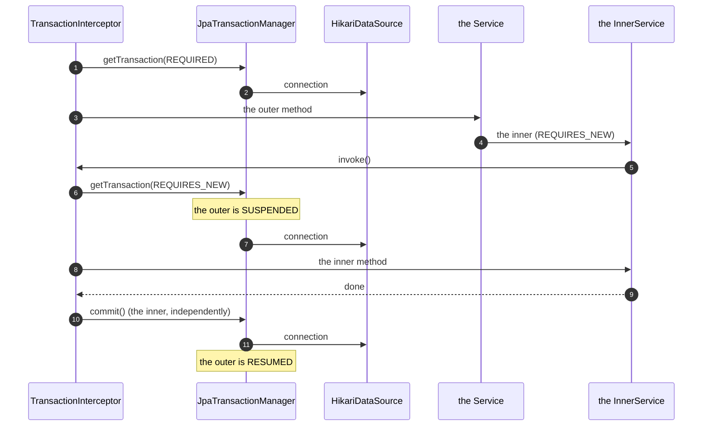

# 05 · Transactions, Propagation & Query Optimisation

> **Level:** Intermediate → Advanced
> **Interview Frequency:** ★★★★★ ("Explain the transaction propagation" is a classic)
> **Prerequisite:** [04 · Caching & the N+1](./04-Caching-Fetching-and-N-plus-1.md)
> **Last Updated:** 2026

---

## 📋 Table of Contents
- [0. TL;DR — The 30-Second Answer](#0-tldr--the-30-second-answer)
- [1. What & Why](#1-what--why)
- [2. Mental Model — The Transaction as a Boundary](#2-mental-model--the-transaction-as-a-boundary)
- [3. Deep Dive — Theory](#3-deep-dive--theory)
- [4. Internal Working Mechanism](#4-internal-working-mechanism)
- [5. Step-by-Step Execution Flow](#5-step-by-step-execution-flow)
- [6. Architecture Diagrams](#6-architecture-diagrams)
- [7. Production-Level Use Cases](#7-production-level-use-cases)
- [8. Code Examples — Production-Grade](#8-code-examples--production-grade)
- [9. Common Mistakes & Gotchas](#9-common-mistakes--gotchas)
- [10. Performance Considerations](#10-performance-considerations)
- [11. Security Considerations](#11-security-considerations)
- [12. Best Practices — The Checklist](#12-best-practices--the-checklist)
- [13. Hands-On Exercises](#13-hands-on-exercises)
- [14. Code Challenges](#14-code-challenges)
- [15. Scenario-Based Questions](#15-scenario-based-questions)
- [16. Interview Q&A — Level-wise](#16-interview-qa--level-wise)
- [17. Counter-Questions & Traps](#17-counter-questions--traps)
- [18. Tricky Interview Questions](#18-tricky-interview-questions)
- [19. Follow-Up Questions Asked by Interviewers](#19-follow-up-questions-asked-by-interviewers)
- [20. Real 3–5 Year Scenarios](#20-real-35-year-scenarios)
- [21. Frequently Asked Production Issues](#21-frequently-asked-production-issues)
- [22. Debugging Scenarios](#22-debugging-scenarios)
- [23. Architecture Design Questions](#23-architecture-design-questions)
- [24. Rapid-Fire MCQs](#24-rapid-fire-mcqs)
- [25. Cheat Sheet — One-Page Summary](#25-cheat-sheet--one-page-summary)
- [26. Real-World Production Notes](#26-real-world-production-notes)
- [27. Follow-up Learning](#27-follow-up-learning)

---

## 0. TL;DR — The 30-Second Answer

- **The `@Transactional` is a proxy** — the AOP proxy intercepts the call and manages the
  transaction. **The self-invocation doesn't work** (the classic trap).
- **The propagation:**
  - `REQUIRED` (the default) → join the existing or create a new.
  - `REQUIRES_NEW` → **suspend** the current and start a new one (a second connection!).
  - `NESTED` → a **savepoint** (the same connection, the partial rollback).
  - `SUPPORTS` → join if it exists, no transaction otherwise.
  - `NOT_SUPPORTED` → suspend, run without.
  - `MANDATORY` → join or throw.
  - `NEVER` → throw if it exists.
- **The rollback rules:** by default, a `RuntimeException` or an `Error` → the rollback; a
  **checked exception** → the commit! (`rollbackFor = Exception.class` to change it).
- **The isolation levels:** `READ_UNCOMMITTED` (the dirty read) → `READ_COMMITTED` (the
  default, the Postgres) → `REPEATABLE_READ` (the MySQL default) → `SERIALIZABLE`.
- **The `REQUIRES_NEW` needs a second connection** → the pool exhaustion risk (the pool of 10
  with the 10 nested `REQUIRES_NEW` calls → the deadlock).
- **The `@Transactional(readOnly = true)`** → the read-only hint (the flush is skipped, the
  dirty checking is skipped) + the potential **read replica** routing.
- **The optimisation checklist:** the indexes (the composite, the covering), the query shape
  (the `EXPLAIN ANALYZE`), the pagination (the keyset), the projections, the batching, the
  connection pool (the HikariCP's sizing), the `order_inserts`, the `readOnly`, the statistics.

---

## 1. What & Why

The transaction boundary is the most consequential design decision in a Spring Boot app: it
determines the **atomicity**, the **consistency**, the **locking**, the **performance**, and
the **failure semantics**. The classic interview question — *"explain the propagation"* — tests
whether you understand the machinery or just the annotations.

---

## 2. Mental Model — The Transaction as a Boundary

```text
   the HTTP request
        │
        ▼
   ┌──────────────────────────────────────────────────┐
   │  @Transactional (REQUIRED) — the outer boundary  │
   │  ┌────────────────────────────────────────────┐  │
   │  │  the service method                        │  │
   │  │    ├─ the repository calls (the same tx)   │  │
   │  │    └─ the other service (the same tx)      │  │
   │  └────────────────────────────────────────────┘  │
   └──────────────────────────────────────────────────┘
        │
        │  a nested call needs a DIFFERENT outcome:
        ▼
   ┌──────────────────────────────────────────────────┐
   │  @Transactional(REQUIRES_NEW) — the new boundary │
   │  → the outer is SUSPENDED (a new connection!)   │
   │  → the inner commits/rolls back independently   │
   │  → the outer resumes                          │
   └──────────────────────────────────────────────────┘
```

**The three questions every transaction decision answers:**
1. **What must be atomic?** (the unit of work)
2. **What must happen even if the outer fails?** (the `REQUIRES_NEW` — the audit log)
3. **What must NOT happen if the outer fails?** (the `NESTED` — the savepoint)

---

## 3. Deep Dive — Theory

### 3.1 The `@Transactional` mechanics

```text
  the client → the proxy (the CGLIB / the JDK dynamic proxy)
                   │
                   ▼
         TransactionInterceptor.invoke()
                   │
                   ├─ ① get the existing transaction (the TransactionSynchronizationManager)
                   ├─ ② decide (the propagation rules)
                   ├─ ③ start a new one (if needed) → the PlatformTransactionManager
                   │       └─ the DataSourceTransactionManager
                   │             ├─ the connection acquisition (the DataSource)
                   │             ├─ the setAutoCommit(false)
                   │             └─ the TransactionSynchronizationManager.initSynchronization()
                   ├─ ④ the business method
                   └─ ⑤ the commit / the rollback (the finally)
```

**The `PlatformTransactionManager`:** the `JpaTransactionManager` (the JPA + the
`EntityManager` integration) or the `DataSourceTransactionManager` (the plain JDBC). The
Spring Boot's `spring-boot-starter-data-jpa` configures the `JpaTransactionManager`.

**The `JpaTransactionManager`:** it opens a JDBC connection for the transaction and binds the
`EntityManager` to it — the `EntityManager` and the JDBC connection share the transaction.

### 3.2 The self-invocation trap

```java
@Service
public class OrderService {

    @Transactional
    public void placeOrder() {
        calculateTotal();          // ⚠ the self-invocation — the proxy is bypassed!
    }

    @Transactional
    public void calculateTotal() {   // the annotation has NO effect here
        ...
    }
}
```

**Why:** the `@Transactional` is implemented by the **proxy** — the call `placeOrder()` →
`calculateTotal()` is a **direct** `this` call on the target object, not through the proxy → the
interceptor is never invoked.

**The symptoms:**
- The `calculateTotal` runs **without a transaction** → the repository calls inside it each
  get their own transaction (or fail with "no EntityManager with the transaction").
- The lazy loading inside it fails.

**The fixes:**
1. **Inject the self-reference** (`@Lazy private OrderService self;`) — the ugly but explicit.
2. **Extract the method into a separate bean** — the recommended.
3. **`AopContext.currentProxy()`** — requires `exposeProxy = true` — the discouraged.
4. **`TransactionTemplate`** — the programmatic API (no proxy, no self-invocation problem).

### 3.3 The propagation table

| The propagation | The existing transaction? | The behaviour |
|-----------------|---------------------------|--------------|
| `REQUIRED` (the default) | No | A new transaction is created |
| `REQUIRED` | Yes | It **joins** the existing one (the same connection, the same context) |
| `REQUIRES_NEW` | No | A new transaction is created |
| `REQUIRES_NEW` | Yes | The existing is **suspended**, a **new** transaction + a **new connection** is created; the inner commits/rolls back independently; the outer resumes |
| `NESTED` | No | A new transaction is created (the same as `REQUIRED`) |
| `NESTED` | Yes | A **savepoint** is created (the same connection, the same context) — the inner rollback rolls back to the savepoint only |
| `SUPPORTS` | No | No transaction (the operations run in their own) |
| `SUPPORTS` | Yes | It joins the existing |
| `NOT_SUPPORTED` | Either | The existing is **suspended**, the method runs **without** a transaction |
| `MANDATORY` | No | **Throws** (`IllegalTransactionStateException`) |
| `MANDATORY` | Yes | It joins the existing |
| `NEVER` | Yes | **Throws** |
| `NEVER` | No | It runs without a transaction |

**The key differences:**
- `REQUIRES_NEW` vs `NESTED`: the new **transaction** (a new connection, an independent commit)
  vs the new **savepoint** (the same connection, the same context — the outer can still roll
  back the inner's work).
- The `NESTED` requires the savepoint support (the JDBC driver + the DB).

### 3.4 The `REQUIRES_NEW` — the classic use and the classic trap

**The legitimate use — the audit log:**
```java
@Service
public class AuditService {
    @Transactional(propagation = Propagation.REQUIRES_NEW)
    public void recordFailure(String action, String reason) {
        auditRepository.save(new AuditEntry(action, reason));
    }
}
```
The audit must be persisted **even if the business transaction rolls back** → the new
transaction.

**The trap — the connection pool exhaustion:**
```text
  the pool = 10 connections
  the request thread holds 1 (the outer transaction)
  the async thread (@Async) needs 1
  → 9 free. Fine.

  BUT: 10 concurrent requests × (the outer tx + the REQUIRES_NEW) = 20 connections needed
  → the pool of 10 → the requests wait for a connection
  → the holders are waiting for a connection → DEADLOCK (until the timeout)
```

**The classic deadlock scenario:**
```text
  Thread A: holds the connection (the outer tx) → calls the REQUIRES_NEW → needs a 2nd
  Thread B: holds the connection (the outer tx) → calls the REQUIRES_NEW → needs a 2nd
  ...
  Thread J: holds the connection → calls the REQUIRES_NEW → waits for a connection
  → all 10 connections are held by the outer transactions, all waiting for an 11th
  → DEADLOCK (the HikariCP's connectionTimeout → the "the connection is not available" error)
```

**The fixes:**
- **Increase the pool** (but the DB's `max_connections` is the real limit).
- **Reduce the `REQUIRES_NEW` usage.**
- **Do the audit asynchronously** (`@Async` + the separate executor — but the same risk).
- **Use the outbox pattern** (the audit is written in the same transaction, then published
  asynchronously) — the modern, robust answer.

### 3.5 The rollback rules

```java
@Transactional                       // the default: rolls back on the RuntimeException/Error
@Transactional(rollbackFor = Exception.class)   // rolls back on the checked exceptions too
@Transactional(noRollbackFor = BusinessException.class)
```

**The default:** the `RuntimeException` and the `Error` → the rollback; the **checked
exception** → the **commit** (a famous surprise).

**The Spring's rollback rules in detail:**
- The `rollbackFor` / the `noRollbackFor` (the explicit).
- The **default** rules (`DefaultTransactionAttribute`): the `RuntimeException` → the rollback; the
  `Error` → the rollback; the checked exception → the commit.
- The **JPA's** rules: the `PersistenceException` → the rollback; the other exceptions → the
  commit (the JPA spec says a non-PersistenceException doesn't mark the transaction for the
  rollback). **The Spring's `JpaTransactionManager` uses the Spring's default rules** (the
  `RuntimeException` → the rollback), not the JPA's.

**The "the rollback-only" trap:**
```java
@Transactional
public void methodA() {
    try {
        subService.methodB();   // the inner marks the tx as rollback-only
    } catch (Exception e) {
        // swallowed
    }
    // the outer commits → 💥 UnexpectedRollbackException
}
```

**The symptom:** `UnexpectedRollbackException: Transaction rolled back because it has been
marked as rollback-only`. The cause: the inner transaction failed (and rolled back), but the
exception was swallowed, so the outer tried to commit — but the shared transaction is already
marked for the rollback.

**The fixes:** (1) don't swallow the exception (the standard); (2) the `@Transactional(propagation
= REQUIRES_NEW)` on the inner (the independent transaction — but the connection risk); (3) the
`noRollbackFor` (only if the semantics are right).

### 3.6 The isolation levels

| The level | The dirty read | The non-repeatable read | The phantom read | The notes |
|-----------|---------------|-------------------------|------------------|----------|
| `READ_UNCOMMITTED` | Possible | Possible | Possible | Rarely used |
| `READ_COMMITTED` | No | Possible | Possible | **The Postgres default**; the most common |
| `REPEATABLE_READ` | No | No | Possible* | The MySQL/InnoDB default; in Postgres, the "the serialization failure" behaviour |
| `SERIALIZABLE` | No | No | No | The strictest; the highest contention; the aborts |

\* In Postgres, `REPEATABLE READ` actually **prevents** the phantoms (it's stronger than the SQL
standard) — but it can throw the `SerializationFailure` (the "could not serialize access due
to concurrent update").

**The Spring's isolation:**
```java
@Transactional(isolation = Isolation.SERIALIZABLE)
```

**The practical advice:** **don't change the isolation level** — use the default
(`READ_COMMITTED`) and handle the concurrency explicitly:
- The **optimistic locking** (the `@Version` + the retry) for the lost-update prevention.
- The **atomic updates** (`UPDATE ... WHERE count > 0`) for the counters.
- The **pessimistic locks** (`SELECT ... FOR UPDATE`) for the "read-then-decide" flows.
- The **serialisable** only for the specific financial flows (with the retry for the
  serialization failures).

### 3.7 The `readOnly = true`

```java
@Transactional(readOnly = true)
public List<Order> findAll() { ... }
```

**What it does (in Hibernate):**
1. The `FlushMode` = `MANUAL` → the flush is skipped → the accidental changes aren't written.
2. The **dirty checking is skipped** for the loaded entities (the Hibernate's `readOnly`
   session setting) → less CPU.
3. The **read-only hint** on the JDBC connection (`Connection.setReadOnly(true)`) → the driver
   may route to a **read replica** (with the Postgres's routing middleware) or reject the writes.
4. The **optimisation**: the query's read-only hint skips the **snapshot** creation (the
   Hibernate 6's `@QueryHints(readOnly)`).

**The production pattern:**
```java
@Transactional(readOnly = true)   // the queries
public List<OrderResponse> list() { ... }

@Transactional                 // the commands
public void update(...) { ... }
```

**The caveat:** a `readOnly` transaction that **writes** → the write is flushed at the commit
anyway? No — with the `MANUAL` flush mode, the changes are **not** written (they're silently
lost!). Actually: the `readOnly` + the write → the Hibernate throws
`HibernateException: Flush during cascade is dangerous`? Or the changes are simply not
persisted (the flush is skipped). The rule: **never write in a `readOnly` transaction**.

### 3.8 The self-invocation, the private methods, and the final methods

```java
@Transactional
private void helper() { ... }      // ⚠ the Spring AOP doesn't proxy the private methods

@Transactional
protected void helper() { ... }    // ⚠ the Spring AOP (the CGLIB) CAN proxy the protected
                                    //   methods — but the self-invocation still bypasses it

@Transactional
public final void helper() { ... } // ⚠ the CGLIB can't override the final methods
```

**The rules:**
- The `@Transactional` must be on a **public** method (the safest) — the private/final methods
  aren't advised.
- The **self-invocation** never triggers the proxy.

### 3.9 The `TransactionTemplate` — the programmatic API

```java
@Service
public class PaymentService {

    private final TransactionTemplate transactionTemplate;
    private final PaymentRepository paymentRepository;

    @Transactional
    public void process(List<Payment> payments) {
        for (Payment payment : payments) {
            transactionTemplate.execute(status -> {
                paymentRepository.save(payment);
                // the explicit control:
                if (payment.isInvalid()) {
                    status.setRollbackOnly();   // the equivalent of the exception
                }
                return null;
            });
        }
    }
}
```

**The advantages:** no proxy, no self-invocation issue, the explicit control, the
programmatic composition.

**The `TransactionTemplate` with the propagation:**
```java
TransactionTemplate requiresNew = new TransactionTemplate(txManager);
requiresNew.setPropagationBehavior(TransactionDefinition.PROPAGATION_REQUIRES_NEW);
```

### 3.10 The query optimisation checklist

| The lever | The impact | The how |
|----------|-----------|---------|
| **The indexes** | The biggest | The composite (the filter + the sort), the covering, the partial |
| **The query shape** | The biggest | The `EXPLAIN (ANALYZE, BUFFERS)`, the "no sequential scan on a big table", the "no `rows removed by filter`" |
| **The projections** | Big | No entities, no proxies, the covering index |
| **The pagination** | Big | The keyset (not the `OFFSET`) |
| **The N+1** | Big | The projections, the entity graphs, the batching |
| **The JDBC batching** | Big for the writes | `batch_size=50`, `order_inserts` |
| **The connection pool** | Medium | The HikariCP's sizing (the formula) |
| **The `readOnly`** | Medium | The read transactions |
| **The `FlushMode`** | Medium | The `COMMIT` for the bulk reads (carefully) |
| **The schema** | Big | The denormalisation, the partitioning, the types (`timestamptz`, `bigint`) |

### 3.11 The connection pool sizing (HikariCP)

```properties
spring.datasource.hikari.maximum-pool-size=20
spring.datasource.hikari.minimum-idle=5
spring.datasource.hikari.connection-timeout=30000
spring.datasource.hikari.idle-timeout=600000
spring.datasource.hikari.max-lifetime=1800000
spring.datasource.hikari.leak-detection-threshold=60000
```

**The sizing formula (the Hikari's wiki):**
```
connections = ((core_count * 2) + effective_spindle_count)
```
For a modern cloud DB (the CPU is not the constraint, the network/DB time is), the practical
formula:
```
pool_size = (peak_concurrent_requests × avg_request_db_time) / (target_request_throughput × 1)
```
Or more simply: **the pool size ≈ the number of the concurrent DB-active requests × 1.2** (a
little headroom). The **DB's `max_connections`** is the real ceiling: `pool_size × instances ×
(1 + the other services) < max_connections`.

**The trade-off:** a bigger pool = more concurrency but more DB contention; a smaller pool =
the queueing at the app but a healthier DB. The **Postgres** with 4 vCPUs typically does well
with 10–20 connections per instance.

**The `leak-detection-threshold`** — the Hikari logs a stack trace when a connection is held
longer than the threshold → the "the connection leak" detector (the classic: the long
transaction, the streaming result set not closed).

### 3.12 The `EXPLAIN ANALYZE` — reading the plan

```sql
EXPLAIN (ANALYZE, BUFFERS) 
SELECT o.id, o.order_number, c.name
FROM orders o
JOIN customers c ON c.id = o.customer_id
WHERE o.status = 'PAID'
ORDER BY o.created_at DESC
LIMIT 20;
```

```text
Limit  (cost=... rows=20) (actual time=1.2..1.5 rows=20 loops=1)
  →  Index Scan using idx_orders_status_created_at on orders
       (cost=... rows=20) (actual time=1.1..1.4 rows=20 loops=1)
       Index Cond: (status = 'PAID'::text)
  →  Nested Loop  (actual time=1.3..1.5 rows=20 loops=1)
        →  Index Scan using idx_customers_pkey on customers
              (cost=... rows=1) (actual time=0.02..0.02 rows=1 loops=20)
              Index Cond: (id = o.customer_id)
Planning Time: 0.2 ms
Execution Time: 1.7 ms
```

**The red flags:**
| The plan | The meaning | The fix |
|---------|-------------|---------|
| `Seq Scan` on a big table | The full table scan | The index; the `ANALYZE` (the statistics are stale) |
| `rows=20` estimated vs `rows=2000000` actual | The **stale statistics** | `ANALYZE` / the `default_statistics_target` |
| `rows removed by Filter: 999999` | The index is used but the filter is selective | The composite index (the filter column in the index) |
| `Nested Loop` with a large outer row count | The N+1 at the SQL level | The `hash join` / the index |
| `Sort` with `external merge Disk` | The sort doesn't fit in the memory | The index (the sort order) or the `work_mem` |
| `Heap Fetches: 1000000` | The index-only scan needs the heap | The `INCLUDE` columns (the covering index) |
| The `actual time` >> the `cost` | The stale statistics | The `ANALYZE` |

### 3.13 The keyset pagination

```sql
-- ❌ The OFFSET pagination
SELECT * FROM orders ORDER BY created_at DESC LIMIT 20 OFFSET 100000;
-- the DB reads and discards 100,000 rows

-- ✅ The keyset pagination
SELECT * FROM orders
WHERE (created_at, id) < (?, ?)
ORDER BY created_at DESC, id DESC
LIMIT 20;
-- the index range scan → O(log n)
```

**The trade-off:** the keyset pagination **can't jump to an arbitrary page** (the "page 57" link)
→ the UI's design must change (the infinite scroll, the cursor-based pagination). The
**Hybrid** (the anchor + the offset for the small jumps) is a common compromise.

### 3.14 The bulk operations

```java
@Modifying(clearAutomatically = true, flushAutomatically = true)
@Query("update Order o set o.status = :status where o.id in :ids")
int bulkUpdate(@Param("ids") List<Long> ids, @Param("status") OrderStatus status);
```

**The bulk operations' limitations:**
- They **bypass** the persistence context (the loaded entities are stale → the `clearAutomatically`).
- They **don't fire** the entity callbacks (`@PreUpdate`/`@PostUpdate`).
- They **don't cascade** (the `cascadeOnFlush` is not applied).
- They **don't** respect the optimistic locking (the `@Version` isn't incremented → the stale
  updates are possible!). Actually, a JPQL bulk update **does** respect the `@Version` if the
  query includes it? No — the JPQL bulk update doesn't increment the version by default
  (Hibernate's `versioned` update — the `update versioned Order` syntax increments it).
- The **Hibernate 6's** `MutationQuery` (the new API) is clearer.

**The alternative — the native multi-row insert:**
```java
@Modifying
@Query(value = """
        INSERT INTO order_lines (order_id, product_id, quantity, unit_price)
        SELECT * FROM UNNEST(CAST(:orderIds AS bigint[]),
                             CAST(:productIds AS bigint[]),
                             CAST(:quantities AS int[]),
                             CAST(:prices AS numeric[]))
        """, nativeQuery = true)
int bulkInsert(@Param("orderIds") long[] orderIds, ...);
```

---

## 4. Internal Working Mechanism

### 4.1 The `TransactionInterceptor`

```text
  TransactionAttributeSource
    ├─ the annotation lookup (the @Transactional on the method/class)
    ├─ the "the public methods only" rule
    └─ the cached attributes (the proxy's per-method cache)
            │
            ▼
  TransactionAspectSupport.invokeWithinTransaction()
    ├─ ① determine the transaction attribute
    ├─ ② txManager.getTransaction(attr)   ← the propagation decision
    ├─ ③ the business method
    ├─ ④ txManager.commit() / rollback()
    └─ ⑤ the cleanup (the restore the suspended transaction)
```

### 4.2 The `JpaTransactionManager` — the internals

```text
  JpaTransactionManager.doBegin()
    ├─ the EntityManagerFactory.createEntityManager()
    ├─ the EntityTransaction.begin()
    ├─ the JDBC connection: dataSource.getConnection()   ← from the pool
    ├─ the DataSourceUtils.prepareConnectionForTransaction()
    │     └─ the setAutoCommit(false) + the isolation + the readOnly
    ├─ the TransactionSynchronizationManager.bindResource(entityManagerFactory, em)
    └─ the TransactionSynchronizationManager.bindResource(dataSource, connection)
```

**The `REQUIRES_NEW`:** the `JpaTransactionManager` suspends the current resources (the
`EntityManager` and the connection) → the new transaction gets a **new** `EntityManager` and a
**new** connection from the pool.

### 4.3 The `TransactionSynchronizationManager` — the thread-bound resources

```text
  ThreadLocal<TransactionSynchronizationManager>
    ├─ resources: a Map<Object, Object> (the key = the EntityManagerFactory, the value = the EM)
    ├─ synchronizations: the list of the before/after-commit callbacks
    ├─ currentTransactionName / readOnly / isolationLevel
    └─ the "the actual transaction active" flag
```

**The consequence:** the transaction state is **thread-bound** → the async work
(`@Async`, the `CompletableFuture`, the `Executor`) doesn't inherit the transaction (a new
thread = a new `TransactionSynchronizationManager`).

### 4.4 The flush and the transaction lifecycle

```text
  BEGIN
    ├─ the entities are loaded (the queries, the auto-flush)
    ├─ the dirty changes accumulate in the action queue
    ├─ the commit:
    │     ├─ the beforeCompletion callbacks
    │     ├─ the FLUSH (the SQL is executed here!)
    │     ├─ the actual JDBC commit
    │     └─ the afterCompletion callbacks
    └─ ROLLBACK
          ├─ the beforeCompletion callbacks
          ├─ the rollback (the JDBC rollback)
          └─ the afterCompletion callbacks
```

**The critical detail:** the SQL is executed **at the flush, during the commit** — after the
`beforeCompletion`. So a constraint violation surfaces **at the commit**, not at the `save()`.
(Except with the `IDENTITY` id generation, which executes the INSERT at the `persist`.)

### 4.5 The `JpaTransactionManager`'s rollback behaviour on the commit failure

```text
  the commit → the flush → the SQL → the constraint violation
    → the JPA spec: the transaction is rolled back
    → the Spring: the RuntimeException propagates
    → the @Transactional interceptor marks the rollback
    → the transaction is rolled back
```

**The important nuance:** the `TransactionAspectSupport` catches the exception, calls
`completeTransactionAfterThrowing` → the rollback (if the rollback rule matches) → then
**rethrows** the original exception. If the rollback rule doesn't match (a checked exception),
the transaction is **committed** (the partial work is written!).

---

## 5. Step-by-Step Execution Flow

### 5.1 The normal flow



### 5.2 The rollback flow



### 5.3 The `REQUIRES_NEW` flow



---

## 6. Architecture Diagrams

### 6.1 The propagation decision tree

```text
  A method needs a transaction. What does it need?
        │
        ▼
  ┌───────────────────────────────────────────┐
  │ Must it join the caller's transaction?    │
  └──────┬─────────────────────────┬──────────┘
         │ yes                     │ no
         ▼                         ▼
   ┌───────────┐          ┌────────────────────┐
   │ REQUIRED  │          │ Does it need its   │
   │ (default) │          │ OWN transaction    │
   │           │          │ (an independent    │
   │           │          │  commit/rollback)? │
   └───────────┘          └──────┬─────────────┘
                                 │
                 ┌───────────────┴───────────────┐
                 │ yes                           │ no
                 ▼                               ▼
          ┌─────────────────┐            ┌──────────────┐
          │ REQUIRES_NEW    │            │ NESTED       │
          │ (a new conn,    │            │ (a savepoint │
          │  an independent │            │  on the same │
          │  commit)        │            │  connection) │
          │ ⚠ the pool risk │            │              │
          └─────────────────┘            └──────────────┘
```

### 6.2 The transaction boundary architecture

```text
   ┌──────────────────────────────────────────────────────────┐
   │  THE HTTP LAYER — NO TRANSACTION                           │
   │    the controller: the validation, the mapping             │
   └──────────────────────┬───────────────────────────────────┘
                          ▼
   ┌──────────────────────────────────────────────────────────┐
   │  THE SERVICE LAYER — THE TRANSACTION BOUNDARY            │
   │                                                          │
   │   @Transactional (REQUIRED)                               │
   │   ┌────────────────────────────────────────────────┐     │
   │   │ the aggregate operations                      │     │
   │   │   ├─ the repository calls (the same tx)       │     │
   │   │   ├─ the domain events (the outbox)           │     │
   │   │   └─ the REQUIRES_NEW (the rare case)         │     │
   │   └────────────────────────────────────────────────┘     │
   └──────────────────────┬───────────────────────────────────┘
                          ▼
   ┌──────────────────────────────────────────────────────────┐
   │  THE REPOSITORY LAYER — @Transactional(readOnly=true)     │
   │    for the queries (the optimiser's hint)                 │
   └──────────────────────────────────────────────────────────┘
```

### 6.3 The isolation levels vs the anomalies

```text
   Isolation            Dirty read   Non-repeatable   Phantom
   ─────────────────────────────────────────────────────────────
   READ UNCOMMITTED         ✔              ✔             ✔
   READ COMMITTED            ✘              ✔             ✔
   REPEATABLE READ          ✘              ✘             ✔*
   SERIALIZABLE             ✘              ✘             ✘

   * Postgres: the REPEATABLE READ also prevents the phantoms
     (but it throws the "could not serialize access" instead)
```

---

## 7. Production-Level Use Cases

| Use case | The technique |
|----------|---------------|
| **A multi-table write** | One `@Transactional` (the service) — the atomicity |
| **The audit log (must survive the rollback)** | The `REQUIRES_NEW` or the **outbox** (the recommended) |
| **The bulk import** | The chunked transactions (the batch + the checkpoint) |
| **The read-only endpoints** | `@Transactional(readOnly = true)` + the replica routing |
| **The report generation** | The read-only + the `StatelessSession` + the projections |
| **The retry on the optimistic lock** | The `REQUIRES_NEW` (each attempt in its own transaction) — or the `TransactionTemplate` |
| **The saga's compensations** | The `REQUIRES_NEW` (the independent commit) |
| **The external API call in a transaction** | **Never** — the call outside the transaction (the short transaction) |
| **The lock ordering** | The pessimistic locks in a consistent order (the deadlock avoidance) |
| **The event publishing** | The **outbox** (the same transaction, the async publish) |

---

## 8. Code Examples — Production-Grade

### 8.1 The service with the correct transaction boundaries

```java
@Service
@RequiredArgsConstructor
public class OrderService {

    private final OrderRepository orderRepository;
    private final PaymentService paymentService;
    private final ApplicationEventPublisher eventPublisher;

    @Transactional
    public OrderResponse placeOrder(PlaceOrderCommand command) {
        Customer customer = customerRepository.findById(command.customerId())
                .orElseThrow(() -> new CustomerNotFoundException(command.customerId()));

        List<OrderLine> lines = command.lines().stream()
                .map(l -> new OrderLine(productRepository.getReferenceById(l.productId()), l.quantity()))
                .toList();

        Order order = Order.place(customer, lines);
        orderRepository.save(order);

        // The events are published inside the transaction (the outbox pattern)
        eventPublisher.publishEvent(new OrderPlacedEvent(order.getId()));

        return OrderResponse.from(order);
    }

    @Transactional(readOnly = true)
    public OrderResponse getById(Long id) {
        return orderRepository.findById(id)
                .map(OrderResponse::from)
                .orElseThrow(() -> new OrderNotFoundException(id));
    }
}
```

### 8.2 The `REQUIRES_NEW` for the audit (with the pool awareness)

```java
@Service
@RequiredArgsConstructor
public class AuditService {

    private final AuditRepository auditRepository;

    @Transactional(propagation = Propagation.REQUIRES_NEW)
    public void recordFailure(String action, String reason, String correlationId) {
        auditRepository.save(AuditEntry.failure(action, reason, correlationId));
    }
}
```

> **The production note:** the `REQUIRES_NEW` takes a **second connection** from the pool. If
> the outer transactions hold connections while waiting for the inner ones, the pool can be
> exhausted → the deadlock. The **preferred** pattern is the **outbox** (the audit row is
> written in the same transaction and published asynchronously).

### 8.3 The outbox pattern (the recommended alternative to the `REQUIRES_NEW`)

```java
@Entity
@Table(name = "outbox_events", indexes = @Index(name = "idx_outbox_unpublished",
        columnList = "published, created_at"))
public class OutboxEvent {

    @Id
    @GeneratedValue(strategy = GenerationType.IDENTITY)
    private Long id;

    @Column(name = "event_type", nullable = false, length = 100)
    private String eventType;

    @Column(name = "payload", nullable = false, columnDefinition = "jsonb")
    private String payload;

    @Column(name = "created_at", nullable = false)
    private Instant createdAt;

    @Column(name = "published", nullable = false)
    private boolean published;

    @Version
    private Long version;
}
```

```java
@Service
@RequiredArgsConstructor
public class OutboxService {

    private final OutboxRepository outboxRepository;
    private final ObjectMapper objectMapper;

    @Transactional
    public void publish(String eventType, Object payload) {
        try {
            outboxRepository.save(OutboxEvent.of(eventType, objectMapper.writeValueAsString(payload)));
        } catch (JsonProcessingException e) {
            throw new IllegalStateException("Cannot serialise the outbox event", e);
        }
    }
}
```

```java
@Component
@RequiredArgsConstructor
@Slf4j
public class OutboxPublisher {

    private final OutboxRepository outboxRepository;
    private final OutboxService outboxService;   // the REQUIRES_NEW publisher

    @Scheduled(fixedDelay = 1000)
    public void publishPending() {
        List<OutboxEvent> pending = outboxRepository.findTop100ByPublishedFalseOrderByCreatedAt();
        for (OutboxEvent event : pending) {
            try {
                outboxService.publishToBroker(event);   // @Transactional(REQUIRES_NEW)
                event.markPublished();
            } catch (Exception e) {
                log.error("Failed to publish the outbox event {}", event.getId(), e);
            }
        }
    }
}
```

### 8.4 The `TransactionTemplate` for the retry

```java
@Service
@RequiredArgsConstructor
public class InventoryService {

    private final InventoryRepository inventoryRepository;
    private final TransactionTemplate transactionTemplate;

    public void reserve(String sku, int quantity) {
        for (int attempt = 1; attempt <= 3; attempt++) {
            try {
                transactionTemplate.execute(status -> {
                    Inventory inventory = inventoryRepository.findBySku(sku)
                            .orElseThrow(() -> new SkuNotFoundException(sku));
                    inventory.reserve(quantity);   // the @Version → the optimistic lock
                    return null;
                });
                return;
            } catch (OptimisticLockingFailureException e) {
                if (attempt == 3) throw e;
                sleep(Duration.ofMillis(20L * attempt));   // the backoff
            }
        }
    }
}
```

> **Why the `TransactionTemplate` and not `@Transactional`?** The **retry needs a new
> transaction per attempt** — with the `@Transactional`, the retry would be inside the same
> (already rolled back) transaction. The `TransactionTemplate` gives the explicit control.

### 8.5 The bulk import with the chunked transactions

```java
@Service
@RequiredArgsConstructor
@Slf4j
public class BulkImportService {

    private final OrderRepository orderRepository;
    private final TransactionTemplate transactionTemplate;

    public ImportResult importOrders(List<ImportRow> rows, int chunkSize) {
        int imported = 0;
        for (int i = 0; i < rows.size(); i += chunkSize) {
            List<ImportRow> chunk = rows.subList(i, Math.min(i + chunkSize, rows.size()));
            // Each chunk is its own transaction — a failure doesn't roll back everything
            transactionTemplate.execute(status -> {
                orderRepository.saveAll(chunk.stream().map(this::toOrder).toList());
                return null;
            });
            imported += chunk.size();
            log.info("Imported {}/{}", imported, rows.size());
        }
        return new ImportResult(imported);
    }
}
```

### 8.6 The read-only service with the projections

```java
@Service
@RequiredArgsConstructor
public class OrderQueryService {

    private final OrderRepository orderRepository;

    @Transactional(readOnly = true)
    public List<OrderSummaryDto> list(OrderStatus status, Pageable pageable) {
        return orderRepository.findSummariesByStatus(status, pageable);
    }
}
```

### 8.7 The pessimistic locking (the "read-then-decide")

```java
@Repository
public interface SeatRepository extends JpaRepository<Seat, Long> {

    @Lock(LockModeType.PESSIMISTIC_WRITE)
    @Query("select s from Seat s where s.eventId = :eventId and s.rowNumber = :row and s.columnNumber = :col")
    Optional<Seat> findForUpdate(@Param("eventId") Long eventId,
                                 @Param("row") int row,
                                 @Param("col") int col);
}
```

```java
@Transactional
public Booking bookSeat(Long eventId, int row, int col) {
    Seat seat = seatRepository.findForUpdate(eventId, row, col)
            .orElseThrow(() -> new SeatNotFoundException(eventId, row, col));

    if (seat.isBooked()) {
        throw new SeatAlreadyBookedException(eventId, row, col);
    }
    seat.book(orderId);
    return seat;
}
```

> **The deadlock warning:** with multiple seats, always lock them in a **consistent order** (the
> sorted ids) — otherwise two transactions can deadlock.

### 8.8 The atomic update (the no-lock correctness)

```java
@Modifying
@Query("""
       update Inventory i
       set i.available = i.available - :quantity,
           i.updatedAt = CURRENT_TIMESTAMP
       where i.sku = :sku and i.available >= :quantity
       """)
int reserveIfAvailable(@Param("sku") String sku, @Param("quantity") int quantity);
```

```java
@Transactional
public void reserve(String sku, int quantity) {
    int affected = inventoryRepository.reserveIfAvailable(sku, quantity);
    if (affected == 0) {
        throw new InsufficientStockException(sku, quantity);
    }
}
```

> **The key insight:** the check-and-set in **one statement** — no lock, no version, no
exception — the DB's row lock (during the statement) is enough. This is the best pattern for
the counters and the stock.

### 8.9 The connection pool configuration (HikariCP)

```yaml
spring:
  datasource:
    url: jdbc:postgresql://db:5432/app
    hikari:
      maximum-pool-size: 20
      minimum-idle: 10
      connection-timeout: 30000
      idle-timeout: 600000
      max-lifetime: 1800000
      leak-detection-threshold: 60000
      pool-name: app-pool
  jpa:
    properties:
      hibernate:
        jdbc:
          batch_size: 50
        order_inserts: true
        order_updates: true
        default_batch_fetch_size: 50
```

### 8.10 The `@Transactional` on the repository (the read-only hint)

```java
public interface OrderRepository extends JpaRepository<Order, Long> {

    @Transactional(readOnly = true)
    @Query("select o from Order o where o.id = :id")
    Optional<Order> findDetailedById(@Param("id") Long id);
}
```

> **The rule:** the service owns the transaction; the repository's `readOnly` is a **hint** for
the optimiser (the `REQUIRED` joins the service's transaction — the `readOnly` is then ignored
if the outer isn't read-only).

---

## 9. Common Mistakes & Gotchas

| # | ❌ Wrong | ✅ Right | Why |
|---|----------|----------|-----|
| 1 | The `@Transactional` on a private/self-invoked method | A public method on a separate bean | The proxy isn't applied |
| 2 | The checked exception → the commit | `rollbackFor = Exception.class` | The default rollback rules |
| 3 | The external HTTP call inside the transaction | The call outside (or the outbox) | The connection is held during the network call |
| 4 | The `REQUIRES_NEW` in a loop | The outbox / the batch | The pool exhaustion |
| 5 | The swallowed exception → the `UnexpectedRollbackException` | Don't swallow (or the `REQUIRES_NEW`) | The rollback-only marker |
| 6 | The `readOnly` transaction with a write | The separate write methods | The write is silently lost |
| 7 | The isolation level changed to `SERIALIZABLE` "for safety" | The default + the explicit concurrency control | The contention, the aborts |
| 8 | The bulk `@Modifying` without `clearAutomatically` | Add it | The stale entities |
| 9 | The `OFFSET` pagination on the deep pages | The keyset | The O(offset) cost |
| 10 | The `join fetch` + the `Pageable` | The `@EntityGraph` | The in-memory pagination |
| 11 | The `@Transactional` on the controller | The service | The layering |
| 12 | The `@Transactional` on the entity's method | The service | The proxy |
| 13 | The pool size = 100 | The measured size | The DB's contention |
| 14 | The `PROPAGATION_REQUIRES_NEW` for the retry | The `TransactionTemplate` per attempt | The same transaction is already rolled back |
| 15 | The `final` method with `@Transactional` | Not final | The CGLIB can't override it |
| 16 | The `@Async` method relying on the caller's transaction | A new transaction (the `REQUIRES_NEW`) | The thread-bound state |
| 17 | The long transaction (the loop with the DB writes) | The chunked transactions | The locks, the timeout |
| 18 | The pessimistic locks in a random order | A consistent order | The deadlocks |

---

## 10. Performance Considerations

| Aspect | Impact | Guidance |
|--------|--------|----------|
| **The transaction duration** | The locks are held, the connection is held | The short transactions; no the external calls |
| **The connection pool** | The concurrency limit | The measured sizing; the DB's `max_connections` |
| **The `REQUIRES_NEW`** | An extra connection per call | The outbox; the rare use |
| **The isolation level** | The contention, the aborts | The default; the explicit controls |
| **The locking** | The blocked transactions | The optimistic first; the atomic updates |
| **The batch size** | The round trips | 50; the `order_inserts` |
| **The dirty checking** | The CPU per entity | The projections; the `readOnly` |
| **The auto-flush** | The extra flushes | The `FlushMode` tuning; the short transactions |
| **The `OFFSET`** | The O(offset) scan | The keyset |
| **The `SERIALIZABLE`** | The serialization failures | The retries |

---

## 11. Security Considerations

| Risk | Mitigation |
|------|-----------|
| **The transaction spanning the user input** | The validation before the transaction (the fast fail) |
| **The long transaction holding the locks** (the DoS) | The timeouts (the query timeout, the statement timeout) |
| **The authorisation inside the transaction** | The authorisation check before the write; the `@PreAuthorize` on the service |
| **The audit in a rollback-only transaction** | The outbox (the audit is durable) |
| **The multi-tenant isolation in the transaction** | The tenant predicate on every query; the RLS |
| **The data exposure on the rollback** | The transaction is atomic — no partial data |
| **The `readOnly` on the replica with the replica lag** | The read-your-writes for the critical flows (the write-then-read on the primary) |

---

## 12. Best Practices — The Checklist

- [ ] **The transaction at the service layer** (the public method), never the controller or the
  repository.
- [ ] **The short transactions** — no the HTTP calls, no the sleeps, no the heavy computation.
- [ ] **The `rollbackFor = Exception.class`** if the checked exceptions must roll back.
- [ ] **The outbox** instead of the `REQUIRES_NEW` for the reliable side effects.
- [ ] **`readOnly = true`** on the read transactions.
- [ ] **The `REQUIRES_NEW` sparingly** (the pool awareness).
- [ ] **The default isolation** + the explicit concurrency control (the `@Version`, the atomic
  updates, the pessimistic locks where needed).
- [ ] **The keyset pagination** for the deep pages.
- [ ] **The `EXPLAIN ANALYZE`** before and after the query changes.
- [ ] **The pool sizing** measured, not guessed.
- [ ] **The `leak-detection-threshold`** in the non-prod.
- [ ] **The statement/query timeouts** (the `spring.jpa.properties.jakarta.persistence.query.timeout`
  or the `hibernate.jdbc.timeout`).
- [ ] **The chunked transactions** for the bulk operations.

---

## 13. Hands-On Exercises

**🧪 Lab 1 — The self-invocation**
1. Add a `@Transactional` method to a service and call it from another method of the same
   service.
2. Put a `save()` in it and run it → no transaction? (the `TransactionSynchronizationManager`
   is empty).
3. Move it to a separate bean → it works.

**🧪 Lab 2 — The checked exception**
1. Throw a checked exception from a transactional method.
2. Check the DB → the row is **committed** (the default!).
3. Add `rollbackFor = Exception.class` → the row is rolled back.

**🧪 Lab 3 — The `REQUIRES_NEW` and the pool**
1. Set the pool size to 2.
2. Call a `REQUIRES_NEW` method from a transactional method in a loop.
3. Watch the Hikari's log → the "connection is not available" timeout.

**🧪 Lab 4 — The `EXPLAIN`**
1. Take a slow query → `EXPLAIN (ANALYZE, BUFFERS)`.
2. Find the `Seq Scan` → add the index → re-run.
3. Compare the times.

---

## 14. Code Challenges

### Challenge 1 — A generic transactional retry (medium-hard)
**Goal:** An `@Retryable`-style retry for the optimistic locking failures.
**Requirements:** the new transaction per attempt (the `TransactionTemplate`), the bounded
attempts, the exponential backoff with the jitter, the metrics (the retry count), the
integration with the Spring Retry, and the test.

### Challenge 2 — A deadlock-safe lock ordering (hard)
**Goal:** A service that locks multiple rows in a **consistent order** to avoid the deadlocks.
**Requirements:** the pessimistic locking, the sorted ids, the retry on the deadlock
(`DeadlockLoserDataAccessException`), the test (the concurrent test with the Testcontainers).

### Challenge 3 — A transaction budget monitor (hard)
**Goal:** A tool that detects the long transactions and the pool starvation.
**Requirements:** the transaction duration tracking (the interceptor), the pool metrics
(Micrometer), the threshold alerts, the leak detection, and the dashboard.

---

## 15. Scenario-Based Questions

**S1.** *"A user clicked 'Place Order' twice and got two orders. The button is disabled in the
UI."*
>
> **Ideal answer:** (1) **The diagnosis**: this is an **idempotency** problem, not a
transaction problem. The UI's debounce is a **client-side** control, not a guarantee (the
double-click, the retry, the network timeout, the mobile app, the API client). (2) **The fix**:
the **idempotency key** — (a) the client generates a unique key (the UUID) per the logical
operation and sends it (the `Idempotency-Key` header); (b) the server stores it with a
**unique constraint** (the idempotency table: the key + the request hash + the response +
the status); (c) the duplicate request → the **409** (or the stored response replayed, which
is nicer). (3) **The implementation** (the important detail): the idempotency record and the
order must be written in the **same transaction** — otherwise the crash between them leaves
the state inconsistent. The check-then-insert has a **race** (two concurrent requests with the
same key) → the **unique constraint** is the real guard (the insert fails → the duplicate is
detected). (4) **The alternatives** (and why they're weaker): (a) the **optimistic locking** on
the cart (the version) — it doesn't help (the two requests are the same version → the second
fails → a 409, but the user experience is poor); (b) the **distributed lock** (the Redis's
`SETNX` on the cart id) — it serialises but doesn't give the idempotency (the retry after the
timeout still duplicates); (c) the **the unique constraint on the business key** (the
"the order with the same idempotency key") — the simplest form of the idempotency. (5) **The
production notes**: the idempotency records expire (the TTL, e.g. 24h), the request hash
detects the "the same key with a different payload" (the 422), the response replay (the
"the original response" is returned for the retry — the best UX). (6) The senior framing:
"**the UI's debounce is a UX nicety, not a correctness guarantee** — the idempotency key is
the contract. The transaction boundary and the unique constraint are what make it correct."

**S2.** *"At peak, the app starts throwing 'HikariPool-1 - Connection is not available,
request timed out after 30000ms'. The DB's CPU is 15%."*
>
> **Ideal answer:** (1) **The diagnosis**: the **pool exhaustion**, not the DB's capacity. The
DB's CPU at 15% means the DB is **idle-waiting** — the connections are held but not doing work.
The causes: (a) the **long transactions** (the connection is held during the external calls,
the sleeps, the big processing); (b) the **`REQUIRES_NEW`** (the double connection per request);
(c) the **leaked connections** (the result set not closed, the `JdbcTemplate` without the
try-with-resources); (d) the **pool too small** for the concurrency; (e) the **lock waits** (the
pessimistic locks block the queries while holding the connection → the CPU is idle but the
connections are busy-waiting). (2) **The diagnosis steps**: (a) the **Hikari's metrics** (the
active, the idle, the pending, the acquisition time) — the `pending` > 0 and the `active` = the
max → the exhaustion; (b) the **leak detection** (`leak-detection-threshold=60000` → the stack
traces); (c) the **the slow query log** (the `pg_stat_activity` with the `state='active'` vs
`state='idle in transaction'` — **the idle-in-transaction** connections are the smoking gun:
the transaction is open but nothing is running!); (d) the **the transaction duration
histogram** (the custom metric). (3) **The fixes** (by the cause): (a) the **short
transactions** (move the external calls out); (b) the **outbox** instead of the
`REQUIRES_NEW`; (c) the **fix the leaks** (the try-with-resources, the streaming); (d) the
**pool sizing** (the formula, and the DB's `max_connections`); (e) the **the lock timeout**
(`SET LOCAL lock_timeout = '2s'`) so a blocked query fails fast instead of holding the
connection. (4) **The systemic fixes**: (a) the **the connection pool as a queue** (the
`connection-timeout` → the fast failure with the 503 + the retry, not the 30s hang); (b) the
**the bulkhead** (the separate pools for the critical paths); (c) the **the load shedding**
(the Resilience4j's rate limiter at the edge); (d) the **the alerting** on the pool's
saturation (> 80%) and the idle-in-transaction count. (5) The senior framing: "**the DB's CPU
at 15% with the timeouts is the classic 'the connections are held, not used' signature** — the
diagnosis is `pg_stat_activity`, not the CPU. The fix is the **transaction boundary**, not a
bigger pool."

**S3.** *"The 'update stock' endpoint sometimes oversells. The code uses `@Transactional` and a
`@Version`."*
>
> **Ideal answer:** (1) **The diagnosis**: the `@Version` protects against the **lost update**
(two transactions reading the same version), but the oversell is a different class of bug: the
**check-then-act** across transactions. The classic: (a) the code reads the stock (100),
validates (the quantity ≤ 100), then writes the new stock — with the `@Version`, the second
transaction's write **fails** (the `OptimisticLockingFailureException`) → the endpoint returns
500 (the user retries) → but if the code **catches and ignores** the exception, or if the
**stock is decremented elsewhere** (the DB trigger, the other service, the direct SQL), the
oversell happens; (b) the **`@Version` isn't on the entity** (the missing annotation — the
classic!); (c) the **the retry with a stale check** (the retry re-reads but the validation
isn't repeated); (d) the **the isolation level is too low** and the check reads a stale value
under `READ COMMITTED` (two transactions read 100, both pass the check, one write fails — the
version saves it, but only if the version is there); (e) the **the negative stock is allowed**
(the DB constraint missing — the `CHECK (available >= 0)`). (2) **The proof**: (a) the
`@Version` column's presence in the schema (the missing annotation → the smoking gun); (b) the
logs for the `OptimisticLockingFailureException` (the swallowed exceptions!); (c) the DB's
constraint (the `CHECK`); (d) the reproduction with two concurrent requests. (3) **The fix**:
(a) the **atomic update** — `UPDATE inventory SET available = available - ? WHERE sku = ? AND
available >= ?` → the check-and-set in one statement, the affected rows = 0 → the failure. **No
version, no exception, no oversell**; (b) the **DB constraint** as the last line of defence
(`CHECK (available >= 0)`); (c) the **proper error handling** (the `OptimisticLockingFailureException`
→ the 409, never swallowed); (d) the **`@Version` kept** (for the other fields' lost updates);
(e) the **the idempotency** for the retries. (4) **The prevention**: (a) the **concurrency
tests** (the Testcontainers + two threads + the assertion that the stock never goes negative);
(b) the **the invariant checks** in the domain (`reserve()` throws if the quantity is
insufficient — the entity enforces it); (c) the **the monitoring** (the negative-stock alert).
(5) The senior framing: "**the `@Version` is not a stock control** — it's a lost-update
detector. The stock control is the **atomic conditional update** (or the pessimistic lock for
the complex cases) plus the **DB constraint** as the invariant's backstop. The exception
swallowing is what turns a detected conflict into a corrupted invariant."

---

## 16. Interview Q&A — Level-wise

### 🟢 Beginner
**Q: What does `@Transactional` do?**
**A:** It makes the method run within a **database transaction** — the operations either all
succeed (the commit) or all fail (the rollback). Spring implements it with an **AOP proxy**
that starts/commits/rolls back the transaction around the method.

**Q: When does the transaction roll back?**
**A:** By default, when a **RuntimeException** or an **Error** propagates out of the method. A
**checked exception** → the commit (a famous surprise) — use `rollbackFor = Exception.class` to
change it.

**Q: What is the propagation?**
**A:** The rule that decides what happens when a transactional method is called within another
transaction: `REQUIRED` (the default — join or create), `REQUIRES_NEW` (a new, independent
transaction), `NESTED` (a savepoint), `SUPPORTS`, `NOT_SUPPORTED`, `MANDATORY`, `NEVER`.

### 🟡 Intermediate
**Q: What is the difference between `REQUIRED` and `REQUIRES_NEW`?**
**A:** `REQUIRED` joins the existing transaction (the same connection, the same context, one
commit). `REQUIRES_NEW` **suspends** the current transaction and starts a **new** one with a
**new connection** — it commits/rolls back independently of the outer. Use it when the inner
work must survive the outer's rollback (the audit log). The cost: an extra connection (the
pool exhaustion risk).

**Q: What is the difference between `REQUIRES_NEW` and `NESTED`?**
**A:** `REQUIRES_NEW` = a **new transaction** (a new connection, an independent commit, a
separate persistence context). `NESTED` = a **savepoint** on the same connection (the same
context) → the inner rollback rolls back only to the savepoint, but the outer's rollback still
undoes everything. `NESTED` requires the savepoint support (the driver + the DB).

**Q: What is the `readOnly = true` for?**
**A:** It sets the read-only hint: the flush is skipped, the dirty checking is skipped (the
Hibernate optimisation), the connection is marked read-only (the driver may route to a replica).
It's a performance hint for the read transactions — never write in one.

**Q: Why isn't my `@Transactional` working?**
**A:** The most common causes: (1) the **self-invocation** (the proxy isn't applied); (2) the
**private/final method** (the CGLIB can't advise it); (3) the **class isn't a Spring bean**;
(4) the **checked exception** (the rollback doesn't happen, but the transaction still exists);
(5) the **JDK proxy vs the CGLIB** (the interface-based proxy → the method isn't on the
interface → not advised).

### 🔴 Advanced / Senior
**Q: Explain the transaction propagation in detail.**
**A:** The `TransactionInterceptor` determines the attribute (the annotation) and calls the
`PlatformTransactionManager.getTransaction(attribute)`. The rules: (1) `REQUIRED` — if a
transaction exists (the `TransactionSynchronizationManager` has the resources), join it; else
create one. (2) `REQUIRES_NEW` — suspend the existing (the resources are unbound and the
transaction is suspended), create a new one (a new connection + a new `EntityManager`); the
completion restores the suspended one. (3) `NESTED` — if a transaction exists, create a
**savepoint** on the same connection (the JDBC `Savepoint`); the inner rollback → the
rollback to the savepoint; the outer rollback → everything. (4) `SUPPORTS` — join if it exists,
else run without. (5) `NOT_SUPPORTED` — suspend, run without. (6) `MANDATORY` — join or
throw. (7) `NEVER` — throw if one exists. The key detail: the **`REQUIRES_NEW` consumes a
second connection from the pool** → the exhaustion/deadlock risk under concurrency, and the
`NESTED` shares the connection (no pool risk, but the savepoint support is needed).

**Q: What is the `UnexpectedRollbackException` and how do you fix it?**
**A:** It happens when the inner transactional method **rolled back** (the shared transaction
is marked rollback-only) but the outer **swallowed** the exception and tried to commit. The
commit then fails because the transaction is already marked for the rollback. The fixes: (1)
**don't swallow** the exception (let it propagate → the whole transaction rolls back); (2) the
`REQUIRES_NEW` on the inner (the independent transaction — the connection cost); (3) the
`noRollbackFor` (only when the semantics are correct). The root cause is always the exception
swallowing — the "the best catch is to rethrow" rule.

**Q: How do you choose the isolation level?**
**A:** The default (`READ_COMMITTED`) is right for the vast majority of the applications. The
higher levels cost: the contention (the locks held longer), the serialization failures (the
aborts), the replication impact. The right approach: keep the default and implement the
concurrency control explicitly — the **optimistic locking** (`@Version` + the retry) for the
lost updates, the **atomic conditional updates** for the counters and the stock, the
**pessimistic locks** for the "read-then-decide" flows, the **unique constraints** for the
"the duplicate" invariants. The `SERIALIZABLE` is for the specific financial flows (with the
retries for the serialization failures) — a decision that should be justified by the business
requirement, not applied by default.

**Q: Why is the connection pool exhausted when the DB is at 15% CPU?**
**A:** The connections are **held**, not **used**. The causes: the long transactions (the
external calls, the sleeps), the `REQUIRES_NEW` (the double connection), the leaks (the
unclosed result sets), the lock waits (the blocked queries hold the connection while the DB
waits on the lock), or the pool being simply too small. The diagnosis: the Hikari's metrics
(the active/idle/pending), the `pg_stat_activity` (the `state='idle in transaction'` — the
smoking gun), the leak detection. The fixes: the short transactions, the outbox instead of the
`REQUIRES_NEW`, the leak fixes, the pool sizing, and the `lock_timeout` so a blocked query
fails fast.

**Q: What is the outbox pattern and why is it better than the `REQUIRES_NEW`?**
**A:** The **outbox** writes the event to a table **in the same transaction** as the business
data (the atomicity: either both are committed or neither) and a **poller/CDC** publishes it
asynchronously to the broker (the at-least-once delivery, the retries, the ordering per
aggregate). The `REQUIRES_NEW` publishes inside the transaction (the broker call inside the
DB's transaction — the risk of the message being published and the DB rolling back, or the
DB committing and the publish failing → the inconsistency) or uses a second connection (the
pool risk). The outbox gives the **atomicity** + the **no extra connection** + the **the
reliable delivery**; the price is the **the polling latency** (or the CDC's complexity) and
the **the duplicate messages** (the consumers must be idempotent).

### ⚫ Expert / Principal
**Q: Design the transaction strategy for a multi-service order flow.**
> **Answer structure:** (1) The **boundaries** — the **local** transaction per service (the
aggregate's consistency is local; the cross-service consistency is not). (2) The **saga** — the
orchestration (the central coordinator) vs the choreography (the events); the compensation
(the `REQUIRES_NEW` for the compensating action, or the outbox + the event). (3) The **outbox**
for the reliable event publishing (the atomicity with the local data). (4) The **idempotency**
at every consumer (the deduplication, the idempotent handlers). (5) The **consistency** — the
eventual, the read-your-writes (the client's polling or the "the pending" status). (6) The
**failure modes** — the partial failures, the compensation's own failure (the manual
intervention), the timeout, the duplicate events (the at-least-once). (7) The **observability**
— the saga's state, the stuck sagas (the alert), the compensation's success rate. (8) The
**testing** — the chaos (the service failure mid-flow), the contract tests, the replay.

---

## 17. Counter-Questions & Traps

### CQ1. "Does the `@Transactional` on the repository method work?"
- **Naive answer:** "Yes, each repository call is transactional."  ← the trap
- **The trap:** The repository is a Spring bean → the proxy applies → **yes**, it works — but
  only when there's **no outer transaction** (then it creates one per call!). Inside the
  service's transaction, the repository's `REQUIRED` **joins** it (no new transaction).
- **Expert answer:** It works (the repository is a proxy-advised bean), but the semantics depend
on the context: (1) **outside** a transaction → each repository call gets **its own**
transaction (and its own persistence context) → the lazy loading fails, the multi-call
operations aren't atomic; (2) **inside** a transaction → the repository joins it (the same
connection, the same context). The recommended design: the **service** owns the transaction
(the boundary) and the repository is a thin data-access layer (no `@Transactional` except for
the `readOnly` hints and the bulk operations that need their own).

### CQ2. "What happens if I call a `@Transactional` method from a `@PostConstruct`?"
- **Naive answer:** "It runs in a transaction."  ← the trap
- **The trap:** The `@PostConstruct` runs during the **bean initialisation** — the proxy isn't
fully in place (the AOP proxy is created after the target's initialisation) → the annotation
is ignored → no transaction. And the `EntityManager` may not be ready.
- **Expert answer:** The `@PostConstruct` runs on the **target** object (before the proxy
wraps it) → the `@Transactional` is bypassed → the method runs without a transaction (and the
`@PostConstruct` runs on the **Spring-managed** bean, so the injected dependencies are
available, but the transaction advice is not). The same for the `@PostConstruct` in a
`@Bean` method. The fix: the `ApplicationRunner`/`CommandLineRunner`/`@EventListener(ApplicationReadyEvent.class)`
for the startup work, or the `TransactionTemplate` explicitly.

### CQ3. "Is the transaction rolled back if the method returns normally but the commit fails?"
- **Naive answer:** "No, the method succeeded."  ← the trap
- **The trap:** The constraint violation surfaces at the **commit**, not in the method.
- **Expert answer:** The method body completes normally, but the **flush** happens during the
commit → the constraint violation is thrown **at the commit** → the transaction is rolled back
→ the exception propagates to the caller (the `TransactionInterceptor`'s
`completeTransactionAfterThrowing`... actually the commit failure is thrown from
`commit()` → the interceptor catches it and calls `rollbackAfterCompletion`). The caller sees
the exception (so the API returns a 500). The lesson: **the `try/catch` inside the method
doesn't protect against the commit-time failures** — the caller must handle it.

### CQ4. "Why does the `REQUIRES_NEW` need a second connection?"
- **Naive answer:** "Because it's a new transaction."  ← the mechanism
- **The trap:** The developer doesn't realise the pool implication.
- **Expert answer:** A transaction holds a **JDBC connection** for its duration. The
`REQUIRES_NEW` **suspends** the outer transaction (the connection is unbound from the
thread's context but **not returned to the pool** — it's held) and the inner transaction
acquires a **second** connection. So the request uses 2 connections concurrently. Under
concurrency (N requests × 2 connections > the pool size) → the **deadlock**: all the
connections are held by the suspended outer transactions while the inner ones wait for a
free one → the Hikari's `connectionTimeout`. The mitigations: the outbox, the `REQUIRES_NEW`
sparingly, a bigger pool (bounded by the DB's `max_connections`), the timeout tuning.

### CQ5. "Does the `@Transactional(readOnly = true)` prevent the writes?"
- **Naive answer:** "Yes, it throws if you write."  ← not exactly
- **The trap:** The developer relies on it as a guard.
- **Expert answer:** It **doesn't** throw by default. With the Hibernate's `readOnly` session,
the flush mode is `MANUAL` → the changes are **not** written (they're silently lost — the
worst outcome). Some configurations (the Spring Data's `readOnly` on the repository) throw
(`InvalidDataAccessApiUsageException: Modifying a query that is not modifying`... that's the
query methods). The rule: **`readOnly` is a performance hint, not a safety mechanism** — the
write protection comes from the **code structure** (the separate read/write services, the
`@Modifying` only on the write queries).

### CQ6. "Can the transaction span the HTTP call to another service?"
- **Naive answer:** "Yes, the `@Transactional` covers it."  ← the trap
- **The trap:** The distributed transaction (the 2PC) is not what happens — the local
transaction is open while the call is made → the connection is held, the locks are held, and
the consistency isn't guaranteed (the other service's DB is a different transaction).
- **Expert answer:** The `@Transactional` only covers the **local** database. If the method
calls another service (over HTTP), the local transaction is still open during the call → the
connection is held (the pool pressure), the locks are held (the contention), and the
**distributed consistency** isn't provided (there's no 2PC — the other service's transaction
is independent → the classic dual-write problem). The right patterns: (1) the **outbox** (the
local commit + the async publish); (2) the **saga** (the compensating transactions); (3) the
**call outside the transaction** (the short transaction, then the call, then another
transaction) — acceptable when the operation is idempotent.

---

## 18. Tricky Interview Questions

**T1. "What is the difference between the transaction's suspension and the rollback?"**
> The **suspension** (the `REQUIRES_NEW`/`NOT_SUPPORTED`) unbinds the transaction's resources
from the thread (the connection is held but not associated) and binds new ones; the outer
transaction can **resume** afterwards — nothing is lost. The **rollback** undoes the work
permanently (the changes are gone). The `PROPAGATION_REQUIRES_NEW` suspends then commits the
inner independently.

**T2. "Can a transaction be rolled back partially?"**
> Yes — with the `NESTED` propagation (the **savepoint**): the inner rollback undoes only the
inner work. Without it, the rollback is all-or-nothing (the whole transaction).

**T3. "What is the `UnexpectedRollbackException` exactly?"**
> The transaction was marked **rollback-only** (by an inner transaction that failed) but the
outer method completed normally → the commit is attempted → the `JpaTransactionManager`
refuses to commit a rollback-only transaction → the `UnexpectedRollbackException`. The
cause: the exception was swallowed.

**T4. "Does the `@Transactional` on the interface method work with the JDK proxy?"**
> Yes — the JDK proxy is created from the interfaces, so the annotation must be on the
**interface** (or the implementation, but the JDK proxy looks up the attribute on the
**target class** for the method — the `TransactionAttributeSource` checks the most specific
method, the interface, then the class). The safest: the annotation on the **implementation**
(the Spring checks the target class first). The **trap**: the JDK proxy means only the
**interface's** methods are exposed — calling a non-interface method on the proxy fails
(`ClassCastException` / the `IllegalArgumentException`).

**T5. "What happens with the `@Transactional` and the `final` class?"**
> The CGLIB can't subclass a final class → the proxy can't be created → the annotation is
ignored (or the bean creation fails with the CGLIB's error). The entities and the services
with the `@Transactional` must not be final.

**T6. "What is the transaction's default timeout?"**
> The JPA's default (no timeout) and the DB's `statement_timeout`. Spring's
`@Transactional(timeout = 30)` sets the **the transaction's** timeout (the query's timeout via
the `DataSource`'s statement timeout) → the `TransactionTimedOutException`. In production, set
the **statement timeout** at the DB level (`statement_timeout = '30s'`) — it protects every
query, including the ones outside the Spring's transactions.

**T7. "What is the difference between the `flush` and the `commit`?"**
> The **flush** sends the pending SQL to the DB (the transaction is still open — the rollback
is possible). The **commit** makes it permanent (the `COMMIT` is issued). The flush happens
at the commit (and before the queries — the auto-flush). The trap: the constraint violation
surfaces at the flush (during the commit) → the `save()` didn't fail.

**T8. "Can you have a transaction without a database connection?"**
> Yes — a `JpaTransactionManager` with a `HibernateJpaDialect` and the
`hibernate.allow_update_outside_transaction`... For the **read-only** queries, the
`@Transactional` without a write still acquires a connection (the entity manager needs it).
But the **Hibernate's `StatelessSession`** and the **native queries** with the
`@Transactional(propagation = NOT_SUPPORTED)` can run without. The practical point: a
transaction without a connection is unusual — the `@Transactional` always gets one.

**T9. "What is the difference between the `REQUIRED` joining and the `SUPPORTS` joining?"**
> `REQUIRED` **creates** a transaction if none exists (the operations are atomic); `SUPPORTS`
**doesn't create** one (the operations run without a transaction if there's none) but joins
the existing one if there is. `SUPPORTS` is for the methods that work both with and without
(the "the optional transactionality").

**T10. "What happens if the transaction is marked rollback-only and the method returns
normally?"**
> The commit is attempted → the manager sees the rollback-only flag → it **rolls back** and
throws the `UnexpectedRollbackException` (the data is lost, but the caller is told). The
`TransactionAspectSupport` can be configured to `failEarlyOnGlobalRollbackOnly` — a
Hibernate-specific option.

**T11. "How do you make the transaction work with the `CompletableFuture`?"**
> The `TransactionSynchronizationManager` is **thread-bound** → the async work runs in a
**different thread** with **no transaction** (and the lazy loading fails). The options: (1) the
`@Async` with the `@Transactional` on the async method (a new transaction in the new thread);
(2) the `TransactionTemplate` inside the async block (the explicit control); (3) the
**outbox** + the event-driven processing (the recommended — the transaction boundary stays in
the request thread).

**T12. "What is the 'the transaction is too long' symptom in Postgres?"**
> The `idle in transaction` state — the connection is open with an open transaction but no
query is running (the app is doing the CPU work, the HTTP call, or the sleep). The
`idle_in_transaction_session_timeout` (the DB-level setting) is the production guard: it kills
the long transactions. The monitoring: the `pg_stat_activity` count of the idle-in-transaction
sessions.

---

## 19. Follow-Up Questions Asked by Interviewers

**F1** (after "the propagation") → *"What happens to the outer transaction if the inner
`REQUIRES_NEW` rolls back?"*
→ The outer is **unaffected** (it was suspended) → it continues and can commit. The
`UnexpectedRollbackException` only occurs when the inner is in the **same** transaction
(`REQUIRED`) and its failure marks the shared transaction rollback-only.

**F2** (after "the isolation") → *"What would you do for the bank transfer?"*
→ The **atomic updates** (the conditional decrement with the affected-rows check) + the
**unique idempotency key** + the **`@Version`** for the other fields. If a truly serialisable
multi-row invariant is needed, the **pessimistic lock** with a **consistent lock order** (the
sorted account ids) → the deadlock-free. The `SERIALIZABLE` is the last resort (the
serialization failures + the retries).

**F3** (after "the self-invocation") → *"How do you fix it without changing the design?"*
→ The `TransactionTemplate` (the programmatic, no proxy) or the self-injection with `@Lazy`.
The cleanest: extract the method into a separate bean (the "the collaborator" pattern).

**F4** (after "the pool") → *"How do you size it?"*
→ The formula: the concurrent DB-active requests × 1.2, bounded by the DB's `max_connections`
(÷ the instances × the other services). The measurement: the Hikari's `pending` count and the
acquisition time (if `pending` is consistently > 0, the pool is too small; if the DB's CPU is
high with an idle pool, it's too big).

**F5** (after "the rollback") → *"What if the code catches the exception and continues?"*
→ The transaction is already marked rollback-only → the commit fails with the
`UnexpectedRollbackException` (the work is lost, the caller is surprised). The options: (1) the
`REQUIRES_NEW` on the inner (the independent transaction); (2) the `noRollbackFor` (only if the
semantics allow); (3) the best: **don't catch** (or rethrow).

---

## 20. Real 3–5 Year Scenarios

**R1. "The 'Place Order' endpoint returns 500s in production but works in staging. The stack
trace shows a `ConstraintViolationException` on the `orders` table."**
>
> **Ideal answer:** (1) **The diagnosis**: the difference between the environments. The causes:
(a) the **the commit-time failure** (the constraint is checked at the flush, at the commit) —
but why only in production? The **data**: the production has the values that violate the
constraint (the `order_number` too long, the duplicate, the FK to a missing product); (b) the
**the sequence's state** (the out-of-sync sequence → the duplicate key! — a classic after a
restore or a manual insert); (c) the **the schema drift** (the staging's schema is newer than
the prod's → the constraint exists in the staging but not in the prod, or the reverse — the
constraint is in the prod and the code assumes it doesn't exist); (d) the **the concurrency**
(the duplicate key under the concurrent requests — the production's load); (e) the **the data
type** (the prod's value is longer → the truncation → the error). (2) **The proof**: (a) the
**the full SQL and the parameters** (the log with the `show_sql` + the bind tracing, or the
DB's log); (b) the **the constraint's definition** in both environments (`\d orders`); (c) the
**the data probe** (the offending rows: the duplicates, the orphans); (d) the **the replication
of the load** (the concurrent test). (3) **The fixes**: (a) the **the sequence re-sync** (the
`setval`); (b) the **the schema alignment** (the migrations — the prod's schema is the
out-of-date one); (c) the **the validation** (the domain validation before the write, so the
error is a 400 not a 500); (d) the **the idempotency** (the duplicate key becomes the
idempotent replay). (4) **The systemic fixes**: (a) the **the `ddl-auto=validate`** in the prod
(the startup fails on the drift, not the runtime); (b) the **the CI with the production-like
data** (the seeded Testcontainers, the anonymised production snapshots for the perf tests); (c)
the **the error mapping** (the `DataIntegrityViolationException` → a 409/400 with a clear
message, not a 500); (d) the **the DB's constraint naming** (the named constraints → the
readable errors). (5) The senior framing: "**the environment difference is a data/schema
difference** — the first hypothesis is always 'the prod's data or schema differs', and the
proving tool is the constraint's definition plus the offending rows, not the code."

**R2. "The nightly job that exports 5M rows is now failing with 'could not obtain a connection
from the internal connection pool'."**
>
> **Ideal answer:** (1) **The diagnosis**: the job holds a connection for the entire run (a
**long transaction**) → the pool's connections are all held → the other operations (the API's
requests) can't get one → the failures. The classic: a `@Transactional` on the job's method
(the 5M-row transaction). (2) **The proof**: (a) the Hikari's metrics (the `active` = the max,
the `pending` high); (b) the **the `pg_stat_activity`** (the idle-in-transaction sessions from
the job's connection — the smoking gun: the long transaction holding the locks and the
MVCC snapshot); (c) the job's SQL log (the single transaction's duration). (3) **The fixes**:
(a) **chunk the job** — the batch (e.g. 1000 rows) per transaction, with the checkpoint
(the watermark) between the batches → each batch is a short transaction, the pool is released,
the failure only loses a batch; (b) the **`StatelessSession`** (the minimal overhead) or the
**read-only** transactions; (c) the **the projection** (the streaming export, not the entity
loading); (d) the **the DB-side export** (`COPY` to a file, the `pg_dump`) for the big exports
— the app shouldn't move 5M rows through the JVM. (4) **The systemic fixes**: (a) the
**transaction budget** — no transaction should hold a connection for more than N seconds (the
monitoring + the alert); (b) the **the pool's isolation** — a separate pool for the batch jobs
(the bulkhead) so the job can't starve the API; (c) the **`idle_in_transaction_session_timeout`**
at the DB level (the guard); (d) the **the off-peak scheduling** + the **the rate limiting**
(the job's own throttle). (5) The senior framing: "**a long-running job must not hold a
transaction** — the job is a **pipeline of bounded units of work** (the batch, the checkpoint,
the idempotency), not one giant transaction. The connection pool is a shared, finite resource:
the batch jobs and the API traffic need **isolation** (the bulkhead)."

**R3. "The team added `REQUIRES_NEW` to a service method to 'make sure it always saves'. Now
the API times out under load with 'Connection is not available'."**
>
> **Ideal answer:** (1) **The diagnosis**: the `REQUIRES_NEW` takes a **second connection**
while the outer transaction holds one → the request needs 2 connections → with the pool of 20
and the concurrency of 12+, the pool is exhausted → the **deadlock** (the outer transactions
hold their connections while waiting for the inner ones → the 30s timeout). (2) **The proof**:
(a) the Hikari's metrics (the `active` = the max, the `pending` > 0, the acquisition time at
the timeout); (b) the **`pg_stat_activity`** (the connections in the `idle in transaction` — the
suspended outer transactions!); (c) the code review (the `REQUIRES_NEW` in a hot path). (3)
**The immediate fix**: (a) reduce the `REQUIRES_NEW` (the correct transaction boundary is
usually `REQUIRED`); (b) the **the outbox** for the "must always be recorded" case (the audit
row in the same transaction, published asynchronously) — no second connection, no deadlock; (c)
as a stopgap, **increase the pool** (bounded by the DB's `max_connections`) and **reduce the
`connection-timeout`** (the fast failure, the 503 + the retry) so the requests fail fast
instead of hanging for 30s. (4) **The root cause analysis**: why was the `REQUIRES_NEW` added?
"To make sure it always saves" — the developer wanted the **independent commit** (the audit
must survive the rollback). The correct answer for that requirement is the **outbox** (or the
`REQUIRES_NEW` only on the **error path**, which is rare). (5) **The systemic fixes**: (a) the
**the review checklist** (the `REQUIRES_NEW` in a hot path is a red flag); (b) the **the
monitoring** (the pool's saturation, the pending count, the `idle in transaction` count); (c)
the **the bulkhead** (the separate pools). (6) The senior framing: "**the `REQUIRES_NEW` is a
connection-pool hazard** — it converts a 1-connection request into a 2-connection request
while the first is suspended. The requirement it serves (the independent commit) has a better
mechanism: the **outbox**."

---

## 21. Frequently Asked Production Issues

| Symptom | Cause | Diagnosis | Fix |
|---------|-------|-----------|-----|
| The `UnexpectedRollbackException` | The swallowed exception (the rollback-only marker) | The stack trace | Don't swallow; the `REQUIRES_NEW` |
| "Connection is not available" | The pool exhaustion (the long tx, the `REQUIRES_NEW`, the leak) | The Hikari's metrics, the `pg_stat_activity` | The short transactions, the outbox, the sizing |
| The `@Transactional` "doesn't work" | The self-invocation / the private method | The `TransactionSynchronizationManager.isActualTransactionActive()` | The separate bean |
| The row is committed despite the exception | The checked exception (the default rules) | The exception type | `rollbackFor = Exception.class` |
| The `LazyInitializationException` in the async task | The thread-bound transaction | The thread | The `REQUIRES_NEW` in the async, the outbox |
| The `ConstraintViolationException` only in the prod | The data / the schema drift / the sequence | The constraint's definition | The migrations, the `setval`, the validation |
| The connection leak (the Hikari's warning) | The unclosed result set / the long transaction | The leak detection's stack trace | The try-with-resources |
| The deadlock (Postgres) | The inconsistent lock ordering | The `pg_locks` | The sorted lock order, the `lock_timeout` |
| The write is lost | The `readOnly` transaction | The code | The separate write methods |
| The `OptimisticLockingFailureException` | The concurrent update | The version | The 409 + the retry |

---

## 22. Debugging Scenarios

**D1. "Is there an active transaction right now?"**
```java
TransactionSynchronizationManager.isActualTransactionActive();
TransactionSynchronizationManager.isCurrentTransactionReadOnly();
```

**D2. "What propagated the transaction?"**
```java
// The DEBUG logging
logging.level.org.springframework.transaction.interceptor=TRACE
logging.level.org.springframework.orm.jpa.JpaTransactionManager=DEBUG
```

**D3. "Which connections are held and by what?"**
```sql
SELECT pid, state, xact_start, now() - xact_start AS duration, query
FROM pg_stat_activity
WHERE state LIKE 'idle%' AND xact_start IS NOT NULL
ORDER BY duration DESC;
```

**D4. "What is the pool's state?"**
```java
HikariDataSource ds = (HikariDataSource) dataSource;
HikariPoolMXBean pool = ds.getHikariPoolMXBean();
pool.getActiveConnections();
pool.getIdleConnections();
pool.getThreadsAwaitingConnection();
```

**D5. "Is the transaction marked rollback-only?"**
```java
TransactionAspectSupport.currentTransactionStatus().isRollbackOnly();
```

---

## 23. Architecture Design Questions

**Q1. 🏗️ Design the transaction strategy for an order-processing system (the boundaries, the
events, the consistency).**
> **Answer structure:** (1) The **boundaries** — the aggregate's transaction is local (the
`OrderService.placeOrder` is one transaction); the cross-service flows are the **saga**. (2) The
**outbox** for the events (the atomicity with the local data). (3) The **idempotency** (the
consumers). (4) The **compensation** (the `REQUIRES_NEW` in the compensation handler, or the
compensating event). (5) The **read models** (the eventual consistency, the client's status
polling). (6) The **observability** (the saga's state, the stuck sagas). (7) The **the failure
modes** (the duplicate events, the out-of-order events — the per-aggregate ordering).

**Q2. 🏗️ Design a "the money transfer" system (the correctness, the concurrency).**
> **Answer structure:** (1) The **atomic conditional updates** (the decrement + the increment
with the affected-rows check); (2) the **double-entry ledger** (the immutable entries, the
balanced sum — the DB's constraint or the app's check); (3) the **idempotency key** (the
unique constraint — the replay safety); (4) the **optimistic locking** on the account;
(5) the **pessimistic lock** (the sorted ids) only if a multi-row invariant is needed;
(6) the **the isolation** — the default (`READ COMMITTED`) is enough with the conditional
updates; (7) the **the audit** (the append-only ledger, the reconciliation job); (8) the
**the observability** (the imbalance detector — the sum of the debits vs the credits, the
daily reconciliation).

**Q3. 🏗️ Design the batch processing platform (the throughput, the isolation).**
> **Answer structure:** (1) The **unit of work** — the bounded batch (1000 rows), the
checkpoint, the idempotency. (2) The **the transaction** — one per batch, short; the
`StatelessSession` for the reads. (3) The **the throughput** — the keyset pagination, the
JDBC batching, the multi-row inserts, the `COPY`. (4) The **the isolation** — the separate
pool (the bulkhead), the rate limiting (the job's throttle), the off-peak schedule. (5) The
**the scheduling** — the distributed lock (the "one instance runs the job"), the leader
election. (6) The **the observability** — the rows/second, the duration budget, the retry
count, the stuck jobs. (7) The **the failure modes** — the partial batch (the retry), the
schema change mid-run (the snapshot isolation), the long-running job's memory.

---

## 24. Rapid-Fire MCQs

**1.** The default rollback behaviour:
A) All the exceptions  B) The `RuntimeException` and the `Error`  C) Only the `Error`  D) The checked exceptions
**✅ B**

**2.** `REQUIRES_NEW` acquires:
A) No connection  B) A second connection  C) A read replica  D) A savepoint
**✅ B**

**3.** `NESTED` uses:
A) A new transaction  B) A savepoint on the same connection  C) A new connection  D) No transaction
**✅ B**

**4.** The self-invocation of a `@Transactional` method:
A) Works  B) Doesn't work (the proxy is bypassed)  C) Creates a new transaction  D) Throws
**✅ B**

**5.** The `UnexpectedRollbackException` means:
A) The DB failed  B) The transaction was marked rollback-only but the outer committed  C) The pool is exhausted  D) The lock timed out
**✅ B**

**6.** The default isolation level (the Postgres):
A) READ UNCOMMITTED  B) READ COMMITTED  C) REPEATABLE READ  D) SERIALIZABLE
**✅ B**

**7.** The `readOnly = true`:
A) Prevents the writes with an exception  B) Skips the flush + the dirty checking  C) Uses the replica  D) Locks the rows
**✅ B** (the replica routing is possible but not guaranteed)

**8.** The `@Transactional` must be on a public method:
A) Always  B) Only if it's the interface proxy  C) Never  D) Only in the tests
**✅ A** (the safest; the private methods aren't advised)

**9.** The bulk `@Modifying` query needs `clearAutomatically`:
A) To commit  B) To avoid the stale entities in the context  C) To lock the rows  D) To batch
**✅ B**

**10.** The `PROPAGATION_SUPPORTS`:
A) Always creates a transaction  B) Joins if it exists, else no transaction  C) Suspends  D) Throws if none exists
**✅ B**

**11.** The `PROPAGATION_MANDATORY`:
A) Creates a transaction  B) Joins if it exists, else throws  C) Suspends  D) Rolls back
**✅ B**

**12.** The `flush` happens:
A) At the `save()`  B) Before the queries and at the commit  C) Only at the commit  D) Never
**✅ B**

**13.** The `IDENTITY` id generation executes the INSERT:
A) At the flush  B) At the `persist()`  C) At the commit  D) Never
**✅ B**

**14.** The `TransactionSynchronizationManager` is:
A) Global  B) Thread-bound  C) Connection-bound  D) JVM-bound
**✅ B**

**15.** The pool exhaustion symptom (the DB at 15% CPU):
A) The DB is slow  B) The connections are held, not used  C) The SQL is bad  D) The network
**✅ B**

**16.** The outbox pattern solves:
A) The performance  B) The atomic event publishing with the data  C) The locking  D) The serialisation
**✅ B**

**17.** The keyset pagination is:
A) `LIMIT ... OFFSET`  B) The comparison with the last row's key  C) The cursor in the URL  D) The in-memory paging
**✅ B**

**18.** The pessimistic lock's deadlock avoidance:
A) The timeout  B) The consistent lock ordering  C) The bigger pool  D) The retry
**✅ B**

---

## 25. Cheat Sheet — One-Page Summary

```text
┌──────────────────────────────────────────────────────────────────────────────┐
│  THE TRANSACTION — the boundary at the SERVICE layer                          │
│    @Transactional (the public method) — the proxy (⚠ no self-invocation)     │
│    The rollback: the RuntimeException/Error (add the rollbackFor for others)  │
│    The readOnly: the read transactions (the optimiser's hint)                │
├──────────────────────────────────────────────────────────────────────────────┤
│  THE PROPAGATION                                                             │
│    REQUIRED    — join or create (the default)                                │
│    REQUIRES_NEW— suspend + a NEW transaction (⚠ a 2nd connection!)            │
│    NESTED      — a savepoint (the same connection)                           │
│    SUPPORTS    — join if it exists, else none                                │
│    NOT_SUPPORTED / MANDATORY / NEVER                                         │
├──────────────────────────────────────────────────────────────────────────────┤
│  THE CONCURRENCY CONTROL                                                     │
│    The @Version + the retry (the lost update)                                │
│    The atomic conditional UPDATE (the counters, the stock) — the best        │
│    The pessimistic lock (the read-then-decide) — with a sorted lock order    │
│    The unique constraint (the "the duplicate" invariants)                    │
├──────────────────────────────────────────────────────────────────────────────┤
│  ⚠ No the external calls inside the transaction                              │
│  ⚠ The outbox instead of the REQUIRES_NEW for the reliable side effects      │
│  ⚠ The chunked transactions for the batch jobs (never one giant transaction)  │
│  ⚠ The keyset pagination (not the OFFSET)                                    │
│  ⚠ The pool sizing is measured, and the jobs are isolated (the bulkhead)    │
└──────────────────────────────────────────────────────────────────────────────┘
```

---

## 26. Real-World Production Notes

- **The transaction boundary is the design.** Get it wrong and the system's correctness,
  performance, and failure behaviour all suffer.
- **The `REQUIRES_NEW` is a smell in a hot path.** The outbox is the answer.
- **The batch job is a pipeline, not a transaction.**
- **The isolation level should be the default.** The explicit concurrency control is better
  engineering than a global isolation change.

---

## 27. Follow-up Learning

- → [11 · Database Design & Optimisation](../11-Database-Design-Optimization/README.md) — the
  isolation levels, the locks, the deadlocks, the connection pooling.
- → [08 · Microservices](../08-Microservices-with-Spring-Boot/README.md) — the saga, the distributed transactions.
- → [13 · Testing](../13-Testing/README.md) — the transactional tests.

---
**Next Chapter:** → [06 · Hibernate Internals & Performance Tuning](./06-Hibernate-Internals-and-Performance-Tuning.md)
**Previous Chapter:** ← [04 · Caching & the N+1](./04-Caching-Fetching-and-N-plus-1.md)
