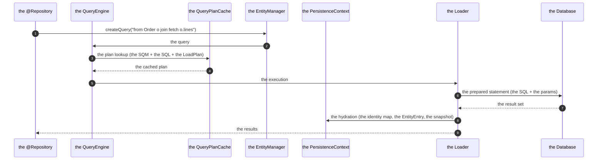
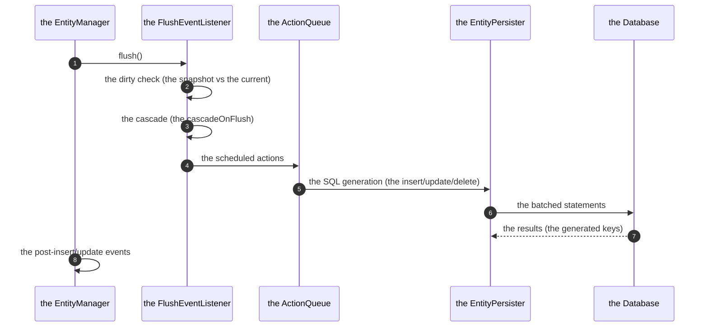

# 06 · Hibernate Internals & Performance Tuning

> **Level:** Advanced → Expert
> **Interview Frequency:** ★★★☆☆ (A "deep dive" question — usually a follow-up on "how does
> Hibernate work?")
> **Prerequisite:** [05 · Transactions & Query Optimisation](./05-Transactions-and-Query-Optimization.md)
> **Last Updated:** 2026

---

## 📋 Table of Contents
- [0. TL;DR — The 30-Second Answer](#0-tldr--the-30-second-answer)
- [1. What & Why](#1-what--why)
- [2. Mental Model — Hibernate as a SQL Generator](#2-mental-model--hibernate-as-a-sql-generator)
- [3. Deep Dive — Theory](#3-deep-dive--theory)
- [4. Internal Working Mechanism](#4-internal-working-mechanism)
- [5. Step-by-Step Execution Flow](#5-step-by-step-execution-flow)
- [6. Architecture Diagrams](#6-architecture-diagrams)
- [7. Production-Level Use Cases](#7-production-level-use-cases)
- [8. Code Examples — Production-Grade](#8-code-examples--production-grade)
- [9. Common Mistakes & Gotchas](#9-common-mistakes--gotchas)
- [10. Performance Considerations](#10-performance-considerations)
- [11. Security Considerations](#11-security-considerations)
- [12. Best Practices — The Checklist](#12-best-practices--the-checklist)
- [13. Hands-On Exercises](#13-hands-on-exercises)
- [14. Code Challenges](#14-code-challenges)
- [15. Scenario-Based Questions](#15-scenario-based-questions)
- [16. Interview Q&A — Level-wise](#16-interview-qa--level-wise)
- [17. Counter-Questions & Traps](#17-counter-questions--traps)
- [18. Tricky Interview Questions](#18-tricky-interview-questions)
- [19. Follow-Up Questions Asked by Interviewers](#19-follow-up-questions-asked-by-interviewers)
- [20. Real 3–5 Year Experience Scenarios](#20-real-35-year-experience-scenarios)
- [21. Frequently Asked Production Issues](#21-frequently-asked-production-issues)
- [22. Debugging Scenarios](#22-debugging-scenarios)
- [23. Architecture Design Questions](#23-architecture-design-questions)
- [24. Rapid-Fire MCQs](#24-rapid-fire-mcqs)
- [25. Cheat Sheet — One-Page Summary](#25-cheat-sheet--one-page-summary)
- [26. Real-World Production Notes](#26-real-world-production-notes)
- [27. Follow-up Learning](#27-follow-up-learning)

---

## 0. TL;DR — The 30-Second Answer

- **Hibernate = a SQL generator + a state machine + a cache.** The **metadata** (the
  `EntityPersister` per entity) drives the SQL generation; the **persistence context** drives
  the state transitions; the **loaders** drive the fetching.
- **The `EntityPersister`** is the heart: it holds the mapping metadata, the SQL templates, the
  loader plans, and the identifier/optimistic-locking strategies.
- **The `ActionQueue`** orders the pending operations: the orphan removals → the inserts → the
  updates → the collection operations → the deletes.
- **The `StatefulPersistenceContext`** holds the identity map, the managed entities (the
  insertion order = the flush order), the collection entries, and the proxies.
- **The dirty checking** compares the current state with the `loadedState` snapshot (or uses the
  bytecode enhancement's dirty flag).
- **The `StatementInspector`** is the hook for the SQL logging/tracing (the production
  observability hook).
- **The `Statistics`** (the entity load count, the query count, the flush count) is the N+1
  detector.
- **The tuning levers (in the order of the impact):**
  1. The **indexes** + the **query shape** (the `EXPLAIN`).
  2. The **fetch plan** (the N+1, the projections).
  3. The **batching** (the writes).
  4. The **the connection pool**.
  5. The **the bytecode enhancement** (the dirty tracking, the lazy attributes).
  6. The **the second-level cache** (the careful use).
  7. The **the JVM/GC tuning** (the entity-heavy workloads).

---

## 1. What & Why

Most developers use Hibernate as a black box. The 3–5 year candidates can look at the generated
SQL, explain **why** it's shaped that way, and know which knobs actually move the needle (and
which are folklore). This chapter is the "knowing the machine" chapter.

---

## 2. Mental Model — Hibernate as a SQL Generator

```text
  the JPQL/HQL (or the Criteria API)
        │
        │  the ANTLR parser → the AST → the SQM tree
        ▼
  ┌──────────────────────────────────────────────────────┐
  │  THE SEMANTIC QUERY MODEL (SQM)                       │
  │    the query tree: the roots, the joins, the          │
  │    the selections, the predicates, the orderings      │
  └───────────────────┬──────────────────────────────────┘
                      │  the SQM → the SQL AST
                      ▼
  ┌──────────────────────────────────────────────────────┐
  │  THE SQL AST + THE TRANSLATION                       │
  │    the table references, the columns, the params      │
  └───────────────────┬──────────────────────────────────┘
                      ▼
  ┌──────────────────────────────────────────────────────┐
  │  THE JDBC EXECUTION                                  │
  │    the prepared statement, the parameter binding,     │
  │    the result set → the entity hydration             │
  └──────────────────────────────────────────────────────┘
```

**The three subsystems:**
1. **The metadata** (`EntityPersister`, `CollectionPersister`, `QueryableCollection`) — the
   "what" (the mapping).
2. **The state machine** (`StatefulPersistenceContext`, `ActionQueue`, `EntityEntry`) — the
   "when" (the lifecycle).
3. **The loaders** (`Loader`, `EntityLoader`, `CollectionLoader`, `BatchEntityLoader`) — the
   "how" (the fetching).

---

## 3. Deep Dive — Theory

### 3.1 The `EntityPersister`

```java
public interface EntityPersister extends EntityPersisterFactory {
    // The identity
    Object getIdentifier(Object entity, SharedSessionContractImplementor session);
    Object getIdentifier(Object entity, EntityMode mode, SharedSessionContractImplementor session);
    void setIdentifier(Object entity, Object id, EntityMode mode, SharedSessionContractImplementor session);

    // The SQL
    InsertCoordinator getInsertCoordinator();
    UpdateCoordinator getUpdateCoordinator();
    DeleteCoordinator getDeleteCoordinator();

    // The state
    Object[] getPropertyValues(Object entity, EntityMode mode);
    void setPropertyValues(Object entity, Object[] values, EntityMode mode);
    Object[] getLoadedPropertyValues(Object entity, EntityMode mode);
    void setLoadedPropertyValues(Object entity, Object[] values, EntityMode mode);

    // The loading
    EntityLoader getLoaderByLockOptions(LockOptions lockOptions);
    UniqueEntityLoader getUniqueEntityLoader(LockOptions lockOptions);

    // The metadata
    String getEntityName();
    EntityMetamodel getEntityMetamodel();
    boolean hasLazyProperties();
    boolean isMutable();
    boolean isVersioned();
    boolean isIdentifierAssignable();
    ...
}
```

**The `EntityMetamodel`** (the per-entity metadata):
```text
  EntityMetamodel
    ├─ the properties (the types, the lazy flags, the insertability, the updatability)
    ├─ the property spans (the identifier, the version, the lazy, the non-lazy)
    ├─ the "the identifier property" (the id)
    ├─ the "the version property" (the @Version)
    ├─ the "the lazy property" (the lazy basic, for the enhancement)
    ├─ the "the non-aggregated composite id" (the @IdClass)
    ├─ the "the static where" (the @SQLRestriction, the @Where)
    └─ the "the subclass" (the discriminator)
```

**The `InsertCoordinator` / `UpdateCoordinator` / `DeleteCoordinator`** (Hibernate 6's
refactoring): each one owns the SQL generation, the parameter binding, the optimistic locking,
the versioning, and the cascade for that operation.

### 3.2 The `ActionQueue` — the exact order

```java
public class ActionQueue implements Serializable {
    private final ArrayList<EntityInsertAction> entityInsertions;
    private final ArrayList<EntityUpdateAction> entityUpdates;
    private final ArrayList<EntityDeleteAction> entityDeletions;
    private final ArrayList<CollectionRemoveAction> collectionRemovals;
    private final ArrayList<CollectionUpdateAction> collectionUpdates;
    private final ArrayList<CollectionRecreateAction> collectionCreations;
    private final ArrayList<QueuedOperationCollection> queuedOperations;
    ...
}
```

**The execution order (Hibernate 6):**
```text
  ① the orphan removals      (the DELETE of the removed children)
  ② the entity insertions    (the INSERTs)
  ③ the entity updates       (the UPDATEs)
  ④ the collection removals  (the DELETE of the old collection rows)
  ⑤ the collection recreations (the DELETE + INSERT of the modified collections)
  ⑥ the collection updates/creations
  ⑦ the entity deletions     (the DELETEs)
  ⑧ the queued operations    (the bulk ops)
```

**Why:** the inserts before the updates (the generated ids), the deletes last (the FKs).

### 3.3 The hydration — the entity creation

```text
  the ResultSet
     │
     ▼
  the EntityInitializer
     ├─ the "the entity is already in the context" → hydrate the existing instance
     ├─ the "the entity is a proxy" → hydrate the proxy
     └─ the "the entity is new" → create the instance
           ├─ the instantiation (the no-arg constructor, the bytecode enhancement's
           │   "the instantiation" callback)
           ├─ the property population (the setters, or the direct field access
           │   with the enhancement)
           ├─ the EntityEntry (the id, the status, the loadedState snapshot)
           ├─ the interceptor (the onLoad)
           └─ the @PostLoad callbacks
```

**The bytecode enhancement's effect:** the property population writes the **fields directly**
(no setters) → the dirty tracking isn't triggered by the hydration → faster.

### 3.4 The `StatefulPersistenceContext` — the identity map

```java
public class StatefulPersistenceContext implements Serializable, PersistenceContext {
    protected Map<EntityKey, Object> entitiesByKey;
    protected Map<EntityKey, Object> proxiesByKey;
    protected Map<EntityKey, PersistentCollection> collectionEntries;
    protected List<EntityEntry> managedEntities;
    protected Set<EntityKey> nullabilityTransientEntities;
    protected Interceptor interceptor;
    protected LoadContexts loadContexts;
    ...
}
```

**The `EntityKey`:**
```java
public final class EntityKey {
    private final String entityName;
    private final Object identifier;
    private final String role;    // the root entity name (for the inheritance)
    ...
    // the equals/hashCode on the (entityName, identifier)
}
```

**The `EntityEntry`:**
```java
public class EntityEntry {
    private Object id;
    private Object[] loadedState;      // the snapshot!
    private Object[] loadedPropertyNames;
    private Status status;              // MANAGED, LOADING, READ_ONLY, GONE, DELETED
    private Object entity;
    private EntityKey entityKey;
    private boolean loadedStateDirty;
    private Interceptor.EntityEntry entry;
    ...
}
```

**The `EntityEntry.status` — the state machine:**
| The status | The meaning |
|------------|-------------|
| `MANAGED` | The entity is in the context, the changes are tracked |
| `LOADING` | The entity is being loaded (the recursive load guard) |
| `READ_ONLY` | The entity is read-only (no dirty checking) |
| `GONE` | The entity was deleted (the scheduled delete) |
| `DELETED` | The entity was removed and the delete was executed |

### 3.5 The bytecode enhancement — what it changes

```java
public class Order {
    // The enhanced version (conceptually):
    private int $$_hibernate_read_Order_status;   // the read status
    private int $$_hibernate_write_Order_status;

    public void setStatus(OrderStatus status) {
        if (status != this.status) {
            this.$$_hibernate_write_Order_status = 1;
            this.status = status;
        }
    }
}
```

**What the enhancement gives:**
1. The **dirty tracking** — the write flag (no snapshot comparison).
2. The **lazy attributes** — the `@Basic(fetch = LAZY)` with a group (the fine-grained laziness).
3. The **the direct field access** — the hydration writes the fields (no setters) → faster, and
   the setters' side effects don't fire during the load.
4. The **the association management** — the "the dirty collection" detection (the
   `$$_hibernate_track`).

**The configuration:**
```properties
spring.jpa.properties.hibernate.bytecode.provider=bytebuddy
spring.jpa.properties.hibernate.enhancer.enableLazyInitialization=true
spring.jpa.properties.hibernate.enhancer.enableDirtyTracking=true
spring.jpa.properties.hibernate.enhancer.enableAssociationManagement=true
```

**The build-time enhancement (the Maven plugin):**
```xml
<plugin>
  <groupId>org.hibernate.orm</groupId>
  <artifactId>hibernate-enhance-maven-plugin</artifactId>
  <version>6.6.1.Final</version>
  <executions>
    <execution>
      <goals><goal>enhance</goal></goals>
    </execution>
  </executions>
</plugin>
```

**The trade-offs:** the entity classes can't be `final`; the `equals`/`hashCode` need care (the
enhanced classes get the "the enhanced" handling — the enhanced `equals` handles the proxies);
the build complexity (the plugin's order relative to the compiler); the "the enhancement is
invisible" (a developer is surprised by the dirty tracking).

### 3.6 The query pipeline — the JPQL to the SQL

```text
  the JPQL
    │  (the ANTLR grammar)
    ▼
  the HQL AST
    │  (the semantic analysis, the type resolution)
    ▼
  the SQM tree (the Semantic Query Model)
    │  (the translation — the dialect, the function registration, the limits)
    ▼
  the SQL AST
    │  (the parameter binding)
    ▼
  the JDBC PreparedStatement
```

**The SQM is the key abstraction** (Hibernate 6's): a **tree** of the query nodes
(`SqmSelectStatement`, `SqmRoot`, `SqmJoin`, `SqmWhereClause`, ...). It enables:
- The **query interpretation** (the Criteria API → the SQM → the same path as the HQL).
- The **programmatic entity graphs** (the graph → the SQM → the fetch).
- The **the mutation queries** (the `MutationQuery` for the bulk ops).
- The **the caching** of the SQM (the query plan cache).

### 3.7 The `StatementInspector` — the observability hook

```java
@Component
public class TracingStatementInspector implements StatementInspector {

    private static final Logger log = LoggerFactory.getLogger(TracingStatementInspector.class);

    @Override
    public String inspect(String sql) {
        if (sql.startsWith("call")) {
            throw new IllegalArgumentException("The stored procedures are not allowed");
        }
        return sql;
    }
}
```

**The production uses:**
- The **SQL guard** (the "no the raw SQL" policy, the `HQL` injection prevention).
- The **the tracing** (the query tag for the APM).
- The **the tenant predicate injection** (the multi-tenancy — the row-level filtering).

**The multi-tenancy with the `StatementInspector`:**
```java
@Component
public class TenantStatementInspector implements StatementInspector {
    @Override
    public String inspect(String sql) {
        if (sql.contains("tenant_id")) return sql;   // already filtered
        return sql.replace("where ", "where tenant_id = :currentTenant and ");
    }
}
```
> **The caveat:** the string manipulation on the SQL is **fragile** (the SQL shape varies, the
subqueries). The production implementations use a proper SQL parser or the **Hibernate's
`@TenantId`** (Hibernate 6's built-in multi-tenancy — the discriminator-based, the
schema-based). The `StatementInspector` is best used for the **observability** and the
**guardrails**, not for the correctness-critical filtering.

### 3.8 The `Statistics` — the metrics

```java
@Component
@RequiredArgsConstructor
public class HibernateMetricsBinder {

    private final EntityManagerFactory entityManagerFactory;

    @Bean
    MeterBinder hibernateMetrics() {
        Statistics stats = entityManagerFactory.unwrap(SessionFactory.class).getStatistics();
        stats.setStatisticsEnabled(true);

        return registry -> {
            Gauge.builder("hibernate.session.open", stats, Statistics::getSessionOpenCount)
                 .register(registry);
            Gauge.builder("hibernate.query.count", stats, Statistics::getQueryExecutionCount)
                 .register(registry);
            Gauge.builder("hibernate.entity.loads", stats, Statistics::getEntityLoadCount)
                 .register(registry);
            Gauge.builder("hibernate.collection.loads", stats, Statistics::getCollectionLoadCount)
                 .register(registry);
            Gauge.builder("hibernate.flushes", stats, Statistics::getFlushCount)
                 .register(registry);
            Gauge.builder("hibernate.query.max.ms", stats, s -> s.getQueryExecutionMaxTime())
                 .register(registry);
        };
    }
}
```

**The metrics to alert on:**
- The **query count per request** (the N+1's signature) — a ratio against the request count.
- The **entity load count** vs the row count.
- The **flush count** (the high count = the many small transactions).
- The **collection load count**.

### 3.9 The `JdbcObserver` — the Hibernate 6.6 observability

Hibernate 6.6 introduced the `JdbcObserver` — a modern, structured hook for the JDBC events
(the statement execution, the result set reading), designed for the APM integration.

```java
public class MicrometerJdbcObserver extends JdbcObserver {
    @Override
    public void statementExecuted(StatementInformation info) {
        // the timing, the SQL
    }
}
```

**The advantage over the `StatementInspector`:** it's **structured** (the timing, the
parameters, the result size) rather than a string callback.

---

## 4. Internal Working Mechanism

### 4.1 The `SessionImpl` — the key collaborators

```java
public class SessionImpl extends AbstractSharedSessionContract implements Session {
    protected transient ActionQueue actionQueue;
    protected transient StatefulPersistenceContext persistenceContext;
    protected transient JdbcCoordinator jdbcCoordinator;
    protected transient Interceptor interceptor;
    protected transient FlushEventListener[] flushListeners;
    protected transient ActionQueue returnedSensitiveProperties;
    ...
}
```

**`AbstractSharedSessionContract`** (the base): the `eventEngine` (the listeners), the
`jdbcCoordinator` (the connection, the statement inspector), the `persistenceContext` (the
state), the `eventListeners` (the `PostLoad`, `PostInsert`, ...), the `queryEngine`.

**The `EventEngine`:**
```text
  EventEngine
    ├─ the listeners:
    │     ├─ the load listeners (the DefaultLoadEventListener)
    │     ├─ the flush listeners (the DefaultFlushEntityEventListener)
    │     ├─ the persist listeners (the DefaultPersistEventListener)
    │     ├─ the merge listeners
    │     ├─ the delete listeners
    │     ├─ the collection listeners (the collection recreation!)
    │     ├─ the post-insert/update/delete/load listeners
    │     ├─ the auto-flush listener
    │     └─ the cascade listener
    └─ the listener groups (the mutable, the groups can be re-registered)
```

### 4.2 The `JdbcCoordinator` — the statement handling

```text
  JdbcCoordinator
    ├─ the connection (the logical connection, the pool-aware wrapper)
    ├─ the statementInspector
    ├─ the preparedStatementCache
    │     └─ the "the statement cache" (the SQL → the PreparedStatement)
    ├─ the resultSetReturn
    └─ the releaseMode (the "the auto-commit" handling, the afterStatement handling)
```

**The prepared statement cache** (the `hibernate.prepared_statement_cache_size`): the SQL is
prepared once and reused. The `@DynamicUpdate` **defeats** it (the SQL varies with the dirty
columns → the cache thrashes).

### 4.3 The `LoadPlan` — the fetch strategy selection

```text
  the load plan (per query)
    ├─ the "the entity's loader" (the single, the batch, the join)
    ├─ the "the collection's loader" (the single, the batch, the subselect, the join)
    └─ the "the fetch timing" (the immediate, the delayed)
```

**The `LoadPlan` selection (Hibernate 6):**
```text
  for each fetch:
    the to-one association:
      ├─ the entity is already in the context? → no fetch
      ├─ the FK is known (the @ManyToOne with the join) → the join fetch
      └─ otherwise → the proxy (the delayed load)

    the to-many association:
      ├─ the fetch mode is JOIN and the query allows it → the join fetch
      ├─ the @BatchSize → the batch loader
      ├─ the @Fetch(SUBSELECT) → the subselect loader
      └─ the default → the single collection loader (the N+1)
```

### 4.4 The query plan cache

```text
  the HQL string (or the SQM)
     │  (the hash + the parameter count)
     ▼
  the QueryPlanCache
     ├─ the SQM (the parsed tree)
     ├─ the SQL (the translated)
     ├─ the LoadPlan (the fetch strategy)
     └─ the "the query space" (the tables)
```

**The cache sizing:** `hibernate.query.plan_cache_max_size` (the default 2048). When it's full,
the oldest plans are evicted (the LRU) → the re-parsing cost.

### 4.5 The `EventListener` — the hook for the cross-cutting concerns

```java
public class AuditEntityListener implements PostInsertEventListener, PostUpdateEventListener {

    @Override
    public void onPostInsert(PostInsertEvent event) {
        AuditEntry entry = new AuditEntry(event.getEntity().getClass().getSimpleName(),
                event.getId(), "INSERT", event.getTimestamp());
        auditRepository.save(entry);
    }
}
```

**The use cases:** the audit trail, the event publishing, the soft delete, the denormalised
counter maintenance.

**The caveat:** the listeners run **inside the transaction** (the `PostInsert` runs at the
flush) → the listener's own writes are part of the transaction (and can fail it). And the
**bulk JPQL operations don't fire** the entity listeners.

### 4.6 The `Interceptor` (the legacy hook)

```java
public class AuditInterceptor implements Interceptor {
    @Override
    public boolean onSave(Object entity, Object id, Object[] state, String[] propertyNames, Type[] types) {
        // the pre-persist
        return false;   // false = don't override
    }

    @Override
    public void onFlushDirty(Object entity, Object id, Object[] currentState, Object[] previousState,
                             String[] propertyNames, Type[] types) {
        // the pre-update (the dirty detection's callback)
    }
}
```

**The modern recommendation:** the `Interceptor` is **legacy** (Hibernate 6 prefers the
`EventListener`s and the bytecode enhancement). The `onFlushDirty` is the classic hook for the
audit.

---

## 5. Step-by-Step Execution Flow

### 5.1 The query execution flow



### 5.2 The flush execution flow



---

## 6. Architecture Diagrams

### 6.1 The Hibernate architecture (the main components)

```text
   ┌────────────────────────────────────────────────────────────────┐
   │                        THE SESSION                              │
   │  ┌──────────────┐  ┌──────────────┐  ┌──────────────────┐    │
   │  │ EventEngine  │  │ ActionQueue  │  │ PersistenceCtx   │    │
   │  │ (the hooks)  │  │ (the pending)│  │ (the state)      │    │
   │  └──────────────┘  └──────────────┘  └──────────────────┘    │
   │  ┌──────────────┐  ┌──────────────┐                          │
   │  │ QueryEngine  │  │ JdbcCoord.   │                          │
   │  │ (the plans)  │  │ (the conn.)  │                          │
   │  └──────────────┘  └──────────────┘                          │
   └────────────────────────────────────────────────────────────────┘
              │                          │
              ▼                          ▼
   ┌────────────────────┐    ┌────────────────────────────┐
   │ THE METADATA       │    │ THE JDBC LAYER             │
   │ (the SessionFactory)│   │  the connection (the pool) │
   │  ├ EntityPersister │    │  the statement inspector   │
   │  ├ CollectionPersist│   │  the statement cache       │
   │  └ the loaders     │    │  the JdbcObserver (6.6)    │
   └────────────────────┘    └────────────────────────────┘
```

### 6.2 The state machine (the `EntityEntry.status`)

```text
              the load
                 │
                 ▼
            ┌─────────┐
            │ LOADING │  (the recursive load guard)
            └────┬────┘
                 │ the load completes
                 ▼
            ┌─────────┐       the eviction / the rollback
            │ MANAGED │ ────────────────────────────┐
            └────┬────┘                               ▼
                 │                           ┌──────────────┐
                 │ the remove()              │   DETACHED   │
                 ▼                           └──────────────┘
            ┌─────────┐
            │  GONE   │  (the delete is scheduled)
            └────┬────┘
                 │ the flush executes the delete
                 ▼
            ┌─────────┐
            │ DELETED │
            └─────────┘
```

---

## 7. Production-Level Use Cases

| Use case | The technique |
|----------|---------------|
| **The query tracing / the APM** | The `JdbcObserver` (6.6) or the `StatementInspector` |
| **The multi-tenancy** | The `@TenantId` (Hibernate 6) or the filter (the statement inspector as the last resort) |
| **The audit trail** | The `PostInsert`/`PostUpdate`/`PostDelete` listeners (or the DB trigger) |
| **The N+1's detection** | The `Statistics` + the Micrometer's gauges |
| **The read performance** | The bytecode enhancement (the dirty tracking, the lazy attributes) |
| **The statement-level policies** | The `StatementInspector` (the "no the stored procedures", the query tagging) |
| **The custom id generation** | The `IdentifierGenerator` (the UUID v7, the snowflake) |
| **The soft delete** | The `@SQLRestriction` (the 6.4+) |
| **The denormalised counters** | The `PostUpdate` listener (the careful, the concurrency) |
| **The query-time logging** | The `StatementInspector` with the MDC's correlation id |

---

## 8. Code Examples — Production-Grade

### 8.1 The `StatementInspector` with the correlation id (the observability)

```java
@Component
public class CorrelationStatementInspector implements StatementInspector {

    @Override
    public String inspect(String sql) {
        MDC.put("lastSql", sql);
        return sql;
    }
}
```

### 8.2 The `JdbcObserver` (Hibernate 6.6)

```java
@Component
@RequiredArgsConstructor
public class MetricsJdbcObserver extends JdbcObserver {

    private final MeterRegistry meterRegistry;

    @Override
    public void statementExecuted(StatementInformation statementInformation) {
        long elapsed = statementInformation.getExecutionTime();
        String sql = statementInformation.getSql();

        meterRegistry.counter("hibernate.jdbc.statements",
                "type", statementInformation.getStatementType().name())
                .increment();

        Timer.builder("hibernate.jdbc.query.time")
             .tag("type", statementInformation.getStatementType().name())
             .register(meterRegistry)
             .record(elapsed, TimeUnit.MILLISECONDS);
    }
}
```

### 8.3 The `Statistics`-based metrics with the N+1's detector

```java
@Component
@RequiredArgsConstructor
public class HibernateMetrics {

    private final Statistics statistics;
    private final MeterRegistry meterRegistry;
    private final Counter queryCounter;

    public HibernateMetrics(EntityManagerFactory emf, MeterRegistry meterRegistry) {
        this.statistics = emf.unwrap(SessionFactory.class).getStatistics();
        this.statistics.setStatisticsEnabled(true);
        this.queryCounter = meterRegistry.counter("hibernate.queries");
    }

    @PostConstruct
    void registerGauges() {
        Gauge.builder("hibernate.entity.loads", statistics, Statistics::getEntityLoadCount)
             .register(meterRegistry);
        Gauge.builder("hibernate.collection.loads", statistics, Statistics::getCollectionLoadCount)
             .register(meterRegistry);
        Gauge.builder("hibernate.flushes", statistics, Statistics::getFlushCount)
             .register(meterRegistry);
    }

    /**
     * The N+1 detector: the queries per loaded entity.
     * A healthy application: < 1. A N+1: > 5.
     */
    @Scheduled(fixedRate = 60_000)
    void checkForNPlusOne() {
        long queries = statistics.getQueryExecutionCount();
        long entities = statistics.getEntityLoadCount();
        if (entities > 0) {
            double ratio = (double) queries / entities;
            if (ratio > 5.0) {
                log.warn("Possible N+1 detected: {} queries for {} entity loads (ratio {})",
                        queries, entities, ratio);
            }
        }
    }
}
```

### 8.4 The `EntityListener` for the audit trail

```java
@Component
@RequiredArgsConstructor
public class AuditTrailListener implements PostInsertEventListener, PostUpdateEventListener {

    private final AuditRepository auditRepository;

    @Override
    public void onPostInsert(PostInsertEvent event) {
        persistAudit(event.getEntity(), event.getId(), "INSERT", event.getTimestamp());
    }

    @Override
    public void onPostUpdate(PostUpdateEvent event) {
        persistAudit(event.getEntity(), event.getId(), "UPDATE", event.getTimestamp());
    }

    private void persistAudit(Object entity, Object id, String operation, Date timestamp) {
        if (entity instanceof Auditable auditable) {
            auditRepository.save(AuditEntry.of(
                    auditable.auditType(),
                    id,
                    operation,
                    auditable.auditPayload(),
                    timestamp.toInstant()));
        }
    }
}
```

> **The production caveat:** the listener runs **inside the transaction** → the audit write is
part of it (an atomicity plus). But the **bulk JPQL operations don't fire** the listeners → the
audit gaps. For the critical tables, the **DB trigger** is the most reliable.

### 8.5 The custom identifier generator (the UUID v7)

```java
public class UuidV7Generator implements IdentifierGenerator {

    private static final SecureRandom RANDOM = new SecureRandom();

    @Override
    public Object generate(SharedSessionContractImplementor session, Object obj) {
        return uuidV7();
    }

    public static UUID uuidV7() {
        long timestamp = System.currentTimeMillis();

        // The 48 bits of the timestamp
        long ms = timestamp & 0xFFFFFFFFFFFFL;

        // The 4 bits of the version (7) + the 12 bits of the random
        long randA = RANDOM.nextInt(1 << 12);
        long version = 0x7L;

        // The 2 bits of the variant + the 62 bits of the random
        long randB = RANDOM.nextLong();
        long variant = (randB & 0x3FFFFFFFFFFFFFFFL) | 0x8000000000000000L;

        long mostSigBits = (ms << 16) | (version << 12) | randA;
        long leastSigBits = variant;

        return new UUID(mostSigBits, leastSigBits);
    }
}
```

```java
@Entity
public class Payment {
    @Id
    @UuidGenerator
    @GenericGenerator(name = "uuidV7", type = UuidV7Generator.class)
    @GeneratedValue(generator = "uuidV7")
    private UUID id;
}
```

> **The UUID v7** is **time-ordered** → the index locality is good (the inserts are appended) →
> the better performance than the v4 (the random UUIDs → the index page splits).

### 8.6 The `IdentifierGenerator` — the snowflake ids

```java
public class SnowflakeIdGenerator implements IdentifierGenerator {

    private static final long EPOCH = 1704067200000L;  // 2024-01-01
    private static final long SEQUENCE_BITS = 12;
    private static final long WORKER_ID_BITS = 10;

    private final AtomicLong sequence = new AtomicLong(0);
    private final long workerId;

    public SnowflakeIdGenerator(long workerId) {
        this.workerId = workerId;
    }

    @Override
    public Object generate(SharedSessionContractImplementor session, Object obj) {
        long timestamp = System.currentTimeMillis() - EPOCH;

        long sequenceValue = sequence.updateAndGet(current -> (current + 1) & ((1L << SEQUENCE_BITS) - 1));

        return (timestamp << (WORKER_ID_BITS + SEQUENCE_BITS))
             | (workerId << SEQUENCE_BITS)
             | sequenceValue;
    }
}
```

> **The trade-off:** the snowflake ids are **short** (8 bytes vs the UUID's 16), **sortable**,
and **distributed** — but they leak the timestamp and they need a **unique worker id** (the
coordination, the ZooKeeper/etcd or a static allocation). The **UUID v7** is simpler and
collision-free without the coordination.

### 8.7 The `TenantIdentifier` — the multi-tenancy (Hibernate 6)

```java
@Entity
@TenantId
private UUID tenantId;
```

```properties
spring.jpa.properties.hibernate.tenant_identifier_resolver=com.acme.TenantContextResolver
```

```java
public class TenantContextResolver implements CurrentTenantIdentifierResolver {
    @Override
    public String resolveCurrentTenantIdentifier() {
        return TenantContext.getCurrentTenantId();   // the ThreadLocal
    }

    @Override
    public boolean validateExistingCurrentSessions() {
        return false;
    }
}
```

### 8.8 The `Interceptor` for the legacy audit (the pre-update)

```java
public class AuditInterceptor implements Interceptor {

    private final ThreadLocal<Map<Object, Object>> previousStates = new ThreadLocal<>();

    @Override
    public boolean onSave(Object entity, Object id, Object[] state, String[] propertyNames, Type[] types) {
        if (entity instanceof Auditable auditable) {
            auditable.setCreatedAt(Instant.now());
            auditable.setCreatedBy(CurrentUser.get());
        }
        return false;
    }

    @Override
    public void onFlushDirty(Object entity, Object id, Object[] currentState, Object[] previousState,
                             String[] propertyNames, Type[] types) {
        if (entity instanceof Auditable auditable) {
            auditable.setUpdatedAt(Instant.now());
            auditable.setUpdatedBy(CurrentUser.get());
        }
    }
}
```

### 8.9 The Hibernate configuration (the tuned properties)

```yaml
spring:
  jpa:
    open-in-view: false                 # ⚠ never true in production
    properties:
      hibernate:
        # The dialect — let the Boot detect it
        # jdbc.time_zone: UTC
        format_sql: false
        # The batching
        jdbc.batch_size: 50
        order_inserts: true
        order_updates: true
        # The lazy loading
        default_batch_fetch_size: 50
        # The bytecode enhancement
        bytecode.provider: bytebuddy
        enhancer:
          enableLazyInitialization: true
          enableDirtyTracking: true
        # The statement cache
        prepared_statement_cache_size: 250
        jdbc.batch_versioned_data: true
        # The query plan cache
        query.plan_cache_max_size: 2048
        # The logging
        show_sql: false
```

---

## 9. Common Mistakes & Gotchas

| # | ❌ Wrong | ✅ Right | Why |
|---|----------|----------|-----|
| 1 | `open-in-view: true` | `false` (the DTO mapping in the service) | The hidden session, the perf, the leaks |
| 2 | The `StatementInspector` for the tenant filtering | The `@TenantId` or the filter | The fragile SQL rewriting |
| 3 | The `@DynamicUpdate` everywhere | Only where the update is small | The statement cache thrashing |
| 4 | The entity listeners for the critical audit | The DB trigger | The bulk ops don't fire them |
| 5 | The `Statistics` enabled in the prod without a plan | The sampling | The overhead |
| 6 | The `Interceptor` for the new code | The `EventListener` (Hibernate 6) | The legacy |
| 7 | The `UUID.randomUUID()` (v4) as the id | The v7 | The index locality |
| 8 | The `final` entity with the enhancement | Not final | The enhancement can't instrument it |
| 9 | The `IDENTITY` with the batching | The `SEQUENCE` | The batching breaks |
| 10 | The `hibernate.jdbc.batch_versioned_data` off | On | The versioned entities aren't batched |
| 11 | The `query.plan_cache_max_size` too small | 2048+ | The plan re-parsing |
| 12 | The `Interceptor`'s write failing the transaction | The careful handling | The listener runs inside the tx |
| 13 | The `prepared_statement_cache_size` = 0 with the `@DynamicUpdate` | The bigger cache | The re-preparation |
| 14 | The `save()` + the `flush()` in a loop | The `saveAll` | The round trips |
| 15 | The `Interceptor`'s `onFlushDirty` modifying the state | The careful | The infinite loop risk |

---

## 10. Performance Considerations

| Aspect | Impact | Guidance |
|--------|--------|----------|
| **The bytecode enhancement** | 10–30% on the write-heavy workloads | Enable it; the build plugin |
| **The statement cache** | The re-preparation cost | 250; the `@DynamicUpdate` reduces it |
| **The query plan cache** | The re-parsing cost | 2048; the HQL literals (not the concatenation!) |
| **The JDBC batching** | The round trips | 50; the `order_inserts`; the `batch_versioned_data` |
| **The dirty tracking** | The CPU + the memory per entity | The enhancement; the projections; the `readOnly` |
| **The proxy interception** | The CPU per lazy access | The projections; the `@BatchSize` |
| **The statistics** | The counter increments | The sampling in the prod |
| **The hydration** | The reflection/field access | The enhancement (the direct field access) |
| **The GC pressure** | The entity churn | The projections; the `clear()`; the heap tuning |

---

## 11. Security Considerations

| Risk | Mitigation |
|------|-----------|
| **The HQL/SQL injection** (the native query with the string concatenation) | The parameter binding; the `StatementInspector` guard |
| **The multi-tenancy leak** (the native query without the tenant) | The `@TenantId`; the filter; the native query review |
| **The audit trail's tamperability** | The DB trigger (the immutable table); the append-only design |
| **The `Interceptor` executing the code with the entity's data** | The validation; the safe serialisation |
| **The sensitive data in the SQL logs** | The parameter masking; the `show_sql` off in the prod; the log scrubbing |
| **The `StatementInspector`'s SQL rewriting** | The parser-based approach; the review |

---

## 12. Best Practices — The Checklist

- [ ] **`open-in-view: false`** always.
- [ ] **The DTO mapping in the service** (the entity never leaves the transaction).
- [ ] **The bytecode enhancement** enabled (the dirty tracking, the lazy attributes).
- [ ] **The JDBC batching** (50) + the `order_inserts` + the `batch_versioned_data`.
- [ ] **The `default_batch_fetch_size`** (50).
- [ ] **The `SEQUENCE`** (not the `IDENTITY`) for the batched writes.
- [ ] **The `@DynamicUpdate`** only where it pays off.
- [ ] **The HQL literals** in the `@Query` (not the concatenation → the plan cache).
- [ ] **The `@TenantId`** (or the filter) for the multi-tenancy.
- [ ] **The `StatementInspector`** for the observability and the guardrails (not the correctness).
- [ ] **The `Statistics`** monitored (the N+1's ratio).
- [ ] **The DB trigger** for the critical audits.
- [ ] **The `EXPLAIN ANALYZE`** for every new query.
- [ ] **The `hibernate.jdbc.time_zone: UTC`** (the timezone consistency).

---

## 13. Hands-On Exercises

**🧪 Lab 1 — The generated SQL**
1. Enable the SQL logging with the parameter binding.
2. Write a query with a join fetch, a lazy collection, and a `@Version`.
3. Predict the SQL (the joins, the `where id=? and version=?`) → then compare.

**🧪 Lab 2 — The flush order**
1. Create a parent with 3 children in one transaction.
2. Look at the SQL order → the parent's INSERT, then the children's.
3. Add the `@Version` and the batching → observe the batched statements.

**🧪 Lab 3 — The bytecode enhancement**
1. Enable the enhancement (the runtime `enableDirtyTracking`).
2. Load an entity, change a field, and check the SQL → the UPDATE with only the changed column.
3. Compare with the disabled version.

**🧪 Lab 4 — The `StatementInspector`**
1. Implement the inspector that logs the SQL with the MDC.
2. Trigger a request → the log shows the last SQL per request.
3. Add a guard: throw if the SQL contains "delete from users".

---

## 14. Code Challenges

### Challenge 1 — A SQL guard (medium)
**Goal:** A `StatementInspector` that blocks the dangerous SQL (the `DROP`, the `TRUNCATE`, the
`UPDATE` without a `WHERE`).
**Requirements:** the pattern matching (the SQL normalisation), the allow-list, the metrics,
the tests (the unit on the inspector), and the documentation (the escape hatch).

### Challenge 2 — An ORM performance dashboard (hard)
**Goal:** A metrics pipeline that reports the query count per endpoint, the N+1's ratio, the
slow queries, and the batch effectiveness.
**Requirements:** the `JdbcObserver`, the Micrometer, the tags (the endpoint), the
dashboards (the Grafana), the alerts (the N+1's ratio), and the baseline (the regression
detection).

### Challenge 3 — A generic soft-delete + restore framework (hard)
**Goal:** The `@SQLRestriction`-based soft delete with the restore, the purge, and the
`@TenantId`-style integration.
**Requirements:** the base entity, the repository's base class, the partial index, the
restore's event, the purge's job, and the tests.

---

## 15. Scenario-Based Questions

**S1.** *"The application's memory usage grows to 4GB with 200GB of heap and the GC is
thrashing. The heap dump shows millions of `EntityEntry` objects."**
>
> **Ideal answer:** (1) **The diagnosis**: the **persistence context** accumulation. The
`EntityEntry` objects (with the `loadedState` snapshots) are the persistence context's
bookkeeping → they're held for the transaction's duration. The causes: (a) a **long-running
transaction** (the batch job, the report) loading millions of entities; (b) a **memory leak** in
the application code (the entities held in a static/collection field); (c) the **sessions
not being closed** (the `@Transactional` in a loop? or the sessions created outside a
transaction and never closed); (d) the **second-level cache** misconfigured (the entities
retained). (2) **The proof**: the heap dump → the `SessionImpl` → the
`StatefulPersistenceContext` → the `entitiesByKey` map (the count of the entities); the
**dominator tree** (what holds the `SessionImpl`); the JFR's allocation profile. (3) **The
fixes**: (a) the **bounded unit of work** — the chunked batch with the `em.clear()` between
the batches; (b) the **`StatelessSession`** (no context, no snapshot) for the bulk reads; (c)
the **projections** (the DTOs, not the entities → no `EntityEntry`, no snapshot); (d) the
**find the leak** (the dominator tree → the retaining reference → fix it); (e) the **the L2's
size limits** (`maxBytesLocalHeap`); (f) the **the short transactions**. (4) **The systemic
fixes**: (a) the **the transaction duration budget** (the metric + the alert — no transaction
over N seconds); (b) the **the heap sizing** (the container's limit vs the `-Xmx` — the
container's memory limit with the JVM's heap: the `-XX:MaxRAMPercentage=75` and the
headroom); (c) the **the load test** with the representative data volume (the 200GB heap
doesn't scale the data — the batch does). (5) The senior framing: "**the memory scales with
the transaction's duration × the data volume** — the fix is the **bounded unit of work**, not
a bigger heap. The heap is the symptom; the unbounded transaction is the cause."

**S2.** *"After adding the `@DynamicUpdate` to reduce the update size, the DB's CPU went up and
the p99 latency worsened."**
>
> **Ideal answer:** (1) **The diagnosis**: the `@DynamicUpdate` generates a **different SQL per
dirty-column combination** → the **prepared statement cache thrashes** (each combination is a
new SQL to prepare) → the prepare cost + the plan cache misses + the DB's planning time. The
**Postgres**'s generic plans kick in after 5 executions of a prepared statement, but each new
SQL variant needs its own 5 executions to reach the generic plan. (2) **The proof**: (a) the
Hikari's/Postgres's prepared statement count (the many distinct SQLs); (b) the
`pg_stat_statements` (the many similar queries with the different column lists, each with a
low call count); (c) the DB's `pg_prepared_statements`; (d) the APM (the prepare time vs the
execute time). (3) **The fix**: (a) **remove the `@DynamicUpdate`** from the hot entities (or
apply it only where the update is a small fraction of the row and the entity is large); (b)
**use the fixed-column updates** (the `Hibernate`'s `optimistic_lock` / the "the
`@DynamicUpdate` with the column subset" — Hibernate 6 has the
`@DynamicUpdate` with the batched variant); (c) **split the entity** (the rarely-updated
columns in a separate table → the update touches the small table); (d) **keep the
prepared statement cache bigger** (the `prepared_statement_cache_size`); (e) the **the
Postgres's `plan_cache_mode`** (`force_generic_plan` for the stable queries). (4) **The
decision rule**: the `@DynamicUpdate` pays off when (1) the entity is **wide** (the many
columns, the large rows → the write amplification), (2) the update touches **a few columns**,
and (3) the **statement count** for that entity is low. It loses when the entity is updated
frequently (the cache thrashing) or the row is narrow. (5) The senior framing: "**the
`@DynamicUpdate` trades the write amplification for the plan cache** — the trade is only
worth it for the wide, rarely-updated entities. The measurement decides, not the intuition."

**S3.** *"The `Statistics` shows 1.2M entity loads per hour but the DB's query count is only
40k. Where do the loads come from?"**
>
> **Ideal answer:** (1) **The diagnosis**: the entity loads (1.2M) are far more than the
queries (40k) → the **N+1** (or the batched loading: 30 entities per query). The ratio
(30:1) suggests the **batched lazy loading** is working but there's a lot of it, OR the N+1 is
partially fixed. (2) **The investigation**: (a) the **the SQL log** (the repeated queries with
the different parameters); (b) the **`getEntityFetchCount`** (the eager fetches — the join
fetches count here) vs the `getEntityLoadCount`; (c) the **`getCollectionLoadCount`** (the
collection loads — the one-to-many is the usual N+1's source); (d) the **the query space**
(the `pg_stat_statements` — the top queries by the call count and the time). (3) **The
diagnosis of the cause**: (a) the **the collection access in a loop** (the DTO mapping
touching the lazy collections); (b) the **the entity serialised directly** (the Jackson
triggers the lazy loading); (c) the **the `Specification`** (the fetch isn't controlled);
(d) the **the `Optional<Profile>`** (the inverse one-to-one is eager → every user query loads
the profile). (4) **The fixes**: the DTO projection, the `@EntityGraph`, the `@BatchSize`,
the explicit `LAZY` on the one-to-one. (5) **The measurement discipline**: the
**`getEntityLoadCount` vs the row count** (the ratio), the **the SQL log's top queries**,
and the **the APM's DB span per endpoint**. (6) The senior framing: "**the entity-load count
is the N+1's fingerprint** — a query that loads 1 row but 30 entities means the lazy loading
is the source. The fix is the **fetch plan** (the projection), not the ORM's settings."

---

## 16. Interview Q&A — Level-wise

### 🟢 Beginner
**Q: What is Hibernate?**
**A:** An ORM (the JPA provider) that maps the Java objects to the relational data: it handles
the SQL generation, the parameter binding, the identity mapping, the dirty checking, the lazy
loading, the cascading, and the query translation (the HQL/JPQL → the SQL).

**Q: What is the `EntityManager`?**
**A:** The JPA's interface to the persistence context (the unit of work). It manages the
entities' lifecycle (`persist`, `merge`, `remove`, `find`), the queries (`createQuery`), and
the transactions. In Spring, the injected bean is a **proxy** that resolves the thread-bound
instance.

### 🟡 Intermediate
**Q: What is the `EntityPersister`?**
**A:** Hibernate's internal object that holds everything about an entity type: the mapping
metadata (the properties, the columns, the associations), the SQL generation (the insert, the
update, the delete templates), the loader plans (the fetch strategies), the identifier
generator, and the optimistic locking. One per entity type per `SessionFactory`.

**Q: What does the dirty checking do?**
**A:** It detects the changes on the managed entities and generates the `UPDATE`s at the flush.
It works by comparing the current state with the `loadedState` snapshot (the `EntityEntry`),
or with the bytecode enhancement's dirty flag.

**Q: What is the `ActionQueue`?**
**A:** The ordered list of the pending database operations for the session. At the flush, the
actions are executed in a specific order: the orphan removals, the inserts, the updates, the
collection operations, the deletes. The order guarantees the FK integrity (the inserts before
the updates, the deletes last).

### 🔴 Advanced / Senior
**Q: How does Hibernate translate a JPQL query into SQL?**
**A:** (1) The **parsing** (the ANTLR grammar) → the HQL AST; (2) the **semantic analysis**
(the type resolution, the validation) → the **SQM** (the Semantic Query Model — a tree of the
query nodes, Hibernate 6's central query abstraction); (3) the **translation** (the SQM → the
SQL AST, using the dialect's rules, the registered functions, and the limit handlers);
(4) the **parameter binding** → the JDBC `PreparedStatement`; (5) the **the execution** (the
statement, the result set → the hydration → the entities). The whole plan (the SQM, the SQL,
the load plan) is cached in the **query plan cache** (keyed by the HQL + the parameter count) →
the repeated queries skip the steps 1–3.

**Q: What is the bytecode enhancement and what does it buy?**
**A:** Hibernate (or the build plugin) instruments the entity classes: (1) the **dirty
tracking** — the setters set a write flag (no snapshot comparison at the flush) → less CPU and
memory; (2) the **lazy attributes** — the `@Basic(fetch = LAZY)` with a group (the
fine-grained laziness, e.g. the large `TEXT` column); (3) the **direct field access** — the
hydration writes the fields (no setters) → faster, and the setters' side effects don't fire
during the load; (4) the **association management** — the dirty collection detection. The
trade-offs: the classes can't be `final`, the build complexity, and the "the invisible
behaviour" (the developer is surprised by the automatic dirty tracking).

**Q: Explain the flush's internals.**
**A:** (1) The **dirty check** — for each managed entity, the `EntityEntry.loadedState` is
compared with the current state → the changed properties are detected; (2) the **cascade** —
the `cascadeOnFlush` traverses the graph and schedules the actions for the children; (3) the
**action queue** — the ordered actions (the orphan removals, the inserts, the updates, the
collection ops, the deletes); (4) the **SQL generation** — the `EntityPersister`'s coordinators
(the `InsertCoordinator`, the `UpdateCoordinator`) build the SQL (the dirty columns only, the
`where id=? and version=?`); (5) the **JDBC execution** — the batched statements; (6) the
**post-events** — the `@PostPersist`/`@PostUpdate` and the entity listeners.

**Q: How do you instrument Hibernate for production observability?**
**A:** (1) The **`JdbcObserver`** (Hibernate 6.6) — the structured JDBC events (the SQL, the
timing, the type) → the Micrometer's timers; (2) the **`StatementInspector`** — the SQL hook
(the tracing, the MDC's correlation id, the query tagging, the guardrails); (3) the
**`Statistics`** — the entity load count, the collection load count, the flush count, the
query count → the gauges and the **N+1's ratio** (the queries per entity load); (4) the
**`datasource-proxy`** in the dev (the query count per request); (5) the **Micrometer's
Hibernate metrics** (the built-in binders); (6) the **APM's** JDBC spans (the agent). The
production discipline: the `show_sql` off, the sampling of the expensive instrumentation, the
PII in the parameter logs.

### ⚫ Expert / Principal
**Q: Design the ORM layer strategy for a high-throughput platform.**
> **Answer structure:** (1) The **read path** — the projections (the DTO queries) as the
default; the entity graphs for the aggregates; the `StatelessSession` for the bulk. (2) The
**write path** — the aggregates with the optimistic locking; the atomic updates for the
counters; the batching (the `SEQUENCE`, the JDBC batching, the `order_inserts`); the
chunked transactions. (3) The **the ORM configuration** — the enhancement, the batch sizes,
the statement cache, the plan cache, the `open-in-view: false`. (4) The **the migrations** —
the schema owned by the migrations, the `validate` in the prod, the expand-and-contract. (5)
The **observability** — the query count per endpoint (the N+1's detector), the slow query
tracking, the pool's metrics, the transaction duration. (6) The **the testing** — the
Testcontainers, the query-count assertions, the concurrency tests, the migration tests. (7)
The **evolution** — the JPA 3.1's features, the Hibernate 6.6's `JdbcObserver`, the "the ORM
is an implementation detail behind the repository" (the domain model's independence).

---

## 17. Counter-Questions & Traps

### CQ1. "Is the bytecode enhancement worth it?"
- **Naive answer:** "Yes, it's faster."  ← the trap
- **The trap:** The interviewer wants the trade-offs and the measurement.
- **Expert answer:** It depends on the workload: (1) the **write-heavy** (the many updates) → the
dirty flag replaces the snapshot comparison → the CPU and the memory win; (2) the
**read-heavy** → less of an impact (the dirty check is a small part of the read path). The
**other** wins: the lazy attributes (the fine-grained laziness) and the direct field access
(the hydration). The **costs**: the build complexity (the plugin's ordering), the `final` classes
are out, and the "the magic" (the automatic dirty tracking surprises the developers who expect
the explicit `save()`). The **measurement**: the profile before/after (the CPU's share in the
dirty check — the JFR's allocation profile, the `Statistics`).

### CQ2. "Does the `Statistics` slow the application down?"
- **Naive answer:** "A little."  ← the trap
- **The trap:** The interviewer wants the exact answer: the statistics have a **real** but
**small** cost (the counter increments), and the `EntityIncrementCounters` has a
**configurable** granularity.
- **Expert answer:** The `Statistics` is enabled with `setStatisticsEnabled(true)` — the
overhead is the counter increments (the atomic increments per event). It's measurable but
usually **< 1%** for the typical application — the bigger cost is the **`isStatisticsEnabled`
check** on the hot paths (which is a boolean check, not a counter). For the production, the
recommendation: enable it (the observability is worth it) but don't use the **query execution
max time** as a hot metric (it's a `long` updated per query — fine) and be careful with the
`getEntityDump` (it's expensive). The alternative: the `JdbcObserver` (the structured
events) or the `datasource-proxy` (the dev).

### CQ3. "Can you make Hibernate generate a specific SQL?"
- **Naive answer:** "Yes, with the native query."  ← partial
- **The trap:** The developer thinks the native query is the only way, losing the ORM's
features.
- **Expert answer:** Several levels: (1) the **native query** (`nativeQuery = true`) — the full
control, the raw SQL, the no portability, the no the entity mapping (the `addScalar`/the
`addEntity`); (2) the **custom SQL in the mapping** (the `@SQLRestriction`, the `@Formula`, the
`@Subselect` — the entity-level SQL fragments, still ORM-managed); (3) the **the `ResultTransformer`**
/the **the `Tuple`** (the custom mapping of the results); (4) the **the Criteria API** (the
programmatic query with the control over the structure); (5) the **the `SqmQuery`** (the
Hibernate 6's SQM-level manipulation, the most powerful). The recommendation: the native query
for the DB-specific SQL (the window functions, the CTEs, the `ON CONFLICT`), the ORM for the
rest.

### CQ4. "What if the ORM generates a bad SQL?"
- **Naive answer:** "Use the native query."  ← the trap
- **The trap:** The real answer is the **schema/query design** (the missing index, the wrong
column order, the correlated subquery).
- **Expert answer:** Diagnose in order: (1) the **the `EXPLAIN ANALYZE`** (is it the plan or the
SQL shape?); (2) the **the index** (the missing composite, the wrong column order, the
function on the column — `WHERE DATE(created_at) = ?` prevents the index use!); (3) the **the
SQL shape** (the correlated subquery → the join; the `SELECT *` → the projection; the
`DISTINCT` on the wide row); (4) the **the ORM's mapping** (the eager collection → the
`@BatchSize`; the `join fetch` → the projection). The ORM's SQL is usually a **symptom** of the
mapping or the query design, not a Hibernate bug. The escape hatch (the native query) should
be the last resort, and it comes with the cost: the no portability, the no the entity mapping,
the no the dirty checking.

### CQ5. "Is the `EntityManager` the same as the `Session`?"
- **Naive answer:** "Yes, the Session is the Hibernate implementation of the EntityManager."
  ← correct, but the interviewer wants the nuances
- **The trap:** The `EntityManager` is **not** thread-safe, but the `Session` has the
Hibernate-specific APIs (the statistics, the `setDefaultReadOnly`, the `enableDirtyTracking`,
the `getSessionFactory`).
- **Expert answer:** The `Session` implements the `EntityManager` (Hibernate 6) and adds the
Hibernate-specific APIs: the `Statistics` access, the `setDefaultReadOnly`, the
`enableDirtyTracking`, the `getSessionFactory`, the `unwrap`, the `setJdbcBatchSize`. The
`Session` also has the **`StatelessSession`** variant (the no context, the no dirty checking,
the no identity map — the bulk reads). The **practical advice**: depend on the `EntityManager`
in the application code (the portability), and unwrap to the `Session` only in the
infrastructure (the Hibernate-specific tuning). The `EntityManager` is **not** thread-safe
(the Spring proxy makes the injection safe, but the instance isn't).

---

## 18. Tricky Interview Questions

**T1. "What is the difference between the `Session` and the `StatelessSession`?"**
> The `Session` has the **persistence context** (the identity map, the dirty checking, the
automatic flush, the cascade, the lazy loading). The `StatelessSession` has **none** of them —
every operation goes straight to the DB (no state tracking, no first-level cache, the
collections can't be lazy-loaded usefully). It's for the **bulk reads** (the imports, the
exports) where the per-entity overhead dominates. The trade-off: no the identity map (the
same row can be loaded twice), no the automatic dirty checking (the explicit `update`), no the
cascade.

**T2. "What happens if the entity's class is `final`?"**
> The **proxy** can't subclass it → the lazy loading on the associations fails (the
`HibernateProxyException` — "cannot proxy final class") → the eager loading is required for
that entity. And the bytecode enhancement can't instrument it (the final methods/classes).

**T3. "What is the 'the read-only entity'?"**
> An entity marked read-only (`session.setDefaultReadOnly(true)`, the `@Immutable`, the
`@Cache(readOnly = true)`) → Hibernate doesn't track the changes (no dirty check, no snapshot)
→ a performance win for the read-only data. The `@Immutable` entity is also **not updated** by
the ORM (the direct SQL update works).

**T4. "What is the difference between the `flush` and the `clear`?"**
> The **flush** writes the pending changes to the DB (the transaction is still open). The
**clear** discards the pending changes AND detaches everything (the context is emptied) — the
changes are **lost** (unless flushed first). The typical use: `flush()` then `clear()` in a
batch loop (the memory), or `clear()` after a bulk operation (the stale state).

**T5. "What is the 'the query space'?"**
> The set of the tables a query touches — used by the **auto-flush** to decide whether the
pending changes affect the query's results (the flush only if the spaces overlap). It's also
used by the **batch loader** to decide when to close a batch (a different table → close the
batch).

**T6. "How does the Hibernate decide to use a `join fetch` vs a separate select?"**
> The **load plan** (the optimiser): for a **to-one** with a known FK → the join (the same
query, no extra round trip). For a **to-many** → a separate select by default (the join would
multiply the rows) unless the query explicitly requests the join fetch (or the fetch mode is
`JOIN` / the entity graph forces it). The `@BatchSize` groups the separate selects.

**T7. "What is the `hibernate.jdbc.batch_versioned_data`?"**
> By default, Hibernate doesn't batch the statements for the **versioned** entities (the
`@Version`) — because the version check's affected-rows count is needed per statement to detect
the conflict. With `batch_versioned_data = true`, the versioned updates are batched too (the
conflict detection becomes the sum of the affected rows). The trade-off: the granularity of
the conflict detection.

**T8. "What is the `hibernate.order_inserts` and why does it matter?"**
> It sorts the inserts **by entity type** before executing them → the JDBC batch contains the
same statement type (the driver's batch is homogeneous) → the batching works. Without it, the
interleaved inserts of different types would break the batch into many small ones.

**T9. "What is the difference between the `persist` and the `merge` in the internals?"**
> The `persist` transitions the entity to **managed** (the id is assigned, the snapshot is
created). The `merge` does a **load-or-create** of the managed instance and **copies the state**
from the detached one → it returns the managed instance. The internals: the `merge` uses the
`DefaultMergeEventListener` → the `EntityCopy` (the `AbstractEntityPersister.copyValues`).

**T10. "What is the 'the Hibernate statement cache' vs the 'the JDBC statement cache'?"**
> The **Hibernate's** `PreparedStatementCache` (the `hibernate.prepared_statement_cache_size`)
caches the **PreparedStatement objects** (the Hibernate's wrappers) per connection, keyed by
the SQL. The **JDBC driver's** cache may also exist (the Postgres's server-side prepared
statements, the Hikari's `prepStmtCacheSize` for the PgJDBC driver). The Hibernate one is
useful for the repeated identical SQL; the driver's is for the server-side plan.

**T11. "Why does the `PostUpdate` listener run even when nothing changed?"**
> It doesn't — the `@PostUpdate` only fires if the entity was **dirty** (the flush detected a
change). But the `Interceptor.onFlushDirty` is called during the dirty check for **every**
entity (the callback receives the `currentState` and the `previousState` — the developer must
compare them). That's a common source of confusion.

**TT12. "What is the 'the hibernate.jdbc.time_zone' for?"**
> It tells Hibernate to convert the `Timestamp`/`Date` parameters to the DB's timezone
convention (the `java.sql.Timestamp` vs the `OffsetDateTime`). With the `UTC` and the
Postgres's `timestamptz`, the parameters are consistent. The classic bug: the timestamps
shifting by the hours because the JVM's timezone differs from the DB's. The modern advice: the
JVM, the DB, and the app all in UTC (`spring.jpa.properties.hibernate.jdbc.time_zone=UTC` +
the JVM's `-Duser.timezone=UTC`).

---

## 19. Follow-Up Questions Asked by Interviewers

**F1** (after "the `EntityPersister`") → *"What happens when the entity mapping changes at
runtime?"*
→ It doesn't (the metadata is built at the startup, the `SessionFactory` is immutable) — a
change requires a restart. (The `Hibernate` 6's runtime schema management is a different
thing.)

**F2** (after "the flush") → *"How do you know the flush happened?"*
→ The `Statistics.getFlushCount()`, the `PostFlush` event listener, or the SQL log (the
statements grouped between the transaction's begin/commit).

**F3** (after "the enhancement") → *"How do you enable it in a Maven build?"*
→ The `hibernate-enhance-maven-plugin` (the `enhance` goal) — it runs after the compilation
(the `process-classes` phase). The alternative: the runtime enhancement (the
`hibernate.enhancer.enableLazyInitialization` + the `enableDirtyTracking` — the entities are
enhanced on the fly, at the class-loading).

**F4** (after "the observability") → *"How would you find the slowest query?"*
→ The `pg_stat_statements` (the DB-side, the total time, the call count) + the APM's JDBC
spans (the per-endpoint) + the `Statistics.getQueryExecutionMaxTime()` (a single query, not
aggregated) + the Hibernate's `SlowQueryInspector` (the Hibernate 6.5+'s
`hibernate.session_factory.statement_inspector`-based slow query logging).

**F5** (after "the `ActionQueue`") → *"What if the insert fails? What happens to the
transaction?"*
→ The exception propagates → the flush is aborted → the transaction is marked rollback-only
→ the rollback (the whole transaction, not just the failed statement). The other statements
already executed are undone by the DB's rollback.

---

## 20. Real 3–5 Year Experience Scenarios

**R1. "The production DB's CPU is at 70% and the p99 latency is 2 seconds. The same queries
in staging are fast. The staging has 1% of the data."**
>
> **Ideal answer:** (1) **The diagnosis**: a **plan difference** due to the data volume (the
"the query works in staging" trap). The causes: (a) the **stale statistics** (the prod's
`ANALYZE` hasn't run → the planner's estimates are wrong → the bad plan); (b) the **the index
isn't used in the prod** (the planner's cost model says the index isn't worth it at the prod's
volume — the classic "the index is used in the staging, the seq scan in the prod"); (c) the
**different data distribution** (the skewed data → the planner's assumption is wrong); (d) the
**the bloat** (the table's bloat from the updates → the seq scan reads the dead tuples → the
IO amplification → the `VACUUM`); (e) the **the different plan for the different statistics**
(the `default_statistics_target`); (f) the **the replica** (the read replica's lag → the
queries wait). (2) **The proof**: (a) the **`EXPLAIN (ANALYZE, BUFFERS)` on the prod** (the
plan + the actual vs the estimated rows — the mismatch is the smoking gun); (b) the
**`pg_stat_user_tables`** (the `n_live_tup`, the `n_dead_tup`, the last `ANALYZE`, the
`last_autoanalyze`); (c) the **`pg_stat_statements`** (the top queries by the total time); (d)
the **`pg_stat_user_indexes`** (the index's usage — the unused index, the low hit rate).
(3) **The fixes**: (a) the **`ANALYZE`** (or the `autovacuum` tuning — the `autovacuum_vacuum_scale_factor`
for the big tables); (b) the **the index** (or the `ANALYZE` to make the planner use the
existing one); (c) the **the statistics target** (the `ALTER TABLE ... ALTER COLUMN ... SET STATISTICS 1000`
for the skewed columns); (d) the **`VACUUM FULL`** (the bloat — the lock, so the maintenance
window) or the `pg_repack` (the online); (e) the **the query rewrite** (the projection, the
index-friendly predicates). (4) **The systemic fixes**: (a) the **the autovacuum tuning**
(the per-table settings, the `autovacuum_vacuum_scale_factor = 0.02` for the big tables); (b)
the **the query budget** (the slow query log, the `pg_stat_statements` review in the CI); (c)
the **the load test with the production-like data volume** (the staging's 1% of the data hides
the plan problems!) — the **the data-scale testing**; (d) the **the monitoring** (the
`n_dead_tup`, the `last_analyze`, the plan regressions). (5) The senior framing: "**'it works
in staging' is a data-volume symptom** — the plan changes with the statistics. The production's
plan must be validated with the `EXPLAIN ANALYZE` on the production-like data, and the
statistics must be fresh (`ANALYZE`/the autovacuum tuning)."

**R2. "We added a new feature that queries the orders with the customer. The dashboard is
now slow (5 seconds) and the DB shows a 10x increase in the query count."**
>
> **Ideal answer:** (1) **The diagnosis**: the classic N+1 introduced by a new association. The
`pg_stat_statements` shows the same query (the orders) with a high call count, plus a second
query (the customers) with an equally high call count. (2) **The fix**: the **DTO projection**
(`select new OrderSummaryDto(o.id, o.orderNumber, c.name) from Order o join o.customer c`) — one
query; or the **`@EntityGraph`** if the entities are needed. (3) **The prevention** (this is
the important part): (a) the **query-count assertions in the CI** (the integration test that
asserts the query count doesn't scale with the data — the N+1's regression guard); (b) the
**the architectural rule** — the DTO-only responses (no entity serialisation); (c) the **the
APM's metric** — the DB span count per endpoint, with the alert; (d) the **the code review
checklist** — "a new association? where is the fetch plan?"; (e) the **the `default_batch_fetch_size`**
as the safety net (it turns the worst case into 1+1). (4) **The deeper lesson**: the **the
fetch plan is a design artifact** — it should be reviewed and tested like the API contract.
The N+1 is a **regression** that the tooling must catch. (5) The senior framing: "**the N+1 is
the default failure mode of any new association** — the defence is the automated
query-count assertion (the CI) plus the projection-first design. The tuning
(`@BatchSize`) is the mitigation, not the fix."

**R3. "The team's Hibernate config has 40 properties copied from a blog. Nobody knows why
they're there, and the app has intermittent 500s with 'too many connections'."**
>
> **Ideal answer:** (1) **The approach**: treat it as a **configuration audit**, not a
random cleanup. (2) **The steps**: (a) **the inventory** — the current config, the git history
(who added what and when), the version comparison (the properties that were removed/renamed in
the newer Hibernate/Spring Boot versions — the `hibernate.*` vs the `spring.jpa.properties.*`
migration, the renamed properties); (b) **the classification** — for each property: the
**default** (the redundant ones → remove), the **justified** (the documented reason → keep),
the **unknown** (→ test and measure), the **obsolete** (→ remove). The common ones: the
redundant `hibernate.jdbc.driver`/`dialect` (the Boot detects them), the
`hibernate.show_sql` (the Boot's `logging.level`), the `hibernate.format_sql` (the dev only),
the `hibernate.hbm2ddl.auto` (the `ddl-auto` — should be `validate` in the prod), the
`hibernate.current_session_context_class` (the Spring handles it), the
`hibernate.jdbc.batch_size` (the `hibernate.jdbc.batch_size` is fine, but the `hibernate.jdbc.batch_versioned_data`
needs a check), the `hibernate.generate_statistics` (→ the `Statistics.setStatisticsEnabled`),
the `hibernate.max_fetch_depth` (the legacy — the Hibernate 6 removed it). (c) **the
validation** — the change is a **config change** → the load test + the canary + the monitoring
(the query count, the latency, the connection count). (d) **the connection exhaustion** — the
immediate diagnosis: the pool's metrics, the `pg_stat_activity` (the `idle in transaction`), the
transactions that are too long. The likely culprits in the config: the `hikari.maximum-pool-size`
being too large, the `connection-timeout` being too long (the 30s hang), the missing
`idle_in_transaction_session_timeout` at the DB level. (e) **The process** — the config in the
**version control** (the `application.yml`, the profile-specific overrides), the documented
reasons (the comments or the ADR), and the **the removal process** (one property at a time, with
the measurement). (3) The senior framing: "**the configuration is code** — it needs the review,
the tests, and the ownership. The 40 unexplained properties are the 40 untested assumptions;
the audit converts them into the documented decisions. The connection exhaustion is usually a
**transaction-boundary** problem, not a config problem."

---

## 21. Frequently Asked Production Issues

| Symptom | Cause | Diagnosis | Fix |
|---------|-------|-----------|-----|
| The `LazyInitializationException` | The entity leaves the transaction | The stack trace | The DTO mapping in the service |
| The N+1 | The lazy access in the loop | The query count | The projection, the entity graph |
| The memory growth | The context accumulation | The heap dump | The `clear()`, the stateless session |
| The "cannot proxy final class" | The final entity | The stack trace | Remove the final |
| The slow queries only in the prod | The plan/statistics | The `EXPLAIN ANALYZE` | The `ANALYZE`, the index |
| The connection exhaustion | The long tx, the `REQUIRES_NEW`, the leak | The Hikari's metrics, the `pg_stat_activity` | The short transactions, the outbox |
| The timestamps shifted | The timezone mismatch | The comparison | The UTC everywhere |
| The "the update doesn't persist" | The detached entity / the read-only | The SQL log | The dirty checking, the `merge` |
| The `HibernateProxyException` | The final method / the final class | The stack trace | The enhancement, or the `Hibernate.unproxy` |
| The high CPU with the small data | The `@DynamicUpdate`'s cache thrashing | The `pg_stat_statements` | Remove the dynamic update |
| The "the update writes all the columns" | The default behaviour | The SQL log | The `@DynamicUpdate` (carefully) |

---

## 22. Debugging Scenarios

**D1. "Show me the generated SQL with the parameters."**
```properties
logging.level.org.hibernate.SQL=DEBUG
logging.level.org.hibernate.orm.jdbc.bind=TRACE
spring.jpa.properties.hibernate.format_sql=true
```

**D2. "How many entities were loaded and how many queries ran?"**
```java
Statistics stats = emf.getSessionFactory().getStatistics();
stats.getEntityLoadCount();
stats.getQueryExecutionCount();
stats.getCollectionLoadCount();
stats.getFlushCount();
```

**D3. "What does the load plan look like?"**
```text
  logging.level.org.hibernate.loader=DEBUG
  logging.level.org.hibernate.engine.jdbc=DEBUG
```
The load plan's `LoadPlan` details are in the DEBUG output of the `org.hibernate.loader` /
the `org.hibernate.SQL` logger.

**D4. "Is the entity enhanced?"**
```java
// The enhanced class has the $$_hibernate_ fields
Order.class.getDeclaredFields();   // look for the $$_hibernate_ fields
```

**D5. "Which SQL ran for this request?"**
The `StatementInspector` with the MDC's correlation id.

---

## 23. Architecture Design Questions

**Q1. 🏗️ Design the ORM strategy for a high-throughput, multi-tenant platform.**
> **Answer structure:** (1) The **read path** — the DTO projections as the default; the entity
graphs for the aggregates; the `StatelessSession` for the bulk; the read-only transactions.
(2) The **write path** — the aggregates with the optimistic locking; the atomic updates; the
batching; the chunked transactions. (3) The **multi-tenancy** — the `@TenantId` (the
discriminator) or the schema-per-tenant; the native queries' discipline. (4) The **the schema**
— the migrations, the `validate` in the prod, the partitioning. (5) The **the observability** —
the query count per endpoint, the N+1's ratio, the slow queries, the pool, the transactions.
(6) The **the testing** — the Testcontainers, the query-count assertions, the concurrency.
(7) The **the evolution** — the ORM behind the repository (the domain's independence).

**Q2. 🏗️ Design the migration from a legacy JDBC codebase to Spring Data JPA.**
> **Answer structure:** (1) The **inventory** — the tables, the queries, the data access
patterns; the "the N+1 doesn't exist" (the legacy JDBC is often the fast one). (2) The
**strangler** — the new features on JPA, the legacy on JDBC, the same DB. (3) The **the mapping**
— the legacy schema's quirks (the no PK, the reserved words, the no FKs) → the `@Subselect`/the
`@Formula`/the native queries; the entity mapping can't always be clean. (4) The **the
performance parity** — the query-count comparison per endpoint (the benchmark: the same data,
the same queries, the latency). (5) The **the rollout** — the feature flags, the canary, the
comparison dashboards. (6) The **the tests** — the characterisation tests (the legacy's
behaviour is captured as the tests before the migration). (7) The **the lessons** — the JPA
gives the productivity but the performance must be **measured**; the legacy's hand-tuned SQL
is often faster than the naive ORM usage.

**Q3. 🏗️ Design the ORM strategy for a 100k writes/second system.**
> **Answer structure:** (1) The **write path** — the JPA is often the wrong tool at that
throughput: the **JDBC batching** (or the `COPY`), the **the projections for the writes** (the
`INSERT` via a native query, not the entity), the **the partitioning** (the time-partitioned
tables). (2) The **the ORM's role** — the reads and the complex aggregates; the writes go
through the tuned SQL. (3) The **the id strategy** — the `SEQUENCE`/the snowflake/UUID v7
(the `IDENTITY` is a no). (4) The **the connection pool** — the sized, the isolated. (5) The
**the batching** — the 1000-row batches, the `order_inserts`. (6) The **the consistency** —
the idempotency, the `ON CONFLICT DO NOTHING`. (7) The **the observability** — the writes
per second, the batch efficiency, the lock waits.

---

## 24. Rapid-Fire MCQs

**1.** The `EntityPersister` holds:
A) The entities  B) The mapping metadata + the SQL + the loaders  C) The transactions  D) The connections
**✅ B**

**2.** The `ActionQueue`'s order starts with:
A) The deletes  B) The orphan removals, then the inserts  C) The updates  D) The bulk ops
**✅ B**

**3.** The dirty check compares:
A) The DB with the entity  B) The current state with the `loadedState` snapshot  C) Two entities  D) The parameters
**✅ B**

**4.** The bytecode enhancement's main benefit:
A) The faster SQL  B) The dirty flag (no snapshot comparison) + the lazy attributes  C) The smaller jar  D) The no proxies
**✅ B**

**5.** The `Statistics.getEntityLoadCount()` detects:
A) The slow queries  B) The N+1's  C) The deadlocks  D) The leaks
**✅ B**

**6.** The `StatementInspector` is called:
A) Before the execution  B) When the SQL is generated (before the parameters)  C) After the execution  D) Only for the writes
**✅ B**

**7.** The `EntityEntry.status` includes:
A) MANAGED, LOADING, READ_ONLY, GONE, DELETED  B) NEW, SAVED  C) Only MANAGED  D) PERSISTENT, TRANSIENT
**✅ A**

**8.** The `hibernate.order_inserts` groups:
A) The queries by the type  B) The rows by the id  C) The transactions  D) The connections
**✅ A**

**9.** The `hibernate.jdbc.batch_versioned_data`:
A) Disables the versioning  B) Batches the versioned updates too  C) Enables the versioning  D) Disables the batching
**✅ B**

**10.** The SQM is:
A) The SQL  B) The semantic query model (the query tree)  C) The JDBC statement  D) The bytecode
**✅ B**

**11.** The `open-in-view: false`:
A) Disables the entity loading  B) Closes the session after the request's transaction  C) Disables the lazy loading  D) Disables the transactions
**✅ B**

**12.** The `StatelessSession`:
A) Is faster for the writes  B) Has no persistence context (the bulk reads)  C) Is thread-safe  D) Disables the transactions
**✅ B**

**13.** The bytecode enhancement can't instrument:
A) The private methods  B) The final classes/methods  C) The static methods  D) The interfaces
**✅ B**

**14.** The `@Immutable` entity:
A) Is never updated by the ORM  B) Can't be persisted  C) Is always loaded eagerly  D) Disables the version
**✅ A**

**15.** The `hibernate.jdbc.time_zone: UTC`:
A) Changes the JVM's timezone  B) Aligns the JDBC's timestamp handling  C) Changes the DB's timezone  D) Formats the dates
**✅ B**

**16.** The `PostUpdate` listener fires:
A) For every managed entity  B) Only for the dirty entities  C) Only for the bulk updates  D) After the commit
**✅ B**

**17.** The `JdbcObserver` (6.6) is:
A) A replacement for the `StatementInspector`  B) The structured JDBC event hook  C) A connection pool  D) A SQL parser
**✅ B**

**18.** The `IDENTITY` prevents the JDBC batching because:
A) The IDs are sequential  B) The INSERT executes immediately (to get the id)  C) The DB is slow  D) The sequence is missing
**✅ B**

---

## 25. Cheat Sheet — One-Page Summary

```text
┌──────────────────────────────────────────────────────────────────────────────┐
│  HIBERNATE = THE METADATA + THE STATE MACHINE + THE LOADERS                  │
│    the EntityPersister  → the mapping, the SQL, the loaders                  │
│    the ActionQueue      → the ordered pending operations                     │
│    the PersistenceCtx   → the identity map, the snapshots, the proxies       │
│    the EventEngine      → the hooks (the listeners, the cascade)              │
├──────────────────────────────────────────────────────────────────────────────┤
│  THE FLUSH ORDER                                                             │
│    the orphan removals → the inserts → the updates                          │
│    → the collection ops → the deletes                                       │
├──────────────────────────────────────────────────────────────────────────────┤
│  THE TUNING LEVERS (the impact order)                                       │
│    ① the indexes + the query shape (the EXPLAIN)                            │
│    ② the fetch plan (the N+1, the projections)                             │
│    ③ the batching (batch_size=50, order_inserts, batch_versioned_data)       │
│    ④ the connection pool (the measured sizing)                              │
│    ⑤ the bytecode enhancement (the dirty flag, the lazy attributes)          │
│    ⑥ the L2 (the careful use)                                              │
│    ⑦ the JVM/GC (the entity-heavy workloads)                               │
├──────────────────────────────────────────────────────────────────────────────┤
│  ⚠ open-in-view: false — the DTO mapping in the service                      │
│  ⚠ The @DynamicUpdate thrashes the statement cache                          │
│  ⚠ The bulk JPQL ops don't fire the entity listeners (the DB trigger)       │
│  ⚠ The native queries bypass the @SQLRestriction and the @TenantId          │
│  ⚠ The UTC everywhere (the JVM, the DB, the jdbc.time_zone)                 │
└──────────────────────────────────────────────────────────────────────────────┘
```

---

## 26. Real-World Production Notes

- **The ORM's configuration is code.** Every property is a decision; the unexplained ones are
  the untested assumptions.
- **The "it works in staging" trap is usually the data volume.** The plan changes with the
  statistics.
- **The new association is the N+1's default.** The fetch plan must be reviewed and tested.
- **The `@DynamicUpdate` is a trade, not a free win.**

---

## 27. Follow-up Learning

- → [11 · Database Design & Optimisation](../11-Database-Design-Optimization/README.md) — the
  indexes, the query plans, the connection pooling.
- → [10 · Caching & Performance](../10-Caching/README.md) — the caching layers.
- → [13 · Testing](../13-Testing/README.md) — the integration tests, the query-count
  assertions.

---
**Next Chapter:** → [README (Topic Index)](./README.md)
**Previous Chapter:** ← [05 · Transactions & Query Optimisation](./05-Transactions-and-Query-Optimization.md)
