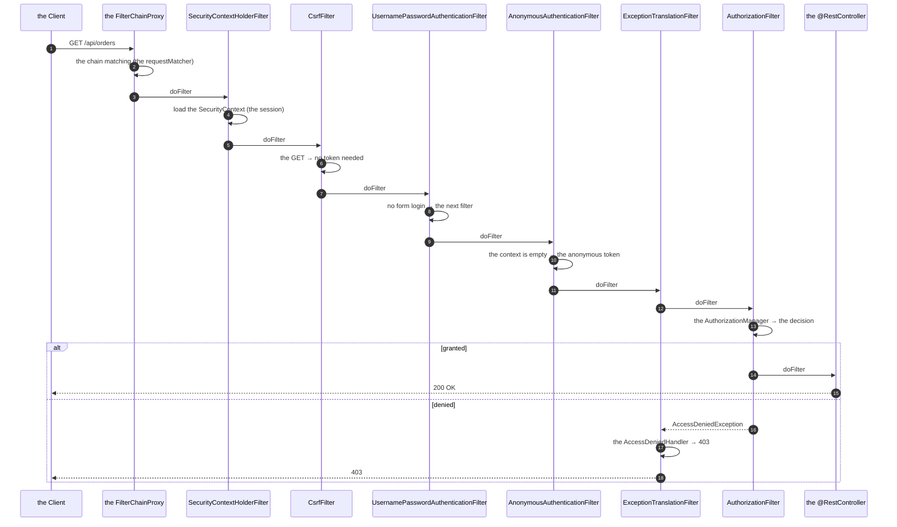
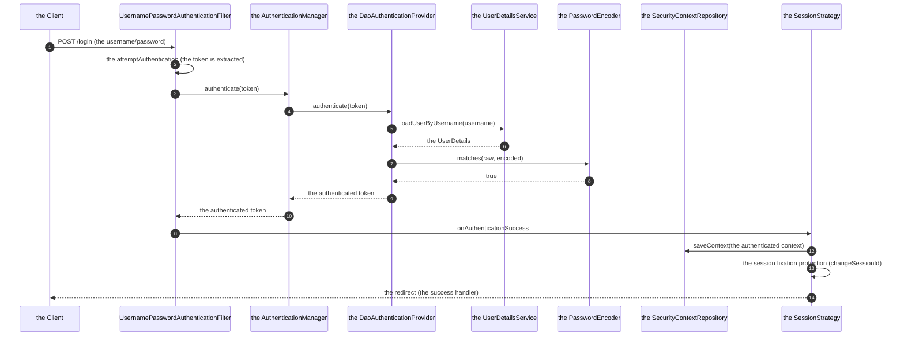
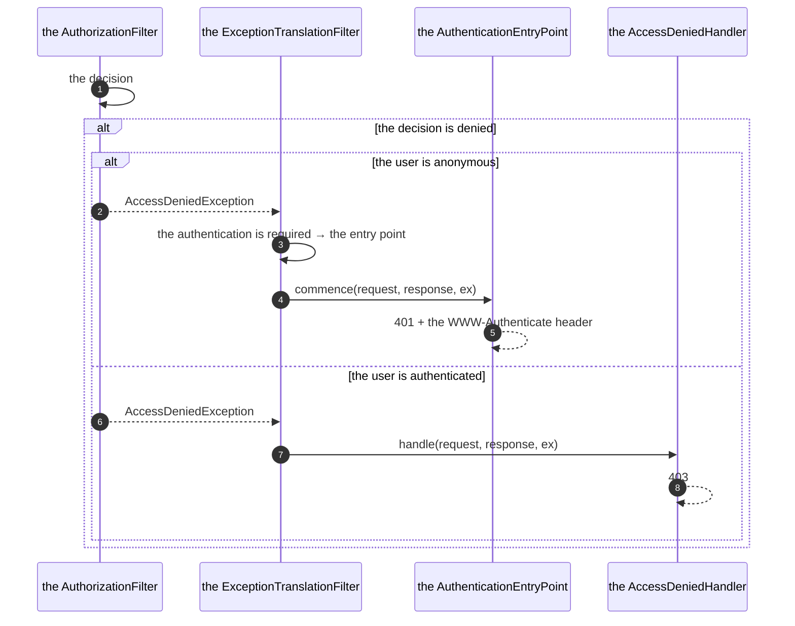

# 01 · Security Architecture & the Filter Chain

> **Level:** Beginner → Advanced
> **Interview Frequency:** ★★★★★ (The "walk me through the security filter chain" question)
> **Prerequisite:** [03 · Spring MVC](../03-Spring-MVC/README.md)
> **Last Updated:** 2026

---

## 📋 Table of Contents
- [0. TL;DR — The 30-Second Answer](#0-tldr--the-30-second-answer)
- [1. What & Why](#1-what--why)
- [2. Mental Model — The Gate Before the Door](#2-mental-model--the-gate-before-the-door)
- [3. Deep Dive — Theory](#3-deep-dive--theory)
- [4. Internal Working Mechanism](#4-internal-working-mechanism)
- [5. Step-by-Step Execution Flow](#5-step-by-step-execution-flow)
- [6. Architecture Diagrams](#6-architecture-diagrams)
- [7. Production-Level Use Cases](#7-production-level-use-cases)
- [8. Code Examples — Production-Grade](#8-code-examples--production-grade)
- [9. Common Mistakes & Gotchas](#9-common-mistakes--gotchas)
- [10. Performance Considerations](#10-performance-considerations)
- [11. Security Considerations](#11-security-considerations)
- [12. Best Practices — The Checklist](#12-best-practices--the-checklist)
- [13. Hands-On Exercises](#13-hands-on-exercises)
- [14. Code Challenges](#14-code-challenges)
- [15. Scenario-Based Questions](#15-scenario-based-questions)
- [16. Interview Q&A — Level-wise](#16-interview-qa--level-wise)
- [17. Counter-Questions & Traps](#17-counter-questions--traps)
- [18. Tricky Interview Questions](#18-tricky-interview-questions)
- [19. Follow-Up Questions Asked by Interviewers](#19-follow-up-questions-asked-by-interviewers)
- [20. Real 3–5 Year Experience Scenarios](#20-real-35-year-experience-scenarios)
- [21. Frequently Asked Production Issues](#21-frequently-asked-production-issues)
- [22. Debugging Scenarios](#22-debugging-scenarios)
- [23. Architecture Design Questions](#23-architecture-design-questions)
- [24. Rapid-Fire MCQs](#24-rapid-fire-mcqs)
- [25. Cheat Sheet — One-Page Summary](#25-cheat-sheet--one-page-summary)
- [26. Real-World Production Notes](#26-real-world-production-notes)
- [27. Follow-up Learning](#27-follow-up-learning)

---

## 0. TL;DR — The 30-Second Answer

- **Spring Security is a servlet filter chain.** `SecurityFilterChain` is a `List<Filter>`; each
  filter handles one concern and calls `filterChain.doFilter()` to pass the request along.
- **The order matters enormously.** The canonical order: `DisableEncodeUrlFilter` →
  `WebAsyncManagerIntegrationFilter` → `SecurityContextHolderFilter` → `HeaderWriterFilter` →
  `CorsFilter` → `CsrfFilter` → `LogoutFilter` → **`UsernamePasswordAuthenticationFilter`** →
  `BasicAuthenticationFilter` → `RequestCacheAwareFilter` → `SecurityContextHolderAwareRequestFilter` →
  `AnonymousAuthenticationFilter` → `ExceptionTranslationFilter` → **`AuthorizationFilter`**.
- **The two halves:**
  - **Authentication** — *who are you?* (`AuthenticationManager` → `AuthenticationProvider` →
    `UserDetailsService` → `PasswordEncoder`).
  - **Authorization** — *can you do this?* (the `AuthorizationFilter` → the `AuthorizationManager` →
    the `AccessDecisionManager`/`AuthorizationDecision`).
- **`SecurityContextHolder`** — the thread-local holding the `Authentication`. **The
  `SecurityContextHolderFilter`** loads it (from the session or the header) and clears it at the
  end of the request (the `SecurityContextHolderFilter` in Spring Security 6 — the
  `SecurityContextPersistenceFilter` in 5.x).
- **`FilterChainProxy`** — the single entry point that dispatches to the matching
  `SecurityFilterChain` (by the `requestMatchers`).
- **`ExceptionTranslationFilter`** — the last line of defence: it catches the
  `AccessDeniedException` and the `AuthenticationException` and delegates to the
  `AuthenticationEntryPoint` (the 401) or the `AccessDeniedHandler` (the 403).
- **Spring Security 6+:** the lambda DSL (`SecurityFilterChain` beans), the `authorizeHttpRequests`
  (the `authorizeRequests` is deprecated), the `PathPatternRequestMatcher` (the `AntPathRequestMatcher`
  is deprecated), the **`AuthenticationManager` as a bean**, the `SecurityFilterChain` as a bean
  (the `WebSecurityConfigurerAdapter` is removed), the **`@EnableMethodSecurity`** (the
  `@EnableGlobalMethodSecurity` is deprecated).
- **The one-liner:** *"Spring Security is a chain of servlet filters. The first half establishes
  **who** you are (the authentication), the second half decides **what** you may do (the
  authorization). Everything else — the CSRF, the CORS, the sessions, the headers — is a filter
  in the chain."*

---

## 1. What & Why

Most Spring developers use the defaults and never know why. The interviews ask "walk me
through the request flow" because that's the question that separates "I copied the config" from
"I understand it". This chapter is the foundation for Topics 05 (Security) and 06 (JWT).

---

## 2. Mental Model — The Gate Before the Door

```text
   the HTTP request
        │
        ▼
   ┌──────────────────────────────────────────────────────┐
   │  THE SERVLET CONTAINER                                │
   │   the FilterChainProxy (the single entry point)      │
   └───────────────────────┬──────────────────────────────┘
                           ▼
   ┌──────────────────────────────────────────────────────┐
   │  THE SECURITY FILTER CHAIN (the ordered filters)    │
   │                                                      │
   │   ① the CORS (the pre-flight)                       │
   │   ② the CSRF (the token check)                       │
   │   ③ the AUTHENTICATION (who are you?)                │
   │   ④   the SecurityContext (the thread-local)         │
   │   ⑤ the ANONYMOUS (the fallback identity)           │
   │   ⑥ the AUTHORIZATION (can you do this?)             │
   │   ⑦ the EXCEPTION TRANSLATION (the 401/403)         │
   └───────────────────────┬──────────────────────────────┘
                           ▼
                   your @RestController
```

> **Caption:** The filters are like a series of gates. Each one can **stop the request** (by
> throwing or by writing the response) or **pass it on**. The security context is established
> *before* the authorization gate — that's the whole design.

---

## 3. Deep Dive — Theory

### 3.1 The filter chain — the canonical order (Spring Security 6)

```java
@Bean
SecurityFilterChain filterChain(HttpSecurity http) throws Exception {
    http
        .authorizeHttpRequests(auth -> auth
            .requestMatchers("/api/public/**").permitAll()
            .anyRequest().authenticated())
        .httpBasic(Customizer.withDefaults())
        .formLogin(Customizer.withDefaults())
        .sessionManagement(session -> session
            .sessionCreationPolicy(SessionCreationPolicy.STATELESS));

    return http.build();
}
```

**The filters Spring Security adds (the order):**

| # | The filter | The responsibility |
|---|-----------|-------------------|
| 1 | `DisableEncodeUrlFilter` | Removes the `JSESSIONID` from the URLs (the cookie-based sessions) |
| 2 | `WebAsyncManagerIntegrationFilter` | Propagates the `SecurityContext` to the async tasks |
| 3 | `SecurityContextHolderFilter` | Loads the `SecurityContext` from the `SecurityContextRepository` and **clears it at the end** |
| 4 | `HeaderWriterFilter` | Writes the security headers (the CSP, the `X-Content-Type-Options`, the HSTS, the frame options) |
| 5 | `CorsFilter` | The CORS handling (the pre-flight `OPTIONS`) |
| 6 | `CsrfFilter` | The CSRF token validation (the `CsrfTokenRepository`) |
| 7 | `LogoutFilter` | The logout handling (the session invalidation, the cookie clearing) |
| 8 | `UsernamePasswordAuthenticationFilter` | The **form login** (the username/password) |
| 9 | `LogoutFilter` / `BasicAuthenticationFilter` | The **HTTP Basic** (the header) |
| 10 | `RequestCacheAwareFilter` | Saves the request for the redirect after the login |
| 11 | `SecurityContextHolderAwareRequestFilter` | Wraps the request to expose the `getUserPrincipal()` / the `isUserInRole()` |
| 12 | `AnonymousAuthenticationFilter` | Populates the `SecurityContext` with an **anonymous** token if it's empty |
| 13 | `ExceptionTranslationFilter` | Catches the `AuthenticationException` → the `AuthenticationEntryPoint` (the 401); the `AccessDeniedException` → the `AccessDeniedHandler` (the 403) |
| 14 | `AuthorizationFilter` | The **authorization** decision |

**The two filters that matter most for the interviews:** the
`UsernamePasswordAuthenticationFilter` (the authentication) and the `AuthorizationFilter` (the
authorization).

### 3.2 The `FilterChainProxy` — the dispatcher

```java
public class FilterChainProxy extends GenericFilterBean {

    private final List<SecurityFilterChain> filterChains;
    private final RequestMatcher requestMatcher;

    @Override
    public void doFilter(HttpServletRequest request, HttpServletResponse response, FilterChain chain)
            throws IOException, ServletException {

        // ① Find the chain that matches this request
        SecurityFilterChain securityFilterChain = getSecurityFilterChain(request);

        // ② Delegate to it
        if (securityFilterChain != null) {
            securityFilterChain.getFilters().forEach(filter -> {
                try {
                    filter.doFilter(request, response, chain);
                } catch (IOException | ServletException e) {
                    throw new ServletException(e);
                }
            });
            return;
        }
        // ③ No chain matched → the servlet container's default chain
        chain.doFilter(request, response);
    }
}
```

**The matching:** the `SecurityFilterChain` has a `requestMatcher` (e.g. `/api/**`). The **first
matching chain wins** → the **order of the `SecurityFilterChain` beans matters** (the
`@Order` on the bean, or the order of the definition).

```java
@Bean
@Order(1)
SecurityFilterChain apiChain(HttpSecurity http) throws Exception {
    http.securityMatcher("/api/**")
        .authorizeHttpRequests(a -> a.anyRequest().authenticated())
        .sessionManagement(s -> s.sessionCreationPolicy(SessionCreationPolicy.STATELESS));
    return http.build();
}

@Bean
@Order(2)
SecurityFilterChain webChain(HttpSecurity http) throws Exception {
    http.authorizeHttpRequests(a -> a.anyRequest().permitAll());
    return http.build();
}
```

### 3.3 The `SecurityContextHolder` — the thread-local

```java
public class SecurityContextHolder {
    private static final ThreadLocal<SecurityContext> contextHolder = new ThreadLocal<>();

    public static void setContext(SecurityContext context) { contextHolder.set(context); }
    public static SecurityContext getContext() { return contextHolder.get(); }
    public static void clearContext() { contextHolder.remove(); }
}
```

**The strategies (the `SecurityContextHolder` modes):**
| The strategy | The storage | The use |
|-------------|-------------|-------|
| `MODE_THREADLOCAL` (the default) | The `ThreadLocal` | The normal web apps |
| `MODE_INHERITABLETHREADLOCAL` | The `InheritableThreadLocal` | The `@Async` (the child threads inherit) — the leak risk |
| `MODE_GLOBAL` | The `SecurityContextHolderStrategy` (the custom) | The reactive (the `ReactorContext`) |

**The critical production note:** the `SecurityContextHolderFilter` **clears** the context at
the end of the request → the thread (the Tomcat's worker) is not polluted for the next request.
**If you disable the filter (the `spring.security.filter.deny-all` or the `WebSecurity`
customization) and forget to clear it → the security leak between the requests on the same
thread!**

**The Spring Security 6 change:** the `SecurityContextHolderFilter` (the stateless-by-default
architecture) replaced the `SecurityContextPersistenceFilter`. The difference: in 6.x, the
`SecurityContext` is **not** automatically saved to the session — the `SecurityContextRepository`
(the `DelegatingSecurityContextRepository` with the `HttpSessionSecurityContextRepository` and
the `RequestAttributeSecurityContextRepository`) handles the persistence, and the
`requireExplicitSave` defaults to **true** in 6.x (the `SecurityContext` is only saved when
`saveContext` is called).

### 3.4 The `Authentication` — the token

```java
public interface Authentication extends Principal, Serializable {
    Object getCredentials();
    Object getDetails();
    Object getPrincipal();
    boolean isAuthenticated();
    void setAuthenticated(boolean isAuthenticated) throws IllegalArgumentException;
    Collection<? extends GrantedAuthority> getAuthorities();
    String getName();
}
```

**The implementations:**
| The class | The meaning |
|----------|-------------|
| `UsernamePasswordAuthenticationToken` | The username/password (the form login, the basic auth) |
| `BearerTokenAuthenticationToken` | The JWT / the OAuth2 bearer token |
| `AnonymousAuthenticationToken` | The unauthenticated fallback |
| `RememberMeAuthenticationToken` | The remember-me cookie |
| `PreAuthenticatedAuthenticationToken` | The certificate / the mutual TLS |
| `TestingAuthenticationToken` | The tests |

**The `AuthenticationProvider` — the actual check:**
```java
public interface AuthenticationProvider {
    Authentication authenticate(Authentication authentication) throws AuthenticationException;
    boolean supports(Class<?> authentication);
}
```

**The `AuthenticationManager` — the orchestrator:**
```java
public interface AuthenticationManager {
    Authentication authenticate(Authentication authentication) throws AuthenticationException;
}
```

**The `ProviderManager` — the standard implementation:**
```text
  ProviderManager.authenticate(authentication)
      │
      ├─ ① Find the providers that support this token type
      │     (the supports(Class) check, in the registration order)
      │
      ├─ ② If no provider → the ParentAuthenticationManager (the parent, e.g. the OAuth2)
      │     or the AuthenticationException
      │
      ├─ ③ For each provider:
      │       ├─ the provider.authenticate(token)
      │       ├─ the SUCCESS → return the authenticated token
      │       ├─ the ProviderNotFoundException → try the next provider
      │       └─ the AuthenticationException → the "the last exception is thrown"
      │             (unless the provider is a "the last" one)
      │
      └─ ④ No provider succeeded → the last exception (or the ProviderNotFoundException)
```

**The parent manager:** the `ProviderManager` can have a **parent** `AuthenticationManager`
(the `ParentAuthenticationManager`) → the delegation (the OAuth2's
`OAuth2AuthorizationRequestRedirectFilter` → the OAuth2's `AuthenticationManager`).

### 3.5 The `UserDetails` & the `UserDetailsService`

```java
public interface UserDetails extends Serializable {
    Collection<? extends GrantedAuthority> getAuthorities();
    String getPassword();
    String getUsername();
    boolean isAccountNonExpired();
    boolean isAccountNonLocked();
    boolean isCredentialsNonExpired();
    boolean isEnabled();
}
```

```java
public interface UserDetailsService {
    UserDetails loadUserByUsername(String username) throws UsernameNotFoundException;
}
```

**The `User` builder:**
```java
UserDetails user = User.builder()
        .username("alice")
        .password(passwordEncoder.encode("secret"))
        .roles("USER", "ADMIN")
        .accountExpired(false)
        .accountLocked(false)
        .credentialsExpired(false)
        .disabled(false)
        .build();
```

**The `AuthenticationProvider` — the default (`DaoAuthenticationProvider`):**
```java
public Authentication authenticate(Authentication authentication) {
    String username = authentication.getName();
    UserDetails user = this.userDetailsService.loadUserByUsername(username);

    if (user == null) throw new BadCredentialsException("Bad credentials");

    // ① the pre-authentication checks
    if (!this.preAuthenticationChecks.check(user)) {
        throw new AccountStatusException(...);   // the locked/disabled/expired
    }

    // ② the password
    String presentedPassword = authentication.getCredentials().toString();
    if (!this.passwordEncoder.matches(presentedPassword, user.getPassword())) {
        throw new BadCredentialsException("Bad credentials");
    }

    // ③ the post-authentication checks
    if (!this.postAuthenticationChecks.check(user)) {
        throw new AccountStatusException(...);
    }

    // ④ the authorities
    Collection<GrantedAuthority> authorities = user.getAuthorities();
    ...
    return new UsernamePasswordAuthenticationToken(user, null, authorities);
}
```

**The critical detail:** the `AccountStatusException` reveals **more** than the
`BadCredentialsException` (the account exists but is locked vs the wrong password) — an
**enumeration** vector. The mitigation: a **generic** error message (and a constant-time
response).

### 3.6 The `PasswordEncoder` — the hashing

```java
public interface PasswordEncoder {
    String encode(CharSequence rawPassword);
    boolean matches(CharSequence rawPassword, String encodedPassword);
    default boolean upgradeEncoding(String encodedPassword) { return false; }
}
```

**The implementations:**
| The encoder | The format | The recommendation |
|-------------|-----------|-------------------|
| `BCryptPasswordEncoder` | `$2a$10$...` | ✅ The default choice — the salt is built in, the cost factor is configurable |
| `Argon2PasswordEncoder` | `$argon2id$...` | ✅ The best (the memory-hard) — needs the BouncyCastle |
| `SCryptPasswordEncoder` | `$s0$...` | ✅ The memory-hard |
| `Pbkdf2PasswordEncoder` | `iterations:...` | ✅ The FIPS-friendly |
| `NoOpPasswordEncoder` | the plaintext | ❌ Never in production |
| `DelegatingPasswordEncoder` | `{bcrypt}$2a$...` | ✅ The recommended default — the prefix identifies the encoder (the migration-friendly) |

**The `DelegatingPasswordEncoder` (the Spring Security 5.5+ default):**
```java
@Bean
PasswordEncoder passwordEncoder() {
    return PasswordEncoderFactories.createDelegatingPasswordEncoder();
    // → the default: {bcrypt} with a strength of 10
}
```
**The benefit:** the encoded value carries the encoder's id (`{bcrypt}`) → you can **change the
encoder** and the old passwords still verify (and the `upgradeEncoding` flag lets you
re-hash them on the next login).

**The parameters:**
```java
new BCryptPasswordEncoder(12);   // the cost factor: 2^12 = 4096 iterations
new Argon2PasswordEncoder(65536, 10, 4, 32, 32);   // the memory, the iterations, the parallelism, the salt, the hash
```

**The tuning:** the bcrypt's cost should be calibrated so the hashing takes ~100ms on your
hardware (the OWASP's recommendation). The 2^12 = 4096 iterations ≈ 100–250ms on a modern CPU.

### 3.7 The authorization model

```text
  the AuthorizationFilter
        │
        ▼
  the AuthorizationManager
        │
        ▼
  the RequestMatcherDelegatingAuthorizationManager
        │
        ├─ the RequestMatcher → the AuthorizationManager
        │
        └─ the AuthorizationFilter's AuthorizationManager
              │
              ▼
        the AuthorizationManager.beforeAuthorization()
              │
              ▼
        the AuthorizeAuthorizationManager (the WebExpressionAuthorizationManager)
              │
              ├─ the AuthorizationDecision (the granted/denied)
              └─ the AccessDeniedException (if denied)
```

**The expression-based authorization:**
```java
http.authorizeHttpRequests(auth -> auth
    .requestMatchers("/admin/**").hasRole("ADMIN")
    .requestMatchers(HttpMethod.GET, "/api/orders/**").hasAuthority("ORDER_READ")
    .requestMatchers("/api/orders/**").hasAuthority("ORDER_WRITE")
    .anyRequest().authenticated());
```

**The `hasRole` vs `hasAuthority`:** `hasRole("ADMIN")` prefixes with `ROLE_` →
`hasAuthority("ROLE_ADMIN")` is the same. **The trap:** the authorities from the database are
often `ADMIN` (no prefix) → `hasRole("ADMIN")` fails.

**The `AuthorizationManager` (the granular API):**
```java
@Bean
AuthorizationManager<RequestAuthorizationContext> adminOnly() {
    return (authentication, context) -> {
        boolean granted = authentication.get().getAuthorities().stream()
                .anyMatch(a -> a.getAuthority().equals("ROLE_ADMIN"));
        return new AuthorizationDecision(granted);
    };
}
```

### 3.8 The `ExceptionTranslationFilter` — the 401 vs the 403

```java
public class ExceptionTranslationFilter extends OncePerRequestFilter {

    @Override
    public void doFilter(...) {
        try {
            filterChain.doFilter(request, response);
        } catch (AuthenticationException | AccessDeniedException ex) {
            throw ex;
        } catch (Exception ex) {
            throw new ServletException(ex);
        }
    }
}
```

**The distinction:**
| The situation | The exception | The handler | The status |
|-------------|---------------|-----------|-----------|
| **Not authenticated** (the identity is missing/anonymous) | `AuthenticationException` | The `AuthenticationEntryPoint` | **401 Unauthorized** |
| **Authenticated but not allowed** | `AccessDeniedException` | The `AccessDeniedHandler` | **403 Forbidden** |

**The `AuthenticationEntryPoint` implementations:**
- `BasicAuthenticationEntryPoint` — the 401 with the `WWW-Authenticate: Basic` header.
- `Http403ForbiddenEntryPoint` — the 403 (the "the user is anonymous, so we don't reveal the
  resource's existence").
- `LoginUrlAuthenticationEntryPoint` — the redirect to the login page (the form login).
- `DelegatingAuthenticationEntryPoint` — the choice based on the request type (the browser → the
  redirect; the API → the 401).
- `BearerTokenAuthenticationEntryPoint` — the 401 with the `WWW-Authenticate: Bearer` (the OAuth2
  / the JWT).

**The production API pattern:**
```java
http.exceptionHandling(ex -> ex
    .authenticationEntryPoint((request, response, ex2) -> {
        response.setStatus(HttpServletResponse.SC_UNAUTHORIZED);
        response.setContentType(MediaType.APPLICATION_JSON_VALUE);
        objectMapper.writeValue(response.getOutputStream(),
                new ApiError("UNAUTHORIZED", "Authentication required"));
    })
    .accessDeniedHandler((request, response, ex2) -> {
        response.setStatus(HttpServletResponse.SC_FORBIDDEN);
        ...
    }));
```

### 3.9 The session management

```java
http.sessionManagement(session -> session
    .sessionCreationPolicy(SessionCreationPolicy.IF_REQUIRED)  // the default
    .sessionFixation(sessionFixation -> sessionFixation.changeSessionId())
    .maximumSessions(1)
    .sessionConcurrency(...)
    .invalidSessionUrl("/login?invalid")
    .sessionAuthenticationError(...)
);
```

**The `SessionCreationPolicy`:**
| The policy | The behaviour |
|------------|--------------|
| `ALWAYS` | A session is created for every request |
| `NEVER` | Never (the app manages the sessions) |
| `IF_REQUIRED` (the default) | A session is created if it's needed (the state is saved) |
| `STATELESS` | Never — the `SecurityContext` isn't saved (the JWT / the API) |

**The session fixation protection:** the `changeSessionId()` (the default since Spring Security
4) — the session id is changed on the authentication (the old id is invalidated) → the
attacker's pre-set session id is useless.

**The concurrency control:**
```java
.sessionConcurrency(registry -> registry
    .maximumSessions(1)
    .maxSessionsPreventsLogin(false)   // the old session is expired
    .expiredSessionStrategy(event -> ...));
```
**The caveat:** the session registry is in-memory (per instance) → in a cluster, the "the
maximum 1 session" doesn't work across the instances (the fix: the Spring Session with the
Redis).

### 3.10 The CORS — the configuration

```java
@Bean
CorsConfigurationSource corsConfigurationSource() {
    CorsConfiguration config = new CorsConfiguration();
    config.setAllowedOrigins(List.of("https://app.example.com"));   // NOT "*" with credentials
    config.setAllowedMethods(List.of("GET", "POST", "PUT", "DELETE", "OPTIONS"));
    config.setAllowedHeaders(List.of("Authorization", "Content-Type", "X-CSRF-TOKEN"));
    config.setExposedHeaders(List.of("Location"));
    config.setAllowCredentials(true);
    config.setMaxAge(3600L);

    UrlBasedCorsConfigurationSource source = new UrlBasedCorsConfigurationSource();
    source.registerCorsConfiguration("/api/**", config);
    return source;
}
```

**The rules:**
- **`allowCredentials = true` + `allowedOrigins = "*"` is illegal** (the CORS spec — the browser
  rejects it). Use the explicit origins or `allowedOriginPatterns` (the Spring 5.3+).
- The `CorsFilter` must be **before** the `CsrfFilter` (the pre-flight `OPTIONS` requests must
  not require the CSRF token) — the Spring Security's `http.cors()` places it correctly.
- The **`@CrossOrigin`** on the controller is simpler but less controlled.

### 3.11 The CSRF — the configuration

```java
http.csrf(csrf -> csrf
    .csrfTokenRepository(CookieCsrfTokenRepository.withHttpOnlyFalse())
    .csrfTokenRequestHandler(new CsrfTokenRequestAttributeHandler())
    .ignoringRequestMatchers("/api/**"));   // ⚠ only for the stateless APIs
```

**The CSRF's mechanism (the synchroniser token pattern):**
1. The server generates a random token, stores it in the session (or a cookie), and embeds it in
   the HTML form (or the meta tag).
2. The client sends it back with every state-changing request (the header `X-CSRF-TOKEN` or the
   form field `_csrf`).
3. The `CsrfFilter` compares the two → a mismatch → the `CsrfException` → the 403.

**The stateless APIs:** the CSRF is **not needed** when there's no cookie-based authentication
(the browser doesn't send anything automatically) → the token can't be forged → the CSRF is
disabled. **But** if you use the **JWT in a cookie** (the "the httpOnly cookie" pattern) → the
CSRF **is** needed (the cookie is sent automatically) → the **double-submit cookie** or the
`XSRF-TOKEN` header pattern.

### 3.12 The `UserDetailsService` vs the `AuthenticationProvider` vs the `AuthenticationManager`

```text
  the AuthenticationManager (the orchestrator)
      │
      ▼
  the AuthenticationProvider (the strategy: "how do I verify?")
      │
      ├─ the DaoAuthenticationProvider (the username/password)
      │     └─ the UserDetailsService (the user lookup)
      │           └─ the PasswordEncoder (the verification)
      │
      ├─ the OidcUserService (the OIDC)
      ├─ the JwtAuthenticationProvider (the JWT)
      └─ the AnonymousAuthenticationProvider
```

**The Spring Security 6.1+ change:** the `AuthenticationManager` can be **exposed as a bean**
(`@Bean AuthenticationManager authenticationManager(UserDetailsService uds, PasswordEncoder pe)`)
→ the **explicit** configuration (the no `DaoAuthenticationProvider` auto-registration).

### 3.13 The `SecurityContextRepository`

```java
public interface SecurityContextRepository {
    SecurityContext loadEmptyContext(HttpServletRequest request);
    void saveContext(HttpServletContext context, HttpServletRequest request, HttpServletResponse response);
}
```

**The implementations:**
| The implementation | The storage |
|-------------------|------------|
| `HttpSessionSecurityContextRepository` | The HTTP session (the default in 6.x with the `SecurityContextHolderFilter`) |
| `RequestAttributeSecurityContextRepository` | The request attribute (the per-request only) |
| `DelegatingSecurityContextRepository` | The request attribute (the save) + the session (the read) |
| `NullSecurityContextRepository` | Nothing (the stateless) |

**The stateless setup (Spring Security 6):**
```java
@Bean
SecurityFilterChain apiChain(HttpSecurity http) throws Exception {
    http
        .securityContext(context -> context
            .securityContextRepository(new RequestAttributeSecurityContextRepository()))
        .sessionManagement(session -> session
            .sessionCreationPolicy(SessionCreationPolicy.STATELESS));
    return http.build();
}
```

### 3.14 The `@EnableMethodSecurity` — the method-level security

```java
@Configuration
@EnableMethodSecurity
public class MethodSecurityConfig { }
```

```java
@Service
public class AccountService {
    @PreAuthorize("hasRole('ADMIN')")
    public void closeAccount(Long id) { ... }

    @PreAuthorize("@accountGuard.canAccess(#id, authentication)")
    public Account getAccount(Long id) { ... }

    @PostAuthorize("return.owner.username == authentication.name")
    public Account loadOwnedAccount(Long id) { ... }

    @PreAuthorize("hasAuthority('ORDER_WRITE')")
    @Transactional
    public Order placeOrder(...) { ... }
}
```

**The three annotations:**
| The annotation | The evaluation point | The use |
|---------------|---------------------|-------|
| `@PreAuthorize` | **Before** the method | The access control (the veto) |
| `@PostAuthorize` | **After** the method | The filtering (the return value's access) |
| `@PreAuthorize` + `@PostAuthorize` | Both | The write + the read control |

**The `@EnableMethodSecurity` defaults:** `prePostEnabled = true`, `securedEnabled = true`,
`jsr250Enabled = true` (the `@RolesAllowed`/`@PermitAll`).

**The SpEL's context:**
- `authentication` — the `Authentication` object.
- `principal` — the `Authentication.getPrincipal()`.
- `roles` / `authorities` — the collections.
- `hasRole('X')`, `hasAuthority('X')`, `hasAnyRole(...)`, `permitAll()`, `denyAll()`,
  `isAuthenticated()`, `isAnonymous()`.

**The self-invocation trap:** the method security is also a proxy → the self-invocation bypasses
it (the same as the `@Transactional`).

---

## 4. Internal Working Mechanism

### 4.1 The `HttpSecurity` — the builder

```java
public final class HttpSecurity {

    private final List<AuthenticatedFilter> filters = new ArrayList<>();
    private final Map<Class<? extends SecurityConfigurerAdapter<?, ?>, SecurityConfigurerAdapter<?, ?>> configurers = new LinkedHashMap<>();
    private final ObjectPostProcessor<Object> objectPostProcessor = new ObjectPostProcessor<>() { ... };
    private final AuthenticationManagerBuilder authenticationManagerBuilder;
    private final HttpSessionRequestCache httpSessionRequestCache;
    private SecurityContextRepository securityContextRepository;
    ...
}
```

**The configurers (each one adds its filters):**
```text
  HttpSecurity
    ├─ CsrfConfigurer         → the CsrfFilter
    ├─ CorsConfigurer         → the CorsFilter
    ├─ ExceptionHandlingConfigurer → the ExceptionTranslationFilter
    ├─ SessionManagementConfigurer → the SessionManagementFilter
    ├─ SecurityContextConfigurer  → the SecurityContextHolderFilter
    ├─ RequestCacheConfigurer → the RequestCacheAwareFilter
    ├─ AnonymousConfigurer    → the AnonymousAuthenticationFilter
    ├─ ExceptionHandlingConfigurer
    ├─ LogoutConfigurer       → the LogoutFilter
    ├─ DefaultLoginPageConfigurer → the LoginPageGeneratingFilter
    ├─ UsernamePasswordConfigurer → the UsernamePasswordAuthenticationFilter
    ├─ DefaultLoginPageConfigurer
    ├─ BasicAuthenticationConfigurer → the BasicAuthenticationFilter
    ├─ BearerTokenConfigurer  → the BearerTokenAuthenticationFilter
    ├─ OAuth2LoginConfigurer  → the OAuth2LoginAuthenticationFilter
    ├─ OAuth2AuthorizationCodeConfigurer
    ├─ OidcConfigurer
    └─ ...
```

**The `build()`:** the `DefaultSecurityFilterChain` is created with the ordered filters. The
ordering is a **fixed list** in `HttpSecurity` (the `FILTERS` constant) — the configurers add
their filters to the correct position.

**The `DefaultSecurityFilterChain`:**
```java
public final class DefaultSecurityFilterChain implements SecurityFilterChain {
    private final List<Filter> filters;
    @Override public List<Filter> getFilters() { return this.filters; }
}
```

### 4.2 The `FilterChainProxy`'s chain matching

```java
private SecurityFilterChain getSecurityFilterChain(HttpServletRequest request) {
    for (SecurityFilterChain chain : this.filterChains) {
        if (chain.matches(request)) return chain;
    }
    return null;
}
```
The `matches` uses the `RequestMatcher` (the `PathPatternRequestMatcher` in 6.x, the
`AntPathRequestMatcher` before).

### 4.3 The `SecurityContextHolderFilter`

```java
public class SecurityContextHolderFilter extends OncePerRequestFilter {

    @Override
    protected void doFilterInternal(HttpServletRequest request, HttpServletResponse response, FilterChain chain) {
        try {
            // ① Load the context from the repository
            SecurityContext context = this.securityContextRepository.loadContext(request);
            SecurityContextHolder.setContext(context);

            // ② Continue the chain
            chain.doFilter(request, response);
        } finally {
            // ③ ALWAYS clear the context (the thread-local hygiene)
            SecurityContextHolder.clearContext();
        }
    }
}
```

**The `finally` block is the security-critical part:** without it, the next request on the same
Tomcat's worker thread would see the previous request's `Authentication`.

### 4.4 The `AnonymousAuthenticationFilter`

```java
public class AnonymousAuthenticationFilter extends OncePerRequestFilter {
    @Override
    protected void doFilterInternal(...) {
        if (SecurityContextHolder.getContext().getAuthentication() == null) {
            Authentication authentication = createAuthentication((HttpServletRequest) request);
            SecurityContext context = SecurityContextHolder.createEmptyContext();
            context.setAuthentication(authentication);
            SecurityContextHolder.setContext(context);
        }
        chain.doFilter(request, response);
    }
}
```
**The `AnonymousAuthenticationToken`** has the authority `ROLE_ANONYMOUS` → the
`authenticated()` check distinguishes the anonymous from the real user. The `AuthenticatedAuthorizationManager`
uses it: the `permitAll()` works for the anonymous too.

### 4.5 The `AuthorizationFilter` — the modern decision point

```java
public class AuthorizationFilter extends OncePerRequestFilter {

    @Override
    protected void doFilterInternal(HttpServletRequest request, HttpServletResponse response, FilterChain chain) {
        AuthorizationDecision decision = this.authorizationManager.check(this::getAuthentication, request);
        this.eventPublisher.publishEvent(new AuthorizationEvent(this, decision, ...));
        if (decision.isGranted()) {
            chain.doFilter(request, response);
        } else {
            throw new AccessDeniedException("Access Denied");
        }
    }
}
```

**The `AuthorizationManager` chain:**
```text
  the AuthorizationManager (the RequestMatcherDelegatingAuthorizationManager)
      │
      ▼
  the AuthorizeAuthorizationManager (the expression)
      │  (the WebExpressionSecurityExpressionHandler evaluates the expression)
      ▼
  the AuthorizationDecision (granted: true/false)
```

### 4.6 The `SecurityContext` — the immutable holder (6.x)

```java
public class SecurityContext implements Serializable {
    private final Authentication authentication;
    // the setters are deprecated in 6.x (the immutability)
    public static SecurityContext createEmptyContext() { return new SecurityContext(); }
    public static SecurityContext withAuthentication(Authentication auth) { ... }
}
```

**The Spring Security 6 change:** the `SecurityContext` is **immutable** → the
`setAuthentication` is deprecated → the pattern is `SecurityContextHolder.setContext(newContext)`
or the `SecurityContextHolder.createEmptyContext()` + `setAuthentication` on the *new* context.

**The `SecurityContextHolderStrategy` — the deferred clearing:**
```java
public class SecurityContextHolderFilter extends OncePerRequestFilter {
    // the strategy defers the clearing to the end of the request
    // (the SecurityContextHolderFilter + the deferred clearing)
}
```

### 4.7 The `WebSecurityConfiguration` — the wiring

```text
  WebSecurityConfiguration
    └─ springSecurityFilterChain() → the FilterChainProxy (a @Bean)
         └─ the HttpSecurity (the per-chain configuration)
              └─ the filters
```

**The `FilterChainProxy` is registered as a `Filter`** — the Spring Boot auto-registers it with
the servlet container (the `DelegatingFilterProxyRegistrationBean`).

**The `SecurityFilterChain` beans** are collected by the `WebSecurityConfiguration` (the
`@Autowired List<SecurityFilterChain>`) → they become the `FilterChainProxy`'s chains.

---

## 5. Step-by-Step Execution Flow

### 5.1 The full request flow



### 5.2 The form login flow



### 5.3 The 401 vs the 403 flow



---

## 6. Architecture Diagrams

### 6.1 The complete filter chain (the visual)

```text
   the HTTP request
        │
        ▼
  ┌───────────────────────────────────────────────────────┐
  │ FilterChainProxy (the dispatcher)                     │
  │   → the first matching SecurityFilterChain           │
  └───────────────────────┬───────────────────────────────┘
                          ▼
  ┌───────────────────────────────────────────────────────┐
  │ ① DisableEncodeUrlFilter                              │
  │ ② WebAsyncManagerIntegrationFilter                    │
  │ ③ SecurityContextHolderFilter   ← loads the context   │
  │ ④ HeaderWriterFilter            ← the security headers│
  │ ⑤ CorsFilter                   ← the pre-flight       │
  │ ⑥ CsrfFilter                   ← the token check      │
  │ ⑦ LogoutFilter                                         │
  │ ⑧ UsernamePasswordAuthenticationFilter ← the form login│
  │ ⑨ BasicAuthenticationFilter      ← the HTTP Basic     │
  │ ⑩ RequestCacheAwareFilter                             │
  │ ⑪ SecurityContextHolderAwareRequestFilter             │
  │ ⑫ AnonymousAuthenticationFilter ← the fallback        │
  │ ⑬ ExceptionTranslationFilter     ← the 401/403        │
  │ ⑭ AuthorizationFilter            ← the decision       │
  └───────────────────────┬───────────────────────────────┘
                          ▼
                  the DispatcherServlet → the controller
```

### 6.2 The authentication architecture

```text
   the UsernamePasswordAuthenticationToken
              │
              ▼
   ┌──────────────────────────┐
   │ the AuthenticationManager│
   │  (the ProviderManager)  │
   └──────────┬───────────────┘
              │ the supports() check
              ▼
   ┌──────────────────────────┐
   │ the AuthenticationProvider│
   │ (the DaoAuthentication..)│
   │  ① the pre-checks        │
   │  ② the password check    │
   │  ③ the post-checks       │
   └──────────┬───────────────┘
              │
      ┌───────┴────────┐
      ▼                ▼
  the UserDetails   the PasswordEncoder
  Service            (the BCrypt)
      │
      ▼
  the UserDetails (the User)
```

### 6.3 The authorization architecture

```text
   the AuthorizationFilter
            │
            ▼
   the AuthorizationManager
   (the RequestMatcherDelegating..)
            │
            ├── the RequestMatcher → the specific manager
            │
            ▼
   the AuthorizeAuthorizationManager
   (the expression evaluation)
            │
            ▼
   the AuthorizationDecision (granted: true/false)
            │
      ┌─────┴─────┐
      ▼           ▼
   granted     denied → the AccessDeniedException
                            │
                            ▼
                  the ExceptionTranslationFilter
                            │
                ┌───────────┴───────────┐
                ▼                       ▼
         the 401 (the entry point)  the 403 (the handler)
```

### 6.4 The state vs the stateless architecture

```text
   THE STATEFUL (the session)              THE STATELESS (the JWT)
   ───────────────────────────             ──────────────────────
   the browser                             the API client
      │                                       │
      ▼                                       ▼
   the Cookie (JSESSIONID)                 the Authorization: Bearer
      │                                       │
      ▼                                       ▼
   the HttpSession                          the SecurityContextRepository
      │                                     (the RequestAttribute — per request)
      ▼                                       │
   the SecurityContext                       ▼
   (the server-side state)                the controller
                                          (the Authentication is in the token)
```

---

## 7. Production-Level Use Cases

| Use case | The technique |
|----------|---------------|
| **A REST API with the JWT** | The stateless chain (`SessionCreationPolicy.STATELESS`) + the `BearerTokenAuthenticationFilter` (Topic 06) |
| **A server-rendered app** | The form login + the `LoginPageGeneratingFilter` + the CSRF |
| **A hybrid (the web + the API)** | Two `SecurityFilterChain` beans (the `securityMatcher`) — the API is stateless, the web is session-based |
| **A microservice (no login page)** | The `httpBasic` for the service-to-service + the JWT for the user-facing |
| **The multi-tenancy** | The tenant resolved in the `Authentication` (the `TenantAuthenticationToken`) or a filter before the authorization |
| **The method-level security** | The `@EnableMethodSecurity` + the `@PreAuthorize` with the custom beans |
| **The audit** | The `AuthenticationAuditListener` (the `AbstractAuthenticationAuditListener`) |
| **The GDPR / the "forget me"** | The `UserDetailsService` that returns a disabled user |
| **The internal APIs** | The `securityMatcher("/internal/**")` + the mTLS / the service token |
| **The CORS for the SPA** | The `CorsConfigurationSource` bean (the explicit origins) |

---

## 8. Code Examples — Production-Grade

### 8.1 The production API security configuration (Spring Security 6)

```java
@Configuration
@EnableWebSecurity
@EnableMethodSecurity
public class SecurityConfig {

    private final ObjectMapper objectMapper;
    private final CustomUserDetailsService userDetailsService;
    private final PasswordEncoder passwordEncoder;

    @Bean
    SecurityFilterChain apiFilterChain(HttpSecurity http) throws Exception {
        http
            .securityMatcher("/api/**")
            .csrf(csrf -> csrf.disable())            // the stateless API
            .cors(Customizer.withDefaults())
            .sessionManagement(session -> session
                .sessionCreationPolicy(SessionCreationPolicy.STATELESS))
            .authorizeHttpRequests(auth -> auth
                .requestMatchers("/api/auth/**", "/actuator/health", "/v3/api-docs/**").permitAll()
                .requestMatchers(HttpMethod.GET, "/api/products/**").permitAll()
                .requestMatchers("/api/admin/**").hasRole("ADMIN")
                .anyRequest().authenticated())
            .exceptionHandling(ex -> ex
                .authenticationEntryPoint(apiAuthenticationEntryPoint())
                .accessDeniedHandler(apiAccessDeniedHandler()))
            .httpBasic(Customizer.withDefaults())
            .oauth2ResourceServer(oauth2 -> oauth2.jwt(Customizer.withDefaults()));

        return http.build();
    }

    private AuthenticationEntryPoint apiAuthenticationEntryPoint() {
        return (request, response, ex) -> {
            response.setStatus(HttpServletResponse.SC_UNAUTHORIZED);
            response.setContentType(MediaType.APPLICATION_JSON_VALUE);
            objectMapper.writeValue(response.getOutputStream(),
                    ApiError.of("UNAUTHORIZED", "Authentication is required to access this resource"));
        };
    }

    private AccessDeniedHandler apiAccessDeniedHandler() {
        return (request, response, ex) -> {
            response.setStatus(HttpServletResponse.SC_FORBIDDEN);
            response.setContentType(MediaType.APPLICATION_JSON_VALUE);
            objectMapper.writeValue(response.getOutputStream(),
                    ApiError.of("FORBIDDEN", "You do not have permission to perform this action"));
        };
    }
}
```

### 8.2 The hybrid configuration (the API + the web)

```java
@Configuration
@EnableWebSecurity
public class SecurityConfig {

    @Bean
@Order(1)
    SecurityFilterChain apiChain(HttpSecurity http) throws Exception {
        http.securityMatcher("/api/**")
            .csrf(csrf -> csrf.disable())
            .sessionManagement(s -> s.sessionCreationPolicy(SessionCreationPolicy.STATELESS))
            .authorizeHttpRequests(a -> a.anyRequest().authenticated())
            .oauth2ResourceServer(o -> o.jwt(Customizer.withDefaults()));
        return http.build();
    }

    @Bean
@Order(2)
    SecurityFilterChain webChain(HttpSecurity http) throws Exception {
        http
            .authorizeHttpRequests(a -> a
                .requestMatchers("/", "/login", "/css/**").permitAll()
                .anyRequest().authenticated())
            .formLogin(Customizer.withDefaults());
        return http.build();
    }
}
```

### 8.3 The `UserDetailsService` (the production implementation)

```java
@Service
@RequiredArgsConstructor
public class CustomUserDetailsService implements UserDetailsService {

    private final UserRepository userRepository;
    private final PasswordEncoder passwordEncoder;
    private final AccountStatusService accountStatusService;

    @Override
    public UserDetails loadUserByUsername(String username) throws UsernameNotFoundException {
        User user = userRepository.findByUsername(username)
                .orElseThrow(() -> new UsernameNotFoundException("User not found"));

        return User.withUsername(user.getUsername())
                .password(user.getPasswordHash())
                .authorities(accountStatusService.authoritiesFor(user))
                .accountExpired(!user.isAccountActive())
                .accountLocked(user.isLockedUntil() != null && user.isLockedUntil().isAfter(Instant.now()))
                .credentialsExpired(false)
                .disabled(!user.isEnabled())
                .build();
    }
}
```

### 8.4 The `AuthenticationProvider` (the custom, with the MFA check)

```java
@Component
@RequiredArgsConstructor
public class MfaAuthenticationProvider implements AuthenticationProvider {

    private final UserRepository userRepository;
    private final PasswordEncoder passwordEncoder;
    private final OtpService otpService;

    @Override
    public Authentication authenticate(Authentication authentication) throws AuthenticationException {
        String username = authentication.getName();
        String password = authentication.getCredentials().toString();

        User user = userRepository.findByUsername(username)
                .orElseThrow(() -> new BadCredentialsException("Invalid credentials"));

        if (!passwordEncoder.matches(password, user.getPasswordHash())) {
            otpService.recordFailedAttempt(username);
            throw new BadCredentialsException("Invalid credentials");
        }

        if (user.isMfaRequired()) {
            String otp = (String) authentication.getDetails();
            if (!otpService.verify(username, otp)) {
                throw new BadCredentialsException("Invalid one-time password");
            }
        }

        List<GrantedAuthority> authorities = List.copyOf(user.getRoles().stream()
                .map(role -> new SimpleGrantedAuthority("ROLE_" + role.getName()))
                .toList());

        return new UsernamePasswordAuthenticationToken(user, null, authorities);
    }

    @Override
    public boolean supports(Class<?> authentication) {
        return authentication.equals(UsernamePasswordAuthenticationToken.class);
    }
}
```

### 8.5 The `AuthenticationManager` bean (the explicit wiring)

```java
@Bean
AuthenticationManager authenticationManager(UserDetailsService userDetailsService,
                                            PasswordEncoder passwordEncoder) {
    DaoAuthenticationProvider provider = new DaoAuthenticationProvider();
    provider.setUserDetailsService(userDetailsService);
    provider.setPasswordEncoder(passwordEncoder);
    provider.setHideUserNotFoundExceptions(true);   // the enumeration protection
    return new ProviderManager(provider);
}
```

### 8.6 The method-level security with a custom bean

```java
@Component
public class AccountGuard {

    public boolean canAccess(Long accountId, Authentication authentication) {
        if (authentication.getAuthorities().stream()
                .anyMatch(a -> a.getAuthority().equals("ROLE_ADMIN"))) {
            return true;
        }
        return accountService.isOwner(accountId, authentication.getName());
    }
}
```

```java
@Service
public class AccountService {

    @PreAuthorize("@accountGuard.canAccess(#id, authentication)")
    @Transactional(readOnly = true)
    public Account getAccount(Long id) {
        return accountRepository.findById(id)
                .orElseThrow(() -> new AccountNotFoundException(id));
    }

    @PreAuthorize("hasRole('ADMIN') or hasAuthority('ACCOUNT_CLOSE')")
    @Transactional
    public void closeAccount(Long id) { ... }
}
```

### 8.7 The CORS configuration (the correct one)

```java
@Configuration
public class CorsConfig {

    @Bean
    CorsConfigurationSource corsConfigurationSource(@Value("${app.cors.allowed-origins}") List<String> origins) {
        CorsConfiguration configuration = new CorsConfiguration();
        configuration.setAllowedOrigins(origins);                     // the explicit list
        configuration.setAllowedMethods(List.of("GET", "POST", "PUT", "PATCH", "DELETE", "OPTIONS"));
        configuration.setAllowedHeaders(List.of("Authorization", "Content-Type", "X-CSRF-TOKEN", "X-Request-Id"));
        configuration.setExposedHeaders(List.of("Location", "X-Request-Id"));
        configuration.setAllowCredentials(true);
        configuration.setMaxAge(Duration.ofHours(1).toSeconds());

        UrlBasedCorsConfigurationSource source = new UrlBasedCorsConfigurationSource();
        source.registerCorsConfiguration("/api/**", configuration);
        return source;
    }
}
```

### 8.8 The stateless (JWT) chain — the Spring Security 6 way

```java
@Bean
SecurityFilterChain jwtChain(HttpSecurity http) throws Exception {
    http
        .securityMatcher("/api/**")
        .csrf(csrf -> csrf.disable())
        .sessionManagement(session -> session
            .sessionCreationPolicy(SessionCreationPolicy.STATELESS))
        .securityContext(context -> context
            .securityContextRepository(new RequestAttributeSecurityContextRepository()))
        .authorizeHttpRequests(auth -> auth
            .requestMatchers("/api/auth/login", "/api/auth/refresh").permitAll()
            .anyRequest().authenticated())
        .oauth2ResourceServer(oauth2 -> oauth2
            .jwt(jwt -> jwt.jwtAuthenticationConverter(jwtAuthenticationConverter()))
            .authenticationEntryPoint(new BearerTokenAuthenticationEntryPoint()));
    return http.build();
}
```

### 8.9 The JWT's `GrantedAuthoritiesMapper` (the roles from the claims)

```java
@Bean
JwtAuthenticationConverter jwtAuthenticationConverter() {
    JwtGrantedAuthoritiesConverter authoritiesConverter = new JwtGrantedAuthoritiesConverter();
    authoritiesConverter.setAuthoritiesClaimName("roles");
    authoritiesConverter.setAuthorityPrefix("ROLE_");

    JwtAuthenticationConverter converter = new JwtAuthenticationConverter();
    converter.setJwtGrantedAuthoritiesConverter(authoritiesConverter);
    return converter;
}
```

### 8.10 The custom `AuthenticationEntryPoint` (the API-friendly 401)

```java
@Component
@RequiredArgsConstructor
public class JsonAuthenticationEntryPoint implements AuthenticationEntryPoint {

    private final ObjectMapper objectMapper;

    @Override
    public void commence(HttpServletRequest request, HttpServletResponse response,
                         AuthenticationException authException) throws IOException {
        response.setStatus(HttpServletResponse.SC_UNAUTHORIZED);
        response.setContentType(MediaType.APPLICATION_JSON_VALUE);
        response.setHeader("WWW-Authenticate", "Bearer");

        objectMapper.writeValue(response.getOutputStream(),
                ApiError.of("UNAUTHORIZED", "A valid access token is required",
                        request.getRequestURI()));
    }
}
```

### 8.11 The `SecurityContext` access (the modern way)

```java
@Service
public class CurrentUserService {

    public Optional<UserPrincipal> currentUser() {
        Authentication authentication = SecurityContextHolder.getContext().getAuthentication();

        if (authentication == null || !authentication.isAuthenticated()) {
            return Optional.empty();
        }
        if (authentication instanceof AnonymousAuthenticationToken) {
            return Optional.empty();
        }
        return Optional.of((UserPrincipal) authentication.getPrincipal());
    }

    public Long currentUserId() {
        return currentUser()
                .orElseThrow(() -> new UnauthenticatedException("No authenticated user"))
                .getId();
    }
}
```

### 8.12 The `SecurityContext` access (the clean way — the `Authentication` parameter)

```java
@GetMapping("/profile")
public ProfileResponse profile(Authentication authentication) {
    UserPrincipal principal = (UserPrincipal) authentication.getPrincipal();
    return profileService.getProfile(principal.getId());
}
```

### 8.13 The audit listener

```java
@Component
@RequiredArgsConstructor
public class LoginAuditListener extends AbstractAuthenticationAuditListener {

    private final AuditService auditService;

    @Override
    public void onAuthenticationSuccess(Authentication authentication, String username,
                                        String requestUrl) {
        auditService.recordSuccess(username, requestUrl, extractIp());
    }

    @Override
    public void onAuthenticationFailure(AuthenticationException exception, String username,
                                        String requestUrl) {
        auditService.recordFailure(username, requestUrl, extractIp(), exception.getMessage());
    }
}
```

---

## 9. Common Mistakes & Gotchas

| # | ❌ Wrong | ✅ Right | Why |
|---|----------|----------|-----|
| 1 | `csrf.disable()` with the cookie-based auth | Keep the CSRF (or the double-submit) | The CSRF vulnerability |
| 2 | `allowedOrigins("*")` + `allowCredentials(true)` | The explicit origins | The browser rejects it |
| 3 | The `hasRole("ADMIN")` vs the `ADMIN` authority | The `ROLE_` prefix consistency | The 403s |
| 4 | The `SecurityContext` not cleared | The `SecurityContextHolderFilter` | The security leak between the requests |
| 5 | The `@PreAuthorize` on a self-invoked method | The separate bean | The proxy is bypassed |
| 6 | The `UserDetailsService` returning different messages for the missing user vs the wrong password | The generic message | The user enumeration |
| 7 | The `NoOpPasswordEncoder` | The `DelegatingPasswordEncoder` | The plaintext passwords |
| 8 | The `maximumSessions(1)` in a cluster | The Spring Session with the Redis | The per-instance registry |
| 9 | The `@CrossOrigin("*")` on the controller | The `CorsConfigurationSource` | The uncontrolled origins |
| 10 | The `permitAll()` on the `/api/admin/**` by accident | The explicit matchers | The security hole |
| 11 | The filter chain's order (the `SecurityFilterChain` beans) | The `@Order` | The wrong chain matches |
| 12 | The `sessionManagement` left as the default in a JWT API | `STATELESS` | The useless sessions |
| 13 | The `exceptionHandling` not set → the HTML error page in the API | The JSON handlers | The broken API contract |
| 14 | The `@PreAuthorize("hasRole('ADMIN')")` on the entity's method | The service layer | The layering + the proxy issues |
| 15 | The authorities loaded from the DB without the `ROLE_` prefix | The consistent prefix | The 403s |
| 16 | The `Authentication` from the `SecurityContextHolder` in an `@Async` method | The pass the data explicitly | The thread-local doesn't propagate |
| 17 | The `permitAll()` on the actuator's `/env` | The `/health` only | The config exposure |
| 18 | The `SecurityContextHolder.getContext().getAuthentication()` without the null check | The `getPrincipal()` helper | The NPE |

---

## 10. Performance Considerations

| Aspect | Impact | Guidance |
|--------|--------|----------|
| **The filter chain** | A few microseconds per request | The `@Order` (the most specific first); the `securityMatcher` (the chain routing) |
| **The BCrypt** | ~100–250ms per hash | The cost factor tuning; the caching of the "the user is locked" state; the async verification |
| **The session lookup** | The DB/Redis round trip per request | The Spring Session with the Redis; the cookie-based JWT (no lookup) |
| **The `UserDetailsService` per request** | A DB query per request | The `UserCache` (the `CachingUserDetailsService`); the JWT (no lookup) |
| **The `SecurityContext` load/save** | The session write per request | The Spring Session with the Redis; the read-only attributes |
| **The CORS pre-flight** | An extra round trip | The `maxAge` (the browser caches it) |
| **The CSRF token** | The token generation + the cookie | The `CookieCsrfTokenRepository` (the deferred token, Spring Security 6) |

---

## 11. Security Considerations

| Risk | Mitigation |
|------|-----------|
| **The session fixation** | The `changeSessionId()` (the default) |
| **The CSRF** | The CSRF token (the state-changing requests); the SameSite cookie as the defence in depth |
| **The CORS misconfiguration** | The explicit origins; the `allowCredentials` with the explicit list |
| **The user enumeration** | The generic error messages; the `hideUserNotFoundExceptions` |
| **The brute force** | The account lockout; the rate limiting; the MFA; the CAPTCHA |
| **The privilege escalation** | The method-level security; the ownership checks (the object-level authorization) |
| **The security headers** | The `HeaderWriterFilter` (the CSP, the HSTS, the `X-Content-Type-Options`, the frame options); the CSP's report-only mode first |
| **The `SecurityContext` leak** | The `SecurityContextHolderFilter`'s clearing; the `InheritableThreadLocal` caution |
| **The insecure cookie** | The `httpOnly`, the `secure`, the `SameSite=Strict` (or `Lax`) |
| **The token in the localStorage** | The XSS risk — the httpOnly cookie or the in-memory token |
| **The mass assignment of the roles** | The roles are never client-supplied; the server derives them |

---

## 12. Best Practices — The Checklist

- [ ] **The `@EnableWebSecurity`** + the `SecurityFilterChain` bean (no the
  `WebSecurityConfigurerAdapter`).
- [ ] **The `authorizeHttpRequests`** (the `authorizeRequests` is deprecated).
- [ ] **The `PathPatternRequestMatcher`** (the `AntPathRequestMatcher` is deprecated).
- [ ] **The stateless** for the APIs (`SessionCreationPolicy.STATELESS`).
- [ ] **The CSRF enabled** for the cookie-based auth; disabled **only** for the stateless APIs.
- [ ] **The `DelegatingPasswordEncoder`** (the BCrypt with the strength 12).
- [ ] **The generic error messages** (no the enumeration).
- [ ] **The JSON `AuthenticationEntryPoint`/`AccessDeniedHandler`** for the APIs.
- [ ] **The CORS with the explicit origins.**
- [ ] **The method-level security** for the object-level authorization.
- [ ] **The security headers** (the CSP, the HSTS).
- [ ] **The `Authentication` injected as the parameter** (not the `SecurityContextHolder` in the
  business code).
- [ ] **The audit** of the login attempts.
- [ ] **The rate limiting** on the auth endpoints.
- [ ] **The `@Order`** on the multiple `SecurityFilterChain` beans (the most specific first).

---

## 13. Hands-On Exercises

**🧪 Lab 1 — Trace the filters**
1. Set `logging.level.org.springframework.security=TRACE`.
2. Call a protected endpoint → read the filter chain's order in the log.
3. Compare with the canonical order in this chapter.

**🧪 Lab 2 — The 401 vs the 403**
1. Call a protected endpoint without credentials → the 401.
2. Call it with valid credentials but the wrong role → the 403.
3. Call a `permitAll` endpoint → the 200.

**🧪 Lab 3 — The self-invocation**
1. Put a `@PreAuthorize("hasRole('ADMIN')")` on a method and call it from another method of the
   same bean.
2. The non-admin user gets through → the annotation was bypassed.

**🧪 Lab 4 — The CORS**
1. Configure `allowedOrigins("*")` with `allowCredentials(true)` → the startup fails (or the
   browser rejects it).
2. Use the explicit origins → the pre-flight works.

---

## 14. Code Challenges

### Challenge 1 — A reusable multi-tenant security config (medium-hard)
**Goal:** A `SecurityFilterChain` that resolves the tenant from the header/subdomain and puts it
in the `Authentication`.
**Requirements:** the tenant resolver, the custom `Authentication` (the tenant), the
authorization by the tenant, the tests, and the documentation.

### Challenge 2 — A brute-force protection (medium-hard)
**Goal:** The account lockout + the rate limiting on the login.
**Requirements:** the `AuthenticationFailureHandler` (the counter), the lockout (the Redis with
the TTL), the `UserDetailsService` (the check), the audit, the tests (the lockout, the
unlock).

### Challenge 3 — An object-level authorization engine (hard)
**Goal:** A generic mechanism to check "the user can access this resource".
**Requirements:** the annotation (`@ResourceAccess("ORDER", "READ")`), the `AuthorizationManager`
(the SpEL), the resource's access rules (the policy service), the test suite, and the
performance (the no N+1 in the checks).

---

## 15. Scenario-Based Questions

**S1.** *"A user reports they can see another user's data. The endpoint has
`@PreAuthorize("hasRole('USER')")`."*
>
> **Ideal answer:** (1) **The diagnosis**: the **role-based** check doesn't imply the
**object-level** authorization. The user has the `USER` role (so the method-level check passes)
but the method doesn't verify that the requested record **belongs** to them. The classic **IDOR
(insecure direct object reference)**. (2) **The proof**: (a) reproduce with another user's id;
(b) check the method's body (the `findById(id)` without the ownership check); (c) the audit log.
(3) **The fix**: (a) the **ownership check in the query** (the best) — the repository's method
takes the principal's id:
`findByIdAndCustomerId(id, currentUserId)` → the other user's record is simply not found (the
404, not the 403 — don't reveal the existence!); (b) the **explicit guard** —
`@PreAuthorize("@orderGuard.canAccess(#id, authentication)")`; (c) the **the object-level
authorization** in general (the ownership, the tenancy, the state). (4) **The systemic fix**:
(a) the **the architecture rule** — the controller/service always takes the principal from the
security context (never from the request body!); (b) the **the policy layer** — a consistent
way to express "the user can access this resource" (the annotation + the guard beans); (c) the
**the tests** — the **the authorisation test suite** (for each endpoint, the test that another
user's id is rejected — the "the horizontal privilege escalation" test matrix); (d) the
**the static analysis** (the Semgrep/ArchUnit rules: "the controller must not pass the id
without the principal"); (e) the **the API design** — the nested resources
(`/api/orders/{orderId}/items` with the order's ownership verified at the parent).
(5) The senior framing: "**authentication is not authorization** — the role check answers 'are
you a legitimate user of this system?', the object-level check answers 'is this record yours?'.
The second is where the real breaches happen, and it must be **systematic** (the policy layer +
the test matrix), not per-endpoint diligence."

**S2.** *"After deploying to production, some users are logged out randomly and some see another
user's dashboard."**
>
> **Ideal answer:** (1) **The diagnosis**: this is a **security context leak** between the
requests. The symptom "the user sees another user's dashboard" is the classic
`SecurityContextHolder` not being cleared → the Tomcat's worker thread reused → the next
request inherits the previous request's `Authentication`. The causes: (a) the
`SecurityContextHolderFilter` is **not in the chain** (a custom filter chain, the
`WebSecurity` customization that removed it, or the `@Order` on the `FilterChainProxy`); (b) the
`SecurityContextHolder` is set **manually** somewhere in a filter and never cleared; (c) the
`InheritableThreadLocal` strategy with the thread pools (a child's thread inherits the
parent's context — and the pool's thread is reused!); (d) an **async** task that captures the
context. (2) **The proof**: (a) the **the filter chain's log** (the TRACE shows the missing
`SecurityContextHolderFilter`); (b) the **the reproduction** (a request that authenticates,
then an anonymous request → the anonymous request sees the authenticated context); (c) the
**the thread dump** (the `SecurityContextHolder`'s value in the worker thread); (d) the
`InheritableThreadLocal` in the config. (3) **The fixes**: (a) restore the
`SecurityContextHolderFilter` (and ensure the `SecurityContextHolder.clearContext()` in the
`finally`); (b) the `MODE_THREADLOCAL` (not the inheritable); (c) the **explicit clearing** in
the custom filters (the `finally`); (d) the **`DelegatingSecurityContextExecutor`** for the
async (or pass the data explicitly). (4) **The systemic fixes**: (a) a **the test** that
reproduces it (the auth request, then the anonymous request, asserting the 401) — this is a
**must-have** security regression test; (b) the **the security review checklist** (the chain's
filters are not removed); (c) the **the monitoring** — an alert on the "the authenticated
request without the credentials" pattern. (5) The senior framing: "**the `SecurityContext` is
a thread-local — the thread pool makes it a shared-state bug waiting to happen**. The clearing
in a `finally` is not optional, and the regression test (the auth-then-anonymous) is the
cheapest insurance in security."

**S3.** *"The security review flagged that the CSRF is disabled globally, but the team argues
the API is stateless so it's fine."**
>
> **Ideal answer:** (1) **The analysis**: the claim is **conditionally right** and the review
is **conditionally right**. The CSRF protection is needed **only** when the browser sends the
credentials **automatically** (the cookies). If the auth is a **header** (`Authorization: Bearer
...`) — the JS code attaches it → the browser doesn't → the CSRF is impossible → disabling it
is correct. **But**: if the JWT is in an **httpOnly cookie** (a very common pattern, and it's
the most XSS-resistant way to store the token!) → the cookie IS sent automatically → the CSRF
**is** possible → the CSRF **must** stay (or the `SameSite=Strict` cookie + the
`SameSite` defence in depth). (2) **The questions to ask**: (a) **where is the token stored?**
(the header → the CSRF is not needed; the cookie → it is); (b) **are there any cookie-based
endpoints** (the admin panel, the webhooks with a cookie)? (c) **is the `SameSite` set?**
(`Strict`/`Lax` blocks the cross-site POSTs — the defence in depth, but the browser support
and the "the same-site" subdomain attacks remain). (3) **The recommendation**: **the CSRF
enabled by default** (the global default), and **disabled narrowly** — per endpoint (the
`ignoringRequestMatchers` for the specific stateless paths), not globally. The `SameSite=Strict`
on the session cookie. The `csrf.disable()` only in the dedicated stateless chain (the
`securityMatcher("/api/**")` with the bearer-token auth), not in the app-wide config. (4) The
**the Spring Security 6 nuance**: the `CookieCsrfTokenRepository` with the
`CsrfTokenRequestAttributeHandler` (the **the deferred token** — the token is only generated
when the client asks for it, via the `XSRF-TOKEN` cookie) — the SPA pattern: the JS reads the
`XSRF-TOKEN` cookie and sends the `X-XSRF-TOKEN` header. (5) The senior framing: "**the CSRF
is a property of the credential transport, not of the API's style** — the header-based auth is
immune; the cookie-based auth is not. Disable it per chain, with the reason documented, and
keep the `SameSite` as the defence in depth. A global `csrf.disable()` is a policy decision
that must be defended per endpoint, not per team."

---

## 16. Interview Q&A — Level-wise

### 🟢 Beginner
**Q: What is Spring Security?**
**A:** A framework that provides the authentication, the authorization, and the protection
against the common attacks (the CSRF, the session fixation, the XSS headers, the clickjacking)
for the Spring applications. At its core, it's a **servlet filter chain** (`SecurityFilterChain`)
that runs before your controller.

**Q: What is the difference between the authentication and the authorization?**
**A:** The **authentication** = *who are you?* (verifying the credentials, the
`AuthenticationManager`). The **authorization** = *can you do this?* (the permissions, the
`AuthorizationManager`).

**Q: What is the `SecurityContextHolder`?**
**A:** The holder (a thread-local by default) of the `SecurityContext`, which contains the
`Authentication` (the current user). Spring Security's filter loads it at the start of the
request and clears it at the end.

**Q: What does `permitAll()` do?**
**A:** It marks a request matcher as accessible without authentication (or authorization) —
the request proceeds regardless.

### 🟡 Intermediate
**Q: Walk me through the filter chain.**
**A:** The `FilterChainProxy` (the single registered filter) receives the request and finds the
first matching `SecurityFilterChain` (by the `requestMatcher`). The chain's filters run in a
fixed order: the `SecurityContextHolderFilter` (loads the context from the session/header),
the `HeaderWriterFilter` (the security headers), the `CorsFilter`, the `CsrfFilter`, the
`LogoutFilter`, the authentication filters (`UsernamePasswordAuthenticationFilter` for the form
login, `BasicAuthenticationFilter` for the HTTP Basic, `BearerTokenAuthenticationFilter` for the
JWT), the `RequestCacheAwareFilter`, the `AnonymousAuthenticationFilter` (the fallback
identity), the `ExceptionTranslationFilter` (the 401/403), and the `AuthorizationFilter` (the
decision).

**Q: What is the `AuthenticationManager`?**
**A:** The orchestrator of the authentication. The standard implementation is the
`ProviderManager`: it finds the `AuthenticationProvider`s that support the token type
(`supports()`), delegates to them, and returns the first successful result (or throws the last
exception). It can also have a **parent** manager (the delegation for the OAuth2).

**Q: What is the `UserDetailsService`?**
**A:** The interface that loads a user by the username, returning the `UserDetails` (the
password, the authorities, the account status flags). The default
`DaoAuthenticationProvider` uses it plus the `PasswordEncoder` to verify the credentials.

**Q: What does `SessionCreationPolicy.STATELESS` do?**
**A:** It prevents the server from creating or using an HTTP session → the `SecurityContext` is
not persisted → the app is stateless (the JWT pattern). The `SecurityContext` is available for
the request's duration (the `RequestAttributeSecurityContextRepository`).

**Q: What is the difference between the 401 and the 403?**
**A:** The **401 Unauthorized** = the credentials are missing or invalid (the
`AuthenticationEntryPoint` handles it). The **403 Forbidden** = the user is authenticated but
lacks the permission (the `AccessDeniedHandler` handles it). The `ExceptionTranslationFilter`
makes the distinction based on whether the `Authentication` is anonymous.

### 🔴 Advanced / Senior
**Q: Explain the `ExceptionTranslationFilter`'s behaviour in detail.**
**A:** It's the last line of defence before the `AuthorizationFilter` throws. It catches the
`AuthenticationException` (from the authentication filters) and the `AccessDeniedException`
(from the authorization). For the `AccessDeniedException`, it checks whether the current
`Authentication` is **anonymous** (or unauthenticated): if so, it calls the
`AuthenticationEntryPoint` (the 401 — the browser is told to authenticate); if the user **is**
authenticated, it calls the `AccessDeniedHandler` (the 403 — the user is known but not
allowed). The `AuthenticationException` thrown by the authentication filters (e.g. the bad
password) is always handled by the `AuthenticationEntryPoint` (the 401). The key design point:
the **existence of the resource isn't revealed** to the unauthenticated user (the 401, not the
403).

**Q: How does the `ProviderManager` handle multiple providers?**
**A:** It iterates over the registered providers, checking `supports(authentication.getClass())`.
The first provider that returns a successful `Authentication` wins (the chain stops). If a
provider throws an `AuthenticationException`, it's **remembered** and the next provider is
tried; if a provider throws a `ProviderNotFoundException`, the next is tried without remembering
it. If no provider succeeds, the **last** `AuthenticationException` is thrown (or the
`ProviderNotFoundException` if there was none). The subtlety: a provider that returns `null`
(without an exception) is treated as "not applicable" and the next is tried. The practical
consequence: the **order** of the providers matters, and a `supports()` that matches too broadly
can shadow the intended provider.

**Q: How would you implement a "remember me" / a "keep me logged in"?**
**A:** (1) The `RememberMeConfigurer` — after the successful authentication, a token is written
into a cookie (a `Base64` of the username + the timestamp + the **HMAC** with a key); on the
subsequent requests, the `RememberMeAuthenticationFilter` validates the signature and loads the
user from the `UserDetailsService` (the token is only a **pointer**, not a credential). (2) The
**security requirements**: the key must be **rotated** (a per-user salt, a versioned key), the
cookie must be `httpOnly` + `secure` + `SameSite=Lax`, and the token should be **revocable**
(the per-user token version in the DB → the "log out everywhere"). (3) The **alternatives**:
the **JWT in a cookie** (the same trade-off, but the JWT can't be revoked without a blocklist),
the **the refresh token** (Topic 06). (4) The **the risks**: the long-lived cookie is a
high-value target (the XSS → the cookie theft → the impersonation; the `httpOnly` mitigates
the JS theft), and the key compromise → the mass impersonation (the rotation mitigates it).

**Q: What are the differences between the Spring Security 5 and 6 architectures?**
**A:** (1) The **`WebSecurityConfigurerAdapter` is removed** (the `SecurityFilterChain` beans).
(2) The **the `SecurityContextHolderFilter` replaces the `SecurityContextPersistenceFilter`** —
the context is no longer automatically saved to the session (the `requireExplicitSave` is true
by default); the `SecurityContextRepository` is explicit. (3) The **`authorizeHttpRequests`**
replaces the `authorizeRequests` (the `and()` chaining is gone). (4) The **`PathPatternRequestMatcher`**
replaces the `AntPathRequestMatcher` (the `MvcRequestMatcher` is gone in 6.1+; the
`PathPattern` doesn't support the `**` in the middle of the path). (5) The **`AuthenticationManager`
as a bean** (the explicit wiring; the `DaoAuthenticationProvider` needs the explicit
`setUserDetailsService`). (6) The **`@EnableMethodSecurity`** replaces the
`@EnableGlobalMethodSecurity` (the `prePostEnabled` is the default). (7) The **`SecurityContext`
is immutable** (the setters are deprecated). (8) The **the lambda DSL** throughout (no the
`and()`).

### ⚫ Expert / Principal
**Q: Design the security architecture for a multi-tenant B2B platform.**
> **Answer structure:** (1) The **identity** — the OAuth2/OIDC with the external IdP (the
enterprise SSO), the local accounts for the service accounts. (2) The **tenant context** — the
resolved from the subdomain/header, put in the `Authentication` (a custom
`TenantAuthenticationToken`), enforced at the **query level** (the repository's scoping) and at
the **method level** (the `@PreAuthorize` with the tenant check). (3) The **the RBAC + the
ABAC** — the roles for the coarse access, the attributes (the tenant, the resource ownership)
for the fine-grained. (4) The **the object-level authorization** — the policy layer (the
annotation + the guard beans), the **the test matrix** (the horizontal/vertical escalation
tests). (5) The **the defence in depth** — the API gateway (the rate limiting, the WAF), the
app (the filter chain), the DB (the RLS). (6) The **the audit** — the login events, the
authorisation decisions (the sensitive data access), the immutable audit store. (7) The **the
secrets** — the vault, the rotation, the KMS. (8) The **the operations** — the security
headers, the CSP, the dependency scanning, the SAST, the pen tests, the incident response.

---

## 17. Counter-Questions & Traps

### CQ1. "Is the `SecurityContext` stored in the session?"
- **Naive answer:** "Yes, in Spring Security 5."  ← outdated in 6.x
- **The trap:** The interviewer wants the 6.x architecture.
- **Expert answer:** In **Spring Security 6**, the `SecurityContextHolderFilter` loads it from
the `SecurityContextRepository` (by default the `DelegatingSecurityContextRepository` — the
request attribute + the session) and — critically — it is **not** automatically saved back to
the session (`requireExplicitSave` defaults to `true` in 6.x) → the `SecurityContextRepository.saveContext`
must be called explicitly (the `SecurityContextHolderFilter` in the "the explicit save" mode,
or the `SecurityContextPersistenceFilter` behaviour). In **5.x**, the
`SecurityContextPersistenceFilter` always saved it. The practical impact: the custom
authentication flows (the JWT, the custom filters) must save the context explicitly. And the
**stateless** setup uses the `RequestAttributeSecurityContextRepository` (the per-request
storage, no persistence).

### CQ2. "Does the `@PreAuthorize` protect the endpoint if the user tampers with the id?"
- **Naive answer:** "Yes, the @PreAuthorize covers it."  ← the trap
- **The trap:** The interviewer wants the **object-level** vs the **role-level** distinction.
- **Expert answer:** No — the `@PreAuthorize("hasRole('USER')")` is the **role-level** check. The
**object-level** check ("is this record yours?") must be **explicit** — either in the query
(the repository's method takes the principal's id → the other user's record isn't found) or in
the guard (`@PreAuthorize("@orderGuard.canAccess(#id, authentication)")`). The framework can't
infer the ownership. The systemic answer: a **policy layer** (a consistent pattern) plus the
**authorisation test matrix** (for every endpoint, the test that a foreign id is rejected).

### CQ3. "Why disable the CSRF for a REST API?"
- **Naive answer:** "Because the API is stateless."  ← conditionally right
- **The trap:** The "stateless" doesn't mean the "no cookies" — a stateless **JWT in a cookie**
is a real pattern.
- **Expert answer:** The CSRF is possible only when the browser **automatically attaches** the
credentials (the cookies). The **header-based** auth (`Authorization: Bearer`) → the browser
doesn't attach it → the CSRF is impossible → the CSRF protection is unnecessary (and the
stateless chain usually disables it). The **cookie-based** auth (the session cookie, or the JWT
in the cookie) → the CSRF is possible → the protection stays (the token + the `SameSite`).
The best practice: **enable it by default** and disable it **narrowly** (the specific chain),
never globally, and always set the `SameSite` on the cookies.

### CQ4. "What if the `UserDetailsService` throws `UsernameNotFoundException`?"
- **Naive answer:** "The 401 is returned."  ← right, but the trap is the *message*
- **The trap:** The default `DaoAuthenticationProvider` (in Spring Security 5.7+) has
`hideUserNotFoundExceptions = true` → the `UsernameNotFoundException` is converted to a
`BadCredentialsException` → the generic message. The interviewer wants to know you know this.
- **Expert answer:** The default behaviour in the modern Spring Security: the
`DaoAuthenticationProvider` converts the `UsernameNotFoundException` into a
`BadCredentialsException` (`hideUserNotFoundExceptions = true` by default since 5.7) → the
client sees a generic "Bad credentials" → no **user enumeration**. The remaining leak: the
**timing** (the not-found path is faster — the constant-time mitigation), the **the account
status** (`AccountStatusException` for the locked account reveals the existence — mitigate it
with the generic message), and the **the registration/forgot-password flows** (the different
responses reveal the existence). The production approach: the generic messages everywhere + the
timing normalisation.

### CQ5. "Do you need the `SecurityContextHolder` in the business code?"
- **Naive answer:** "Yes, `SecurityContextHolder.getContext().getAuthentication()`."  ← works, but
- **The trap:** The interviewer wants the layering and the testability.
- **Expert answer:** It works, but the **cleaner** approach is to **inject the `Authentication`
as a method parameter** (the controller) or to **extract a `CurrentUser` component** (the
service) that encapsulates the access. The reasons: (1) the **testability** — the parameter can
be passed in; the `SecurityContextHolder` requires the mock; (2) the **the explicitness** — the
dependency is visible in the signature; (3) the **the async safety** — the `SecurityContextHolder`
is thread-bound (the `@Async` loses it), while the passed data doesn't; (4) the **the
decoupling** — the business code doesn't depend on the Spring Security's API. The
`SecurityContextHolder` remains the right tool **inside** the infrastructure (the custom
filters, the helpers).

### CQ6. "What happens if the `SecurityContextHolderFilter` is removed?"
- **Naive answer:** "The security is broken."  ← vague
- **The trap:** The interviewer wants the specific failure mode.
- **Expert answer:** The context is never **loaded** → nothing is authenticated → everything
returns a 401 (the app appears to have no auth at all). If the context is set **manually**
somewhere (a custom filter) but never **cleared**, the more dangerous scenario: the
`SecurityContextHolder`'s thread-local survives the request → the next request on the same
Tomcat's worker thread **inherits** the previous user's `Authentication` → the **cross-user data
leak** (the "the user sees another user's dashboard"). The fix: restore the filter (or clear
it in a `finally` in the custom filter). The **regression test**: authenticate, then make an
unauthenticated request, and assert the 401.

---

## 18. Tricky Interview Questions

**T1. "What is the difference between the `FilterChainProxy` and the `SecurityFilterChain`?"**
> The `FilterChainProxy` is the **single servlet filter** registered with the container — it
dispatches to the matching `SecurityFilterChain` (a list of filters + a `RequestMatcher`). The
`SecurityFilterChain` is one **logical chain** (the filters for a set of URL patterns). The
app can have several (the API, the admin, the public).

**T2. "What is the `OncePerRequestFilter` and why does it matter?"**
> A base class that ensures the filter runs **once per request** (it uses a request attribute as
the guard) — important for the `async` and the `error` dispatching (the filter isn't re-run for
the `ASYNC`/`ERROR` dispatches, unless `shouldNotFilterAsyncDispatch()` returns false). Several
of Spring Security's filters extend it.

**T3. "What is the `RequestCacheAwareFilter` for?"**
> It **saves** the original request (in the session) when the authentication is required → after
the successful login, the user is redirected back to where they were (the "the friendly login").
It's disabled for the APIs (the `NullRequestCache` / the `RequestCacheConfigurer`).

**T4. "What is the difference between the `AuthenticationEntryPoint` and the `AccessDeniedHandler`?"**
> The `AuthenticationEntryPoint` starts the **authentication** (the 401, the redirect to the
login page, the `WWW-Authenticate` header). The `AccessDeniedHandler` handles the
**authorization** failure for an already-authenticated user (the 403). The
`ExceptionTranslationFilter` chooses between them.

**T5. "What is the `SecurityContextRepository` and why does it matter in 6.x?"**
> The abstraction for **loading and saving** the `SecurityContext`. In 6.x, the
`SecurityContextHolderFilter` loads it but does **not** save it automatically
(`requireExplicitSave = true` by default) → the custom authentication flows must call
`saveContext` explicitly, or the app must use the
`SecurityContextHolderFilter` with the `requireExplicitSave(false)`. The stateless setup uses
the `RequestAttributeSecurityContextRepository` (the per-request storage, no session).

**T6. "How does the method security get the `Authentication`?"**
> The `AuthorizationManagerBeforeMethodInterceptor` (the `AuthorizationManager` →
`MethodSecurityExpressionHandler`) reads the `Authentication` from the
`SecurityContextHolder` (or from the `MethodInvocation`'s arguments if the
`@AuthenticationPrincipal` is used) and evaluates the SpEL.

**T7. "What is the difference between the `hasRole` and the `hasAuthority`?"**
> `hasRole("ADMIN")` = `hasAuthority("ROLE_ADMIN")` (the `ROLE_` prefix is added). The
authorities from the database usually have no prefix → the mismatch → the 403. The
`@EnableMethodSecurity` has the `defaultRolePrefix = "ROLE_"` (it's configurable).

**T8. "What is the `AuthenticationPrincipalArgumentResolver`?"**
> It resolves the `@AuthenticationPrincipal` annotation's parameter — the
`authentication.getPrincipal()` by default, or a **spel expression** to extract a property
(`@AuthenticationPrincipal(expression = "username") String username`) — the type-safe,
decoupled alternative to casting the principal in the controller.

**T9. "What happens when the `UserDetailsService` is slow?"**
> The authentication (and every request, if the context is loaded from the session and the user
is re-loaded) is slow. The mitigations: the `CachingUserDetailsService` (the `UserCache`), the
JWT (no lookup), the Spring Session with the Redis (the session is a read, not the user
lookup), and the async authentication (the login's response isn't blocked by the password
verification).

**T10. "What is the difference between the `httpBasic` and the `formLogin`?"**
> The **form login** posts the credentials to a form (the `UsernamePasswordAuthenticationFilter`
reads the `username`/`password` parameters), the session is created, and the response is a
redirect. The **HTTP Basic** sends the credentials in the `Authorization` header (the
`BasicAuthenticationFilter`), the credentials are sent on **every** request (the stateless
pattern, the API). The form login is for the browsers, the basic for the machine-to-machine.

**T11. "What is the `BearerTokenAuthenticationFilter` and where does it fit?"**
> The filter that processes the `Authorization: Bearer <token>` header → it creates a
`BearerTokenAuthenticationToken` → it delegates to the `AuthenticationManager` (the
`BearerTokenAuthenticationProvider` → the `JwtDecoder` → the signature + the claims validation
→ the `JwtAuthenticationToken`). It's the JWT/OAuth2 entry point (Topic 06).

**T12. "What is the difference between the `permitAll()` and the `anonymous()`?"**
> `permitAll()` → anyone, including the anonymous. `anonymous()` → only the **unauthenticated**
users (the `AnonymousAuthenticationToken`) → the authenticated users are **denied**. The
`anonymous()` is for the endpoints that only make sense before the login (the "the sign-up
page" — the logged-in user gets redirected away).

---

## 19. Follow-Up Questions Asked by Interviewers

**F1** (after "the filter chain") → *"Which filter would you add for the rate limiting?"*
→ A `OncePerRequestFilter` after the `AnonymousAuthenticationFilter` (so the identity is
known) and before the `AuthorizationFilter` — or a dedicated filter in the chain; the rate
limiting is better done at the gateway (the API gateway / the Nginx) for the coarse limits and
in the app for the per-user limits (the `UserDetails`-keyed bucket).

**F2** (after "the `ProviderManager`") → *"How would you add a second authentication method
(the OTP)?"*
→ A second `AuthenticationProvider` with a `supports()` that matches the token type (a custom
`OtpAuthenticationToken`), registered in the `ProviderManager`. The order matters (the
`ProviderManager` tries them in the registration order); the `supports()` must be specific.

**F3** (after "the authorization") → *"How do you implement 'the user can only access their own
orders'?"*
→ The **query-level** ownership check (the repository's method takes the principal) is the
strongest (the data isn't even fetched); the **guard bean** with the `@PreAuthorize` is the
flexible; the **the filter** by path (`/api/orders/{id}` → the filter resolves the id and
checks) is the coarse. The interviewer wants to see that you understand the **defence in
depth**: the query + the guard + the test matrix.

**F4** (after "the CSRF") → *"How do you protect a SPA that uses a JWT in a cookie?"*
→ The **double-submit cookie** (the `CookieCsrfTokenRepository` with
`withHttpOnlyFalse` → the JS reads the `XSRF-TOKEN` cookie and sends the `X-XSRF-TOKEN`
header → the `CsrfFilter` compares) + the `SameSite=Strict` on the auth cookie + the
`@AuthenticationPrincipal`... (no, the CSRF is independent). The key: the token is **readable
by the JS** (the `httpOnly = false`) so the SPA can echo it in the header.

**F5** (after "the sessions") → *"How do you handle the session in a load-balanced
environment?"*
→ The **Spring Session with the Redis** (the session is shared) → the `SessionRepository` is
the Redis; the `SecurityContext` is stored in the session (the `SpringSessionBackedSessionRepository`
or the `SecurityContextRepository`); the cookies are the same. Without it, the sticky sessions
or the local sessions (the user is logged out when the load balancer moves them). The
`maximumSessions` also works across the instances (the Redis's registry).

---

## 20. Real 3–5 Year Experience Scenarios

**R1. "The security review says our admin endpoints are protected only by a hidden link. An
intern found the URL."**
>
> **Ideal answer:** (1) **The diagnosis**: the **"security by obscurity"** — the endpoint's
protection is the UI's hiding of the link, not a server-side authorization. The `SecurityFilterChain`
has `permitAll()` for the path, or the endpoint isn't in the chain at all. (2) **The fix**:
(a) the **explicit authorization** — `requestMatchers("/api/admin/**").hasRole("ADMIN")` (the
default-deny approach: the `anyRequest().authenticated()` and the explicit permits for the
public paths); (b) the **the method-level security** on the admin services; (c) the **the
object-level** checks inside (an admin can act on any record, but a normal user can't); (d) the
**the audit** of the admin actions (who, what, when). (3) **The systemic fix**: (a) the
**default-deny** rule in the config (the explicit `permitAll` for the known-public paths, not
the explicit-`permitAll`-for-the-rest); (b) a **the route inventory** (the security test that
enumerates the endpoints and asserts the protection — the "the security test suite"); (c) the
**the CI check** (a test that walks the `RequestMappingHandlerMapping`'s mappings and asserts
that each one is covered by a security rule — an advanced but very effective pattern); (d) the
**the review checklist** (the new endpoint → the authorization rule). (4) **The nuance** (the
senior framing): "**the hidden link is not a control** — but the *reason* it was hidden is
usually 'the normal users don't need it'. The fix isn't just the role check; it's the
**inventory**: what does the system expose, and who should reach it? Then the chain is
**default-deny** and the exceptions are explicit."

**R2. "After the upgrade to Spring Boot 3.2, the users are logged out on every request."**
>
> **Ideal answer:** (1) **The diagnosis**: the **Spring Security 6** change — the
`SecurityContext` is no longer automatically saved to the session (`requireExplicitSave = true`
by default). The authentication succeeds (the login works, the 200 on the login) but the
context isn't persisted → the next request has no context → the 401 → the "the infinite login
loop". The **other** possibility: the `SecurityContextHolderFilter` replaced the
`SecurityContextPersistenceFilter` and the custom `SecurityContextRepository` isn't configured
(the `SecurityContext` isn't found in the session). (2) **The proof**: (a) the TRACE log (the
authentication succeeds, the context is empty on the next request); (b) the session's contents
(the `SPRING_SECURITY_CONTEXT` isn't there); (c) the `SecurityContextRepository` bean (the
custom one vs the default). (3) **The fix**: (a) the **`SecurityContextHolderFilter` with
`requireExplicitSave(false)`** (the Spring Security 5.x-compatible behaviour):
```java
http.securityContext(context -> context
    .requireExplicitSave(false)
    .securityContextRepository(new DelegatingSecurityContextRepository(
        new RequestAttributeSecurityContextRepository(),
        new HttpSessionSecurityContextRepository())));
```
or (b) the **explicit save** in the custom login flow:
```java
SecurityContext context = SecurityContextHolder.createEmptyContext();
context.setAuthentication(authentication);
SecurityContextHolder.setContext(context);
securityContextRepository.saveContext(context, request, response);
```
(4) **The systemic fix**: (a) the **upgrade checklist** (the Spring Security 6 migration
guide — the `WebSecurityConfigurerAdapter`, the `authorizeRequests`, the
`requireExplicitSave`, the `antMatchers` → the `requestMatchers`, the `@EnableGlobalMethodSecurity`
→ the `@EnableMethodSecurity`, the `MVC` matchers); (b) the **integration tests** (the
login-then-access flow — the exact test that would have caught this!); (c) the **the staged
upgrade** (the minor version, the canary). (5) The senior framing: "**the Spring Security 6
architecture makes the context's persistence explicit** — that's the point (the stateless
default). The upgrade's trap is assuming the automatic save; the fix is either the
`requireExplicitSave(false)` (the compatibility) or the explicit save (the idiomatic path)."

**R3. "The `/actuator/env` endpoint is publicly accessible and it exposes the database
password."**
>
> **Ideal answer:** (1) **The diagnosis**: the actuator's exposure wasn't configured. The
Spring Boot's default is only the `/health` (and the `/info`) exposed over HTTP — but a
`management.endpoints.web.exposure.include=*` in a properties file (a common copy-paste from a
blog or a "let me see all the metrics" debug session) exposed everything. And the
`/env` endpoint sanitises the sensitive keys by default (`spring.jackson`... no — the
`/env` sanitises the values matching the `management.endpoint.env.keys-to-sanitize` patterns:
`password`, `secret`, `key`, `token`, `.*credentials.*`, `vcap_services`, `sun.java.command`),
**but** a custom property name (e.g. `app.db.passphrase`) isn't sanitised → the leak. (2) **The
immediate fix**: (a) the **exposure restriction** — `management.endpoints.web.exposure.include=health,info,prometheus`;
(b) the **the management port separation** — `management.server.port=9090` (a separate port,
not routed by the gateway); (c) the **the network restriction** (the actuator is only reachable
from the internal network / the monitoring namespace); (d) the **the credential rotation** (the
exposed password must be rotated — it's in the logs/history now!); (e) the **the `env` disable**
— `management.endpoint.env.enabled=false` (or `access=none`). (3) **The systemic fix**:
(a) the **the configuration review** (the `application.yml` is code — the PR review); (b) the
**the secrets management** (the vault / the Kubernetes secrets / the env vars from the secret
manager — never the plain properties); (c) the **the automated check** (the CI scan for the
`exposure.include=*`; a test that asserts the actuator's exposed endpoints); (d) the **the
security headers/scanning** (the DAST in the CI, the dependency scanning); (e) the **the
production config separation** (the `prod` profile is minimal). (4) **The process lesson**:
"**the debug configuration that ships is the most common config incident**" — the
`exposure.include=*` is a classic. The defence: the **the explicit allow-list** (the default
is already safe — someone changed it), the **the separation of the management port**, and the
**the secret rotation discipline** (the assumption that the exposure happened).

---

## 21. Frequently Asked Production Issues

| Symptom | Cause | Diagnosis | Fix |
|---------|-------|-----------|-----|
| The infinite login loop (the 401 after the login) | The `requireExplicitSave` (Security 6) | The TRACE log, the session | The explicit save / `requireExplicitSave(false)` |
| Another user's data is visible | The `SecurityContext` not cleared | The reproduction, the thread dump | The `SecurityContextHolderFilter` |
| The CORS fails in the browser | The origins/credentials | The browser's console | The explicit origins |
| The 403 for the admin | The `ROLE_` prefix mismatch | The authorities log | The consistent prefix |
| The `@PreAuthorize` doesn't fire | The self-invocation | The code | The separate bean |
| The slow login (the 2s) | The BCrypt's cost | The timing | The tuned cost factor |
| The 401 instead of the 403 | The anonymous detection | The logs | The custom handlers |
| The CSRF errors in the SPA | The token's handling | The network tab | The `XSRF-TOKEN` cookie + the header |
| The `UsernameNotFoundException` leaks | The provider's config | The response's message | `hideUserNotFoundExceptions(true)` |
| The session drops in the cluster | The local sessions | The reproduction | The Spring Session with the Redis |

---

## 22. Debugging Scenarios

**D1. "What filters are in the chain?"**
```properties
logging.level.org.springframework.security=TRACE
```
The log prints the chain's filters and their order at the startup.

**D2. "Who is the current user?"**
```java
Authentication auth = SecurityContextHolder.getContext().getAuthentication();
auth.getName();
auth.getAuthorities();
```

**D3. "Is the request authenticated?"**
```java
Authentication auth = SecurityContextHolder.getContext().getAuthentication();
boolean authenticated = auth != null && auth.isAuthenticated()
        && !(auth instanceof AnonymousAuthenticationToken);
```

**D4. "Which chain handled the request?"**
```properties
logging.level.org.springframework.security.web=DEBUG
```
The `FilterChainProxy` logs "Securing POST /api/orders" and the chain's matcher.

**D5. "What are the user's authorities?"**
```java
Authentication auth = SecurityContextHolder.getContext().getAuthentication();
auth.getAuthorities().forEach(a -> log.info("{} -> {}", a.getAuthority(), a.getClass()));
```

---

## 23. Architecture Design Questions

**Q1. 🏗️ Design the security architecture for a multi-tenant B2B platform.**
> (Covered in the Expert Q&A — the identity, the tenant context, the RBAC+ABAC, the
object-level authorization, the defence in depth, the audit, the secrets, the operations.)

**Q2. 🏗️ Design the authentication for an API consumed by both browsers (SPAs) and
machine-to-machine clients (the partner integrations).**
> **Answer structure:** (1) The **two chains** — the `securityMatcher` for the SPA (the cookie +
the CSRF) and for the partners (the client credentials / the API key). (2) The **the OAuth2**
for the SPA (the authorisation code + PKCE) → the JWT; the **the client credentials** for the
partners (the scoped tokens). (3) The **the scopes** (the fine-grained permissions for the
partners). (4) The **the token storage** (the SPA: the in-memory + the refresh, or the
httpOnly cookie + the CSRF; the partners: the server-side). (5) The **the rotation** (the
refresh tokens, the key rotation, the JWKS). (6) The **the audit** (the per-client logging, the
anomaly detection). (7) The **the rate limiting** (per client, per user, per IP).

**Q3. 🏗️ Design the authorisation for a document-sharing system (the file-level, the
share-level, the org-level).**
> **Answer structure:** (1) The **the model** — the RBAC (the roles) + the ABAC (the
attributes: the owner, the org, the share, the expiry, the classification). (2) The **the
decision point** — a single `can(user, action, resource)` service (the policy engine) with the
rules evaluated in the order (the explicit grant → the explicit deny → the role → the default).
(3) The **the enforcement** — at the API (the guard), at the query (the scoping), and at the
**download** (the signed URL with a short expiry — the resource is the file). (4) The **the
caching** (the decision cache with the invalidation on the share change — the permissions are
cached with a short TTL and the version). (5) The **the audit** (every access, especially the
downloads). (6) The **the testing** — the decision matrix as the test suite (the property-based
testing of the rules).

---

## 24. Rapid-Fire MCQs

**1.** Spring Security is built on:
A) A servlet filter chain  B) An interceptor  C) An AOP aspect  D) A Spring bean post-processor
**✅ A**

**2.** The filter that makes the authorization decision:
A) `ExceptionTranslationFilter`  B) `AuthorizationFilter`  C) `SecurityContextHolderFilter`  D) `CsrfFilter`
**✅ B**

**3.** The filter that handles the 401/403:
A) `AuthorizationFilter`  B) `AnonymousAuthenticationFilter`  C) `ExceptionTranslationFilter`  D) `LogoutFilter`
**✅ C**

**4.** The `SecurityContextHolder` stores the context:
A) In a static field  B) In a thread-local  C) In the session only  D) In a cookie
**✅ B**

**5.** The `ProviderManager` is:
A) The credential store  B) The authentication orchestrator  C) The authorization engine  D) The user lookup
**✅ B**

**6.** `hasRole("ADMIN")` is equivalent to:
A) `hasAuthority("ADMIN")`  B) `hasAuthority("ROLE_ADMIN")`  C) `hasAnyRole("ADMIN")`  D) `permitAll()`
**✅ B**

**7.** The status for an authenticated user without permission:
A) 401  B) 403  C) 404  D) 500
**✅ B**

**8.** The status for a missing/invalid credential:
A) 401  B) 403  C) 302  D) 500
**✅ A**

**9.** The default `PasswordEncoder` recommendation:
A) `NoOpPasswordEncoder`  B) `BCryptPasswordEncoder` / the `DelegatingPasswordEncoder`  C) `MD5`  D) `SHA-1`
**✅ B**

**10.** `SessionCreationPolicy.STATELESS`:
A) Creates a session per request  B) Never uses a session  C) Requires a session  D) Suspends the session
**✅ B**

**11.** The `AnonymousAuthenticationFilter` provides:
A) The anonymous user  B) The admin  C) The service account  D) The API key
**✅ A**

**12.** The `@EnableMethodSecurity` enables:
A) The web security  B) The method-level security  C) The OAuth2  D) The CSRF
**✅ B**

**13.** The CSRF is needed when:
A) The API is RESTful  B) The browser sends the credentials automatically (the cookies)  C) The token is a JWT  D) The app is stateless
**✅ B**

**14.** The `CORS` `allowCredentials(true)` with `allowedOrigins("*")`:
A) Works  B) Is rejected by the browser  C) Is a Spring error  D) Ignores the CSRF
**✅ B**

**15.** The `AccessDeniedHandler` handles:
A) The 401  B) The 403  C) The 404  D) The 500
**✅ B**

**16.** The `AuthenticationEntryPoint` handles:
A) The 401  B) The 403  C) The login redirect  D) Both
**✅ A** (it's the 401; the login redirect is one of its implementations)

**17.** The `SecurityContext` in Spring Security 6 is:
A) Mutable  B) Immutable  C) Transient  D) Serializable-only
**✅ B**

**18.** The `authorizeHttpRequests` vs the `authorizeRequests`:
A) The same  B) The former is the current API  C) The latter is the current API  D) Both are removed
**✅ B**

---

## 25. Cheat Sheet — One-Page Summary

```text
┌──────────────────────────────────────────────────────────────────────────────┐
│  SPRING SECURITY = A FILTER CHAIN                                            │
│  ① SecurityContextHolderFilter (loads the context, clears it in the finally) │
│  ② HeaderWriterFilter (the CSP, the HSTS, the frame options)               │
│  ③ CorsFilter → ④ CsrfFilter → ⑤ LogoutFilter                              │
│  ⑥ UsernamePasswordAuthenticationFilter / BasicAuthenticationFilter /       │
│     BearerTokenAuthenticationFilter  ← the AUTHENTICATION                   │
│  ⑦ AnonymousAuthenticationFilter (the fallback identity)                    │
│  ⑧ ExceptionTranslationFilter (the 401/403)                                │
│  ⑨ AuthorizationFilter ← the AUTHORIZATION                                 │
├──────────────────────────────────────────────────────────────────────────────┤
│  the AUTHENTICATION                                                          │
│    the AuthenticationManager → the AuthenticationProvider                    │
│      → the UserDetailsService + the PasswordEncoder                         │
├──────────────────────────────────────────────────────────────────────────────┤
│  the AUTHORIZATION                                                           │
│    the AuthorizationFilter → the AuthorizationManager → the decision         │
│    the @PreAuthorize (the method level) + the ownership check (the object)   │
├──────────────────────────────────────────────────────────────────────────────┤
│  ⚠ The 401 = not authenticated; the 403 = not authorized                    │
│  ⚠ The role check ≠ the ownership check (the IDOR!)                         │
│  ⚠ The CSRF: keep it for the cookies, drop it for the header-based bearer  │
│  ⚠ The SecurityContext MUST be cleared (the thread reuse!)                  │
│  ⚠ The stateless API: STATELESS + the RequestAttributeSecurityContextRepo   │
│  ⚠ The DelegatingPasswordEncoder (the BCrypt, the strength 12)              │
│  ⚠ The default-deny chain (the explicit permitAll for the public paths)     │
└──────────────────────────────────────────────────────────────────────────────┘
```

---

## 26. Real-World Production Notes

- **The filter chain is the security architecture.** Know the order; know which filter does
  what; know where to insert yours.
- **The role check is not the ownership check.** The IDOR is the most common real-world
  breach in a well-secured app.
- **The `SecurityContext` is a thread-local** — the thread pool makes it a shared-state bug.
- **The upgrade checklist for Spring Security 6** is a real, documented, and easy-to-miss
  migration.

---

## 27. Follow-up Learning

- → [02 · Authentication Flow & UserDetails](./02-Authentication-Flow-and-UserDetails.md) — the
  details of the authentication.
- → [03 · Authorization, Roles & Permissions](./03-Authorization-Roles-and-Permissions.md) — the
  authorization model.
- → [06 · JWT Authentication](../06-JWT-Authentication/README.md) — the stateless
  authentication.
- → [04 · CORS, CSRF & Session Management](./04-CORS-CSRF-and-Session-Management.md) — the
  cross-site protections.

---
**Next Chapter:** → [02 · Authentication Flow & UserDetails](./02-Authentication-Flow-and-UserDetails.md)
**Previous Chapter:** ← [README (Topic Index)](./README.md)
