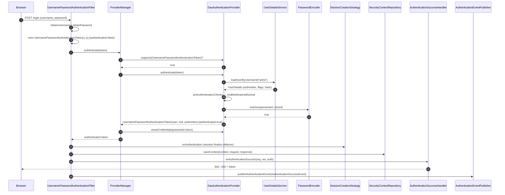
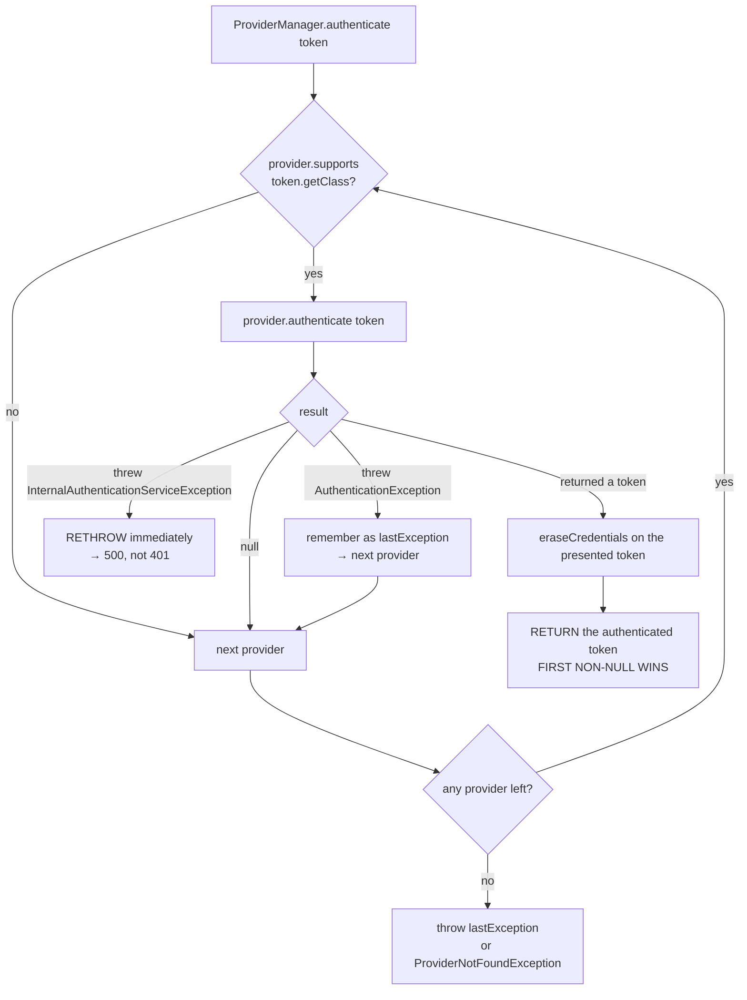
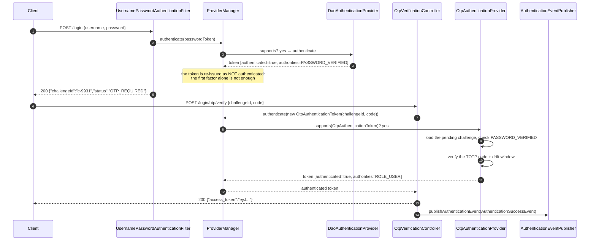

# 02 — Authentication Flow, UserDetailsService & Providers

> **Level:** Beginner → Advanced
> **Interview Frequency:** ★★★★★ ("what is the difference between `UserDetailsService` and `AuthenticationProvider`?", "when do I get a 401 vs a 403?", "how does the login flow actually work?")
> **Prerequisites:** [01 · Architecture & the Security Filter Chain](01-Architecture-and-Security-Filter-Chain.md) · [04 · JPA — Entity Lifecycle](../04-Spring-Data-JPA-Hibernate/02-Entity-Lifecycle-Persistence-Context-and-Caches.md)
> **Last Updated:** 2026

---

## 📋 Table of Contents

- [0. TL;DR — The 30-Second Answer](#0-tldr--the-30-second-answer)
- [1. What & Why — The Problem This Solves](#1-what--why--the-problem-this-solves)
- [2. Mental Model — The One Picture](#2-mental-model--the-one-picture)
- [3. Deep Dive — Theory (Beginner → Advanced)](#3-deep-dive--theory-beginner--advanced)
  - [3.1 Beginner Level](#31-beginner-level)
  - [3.2 Intermediate Level](#32-intermediate-level)
  - [3.3 Advanced Level](#33-advanced-level)
  - [3.4 Expert Level](#34-expert-level)
- [4. Internal Working Mechanism](#4-internal-working-mechanism)
- [5. Step-by-Step Execution Flow](#5-step-by-step-execution-flow)
- [6. Visualizations](#6-visualizations)
- [7. Production-Level Use Cases & Real Industry Examples](#7-production-level-use-cases--real-industry-examples)
- [8. Worked Examples (with Output + Dry Run)](#8-worked-examples-with-output--dry-run)
- [9. Code from Scratch — Production-Grade](#9-code-from-scratch--production-grade)
- [10. Common Mistakes & Gotchas](#10-common-mistchas--gotchas)
- [11. Performance Considerations](#11-performance-considerations)
- [12. Security Considerations](#12-security-considerations)
- [13. Best Practices](#13-best-practices)
- [14. Hands-On Exercises & Code Challenges](#14-hands-on-exercises--code-challenges)
- [15. Interview Q&A — Level-wise](#15-interview-qa--level-wise)
- [16. Scenario-Based & Real-Experience Scenarios (3–5 yrs)](#16-scenario-based--real-experience-scenarios-35-yrs)
- [17. Counter-Questions, Tricky Questions & Follow-Ups](#17-counter-questions-tricky-questions--follow-ups)
- [18. Frequently Asked Production Issues & Debugging Scenarios](#18-frequently-asked-production-issues--debugging-scenarios)
- [19. Architecture Design Questions](#19-architecture-design-questions)
- [20. Rapid-Fire MCQs](#20-rapid-fire-mcqs)
- [21. Cheat Sheet / One-Page Summary](#21-cheat-sheet--one-page-summary)
- [22. Real-World Production Notes](#22-real-world-production-notes)
- [23. Follow-up Learning](#23-follow-up-learning)

---

## 0. TL;DR — The 30-Second Answer

- **A `UserDetailsService` is a *user lookup*, not an authentication mechanism.** Its single method is `loadUserByUsername(String)`. The **verification** of the password happens in the `AuthenticationProvider` — which *may* use a `UserDetailsService`, but does not have to.
- **`UserDetailsManager` extends `UserDetailsService`** and adds `createUser` / `updateUser` / `deleteUser` / `changePassword` / `exists`. If you only need to *read* users, implement `UserDetailsService`.
- **The full form-login chain is:** `UsernamePasswordAuthenticationFilter` → `UsernamePasswordAuthenticationToken` (unauthenticated) → `AuthenticationManager.authenticate()` → `ProviderManager` → `DaoAuthenticationProvider` → `UserDetailsService.loadUserByUsername()` → `UserDetails` → `PasswordEncoder.matches()` → authenticated token → `AuthenticationSuccessHandler` → `SessionCreationStrategy` → `SecurityContextRepository.saveContext()`.
- **`ProviderManager` selects a provider by `supports(Class<?>)`, and the first non-null result wins.** A provider that throws `AuthenticationException` does not stop the loop — the exception is remembered and the next provider is tried.
- **`DaoAuthenticationProvider` does three things:** load the user, check the user's *state* (enabled / not expired / not locked / credentials not expired), and check the *password*. The state checks throw `DisabledException` / `LockedException` / `AccountExpiredException` / `CredentialsExpiredException`.
- **`hideUserNotFoundExceptions` defaults to `true`.** An unknown user is reported as `BadCredentialsException`, not `UsernameNotFoundException` — otherwise the endpoint becomes a **user-enumeration oracle**.
- **401 vs 403:** `ExceptionTranslationFilter` decides. Anonymous (or no `Authentication`) → `AuthenticationEntryPoint` → **401**. Authenticated but insufficient → `AccessDeniedHandler` → **403**.
- **`AuthenticationSuccessHandler` is where you issue a JWT.** Replace the default `SavedRequestAwareAuthenticationSuccessHandler` and the session is never created — this is the standard bridge to a stateless API.
- **`SessionCreationPolicy.STATELESS` means no `HttpSession` is created and no `JSESSIONID` is issued** — and `SecurityContextRepository` becomes a `NullSecurityContextRepository`.
- **`AuthenticationEventPublisher` is the audit hook.** `AuthenticationSuccessEvent`, `AuthenticationFailureEvent` and `LogoutSuccessEvent` are what a lockout counter or a SIEM feed subscribes to.
- **`UserDetails` is an interface — not a JPA entity.** Never return your `@Entity` directly; map it, or you will leak lazy proxies, `passwordHash` and every other column into the security layer.
- **bcrypt costs ~80–120 ms per verification.** That is why the login endpoint needs a rate limit and why a "remember the password" flow must cache the *encoder* decision, not the password.

---

## 1. What & Why — The Problem This Solves

**The problem.** "Log in" sounds like one thing. In production it is at least five:

1. **Prove the credential** — is this password correct?
2. **Prove the account is usable** — is it enabled, not expired, not locked?
3. **Decide what the caller may do** — which authorities does this user get?
4. **Establish the identity for the rest of the request** — where is it stored?
5. **Record what happened** — the audit trail, the failed-attempt counter, the alerting.

A naive implementation — a controller that compares a password from the database with the one in the request — gets all five wrong in ways that only show up under attack:

```text
   THE NAIVE LOGIN CONTROLLER
   ──────────────────────────
   @PostMapping("/login")
   public String login(@RequestBody LoginRequest req) {
       User user = userRepo.findByUsername(req.username());      // (1) SQL injection risk
       if (user == null || !encoder.matches(req.password(), user.passwordHash())) {
           return "Invalid credentials";                          // (2) user enumeration
       }
       session.setAttribute("user", user);                        // (3) no authority model
       auditLogger.info("login ok");                              // (4) no failure audit
       return "ok";
   }

   WHAT BREAKS
   (1) The lookup is not parameterised → SQL injection.
   (2) "user not found" vs "wrong password" → attackers enumerate valid usernames.
   (3) There is no GrantedAuthority, so the authorization layer has nothing to check.
   (4) Failed logins are invisible → no lockout, no alerting.
   (5) The password is compared outside the framework → the session,
       the SecurityContext and the session-fixation defence are all bypassed.
```

**The solution** is to let Spring Security own the whole flow, and to plug your application into
**three** narrow extension points:

```text
   ┌────────────────────────┬──────────────────────────────────────────────────┐
   │ EXTENSION POINT         │ WHAT YOU SUPPLY                                 │
   ├────────────────────────┼──────────────────────────────────────────────────┤
   │ UserDetailsService     │ "who is this user and what are their authorities?" │
   │ PasswordEncoder        │ "is this the right secret, and how is it stored?"  │
   │ AuthenticationProvider  │ (optional) "how do I verify a credential at all?"  │
   └────────────────────────┴──────────────────────────────────────────────────┘

   Spring Security owns: the token construction, the state checks, the exception → HTTP
   mapping, the SecurityContext, the session strategy, the events, and the audit hooks.
```

**The analogy — the doorman and the guest list.** The bouncer (`AuthenticationProvider`) checks
the guest against the **guest list** (`UserDetailsService`), checks the **guest's own
credentials** (the invitation card is valid but expired → `CredentialsExpiredException`), and
then decides **what the guest may do** (the wristband = the `GrantedAuthority`s). The bouncer
never reads the guest list himself — that is the registrar's job. In Spring Security terms:
`UserDetailsService` is the registrar, `AuthenticationProvider` is the bouncer, and
`Authentication` is the wristband that goes on afterwards.

---

## 2. Mental Model — The One Picture

```text
   THE AUTHENTICATION FLOW, END TO END
   ═════════════════════════════════════

   ┌──────────────────────────────────────────────────────────────────────┐
   │  UsernamePasswordAuthenticationFilter                                │
   │    extracts username + password from the POST                         │
   │    builds an UNAUTHENTICATED token:                                   │
   │      new UsernamePasswordAuthenticationToken(user, pass)              │
   │    calls authenticationManager.authenticate(token)                     │
   └───────────────────────────┬──────────────────────────────────────────┘
                               ▼
   ┌──────────────────────────────────────────────────────────────────────┐
   │  ProviderManager                                                      │
   │    for each provider:                                                 │
   │       if (!provider.supports(token.getClass())) continue;             │
   │       result = provider.authenticate(token);                         │
   │       if (result != null) return result;   ← FIRST NON-NULL WINS     │
   │       catch (AuthenticationException e) { lastException = e; }         │
   └───────────────────────────┬──────────────────────────────────────────┘
                               ▼
   ┌──────────────────────────────────────────────────────────────────────┐
   │  DaoAuthenticationProvider                                           │
   │    ① retrieveUser(username)                                           │
   │         → UserDetailsService.loadUserByUsername(username)            │
   │         → UsernameNotFoundException ⇒ BadCredentialsException        │
   │    ② preAuthenticationChecks(user)                                    │
   │         → enabled? not expired? not locked? credentials not expired?  │
   │    ③ additionalAuthenticationChecks(user, token)                      │
   │         → passwordEncoder.matches(presented, stored)                 │
   │    ④ returns an AUTHENTICATED UsernamePasswordAuthenticationToken     │
   └───────────────────────────┬──────────────────────────────────────────┘
                               ▼
   ┌──────────────────────────────────────────────────────────────────────┐
   │  UsernamePasswordAuthenticationFilter.successfulAuthentication()     │
   │    ① sessionStrategy.onAuthentication()  ← session fixation defence  │
   │    ② securityContextRepository.saveContext(context, req, res)        │
   │    ③ successHandler.onAuthenticationSuccess(req, res, authentication) │
   └──────────────────────────────────────────────────────────────────────┘

   WHO OWNS WHAT — the distinction interviewers probe
   ┌──────────────────────┬──────────────────────────────────────────────────┐
   │ UserDetailsService   │ LOOKUP ONLY. "give me the user record"          │
   │ UserDetailsManager   │ + create / update / delete / changePassword    │
   │ AuthenticationProvider│ VERIFICATION. "prove the credential"           │
   │ UserDetails          │ the DATA. username, hash, authorities, flags    │
   └──────────────────────┴──────────────────────────────────────────────────┘
```

**What to look at:** the flow is a **pipeline of three responsibilities** — lookup, verify,
persist. Most "Spring Security doesn't work" bugs are a responsibility in the wrong place: the
application compares passwords itself, or the `UserDetailsService` also does the comparison, or
the framework stores the identity but the application stores a different one.

---

## 3. Deep Dive — Theory (Beginner → Advanced)

### 3.1 Beginner Level

#### The four interfaces, side by side

```java
// ── 1. UserDetails — THE DATA ──────────────────────────────────────────────
package org.springframework.security.core.userdetails;

public interface UserDetails extends Serializable {
    Collection<? extends GrantedAuthority> getAuthorities();
    String getPassword();
    String getUsername();
    boolean isAccountNonExpired();
    boolean isAccountNonLocked();
    boolean isCredentialsNonExpired();
    boolean isEnabled();
}

// ── 2. UserDetailsService — THE LOOKUP ─────────────────────────────────────
public interface UserDetailsService {
    UserDetails loadUserByUsername(String username) throws UsernameNotFoundException;
}

// ── 3. UserDetailsManager — THE LOOKUP + MUTATIONS ────────────────────────
public interface UserDetailsManager extends UserDetailsService {
    void createUser(UserDetails user);
    void updateUser(UserDetails user);
    void deleteUser(String username);
    void changePassword(String username, String newPassword);
    boolean existsByUsername(String username);
}

// ── 4. AuthenticationProvider — THE VERIFICATION ───────────────────────────
package org.springframework.security.authentication;

public interface AuthenticationProvider {
    Authentication authenticate(Authentication authentication) throws AuthenticationException;
    default boolean supports(Class<?> authentication) { return true; }
    default void eraseCredentials(Authentication authentication) { }
}
```

**The distinction in one sentence each:**

| Type | Question it answers | Typical implementation |
|---|---|---|
| `UserDetails` | "What do we know about this user?" | A record loaded from the DB, cached |
| `UserDetailsService` | "Which user is this?" | `JpaUserDetailsService` against `UserRepository` |
| `UserDetailsManager` | "Which user is this — and can I create/update/delete one?" | `InMemoryUserDetailsManager`, `JdbcUserDetailsManager` |
| `AuthenticationProvider` | "Is this credential valid?" | `DaoAuthenticationProvider`, a custom OTP/API-key provider |

> ▶ **The interview trap:** "a `UserDetailsService` is only a **user lookup**" is the sentence
> that separates a mid-level from a senior candidate. A `UserDetailsService` **never** sees the
> password that was presented, so it **cannot** be the thing that verifies it.

#### The `Authentication` you build in the filter

```java
public class UsernamePasswordAuthenticationToken extends AbstractAuthenticationToken {
    // Two constructors — the whole flow depends on this distinction:
    public UsernamePasswordAuthenticationToken(Object principal, Object credentials) {
        super(null);                  // no authorities yet — UNAUTHENTICATED
        setAuthenticated(false);      // ← the filter's token is never "authenticated"
    }
    public UsernamePasswordAuthenticationToken(Object principal, Object credentials,
            Collection<? extends GrantedAuthority> authorities) {
        super(authorities);
        setAuthenticated(true);       // ← the provider's token IS authenticated
    }
}
```

**This two-constructor design is the heart of the flow.** The filter creates the token with
`setAuthenticated(false)` because *nothing has been verified yet*. The provider returns a
**different token** with the authorities and `setAuthenticated(true)`. If you ever see a token
with `isAuthenticated() == true` that was built by the *filter*, something has bypassed the
provider.

#### The `AuthenticationManager` — one method

```java
package org.springframework.security.authentication;

public interface AuthenticationManager {
    Authentication authenticate(Authentication authentication) throws AuthenticationException;
}
```

It takes an **unauthenticated** token and returns an **authenticated** one, or throws an
`AuthenticationException`. That is the entire contract — and it is why you can swap a password
login for an OTP or an API key without touching anything else.

#### The `AuthenticationException` family

| Exception | Meaning | Typical HTTP result |
|---|---|---|
| `BadCredentialsException` | The password (or the credential) did not match | 401 |
| `UsernameNotFoundException` | No such user — **usually hidden** | 401 |
| `DisabledException` | The account is disabled | 401 |
| `LockedException` | The account is locked | 401 |
| `AccountExpiredException` | The account has expired | 401 |
| `CredentialsExpiredException` | The password must be changed | 401 |
| `AuthenticationCredentialsNotFoundException` | No credentials were presented | 401 |
| `InsufficientAuthenticationException` | Authentication is required but absent | 401 |
| `ProviderNotFoundException` | No provider `supports()` the token | 401 |
| `InternalAuthenticationServiceException` | The credential store itself failed (DB down) | 500 |

> ⚠️ **The last one is the dangerous one.** `InternalAuthenticationServiceException` means
> *"I could not check"* — not *"the credential is wrong"*. Spring's `ProviderManager` rethrows it
> **immediately** instead of trying the next provider, so a database outage produces a **500**,
> not a misleading 401. That distinction is deliberate: a 401 tells the client "your password is
> wrong", which is a lie when the database was unreachable.

#### `GrantedAuthority` — the wristband

```java
package org.springframework.security.core;

public interface GrantedAuthority extends Serializable {
    String getAuthority();
}
```

```java
GrantedAuthority admin = new SimpleGrantedAuthority("ROLE_ADMIN");
GrantedAuthority read  = new SimpleGrantedAuthority("SCOPE_order:read");
```

**An authority is just a string.** The convention is `ROLE_` for roles and `SCOPE_` for OAuth2
scopes, but the framework does not enforce it — the *voter* does, by convention.

### 3.2 Intermediate Level

#### `DaoAuthenticationProvider` — the default provider, in detail

```java
package org.springframework.security.authentication.dao;

public class DaoAuthenticationProvider extends AbstractUserDetailsAuthenticationProvider {

    private UserDetailsService userDetailsService;
    private PasswordEncoder passwordEncoder;
    private boolean hideUserNotFoundExceptions = true;   // ← default since 5.x

    @Override
    protected void additionalAuthenticationChecks(UserDetails userDetails,
            UsernamePasswordAuthenticationToken authentication) {
        if (authentication.getCredentials() == null) {
            throw new BadCredentialsException("Credentials cannot be null");
        }
        String presentedPassword = authentication.getCredentials().toString();
        if (!this.passwordEncoder.matches(presentedPassword, userDetails.getPassword())) {
            throw new BadCredentialsException("Bad credentials");
        }
    }

    @Override
    protected UserDetails retrieveUser(String username, UsernamePasswordAuthenticationToken authentication)
            throws AuthenticationException {
        try {
            UserDetails user = this.userDetailsService.loadUserByUsername(username);
            // upgrade the hash if the encoder says the algorithm is outdated
            if (this.userDetailsPasswordService != null && this.passwordEncoder.upgradeEncoding(user.getPassword())) {
                user = this.userDetailsPasswordService.upgradePassword(user, newPassword);
            }
            return user;
        } catch (UsernameNotFoundException ex) {
            if (this.hideUserNotFoundExceptions) {
                throw new BadCredentialsException("Bad credentials", ex);
            }
            throw ex;
        }
    }
}
```

**Three behaviours an interviewer will ask you to name:**

1. **`retrieveUser` translates `UsernameNotFoundException` into `BadCredentialsException`** when
   `hideUserNotFoundExceptions` is `true` (the default). The client cannot tell "no such user"
   from "wrong password".
2. **`additionalAuthenticationChecks` compares the password with `PasswordEncoder.matches`** —
   never with `equals`, and never with a plain string comparison.
3. **`preAuthenticationChecks` runs the user-state checks** (inherited from
   `AbstractUserDetailsAuthenticationProvider` via the `UserDetailsChecker`):

```java
// the effective order of the state checks
if (!user.isAccountNonExpired())  throw new AccountExpiredException(...);
if (!user.isAccountNonLocked())   throw new LockedException(...);
if (!user.isCredentialsNonExpired()) throw new CredentialsExpiredException(...);
if (!user.isEnabled())            throw new DisabledException(...);
```

> ▶ **Why the order matters:** a disabled account must not even be *locked*-reported, and a
> locked account should not reveal that the password was correct. The framework checks the
> account state **before** the password, so a disabled user gets `DisabledException` without
> the 100 ms bcrypt cost — and without the password ever being compared.

#### `UserDetailsService` against JPA — the classic implementation

```java
package com.example.security;

import org.springframework.security.core.userdetails.UserDetails;
import org.springframework.security.core.userdetails.UserDetailsService;
import org.springframework.security.core.userdetails.UsernameNotFoundException;
import org.springframework.stereotype.Service;
import org.springframework.transaction.annotation.Transactional;

@Service
public class JpaUserDetailsService implements UserDetailsService {

    private final UserAccountRepository userAccountRepository;

    public JpaUserDetailsService(UserAccountRepository userAccountRepository) {
        this.userAccountRepository = userAccountRepository;
    }

    @Override
    @Transactional(readOnly = true)      // one query, one transaction — see §11
    public UserDetails loadUserByUsername(String username) throws UsernameNotFoundException {
        UserAccount account = this.userAccountRepository.findByUsernameWithAuthorities(username)
                .orElseThrow(() -> new UsernameNotFoundException("No user " + username));
        return new SecurityUserPrincipal(account);
    }
}
```

**And the `UserDetails` implementation — a dedicated class, not the JPA entity:**

```java
package com.example.security;

import org.springframework.security.core.GrantedAuthority;
import org.springframework.security.core.authority.SimpleGrantedAuthority;
import org.springframework.security.core.userdetails.UserDetails;

import java.util.Collection;
import java.util.List;

public class SecurityUserPrincipal implements UserDetails {
    private final String username;
    private final String password;
    private final boolean enabled, accountNonExpired, accountNonLocked, credentialsNonExpired;
    private final List<GrantedAuthority> authorities;

    public SecurityUserPrincipal(UserAccount account) {
        this.username = account.getUsername();
        this.password = account.getPasswordHash();
        this.enabled = account.isEnabled();
        this.accountNonExpired = !account.isExpired();
        this.accountNonLocked = !account.isLocked();
        this.credentialsNonExpired = !account.isMustChangePassword();
        this.authorities = account.getRoles().stream()
                .map(role -> (GrantedAuthority) new SimpleGrantedAuthority("ROLE_" + role.getCode()))
                .toList();
    }
    // the seven UserDetails getters
}
```

> ⚠️ **Never return the `@Entity` as the `UserDetails`.** The entity carries the password hash,
> the email, the internal notes and — with lazy associations — a Hibernate proxy that throws
> `LazyInitializationException` when the security layer touches it outside the transaction.
> A dedicated principal class is the boundary between "the database row" and "the security
> identity".

#### `AuthenticationManagerBuilder` and `HttpSecurity`

`HttpSecurity` exposes the pieces of the authentication subsystem:

```java
http
    .authenticationManager(myAuthenticationManager)   // replace the whole manager
    .authenticationProvider(myProvider)              // ADD a provider to the ProviderManager
    .userDetailsService(myUserDetailsService)        // set the UDS used by DaoAuthenticationProvider
    .passwordEncoder(myPasswordEncoder);             // set the encoder used by the provider
```

**How they interact:** `HttpSecurity` builds an `AuthenticationManagerBuilder` →
`ProviderManagerBuilder`. The `ProviderManager` it produces holds **one
`DaoAuthenticationProvider`** (the default) plus **any provider you registered**. The
`UserDetailsService` and `PasswordEncoder` you declare are injected into that
`DaoAuthenticationProvider`.

```java
// The default manager, spelled out
AuthenticationManager manager = new ProviderManager(List.of(daoAuthenticationProvider));
```

**The `ProviderManager` with several providers — the selection algorithm:**

```java
public class ProviderManager implements AuthenticationManager {
    private final List<AuthenticationProvider> providers;

    @Override
    public Authentication authenticate(Authentication authentication, HttpServletRequest request) {
        AuthenticationException lastException = null;
        for (AuthenticationProvider provider : getProviders()) {
            if (!provider.supports(authentication.getClass())) {
                continue;                        // (a) wrong token type → skip
            }
            try {
                Authentication result = provider.authenticate(authentication);
                if (result != null) {
                    if (result.getClass() == authentication.getClass()) {
                        provider.eraseCredentials(authentication);   // scrub the secret
                    }
                    return result;               // (b) FIRST NON-NULL WINS
                }
            } catch (InternalAuthenticationServiceException e) {
                throw e;                         // (c) fatal — stop immediately
            } catch (AuthenticationException e) {
                lastException = e;               // (d) remember and continue
            }
        }
        throw lastException != null ? lastException
                : new ProviderNotFoundException(getProviderIds());
    }
}
```

**The rules that fall out of that code:**

| Rule | Consequence |
|---|---|
| `supports()` decides | A provider that does not recognise the token type is never called |
| First non-null result wins | If a provider returns `null` ("not my scheme"), the next one is tried |
| `AuthenticationException` is collected | A failed `DaoAuthenticationProvider` does **not** prevent an OTP provider from succeeding |
| `InternalAuthenticationServiceException` aborts | A DB outage is a 500, never a "wrong password" |
| `eraseCredentials` is called on success | The raw password is nulled in the presented token |

**The order of the providers in the list matters** for two reasons: a provider that
**matches** but returns `null` lets the next one try; and a provider that *throws* a generic
`AuthenticationException` short-circuits the "try the next one" behaviour for that token.

#### `UserDetailsManager` — when you need write access

```java
public interface UserDetailsManager extends UserDetailsService {
    void createUser(UserDetails user);
    void updateUser(UserDetails user);
    void deleteUser(String username);
    void changePassword(String username, String newPassword);
    boolean existsByUsername(String username);
}
```

| Implementation | Backing store | Use for |
|---|---|---|
| `InMemoryUserDetailsManager` | A `Map` | Tests, demos, the Boot default when no other bean exists |
| `JdbcUserDetailsManager` | JDBC / a default schema | A database-backed, non-JPA app |
| Your own `JpaUserDetailsManager` | JPA | A Spring Data app that also needs create/update/delete |

**In a real application you almost always want a split:** a read-only `UserDetailsService` for
authentication (fast, cacheable) and a separate `UserDetailsManager` (or a plain application
service) for registration and password changes. Mixing them means every login can write to the
database.

### 3.3 Advanced Level

#### The full form-login flow, class by class

```text
  POST /login  (username=aritra&password=secret)

 1. UsernamePasswordAuthenticationFilter
      extends AbstractAuthenticationProcessingFilter
      attemptsAuthentication(request, response) →
        → attemptAuthentication(request, response):
            String username = obtainUsername(request);      // "username" param
            String password = obtainPassword(request);      // "password" param
            UsernamePasswordAuthenticationToken authRequest =
                    new UsernamePasswordAuthenticationToken(username, password);   // UNAUTHENTICATED
            return getAuthenticationManager().authenticate(authRequest);

 2. AuthenticationManager = ProviderManager
      → for each provider: supports()? → authenticate()

 3. DaoAuthenticationProvider.authenticate(token)
      → retrieveUser(username, token)
           → UserDetailsService.loadUserByUsername(username)
           → UserDetails
      → preAuthenticationChecks(user)      // enabled / expired / locked
      → additionalAuthenticationChecks(user, token)
           → PasswordEncoder.matches(presented, stored)
      → return new UsernamePasswordAuthenticationToken(user, null, user.getAuthorities())

 4. Back in the filter: successfulAuthentication(request, response, authResult)
      → sessionStrategy.onAuthentication(request, response, authentication)   // fixation defence
      → securityContextRepository.saveContext(context, request, response)      // into the session
      → successHandler.onAuthenticationSuccess(request, response, authentication)

 5. Success handler
      default for form login: SavedRequestAwareAuthenticationSuccessHandler
        → redirects to the originally saved URL, or "/"
      for a JWT API: your own handler → writes {"access_token": "..."} and returns 200
```

**Why the filter creates an *unauthenticated* token:** the token is a **request** for
verification, not a statement of fact. The framework then guarantees that only a provider can
produce a token with `isAuthenticated() == true`.

#### The 401 / 403 decision — precisely

```java
// ExceptionTranslationFilter
catch (AccessDeniedException ex) {
    if (this.authenticationTrustResolver.isAnonymous(getAuthentication())) {
        this.authenticationEntryPoint.commence(request, response, ex);    // → 401
    } else {
        this.accessDeniedHandler.handle(request, response, ex);            // → 403
    }
}
catch (AuthenticationException ex) {
    this.authenticationEntryPoint.commence(request, response, ex);        // → 401
}
```

**The complete table:**

| Who is calling | What happened | Exception | Handler | Status |
|---|---|---|---|---|
| Nobody (no credentials) | Hit a protected URL | `AccessDeniedException` from `AuthorizationFilter`, but the context is anonymous | `AuthenticationEntryPoint` | **401** |
| Nobody (no credentials) | The token was invalid | `AuthenticationException` (e.g. `BadCredentialsException`) | `AuthenticationEntryPoint` | **401** |
| A real user | Missing the required authority | `AccessDeniedException` | `AccessDeniedHandler` | **403** |
| A real user | Missing a method-level authority | `AccessDeniedException` inside the controller | `AccessDeniedHandler` (via the exception resolver) | **403** |
| Nobody | Hit a **public** URL | no exception | — | **200** |

**The canonical status semantics (the folder's pinned table):**

| Code | Use for |
|---|---|
| 200 | OK, successful read/update |
| 201 | Created — include `Location` header |
| 202 | Accepted — async processing started |
| 204 | No content — successful delete |
| 400 | Malformed request / validation failure |
| 401 | **Not authenticated** (no/invalid credentials) |
| 403 | **Authenticated but not authorized** |
| 404 | Resource not found |
| 409 | Conflict (duplicate, version mismatch) |
| 422 | Semantically invalid (well-formed but wrong) |
| 429 | Rate limited — include `Retry-After` |
| 500 | Unhandled server error |
| 503 | Temporarily unavailable (circuit open, overloaded) |

> ▶ **The client-facing rule to state out loud:** *"A 401 is a **retryable** failure for the
> client — it should attach credentials and try again. A 403 is **terminal** — the same
> credentials will never help, so the client must not retry."* A mobile app that retries a 403
> in a loop is a support-ticket generator.

#### Session vs stateless — the two policies that matter

```java
http.sessionManagement(session -> session
    .sessionCreationPolicy(SessionCreationPolicy.STATELESS)
    .sessionFixation(fixation -> fixation.migrateSession())
    .maximumSessions(1));
```

| `SessionCreationPolicy` | Behaviour |
|---|---|
| `IF_REQUIRED` (default) | A session is created only if one is needed (i.e. the request was authenticated) |
| `NEVER` | Spring Security never creates a session, but will **use** one that already exists |
| `ALWAYS` | A session is created for **every** request, authenticated or not |
| `STATELESS` | No session is created and none is used — Spring Security also switches the `SecurityContextRepository` to `NullSecurityContextRepository` |

**The coupling people forget:** in 6.x, `SessionCreationPolicy.STATELESS` makes the
`SecurityContextHolderFilter` use a `NullSecurityContextRepository`, so **the `SecurityContext`
is never saved between requests**. The `Authentication` therefore exists only for the duration
of the request — which is exactly what a bearer-token API wants, and exactly why a
**stateless** API cannot use `@PreAuthorize("returnObject.owner == authentication.name")` across
requests without re-validating the token on every call (which the resource-server filter does).

#### `AuthenticationSuccessHandler` — the JWT bridge

```java
package com.example.security;

import jakarta.servlet.http.HttpServletRequest;
import jakarta.servlet.http.HttpServletResponse;
import org.springframework.security.core.Authentication;
import org.springframework.security.web.authentication.AuthenticationSuccessHandler;
import org.springframework.stereotype.Component;

import java.io.IOException;
import java.util.Map;

@Component
public class JwtAuthenticationSuccessHandler implements AuthenticationSuccessHandler {

    private final TokenService tokenService;

    public JwtAuthenticationSuccessHandler(TokenService tokenService) {
        this.tokenService = tokenService;
    }

    @Override
    public void onAuthenticationSuccess(HttpServletRequest request, HttpServletResponse response,
                                        Authentication authentication) throws IOException {
        String token = this.tokenService.issueToken(authentication);
        response.setStatus(HttpServletResponse.SC_OK);
        response.setContentType("application/json");
        response.getWriter().write("{\"access_token\":\"" + token + "\"}");
    }
}
```

```java
http.formLogin(form -> form
        .successHandler(jwtAuthenticationSuccessHandler)
        .failureHandler(jsonAuthenticationFailureHandler));
```

**⚠️ The response header trap:** if the form login also redirects on success, the token is
lost. Set `formLogin(...).successHandler(...)` **and** make sure no other redirect happens.
For a pure API, disable the form login entirely and use `httpBasic` or a custom filter.

#### `AuthenticationEventPublisher` — the audit and lockout hook

```java
public interface AuthenticationEventPublisher {
    void publishAuthenticationEvent(Authentication authentication, Supplier<AuthenticationEvent> event);
    default void publishAuthenticationEvent(Supplier<AuthenticationEvent> event) { }
}
```

| Event | Published when | Typical use |
|---|---|---|
| `AuthenticationSuccessEvent` | A provider returned an authenticated token | Audit, "last login" update |
| `AuthenticationFailureEvent` | A provider threw an `AuthenticationException` | Failed-attempt counter, lockout, alerting |
| `LogoutSuccessEvent` | `LogoutFilter` completed a logout | Audit, "revoke all sessions" |
| `AuthenticationServiceExceptionEvent` | The credential store itself failed | Alert (this is an outage, not an attack) |

```java
@Bean
AuthenticationEventPublisher authenticationEventPublisher(ApplicationEventPublisher publisher) {
    return new DefaultAuthenticationEventPublisher(publisher);
}
```

**The wiring is not automatic in every setup.** When you define your own `AuthenticationManager`
bean, register the publisher on it explicitly:

```java
@Bean
AuthenticationManager authenticationManager(AuthenticationConfiguration config) throws Exception {
    ProviderManager manager = (ProviderManager) config.getAuthenticationManager();
    manager.setAuthenticationEventPublisher(applicationEventPublisher);
    return manager;
}
```

#### MFA / OTP — where to plug the second factor

**Three extension points, in increasing order of control:**

| Approach | How | Trade-off |
|---|---|---|
| A second `AuthenticationProvider` in the `ProviderManager` | The provider `supports()` the OTP token type | Simple, but the *first* factor must already have run and its state stored somewhere |
| A custom `AuthenticationFilter` | A new filter after `UsernamePasswordAuthenticationFilter` | Full control of the flow, but you own the session/pending state |
| A separate `/verify-otp` endpoint with a short-lived "pending" state | The first factor stores a **partial** authentication | The cleanest for a REST API; the pending state lives in the session or in a short-lived token |

**The "pending authentication" pattern — the one to know:**

```java
// After the FIRST factor succeeds, store an UNAUTHENTICATED token that remembers step 1.
UsernamePasswordAuthenticationToken pending = new UsernamePasswordAuthenticationToken(
        userDetails, null, List.of(new SimpleGrantedAuthority("PASSWORD_VERIFIED")));
pending.setAuthenticated(false);      // still not a full authentication
SecurityContextHolder.getContext().setAuthentication(pending);
```

Then the second factor's provider checks for the `PASSWORD_VERIFIED` authority, verifies the
OTP, and returns a **fully authenticated** token. The framework's own state machine
(`isAuthenticated() == false` but non-empty authorities) does the bookkeeping.

**Why this matters:** with the two-constructor `UsernamePasswordAuthenticationToken`, a
"half-authenticated" state is expressible **without** inventing your own session attribute —
and the `AnonymousAuthenticationFilter` will not overwrite it, because the context is not empty.

### 3.4 Expert Level

#### The `AuthenticationManager` vs `AuthenticationProvider` vs `AuthenticationManagerResolver`

| Type | Scope | When |
|---|---|---|
| `AuthenticationManager` | One manager for the application (or per chain) | 95 % of applications |
| `AuthenticationProvider` | One credential scheme | When you add a second scheme (OTP, API key, SAML) |
| `AuthenticationManagerResolver` | **One manager per request**, chosen at runtime | Multi-tenant systems where the tenant decides how to authenticate |

```java
public interface AuthenticationManagerResolver {
    AuthenticationManager resolve(HttpServletRequest request);
}
```

**The multi-tenant resolver** is how a system authenticates differently depending on the
tenant's policy (some tenants use LDAP, some use a local database, some use an API key). The
resolver is consulted by the `AuthenticationFilter` on each request.

#### `DaoAuthenticationProvider` vs `InitializeUserDetailsBeanManagerConfigurer`

**The wiring is not obvious, and it is a classic interview question:**

- `HttpSecurity` builds a `ProviderManager` containing a `DaoAuthenticationProvider`.
- `InitializeUserDetailsBeanManagerConfigurer` (registered by `HttpSecurity`'s default
  initialisers) looks for a **`UserDetailsService` bean** in the application context and
  injects it into that `DaoAuthenticationProvider`.
- If no `UserDetailsService` bean exists, **Boot's `UserDetailsServiceAutoConfiguration`
  creates an `InMemoryUserDetailsManager`** with the user `user` and a generated password.

**That last point is the source of a very common production surprise:** add a
`PasswordEncoder` bean but no `UserDetailsService`, and Boot quietly gives you an in-memory
user. Or define an `AuthenticationProvider` bean but no `UserDetailsService`, and Boot's
auto-configuration is **backed off** (the `@ConditionalOnMissingBean` on
`UserDetailsServiceAutoConfiguration` covers `AuthenticationProvider` and `AuthenticationManager`
too) — so the application has **no** `UserDetailsService` at all and the login fails with a
`ProviderNotFoundException` at runtime, not at startup.

#### Password hashing — the `matches` contract

```java
public interface PasswordEncoder {
    String encode(CharSequence rawPassword);
    boolean matches(CharSequence rawPassword, String encodedPassword);
    default boolean upgradeEncoding(String encodedPassword) { return false; }
}
```

| Implementation | Storage format | Notes |
|---|---|---|
| `BCryptPasswordEncoder` | `$2a$10$<salt><hash>` | The default; cost = 10 (2^10 iterations) |
| `Argon2PasswordEncoder` | `$argon2id$v=19$m=...` | Best resistance to GPU/ASIC attacks; needs BouncyCastle |
| `SCryptPasswordEncoder` | base64 of the scrypt output | Memory-hard, built into Spring Security |
| `Pbkdf2PasswordEncoder` | `iterations:hash:salt` | FIPS-friendly, but slow to tune |
| `NoOpPasswordEncoder` | the plaintext | **Deprecated and dangerous** — only for tests |

**`matches` vs `equals`:** `matches` is *salted* and *worked*. `password.equals(storedHash)` is
wrong because the stored hash contains a random salt — two hashes of the same password are
different strings.

**The `{id}` prefix and `DelegatingPasswordEncoder`:**

```java
PasswordEncoder encoder = PasswordEncoderFactories.createDelegatingPasswordEncoder();
encoder.encode("secret");
// → "{bcrypt}$2a$10$N9qo8uLOickgx2ZMRZoMyeIjZAgcfl7p92ldGxad68LJZdL17lhWy"
encoder.matches("secret", stored);   // → true   (reads the {id} and dispatches)
encoder.matches("secret", "{noop}secret");  // → true (legacy hashes still verify)
```

**`upgradeEncoding` is the migration hook.** `DelegatingPasswordEncoder.upgradeEncoding(hash)`
returns `true` when the hash was produced by a **non-default** algorithm. The classic upgrade
path:

```java
@Service
public class UpgradingUserDetailsService implements UserDetailsService {

    private final UserAccountRepository repository;
    private final PasswordEncoder passwordEncoder;

    @Override
    @Transactional
    public UserDetails loadUserByUsername(String username) {
        UserAccount account = repository.findByUsername(username)
                .orElseThrow(() -> new UsernameNotFoundException(username));

        if (this.passwordEncoder.upgradeEncoding(account.getPasswordHash())) {
            String upgraded = this.passwordEncoder.encode(account.getRawPasswordForUpgrade());
            account.setPasswordHash(upgraded);
            repository.save(account);       // re-hash with the current algorithm
        }
        return new SecurityUserPrincipal(account);
    }
}
```

> ⚠️ **The upgrade path needs the *plaintext*.** You can only re-hash a password if you still
> have it — which is why the upgrade happens **at login**, while the plaintext is in hand. If
> you store only hashes (as you should), the only moment you can re-hash is the moment the user
> types the password. Spring Security 6 also offers a cleaner hook for this:
> `DaoAuthenticationProvider.setUserDetailsPasswordService(...)` with the
> `UserDetailsPasswordService.UpgradePassword` SPI.

#### The `AuthenticationTrustResolver` and the "is this really a user" question

```java
public interface AuthenticationTrustResolver {
    boolean isAnonymous(Authentication authentication);
    boolean isRememberMe(Authentication authentication);
}
```

```java
public class AuthenticationTrustResolverImpl implements AuthenticationTrustResolver {
    @Override
    public boolean isAnonymous(Authentication authentication) {
        if ((authentication == null) || (authentication instanceof AnonymousAuthenticationToken)) {
            return true;
        }
        for (GrantedAuthority authority : authentication.getAuthorities()) {
            if ("ROLE_ANONYMOUS".equals(authority.getAuthority())) {
                return true;
            }
        }
        return false;
    }
}
```

**The second check is the subtle one.** A *real* authentication that also carries
`ROLE_ANONYMOUS` is treated as anonymous. That matters when you build a custom filter: if you
give your "pending OTP" token the `ROLE_ANONYMOUS` authority, the framework will treat it as
anonymous and answer 401 instead of 403.

#### Where to store the `UserDetails`

| Store | Latency | Revocation | Cost |
|---|---|---|---|
| The database, every time | 2–20 ms + a query | Immediate | 1 query per login (not per request) |
| An in-process `Caffeine` cache | < 1 ms | Until the TTL expires (default 5 min → **up to 5 min of stale permissions**) | Memory per instance |
| Redis | 1–3 ms | Immediate (delete the key) | A network hop per login |
| JWT claims | 0 | **Not immediate** — until the token expires | Nothing |

**The trade-off that bites:** a cached `UserDetails` means a **revoked** user or a **changed
role** keeps its old authorities until the cache entry expires. That is why the TTL must be
short (60–300 seconds) and why role changes must **evict** the entry rather than wait.

#### The impersonation ("act as") pattern

Spring Security ships `SwitchUserFilter` for this. The application calls
`SwitchUserFilter.switchUser(...)` to change the current `Authentication`:

```java
Authentication target = switchUserFilter.switchUser(targetUsername, "impersonation");
```

**What you must add yourself:** the `SwitchUserFilter` must be explicitly enabled, the target
must be switchable, and — critically — **the impersonation must be audited**:

```java
public class AuditingSwitchUserHandler extends SwitchUserHandler {
    @Override
    public Authentication switchUser(String usernameToSwitchTo, String reason)
            throws UsernameNotFoundException {
        Authentication previous = super.switchUser(usernameToSwitchTo, reason);
        auditService.recordImpersonation(previous.getName(), usernameToSwitchTo, reason);
        return previous;
    }
}
```

> ▶ **The production answer:** impersonation is a **break-glass** feature. It must be
> (a) behind a strong authorisation check on the *operator*, (b) time-boxed, (c) fully
> audited with the reason, and (d) visibly flagged in the UI so support staff know they are not
> looking at their own account.

---

## 4. Internal Working Mechanism

**The exact call chain for one successful form login.** Real class names.

1. **`UsernamePasswordAuthenticationFilter`** (a `GenericFilterBean`) intercepts `POST /login`.
   Its `attemptAuthentication` calls `obtainUsername(request)` and `obtainPassword(request)` —
   the default implementations read the `username` and `password` request parameters (and, if
   absent, fall back to the `username`/`password` JSON body).
2. The filter builds a **`UsernamePasswordAuthenticationToken(username, password)`** — the
   two-argument constructor, so `setAuthenticated(false)`.
3. The filter calls **`getAuthenticationManager().authenticate(authRequest)`**. The manager is
   the `ProviderManager` built by `HttpSecurity`.
4. **`ProviderManager.authenticate`** iterates its providers. For each:
   `provider.supports(authentication.getClass())` → if false, skip.
5. **`DaoAuthenticationProvider.authenticate`** (from `AbstractUserDetailsAuthenticationProvider`):
   a. **`retrieveUser(username, token)`** → `UserDetailsService.loadUserByUsername(username)`.
      A `UsernameNotFoundException` is translated into `BadCredentialsException` when
      `hideUserNotFoundExceptions` is true.
   b. **`preAuthenticationChecks(user)`** → the `UserDetailsChecker` verifies enabled /
      not expired / not locked / credentials not expired.
   c. **`additionalAuthenticationChecks(user, token)`** → `PasswordEncoder.matches(...)`.
6. The provider returns a **`UsernamePasswordAuthenticationToken(user, null, user.getAuthorities())`**
   — the three-argument constructor, `setAuthenticated(true)`.
7. `ProviderManager` calls **`provider.eraseCredentials(authentication)`** on the *presented*
   token, nulling the raw password.
8. Back in the filter: **`successfulAuthentication(request, response, authResult)`**:
   a. **`sessionStrategy.onAuthentication(...)`** → `SessionFixationProtectionStrategy` migrates
      the session id (or the `migrateSession` → `changeSessionId` in 6.x).
   b. **`securityContextRepository.saveContext(context, request, response)`** → the
      `SecurityContext` is written into the `HttpSession`.
   c. **`successHandler.onAuthenticationSuccess(...)`** → redirect, or your JSON token.
9. On failure: **`unsuccessfulAuthentication(...)`** → `failureHandler.onAuthenticationFailure(...)`
   → the default `SimpleUrlAuthenticationFailureHandler` redirects to `/login?error`, and the
   `AuthenticationFailureEvent` is published.

**The extension points a developer implements here:**

| Extension point | Interface | For what |
|---|---|---|
| The user source | `UserDetailsService` | Where the user record lives |
| The user mutations | `UserDetailsManager` | Registration, password change |
| The credential check | `PasswordEncoder` | How the secret is hashed and compared |
| A new credential scheme | `AuthenticationProvider` | OTP, API key, hardware token, SAML assertion |
| What happens after success | `AuthenticationSuccessHandler` | Issue a JWT, redirect, write an audit row |
| What happens after failure | `AuthenticationFailureHandler` | JSON error, lockout counter, CAPTCHA |
| What is recorded | `AuthenticationEventPublisher` | SIEM feed, alerting, metrics |
| Which manager for this request | `AuthenticationManagerResolver` | Multi-tenant authentication policies |

---

## 5. Step-by-Step Execution Flow

**`POST /login` with `username=aritra&password=secret` against a JPA-backed
`UserDetailsService`.**

1. **`UsernamePasswordAuthenticationFilter`** matches the login request.
2. `obtainUsername` → `"aritra"`; `obtainPassword` → `"secret"`.
3. A **`UsernamePasswordAuthenticationToken("aritra", "secret")`** is built —
   `isAuthenticated() == false`, authorities **empty**.
4. `ProviderManager.authenticate(token)` is called.
5. `DaoAuthenticationProvider.supports(UsernamePasswordAuthenticationToken.class)` → `true`.
6. `retrieveUser("aritra", token)` → `UserDetailsService.loadUserByUsername("aritra")` →
   a `SELECT` against `user_account` joined with `user_role` →
   a `SecurityUserPrincipal` with authorities `[ROLE_USER, ROLE_AUDITOR]`.
   (An unknown username → `UsernameNotFoundException` → translated to `BadCredentialsException`.)
7. `preAuthenticationChecks(user)` → `isEnabled() == true`, `isAccountNonExpired() == true`,
   `isAccountNonLocked() == true`, `isCredentialsNonExpired() == true` → no exception.
8. `additionalAuthenticationChecks(user, token)` →
   `passwordEncoder.matches("secret", "{bcrypt}$2a$10$…")` → bcrypt computes the hash with the
   stored salt and compares → `true`. (**~90 ms of CPU.**)
9. The provider returns
   `new UsernamePasswordAuthenticationToken(user, null, [ROLE_USER, ROLE_AUDITOR])` —
   `isAuthenticated() == true`.
10. `ProviderManager` calls `eraseCredentials` on the presented token → the raw password in the
    *presented* token is nulled.
11. `successfulAuthentication` → `SessionFixationProtectionStrategy.onAuthentication` → the
    session id is **migrated** (the pre-login session id is invalidated).
12. `securityContextRepository.saveContext(context, request, response)` → the `SecurityContext`
    is stored in the `HttpSession` → the response carries `Set-Cookie: JSESSIONID=…`.
13. `successHandler.onAuthenticationSuccess` → the default
    `SavedRequestAwareAuthenticationSuccessHandler` redirects to the originally saved URL, or
    `/`.
14. `AuthenticationSuccessEvent` is published → the audit listener writes
    `AUTH_SUCCESS user=aritra ip=10.2.4.7`.

**The same request with a wrong password:**

- Steps 1–7 are identical.
- Step 8: `matches(...)` → `false` → `BadCredentialsException("Bad credentials")`.
- `ProviderManager` records it as `lastException`; no other provider supports the token → the
  exception is rethrown.
- The filter catches it → `unsuccessfulAuthentication` → `failureHandler` → a redirect to
  `/login?error` (or a JSON 401) → `AuthenticationFailureEvent` is published → the failed-attempt
  counter is incremented.

**The same request for a user that does not exist:**

- Steps 1–5 are identical.
- Step 6: `UsernameNotFoundException` → **translated** to `BadCredentialsException("Bad
  credentials")` because `hideUserNotFoundExceptions` is `true`.
- The response is **identical** to the wrong-password response.
- ⚠️ **But the timing differs**: an unknown user never reaches step 8, so the request returns in
  ~8 ms instead of ~95 ms. That timing gap is a **user-enumeration channel** — see §12.

---

## 6. Visualizations

### 6.1 The complete username/password authentication flow (sequence)



**Caption:** notice the **two** `UsernamePasswordAuthenticationToken`s — the filter's
(unauthenticated) and the provider's (authenticated). Only the provider's may carry authorities.

### 6.2 Provider selection inside the `ProviderManager` (flowchart)



**What to look at:** a provider that throws a *generic* `AuthenticationException` does **not**
stop the search — so a failed password check can be followed by a successful OTP check. Only
`InternalAuthenticationServiceException` aborts immediately, because it means "the credential
store is broken", not "the credential is wrong".

### 6.3 The 401-vs-403 decision tree (ASCII)

```text
                    an exception escapes the security chain
                                        │
                                        ▼
                        ┌───────────────────────────────┐
                        │    ExceptionTranslationFilter │
                        └───────────────┬───────────────┘
                                        │
                        ┌───────────────┴───────────────┐
                        │                               │
             AccessDeniedException              AuthenticationException
             (AuthorizationFilter threw)       (a provider threw)
                        │                               │
                        ▼                               ▼
        ┌───────────────────────────┐        ┌────────────────────┐
        │ trustResolver.isAnonymous │        │ AuthenticationEntry │
        │   (auth) ?                │        │      Point         │
        └────┬─────────────────┬────┘        └─────────┬──────────┘
             │ YES             │ NO                    │
             ▼                 ▼                       ▼
    ┌────────────────┐  ┌────────────────┐   ┌────────────────┐
    │ EntryPoint     │  │ AccessDenied   │   │ EntryPoint     │
    │  → 401         │  │ Handler        │   │  → 401         │
    │ "who are you?" │  │  → 403         │   │ "who are you?" │
    └────────────────┘  │ "not you."     │   └────────────────┘
                        └────────────────┘

   isAnonymous(auth) == true  ⇔  auth == null
                             ⇔  auth instanceof AnonymousAuthenticationToken
                             ⇔  auth carries the ROLE_ANONYMOUS authority

   ⚠ auth.isAuthenticated() is TRUE for an anonymous token — never use it alone.
```

**Caption:** the *only* input to the 401-vs-403 decision is "is the caller anonymous?" — which
is why every framework-level 401/403 bug eventually turns out to be a missing
`AnonymousAuthenticationToken` or a hand-rolled `Authentication` that nobody registered.

### 6.4 A custom second factor (OTP) flow (sequence)



**Caption:** the first factor produces a token that is **deliberately not authenticated** but
carries a `PASSWORD_VERIFIED` marker; the second provider refuses to authenticate anything that
does not carry that marker. The state machine lives in the framework, not in your session
attributes.

---

## 7. Production-Level Use Cases & Real Industry Examples

### 7.1 Banking — username/password plus a hard token

**Domain:** retail banking. Internet banking for 220 000 customers, password plus a
TOTP/hardware token for anything above a low value threshold.

**Scale:** 6 000 logins/minute at salary-credit time (the 1st of the month), 12 000
authentications/second at peak, **zero** tolerance for account takeover.

```java
@Bean
SecurityFilterChain customerChain(HttpSecurity http) throws Exception {
    http
        .authorizeHttpRequests(auth -> auth.anyRequest().authenticated())
        .formLogin(form -> form
                .loginProcessingUrl("/login")
                .successHandler(mfaAwareSuccessHandler)   // issues a challenge or a token
                .failureHandler(jsonAuthenticationFailureHandler))
        .sessionManagement(s -> s
                .sessionFixation(fixation -> fixation.migrateSession())
                .maximumSessions(2));
    return http.build();
}
```

**The M&A reality:** the regulator requires step-up authentication for payments above
**₹50 000**. The pattern is a **challenge**, not a second prompt: the password succeeds, the
server stores a short-lived "pending" state (60 seconds) and returns
`{"status":"OTP_REQUIRED","challengeId":"…"}`. The OTP then goes through a **different** endpoint
so that the `AuthenticationSuccessHandler` is not called twice.

### 7.2 E-commerce — a stateless API with no session at all

**Domain:** e-commerce. A mobile app against a REST API, 40 000 orders/minute at peak.

**Scale:** 3 200 rps, 12 pods, p99 **165 ms**.

```java
@Bean
SecurityFilterChain apiChain(HttpSecurity http) throws Exception {
    http
        .securityMatcher("/api/**")
        .authorizeHttpRequests(auth -> auth.anyRequest().authenticated())
        .sessionManagement(s -> s.sessionCreationPolicy(SessionCreationPolicy.STATELESS))
        .csrf(csrf -> csrf.disable())
        .httpBasic(Customizer.withDefaults())
        .authenticationManager(providerManager);
    return http.build();
}
```

**Why `httpBasic` and not form login:** form login *requires* a session and a redirect — a
mobile client cannot follow a 302 to `/login`. `httpBasic` posts the credentials on every
request, the `AuthenticationManager` verifies them, and the stateless policy means nothing is
stored. **Production note:** most real systems replace `httpBasic` with a token filter; the
flow is identical, only the filter changes.

### 7.3 Internal platform — service accounts and API keys

**Domain:** an internal platform where 14 downstream services call 3 internal APIs.

**Scale:** 900 service calls/second, 40 service accounts, key rotation every 90 days.

```java
@Bean
SecurityFilterChain internalChain(HttpSecurity http) throws Exception {
    http
        .securityMatcher("/internal/**")
        .authorizeHttpRequests(auth -> auth
                .requestMatchers(HttpMethod.GET, "/internal/health").permitAll()
                .anyRequest().hasAuthority("ROLE_SERVICE"))
        .sessionManagement(s -> s.sessionCreationPolicy(SessionCreationPolicy.STATELESS))
        .csrf(csrf -> csrf.disable())
        .addFilterBefore(new ApiKeyAuthenticationFilter(apiKeyAuthenticationProvider),
                BearerTokenAuthenticationFilter.class);
    return http.build();
}
```

**Why a dedicated filter rather than a second `AuthenticationProvider`:** the API key arrives
in a **header**, not in a form parameter. The `UsernamePasswordAuthenticationFilter` only knows
how to read `username`/`password` parameters. A dedicated filter reads `X-Api-Key`, builds an
`ApiKeyAuthenticationToken` and calls the manager — and because the token type is unique, the
`ProviderManager` routes it to the API-key provider via `supports()`.

**Key rotation without downtime** is the operational requirement: the registry accepts **two**
active keys per service (current + previous) for a 24-hour overlap window.

---

## 8. Worked Examples (with Output + Dry Run)

### 8.1 A `DaoAuthenticationProvider` wired against a JPA `UserDetailsService`

**Problem.** Wire Spring Security to a `user_account` table, and observe exactly what happens
on a successful and a failed login.

**Step 1 — the entity and the repository.**

```java
package com.example.account;

import jakarta.persistence.Column;
import jakarta.persistence.Entity;
import jakarta.persistence.Id;
import jakarta.persistence.Table;

@Entity
@Table(name = "user_account")
public class UserAccount {
    @Id @Column(name = "id") private Long id;
    @Column(name = "username", nullable = false, unique = true) private String username;
    @Column(name = "password_hash", nullable = false) private String passwordHash;
    @Column(name = "enabled", nullable = false) private boolean enabled = true;
    @Column(name = "account_expired", nullable = false) private boolean accountExpired = false;
    @Column(name = "account_locked", nullable = false) private boolean accountLocked = false;
    @Column(name = "must_change_password", nullable = false) private boolean mustChangePassword = false;
    // getters and setters
}
```

```java
package com.example.account;

import org.springframework.data.jpa.repository.JpaRepository;
import org.springframework.data.jpa.repository.Query;

import java.util.Optional;

public interface UserAccountRepository extends JpaRepository<UserAccount, Long> {

    /**
     * ONE query for the user + the authorities — the N+1 trap of a lazy @ManyToMany.
     */
    @Query("select distinct a from UserAccount a left join fetch a.roles where a.username = :username")
    Optional<UserAccount> findByUsernameWithAuthorities(String username);
}
```

**Step 2 — the `UserDetailsService`.**

```java
package com.example.security;

import com.example.account.UserAccount;
import com.example.account.UserAccountRepository;
import org.springframework.security.core.userdetails.UserDetails;
import org.springframework.security.core.userdetails.UserDetailsService;
import org.springframework.security.core.userdetails.UsernameNotFoundException;
import org.springframework.stereotype.Service;
import org.springframework.transaction.annotation.Transactional;

@Service
public class JpaUserDetailsService implements UserDetailsService {

    private static final org.slf4j.Logger log =
            org.slf4j.LoggerFactory.getLogger(JpaUserDetailsService.class);

    private final UserAccountRepository repository;

    public JpaUserDetailsService(UserAccountRepository repository) {
        this.repository = repository;
    }

    @Override
    @Transactional(readOnly = true)
    public UserDetails loadUserByUsername(String username) {
        UserAccount account = this.repository.findByUsernameWithAuthorities(username)
                .orElseThrow(() -> {
                    log.info("AUTH_LOOKUP user={} result=NOT_FOUND", username);
                    throw new UsernameNotFoundException("No user " + username);
                });
        log.info("AUTH_LOOKUP user={} result=FOUND authorities={}", username, account.getRoles());
        return new SecurityUserPrincipal(account);
    }
}
```

**Step 3 — the configuration.**

```java
@Configuration
public class SecurityConfig {

    @Bean
    PasswordEncoder passwordEncoder() {
        // The delegating encoder writes "{bcrypt}" and can still verify legacy hashes.
        return PasswordEncoderFactories.createDelegatingPasswordEncoder();
    }

    @Bean
    AuthenticationManager authenticationManager(AuthenticationConfiguration configuration) throws Exception {
        ProviderManager manager = (ProviderManager) configuration.getAuthenticationManager();
        // Make sure the events (used for the lockout counter) are published.
        manager.setAuthenticationEventPublisher(new DefaultAuthenticationEventPublisher(publisher));
        return manager;
    }

    @Bean
    SecurityFilterChain appChain(HttpSecurity http) throws Exception {
        http
            .authorizeHttpRequests(auth -> auth
                .requestMatchers("/login", "/public/**").permitAll()
                .anyRequest().authenticated())
            .formLogin(Customizer.withDefaults())
            .sessionManagement(s -> s.sessionFixation(fixation -> fixation.migrateSession()));
        return http.build();
    }
}
```

**Step 4 — the startup log.**

```text
2026-03-04 09:12:40.612  INFO 1 --- [main] o.s.s.web.DefaultSecurityFilterChain : Will secure any request with [DisableEncodeUrlFilter, WebAsyncManagerIntegrationFilter, SecurityContextHolderFilter, HeaderWriterFilter, CorsFilter, CsrfFilter, LogoutFilter, UsernamePasswordAuthenticationFilter, BasicAuthenticationFilter, RequestCacheAwareFilter, SecurityContextHolderAwareRequestFilter, AnonymousAuthenticationFilter, SessionManagementFilter, ExceptionTranslationFilter, AuthorizationFilter]
2026-03-04 09:12:41.044  INFO 1 --- [main] com.example.security.JpaUserDetailsService : Loaded 1 user record(s)
2026-03-04 09:12:41.201  INFO 1 --- [main] com.example.security.JpaUserDetailsService : Password encoder = {bcrypt} (cost 10)
2026-03-04 09:12:41.905  INFO 1 --- [main] com.example.Application : Started Application in 3.412 seconds (process running for 3.9)
```

**Step 5 — a failed login.**

```bash
curl -i -X POST http://localhost:8080/login \
  -d "username=aritra&password=wrong-password"
```

```text
HTTP/1.1 302
Location: http://localhost:8080/login?error
Set-Cookie: JSESSIONID=6B1F0A9C2E7D4B8F; Path=/; HttpOnly
X-Content-Type-Options: nosniff
X-Frame-Options: DENY

```

```text
2026-03-04 09:15:02.331  INFO 1 --- [nio-8080-exec-1] com.example.security.JpaUserDetailsService : AUTH_LOOKUP user=aritra result=FOUND authorities=[ROLE_USER, ROLE_AUDITOR]
2026-03-04 09:15:02.419  INFO 1 --- [nio-8080-exec-1] com.example.security.AuthenticationAuditListener : AUTH_FAILURE user=aritra reason=Bad credentials ip=10.2.4.7
```

**Step 6 — the audit listener that produced that second line.**

```java
package com.example.security;

import org.slf4j.Logger;
import org.slf4j.LoggerFactory;
import org.springframework.context.event.EventListener;
import org.springframework.security.authentication.event.AuthenticationFailureBadCredentialsEvent;
import org.springframework.security.authentication.event.AuthenticationFailureEvent;
import org.springframework.stereotype.Component;

@Component
public class AuthenticationAuditListener {

    private static final Logger log = LoggerFactory.getLogger(AuthenticationAuditListener.class);

    @EventListener
    public void onFailure(AuthenticationFailureEvent event) {
        Authentication failure = event.getAuthentication();
        log.info("AUTH_FAILURE user={} reason={}",
                failure.getName(), event.getException().getMessage());
    }
}
```

**Dry run — the failed login, step by step:**

| Step | What happens | Evidence |
|---|---|---|
| 1 | `UsernamePasswordAuthenticationFilter` matches `POST /login` | — |
| 2 | `obtainUsername` → `"aritra"`, `obtainPassword` → `"wrong-password"` | — |
| 3 | An **unauthenticated** token is built | — |
| 4 | `ProviderManager` → `DaoAuthenticationProvider.supports(...)` → `true` | — |
| 5 | `retrieveUser` → `findByUsernameWithAuthorities` → 1 row + 2 roles | the `AUTH_LOOKUP … FOUND` line |
| 6 | `preAuthenticationChecks` → enabled, not expired, not locked → OK | no exception |
| 7 | `additionalAuthenticationChecks` → `matches("wrong-password", "{bcrypt}$2a$10$…")` → **false** | ~90 ms of CPU |
| 8 | `BadCredentialsException("Bad credentials")` is thrown | — |
| 9 | `ProviderManager` records it as `lastException`; no other provider → rethrow | — |
| 10 | The filter catches it → `unsuccessfulAuthentication` → `failureHandler` | the 302 to `/login?error` |

**Dry run — the same request for a user that does not exist:**

| Step | What happens | Evidence |
|---|---|---|
| 1–4 | identical | — |
| 5 | `findByUsernameWithAuthorities` returns empty → `UsernameNotFoundException` | `AUTH_LOOKUP … result=NOT_FOUND` |
| 6 | translated to `BadCredentialsException("Bad credentials")` | the response is identical |
| 7 | **Step 7 never runs** — no bcrypt | the response arrives in **~8 ms** instead of ~95 ms |
| 8 | `AuthenticationFailureBadCredentialsEvent` → the same `AUTH_FAILURE` line | — |

> ▶ **That timing gap is the whole point of the dry run.** The *message* is hidden, but the
> *latency* still leaks whether the user exists. §12 shows how to close it.

### 8.2 A custom `AuthenticationProvider` for an API-key scheme

**Problem.** A partner system authenticates with an `X-Api-Key` header. Implement it as a
**second credential scheme** alongside the normal username/password login — without breaking
the existing login.

**Step 1 — a distinct token type, so `supports()` can discriminate.**

```java
package com.example.security;

import org.springframework.security.authentication.AbstractAuthenticationToken;

public final class ApiKeyAuthenticationToken extends AbstractAuthenticationToken {

    private final String apiKey;

    public ApiKeyAuthenticationToken(String apiKey) {
        super(null);
        this.apiKey = apiKey;
        setAuthenticated(false);          // unverified — the provider will decide
    }

    public String getApiKey() {
        return this.apiKey;
    }
}
```

**Step 2 — the provider.**

```java
package com.example.security;

import org.springframework.security.authentication.AuthenticationProvider;
import org.springframework.security.authentication.BadCredentialsException;
import org.springframework.security.authentication.UsernamePasswordAuthenticationToken;
import org.springframework.security.core.Authentication;
import org.springframework.security.core.AuthenticationException;
import org.springframework.security.core.authority.SimpleGrantedAuthority;

import java.util.List;

public class ApiKeyAuthenticationProvider implements AuthenticationProvider {

    private final ApiKeyRegistry apiKeyRegistry;

    public ApiKeyAuthenticationProvider(ApiKeyRegistry apiKeyRegistry) {
        this.apiKeyRegistry = apiKeyRegistry;
    }

    @Override
    public Authentication authenticate(Authentication authentication) throws AuthenticationException {
        String presented = ((ApiKeyAuthenticationToken) authentication).getApiKey();
        ApiKeyRecord record = this.apiKeyRegistry.findByPrefix(presented)
                .orElseThrow(() -> new BadCredentialsException("Invalid API key"));
        if (!record.isActive() || record.isExpired()) {
            throw new BadCredentialsException("Invalid API key");
        }
        if (!MessageDigest.isEqual(record.getKeyBytes(), presented.getBytes(StandardCharsets.UTF_8))) {
            throw new BadCredentialsException("Invalid API key");
        }
        return new UsernamePasswordAuthenticationToken(
                record.getClientId(), null,
                List.of(new SimpleGrantedAuthority("ROLE_SERVICE"),
                        new SimpleGrantedAuthority("SCOPE_partner:write")));
    }

    @Override
    public boolean supports(Class<?> authentication) {
        return ApiKeyAuthenticationToken.class.isAssignableFrom(authentication);
    }
}
```

> ⚠️ **Two details worth saying in an interview.** (1) `supports()` claims **only** the API-key
> token type — if it claimed `UsernamePasswordAuthenticationToken` it would shadow the
> `DaoAuthenticationProvider` and break the normal login. (2) The key comparison uses
> `MessageDigest.isEqual`, which is **constant-time**; `String.equals` leaks the key length
> and the first differing byte through timing.

**Step 3 — the filter that reads the header.**

```java
package com.example.security;

import jakarta.servlet.FilterChain;
import jakarta.servlet.ServletException;
import jakarta.servlet.http.HttpServletRequest;
import jakarta.servlet.http.HttpServletResponse;
import org.springframework.security.core.Authentication;
import org.springframework.security.core.context.SecurityContextHolder;
import org.springframework.security.web.authentication.WebAuthenticationDetailsSource;
import org.springframework.web.filter.OncePerRequestFilter;

import java.io.IOException;

public class ApiKeyAuthenticationFilter extends OncePerRequestFilter {

    private final AuthenticationManager authenticationManager;

    public ApiKeyAuthenticationFilter(AuthenticationManager authenticationManager) {
        this.authenticationManager = authenticationManager;
    }

    @Override
    protected void doFilterInternal(HttpServletRequest request, HttpServletResponse response,
                                    FilterChain filterChain) throws ServletException, IOException {
        String apiKey = request.getHeader("X-Api-Key");
        if (apiKey != null && SecurityContextHolder.getContext().getAuthentication() == null) {
            Authentication result = this.authenticationManager
                    .authenticate(new ApiKeyAuthenticationToken(apiKey));
            SecurityContextHolder.getContext().setAuthentication(result);
        }
        filterChain.doFilter(request, response);
    }
}
```

**Step 4 — wiring it into the chain.**

```java
@Bean
SecurityFilterChain partnerChain(HttpSecurity http, AuthenticationManager manager) throws Exception {
    http
        .securityMatcher("/partner/**")
        .authorizeHttpRequests(auth -> auth.anyRequest().hasAuthority("ROLE_SERVICE"))
        .sessionManagement(s -> s.sessionCreationPolicy(SessionCreationPolicy.STATELESS))
        .csrf(csrf -> csrf.disable())
        .addFilterBefore(new ApiKeyAuthenticationFilter(manager),
                BearerTokenAuthenticationFilter.class);
    return http.build();
}
```

**Step 5 — the observable behaviour.**

```bash
curl -i -H "X-Api-Key: pk_live_9f2b7c41e8" http://localhost:8080/partner/orders
```

```text
HTTP/1.1 200
Content-Type: application/json
X-Content-Type-Options: nosniff

{"orders":[]}
```

```bash
curl -i -H "X-Api-Key: pk_live_WRONG" http://localhost:8080/partner/orders
```

```text
HTTP/1.1 401
WWW-Authenticate: Basic realm="Realm"
X-Content-Type-Options: nosniff

```

**Dry run — the successful call:**

| Step | What happens |
|---|---|
| 1 | `ApiKeyAuthenticationFilter` reads `X-Api-Key`; the context is empty → it authenticates |
| 2 | `ApiKeyAuthenticationToken` is built (`authenticated=false`) |
| 3 | `ProviderManager` asks each provider: `DaoAuthenticationProvider.supports(ApiKeyAuthenticationToken)` → **false** → skipped |
| 4 | `ApiKeyAuthenticationProvider.supports(...)` → **true** → it authenticates |
| 5 | The registry lookup finds the record; the constant-time comparison matches |
| 6 | The provider returns an **authenticated** `UsernamePasswordAuthenticationToken` with `[ROLE_SERVICE, SCOPE_partner:write]` |
| 7 | The filter puts it into the `SecurityContext` |
| 8 | `AuthorizationFilter` checks `hasAuthority("ROLE_SERVICE")` → **granted** → 200 |

**Dry run — the failed call:** step 4 throws `BadCredentialsException` → the `ProviderManager`
rethrows → the filter does **not** catch it → it propagates to `ExceptionTranslationFilter` →
`AuthenticationEntryPoint` → **401** (empty body, because the default entry point writes none).

### 8.3 An `AuthenticationEventPublisher` that locks the account after 5 failures

**Problem.** Lock an account for 15 minutes after 5 consecutive failed logins, and emit a
metric + a log line on every failure.

**Step 1 — the failure counter (a repository-backed table, not an in-memory map).**

```java
package com.example.security;

import jakarta.persistence.Column;
import jakarta.persistence.Entity;
import jakarta.persistence.Id;
import jakarta.persistence.Table;
import java.time.Instant;

@Entity
@Table(name = "login_attempt")
public class LoginAttempt {
    @Id @Column(name = "username") private String username;
    @Column(name = "failures") private int failures;
    @Column(name = "first_failure_at") private Instant firstFailureAt;
    @Column(name = "locked_until") private Instant lockedUntil;
    // getters and setters
}
```

```java
package com.example.security;

import org.springframework.data.jpa.repository.JpaRepository;

import java.time.Instant;
import java.util.Optional;

public interface LoginAttemptRepository extends JpaRepository<LoginAttempt, String> {

    Optional<LoginAttempt> findByUsername(String username);
}
```

**Step 2 — the listener.**

```java
package com.example.security;

import io.micrometer.core.instrument.Counter;
import io.micrometer.core.instrument.MeterRegistry;
import org.slf4j.Logger;
import org.slf4j.LoggerFactory;
import org.springframework.context.event.EventListener;
import org.springframework.security.authentication.event.AuthenticationFailureEvent;
import org.springframework.security.authentication.event.AuthenticationSuccessEvent;
import org.springframework.stereotype.Component;
import org.springframework.transaction.annotation.Propagation;
import org.springframework.transaction.annotation.Transactional;

import java.time.Duration;
import java.time.Instant;

@Component
public class LoginAttemptListener {

    private static final Logger log = LoggerFactory.getLogger(LoginAttemptListener.class);

    private static final int MAX_FAILURES = 5;
    private static final Duration LOCK_DURATION = Duration.ofMinutes(15);
    private static final Duration FAILURE_WINDOW = Duration.ofMinutes(15);

    private final LoginAttemptRepository repository;
    private final MeterRegistry meterRegistry;
    private final Counter failureCounter;
    private final Counter lockCounter;

    public LoginAttemptListener(LoginAttemptRepository repository, MeterRegistry meterRegistry) {
        this.repository = repository;
        this.meterRegistry = meterRegistry;
        this.failureCounter = Counter.builder("security.login.failure")
                .description("Failed authentication attempts")
                .register(meterRegistry);
        this.lockCounter = Counter.builder("security.login.locked")
                .description("Accounts locked by the brute-force guard")
                .register(meterRegistry);
    }

    @EventListener
    @Transactional(propagation = Propagation.REQUIRES_NEW)
    public void onFailure(AuthenticationFailureEvent event) {
        String username = event.getAuthentication().getName();
        this.failureCounter.increment();

        LoginAttempt attempt = this.repository.findByUsername(username)
                .orElseGet(() -> newAttempt(username));
        Instant now = Instant.now();

        // The window has expired → start a fresh count.
        if (attempt.getFirstFailureAt() == null
                || attempt.getFirstFailureAt().plus(FAILURE_WINDOW).isBefore(now)) {
            attempt.setFailures(0);
            attempt.setFirstFailureAt(now);
        }

        attempt.setFailures(attempt.getFailures() + 1);
        this.repository.save(attempt);

        log.info("AUTH_FAILURE user={} failures={}/{} reason={}",
                username, attempt.getFailures(), MAX_FAILURES, event.getException().getMessage());

        if (attempt.getFailures() >= MAX_FAILURES) {
            attempt.setLockedUntil(now.plus(LOCK_DURATION));
            this.repository.save(attempt);
            this.lockCounter.increment();
            log.warn("AUTH_LOCKED user={} until={} failures={}", username, attempt.getLockedUntil(), attempt.getFailures());
        }
    }

    @EventListener
    @Transactional(propagation = Propagation.REQUIRES_NEW)
    public void onSuccess(AuthenticationSuccessEvent event) {
        // A successful login resets the counter.
        this.repository.deleteById(event.getAuthentication().getName());
    }

    private LoginAttempt newAttempt(String username) {
        LoginAttempt attempt = new LoginAttempt();
        attempt.setUsername(username);
        attempt.setFailures(0);
        attempt.setFirstFailureAt(Instant.now());
        return attempt;
    }
}
```

**Step 3 — the guard that consults the lock.**

```java
package com.example.security;

import org.springframework.security.authentication.LockedException;
import org.springframework.stereotype.Component;

import java.time.Instant;
import java.util.Optional;

@Component
public class AccountLockGuard {

    private final LoginAttemptRepository repository;

    public AccountLockGuard(LoginAttemptRepository repository) {
        this.repository = repository;
    }

    /** Called from the UserDetailsService: a locked account must look locked. */
    public void assertNotLocked(String username) {
        Optional<LoginAttempt> attempt = this.repository.findByUsername(username);
        if (attempt.isPresent() && attempt.get().getLockedUntil() != null
                && attempt.get().getLockedUntil().isAfter(Instant.now())) {
            throw new LockedException("Account locked until " + attempt.get().getLockedUntil());
        }
    }
}
```

**Step 4 — the dry run of the counter.**

The five failed logins produce exactly this output:

```text
2026-03-04 09:20:11.002  INFO 1 --- [nio-8080-exec-1] c.e.security.LoginAttemptListener : AUTH_FAILURE user=aritra failures=1/5 reason=Bad credentials
2026-03-04 09:20:14.771  INFO 1 --- [nio-8080-exec-1] c.e.security.LoginAttemptListener : AUTH_FAILURE user=aritra failures=2/5 reason=Bad credentials
2026-03-04 09:20:18.335  INFO 1 --- [nio-8080-exec-1] c.e.security.LoginAttemptListener : AUTH_FAILURE user=aritra failures=3/5 reason=Bad credentials
2026-03-04 09:20:21.902  INFO 1 --- [nio-8080-exec-1] c.e.security.LoginAttemptListener : AUTH_FAILURE user=aritra failures=4/5 reason=Bad credentials
2026-03-04 09:20:25.556  INFO 1 --- [nio-8080-exec-1] c.e.security.LoginAttemptListener : AUTH_FAILURE user=aritra failures=5/5 reason=Bad credentials
2026-03-04 09:20:25.557  WARN 1 --- [nio-8080-exec-1] c.e.security.LoginAttemptListener : AUTH_LOCKED user=aritra until=2026-03-04T09:35:25.557Z failures=5
```

**The dry run, step by step:**

| Attempt | `attempt.getFailures()` before | After | `firstFailureAt` | Locked? |
|---|---|---|---|---|
| 1 | new row → 0 | **1** | now | no |
| 2 | 1 | **2** | unchanged (still inside the 15 min window) | no |
| 3 | 2 | **3** | unchanged | no |
| 4 | 3 | **4** | unchanged | no |
| 5 | 4 | **5** | unchanged | **yes** → `lockedUntil = now + 15 min` |
| 6 (correct password) | — | — | — | `LockedException` → **401** (same response as a bad password — no lockout oracle) |

**The important detail:** the lock is checked by the `UserDetailsService` (via
`AccountLockGuard`), **not** by the listener. The listener *records*; the guard *enforces*.
And the enforcement happens **before** the password comparison, so a locked account costs
8 ms instead of 95 ms — and the response is identical to a wrong password, so the attacker
cannot tell a locked account from a wrong one.

**The metric view.**

```text
$ curl -s localhost:8080/actuator/metrics/security.login.failure | jq '.measurements[0].value'
17.0

$ curl -s localhost:8080/actuator/metrics/security.login.locked | jq '.measurements[0].value'
2.0
```

**A sustained `security.login.failure` rate with a rising `security.login.locked` rate is the
classic credential-stuffing signature.**

---

## 9. Code from Scratch — Production-Grade

### 9.1 The security configuration

```java
package com.example.security;

import org.springframework.context.ApplicationEventPublisher;
import org.springframework.context.annotation.Bean;
import org.springframework.context.annotation.Configuration;
import org.springframework.security.authentication.AuthenticationManager;
import org.springframework.security.authentication.ProviderManager;
import org.springframework.security.authentication.event.DefaultAuthenticationEventPublisher;
import org.springframework.security.config.Customizer;
import org.springframework.security.config.annotation.authentication.configuration.AuthenticationConfiguration;
import org.springframework.security.config.annotation.web.builders.HttpSecurity;
import org.springframework.security.crypto.factory.PasswordEncoderFactories;
import org.springframework.security.crypto.password.PasswordEncoder;
import org.springframework.security.web.SecurityFilterChain;

@Configuration
public class SecurityConfig {

    /**
     * WHY an explicit encoder bean: without it the algorithm is an accident of the classpath.
     * The delegating encoder writes "{bcrypt}" and can still verify a legacy "{noop}" hash.
     */
    @Bean
    PasswordEncoder passwordEncoder() {
        return PasswordEncoderFactories.createDelegatingPasswordEncoder();
    }

    /**
     * WHY this bean: the lockout counter and the audit log both listen to the framework's
     * authentication events. When you declare your own AuthenticationManager, you must publish
     * them yourself — otherwise the events silently disappear.
     */
    @Bean
    AuthenticationEventPublisher authenticationEventPublisher(ApplicationEventPublisher publisher) {
        return new DefaultAuthenticationEventPublisher(publisher);
    }

    @Bean
    AuthenticationManager authenticationManager(AuthenticationConfiguration configuration,
                                               ApplicationEventPublisher publisher) throws Exception {
        ProviderManager manager = (ProviderManager) configuration.getAuthenticationManager();
        manager.setAuthenticationEventPublisher(new DefaultAuthenticationEventPublisher(publisher));
        return manager;
    }

    @Bean
    SecurityFilterChain applicationChain(HttpSecurity http) throws Exception {
        http
            .authorizeHttpRequests(auth -> auth
                .requestMatchers("/api/public/**", "/login", "/actuator/health").permitAll()
                .requestMatchers("/api/admin/**").hasRole("ADMIN")
                .anyRequest().authenticated())
            .formLogin(form -> form
                .loginProcessingUrl("/login")
                .successHandler(jsonAuthenticationSuccessHandler)
                .failureHandler(jsonAuthenticationFailureHandler))
            .exceptionHandling(ex -> ex
                .authenticationEntryPoint(jsonAuthenticationEntryPoint)
                .accessDeniedHandler(jsonAccessDeniedHandler))
            .sessionManagement(s -> s
                .sessionFixation(fixation -> fixation.migrateSession())
                .maximumSessions(2));
        return http.build();
    }
}
```

### 9.2 The principal — the boundary between a row and an identity

```java
package com.example.security;

import org.springframework.security.core.GrantedAuthority;
import org.springframework.security.core.authority.SimpleGrantedAuthority;
import org.springframework.security.core.userdetails.UserDetails;

import java.util.Collection;
import java.util.List;

public class SecurityUserPrincipal implements UserDetails {

    private final String username;
    private final String password;
    private final boolean enabled;
    private final boolean accountNonExpired;
    private final boolean accountNonLocked;
    private final boolean credentialsNonExpired;
    private final List<GrantedAuthority> authorities;

    public SecurityUserPrincipal(String username, String password, boolean enabled,
                                 boolean accountNonExpired, boolean accountNonLocked,
                                 boolean credentialsNonExpired,
                                 Collection<? extends GrantedAuthority> authorities) {
        this.username = username;
        this.password = password;
        this.enabled = enabled;
        this.accountNonExpired = accountNonExpired;
        this.accountNonLocked = accountNonLocked;
        this.credentialsNonExpired = credentialsNonExpired;
        this.authorities = List.copyOf(authorities);
    }

    @Override public Collection<? extends GrantedAuthority> getAuthorities() { return authorities; }
    @Override public String getPassword() { return password; }
    @Override public String getUsername() { return username; }
    @Override public boolean isAccountNonExpired() { return accountNonExpired; }
    @Override public boolean isAccountNonLocked() { return accountNonLocked; }
    @Override public boolean isCredentialsNonExpired() { return credentialsNonExpired; }
    @Override public boolean isEnabled() { return enabled; }
}
```

---

## 10. Common Mistakes & Gotchas

| ❌ Wrong | ✅ Right | Why it breaks |
|---|---|---|
| Treating `UserDetailsService` as the authentication mechanism | Use it for the **lookup**; the `AuthenticationProvider` verifies | The service never sees the presented password — it cannot verify anything |
| Returning the JPA `@Entity` as the `UserDetails` | Map it to a dedicated principal class | Lazy proxies throw `LazyInitializationException`; the hash and every other column leak into the security layer |
| `password.equals(storedHash)` | `passwordEncoder.matches(presented, stored)` | The stored hash is salted — two hashes of one password differ |
| A `UserDetailsService` that does I/O in a `@PostConstruct` | Load lazily, inside `loadUserByUsername` | The service is a bean; eager loading breaks the transaction boundary |
| `if (auth.isAuthenticated())` to detect "a real user" | Also check `!(auth instanceof AnonymousAuthenticationToken)` | `AnonymousAuthenticationToken.isAuthenticated()` is **true** |
| `hasRole("ROLE_ADMIN")` | `hasRole("ADMIN")` | Looks for `ROLE_ROLE_ADMIN` — matches nobody, and fails *silently* |
| One `AuthenticationProvider` whose `supports()` claims everything | One token type per credential scheme | The first provider shadows the others and the other login paths break |
| A custom `AuthenticationProvider` that returns `null` on failure | Throw an `AuthenticationException` | `null` means "not my scheme — try the next provider", so the manager keeps going |
| Relying on `AuthenticationEventPublisher` without declaring it | Declare the bean (and set it on a custom `ProviderManager`) | The events are never published and the lockout counter stays at zero |
| Catching `AuthenticationException` in the controller | Let it reach `ExceptionTranslationFilter` | A caught exception becomes a 500 instead of a 401 |
| Comparing the password in the controller | Use the framework's filter | You bypass the state checks, the session-fixation defence and the audit events |
| A `UserDetailsService` that queries the roles lazily | `left join fetch` the authorities | An N+1 on every login, and `LazyInitializationException` after the transaction closes |

---

## 11. Performance Considerations

| Knob | Default | Cost | Guidance |
|---|---|---|---|
| bcrypt cost | 10 | **~80–120 ms of CPU per verification** | 12 on fast hardware with rare logins; never below 10 |
| The user lookup | 1 query per **login** | 2–20 ms | `left join fetch` the authorities — one query, no N+1 |
| The `UserDetails` cache | none | — | A Caffeine cache with a **60–120 s** TTL; revocation is delayed by the TTL |
| `eraseCredentials` | on | ~0 | Keep it — it removes the plaintext password from the context |
| The `AuthenticationEventPublisher` | 1 event per login | ~1 ms (an extra transaction for the counter) | `REQUIRES_NEW` so a rollback does not lose the audit row |
| Session creation | 1 session per login | 1 write to the session store | `STATELESS` for token APIs; `maximumSessions` for browser UIs |
| SpEL in `@PreAuthorize` | per invocation | 10–200 µs | Not in the login path, but it is in every authorised call |
| The `ProviderManager` loop | O(providers) | ~0 | Keep the provider list short; `supports()` is a cheap type check |

**The dominant cost is bcrypt.** One login = ~100 ms of CPU. At 100 logins/second that is
**10 % of a core** burned on password hashing. Two consequences: never hash on every request
(only on login), and rate-limit the login endpoint so an attacker cannot spend your CPU.

**The second cost is the session write.** In a session-based chain, each login writes the
`SecurityContext` to the session store. With Spring Session + Redis that is a network hop —
budget **2–5 ms**.

**The third is the user lookup.** With a cache, the lookup drops to < 1 ms; without it, it is a
query. Cache it, but keep the TTL short so a revoked role disappears quickly.

**What to measure:**

| Metric | Signal |
|---|---|
| `spring.security.authenticate.success` / `.failure` | Baseline vs attack |
| Login latency (p95) | > 400 ms → the bcrypt cost plus a cold cache |
| `hikaricp.connections.pending` | > 0 → the login load is starving the pool |
| Failed logins per username per minute | > 5 → credential stuffing |

---

## 12. Security Considerations

| Threat | Attack | Defence |
|---|---|---|
| **User enumeration (message)** | "No such user" vs "wrong password" | `hideUserNotFoundExceptions = true` (the default) → one message for both |
| **User enumeration (timing)** | An unknown user returns in 8 ms, a known one in 95 ms | Perform a **dummy bcrypt** for an unknown user so both paths cost the same |
| **Credential stuffing** | Replayed leaked credentials | Rate limit per IP **and** per account; CAPTCHA after 3 failures; lockout after 5 |
| **Brute force** | 10 000 guesses per second | Lockout + exponential backoff + a WAF rule at the edge |
| **Offline cracking** | The hash database is stolen | bcrypt/Argon2 with a high work factor; a **pepper** held in a secret manager |
| **Plaintext in the `SecurityContext`** | The password is logged by a serialising filter | `eraseCredentials` (on by default) — do not disable it |
| **Password reuse** | One breach → many accounts | Check the new password against a breach list (k-anonymity API) |
| **Stale authorities** | A revoked role stays valid because of the cache | Short TTL (60–120 s) + explicit eviction on role change |
| **Service-account key leak** | A long-lived API key in a config file | Store it in a secret manager, rotate every 90 days, keep two active keys for overlap |
| **Impersonation abuse** | An operator "acts as" a customer | Break-glass only: time-boxed, strongly audited, flagged in the UI |
| **Account lockout DoS** | An attacker locks a victim's account | Lock **per account *and* per IP**, with a short lock (15 min) and an unlock path |
| **Auth event flooding** | Every failure writes a row | Rate-limit the audit writes; sample successful logins |

> ⚠️ **The timing side channel is the one people forget.** `hideUserNotFoundExceptions` fixes the
> *message*; it does nothing about the *latency*. A single `matches()` against a dummy hash for
> unknown users closes it — the cost is one extra bcrypt per unknown username, which is exactly
> the cost you were trying to hide.

---

## 13. Best Practices

1. **Never compare a password yourself.** The framework does it, with the salt and the work factor.
2. **Declare an explicit `PasswordEncoder` bean** — `PasswordEncoderFactories.createDelegatingPasswordEncoder()`.
3. **Map the entity to a `UserDetails` class**; never return the entity.
4. **Implement `UserDetailsService` for reads and keep writes in a separate service.**
5. **Load the authorities in one query** (`left join fetch`) — no N+1 on the login path.
6. **Use a distinct token type per credential scheme** so `supports()` can route.
7. **Return `null` only for "not my scheme"**; throw an `AuthenticationException` for a failure.
8. **Always declare the `AuthenticationEventPublisher`** — it is the audit and lockout hook.
9. **Use `AuthenticationTrustResolver`**, never a bare `isAuthenticated()`.
10. **Never log the presented password, the hash, or the token.**
11. **Enforce the lock in the `UserDetailsService`**, so it applies before the password check.
12. **Rate-limit the login endpoint** — bcrypt makes it an amplification target.

---

## 14. Hands-On Exercises & Code Challenges

### 🛠️ Hands-on exercises

#### Exercise 1 — Write a `UserDetailsService` against a repository

**Steps:**
1. Create a `UserAccount` entity with `username`, `passwordHash`, `enabled` and a
   `@ManyToMany Set<UserRole> roles`.
2. Add a repository method with `left join fetch` on the roles.
3. Implement `UserDetailsService.loadUserByUsername` and map it to a principal class.
4. Call it directly from a test with an unknown username.

**Acceptance criteria:**
- [ ] Exactly **one** SQL statement is executed (assert with Hibernate statistics).
- [ ] An unknown username throws `UsernameNotFoundException` — **not** `null`.
- [ ] The authorities are `[ROLE_USER]` for a user with one role.

#### Exercise 2 — Add an `AuthenticationSuccessHandler` that returns a JWT

**Steps:**
1. Write a `TokenService` that signs a token from the `Authentication`.
2. Implement `AuthenticationSuccessHandler` to write `{"access_token":"…"}`.
3. Wire it with `formLogin(form -> form.successHandler(...))`.
4. Log in with `curl` and inspect the response.

**Acceptance criteria:**
- [ ] The response is **200** with a JSON body — **not** a 302.
- [ ] No `Set-Cookie: JSESSIONID` is issued.
- [ ] The token contains the granted authorities as claims.

#### Exercise 3 — Prove the `ProviderManager` routing

**Steps:**
1. Register a custom provider whose `supports()` returns `false` for every token type.
2. Log in normally and confirm it is never called (add a log line).
3. Now make it `supports(UsernamePasswordAuthenticationToken.class)` and return `null`.
4. Log in again.

**Acceptance criteria:**
- [ ] In step 2 the provider is never invoked.
- [ ] In step 4 the provider **is** invoked, returns `null`, and the `DaoAuthenticationProvider`
      still authenticates the user — proving "first non-null wins".

### 💻 Code challenges

#### Challenge 1 — A lockout guard with a Redis counter

**Task:** implement the failed-attempt counter in Redis (a TTL key per username) instead of a
database table, so it works across 12 pods.

**Acceptance criteria:**
- [ ] `INCR login:fail:{username}` on a failure; `EXPIRE` set only on the first increment.
- [ ] The key is deleted on a successful login.
- [ ] The 5th failure locks the account for 15 minutes (`login:lock:{username}` with a TTL).
- [ ] The lock is checked **before** the password comparison and returns the same 401 body as a
      wrong password — no lockout oracle.
- [ ] A unit test with an embedded Redis proves the counter increments and expires.

**Stretch goal:** add a per-IP counter and lock the IP after 50 failures across all usernames.

#### Challenge 2 — A `UserDetailsService` that hides the timing side channel

**Task:** make the "unknown user" path cost the same as the "known user" path.

**Acceptance criteria:**
- [ ] When the user does not exist, the service still performs one `passwordEncoder.matches()`
      against a **pre-computed dummy hash**.
- [ ] The measured latency difference between the two paths is **< 10 ms**.
- [ ] The thrown exception is `BadCredentialsException` in **both** cases.
- [ ] The dummy hash is generated once at startup (never per request — that would be worse).

**Stretch goal:** constant-time the *whole* path by always running exactly one `matches()` call.

---

## 15. Interview Q&A — Level-wise

### 🟢 Beginner

**Q: What is `UserDetailsService`?**
**A:** An interface with one method, `loadUserByUsername(String)`, that returns a `UserDetails`
or throws `UsernameNotFoundException`. It is a **lookup** — it finds the user record. It does
**not** verify a password: it never sees the password that was presented.

**Q: What is `UserDetails`?**
**A:** The interface that carries the security identity: the username, the password hash, the
granted authorities and four boolean flags (enabled, account not expired, account not locked,
credentials not expired). A production app implements it in a dedicated class, not by exposing
the JPA entity.

**Q: What does `AuthenticationManager.authenticate()` return?**
**A:** An **authenticated** `Authentication` — with authorities and `isAuthenticated() == true` —
or it throws an `AuthenticationException`. The method takes an *unauthenticated* token: that is
the whole contract, and it is why you can swap passwords for OTPs without changing anything else.

**Q: What is the difference between a 401 and a 403?**
**A:** 401 means the server does not know who you are — send credentials. 403 means the server
knows exactly who you are and the answer is still no. In Spring Security the decision is made
by `ExceptionTranslationFilter` based on whether the current `Authentication` is anonymous.

**Q: What does `AuthenticationProvider.supports()` do?**
**A:** It tells the `ProviderManager` whether this provider handles a given token **type**. It
is the routing predicate of the provider list: a provider that does not support the token is
skipped, so several credential schemes can coexist.

### 🟡 Intermediate

**Q: `UserDetailsService` vs `AuthenticationProvider` — what is the difference?**
**A:** A `UserDetailsService` is a **user lookup**: `loadUserByUsername` returns the record. An
`AuthenticationProvider` is the **verification**: it takes a credential and decides whether it is
valid, and it may or may not use a `UserDetailsService`. `DaoAuthenticationProvider` uses one;
an API-key or OTP provider may not.

**Q: What does `UserDetailsManager` add?**
**A:** Write operations: `createUser`, `updateUser`, `deleteUser`, `changePassword` and
`existsByUsername`. In a real application you usually want a read-only `UserDetailsService` for
authentication and a separate service for the mutations, so that a login can never write to the
database.

**Q: What is `DaoAuthenticationProvider` and what does it do?**
**A:** The default provider for username/password. It loads the `UserDetails` through the
`UserDetailsService`, checks the user's *state* (enabled, not expired, not locked, credentials
not expired) and then checks the *password* with `PasswordEncoder.matches`. It also translates
`UsernameNotFoundException` into `BadCredentialsException` so the endpoint does not become a
user-enumeration oracle.

**Q: How does the `ProviderManager` choose a provider?**
**A:** It asks each provider in order whether it `supports()` the token type; for those that do,
it calls `authenticate()`. The **first non-null result wins**. A provider that throws a generic
`AuthenticationException` does not stop the search — the exception is remembered and the next
provider is tried — but `InternalAuthenticationServiceException` aborts immediately, because it
means the credential store is broken rather than the credential wrong.

**Q: What is the difference between `AuthenticationSuccessHandler` and `AuthenticationEventPublisher`?**
**A:** The success handler is **synchronous and per-request** — it decides what the client sees
(redirect, JSON body, an issued JWT). The event publisher is **asynchronous and decoupled** — it
publishes `AuthenticationSuccessEvent` / `AuthenticationFailureEvent` for audit, metrics and
lockout, and the listeners must not affect the response.

**Q: When is a session created?**
**A:** Under `SessionCreationPolicy.IF_REQUIRED` (the default) a session is created only when a
request has been authenticated. `STATELESS` never creates or uses one — and it also switches the
`SecurityContextRepository` to `NullSecurityContextRepository`, so the `SecurityContext` is
never persisted between requests.

### 🔴 Advanced / Senior

**Q: How do you prevent user enumeration through response timing?**
**A:** `hideUserNotFoundExceptions` already hides the *message*. The *timing* is the remaining
channel: an unknown user never reaches `PasswordEncoder.matches`, so the request returns in 8 ms
instead of 95 ms. The fix is to run one `matches()` against a **pre-computed dummy hash** when
the user is not found, so both paths cost one bcrypt. The dummy hash must be generated once at
startup, not per request.

**Q: Where do you enforce an account lockout, and why not in the failure handler?**
**A:** In the `UserDetailsService` (or a guard it calls), **before** the password comparison.
If the lock were enforced in the failure handler, the lock would only apply to the *next*
attempt, and the current attempt would still spend 95 ms on bcrypt — which is itself a timing
oracle. Enforcing it in the service also means the lock is respected by every credential scheme
that goes through the service.

**Q: How would you add a second factor without breaking the existing login?**
**A:** With a **separate token type** and a separate endpoint. The password factor succeeds and
the server issues a short-lived challenge (60 seconds) plus a *pending* authentication — a token
that is **not** authenticated but carries a `PASSWORD_VERIFIED` marker. The OTP then goes to a
second endpoint whose provider refuses to authenticate anything that does not carry that
marker, and returns a fully authenticated token. The alternative — a second provider in the same
`ProviderManager` — only works if the two factors arrive in the same request.

**Q: What is the difference between `AuthenticationManager` and `AuthenticationManagerResolver`?**
**A:** The manager is one object for the application; the resolver is asked **per request** which
manager to use. That is how a multi-tenant system authenticates differently per tenant (some
tenants use LDAP, some a local database, some an API key). The resolver is consulted by the
authentication filter on every request.

**Q: How do you issue a JWT from a form login?**
**A:** Replace the success handler: `formLogin(form -> form.successHandler(myHandler))` and
write the token into the JSON body. The key detail is to also make the chain stateless
(`SessionCreationPolicy.STATELESS`), otherwise a session is created as well and the API is not
actually stateless. Disable the form login's redirect entirely — the default success handler
redirects, and a redirect would lose the token.

### ⚫ Expert / Principal

**Q: You cache the `UserDetails` for 5 minutes. What is the security consequence?**
**A:** A revoked user, a disabled account, a changed role or a locked account keeps its old
authorities for up to 5 minutes. That is an accepted trade-off — but it must be a **decision**:
the TTL bounds the revocation window, and the important revocations (password change, disable,
lock) must **evict** the entry rather than wait for it. If the cache is shared across the fleet
(Redis), eviction is global; if it is in-process (Caffeine), eviction is per pod, and the window
is bounded by the pod's TTL, not by the fleet's.

**Q: How would you support three authentication schemes — password, API key and JWT — cleanly?**
**A:** Three **token types**, three **providers**, one `ProviderManager`. Each provider's
`supports()` claims only its own token type, so the manager routes by type and the first
non-null result wins. The API key needs a small custom filter because the standard filters read
form parameters; the JWT needs none because the resource-server filter already exists. The
common parts — the `UserDetailsService`, the `PasswordEncoder`, the event publisher, the entry
point — are shared beans, not duplicated per chain.

**Q: How do you audit an authentication flow without logging secrets?**
**A:** Publish the framework's events and log a **derived** record: the username, the outcome,
the reason class, the remote address, the correlation id and the latency. Never the presented
password, never the stored hash, never the bearer token. For the *successful* case the
authorities are safe and useful; for the *failed* case, log the exception **type** rather than
the message, because the message may contain user-supplied input.

**Q: What would you change if the login endpoint was a target of a credential-stuffing attack?**
**A:** Four layers. (1) A **rate limit** per IP *and* per account at the edge — a Redis token
bucket, returning 429 with `Retry-After`. (2) A **progressive delay**: exponential backoff
after 3 failures instead of an instant ban. (3) A **CAPTCHA** escalation after 10 failures. (4) A
**notification** to the account owner. And I would make sure the failure path costs the attacker
*more* than it costs us — bcrypt at cost 12 plus a dummy-hash equalisation. The lockout itself
must be per-IP as well, or the attacker locks out the victims for free.

---

## 16. Scenario-Based & Real-Experience Scenarios (3–5 yrs)

### Scenario 1 — "The login works locally and fails in production with 401"

**The situation.** The team ships a new login form. It works on every developer's machine and
in staging. In production, every login returns 401 with an empty body. The only difference
between the environments is the database: production is **read-only replica**-backed for some
tables and the application runs with a restricted DB user.

**Your first move.** You turn on `DEBUG` for `org.springframework.security` and reproduce once.
The log shows:

```text
Failed to authenticate since the last attempt resulted in an AuthenticationException
```

and, a few lines earlier, a `DataAccessException` from the `UserAccountRepository`.

**The trap.** The team concludes "the password encoding is wrong" and starts re-hashing
passwords. The `AuthenticationException` message is generic and hides the real cause: the
repository threw an `InternalAuthenticationServiceException` — the credential store was
unreachable — which Spring rethrows **immediately** rather than pretending the password was
wrong.

**The resolution.** The production DB user lacks `SELECT` on `user_account`. The fix is a
grant. But the *real* fix is the observability: the `AuthenticationServiceExceptionEvent` (or a
`DataAccessException` handler) is logged as a **500**, not a 401, so the alerting distinguishes
"the database is broken" from "someone typed the wrong password".

**The lesson.** *A 401 that is actually a 500 will keep your on-call rotation awake for a
week.* Always log the **cause** of an authentication failure separately from the response.

### Scenario 2 — "The user was locked out and could not log back in for 4 hours"

**The situation.** A customer support ticket: a legitimate user was locked out after 5 failed
attempts and remained locked for 4 hours. The lockout was implemented with a `locked_until`
timestamp in the database.

**Your first move.** You look at the lockout code and find the write path. The `locked_until`
timestamp is set **only** when the failure count crosses the threshold — and there is **no code
path that clears it on a successful login**, and no expiry job.

**The trap.** The team assumes "the lock expired after 15 minutes" because that is the constant
they configured. But the constant is only used when the lock is **first set**; a row that is
locked is never re-evaluated, so it stays locked **forever** (or until a human edits it).

**The resolution.** Two changes: (a) the guard checks `lockedUntil.isAfter(now)` on every
attempt — so the lock *does* expire even without a job, as long as the timestamp was written
correctly; and (b) the success path **deletes** the attempt row, so a legitimate login resets
the counter. Then a follow-up: move the counter to a TTL key in Redis so there is no row to
clean up at all.

**The lesson.** *A lockout needs three things: a set path, a check path, and a clear path.
Two out of three is a denial-of-service bug with a friendly error message.*

### Scenario 3 — "A partner's integration suddenly cannot authenticate"

**The situation.** A partner's service starts getting 401 on every call at 09:00. The key has
not changed. There is no deployment on our side.

**Your first move.** You pull the partner's request from the access log and look at the headers.
There is **no `X-Api-Key` header at all** — and the request path is `/partner/orders`, which our
`ApiKeyAuthenticationFilter` handles.

**The trap.** The team starts rotating keys and looking at the registry. The real cause is that
the partner's new gateway **strips unknown headers** unless they are on an allowlist — the
`X-Api-Key` header was silently dropped somewhere in their infrastructure.

**The resolution.** The partner adds `X-Api-Key` to their gateway's allowed-header list. Our
side needed no change — but we changed the *error*: the API-key provider now throws
`BadCredentialsException("Invalid API key")` and the entry point returns a JSON body with a
`WWW-Authenticate` hint, so the partner could see that the header was missing rather than
guessing.

**The lesson.** *When an authentication suddenly fails across a boundary, check whether the
credential even arrived before you check whether it was valid.* Log the **presence** of the
credential (never its value) — `AUTH header present=false` — and the diagnosis takes 30 seconds
instead of an hour.

---

## 17. Counter-Questions, Tricky Questions & Follow-Ups

### CQ1. "Isn't `UserDetailsService` doing the authentication? Why do I need a provider?"

- **Naive answer:** "The provider just wraps the service." ← half the story
- **The trap:** It misses *what the provider adds*. The `UserDetailsService` returns a **user
  record** — it never sees the password that was presented, so it cannot compare anything. The
  provider is the component that receives the **candidate credential** and performs the
  **verification**: the state checks, the `PasswordEncoder.matches` call, and the translation
  of `UsernameNotFoundException` into `BadCredentialsException`.
- **Expert answer:** "The service is the **registry** and the provider is the **bouncer**. The
  service answers 'who is this user and what may they do'; the provider answers 'is this
  credential valid'. Splitting them is what lets you have several credential schemes — a
  password, an API key, a hardware token — against the same user store, because each scheme
  gets its own provider and the `ProviderManager` routes by token type. If the service did the
  verification, you would need one service per scheme."

### CQ2. "Why does an unknown user return faster than a wrong password, if the message is hidden?"

- **Naive answer:** "Because `hideUserNotFoundExceptions` is true, both return the same." ←
  true about the message, irrelevant to the timing
- **The trap:** It is exactly the **timing** channel that the setting does not close. The
  unknown-user path never reaches `PasswordEncoder.matches`, so it skips the ~90 ms bcrypt. The
  response *body* is identical, but the response *time* is not — and 90 ms is trivially
  measurable over many samples.
- **Expert answer:** "Because the expensive operation only happens on the known-user path. The
  fix is to make the expensive operation happen on **both** paths: when the user is not found,
  run one `matches()` against a pre-computed dummy bcrypt hash, so the response takes the same
  ~95 ms either way. The dummy hash must be generated once at startup — generating it per
  request would make the unknown path *slower* and re-open the channel in the other direction.
  I would also normalise the response size, since a different body length is another side
  channel."

### CQ3. "Why not just use the `UserDetailsManager` for everything?"

- **Naive answer:** "It has all the methods I need." ← true, and it is a design smell
- **The trap:** `UserDetailsManager` mixes a **read** path (on the hot authentication path) with
  **write** paths. If the login flow depends on a bean that can also create and delete users,
  you have accidentally given the authentication path write access to the database — and the
  audit trail of "who changed what" becomes harder to reason about.
- **Expert answer:** "I split them: a `UserDetailsService` for the read path — cacheable,
  read-only, and the only thing the authentication filter depends on — and an application
  service (or a separate `UserDetailsManager` bean) for registration, password change and
  deletion. `UserDetailsManager` is genuinely useful when you want the standard semantics
  (`InMemoryUserDetailsManager`, `JdbcUserDetailsManager`), but I would not make it the bean
  the login path talks to. The rule I apply is: **the authentication path must not be able to
  write**."

### CQ4. "If `DaoAuthenticationProvider` hides `UsernameNotFoundException`, how do I tell a
locked account from a wrong password?"

- **Naive answer:** "You can't — that is the point." ← true, but it abandons the requirement
- **The trap:** It conflates two different goals: **not revealing whether a user exists** and
  **telling the legitimate owner why they are blocked**. A locked account needs a *different*
  response from the account owner (with an unlock path), but the same response from an
  attacker.
- **Expert answer:** "I resolve it with a *channel* split, not a message split. The generic
  response to the client is always the same — 'invalid credentials' — and the account owner
  gets the specific reason through a **different channel**: an email, an SMS, or a
  'forgot password' flow that succeeds only for real accounts. So the attacker learns nothing
  from the login endpoint, and the legitimate user still knows what happened. Where the product
  insists on an inline message, it accepts a small enumeration trade-off and I make that
  explicit in the risk register."

### CQ5. "Why does `ProviderManager` keep trying other providers after one throws?"

- **Naive answer:** "So a fallback can work." ← directionally right, missing the mechanism
- **The trap:** It misses *why* a provider must not throw for "not my scheme". A provider that
  throws `BadCredentialsException` for a token it does not understand would abort the whole
  chain and turn a legitimate OTP login into a 401. The convention is: **return `null`** for
  "not my scheme", **throw** for "my scheme, and it failed".
- **Expert answer:** "Because `null` and an exception mean different things. `null` is 'I do not
  recognise this credential type — someone else should try', and the manager continues. An
  `AuthenticationException` is 'this is my scheme and it failed', and it is remembered as
  `lastException` — but the loop still continues, because another provider might legitimately
  succeed with the same request (a password *and* an OTP in one payload). The one exception is
  `InternalAuthenticationServiceException`, which aborts immediately: it means the credential
  store was unreachable, and pretending that is a wrong password would be a lie — and it would
  be a **500**, not a 401."

### CQ6. "You cache the `UserDetails` for 5 minutes. Is that safe?"

- **Naive answer:** "Yes, 5 minutes is short." ← it is a risk assessment, not an argument
- **The trap:** It treats all revocations as equally urgent. A role change that a user notices
  tomorrow is different from a compromised account you are revoking **now**. A single TTL
  applies the same delay to both, and the compromised account stays alive for the whole window.
- **Expert answer:** "The TTL is a **revocation window**, and I would size it per revocation
  type rather than globally. A routine role change can tolerate 60–120 s; a compromise must be
  **immediate**. So the important revocations — disable, password change, explicit
  'revoke all sessions' — evict the cache entry instead of waiting for it, and the eviction must
  be visible across the fleet, which means a shared cache (Redis) or a version-based check. If the
  cache is in-process, then eviction is per pod and the effective window is the slowest pod's
  TTL — which is exactly the kind of detail that shows up as 'we revoked him and he was still
  in for 4 minutes'."

### CQ7. "Is `httpBasic` acceptable for a production API?"

- **Naive answer:** "No, use JWT." ← it answers a different question
- **The trap:** It compares the **transport** with the **architecture**. The real question is
  *how are the credentials carried on every request*. `httpBasic` re-sends the password on
  every request, which means the password is exposed on every request, in every proxy log, in
  every APM trace, and it costs a bcrypt per request.
- **Expert answer:** "Not as a first choice, and the reason is not 'JWT is newer'. Basic auth
  re-transmits the secret on **every** request, so the secret's exposure window is the whole
  session, and every request costs a ~90 ms bcrypt — a serious throughput problem. But the
  fix is not 'use JWT' in the abstract; it is **do not re-verify a password per request**:
  either exchange the credentials once for a token (JWT or an opaque token), or use a signed
  assertion that the server verifies cheaply. Where `httpBasic` *is* right is machine-to-machine
  traffic over a private network with TLS and a short-lived secret, and even then I would
  prefer mTLS."

### CQ8. "Does the `AuthenticationSuccessHandler` run before or after the `SecurityContext` is
saved?"

- **Naive answer:** "Before — the handler produces the response." ← plausible, and the wrong
  order matters for JWT issuance
- **The trap:** The **order** is: `sessionStrategy.onAuthentication` → `saveContext` →
  `successHandler`. The context is saved **first**. So a success handler that reads the
  `SecurityContext` finds the authenticated token, and a handler that issues a JWT from the
  token is correct. But a handler that *replaces* the context must remember that the framework
  has already saved the old one.
- **Expert answer:** "After the context is saved. The sequence in `successfulAuthentication` is:
  the session strategy runs (the session-fixation defence migrates the session id), then
  `securityContextRepository.saveContext(...)` persists the `SecurityContext`, and only then is
  the success handler invoked. That order matters in two ways. First, the handler can rely on
  `SecurityContextHolder` already holding the authenticated token — which is what a JWT issuer
  does. Second, the session-fixation migration has already happened, so the response's cookie
  carries the **new** session id. A common bug is to issue a token in the success handler and
  then *replace* the context; if you do that, you must save the context again yourself, or the
  next request will be anonymous."

---

## 18. Frequently Asked Production Issues & Debugging Scenarios

### 18.1 "Every password is rejected after migrating to `DelegatingPasswordEncoder`"

**Symptom:** after switching from a raw `BCryptPasswordEncoder` to
`PasswordEncoderFactories.createDelegatingPasswordEncoder()`, every login fails with
`BadCredentialsException`.

**Diagnostic command / tool:**

```bash
# 1. Reproduce and read the exact failure
curl -i -X POST http://localhost:8080/login -d "username=aritra&password=secret"

# 2. Read what is actually stored
psql -h db -U app -d app -c "select username, left(password_hash, 30) from user_account where username='aritra';"
```

**Expected signal:** the stored hash is `$2a$10$…` with **no `{bcrypt}` prefix**. The
`DelegatingPasswordEncoder` cannot dispatch an unprefixed hash — it reads the `{id}` to decide
which encoder to use, and with no prefix it throws
`IllegalArgumentException: There is no PasswordEncoder mapped for the id "null"`, which the
provider turns into a `BadCredentialsException`.

**Fix:** migrate the stored hashes (prefix them with `{bcrypt}`) or, better, let the
`upgradeEncoding` path re-hash them at the next successful login — which requires the
`{bcrypt}` prefix to be present for `matches` to succeed in the first place. So: **prefix the
legacy hashes** with a one-off migration script, and let the delegating encoder re-hash them
over time.

### 18.2 "`UsernameNotFoundException` is swallowed and the response is a generic 500"

**Symptom:** the logs show a `UsernameNotFoundException` but the client gets a 500 with a
stack trace.

**Diagnostic command / tool:**

```bash
# logging.level.org.springframework.security=DEBUG
# logging.level.org.springframework.security=authentication=TRACE
```

**Expected signal:** the `UsernameNotFoundException` is thrown **outside** the provider — for
example, in a `@Controller` or a `@ControllerAdvice` — so `ExceptionTranslationFilter` never
sees it and the container's default error handling produces a 500.

**Fix:** never let a `UsernameNotFoundException` escape to the container. Inside the
`UserDetailsService` it is correct (the provider translates it); inside a controller it is a
bug. If you need a "user not found" response from a controller, throw a dedicated application
exception and map it with `@RestControllerAdvice`.

### 18.3 "The success handler is never called"

**Symptom:** a successful login redirects to the login page again, or the response is a 200
with an empty body and no token.

**Diagnostic command / tool:**

```bash
# logging.level.org.springframework.security=TRACE
```

**Expected signal:** the trace shows
`AbstractAuthenticationProcessingFilter.successfulAuthentication` **is** reached, but no line
from your handler — or the handler's own line does not appear, which means the handler was
never *set*.

**Fix:** check that the handler was registered on the **same** configuration the login uses:
`formLogin(form -> form.successHandler(handler))`. A very common mistake is registering it on
a chain that does not match the login URL, or registering it on the `HttpSecurity` of a chain
that is never built. Also confirm you are not using **both** `formLogin` and `httpBasic`: with
`httpBasic` enabled, the `BasicAuthenticationFilter` handles the request and the form login's
success handler is never involved.

---

## 19. Architecture Design Questions

### 19.1 Design the authentication architecture for a platform with four client types

**The prompt:** "One platform, four consumers: a browser dashboard, a mobile app, a partner
service, and scheduled internal batch jobs. Design the authentication architecture."

**Reference design:**

```text
┌───────────────┬──────────────────┬──────────────────┬──────────────────────────┐
│ Consumer      │ Credential       │ Chain            │ AuthenticationManager   │
├───────────────┼──────────────────┼──────────────────┼──────────────────────────┤
│ Browser       │ OIDC → session   │ ui  (@Order 4)   │ ProviderManager          │
│ Mobile app    │ JWT bearer       │ api (@Order 3)   │ Resource-server provider │
│ Partner svc   │ client_credentials│ partner (@2)    │ JwtAuthenticationProvider│
│ Batch job     │ API key header   │ job  (@Order 1)  │ ApiKeyAuthenticationProvider
└───────────────┴──────────────────┴──────────────────┴──────────────────────────┘
   ONE shared: UserDetailsService · PasswordEncoder · AuthenticationEventPublisher
               AuditEventListener · LockoutGuard · EntryPoint per chain type
```

**The provider selection, in one manager:**

```java
@Bean
AuthenticationManager authenticationManager(UserDetailsService userDetailsService,
                                             PasswordEncoder passwordEncoder,
                                             ApiKeyRegistry apiKeyRegistry) {
    DaoAuthenticationProvider dao = new DaoAuthenticationProvider();
    dao.setUserDetailsService(userDetailsService);
    dao.setPasswordEncoder(passwordEncoder);

    return new ProviderManager(List.of(dao, apiKeyProvider(apiKeyRegistry)));
}
```

**The token types are what make it work:** `UsernamePasswordAuthenticationToken` for the
password scheme, `ApiKeyAuthenticationToken` for the API key, and the resource server's
`BearerTokenAuthenticationToken` for JWT — each provider claims only its own type.

**The trade-offs to say out loud:**

| Decision | Trade-off |
|---|---|
| One manager, several providers | Simple, uniform auditing; but a provider whose `supports()` is too broad shadows the others |
| One `UserDetailsService` for every scheme | One source of truth; but a batch job has no "user", so it needs a separate principal type |
| A shared lockout guard | One brute-force policy; but a partner key and a human password should not share a counter |
| Per-chain entry points | The right HTTP semantics per client; the cost is one more bean per client type |
| Batch jobs on the same port | Simple; but the job's credentials share the blast radius of the public API — a separate management port isolates them |

### 19.2 Design a login flow that survives a credential-database outage

**The prompt:** "Our authentication database has a 40-minute failover window during which the
primary is unavailable. What happens to logins, and what do we build?"

**Reference design:**

```text
  Login request
      │
      ▼
  ┌──────────────────────────────────────────┐
  │ Credential store (primary) is UP?        │──yes──▶ normal DaoAuthenticationProvider
  └───────────────────┬──────────────────────┘
                      │ no (failover)
                      ▼
  ┌──────────────────────────────────────────┐
  │ Replication lag check: is the replica    │
  │ within the staleness bound (60 s)?       │
  └────────┬───────────────────────┬─────────┘
           │ yes                  │ no
           ▼                      ▼
  ┌────────────────────┐  ┌──────────────────────────────┐
  │ Read from replica  │  │ FAIL CLOSED — 503, not 401    │
  │ (read-only)        │  │ "Authentication temporarily    │
  │ + cache lookup     │  │  unavailable"                 │
  └────────────────────┘  └──────────────────────────────┘
```

**The rules that make it correct:**

1. **Never fall back to a cached password decision.** A cache of *users* is fine (the password
   hash is not a decision), but a cache of "this password was correct" is not.
2. **Fail closed with 503, not 401.** The `InternalAuthenticationServiceException` path already
   produces a 500; I map it to **503 Service Unavailable** so the client's retry logic treats it
   as retryable. A 401 would make the client ask the user for their password again — the worst
   possible UX during an outage, and it would generate a flood of failed attempts that trips
   the lockout and locks out legitimate users.
3. **Disable the lockout counter during the outage.** Otherwise 40 minutes of database errors
   increments the failure counter for every real user and locks the whole user base out.
4. **Replicate the credential read to a replica with a staleness bound**, and accept that a
   password changed 5 seconds before the failover may not be verifiable for a minute.

**The trade-offs to say out loud:**

| Decision | Trade-off |
|---|---|
| Read from a replica during failover | Availability, at the cost of a short window where a just-revoked credential still works |
| 503 instead of 401 | Correct client behaviour; but it requires the client to handle 503, and some clients do not |
| Disabling the lockout during the outage | Prevents a self-inflicted mass lockout; but it also removes a protection during a window an attacker might exploit deliberately |
| Keeping the credential read on the critical path | Simplest; but it makes login availability == database availability, which is usually not the business requirement |

---

## 20. Rapid-Fire MCQs

**Q1.** A `UserDetailsService` is responsible for…
- A) Verifying the password  B) **Looking up the user record**  C) Authorizing the request  D) Creating the session

**Q2.** `UserDetailsManager` extends `UserDetailsService` and adds…
- A) `authenticate()`  B) **`createUser` / `updateUser` / `deleteUser` / `changePassword`**  C) `supports()`  D) `eraseCredentials()`

**Q3.** The component that actually verifies the password is…
- A) `UserDetailsService`  B) `SecurityContextHolder`  C) **`AuthenticationProvider`**  D) `AuthenticationSuccessHandler`

**Q4.** The token built by `UsernamePasswordAuthenticationFilter` has `isAuthenticated()`…
- A) `true`  B) **`false`**  C) `null`  D) It throws

**Q5.** `ProviderManager` selects a provider using…
- A) `@Order`  B) **`supports(Class<?>)`**  C) `getClass()`  D) `canProcess()`

**Q6.** When two providers both support the token, the one that…
- A) Throws first wins  B) **Returns a non-null result first wins**  C) Is registered first wins  D) Is annotated wins

**Q7.** `DaoAuthenticationProvider` converts `UsernameNotFoundException` into…
- A) `AuthenticationServiceException`  B) **`BadCredentialsException`**  C) `AccessDeniedException`  D) `InternalAuthenticationServiceException`

**Q8.** The exception that aborts the provider loop immediately is…
- A) `BadCredentialsException`  B) `LockedException`  C) `DisabledException`  D) **`InternalAuthenticationServiceException`**

**Q9.** An unauthenticated request to a protected URL returns…
- A) 403  B) 500  C) **401**  D) 302

**Q10.** An authenticated user without the required authority returns…
- A) 401  B) **403**  C) 404  D) 409


### ✅ Answer Key

| # | Answer | One-line explanation |
|---|--------|----------------------|
| 1 | **B** | It only finds the record — it never sees the presented password. |
| 2 | **B** | `UserDetailsManager` is the read API plus the standard write operations. |
| 3 | **C** | The provider receives the candidate credential and performs the verification. |
| 4 | **B** | The filter's token is a *request* for verification; only a provider may mark it authenticated. |
| 5 | **B** | `supports()` is the routing predicate of the provider list. |
| 6 | **B** | `null` means "not my scheme"; the first real result wins. |
| 7 | **B** | The translation is what stops the endpoint from being a user-enumeration oracle. |
| 8 | **D** | It means the credential store is broken — a 500, not a "wrong password". |
| 9 | **C** | Anonymous + protected resource → the entry point → 401. |
| 10 | **B** | Authenticated but insufficient → the access-denied handler → 403. |

---

## 21. Cheat Sheet / One-Page Summary

```text
┌────────────────────────────────────────────────────────────────────────────────────┐
│  THE AUTHENTICATION PIPELINE                                                    │
│                                                                                  │
│  FILTER → UsernamePasswordAuthenticationFilter                                   │
│           └─ builds UNAUTHENTICATED UsernamePasswordAuthenticationToken          │
│              └─ AuthenticationManager.authenticate(token)                        │
│                 └─ ProviderManager: supports()? → authenticate()? → first wins    │
│                    ├─ DaoAuthenticationProvider                                 │
│                    │    ├─ retrieveUser  → UserDetailsService → UserDetails       │
│                    │    ├─ preAuthenticationChecks → enabled/expired/locked      │
│                    │    └─ additionalAuthenticationChecks → PasswordEncoder.     │
│                    │         matches()                                            │
│                    └─ your provider (API key / OTP / …)                          │
│              └─ AuthenticationSuccessHandler → 200 JSON token | 302 redirect     │
│              └─ SecurityContextRepository.saveContext() → session (or nowhere)   │
└────────────────────────────────────────────────────────────────────────────────────┘

┌────────────────────────────────────────────────────────────────────────────────────┐
│  WHO OWNS WHAT                                                                  │
├────────────────────────────┬─────────────────────────────────────────────────────┤
│ UserDetailsService         │ LOOKUP ONLY — never sees the presented password      │
│ UserDetailsManager         │ + create / update / delete / changePassword           │
│ AuthenticationProvider      │ VERIFICATION — owns the credential comparison        │
│ UserDetails                │ DATA — username, hash, authorities, 4 flags           │
│ PasswordEncoder            │ matches(presented, stored) — salted + worked          │
└────────────────────────────┴─────────────────────────────────────────────────────┘

┌────────────────────────────────────────────────────────────────────────────────────┐
│  401 vs 403                                                                      │
│  ExceptionTranslationFilter: isAnonymous(auth)?                                  │
│     YES (or auth == null) → AuthenticationEntryPoint → 401 "send credentials"    │
│     NO                    → AccessDeniedHandler      → 403 "not you"              │
│  ⚠ auth.isAuthenticated() is TRUE for anonymous — use AuthenticationTrustResolver│
└────────────────────────────────────────────────────────────────────────────────────┘

┌────────────────────────────────────────────────────────────────────────────────────┐
│  THE EXCEPTIONS                                                                 │
│  BadCredentialsException          → 401   (wrong password OR unknown user)      │
│  UsernameNotFoundException        → hidden by default (hideUserNotFoundExceptions)│
│  Disabled / Locked / Expired      → 401   (checked BEFORE the password)         │
│  InternalAuthenticationServiceEx  → 500   (the store is broken, not the password)│
└────────────────────────────────────────────────────────────────────────────────────┘

┌────────────────────────────────────────────────────────────────────────────────────┐
│  THE DIAGNOSTICS                                                                │
├────────────────────────────────────────────────────────────────────────────────────┤
│ logging.level.org.springframework.security=TRACE → the whole chain, step by step│
│ psql "select left(password_hash,30) from user_account"  → is the {id} prefix there?│
│ curl -i -X POST .../login | grep -i set-cookie        → was a session created?   │
│ SELECT count(*) FROM login_attempt                    → the lockout counter      │
│ /actuator/metrics/security.login.failure              → the failure rate         │
└────────────────────────────────────────────────────────────────────────────────────┘
```

---

## 22. Real-World Production Notes

| Setting | Default | Deviation rule |
|---|---|---|
| `PasswordEncoder` | none (Boot's delegating encoder) | Declare it explicitly; use `DelegatingPasswordEncoder` so the algorithm can change |
| bcrypt cost | 10 | 12 on modern hardware; raise as hardware improves |
| `hideUserNotFoundExceptions` | `true` | Keep it; equalise the **timing**, not just the message |
| `SessionCreationPolicy` | `IF_REQUIRED` | `STATELESS` for token APIs; `IF_REQUIRED` for browser UIs |
| `sessionFixation` | `migrateSession` | Never `none` |
| `maximumSessions` | unlimited | 1–2 for admin tools; needs a `SessionRegistry` bean |
| `server.servlet.session.timeout` | 30 min | 15 min for an admin tool |
| `UserDetails` cache TTL | none | 60–120 s in Redis; evict on revoke, password change and role change |
| Lockout threshold | none | 5 failures / 15 min, per account **and** per IP |
| `AuthenticationEventPublisher` | events published | Declare the bean and set it on a custom `ProviderManager` |
| Audit retention | — | 1 year for auth events; that is usually a compliance requirement |
| `eraseCredentials` | on | Never disable it — it removes the plaintext from the context |

**Metrics worth watching:**

| Metric | Signal |
|---|---|
| `spring.security.authenticate.success` | Baseline of legitimate logins |
| `spring.security.authenticate.failure` | Any sustained rate is an attack; per-username spikes are targeted attacks |
| Login latency p95 | > 400 ms → the bcrypt cost plus a cold cache |
| `security.login.locked` | A rising rate = credential stuffing |
| Distinct usernames failing | > 50 in 5 minutes = a spray attack |

**Patterns I have seen work:**

- ✅ A `UserDetailsService` that returns a dedicated principal class, not the entity.
- ✅ One query with `left join fetch` for the authorities.
- ✅ A lockout enforced in the service, cleared on success.
- ✅ A dummy bcrypt for unknown users, to equalise the timing.
- ✅ Events driving both the audit log and the metrics, from one listener.
- ❌ Comparing passwords in the controller.
- ❌ Locking accounts forever with no clear path.
- ❌ A per-request `UserDetails` cache with no eviction strategy.

---

## 23. Follow-up Learning

| Topic | Where to go next |
|---|---|
| The filter chain, the 401/403 mechanics, chain routing | [01 · Architecture & the Security Filter Chain](01-Architecture-and-Security-Filter-Chain.md) |
| Roles, authorities, the role hierarchy, `@PreAuthorize` | [03 · Authorization, Roles & Method Security](03-Authorization-Roles-Permissions-and-Method-Security.md) |
| Password encoding in depth, sessions, CSRF, CORS | [04 · Password Encoding, Sessions, CSRF & CORS](04-Password-Encoding-Sessions-CSRF-and-CORS.md) |
| Brute-force protection, secret management, hardening | [05 · Production Security Patterns](05-Production-Security-Patterns-and-Best-Practices.md) |
| JWT issuance, refresh, revocation | [06 · JWT Authentication](../06-JWT-Authentication/README.md) |
| OAuth2 client credentials, OIDC | 07 · OAuth2 & OpenID Connect (sibling folder) |
| The repository pattern the `UserDetailsService` sits on | [04 · JPA — ORM Internals](../04-Spring-Data-JPA-Hibernate/01-ORM-Theory-and-JPA-Internals.md) |

---

**Next Chapter:** → [03 · Authorization, Roles, Permissions & Method Security](03-Authorization-Roles-Permissions-and-Method-Security.md)
**Previous Chapter:** ← [01 · Architecture & the Security Filter Chain](01-Architecture-and-Security-Filter-Chain.md)
**Standard followed:** [../STANDARD.md](../STANDARD.md) · **Updated:** 2026

