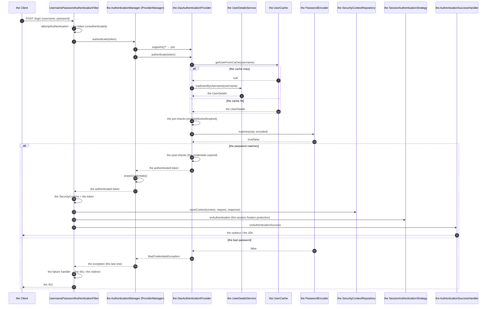
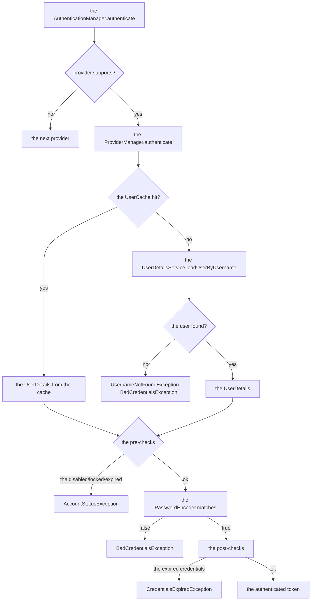
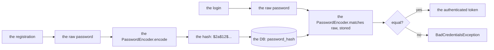

# 02 · Authentication Flow, `UserDetailsService` & Password Encoding

> **Level:** Beginner → Advanced
> **Interview Frequency:** ★★★★★ ("Walk me through the authentication flow")
> **Prerequisite:** [01 · Security Architecture](./01-Security-Architecture-and-Filter-Chain.md)
> **Last Updated:** 2026

---

## 📋 Table of Contents
- [0. TL;DR — The 30-Second Answer](#0-tldr--the-30-second-answer)
- [1. What & Why](#1-what--why)
- [2. Mental Model — The Three Questions](#2-mental-model--the-three-questions)
- [3. Deep Dive — Theory](#3-deep-dive--theory)
- [4. Internal Working Mechanism](#4-internal-working-mechanism)
- [5. Step-by-Step Execution Flow](#5-step-by-step-execution-flow)
- [6. Architecture Diagrams](#6-architecture-diagrams)
- [7. Production-Level Use Cases](#7-production-level-use-cases)
- [8. Code Examples — Production-Grade](#8-code-examples--production-grade)
- [9. Common Mistakes & Gotchas](#9-common-mistakes--gotchas)
- [10. Performance Considerations](#10-performance-considerations)
- [11. Security Considerations](#11-security-considerations)
- [12. Best Practices — The Checklist](#12-best-practices--the-checklist)
- [13. Hands-On Exercises](#13-hands-on-exercises)
- [14. Code Challenges](#14-code-challenges)
- [15. Scenario-Based Questions](#15-scenario-based-questions)
- [16. Interview Q&A — Level-wise](#16-interview-qa--level-wise)
- [17. Counter-questions & Traps](#17-counter-questions--traps)
- [18. Tricky Interview Questions](#18-tricky-interview-questions)
- [19. Follow-Up Questions Asked by Interviewers](#19-follow-up-questions-asked-by-interviewers)
- [20. Real 3–5 Year Experience Scenarios](#20-real-35-year-experience-scenarios)
- [21. Frequently Asked Production Issues](#21-frequently-asked-production-issues)
- [22. Debugging Scenarios](#22-debugging-scenarios)
- [23. Architecture Design Questions](#23-architecture-design-questions)
- [24. Rapid-Fire MCQs](#24-rapid-fire-mcqs)
- [25. Cheat Sheet — One-Page Summary](#25-cheat-sheet--one-page-summary)
- [26. Real-World Production Notes](#26-real-world-production-notes)
- [27. Follow-up Learning](#27-follow-up-learning)

---

## 0. TL;DR — The 30-Second Answer

- **The authentication flow:** the filter extracts the credentials → creates an
  `Authentication` (an *unauthenticated* token) → the `AuthenticationManager`
  (`ProviderManager`) finds the `AuthenticationProvider`s → the provider loads the
  `UserDetails` (`UserDetailsService`) → verifies the password (`PasswordEncoder`) →
  returns an **authenticated** token → the `SecurityContext` is saved → the success handler
  redirects.
- **`UserDetailsService`** — one method: `loadUserByUsername(String)`. The default
  implementation `DaoAuthenticationProvider` uses it **plus** a `PasswordEncoder` and the
  account-status checks.
- **`UserDetails`** — the user snapshot: the username, the password (hashed), the authorities,
  and the four status flags (`accountNonExpired`, `accountNonLocked`, `credentialsNonExpired`,
  `enabled`).
- **The `AuthenticationProvider`** is the pluggable strategy. `supports(Class)` decides which
  provider handles which token type — the `ProviderManager` tries them in order and the first
  success wins.
- **The `PasswordEncoder`:** use the **`DelegatingPasswordEncoder`** (the `{bcrypt}` prefix) —
  it makes the encoder swappable and the migration possible. **Never** store the passwords
  reversibly, never use MD5/SHA-1, never use a bare SHA-256 without a salt and a work factor.
- **The `AuthenticationManager` as a bean** (Spring Security 6.1+): the explicit wiring, the
  custom providers registered in order.
- **The two-phase trick:** the `Authentication` starts **unauthenticated**
  (`isAuthenticated() == false`) → the provider does the work → it returns a **new**,
  authenticated token. The `AuthenticatedAuthenticationToken` is the marker.
- **The "don't trust the request" rule:** the username in the token comes from the request
  (the form field / the header) → it is **untrusted input** until the provider verifies it.
- **The one-liner:** *"The `AuthenticationManager` orchestrates, the `AuthenticationProvider`
  verifies, the `UserDetailsService` fetches the user, and the `PasswordEncoder` checks the
  password. The `UserDetails` is the contract between your database and the framework."*

---

## 1. What & Why

Authentication is the first thing every API does and the most commonly botched one. The
interviews probe whether you understand the *extension points* (so you can add the MFA, the
LDAP, the social login) rather than just the `@Bean PasswordEncoder` boilerplate.

---

## 2. Mental Model — The Three Questions

```text
  ① WHO ARE YOU?      → the Authentication
  ② HOW DO WE PROVE IT? → the AuthenticationProvider + the PasswordEncoder
  ③ WHAT CAN YOU DO?   → the GrantedAuthority (the next chapter)
```

And the framework's answer to "where do you keep the user?" is: **you don't keep it in the
framework** — you implement `UserDetailsService` and return a `UserDetails`. The framework never
touches your `User` entity.

---

## 3. Deep Dive — Theory

### 3.1 The `Authentication` — the token's lifecycle

```java
public interface Authentication extends Principal, Serializable {
    Object getCredentials();     // the password (the raw, in the request's token)
    Object getDetails();         // the extra info (the IP, the session id, the user-agent)
    Object getPrincipal();       // the user identity (the UserDetails, or the JWT's subject)
    boolean isAuthenticated();
    void setAuthenticated(boolean isAuthenticated) throws IllegalArgumentException;
    Collection<? extends GrantedAuthority> getAuthorities();
    String getName();
}
```

**The two states:**
```text
   ① BEFORE the verification                    ② AFTER the verification
   ───────────────────────────                   ──────────────────────────
   UsernamePasswordAuthenticationToken            UsernamePasswordAuthenticationToken
   principal = "<the requested username>"        principal = the UserDetails
   credentials = "<the raw password>"             credentials = null
   authorities = [] (empty)                      authorities = [ROLE_USER, ...]
   isAuthenticated() = false                     isAuthenticated() = true
```

**The `setAuthenticated(true)` guard:** the `AbstractAuthenticationToken.setAuthenticated` throws
`IllegalArgumentException` if you try to set it to `true`:
```java
public void setAuthenticated(boolean authenticated) {
    if (authenticated) {
        throw new IllegalArgumentException("Cannot set this token to trusted - use constructor which takes a GrantedAuthority list instead");
    }
    this.authenticated = false;
}
```
**Why?** The `AbstractAuthenticationToken`'s constructor with the `GrantedAuthority` list sets
the trusted flag. The design prevents a code path from "promoting" a token without the
authorities — a defence against the "forged the authenticated" bug.

### 3.2 The `UsernamePasswordAuthenticationToken` — the two constructors

```java
// ① The unauthenticated token (the credentials to verify)
public UsernamePasswordAuthenticationToken(Object principal, Object credentials) {
    super(null);                    // no authorities
    this.principal = principal;
    this.credentials = credentials;
    setAuthenticated(false);
}

// ② The authenticated token (the verified result)
public UsernamePasswordAuthenticationToken(Object principal, Object credentials,
                                           Collection<? extends GrantedAuthority> authorities) {
    super(authorities);
    this.principal = principal;
    this.credentials = credentials;
    setAuthenticated(true);         // via the super's constructor
}
```

**The `AbstractAuthenticationToken`:**
```java
public abstract class AbstractAuthenticationToken implements Authentication, Serializable {
    private final List<GrantedAuthority> authorities;
    private final boolean authenticated;

    public AbstractAuthenticationToken(Collection<? extends GrantedAuthority> authorities) {
        this.authorities = (authorities == null)
                ? Collections.emptyList()
                : Collections.unmodifiableList(new ArrayList<>(authorities));
        this.authenticated = true;    // the trusted constructor
    }
    ...
}
```

### 3.3 The `GrantedAuthority` — the authority

```java
public interface GrantedAuthority extends Serializable {
    String getAuthority();
}
```

**The implementations:**
| The class | The authority string |
|-----------|---------------------|
| `SimpleGrantedAuthority` | `"ROLE_ADMIN"` |
| `RoleHierarchyImpl` (the `GrantedAuthority` wrapper) | The expanded roles |

**The `RoleHierarchy` — the role inheritance:**
```java
@Bean
RoleHierarchy roleHierarchy() {
    RoleHierarchyImpl hierarchy = new RoleHierarchyImpl();
    hierarchy.setHierarchy("ROLE_ADMIN > ROLE_MANAGER > ROLE_USER");
    return hierarchy;
}
```
Now a `ROLE_MANAGER` gets `ROLE_USER` too → `hasRole("USER")` passes for a manager.

**To activate it:** the `DefaultWebSecurityExpressionHandler` with the role hierarchy:
```java
@Bean
DefaultWebSecurityExpressionHandler expressionHandler(RoleHierarchy roleHierarchy) {
    DefaultWebSecurityExpressionHandler handler = new DefaultWebSecurityExpressionHandler();
    handler.setRoleHierarchy(roleHierarchy);
    return handler;
}
```

**The caveat:** the role hierarchy works for the **web** and the **method** security only if the
`expressionHandler` is configured for both (the method security needs its own
`MethodSecurityExpressionHandler`).

### 3.4 The `UserDetails` — the contract

```java
public interface UserDetails extends Serializable {
    Collection<? extends GrantedAuthority> getAuthorities();
    String getPassword();
    String getUsername();
    boolean isAccountNonExpired();
    boolean isAccountNonLocked();
    boolean isCredentialsNonExpired();
    boolean isEnabled();
}
```

**The four flags — what they mean in production:**

| The flag | The `false` means | The typical trigger | The production source |
|---------|-------------------|--------------------|---------------------|
| `isAccountNonExpired` | The account is past its expiry | The inactivity period, the subscription ended | The DB (`account_expires_at`) |
| `isAccountNonLocked` | The account is locked out | The failed login attempts, the fraud detection | The DB / the Redis (`locked_until`) |
| `isCredentialsNonExpired` | The password must be changed | The 90-day policy, the admin's reset | The DB (`password_changed_at`) |
| `isEnabled` | The account is disabled | The deactivation, the deletion, the pending verification | The DB (`status`) |

**The `User` builder (the Spring's implementation):**
```java
public final class User implements UserDetails {
    private final String username;
    private final String password;
    private final boolean enabled;
    private final boolean accountNonExpired;
    private final boolean accountNonLocked;
    private final boolean credentialsNonExpired;
    private final Collection<? extends GrantedAuthority> authorities;
    ...
}
```

**The custom `UserDetails` (the production pattern — the principal with the id):**
```java
@Getter
public class UserPrincipal implements UserDetails {

    private final Long id;
    private final String email;
    private final String password;
    private final boolean enabled;
    private final boolean accountNonExpired;
    private final boolean accountNonLocked;
    private final boolean credentialsNonExpired;
    private final Collection<? extends GrantedAuthority> authorities;

    @Override
    public String getUsername() { return email; }
    @Override
    public Collection<? extends GrantedAuthority> getAuthorities() { return authorities; }
    @Override
    public boolean isAccountNonExpired() { return accountNonExpired; }
    @Override
    public boolean isAccountNonLocked() { return accountNonLocked; }
    @Override
    public boolean isCredentialsNonExpired() { return credentialsNonExpired; }
    @Override
    public boolean isEnabled() { return enabled; }
}
```

**Why a custom principal?** (1) the controllers get the `id` without a DB lookup; (2) the
`@AuthenticationPrincipal` can be typed; (3) the JWT's claims can be mapped directly to it.

### 3.5 The `UserDetailsService` — one method

```java
public interface UserDetailsService {
    UserDetails loadUserByUsername(String username) throws UsernameNotFoundException;
}
```

**The `JdbcUserDetailsManager` (the JDBC implementation):**
```java
@Bean
UserDetailsService userDetailsService(DataSource dataSource) {
    JdbcUserDetailsManager manager = new JdbcUserDetailsManager(dataSource);
    manager.setUsersByUsernameQuery("select username, password, enabled from users where username = ?");
    manager.setAuthoritiesByUsernameQuery("select username, authority from authorities where username = ?");
    return manager;
}
```

**The `InMemoryUserDetailsManager` (the tests):**
```java
@Bean
UserDetailsService inMemoryUserDetailsManager(PasswordEncoder encoder) {
    UserDetails user = User.builder()
            .username("admin")
            .password(encoder.encode("admin123"))
            .roles("ADMIN", "USER")
            .build();
    return new InMemoryUserDetailsManager(user);
}
```

**The production implementation (the JPA):**
```java
@Service
@Transactional(readOnly = true)
public class CustomUserDetailsService implements UserDetailsService {

    private final UserRepository userRepository;
    private final RoleRepository roleRepository;

    @Override
    public UserDetails loadUserByUsername(String username) {
        User user = userRepository.findByUsernameWithRoles(username)
                .orElseThrow(() -> new UsernameNotFoundException("Invalid credentials"));

        List<GrantedAuthority> authorities = user.getRoles().stream()
                .map(role -> new SimpleGrantedAuthority("ROLE_" + role.getName()))
                .toList();

        return new UserPrincipal(
                user.getId(), user.getUsername(), user.getPasswordHash(),
                user.isEnabled(), user.isAccountNonExpired(),
                user.isAccountNonLocked(), user.isCredentialsNonExpired(),
                authorities);
    }
}
```

**The `UserCache` — the caching layer:**
```java
@Bean
UserCache userCache() {
    return new ConcurrentReferenceHashMapCache<>();   // or the Redis-backed one
}
```
**The caveat:** the cached `UserDetails` won't reflect a password change until it's evicted
→ the `ProviderManager` calls `userCache.removeUserFromCache(username)` after a successful
authentication.

### 3.6 The `DaoAuthenticationProvider` — the default provider

```java
public class DaoAuthenticationProvider implements AuthenticationProvider, InitializingBean {

    private UserDetailsService userDetailsService;
    private PasswordEncoder passwordEncoder;
    private boolean hideUserNotFoundExceptions = true;   // the default since 5.7
    private UserCache userCache;
    private final AccountStatusUserDetailsChecker userDetailsChecker = new AccountStatusUserDetailsChecker();

    @Override
    public Authentication authenticate(Authentication authentication) throws AuthenticationException {
        String username = authentication.getName();
        UserDetails user = this.userCache.getUserFromCache(username);

        if (user == null) {
            user = this.userDetailsService.loadUserByUsername(username);
            this.userCache.removeUserFromCache(username);   // the cache is populated on the success
        }

        if (user == null) {
            throw new UsernameNotFoundException("User not found");
        }

        // ① the pre-authentication checks (the enabled/expired/locked)
        if (!this.userDetailsChecker.isPreAuthenticationChecksPass(user, authentication)) {
            throw new AccountStatusException("User account is locked");
        }

        // ② the password
        String presentedPassword = authentication.getCredentials().toString();
        if (!this.passwordEncoder.matches(presentedPassword, user.getPassword())) {
            throw new BadCredentialsException("Invalid credentials");
        }

        // ③ the post-authentication checks (the credentials expired)
        if (!this.userDetailsChecker.isPostAuthenticationChecksPass(user, authentication)) {
            throw new CredentialsExpiredException("User credentials have expired");
        }

        // ④ the authorities
        Collection<GrantedAuthority> authorities = user.getAuthorities();

        UsernamePasswordAuthenticationToken authenticated =
                new UsernamePasswordAuthenticationToken(user, null, authorities);
        authenticated.setDetails(authentication.getDetails());
        return authenticated;
    }

    @Override
    public boolean supports(Class<?> authentication) {
        return authentication.equals(UsernamePasswordAuthenticationToken.class);
    }
}
```

**The `AccountStatusUserDetailsChecker`:**
```java
public class AccountStatusUserDetailsChecker implements UserDetailsChecker {
    @Override
    public boolean isPreAuthenticationChecksPass(UserDetails user, Authentication authentication) {
        if (!user.isEnabled())            throw new DisabledException("User is disabled");
        if (!user.isAccountNonLocked())   throw new LockedException("User is locked");
        if (!user.isAccountNonExpired())  throw new AccountExpiredException("User account expired");
        return true;
    }
    @Override
    public boolean isPostAuthenticationChecksPass(UserDetails user, Authentication authentication) {
        if (!user.isCredentialsNonExpired()) throw new CredentialsExpiredException("Credentials expired");
        return true;
    }
}
```

**The `hideUserNotFoundExceptions` (the default `true`):** the `UsernameNotFoundException` is
caught and rethrown as a `BadCredentialsException` → the client sees one generic message →
no **user enumeration**.

### 3.7 The `PasswordEncoder` — the details

```java
public interface PasswordEncoder {
    String encode(CharSequence rawPassword);
    boolean matches(CharSequence rawPassword, String encodedPassword);
    default boolean upgradeEncoding(String encodedPassword) { return false; }
}
```

**The `DelegatingPasswordEncoder` (the recommended default):**
```java
@Bean
PasswordEncoder passwordEncoder() {
    return PasswordEncoderFactories.createDelegatingPasswordEncoder();
}
```
The default is `{bcrypt}` with the strength 10.

**The custom:**
```java
@Bean
PasswordEncoder passwordEncoder() {
    String idForEncode = "bcrypt12";
    Map<String, PasswordEncoder> encoders = new HashMap<>();
    encoders.put(idForEncode, new BCryptPasswordEncoder(12));
    encoders.put("noop", NoOpPasswordEncoder.getInstance());
    encoders.put("sha256", new StandardPasswordEncoder());

    return new DelegatingPasswordEncoder(idForEncode, encoders);
}
```
**The encoded format:** `{bcrypt12}$2a$12$...` → the prefix tells the encoder how to verify.

**The `upgradeEncoding` — the transparent migration:**
```java
@Override
public boolean upgradeEncoding(String encodedPassword) {
    return "noop".equals(getId(encodedPassword));   // the legacy noop → re-hash
}
```
Then, in a custom provider (or via the `PasswordEncoder`'s `matches`), after a successful
verification, if `upgradeEncoding(encoded)` is true → re-encode and save.

**The `Argon2PasswordEncoder` (the best for the modern apps):**
```java
@Bean
PasswordEncoder passwordEncoder() {
    // 65536 KB memory, 10 iterations, 4 parallelism, 32 salt, 32 hash
    return new Argon2PasswordEncoder(65536, 10, 4, 32, 32);
}
```
Requires the BouncyCastle dependency.

**The parameters of the BCrypt:**
```java
new BCryptPasswordEncoder(12);  // the cost: 2^12 rounds
```
**The calibration:** the OWASP recommends the hashing should take ~1 second on the target
hardware (some say 250ms). The **benchmark** before choosing:
```java
long start = System.nanoTime();
encoder.encode("test");
long ms = (System.nanoTime() - start) / 1_000_000;
```

**The properties of the BCrypt:**
- The salt is **built into** the hash (no separate salt column).
- The cost is stored in the hash → the future cost increases are transparent.
- The 72-byte limit (the password is truncated at 72 bytes) → pre-hash with SHA-256 if you
  allow long passwords.
- The **base64** encoding (the bcrypt's own alphabet, not the standard one).

### 3.8 The `ProviderManager` — the orchestrator

```java
public class ProviderManager implements AuthenticationManager, InitializingBean {

    private final List<AuthenticationProvider> providers;
    private AuthenticationManager parentAuthenticationManager;
    private boolean eraseCredentialsAfterAuthentication = true;

    @Override
    public Authentication authenticate(Authentication authentication) throws AuthenticationException {
        Authentication result = null;
        AuthenticationException lastException = null;
        boolean parentResult = false;
        boolean exhaustedProviders = false;

        for (AuthenticationProvider provider : this.providers) {
            if (!provider.supports(authentication.getClass())) continue;

            exhaustedProviders = true;
            try {
                result = provider.authenticate(authentication);
                if (result != null) {
                    if (this.eraseCredentialsAfterAuthentication
                            && (result.getCredentials() != null)) {
                        result.eraseCredentials();
                    }
                    return result;
                }
            } catch (InternalAuthenticationServiceException ex) {
                throw ex;      // the fatal one (the DB is down)
            } catch (AuthenticationException ex) {
                lastException = ex;
            }
        }

        if (parentAuthenticationManager != null) {
            parentResult = parentAuthenticationManager.authenticate(authentication);
            if (parentResult != null) return parentResult;
        }

        if (lastException == null) {
            lastException = new ProviderNotFoundException(
                    "No AuthenticationProvider found for " + authentication.getClass());
        }
        if (parentResult && exhaustedProviders) {
            lastException = new ParentAuthenticationException(lastException);
        }
        throw lastException;
    }
}
```

**The key behaviours:**
1. The **first success wins** → the chain stops.
2. An `AuthenticationException` from a provider → **remembered**, the next provider is tried.
3. An `InternalAuthenticationServiceException` → **rethrown immediately** (the infrastructure
   failure — the DB is down → don't try the other providers, and don't report it as a bad
   password!).
4. No provider succeeded → the **last** exception is thrown.
5. `eraseCredentialsAfterAuthentication` → the credentials are wiped from the token after the
   success (the `UsernamePasswordAuthenticationToken.eraseCredentials` sets the credentials to
   `null`).

**The `parentAuthenticationManager` — the delegation:**
```java
@Bean
AuthenticationManager authenticationManager(ParentAuthenticationManager parent) {
    DaoAuthenticationProvider dao = new DaoAuthenticationProvider();
    dao.setUserDetailsService(userDetailsService);
    dao.setPasswordEncoder(passwordEncoder);

    ProviderManager manager = new ProviderManager(List.of(dao));
    manager.setParentAuthenticationManager(parent);   // the OAuth2's manager
    return manager;
}
```

### 3.9 The `AuthenticationManager` — the modern bean

```java
@Bean
AuthenticationManager authenticationManager(UserDetailsService userDetailsService,
                                            PasswordEncoder passwordEncoder,
                                            OtpAuthenticationProvider otpProvider) {
    DaoAuthenticationProvider dao = new DaoAuthenticationProvider();
    dao.setUserDetailsService(userDetailsService);
    dao.setPasswordEncoder(passwordEncoder);

    return new ProviderManager(List.of(dao, otpProvider));
}
```
**The order matters:** the `ProviderManager` tries them in the list's order → the specific
providers first.

**The `AuthenticationConfiguration` (the implicit way):**
```java
@Configuration
public class AuthenticationConfig {
    @Bean
    UserDetailsService userDetailsService(...) { ... }
    @Bean
    PasswordEncoder passwordEncoder() { ... }
}
```
Spring Boot auto-wires the `AuthenticationManager` from the `UserDetailsService` + the
`PasswordEncoder` beans → the `AuthenticationConfiguration` builds a `DaoAuthenticationProvider`
and a `ProviderManager`.

### 3.10 The `AuthenticationSuccessHandler` & the `AuthenticationFailureHandler`

```java
public interface AuthenticationSuccessHandler {
    void onAuthenticationSuccess(HttpServletRequest request, HttpServletResponse response,
                                 Authentication authentication) throws IOException, ServletException;
}

public interface AuthenticationFailureHandler {
    void onAuthenticationFailure(HttpServletRequest request, HttpServletResponse response,
                                 AuthenticationException exception) throws IOException, ServletException;
}
```

**The defaults:**
- The success → `SavedRequestAwareAuthenticationSuccessHandler` (the redirect to the saved
  request, or the `defaultSuccessUrl`).
- The failure → `SimpleUrlAuthenticationFailureHandler` (the redirect to the `failureUrl` with
  the `?error` parameter).

**The API-friendly versions:**
```java
@Bean
AuthenticationSuccessHandler authenticationSuccessHandler(ObjectMapper objectMapper) {
    return (request, response, authentication) -> {
        response.setStatus(HttpServletResponse.SC_OK);
        response.setContentType(MediaType.APPLICATION_JSON_VALUE);
        objectMapper.writeValue(response.getOutputStream(),
                Map.of("message", "Authenticated", "username", authentication.getName()));
    };
}

@Bean
AuthenticationFailureHandler authenticationFailureHandler(ObjectMapper objectMapper) {
    return (request, response, exception) -> {
        response.setStatus(HttpServletResponse.SC_UNAUTHORIZED);
        response.setContentType(MediaType.APPLICATION_JSON_VALUE);
        objectMapper.writeValue(response.getOutputStream(),
                Map.of("message", "Authentication failed", "error", exception.getMessage()));
    };
}
```

**The `DelegatingAuthenticationSuccessHandler`** — the different responses per the request type
(the browser → the redirect; the API → the JSON).

### 3.11 The `SecurityContextRepository` — the persistence

```java
public interface SecurityContextRepository {
    SecurityContext loadEmptyContext(HttpServletRequest request);
    void saveContext(SecurityContext context, HttpServletRequest request, HttpServletResponse response);
}
```

**The manual save (the API/JWT case):**
```java
@Bean
SecurityContextRepository securityContextRepository() {
    return new DelegatingSecurityContextRepository(
            new RequestAttributeSecurityContextRepository(),
            new HttpSessionSecurityContextRepository());
}
```

**The save in a custom filter:**
```java
Authentication authentication = ...;
SecurityContext context = SecurityContextHolder.createEmptyContext();
context.setAuthentication(authentication);
SecurityContextHolder.setContext(context);
securityContextRepository.saveContext(context, request, response);
```

### 3.12 The `AuthenticationEventPublisher` — the audit

```java
public interface AuthenticationEventPublisher {
    void publishEvent(Authentication authentication);
    void publishEvent(AuthenticationException exception);
}
```

**The events:**
| The event | The meaning |
|-----------|-------------|
| `AuthenticationSuccessEvent` | The authentication succeeded |
| `AuthenticationFailureBadCredentialsEvent` | The bad password |
| `AuthenticationFailureLockedEvent` | The locked account |
| `AuthenticationFailureDisabledEvent` | The disabled account |
| `AuthenticationFailureServiceExceptionEvent` | The infrastructure failure |

**The listener:**
```java
@Component
@RequiredArgsConstructor
public class AuthenticationAuditListener {

    private final AuditService auditService;

    @EventListener
    public void onSuccess(AuthenticationSuccessEvent event) {
        auditService.recordLoginSuccess(event.getAuthentication().getName(),
                event.getAuthentication().getDetails());
    }

    @EventListener
    public void onFailure(AbstractAuthenticationFailureEvent event) {
        auditService.recordLoginFailure(event.getAuthentication().getName(),
                event.getException().getClass().getSimpleName());
    }
}
```

**The `AuthenticationAuditListener` (the Spring's built-in):**
```java
public class DefaultAuthenticationEventPublisher implements AuthenticationEventPublisher {
    // it also publishes the "the session created" events
    // (the SessionAuthenticationEvent)
}
```

### 3.13 The `ReactiveAuthenticationManager` (the WebFlux)

```java
public interface ReactiveAuthenticationManager {
    Mono<Authentication> authenticate(Authentication authentication);
}
```
**The reactive `SecurityContext`:** the `ReactorContext` (the `Context` in the reactive chain) —
not the thread-local. The `SecurityContextServerWebExchangeWebFilter` handles it.

### 3.14 The `RememberMe` — the details

```java
@Bean
RememberMeServices rememberMeServices(UserDetailsService userDetailsService,
                                       KeyPair keyPair) {
    return new TokenBasedRememberMeServices("myKey", userDetailsService);
}
```

**The token's structure:** `username|expirationTimestamp|Base64(MAC(username|expirationTimestamp|key))`
→ the cookie. On the next request, the `RememberMeAuthenticationFilter` verifies the MAC and
loads the user.

**The production fix:** the `PersistentTokenBasedRememberMeServices` (a random token stored in
the DB → **revocable**).

---

## 4. Internal Working Mechanism

### 4.1 The `UsernamePasswordAuthenticationFilter` — the extraction

```java
public class UsernamePasswordAuthenticationFilter extends AbstractAuthenticationProcessingFilter {

    public static final String DEFAULT_USERNAME_PARAMETER = "username";
    public static final String DEFAULT_PASSWORD_PARAMETER = "password";

    @Override
    protected Authentication attemptAuthentication(HttpServletRequest request, HttpServletResponse response)
            throws AuthenticationException {

        if (isPostOnly(request)) {
            String username = obtainUsername(request);
            String password = obtainPassword(request);
            username = (username == null) ? "" : username.trim();
            password = (password == null) ? "" : password;
            return getAuthenticationManager().authenticate(
                    new UsernamePasswordAuthenticationToken(username, password));
        }
        throw new AuthenticationServiceException(
                "Authentication method not supported: " + request.getMethod());
    }

    @Override
    protected void successfulAuthentication(HttpServletRequest request, HttpServletResponse response,
                                            FilterChain chain, Authentication authResult) {
        SecurityContext context = SecurityContextHolder.createEmptyContext();
        context.setAuthentication(authResult);
        SecurityContextHolder.setContext(context);
        this.securityContextRepository.saveContext(context, request, response);
        this.rememberMeServices.loginSuccess(request, response, authResult);
        this.eventPublisher.publishEvent(new AuthenticationSuccessEvent(authResult));
        this.successHandler.onAuthenticationSuccess(request, response, authResult);
    }
}
```

**The `AbstractAuthenticationProcessingFilter`:**
```java
public abstract class AbstractAuthenticationProcessingFilter extends GenericFilterBean
        implements AuthenticationFilter, InitializingBean {

    private final AuthenticationManager authenticationManager;
    private AuthenticationSuccessHandler successHandler;
    private AuthenticationFailureHandler failureHandler;
    private SessionAuthenticationStrategy sessionAuthenticationStrategy;
    private SecurityContextRepository securityContextRepository;
    private RememberMeServices rememberMeServices;
    private boolean continueChainBeforeSuccessfulAuthentication = false;

    public void doFilter(...) {
        if (!requiresAuthentication(request, response)) {
            chain.doFilter(request, response);
            return;
        }
        Authentication authenticationResult;
        try {
            authenticationResult = attemptAuthentication(request, response);
        } catch (AuthenticationException ex) {
            this.failureHandler.onAuthenticationFailure(request, response, ex);
            return;
        }
        if (this.continueChainBeforeSuccessfulAuthentication) {
            chain.doFilter(request, response);
        }
        successfulAuthentication(request, response, chain, authenticationResult);
    }
}
```

### 4.2 The `BasicAuthenticationFilter` — the header's extraction

```java
public class BasicAuthenticationFilter extends OncePerRequestFilter {

    private AuthenticationSuccessHandler successHandler = new HttpStatusEntryPoint(HttpStatus.OK);
    private AuthenticationFailureHandler failureHandler = new HttpStatusEntryPoint(HttpStatus.UNAUTHORIZED);

    @Override
    protected void doFilterInternal(HttpServletRequest request, HttpServletResponse response, FilterChain chain) {
        String header = request.getHeader("Authorization");
        if (header == null || !header.startsWith("Basic ")) {
            chain.doFilter(request, response);
            return;
        }
        try {
            String[] credentials = decodeHeader(header.substring(6));
            String username = credentials[0];
            String password = credentials[1];
            UsernamePasswordAuthenticationToken requestToken =
                    new UsernamePasswordAuthenticationToken(username, password);
            Authentication authResult = this.authenticationManager.authenticate(requestToken);
            SecurityContext context = SecurityContextHolder.createEmptyContext();
            context.setAuthentication(authResult);
            SecurityContextHolder.setContext(context);
            this.securityContextRepository.saveContext(context, request, response);
            this.filterChain.doFilter(request, response);
        } catch (AuthenticationException ex) {
            this.securityContextHolder.clearContext();
            this.failureHandler.onAuthenticationFailure(request, response, ex);
        }
    }
}
```

**The `Basic` header:** `Base64(username:password)` — **not encryption** → only over HTTPS.

### 4.3 The `PasswordEncoder` — the BCrypt's algorithm

```text
  ① the salt = 16 random bytes (from the SecureRandom)
  ② the key = the salt + the password
  ③ the EksBlowfish setup (the cost = 2^rounds iterations of the modified Blowfish)
  ④ the output = the base64(salt + the hash)
  ⑤ the format = $2a$<cost>$<the 22-char salt><the 31-char hash>
```

**The properties:**
- The **salt is unique per password** (the same password → different hashes).
- The **cost is embedded** → the future cost increases work transparently.
- The **slow by design** → the brute force is expensive.
- The **72-byte limit** → the truncation.

**The verification:** the same algorithm with the stored salt and cost → compare.

### 4.4 The `UserCache` — the caching

```java
public interface UserCache {
    UserDetails getUserFromCache(String username);
    void removeUserFromCache(String username);
    void removeUserFromCache(UserDetails user);
}
```

**The `ConcurrentReferenceHashMapCache`** — the soft references (the memory pressure → the
eviction). **The eviction after the auth** (the `DaoAuthenticationProvider` removes the user
from the cache so that the next request re-reads the authorities — hmm, actually it removes it
*before* the check so that the changed password takes effect; and the `ProviderManager` removes
it after the success).

**The production caveat:** the in-memory `UserCache` is per-instance → in a cluster, the user's
deactivation on one node isn't visible on the others until the cache's TTL. The fix: the
JWT (no lookup) or a short cache TTL / a Redis-backed cache / the Spring Session.

### 4.5 The `eraseCredentials`

```java
public interface CredentialsContainer {
    void eraseCredentials();
}
```
The `UsernamePasswordAuthenticationToken.eraseCredentials()` → the credentials become `null`.
The `ProviderManager` calls it after the success (if `eraseCredentialsAfterAuthentication` is
true) → the raw password isn't kept in the `SecurityContext` (a memory-dump protection).

**The caveat:** the `eraseCredentials` also **removes the password from the `UserDetails`** (if
the principal is a `CredentialsContainer`) → the code that reads `principal.getPassword()`
after the authentication gets `null` → the NPE in a "the login succeeded but the password is
null" bug.

---

## 5. Step-by-Step Execution Flow

### 5.1 The form login (the full sequence)



### 5.2 The `UserDetailsService`'s call path



### 5.3 The password's lifecycle (the encoding vs the verification)



---

## 6. Architecture Diagrams

### 6.1 The complete authentication architecture

```text
   the request's credentials
            │
            ▼
   ┌──────────────────────────────────────┐
   │ the AuthenticationFilter             │
   │  (the form / the basic / the bearer) │
   └──────────────────┬───────────────────┘
                      │ the unauthenticated token
                      ▼
   ┌──────────────────────────────────────┐
   │ the AuthenticationManager            │
   │   (the ProviderManager)              │
   │   → the supports() dispatch          │
   │   → the parent (the delegation)      │
   └──────────────────┬───────────────────┘
                      │
                      ▼
   ┌──────────────────────────────────────┐
   │ the AuthenticationProvider           │
   │   ① the UserCache                    │
   │   ② the UserDetailsService           │
   │   ③ the pre-checks                   │
   │   ④ the PasswordEncoder              │
   │   ⑤ the post-checks                  │
   └──────────────────┬───────────────────┘
                      │ the authenticated token
                      ▼
   ┌──────────────────────────────────────┐
   │ the SecurityContextRepository       │
   │   (the session / the request attr)   │
   └──────────────────┬───────────────────┘
                      ▼
          the success handler / the 200
```

### 6.2 The strategy pattern (the extensibility)

```text
   the AuthenticationManager (the stable core)
        │
        ├── DaoAuthenticationProvider  (the username/password)
        │     └── the UserDetailsService + the PasswordEncoder
        │
        ├── JwtAuthenticationProvider  (the JWT)
        │     └── the JwtDecoder
        │
        ├── OidcUserService            (the OIDC)
        │
        ├── AnonymousAuthenticationProvider (the fallback)
        │
        ├── RememberMeAuthenticationProvider (the cookie)
        │
        └── YourCustomProvider          (the MFA, the LDAP, the SAML)
```

**The rule:** the `supports(Class)` must be **specific** (the exact token class) → the
providers don't shadow each other.

### 6.3 The `UserDetails`'s anatomy

```text
   ┌────────────────────────────────────────────────┐
   │ the UserDetails (the user snapshot)            │
   │                                                │
   │  getUsername()          → "alice@example.com"  │
   │  getPassword()          → "$2a$12$..." (hash)  │
   │  getAuthorities()       → [ROLE_USER, ROLE_X]  │
   │  isEnabled()            → true                │
   │  isAccountNonExpired()  → true                │
   │  isAccountNonLocked()   → false (the 5 strikes)│
   │  isCredentialsNonExpired() → true (the 90-day) │
   └────────────────────────────────────────────────┘
```

### 6.4 The `PasswordEncoder`'s options (the decision tree)

```text
   the password storage
        │
        ├── the new project → the Argon2PasswordEncoder (the memory-hard)
        │                    or the DelegatingPasswordEncoder {bcrypt12}
        │
        ├── the legacy MD5/SHA-1 → the DelegatingPasswordEncoder with the
        │     legacy ids → the transparent migration on the next login
        │
        └── the FIPS requirement → the Pbkdf2PasswordEncoder
```

---

## 7. Production-Level Use Cases

| Use case | The technique |
|----------|---------------|
| **The DB-backed users** | The `UserDetailsService` with the JPA + the `UserCache` |
| **The LDAP/AD** | The `LdapAuthenticationProvider` (or the `BindAuthenticator`) |
| **The MFA** | A second `AuthenticationProvider` with the OTP token type + a state machine |
| **The social login** | The `OAuth2LoginAuthenticationProvider` (the `OAuth2UserService`) |
| **The service accounts** | A separate `AuthenticationProvider` for the API keys (the `Authentication` with the key) |
| **The "the password must be changed"** | The `CredentialsExpiredException` + the reset flow |
| **The "the first login must set the password"** | The `CredentialsExpiredException` + a `CredentialsExpiredHandler` (the Spring Security 6.2+ has `CredentialsExpiredAuthenticationFailureHandler`?) — or the custom `AuthenticationFailureHandler` that detects the exception type and redirects to the reset |
| **The legacy password migration** | The `DelegatingPasswordEncoder` + the `upgradeEncoding` + the re-hash on the login |
| **The impersonation (the admin acts as a user)** | A custom `Authentication` (the `ImpersonatingAuthenticationToken`) with the `AuthenticationManager` |

---

## 8. Code Examples — Production-Grade

### 8.1 The complete production authentication setup (Spring Boot 3 / Security 6)

```java
package com.example.auth;

import lombok.RequiredArgsConstructor;
import org.springframework.context.annotation.Bean;
import org.springframework.context.annotation.Configuration;
import org.springframework.security.authentication.AuthenticationManager;
import org.springframework.security.authentication.AuthenticationProvider;
import org.springframework.security.authentication.ProviderManager;
import org.springframework.security.authentication.dao.DaoAuthenticationProvider;
import org.springframework.security.config.annotation.method.configuration.EnableMethodSecurity;
import org.springframework.security.config.annotation.web.builders.HttpSecurity;
import org.springframework.security.config.http.SessionCreationPolicy;
import org.springframework.security.core.userdetails.UserDetailsService;
import org.springframework.security.crypto.argon2.Argon2PasswordEncoder;
import org.springframework.security.crypto.password.PasswordEncoder;
import org.springframework.security.web.SecurityFilterChain;

@Configuration
@EnableMethodSecurity
@RequiredArgsConstructor
public class AuthenticationConfig {

    private final UserDetailsService userDetailsService;
    private final AuthenticationProvider otpAuthenticationProvider;

    @Bean
    public PasswordEncoder passwordEncoder() {
        // 64 MB memory, 3 iterations, 4 parallelism, 32 salt, 32 hash
        return new Argon2PasswordEncoder(65536, 3, 4, 32, 32);
    }

    @Bean
    public AuthenticationManager authenticationManager(PasswordEncoder passwordEncoder) {
        DaoAuthenticationProvider dao = new DaoAuthenticationProvider();
        dao.setUserDetailsService(userDetailsService);
        dao.setPasswordEncoder(passwordEncoder);
        dao.setHideUserNotFoundExceptions(true);

        return new ProviderManager(List.of(otpAuthenticationProvider, dao));
    }

    @Bean
    public SecurityFilterChain filterChain(HttpSecurity http) throws Exception {
        http
            .csrf(csrf -> csrf.disable())
            .sessionManagement(s -> s.sessionCreationPolicy(SessionCreationPolicy.STATELESS))
            .authorizeHttpRequests(auth -> auth
                .requestMatchers("/api/auth/**").permitAll()
                .anyRequest().authenticated())
            .authenticationProvider(otpAuthenticationProvider);
        return http.build();
    }
}
```

### 8.2 The `UserDetailsService` (the production, with the status from the DB)

```java
package com.example.auth;

import lombok.RequiredArgsConstructor;
import org.springframework.security.core.GrantedAuthority;
import org.springframework.security.core.authority.SimpleGrantedAuthority;
import org.springframework.security.core.userdetails.UserDetails;
import org.springframework.security.core.userdetails.UserDetailsService;
import org.springframework.security.core.userdetails.UsernameNotFoundException;
import org.springframework.stereotype.Service;
import org.springframework.transaction.annotation.Transactional;

import java.time.Instant;
import java.util.List;

@Service
@RequiredArgsConstructor
public class JpaUserDetailsService implements UserDetailsService {

    private final UserRepository userRepository;

    @Override
    @Transactional(readOnly = true)
    public UserDetails loadUserByUsername(String username) throws UsernameNotFoundException {
        User user = userRepository.findByUsername(username)
                .orElseThrow(() -> new UsernameNotFoundException("Invalid credentials"));

        List<GrantedAuthority> authorities = user.getRoles().stream()
                .map(role -> new SimpleGrantedAuthority("ROLE_" + role.getName().toUpperCase()))
                .toList();

        return UserPrincipal.builder()
                .id(user.getId())
                .username(user.getUsername())
                .password(user.getPasswordHash())
                .authorities(authorities)
                .enabled(user.getStatus() == UserStatus.ACTIVE)
                .accountNonExpired(user.getAccountExpiresAt() == null
                        || user.getAccountExpiresAt().isAfter(Instant.now()))
                .accountNonLocked(user.getLockedUntil() == null
                        || user.getLockedUntil().isBefore(Instant.now()))
                .credentialsNonExpired(user.getPasswordChangedAt() == null
                        || user.getPasswordChangedAt().isAfter(Instant.now().minus(90, ChronoUnit.DAYS)))
                .build();
    }
}
```

### 8.3 The `UserPrincipal` (the custom, with the id)

```java
package com.example.auth;

import lombok.Builder;
import lombok.Getter;
import org.springframework.security.core.GrantedAuthority;
import org.springframework.security.core.userdetails.UserDetails;

import java.util.Collection;
import java.util.List;

@Getter
@Builder
public class UserPrincipal implements UserDetails {

    private final Long id;
    private final String username;
    private final String password;
    private final boolean enabled;
    private final boolean accountNonExpired;
    private final boolean accountNonLocked;
    private final boolean credentialsNonExpired;
    private final List<? extends GrantedAuthority> authorities;

    @Override
    public boolean isAccountNonExpired() { return accountNonExpired; }
    @Override
    public boolean isAccountNonLocked() { return accountNonLocked; }
    @Override
    public boolean isCredentialsNonExpired() { return credentialsNonExpired; }
    @Override
    public boolean isEnabled() { return enabled; }
}
```

### 8.4 The custom `AuthenticationProvider` (the OTP, the second factor)

```java
package com.example.auth;

@Component
@RequiredArgsConstructor
public class OtpAuthenticationProvider implements AuthenticationProvider {

    private final UserRepository userRepository;
    private final OtpService otpService;

    @Override
    public Authentication authenticate(Authentication authentication) throws AuthenticationException {
        OtpAuthenticationToken token = (OtpAuthenticationToken) authentication;
        String username = token.getName();
        String code = token.getOtp();

        User user = userRepository.findByUsername(username)
                .orElseThrow(() -> new BadCredentialsException("Invalid credentials"));

        if (!otpService.verify(username, code)) {
            throw new BadCredentialsException("Invalid one-time password");
        }

        List<GrantedAuthority> authorities = user.getRoles().stream()
                .map(r -> new SimpleGrantedAuthority("ROLE_" + r.getName()))
                .toList();

        return new UsernamePasswordAuthenticationToken(user, null, authorities);
    }

    @Override
    public boolean supports(Class<?> authentication) {
        return OtpAuthenticationToken.class.isAssignableFrom(authentication);
    }
}
```

```java
public class OtpAuthenticationToken extends AbstractAuthenticationToken {
    private final String principal;
    private final String otp;

    public OtpAuthenticationToken(String principal, String otp) {
        super(null);
        this.principal = principal;
        this.otp = otp;
        setAuthenticated(false);
    }

    @Override public Object getCredentials() { return otp; }
    @Override public Object getPrincipal() { return principal; }
    @Override public String getName() { return principal; }
}
```

### 8.5 The `DelegatingPasswordEncoder` (the migration-friendly)

```java
@Bean
public PasswordEncoder passwordEncoder() {
    String idForEncode = "bcrypt12";
    Map<String, PasswordEncoder> encoders = new HashMap<>();
    encoders.put(idForEncode, new BCryptPasswordEncoder(12));
    encoders.put("argon2", new Argon2PasswordEncoder(65536, 3, 4, 32, 32));
    encoders.put("noop", NoOpPasswordEncoder.getInstance());
    encoders.put("sha256", new StandardPasswordEncoder());

    return new DelegatingPasswordEncoder(idForEncode, encoders);
}
```

### 8.6 The transparent password re-hash (the upgrade on the login)

```java
@Component
@RequiredArgsConstructor
public class PasswordUpgradeService {

    private final PasswordEncoder passwordEncoder;
    private final UserRepository userRepository;

    @Transactional
    public void upgradeIfNeeded(User user, String rawPassword) {
        String encoded = user.getPasswordHash();
        if (passwordEncoder.upgradeEncoding(encoded)) {
            user.setPasswordHash(passwordEncoder.encode(rawPassword));
            user.setPasswordChangedAt(Instant.now());
            userRepository.save(user);
        }
    }
}
```

```java
// In the custom provider, after the successful matches():
passwordUpgradeService.upgradeIfNeeded(user, presentedPassword);
```

### 8.7 The password's policy (the validation at the registration)

```java
@Component
public class PasswordPolicyValidator {

    private static final Pattern UPPER = Pattern.compile(".*[A-Z].*");
    private static final Pattern LOWER = Pattern.compile(".*[a-z].*");
    private static final Pattern DIGIT = Pattern.compile(".*\\d.*");
    private static final Pattern SPECIAL = Pattern.compile(".*[!@#$%^&*()_+\\-=\\[\\]{};':\"\\\\|,.<>\\/?].*");

    @Value("${app.security.password.min-length:12}")
    private int minLength;

    public void validate(String password) {
        List<String> failures = new ArrayList<>();
        if (password.length() < minLength) failures.add("at least " + minLength + " characters");
        if (!UPPER.matcher(password).matches()) failures.add("an uppercase letter");
        if (!LOWER.matcher(password).matches()) failures.add("a lowercase letter");
        if (!DIGIT.matcher(password).matches()) failures.add("a digit");
        if (!SPECIAL.matcher(password).matches()) failures.add("a special character");
        if (COMMON_PASSWORDS.contains(password.toLowerCase())) failures.add("not a commonly used password");

        if (!failures.isEmpty()) {
            throw new WeakPasswordException("The password must contain " + String.join(", ", failures));
        }
    }
}
```

### 8.8 The `AuthenticationSuccessHandler` & the `FailureHandler` (the JSON API)

```java
package com.example.auth;

import com.fasterxml.jackson.databind.ObjectMapper;
import jakarta.servlet.http.HttpServletRequest;
import jakarta.servlet.http.HttpServletResponse;
import lombok.RequiredArgsConstructor;
import org.springframework.http.MediaType;
import org.springframework.security.core.Authentication;
import org.springframework.security.core.AuthenticationException;
import org.springframework.security.web.AuthenticationEntryPoint;
import org.springframework.security.web.authentication.AuthenticationFailureHandler;
import org.springframework.security.web.authentication.AuthenticationSuccessHandler;
import org.springframework.stereotype.Component;

import java.io.IOException;
import java.util.Map;

@Component
@RequiredArgsConstructor
public class JsonAuthHandlers implements AuthenticationSuccessHandler,
                                        AuthenticationFailureHandler,
                                        AuthenticationEntryPoint {

    private final ObjectMapper objectMapper;

    @Override
    public void onAuthenticationSuccess(HttpServletRequest request, HttpServletResponse response,
                                        Authentication authentication) throws IOException {
        response.setStatus(HttpServletResponse.SC_OK);
        response.setContentType(MediaType.APPLICATION_JSON_VALUE);
        objectMapper.writeValue(response.getOutputStream(),
                Map.of("message", "Authenticated", "user", authentication.getName()));
    }

    @Override
    public void onAuthenticationFailure(HttpServletRequest request, HttpServletResponse response,
                                        AuthenticationException exception) throws IOException {
        response.setStatus(HttpServletResponse.SC_UNAUTHORIZED);
        response.setContentType(MediaType.APPLICATION_JSON_VALUE);
        objectMapper.writeValue(response.getOutputStream(),
                Map.of("message", "Authentication failed", "error", exception.getMessage()));
    }

    @Override
    public void commence(HttpServletRequest request, HttpServletResponse response,
                         AuthenticationException authException) throws IOException {
        response.setStatus(HttpServletResponse.SC_UNAUTHORIZED);
        response.setContentType(MediaType.APPLICATION_JSON_VALUE);
        response.setHeader("WWW-Authenticate", "Bearer");
        objectMapper.writeValue(response.getOutputStream(),
                Map.of("message", "Authentication required", "path", request.getRequestURI()));
    }
}
```

### 8.9 The `UserCache` (the `CachingUserDetailsService`)

```java
@Bean
public UserCache userCache() {
    return new ConcurrentReferenceHashMapCache<>(100, 1000);   // the size, the concurrency
}
```

```java
@Bean
public UserDetailsService userDetailsService(UserRepository userRepository) {
    CachingUserDetailsService caching = new CachingUserDetailsService(jpaUserDetailsService);
    caching.setUserCache(userCache());
    return caching;
}
```

### 8.10 The `AuthenticationEventPublisher` (the audit)

```java
@Component
@RequiredArgsConstructor
public class AuthAuditListener {

    private final AuditService auditService;

    @EventListener
    public void onSuccess(AuthenticationSuccessEvent event) {
        auditService.record(AuthEvent.LOGIN_SUCCESS, event.getAuthentication().getName(),
                event.getAuthentication().getDetails());
    }

    @EventListener
    public void onFailure(AuthenticationFailureEvent event) {
        auditService.record(AuthEvent.LOGIN_FAILURE, event.getAuthentication().getName(),
                event.getException().getClass().getSimpleName());
    }
}
```

### 8.11 The `RoleHierarchy` (the role inheritance)

```java
@Bean
public RoleHierarchy roleHierarchy() {
    RoleHierarchyImpl hierarchy = new RoleHierarchyImpl();
    hierarchy.setHierarchy("""
            ROLE_ADMIN > ROLE_MANAGER > ROLE_USER
            ROLE_MANAGER > ROLE_AUDITOR
            """);
    return hierarchy;
}

@Bean
public DefaultWebSecurityExpressionHandler expressionHandler(RoleHierarchy roleHierarchy) {
    DefaultWebSecurityExpressionHandler handler = new DefaultWebSecurityExpressionHandler();
    handler.setRoleHierarchy(roleHierarchy);
    return handler;
}
```

### 8.12 The `@AuthenticationPrincipal` (the clean controller)

```java
@RestController
@RequestMapping("/api/users")
public class UserController {

    @GetMapping("/me")
    public UserResponse me(@AuthenticationPrincipal UserPrincipal principal) {
        return userService.getProfile(principal.getId());
    }

    @GetMapping("/me/email")
    public String email(@AuthenticationPrincipal(expression = "username") String username) {
        return username;
    }
}
```

### 8.13 The `ServiceAuthenticationProvider` (the API keys for the machine-to-machine)

```java
@Component
public class ApiKeyAuthenticationProvider implements AuthenticationProvider {

    private final ApiKeyService apiKeyService;

    @Override
    public Authentication authenticate(Authentication authentication) throws AuthenticationException {
        String rawKey = authentication.getCredentials().toString();
        ApiKeyRecord record = apiKeyService.validate(rawKey)
                .orElseThrow(() -> new BadCredentialsException("Invalid API key"));

        List<GrantedAuthority> authorities = record.scopes().stream()
                .map(scope -> new SimpleGrantedAuthority("SCOPE_" + scope))
                .toList();

        return new UsernamePasswordAuthenticationToken(record.clientId(), null, authorities);
    }

    @Override
    public boolean supports(Class<?> authentication) {
        return ApiKeyAuthenticationToken.class.isAssignableFrom(authentication);
    }
}
```

### 8.14 The registration (the hashing on the way in)

```java
@Service
@RequiredArgsConstructor
public class RegistrationService {

    private final UserRepository userRepository;
    private final PasswordEncoder passwordEncoder;
    private final PasswordPolicyValidator passwordPolicy;

    @Transactional
    public User register(RegisterRequest request) {
        if (userRepository.existsByUsername(request.username())) {
            throw new DuplicateUsernameException("The username is already taken");
        }
        passwordPolicy.validate(request.password());

        User user = new User(request.username(),
                passwordEncoder.encode(request.password()),
                UserStatus.ACTIVE,
                Instant.now());
        return userRepository.save(user);
    }
}
```

### 8.15 The `UserCache`'s eviction (the deactivation takes effect immediately)

```java
@Service
@RequiredArgsConstructor
public class UserService {

    private final UserRepository userRepository;
    private final UserCache userCache;

    @Transactional
    public void deactivate(Long id) {
        User user = userRepository.findById(id).orElseThrow();
        user.setStatus(UserStatus.DISABLED);
        userRepository.save(user);

        // the cached UserDetails must be evicted → the next request sees the new status
        userCache.removeUserFromCache(user.getUsername());
    }
}
```

---

## 9. Common Mistakes & Gotchas

| # | ❌ Wrong | ✅ Right | Why |
|---|----------|----------|-----|
| 1 | The `UserDetailsService` returns the `User` entity with the lazy `roles` | The DTO with the initialised roles | The `LazyInitializationException` |
| 2 | `passwordEncoder.encode()` on every request (in the `UserDetailsService`) | Encode once, at the registration | The passwords never match |
| 3 | The `MD5`/`SHA-1` without a salt | The BCrypt/Argon2 | The rainbow tables |
| 4 | The plain `SHA-256` without a work factor | The BCrypt/Argon2/PBKDF2 | The GPU brute force |
| 5 | The `UserDetails` with the raw password | The hash | The leak |
| 6 | The `getPassword()` used after the authentication | The `eraseCredentials` sets it to null | The NPE |
| 7 | The `ProviderManager` with the broad `supports()` | The specific token class | The provider shadowing |
| 8 | The `UserDetailsService` leaking the "the user not found" | The generic message / `hideUserNotFoundExceptions` | The user enumeration |
| 9 | The `UserCache` never evicted on the deactivation | The `removeUserFromCache` | The deactivated user is still active |
| 10 | The `Authentication` trusted by the request (the `isAuthenticated() == true` from the client) | The `setAuthenticated(true)` is blocked | The forgery |
| 11 | The `UserDetailsService` with a `@Transactional` write | The `@Transactional(readOnly = true)` | The connection's exhaustion |
| 12 | The `loadUserByUsername` doing the role lookup with N+1 queries | The fetch join | The performance |
| 13 | The `AuthenticationManager` with the `DaoAuthenticationProvider` **after** the JWT provider | The specific first | The wrong provider handles the token |
| 14 | The `getAuthorities()` returning the mutable list | The immutable copy | The concurrent modification |
| 15 | The `AccountStatusException` revealing the account's existence | The generic message | The enumeration |
| 16 | The `UserDetailsService` with the `username` case-sensitivity | The normalised (the lower-case) lookup | The login fails |
| 17 | The `RoleHierarchy` not applied to the method security | The `MethodSecurityExpressionHandler` | The `hasRole` mismatch |
| 18 | The `remember-me` key hardcoded | The externalised key (the rotated) | The forged cookies |

---

## 10. Performance Considerations

| Aspect | Impact | Guidance |
|--------|--------|----------|
| **The BCrypt (cost 10)** | ~60–100ms | The cost 12 → ~250ms; tune to the hardware |
| **The Argon2 (64MB)** | ~50–150ms + the memory | The memory is per concurrent login → the capacity planning |
| **The `UserDetailsService` per login** | A DB query (or 2) | The `UserCache`; the fetch join for the roles |
| **The `UserCache` hit** | Nanoseconds | The `ConcurrentReferenceHashMapCache`; the TTL/eviction discipline |
| **The `eraseCredentials`** | Negligible | — |
| **The `BCrypt`'s thread-safety** | The `BCryptPasswordEncoder` uses a `SecureRandom` (thread-safe) | Share the bean (it's a singleton) |
| **The login's throughput** | The CPU-bound hashing | The async authentication (the response isn't blocked) or the more CPU (the horizontal scale) |

**The async authentication:** Spring Security 6 has the `ProviderManager` in a reactive context;
for the servlet, the "async" means the response is returned while the verification runs in the
executor — careful with the session's creation. The practical alternative: keep the hashing
fast enough (the cost factor) and scale horizontally.

---

## 11. Security Considerations

| Risk | Mitigation |
|------|-----------|
| **The user enumeration** | The generic messages; the `hideUserNotFoundExceptions`; the constant-time-ish responses; the identical responses for the registration ("the email is already used" → the generic "if the account exists, we've sent an email") |
| **The offline cracking (the DB leak)** | The BCrypt/Argon2 (the slow hashing); the per-password salt (built in) |
| **The rainbow tables** | Never use a fast hash (the MD5/SHA-1/plain SHA-256 without a work factor) |
| **The brute force (online)** | The account lockout; the rate limiting; the MFA; the CAPTCHA; the monitoring |
| **The password reuse** | The breach-database check (the HIBP's k-anonymity API) |
| **The weak passwords** | The policy (the length 12+, the breached list, the no the dictionary) |
| **The timing attacks** | The constant-time comparison (the `BCrypt`'s `matches` is constant-time-ish) |
| **The session fixation** | The `changeSessionId()` (the default) |
| **The privilege leakage** | The authorities come from the DB, never from the request |
| **The credential in the logs** | Never log the `Authentication` (it contains the credentials); the `PasswordEncoder` never logs the raw |
| **The `Principal`'s serialization** | The `UserDetails` is `Serializable` (the session) → the custom principal must be too (and must not hold the sensitive objects) |
| **The password in the DB dump** | The encryption at rest + the least privilege + the audit |

---

## 12. Best Practices — The Checklist

- [ ] **The `DelegatingPasswordEncoder`** (or the Argon2) — never a bare fast hash.
- [ ] **The `hideUserNotFoundExceptions(true)`** (the default, but be explicit).
- [ ] **The generic error messages** everywhere.
- [ ] **The `UserDetailsService` with a fetch join** (the roles) — no the N+1.
- [ ] **The `UserCache` with the eviction** on the password/status change.
- [ ] **The custom `UserPrincipal`** (with the id) → the controllers don't re-query.
- [ ] **The `AuthenticationManager` as an explicit bean** (the providers are visible and ordered).
- [ ] **The `AuthenticationEventPublisher`** (the audit).
- [ ] **The account lockout** (the 5 strikes, the time-based unlock).
- [ ] **The `PasswordPolicy`** (the length, the breached list).
- [ ] **The rate limiting** on the login endpoint.
- [ ] **The `PasswordEncoder`'s cost calibrated** to ~100–250ms.
- [ ] **The `@AuthenticationPrincipal`** in the controllers (no the casting).
- [ ] **The tests**: the successful login, the wrong password, the locked account, the expired
  credentials, the disabled account, the unknown user (the same response as the wrong
  password!).

---

## 13. Hands-On Exercises

**🧪 Lab 1 — Trace the authentication**
1. Set `logging.level.org.springframework.security=DEBUG`.
2. Log in → read the log: the `DaoAuthenticationProvider`'s success, the
   `SecurityContext` saved, the success handler.
3. Break the password → read the `BadCredentialsException`.

**🧪 Lab 2 — The enumeration**
1. Log in with an unknown user → note the response's time and the message.
2. Log in with a known user and a wrong password → compare.
3. Fix: the generic message + (optionally) the dummy hash to equalise the timing.

**🧪 Lab 3 — The `UserCache` staleness**
1. Log in (the user is cached).
2. Disable the user in the DB.
3. Log in again → it still works (the cache!).
4. Fix: the `removeUserFromCache` on the status change.

**🧪 Lab 4 — The provider order**
1. Register two providers with the broad `supports()` → the wrong one handles the token.
2. Fix: the specific token classes.

---

## 14. Code Challenges

### Challenge 1 — A pluggable authentication system (medium-hard)
**Goal:** Support the password, the OTP, and the API key, with the auto-detection of the
credentials type.
**Requirements:** the three `AuthenticationProvider`s, the token classes, the `ProviderManager`
ordering, the tests for each, the documentation.

### Challenge 2 — A password-rotation engine (medium-hard)
**Goal:** The expired-credentials flow (the 90-day policy) with the forced reset.
**Requirements:** the `CredentialsExpiredException` handling, the `CredentialsExpiredHandler`
(the redirect to the reset), the reset token (the one-time, the expiring, the hashed in the
DB), the audit, the tests.

### Challenge 3 — A zero-knowledge style "the password doesn't leave the server" (hard)
**Goal:** The client-side Argon2 (the WASM) with the server-side verification of the derived
key.
**Requirements:** the client derivation, the server's constant-time comparison, the migration
path, the security analysis (the replay, the MITM), the tests, the documentation.

---

## 15. Scenario-Based Questions

**S1.** *"The security audit found that the login endpoint reveals whether a user exists."*
>
> **Ideal answer:** (1) **The diagnosis**: the **user enumeration** — the different responses
or messages for the "the user not found" and the "the wrong password". The causes: (a) the
`UserDetailsService` throwing a `UsernameNotFoundException` that reaches the client; (b) the
custom `AuthenticationFailureHandler` exposing the exception's type; (c) the **the timing
difference** (the not-found path skips the BCrypt → it's ~100ms faster → the timing attack);
(d) the registration and the forgot-password flows (the "the email is already registered"). (2)
**The proof**: (a) the automated enumeration (a script that tries the common usernames and
compares the responses' status, body, and **the latency distribution**); (b) the code review
of the exception's flow. (3) **The fix**: (a) the **generic message** for all the failure modes
("the username or the password is incorrect"); (b) the **`hideUserNotFoundExceptions(true)`**
(the default — but the custom `AuthenticationProvider` might bypass it); (c) the **the timing
equalisation** — when the user is not found, run a **dummy hash** to burn the same time:
```java
if (user == null) {
    passwordEncoder.matches(presentedPassword, DUMMY_HASH);   // the constant time
    throw new BadCredentialsException("Invalid credentials");
}
```
(d) the **the registration/forgot-password** — the generic "if an account exists, we've sent an
email" pattern (the enumeration there is a design decision — the OAuth2 spec's approach);
(e) the **the rate limiting** (the enumeration is also a DoS vector). (4) **The systemic
fix**: (a) the **the response contract** — a single `AuthenticationFailureHandler` that emits
one message for every failure (the code, not the free text, distinguishes the cases
internally); (b) the **the centralised error mapping** (the `ApiError` with the `code` field —
the client gets the generic `AUTHENTICATION_FAILED`); (c) the **the security tests** (the
automated enumeration test in the CI: the same response for the known/unknown/wrong-password);
(d) the **the audit** (the enumeration attempts → the security alert). (5) The senior framing:
"**the enumeration is rarely a single bug — it's the exception's message reaching the client**.
The fix is architectural: one failure path, one message, one timing. And remember the
registration and the reset flows have the same problem, with a deliberate design decision
about the trade-off."

**S2.** *"The login got slower after the security hardening: 800ms per login. The team wants to
reduce the BCrypt's cost."**
>
> **Ideal answer:** (1) **The analysis**: the 800ms is the **deliberate cost** of the
password hashing (the cost factor 12 → ~250ms... but 800ms suggests the Argon2's 64MB, or a
slow CPU, or the concurrent contention). The trade-off: the cost factor is the **defence
against the offline cracking** — reducing it weakens the protection for a leaked DB. (2) **The
right questions**: (a) **what is the actual threat model?** (the online brute force → the rate
limiting and the lockout; the offline (the DB leak) → the cost factor); (b) **is the 800ms the
hash or something else?** (the profile: the `UserDetailsService`'s query, the role lookup's N+1,
the session's creation, the TLS handshake, the MFA's external call); (c) **is the login's
latency a business problem?** (the users abandon the checkout after ~2s; the login is once per
session, so 800ms may be acceptable). (3) **The recommendations**: (a) **profile first** — the
async-profiler, the Spring Boot's `/actuator/metrics`, the `timed` aspect; (b) **the cost
calibration** — the cost should be set so the hash takes ~100–250ms **on the production
hardware**; if the production CPUs are slow, a cost of 10 is the equivalent of a cost of 12 on
a fast laptop; (c) **the async verification** — the response returns before the hash completes
(Spring Security 6's `ProviderManager` in a reactive context; for the servlet, the
`AsyncTaskExecutor`-based approach is doable but has the session caveats); (d) **the capacity
planning** — the login's QPS × the hash's cost = the CPU requirement (the autoscaling on the
CPU, or the separate auth service); (e) **the hardware acceleration** — the ARM's SHA
extensions for the Argon2. (4) **The systemic fix**: (a) the **the load test** (the login's
throughput at the peak, with the realistic hardware); (b) the **the monitoring** (the login's
latency percentile as an SLO); (c) the **the security review** — any change to the cost factor
is a security decision that must be documented and reviewed (the OWASP's guidance: the ~1
second is the upper bound for the "the worst case", but the trade-off with the availability is
real); (d) the **the rehash-on-login** — the `DelegatingPasswordEncoder` + the `upgradeEncoding`
lets you **raise** the cost gradually (the old hashes are upgraded as the users log in) — the
answer to "we want to increase the cost but the old hashes would break". (5) The senior framing:
"**the password hashing's cost is a security parameter, not a performance knob**. The correct
move is to profile (maybe it's not the hash), to calibrate to the hardware, and to use the
migration mechanism to raise it safely. And to remember the availability trade-off: a 3x
slower login vs a 100x weaker offline defence."

**S3.** *"After a refactoring, some users get 'Invalid credentials' even with the right
password."**
>
> **Ideal answer:** (1) **The diagnosis**: the most likely causes, in order: (a) **the
`UserDetailsService` returns the **unencoded** password** — a refactoring changed the
`UserDetails` construction (e.g. `user.getPassword()` instead of
`user.getPasswordHash()`) → the `matches` compares the raw against the raw → false; (b) **the
`encode()` on the read path** — someone added `passwordEncoder.encode(user.getPassword())` in
the `UserDetailsService` → the stored hash is hashed again → the comparison always fails; (c)
**the `eraseCredentials` + the reuse of the `UserDetails`** — the cached `UserDetails`'s
password is `null` → the NPE or the mismatch; (d) the **the whitespace/trimming** — the
password has a leading/trailing space and the code trims it (or vice versa); (e) the **the
encoding** — the non-ASCII password (the emoji, the accented characters) and the
`StandardPasswordEncoder` vs the `BCrypt`'s byte handling; (f) the **the `UserCache`** — a
stale entry from before the refactoring; (g) the **the `DelegatingPasswordEncoder`'s prefix** —
the DB rows without the `{bcrypt}` prefix (the legacy data) → the `DelegatingPasswordEncoder`
throws the "the id is not found" (or the `UnknownIdException` → the 500, not the 401). (2)
**The proof**: (a) the **the log** (the exception's type and message — the
`UnknownIdException` vs the `BadCredentialsException` tells you a lot); (b) the **the DB
inspection** (the stored value's format — the `$2a$12$` prefix vs the raw); (c) the **the
reproduction** (the affected users vs the not-affected — the pattern: the recently registered
ones work, the old ones fail → the legacy format!); (d) the **the code diff** (the refactoring
commit). (3) **The fix**: (a) correct the `UserDetailsService` to return the stored hash
unmodified; (b) the **the legacy data migration** — the `DelegatingPasswordEncoder` with the
legacy ids, or a one-off migration script that re-hashes the legacy rows (with a known
password — only possible if the old hash is reversible, otherwise the users must reset);
(c) the **the cache flush** after the fix; (d) the **the non-trimming** of the passwords (only
the username is trimmed — the password is exact!). (4) **The systemic fix**: (a) **the
regression test** — a test that registers a user and logs in with it (the round-trip test);
the "the registration → the login" flow is the test that catches this class of bug; (b) the
**the hash format assertion** — a test that asserts the stored value matches the expected
pattern (`^\{bcrypt\}`); (c) the **the monitoring** — the login's failure rate by the error
type (the `UnknownIdException` is an alertable condition — it means a data problem, not a user
error); (d) the **the code review checklist** ("the `UserDetailsService` returns the stored
hash verbatim" — a one-line rule that catches the refactoring bug). (5) The senior framing:
"**the password's storage has an invariant that no compiler enforces: the stored value must be
the encoder's output, and the read path must not transform it**. The round-trip test
(register → login) is the cheapest insurance, and a login-failure-by-error-type metric turns
a data problem into a visible incident instead of a support ticket avalanche."

---

## 16. Interview Q&A — Level-wise

### 🟢 Beginner
**Q: What is a `UserDetailsService`?**
**A:** The interface that loads a user by the username, returning the `UserDetails` (the
username, the hashed password, the authorities, the account status flags). The
`DaoAuthenticationProvider` calls it during the authentication.

**Q: What is a `UserDetails`?**
**A:** The interface representing the user for the framework — the credentials (the hashed
password), the authorities, and the four status flags (the enabled, the not expired, the not
locked, the credentials not expired). Spring's `User` is the default implementation; the
production code usually has a custom one (with the user's id).

**Q: What is a `PasswordEncoder`?**
**A:** The interface for hashing and verifying the passwords. The recommended implementation is
the `DelegatingPasswordEncoder` (defaulting to the BCrypt), which stores the encoder's id in
the hash so the algorithm can be changed later.

**Q: What does `isAuthenticated()` do?**
**A:** It tells whether the token has been **verified**. The token created by the filter starts
as `false`; the provider returns a new token with the authorities and `true`.

### 🟡 Intermediate
**Q: Walk me through the authentication flow.**
**A:** The `UsernamePasswordAuthenticationFilter` extracts the username and the password from
the request and creates an **unauthenticated** `UsernamePasswordAuthenticationToken`. It
delegates to the `AuthenticationManager` — the `ProviderManager` — which iterates over the
registered `AuthenticationProvider`s and picks the ones whose `supports()` matches the token
type. The `DaoAuthenticationProvider` loads the `UserDetails` (the `UserCache` first, then the
`UserDetailsService`), runs the pre-checks (the enabled, the locked, the expired), verifies the
password with the `PasswordEncoder.matches`, runs the post-checks, and returns an
**authenticated** token with the authorities. The `ProviderManager` erases the credentials and
returns. The filter puts the token in the `SecurityContext`, saves it via the
`SecurityContextRepository`, publishes the success event, and calls the success handler.

**Q: What is the difference between the `AuthenticationManager` and the
`AuthenticationProvider`?**
**A:** The `AuthenticationManager` is the **orchestrator** (the strategy selection, the
delegation, the error aggregation). The `AuthenticationProvider` is a **strategy** that knows
how to verify one kind of credential (the `supports()` decides which). The `ProviderManager` is
the default `AuthenticationManager` implementation.

**Q: What is the `supports()` method for?**
**A:** It declares which token types the provider can handle. The `ProviderManager` uses it to
dispatch. It must be **specific** (the exact token class) — a broad `supports()` shadows the
other providers.

**Q: How is the password stored?**
**A:** Hashed with a **salted, adaptive** algorithm. The recommended default is the
`DelegatingPasswordEncoder` (the BCrypt with the strength 10–12) — the salt is embedded in the
hash, the algorithm is slow by design, and the cost is stored so it can be raised later.

**Q: What is the `UserCache`?**
**A:** An optional cache between the `AuthenticationProvider` and the `UserDetailsService` — it
avoids the DB query on every authentication. The `ProviderManager` evicts the entry after a
successful authentication so the changed data takes effect.

### 🔴 Advanced / Senior
**Q: How does the `ProviderManager` handle multiple providers and the failures?**
**A:** It iterates in the registration order, skipping the providers whose `supports()` doesn't
match. The first successful `Authentication` wins (the chain stops) and the credentials are
erased. An `AuthenticationException` is **remembered** and the next provider is tried; an
`InternalAuthenticationServiceException` (the infrastructure failure, e.g. the DB is down) is
rethrown **immediately** (it must not be reported as a bad password). If no provider succeeds,
the **last** exception is thrown (or a `ProviderNotFoundException`). The `parentAuthenticationManager`
is consulted last (the delegation, e.g. the OAuth2's manager).

**Q: How do you support multiple authentication methods (the password + the OTP + the API
key)?**
**A:** Implement a custom `AuthenticationToken` per method (carrying the method-specific
credentials) and a matching `AuthenticationProvider` with a **specific** `supports()`. Register
them in the `ProviderManager` in the order of specificity. The token's type is the dispatch
key — the `ProviderManager` finds the provider by the token's class, so the clients signal the
method by sending the corresponding token type (the custom filter, or the controller calling the
`AuthenticationManager` directly).

**Q: How do you migrate the passwords from an old algorithm?**
**A:** The `DelegatingPasswordEncoder` — the encoded value carries the id (`{md5}...`, `{bcrypt}...`)
→ the `DelegatingPasswordEncoder` picks the right encoder for the verification → the old
passwords keep working. Then the **transparent upgrade**: the `upgradeEncoding()` returns
`true` for the legacy ids → after a successful verification, re-encode with the current
algorithm and update the DB. The users who never log in keep the weak hash (the acceptable
residual risk) — or a forced reset campaign.

**Q: How do you handle the "the account is locked" without revealing it?**
**A:** (1) The `DaoAuthenticationProvider`'s `AccountStatusException` types
(`LockedException`, `DisabledException`, `AccountExpiredException`) are caught in a custom
`AuthenticationFailureHandler` and mapped to the **same generic message** as the bad
credentials → the client can't distinguish. (2) The `hideUserNotFoundExceptions` handles the
unknown user the same way. (3) The **timing** — the locked account fails *before* the BCrypt
(the pre-checks) → it's faster → the timing leak → equalise it (the dummy hash on the failure
paths). (4) Internally, the audit records the **real** reason (the security team needs it) even
though the client doesn't see it.

### ⚫ Expert / Principal
**Q: Design the authentication system for an enterprise platform with the SSO, the local
accounts, the service accounts, and the MFA.**
> **Answer structure:** (1) The **identity sources** — the OIDC (the corporate IdP) as the
primary, the local accounts (the break-glass, the service accounts) as the secondary, the
`AuthenticationProvider` per source. (2) The **the Mfa** — a state machine (the `PENDING_MFA` →
the OTP/PUK) with the `Authentication` carrying the partial state, the short-lived "the MFA
pending" token, the rate limiting, and the recovery codes. (3) The **the service accounts** —
the API keys (hashed in the DB) or the OAuth2's client credentials (the scoped tokens, the
rotation, the vault) — the separate `AuthenticationProvider`, the separate endpoints, the audit.
(4) The **the risk-based** — the step-up authentication (the sensitive actions require a
recent MFA), the device trust, the risk scoring. (5) The **the audit & the analytics** — the
login events, the anomalies (the impossible travel, the new device), the alerting, the
retention. (6) The **the operations** — the IdP's outage (the break-glass accounts, the
cached sessions), the key rotation, the recovery, the runbooks.

---

## 17. Counter-questions & Traps

### CQ1. "Why not just use `UserDetailsService` and let the framework handle it?"
- **Naive answer:** "Because it's the default."  ← the trap
- **The trap:** The interviewer wants the trade-off's depth.
- **Expert answer:** The default `DaoAuthenticationProvider` is fine for a simple username/password
app. You need your own when: (1) the user data isn't a simple table (the LDAP, the remote API,
the multiple sources); (2) you need **additional verification** (the MFA, the device trust, the
captcha) → the custom `AuthenticationProvider`; (3) you need the **non-standard statuses** (the
subscription's expiry, the compliance's hold) → the custom `UserDetails`; (4) you need the
**extra context** in the principal (the id, the tenant) → the custom `UserDetails`; (5) you need
the **brute-force protection** at the verification level. The rule of thumb: the
`UserDetailsService` is the right abstraction until the verification needs more than "a
password matches a hash".

### CQ2. "Why is the `Authentication` immutable after the authentication?"
- **Naive answer:** "To be safe."  ← too vague
- **The trap:** The interviewer wants the specific mechanism.
- **Expert answer:** The `AbstractAuthenticationToken.setAuthenticated(true)` throws
`IllegalArgumentException` by design — the "trusted" state can only be set by the constructor
that takes the `GrantedAuthority` list (which is only called by the provider after the
verification). This prevents a code path from promoting an unverified token (e.g. a filter that
reads the username from a header and sets the token) without the authorities. It's a
defence-in-depth against the "the token forged by the application code" bug. The
`setAuthenticated(false)` is allowed (the de-authentication).

### CQ3. "Is the `UserDetailsService` called on every request?"
- **Naive answer:** "Yes."  ← the common misunderstanding
- **The trap:** With the session, the `SecurityContext` is cached in the session → the
`UserDetailsService` is **not** called per request (unless the `UserCache` is configured and
misses). With the JWT, it's never called (the claims are in the token).
- **Expert answer:** It depends on the authentication mode: the **session-based** → the
`SecurityContext` is loaded from the session (no `UserDetailsService` call) → the authorities
are as of the login time (the stale-authority problem → the cache eviction, the short session
TTL, the `maximumSessions`, or the JWT's short expiry). The **stateless (JWT)** → never (the
token's claims are the authorities) → the revocation problem (the blocklist). The **the API key**
→ per request (the DB lookup, or the cache). The `UserCache` sits in front of the
`UserDetailsService` for the authentications (not for the session's reads). The interviewer
wants you to know the trade-off: the session → the stale authorities; the JWT → the stale
revocation.

### CQ4. "Why is the password hashing so slow?"
- **Naive answer:** "For the security."  ← the interviewer wants the mechanism
- **The trap:** The interviewer wants the threat model explained.
- **Expert answer:** Because the defence is against the **offline** attack: if the DB is
stolen, the attacker can try millions of candidates per second against a fast hash (a GPU does
billions of MD5s/second). The adaptive algorithms (the BCrypt, the Argon2, the PBKDF2) make
each guess cost ~100ms of CPU (and, for the Argon2, memory) → the attacker's throughput drops
by 6-7 orders of magnitude. The salt (per password) defeats the precomputation (the rainbow
tables) and makes every password unique even if the same. The cost factor is stored in the hash
so it can be increased over time, and the `DelegatingPasswordEncoder` enables the transparent
migration. The trade-off: the login's latency (calibrated to ~100–250ms on the target
hardware) and the CPU cost (the login's throughput × the cost = the capacity planning).

### CQ5. "What if the `UserDetailsService` throws a runtime exception (the DB is down)?"
- **Naive answer:** "The 500 is returned."  ← the trap
- **The trap:** The interviewer wants the distinction between the auth failure and the infra
failure.
- **Expert answer:** The `InternalAuthenticationServiceException` (thrown by the
`DaoAuthenticationProvider` when the `UserDetailsService` throws a `DataAccessException`) is
rethrown **immediately** by the `ProviderManager` (it is not caught as an
`AuthenticationException`) → it propagates as a **500**, not a 401. That's the correct
behaviour: a DB outage is a server error, and reporting it as "the invalid credentials" would
mislead the users and hide the incident. The `ExceptionTranslationFilter` only handles the
`AuthenticationException` → the 500 goes to the servlet container's error handling → your
`@ControllerAdvice` → the JSON 500. The production concern: the 500s must be alerted (they're
a different class of incident from the 401s).

### CQ6. "Should the `UserDetailsService` return the JPA entity?"
- **Naive answer:** "It implements UserDetails, so yes."  ← the trap
- **The trap:** The lazy loading + the coupling.
- **Expert answer:** No — the `UserDetailsService` should return a **dedicated, immutable
principal** (a DTO-like object) with only what the framework needs: the username, the hashed
password, the authorities, the status flags, and the id. The reasons: (1) the **the lazy
loading** — the roles are lazy → the `getAuthorities()` outside the transaction → the
`LazyInitializationException`; (2) the **the coupling** — the framework shouldn't depend on the
domain entity (the entity's changes break the security layer); (3) the **the serialization**
— the `UserDetails` is `Serializable` (the session) → the entity's proxies and the lazy
collections are a serialization hazard; (4) the **the exposure** — the entity might carry the
fields you don't want in the session (the PII, the audit fields). The production pattern: a
`UserPrincipal` (a record/builder) with the fetch-joined roles.

---

## 18. Tricky Interview Questions

**T1. "What is the difference between `loadUserByUsername` throwing and returning `null`?"**
> The contract says to **throw** the `UsernameNotFoundException`. The `DaoAuthenticationProvider`
catches it and (with `hideUserNotFoundExceptions = true`) converts it to a
`BadCredentialsException` → the generic message. If you return `null` instead, the provider
also throws a `UsernameNotFoundException` — but you're relying on the implementation detail
rather than the contract.

**T2. "What is the `eraseCredentials` and when does it bite?"**
> The `ProviderManager` (with `eraseCredentialsAfterAuthentication = true`, the default) calls
`eraseCredentials()` on the token after the successful authentication → the raw password is
nulled (and, if the principal implements `CredentialsContainer`, its password too). The bite:
the code that reads `((UserDetails) authentication.getPrincipal()).getPassword()` after the
authentication gets `null` → the NPE. The rule: never read the password from the principal
after the authentication.

**T3. "What is the `UserCache`'s eviction semantics?"**
> The `DaoAuthenticationProvider` calls `userCache.removeUserFromCache(username)` **after** it
loads the user (so the next authentication re-reads it), and the `ProviderManager` removes it
after a **successful** authentication (so the updated authorities are re-read next time). The
practical consequence: the cache is a **short-lived** optimisation, not a source of truth — the
deactivation must explicitly evict the entry, or the user stays active until the cache's
pressure evicts it (the `ConcurrentReferenceHashMapCache` uses soft references → the GC decides).

**T4. "How do you authenticate with two factors without a custom filter?"**
> The **the controller-driven approach**: the login endpoint calls the
`AuthenticationManager` directly with a custom token (the password + the OTP) → the custom
provider verifies both → the controller creates the `SecurityContext` and saves it. This is
the pattern for the APIs (the JWT): the controller orchestrates, the framework's filter isn't
involved.

**T5. "What is the difference between `Authentication` and `Principal`?"**
> `Principal` is the JDK interface (a name + a `getName()`), inherited by `Authentication`. The
`Authentication` adds the credentials, the authorities, the details, and the authenticated flag.
The `Principal` is the "the identity" abstraction; the `Authentication` is the "the security
context" abstraction.

**T6. "What is the `AccountStatusUserDetailsChecker` and can you replace it?"**
> The default checker that throws the `DisabledException`, the `LockedException`, the
`AccountExpiredException`, and the `CredentialsExpiredException`. You can replace it with a
custom `UserDetailsChecker` (the `DaoAuthenticationProvider.setUserDetailsChecker`) — e.g. to
add the subscription's status or to enforce the "the password must be changed" as a distinct
signal.

**TT7. "What happens if the `PasswordEncoder.matches` throws?"**
> A runtime exception propagates → the 500 (not a 401). The production concern: the encoder's
exceptions (a corrupt hash, an unknown id in the `DelegatingPasswordEncoder` → the
`UnknownIdException`) should be handled deliberately — the corrupt row is a data problem (the
alert), not a user error. The `DelegatingPasswordEncoder` throws the `UnknownIdException` for a
hash without a known prefix → the legacy-data migration case (the S1/S3 scenario).

**T8. "What is the `InternalAuthenticationServiceException` for?"**
> It marks an **infrastructure** failure during the authentication (the DB is down, the LDAP is
unreachable) → the `ProviderManager` rethrows it immediately (it doesn't try the other
providers and it's not reported as a bad credential) → the 500 → the alert. The contrast with
the `AuthenticationException` (the user's fault → the 401).

**T9. "How do you support the 'the login with the email OR the username'?"**
> The `UserDetailsService` receives the identifier → the repository queries
`WHERE username = :id OR email = :id` (the normalised, the indexed) → the same contract. The
security nuance: the error messages must be identical for the unknown identifier and the wrong
password (the enumeration) — and the response's time must be the same.

**T10. "What is the difference between the `DaoAuthenticationProvider` and the
`AuthenticationManager` bean in terms of the wiring?"**
> The `AuthenticationConfiguration` (the implicit) builds a `DaoAuthenticationProvider` from the
`UserDetailsService` + the `PasswordEncoder` beans and wraps it in a `ProviderManager`. The
explicit `AuthenticationManager` bean gives you full control (the provider's order, the custom
providers, the parent). In Spring Security 6.1+, if you define an `AuthenticationManager` bean,
the auto-configuration backs off.

**T11. "What is the `SecurityContextHolder` in a `@Async` method?"**
> It's **empty** (the thread-local doesn't propagate) → the code gets `null` → the NPE or the
"the user is anonymous" bug. The fixes: the `DelegatingSecurityContextExecutor` (the Spring's
helper), the `SecurityContext` passed explicitly, or the `TransmittableThreadLocal` (the
Alibaba's library). The production rule: **don't use the `SecurityContextHolder` in the async
code** — pass the needed data.

**T12. "How do you expire the sessions when the user's password changes?"**
> The `SessionRegistry` (the `SessionRegistryImpl`) lets you find and expire the user's sessions
(`sessionRegistry.getAllSessions(principal, false)` → `sessionRegistry.expireNow(sessionInfo)`).
The flow: the password change → find the principal → expire all the sessions → the user must
re-login. The `maximumSessions` (the concurrency control) uses the same registry.

---

## 19. Follow-Up Questions Asked by Interviewers

**F1** (after "the authentication flow") → *"Where would you add a check that the user is from
an allowed IP range?"*
→ A custom `AuthenticationProvider` (the check inside the verification — the cleanest) or a
custom `AuthorizationManager` (if it's a per-request policy) or a filter (if it's a coarse
network gate). The provider is the right place for a credential-time check.

**F2** (after "the `UserDetailsService`") → *"What if the user is in the LDAP and the DB?"*
→ A **composite**: a `DelegatingUserDetailsService` (the Spring's helper) or a custom
`AuthenticationProvider` that tries the LDAP first and falls back to the DB (with the
enumeration-safe behaviour — the same generic message either way). The order matters (the
authoritative source first).

**F3** (after "the password encoder") → *"How do you handle the users created before the
Argon2 migration?"*
→ The `DelegatingPasswordEncoder` with the old id → the `upgradeEncoding` → the re-hash on the
next successful login → the `UserCache`'s eviction. The residual: the users who never log in
keep the old hash (the forced-reset campaign, or accept the risk with the monitoring).

**F4** (after "the `ProviderManager`") → *"What if I need the OTP for some users and not for
others?"*
→ The provider decides **inside** `authenticate()` (the user record says "the MFA is
required") → the provider returns a **partial** result or throws a specific exception
(`MfaRequiredException`) → the `AuthenticationFailureHandler` (or the controller) detects it and
starts the second step. The state machine lives in the auth service (the Redis: the pending
challenge, the TTL, the attempt counter).

**F5** (after "the `UserCache`") → *"How do you ensure the deactivated user is locked out
immediately across the cluster?"*
→ The cache eviction is per-instance → the cross-instance answer is: (1) the **short session
TTL** (the 15-minute session → the deactivation takes effect within the TTL); (2) the **the
Redis-backed `UserCache`** (the shared eviction); (3) the **the JWT with the short expiry** +
the blocklist; (4) the **the gateway's blocklist** (the fast revocation). The interviewer wants
you to say the truth: the immediate, cluster-wide revocation requires a shared state.

---

## 20. Real 3–5 Year Experience Scenarios

**R1. "We migrated to Spring Boot 3 and now the logins fail with 'Invalid credentials' for the
users created before the migration."**
>
> **Ideal answer:** (1) **The diagnosis**: the Spring Boot 3 / Spring Security 6 migration
changed the **default `PasswordEncoder`**. The Spring Security 5.x default was the
`BCryptPasswordEncoder` (the bare hash: `$2a$10$...`); the Spring Security 6 default is the
`DelegatingPasswordEncoder` (the hash: `{bcrypt}$2a$10$...`). The `DelegatingPasswordEncoder`
**requires the prefix** → the legacy rows (no prefix) → the `UnknownIdException` → the
authentication fails. (2) **The proof**: (a) the **the stored hash format** — the DB's value
starts with `{bcrypt}` (the new users) vs `$2a$` (the legacy); (b) the **the exception's
type** in the log — the `UnknownIdException` (a data/config problem) vs the
`BadCredentialsException` (a user error); (c) the **the pattern** — the new users work, the
old ones fail. (3) **The fix**: (a) the **the legacy id in the `DelegatingPasswordEncoder`**:
```java
Map<String, PasswordEncoder> encoders = new HashMap<>();
encoders.put("bcrypt", new BCryptPasswordEncoder());
encoders.put("noop", NoOpPasswordEncoder.getInstance());
encoders.put("sha256", new StandardPasswordEncoder());
return new DelegatingPasswordEncoder("bcrypt", encoders);
```
**But** the legacy rows have no prefix at all → the `DelegatingPasswordEncoder` still can't
read them. The real fix: (b) **the one-off migration** — a script that prefixes the legacy
hashes with `{bcrypt}`:
```sql
UPDATE users SET password_hash = '{bcrypt}' || password_hash
WHERE password_hash NOT LIKE '{%' AND password_hash LIKE '$2%';
```
(the "the dry run first", the "the backup", the "the verification"). (c) Or the
**the `PasswordEncoder` wrapper** that handles the unprefixed hash:
```java
@Bean
PasswordEncoder passwordEncoder() {
    DelegatingPasswordEncoder delegating = new DelegatingPasswordEncoder("bcrypt", encoders);
    return new PasswordEncoder() {
        @Override public String encode(CharSequence raw) { return delegating.encode(raw); }
        @Override public boolean matches(CharSequence raw, String encoded) {
            String candidate = (encoded != null && !encoded.startsWith("{")) ? "{bcrypt}" + encoded : encoded;
            return delegating.matches(raw, candidate);
        }
    };
}
```
(4) **The systemic fix**: (a) the **the migration script in the deploy pipeline** (the
versioned, the idempotent, the dry-run, the verified); (b) the **the CI check** — a test
that asserts every stored hash matches the expected format (the `^{2a|argon2}\$` pattern) →
the migration is verifiable; (c) the **the documentation** — the "the password storage" section
of the README (the algorithm, the prefix, the cost, the migration procedure); (d) the
**the rollback** — the backup, the reverse migration. (5) The senior framing: "**the
`DelegatingPasswordEncoder` is a compatibility feature, not a default** — the migration of the
existing hashes is your job. The lesson: the password storage's format is part of your
**data contract**; the format change is a **data migration**, and it must be versioned,
idempotent, and verified."

**R2. "The authentication is the slowest part of our API — 400ms. Can we cache the
authentication?"**
>
> **Ideal answer:** (1) **The analysis**: first, **is it the authentication?** The 400ms
appears on the login (the hash) but the question says the API. The possibilities: (a) the
**the hash** — the cost factor on slow hardware; (b) the **the `UserDetailsService`'s query**
on each authentication (the cache miss, the slow query, the N+1 on the roles); (c) the **the
session's read** (the DB-backed session — the slow DB); (d) the **the DB's connection pool
exhaustion** (the login's query waits for a connection — the pool's timeout adds the latency!);
(e) the **the external call** (the MFA's provider, the API key's service). (2) **The diagnosis**:
the **the profiling** (the `timed` aspect, the async-profiler, the Micrometer's `@Timed`, the
`datasource` metrics — the **Hikari's pending connections**). The classic finding: the
authentication's DB query is fine, but the **the connection pool's queueing** adds the latency
(the pool is exhausted by the long-running transactions elsewhere) → the login's 400ms is the
pool's wait, not the hash. (3) **The fixes** (depending on the cause): (a) the **the
`UserCache`** (the in-memory cache, the 1-minute TTL) — the authentication's DB query is
eliminated for the repeat logins; (b) the **the `HikariCP` tuning** (the pool's size, the
connection timeout, the leak detection, the `maxLifetime`); (c) the **the fetch join** for the
roles (the N+1 → 1 query); (d) the **the session store** (the Redis instead of the DB); (e) the
**the hash's cost calibration** (if it really is the hash). (4) **The systemic fix**: (a) the
**the SLOs** — the login's latency percentile as a monitored metric (the p95, the p99); (b) the
**the load test** (the login's throughput at the peak with the realistic hardware); (c) the
**the capacity model** — the logins/second × the hash's cost = the CPU requirement; (d) the
**the connection pool's isolation** (the separate pool for the auth path, or the shorter
transactions). (5) The senior framing: "**'the authentication is slow' is a symptom, not a
diagnosis** — in my experience the hash is rarely the culprit in a slow API (it's only on the
login); the usual causes are the pool's queueing and the session store. And the fix depends
on the cause: caching the user, fixing the pool, or moving the session to the Redis. The
important discipline: measure first — a 400ms latency in a 100ms SLO is an incident, and the
metric should exist before the incident."

**R3. "We want to add a 'remember me' that lasts 30 days. The security team is worried."**
>
> **Ideal answer:** (1) **The analysis**: the "remember me" is a **long-lived credential** —
the highest-value target in the app. The threat: the token is stolen (the XSS, the shared
device, the backup) → the attacker impersonates the user for 30 days. The design question:
**what does the token contain, and can it be revoked?** (2) **The options**:
(a) **the session cookie with the max-age** (the simplest: the session's cookie expires in 30
days; the server-side session is still revocable — **the best option**!); (b) the **the
`PersistentTokenBasedRememberMeServices`** (a random token in the DB → **revocable**; the
cookie carries only the pointer); (c) the **the `TokenBasedRememberMeServices`** (the signed
username + the expiry → **not revocable** per-user, only by rotating the key → the weaker
option). (3) **The recommendation**: (a) the **the long-lived session** (the persistent session
with the `maxAge` on the cookie) — the revocability is preserved, the token is a random
session id, and the server controls the expiry; (b) the **`PersistentTokenBasedRememberMeServices`**
if a separate "remember me" is needed (the revocable, the per-device, the "the list of the
remembered devices" feature); (c) never the `TokenBasedRememberMeServices` for 30 days. (4) **The
hardening**: (a) the **the `httpOnly` + `secure` + `SameSite=Lax`** on the cookie; (b) the
**the key rotation** (the HMAC key from the config, the rotation invalidates the old tokens);
(c) the **the user's visibility** (the "the active sessions" page, the revoke-one, the
revoke-all); (d) the **the re-authentication for the sensitive actions** (the password change,
the email change, the payout → the fresh authentication); (e) the **the device fingerprinting**
(the anomaly detection — a new device + a new geography → the challenge). (5) The systemic
framing: "**'the remember me' is a session with a longer life — it should be architected like
one**: server-side state, revocable, visible to the user, with the step-up authentication for
the sensitive operations. The signing-only approach (the `TokenBasedRememberMeServices`) is
convenient but it converts a revocable credential into a bearer token with a 30-day lifetime."

---

## 21. Frequently Asked Production Issues

| Symptom | Cause | Diagnosis | Fix |
|---------|-------|-----------|-----|
| The 401 for the right password | The legacy hash (no prefix) | The stored value's format | The migration / the encoder's wrapper |
| The 500 on the login | The DB is down (`InternalAuthenticationServiceException`) | The exception's type | The DB's fix; the alerting |
| The lazy-loading error in the `UserDetailsService` | The lazy roles outside the transaction | The stack trace | The fetch join / the DTO |
| The deactivated user can still log in | The stale `UserCache` | The reproduction | The cache's eviction |
| The N+1 on the login | The lazy roles | The SQL log | The fetch join |
| The slow login | The cost factor / the pool's queueing | The profiling | The calibration / the pool's tuning |
| The 403 after the role's change | The stale authorities (the session) | The session's contents | The short TTL / the eviction / the re-login |
| The `LazyInitializationException` after the login | The `getAuthorities()` outside the transaction | The stack trace | The eager fetch / the DTO |
| The `UnknownIdException` | The `DelegatingPasswordEncoder` and the unprefixed hash | The exception's type | The migration |
| The "the user is logged out" in the cluster | The local sessions | The reproduction | The Spring Session with the Redis |

---

## 22. Debugging Scenarios

**D1. "What is the exact failure reason?"**
```properties
logging.level.org.springframework.security=DEBUG
logging.level.org.springframework.security.authentication=TRACE
```
The trace shows the `DaoAuthenticationProvider`'s decisions. For the custom provider, log the
failure type explicitly (never the raw password).

**D2. "Is the user in the cache?"**
```java
UserDetails cached = userCache.getUserFromCache(username);
```

**D3. "Does the hash match?"**
```java
boolean ok = passwordEncoder.matches(rawPassword, storedHash);
```
**Never** log the raw password; log the boolean and the user id.

**D4. "What format is the stored hash?"**
```sql
SELECT LEFT(password_hash, 20) FROM users WHERE id = ?;
```
- `{bcrypt}$2a$12$...` → the new format (the `DelegatingPasswordEncoder`).
- `$2a$12$...` → the legacy (the migration needed).
- `e10adc3949ba59abbe56e057f20f883e` → the MD5 (the urgent migration!).

**D5. "Which provider handled it?"**
Add a log in each provider's `authenticate()` (the provider's name + the token's class).

---

## 23. Architecture Design Questions

**Q1. 🏗️ Design the authentication for a marketplace with the buyers, the sellers, and the
internal admins.**
> **Answer structure:** (1) The **identity** — the OIDC (the social logins) + the local accounts
+ the service accounts (the internal integrations). (2) The **the roles** — the RBAC (the
`BUYER`, the `SELLER`, the `ADMIN`) + the attributes (the seller status, the account's
verification, the payout's state) → the ABAC for the fine-grained. (3) The **the onboarding
friction** — the progressive profiling (the minimal data at the signup, the verification later,
the trust score). (4) The **the MFA** — the mandatory for the sellers (the payouts) and the
admins; the optional for the buyers; the risk-based. (5) The **the session/JWT** — the hybrid
(the JWT for the API, the session for the web) with the refresh. (6) The **the audit** — the
login events, the sensitive actions, the anomaly detection. (7) The **the recovery** — the
password reset (the email, the CAPTCHA, the rate limit), the account recovery, the locked
account's unlock.

**Q2. 🏗️ Design the password migration from a legacy system (the MD5) to the modern hashing.**
> **Answer structure:** (1) The **the inventory** — the algorithms in use, the rows, the active
users. (2) The **the compatibility layer** — the `DelegatingPasswordEncoder` with the legacy id
+ the one-off prefixing of the rows. (3) The **the transparent upgrade** — the
`upgradeEncoding` + the re-hash on the successful login (the incremental migration). (4) The
**the forced reset** — for the inactive/old accounts (the "the password is 5+ years old" → the
reset at the next login). (5) The **the verification** — the CI test on the stored format, the
metrics (the % of the legacy hashes remaining, the trend to zero). (6) The **the rollback** —
the backup, the reversible script. (7) The **the communication** — the users' notice (the
"the password policy changes").

**Q3. 🏗️ Design the service-to-service authentication for 30 microservices.**
> **Answer structure:** (1) The **the OAuth2 client credentials** (the short-lived tokens, the
scopes) with the centralised IdP (the Keycloak) — or the **the SPIFFE/SPIRE** (the workload
identity) for the zero-trust; (2) The **the mTLS** (the service mesh's sidecars handle it) —
the defence in depth; (3) The **the token propagation** — the user context flows downstream
(the token exchange / the `on-behalf-of` flow) so the downstream can authorise on the user's
behalf without the shared secrets; (4) The **the authorisation** — the scopes (the coarse) +
the service's own resource-level checks; (5) The **the rotation** — the short expiry, the
automatic renewal, the key rotation; (6) The **the audit** — the per-service logging, the
anomaly detection.

---

## 24. Rapid-Fire MCQs

**1.** `UserDetailsService` has how many abstract methods?
A) 1  B) 2  C) 3  D) 0
**✅ A** (`loadUserByUsername`)

**2.** The default `PasswordEncoder` in Spring Security 6:
A) `NoOpPasswordEncoder`  B) `BCryptPasswordEncoder`  C) `DelegatingPasswordEncoder`  D) `SCryptPasswordEncoder`
**✅ C** (the `createDelegatingPasswordEncoder` defaults to `{bcrypt}`)

**3.** The `DelegatingPasswordEncoder`'s stored format:
A) `$2a$10$...`  B) `{bcrypt}$2a$10$...`  C) `sha256:...`  D) `plain:...`
**✅ B**

**4.** The `ProviderManager` returns the first:
A) The exception  B) The successful authentication  C) The null  D) The user
**✅ B**

**5.** The `hideUserNotFoundExceptions` default:
A) `false`  B) `true`  C) `null`  D) The exception
**✅ B**

**6.** The BCrypt's salt is:
A) Stored in a column  B) Embedded in the hash  C) The same for all users  D) The username
**✅ B**

**7.** The `eraseCredentials` is called by:
A) The controller  B) The `ProviderManager`  C) The `UserDetailsService`  D) The `PasswordEncoder`
**✅ B**

**8.** The `setAuthenticated(true)` on an `AbstractAuthenticationToken`:
A) Works  B) Throws `IllegalArgumentException`  C) Sets the flag silently  D) Is deprecated
**✅ B**

**9.** The `UserCache` eviction after the successful authentication:
A) Never  B) By the `ProviderManager`  C) By the GC only  D) By the controller
**✅ B**

**10.** The `Authentication.getCredentials()` after the authentication:
A) The raw password  B) `null`  C) The hash  D) The authorities
**✅ B** (erased by default)

**11.** The `InternalAuthenticationServiceException` results in:
A) A 401  B) A 403  C) A 500  D) A redirect
**✅ C**

**12.** The recommended password algorithm for a new project:
A) MD5  B) SHA-1  C) BCrypt / Argon2  D) DES
**✅ C**

**13.** The `hasRole("ADMIN")` requires the authority:
A) `ADMIN`  B) `ROLE_ADMIN`  C) `SCOPE_ADMIN`  D) `ADMIN_ROLE`
**✅ B**

**14.** The `UserDetailsService` in the stateless (JWT) API is called:
A) Every request  B) Only at the token's issue  C) Never  D) On every 401
**✅ C** (the claims carry the identity)

**15.** The `UserDetails` is `Serializable` because:
A) The JPA  B) The session's storage  C) The JSON  D) The cache
**✅ B**

---

## 25. Cheat Sheet — One-Page Summary

```text
┌──────────────────────────────────────────────────────────────────────────────┐
│  the AUTHENTICATION FLOW                                                    │
│  the Filter → the token (unauthenticated)                                   │
│    → the AuthenticationManager (the ProviderManager)                        │
│      → the AuthenticationProvider (the supports() dispatch)                 │
│        → the UserCache → the UserDetailsService → the UserDetails           │
│        → the pre-checks → the PasswordEncoder.matches → the post-checks     │
│    → the authenticated token → the SecurityContext → the save → the handler │
├──────────────────────────────────────────────────────────────────────────────┤
│  the KEY INTERFACES                                                         │
│    the AuthenticationManager      — the orchestrator                       │
│    the AuthenticationProvider     — the strategy (the supports())          │
│    the UserDetailsService          — the user lookup (1 method)            │
│    the UserDetails                 — the user snapshot (the principal)     │
│    the PasswordEncoder             — the hash / the verify                 │
│    the SecurityContextRepository   — the persistence                       │
├──────────────────────────────────────────────────────────────────────────────┤
│  ⚠ The 2-phase token: unauthenticated → authenticated (the new instance)  │
│  ⚠ The supports() must be SPECIFIC (the token's class)                    │
│  ⚠ The generic error messages (the enumeration)                            │
│  ⚠ The DelegatingPasswordEncoder (the {bcrypt} prefix)                    │
│  ⚠ The DB stores the hash; the read path NEVER transforms it               │
│  ⚠ The eraseCredentials → the principal's password is null afterwards      │
│  ⚠ The infra failure (the DB down) → the 500, not the 401                 │
│  ⚠ The UserCache's eviction on the status/password change                 │
└──────────────────────────────────────────────────────────────────────────────┘
```

---

## 26. Real-World Production Notes

- **`UserDetailsService` = one method; the whole design hangs on it.** The custom principal
  (with the id) saves a DB lookup per request and makes the controllers type-safe.
- **The password storage's format is a data contract.** The migrations must be versioned,
  idempotent, and verified.
- **The enumeration is a bug in the error handling**, not in the hashing.
- **The infrastructure failure must not masquerade as a bad credential** — the 500 vs the 401 is
  an operational distinction.
- **The cache is an optimisation, never the source of truth** — the eviction is part of the
  write path.

---

## 27. Follow-up Learning

- → [03 · Authorization, Roles & Permissions](./03-Authorization-Roles-and-Permissions.md) — the
  authorisation model.
- → [04 · CORS, CSRF & Session Management](./04-CORS-CSRF-and-Session-Management.md) — the
  cross-site protections.
- → [06 · JWT Authentication](../06-JWT-Authentication/README.md) — the stateless
  authentication.
- → [13 · Testing](../13-Testing/README.md) — the security test suite.

---
**Next Chapter:** → [03 · Authorization, Roles & Permissions](./03-Authorization-Roles-and-Permissions.md)
**Previous Chapter:** ← [01 · Security Architecture](./01-Security-Architecture-and-Filter-Chain.md)
