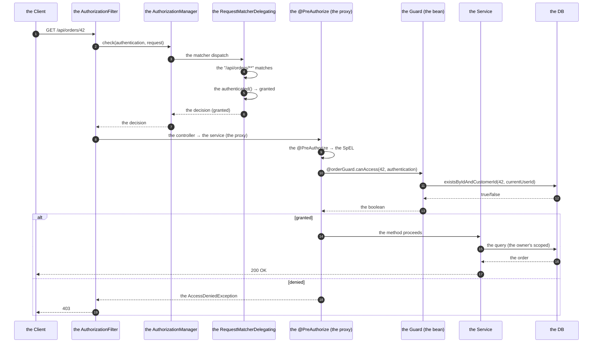
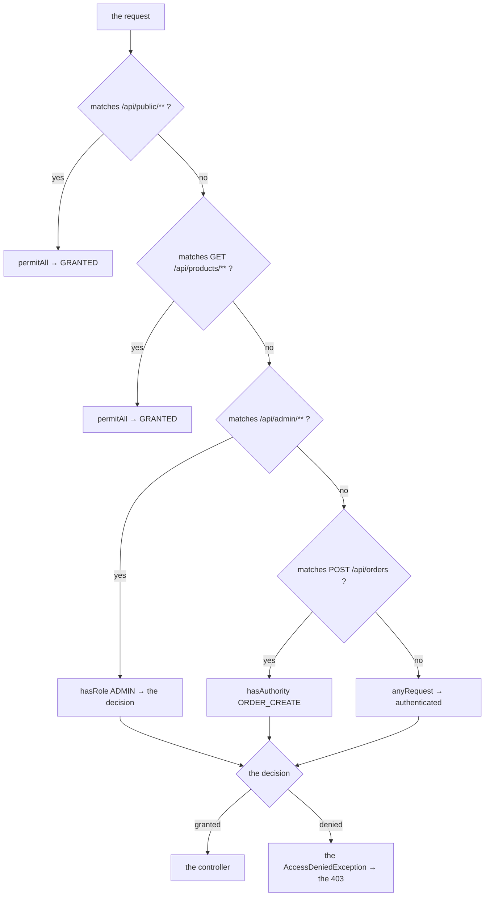

# 03 · Authorization, Roles & Permissions

> **Level:** Beginner → Advanced
> **Interview Frequency:** ★★★★★ ("How do you implement authorization in Spring Security?")
> **Prerequisite:** [02 · Authentication Flow](./02-Authentication-Flow-UserDetailsService-and-Providers.md)
> **Last Updated:** 2026

---

## 📋 Table of Contents
- [0. TL;DR — The 30-Second Answer](#0-tldr--the-30-second-answer)
- [1. What & Why](#1-what--why)
- [2. Mental Model — Two Gates](#2-mental-model--two-gates)
- [3. Deep Dive — Theory](#3-deep-dive--theory)
- [4. Internal Working Mechanism](#4-internal-working-mechanism)
- [5. Step-by-Step Execution Flow](#5-step-by-step-execution-flow)
- [6. Architecture Diagrams](#6-architecture-diagrams)
- [7. Production-Level Use Cases](#7-production-level-use-cases)
- [8. Code Examples — Production-Grade](#8-code-examples--production-grade)
- [9. Common Mistakes & Gotchas](#9-common-mistakes--gotchas)
- [10. Performance Considerations](#10-performance-considerations)
- [11. Security Considerations](#11-security-considerations)
- [12. Best Practices — The Checklist](#12-best-practices--the-checklist)
- [13. Hands-On Exercises](#13-hands-on-exercises)
- [14. Code Challenges](#14-code-challenges)
- [15. Scenario-Based Questions](#15-scenario-based-questions)
- [16. Interview Q&A — Level-wise](#16-interview-qa--level-wise)
- [17. Counter-Questions & Traps](#17-counter-questions--traps)
- [18. Tricky Interview Questions](#18-tricky-interview-questions)
- [19. Follow-Up Questions Asked by Interviewers](#19-follow-up-questions-asked-by-interviewers)
- [20. Real 3–5 Year Experience Scenarios](#20-real-35-year-experience-scenarios)
- [21. Frequently Asked Production Issues](#21-frequently-asked-production-issues)
- [22. Debugging Scenarios](#22-debugging-scenarios)
- [23. Architecture Design Questions](#23-architecture-design-questions)
- [24. Rapid-Fire MCQs](#24-rapid-fire-mcqs)
- [25. Cheat Sheet — One-Page Summary](#25-cheat-sheet--one-page-summary)
- [26. Real-World Production Notes](#26-real-world-production-notes)
- [27. Follow-up Learning](#27-follow-up-learning)

---

## 0. TL;DR — The 30-Second Answer

- **Two authorization layers:** the **URL-level** (the `authorizeHttpRequests` — *which endpoints*
  are protected) and the **method-level** (the `@PreAuthorize` — *which operations* are allowed).
  Use **both**: the URL-level is the coarse gate; the method-level is the fine one.
- **The modern API:** `authorizeHttpRequests(auth -> auth.requestMatchers(...).hasRole(...))`.
  The `authorizeRequests` and the `and()` chaining are **deprecated** (Spring Security 6).
- **The roles vs the permissions:**
  - `hasRole("ADMIN")` ≡ `hasAuthority("ROLE_ADMIN")` (the `ROLE_` prefix is implicit).
  - `hasAuthority("ORDER_READ")` — the granular permission.
  - The **production pattern**: the **roles** are the coarse bundles; the **permissions** are the
    fine-grained capabilities; a role maps to a set of permissions.
- **The object-level (the ownership) check is yours to write.** `@PreAuthorize("hasRole('USER')")`
  does **not** stop user A from reading user B's order (the IDOR). The check belongs in the
  **query** (`findByIdAndOwnerId`) or a **guard bean**.
- **`@EnableMethodSecurity`** (Spring Security 6) enables `@PreAuthorize` / `@PostAuthorize` /
  `@Secured`. The evaluation is a **proxy** → the **self-invocation bypasses it**.
- **The `AuthorizationManager`** is the modern, composable decision API: an interface with
  `check(Supplier<Authentication>, T)` → an `AuthorizationDecision`. The `AuthorizationFilter`
  calls it.
- **The `AccessDecisionManager`** (the legacy, in the 5.x) is replaced by the
  `AuthorizationManager` (with the `AuthorizationFilter`) in Spring Security 6.
- **The `RoleHierarchy`** gives the role inheritance (`ROLE_ADMIN > ROLE_MANAGER > ROLE_USER`).
- **The one-liner:** *"Authorization is two gates: the URL matcher decides who may reach the
  endpoint, and the method annotation decides who may perform the operation. The role check is
  coarse; the ownership check is per-object and it's the one that actually prevents the data
  leaks."*

---

## 1. What & Why

Authorization bugs are the highest-severity bugs in most production systems, and the classic one
— the **IDOR** — passes a naive "I added Spring Security" review. This chapter covers the full
model: the URL level, the method level, the object level, and the data level.

---

## 2. Mental Model — Two Gates

```text
   the request
      │
      ▼
   ┌──────────────────────────┐
   │ GATE 1 — the URL level   │   "may this user reach /api/admin/** ?"
   │ (authorizeHttpRequests)  │   → the AuthorizationFilter
   └────────────┬─────────────┘
                ▼
        the @RestController
                │
                ▼
   ┌──────────────────────────┐
   │ GATE 2 — the method level│   "may this user call this operation ?"
   │ (@PreAuthorize)          │   → the AOP proxy
   └────────────┬─────────────┘
                ▼
   ┌──────────────────────────┐
   │ GATE 3 — the object level│   "does this user own THIS record ?"
   │ (the query / the guard)  │   → YOUR code
   └──────────────────────────┘
```

> **Caption:** Gate 1 and Gate 2 are the framework's. **Gate 3 is the one that breaks** — and
> the one that leaks the data.

---

## 3. Deep Dive — Theory

### 3.1 The URL-level authorization — the current API

```java
http.authorizeHttpRequests(auth -> auth
    .requestMatchers("/api/public/**").permitAll()
    .requestMatchers(HttpMethod.GET, "/api/products/**").permitAll()
    .requestMatchers("/api/admin/**").hasRole("ADMIN")
    .requestMatchers(HttpMethod.POST, "/api/orders").hasAuthority("ORDER_CREATE")
    .requestMatchers("/api/users/**").hasAnyRole("ADMIN", "SUPPORT")
    .anyRequest().authenticated());
```

**The `AuthorizationManagerRequestMatcherRegistry`'s methods:**

| The method | The meaning |
|------------|-------------|
| `permitAll()` | Anyone (the authenticated or the anonymous) |
| `denyAll()` | Nobody (the 403 always) |
| `authenticated()` | The authenticated (not the anonymous) |
| `fullyAuthenticated()` | The authenticated **and** the remember-me is not enough (the full authentication) |
| `anonymous()` | Only the unauthenticated |
| `hasRole("X")` | The authority `ROLE_X` |
| `hasAnyRole("X","Y")` | Any of the roles |
| `hasAuthority("X")` | The exact authority |
| `hasAnyAuthority(...)` | Any of the authorities |
| `access(AuthorizationManager)` | The custom decision (the ABAC) |
| `hasAuthority("SCOPE_x")` | The OAuth2's scope |

**The `AuthorizationManagerRequestMatcherRegistry`'s internals:** the matchers are collected in
an `LinkedHashMap<RequestMatcher, AuthorizationManager>` → the **first match wins** → the
**order** matters → the **most specific first**.

**The `denyAll()` vs the `authenticated()`:** `denyAll()` → the 403 (even for the admin);
`authenticated()` → the 401 for the anonymous, the 200 for the authenticated.

**The `fullyAuthenticated()`:** the remember-me's authentication doesn't count → the sensitive
operations require the fresh credentials. It's the **step-up authentication** at the URL level.

### 3.2 The `RequestMatcher` — the URL matching

**The `PathPatternRequestMatcher` (Spring Security 6.1+):**
```java
PathPatternRequestMatcher.withDefaults().matcher("/api/admin/**")
```

**The patterns:**
| The pattern | The meaning |
|------------|-------------|
| `/api/orders` | The exact path |
| `/api/orders/**` | The path and everything under it |
| `/api/**/edit` | ⚠ **Not supported** by the `PathPattern` (the `**` must be at the end) |
| `*` | One path segment |
| `?` | One character |

**The `MvcRequestMatcher` (the removed in 6.1+):** the pattern was matched against the servlet
path **and** the `HandlerMapping`'s pattern → the `/api/{id}` was matched. **In 6.1+**, the
`PathPatternRequestMatcher` matches the path only → the **the path variables are not available
in the matcher**.

**The consequences of the 6.1 change:**
```java
// The old (the variable matching):
.requestMatchers("/api/orders/{id}").hasRole("ADMIN")   // ⚠ the 6.1+ problem

// The new: the matcher + the guard:
.requestMatchers("/api/orders/**").authenticated()
@PreAuthorize("@orderGuard.canAccess(#id, authentication)")
```

**The `RequestMatcher` (the custom):**
```java
public class ApiVersionRequestMatcher implements RequestMatcher {
    @Override
    public boolean matches(HttpServletRequest request) {
        return request.getRequestURI().startsWith("/api/v2/");
    }
}
```

**The `HttpMethod` + the pattern:**
```java
.requestMatchers(HttpMethod.DELETE, "/api/orders/**").hasAuthority("ORDER_DELETE")
```

**The `RequestMatchers.antMatchers` (the deprecated):** `antMatchers`, `mvcMatchers`,
`regexMatchers` are deprecated in 6.x → use `requestMatchers`.

### 3.3 The method-level authorization

```java
@Configuration
@EnableMethodSecurity
public class MethodSecurityConfig { }
```

**The annotations:**

| The annotation | The evaluation point | The use |
|---------------|---------------------|-------|
| `@PreAuthorize("...")` | **Before** the method | The access control (the veto) |
| `@PostAuthorize("...")` | **After** the method | The filtering (the return value) |
| `@PreAuthorize` + `@PostAuthorize` | Both | The write control + the read control |
| `@Secured("ROLE_ADMIN")` | Before | The simple role check (the legacy) |
| `@RolesAllowed("ADMIN")` | Before | The JSR-250 (the legacy) |

**The `PostAuthorize` — the read filtering:**
```java
@PostAuthorize("return.owner.username == authentication.name or hasRole('ADMIN')")
public Order loadOrder(Long id) { ... }
```
**The semantics:** the method **runs**, then the expression is evaluated against the **return
value** → if it's false → the `AccessDeniedException` → the 403. **The trap:** the data was
**already loaded** (the DB hit, the sensitive data in the memory) → the "the read filtering" is
a *convenience*, not a *protection* — the **query-level** filtering is the real protection.

**The `@PreAuthorize` with the arguments:**
```java
@PreAuthorize("hasRole('ADMIN') or #orderId == authentication.principal.id")
public Order update(Long orderId, UpdateOrderRequest request) { ... }
```
**The SpEL's roots:**
- `authentication` — the `Authentication` object.
- `principal` — `authentication.getPrincipal()` (the shorthand).
- `roles` / `authorities` — the collections.
- `#paramName` — the method's arguments (the parameter names need `-parameters` at compile
  time, or the debug info).
- `return` — the return value (the `@PostAuthorize` only).
- `#beanName` — the Spring beans (the `bean.method()` calls).

**The custom beans in the SpEL:**
```java
@PreAuthorize("@orderGuard.canAccess(#id, authentication)")
```
The `orderGuard` must be a bean (the `BeanFactory` is the evaluation context's root).

**The `@PreAuthorize` + `@Transactional` ordering:** the security's proxy is **outside** the
transaction's proxy (the `@EnableMethodSecurity`'s advisor has the order
`AuthorizationInterceptorsOrder.PRE_AUTHORIZE` = 200, the transaction's is
`Ordered.LOWEST_PRECEDENCE` = the lowest) → **the security check runs before the transaction
starts** → the denied call doesn't open a transaction. Good.

**The self-invocation:**
```java
@Service
public class OrderService {
    @PreAuthorize("hasRole('ADMIN')")
    public void delete(Long id) { ... }

    public void deleteInternal(Long id) {   // ← the self-invocation
        delete(id);   // ⚠ the proxy is bypassed → the check is skipped!
    }
}
```
**The fix:** the separate bean, or the self-injection (the `AwareSelfInjection` — ugly), or the
`@Lazy` self-proxy.

### 3.4 The `AuthorizationManager` — the modern decision API

```java
@FunctionalInterface
public interface AuthorizationManager<T> {
    AuthorizationDecision check(Supplier<Authentication> authentication, T object);
    default AuthorizationManager<T> and(AuthorizationManager<T> other) { ... }
    default AuthorizationManager<T> or(AuthorizationManager<T> other) { ... }
    default AuthorizationManager<T> deny() { ... }
}
```

**The `AuthorizationDecision`:**
```java
public class AuthorizationDecision {
    private final boolean granted;
    public boolean isGranted() { return granted; }
    public static AuthorizationDecision grant() { return new AuthorizationDecision(true); }
    public static AuthorizationDecision deny() { return new AuthorizationDecision(false); }
    // the "abstain" (the 3-valued: the granted, the denied, the abstain)
}
```

**The composition:**
```java
AuthorizationManager<RequestAuthorizationContext> manager =
    AuthorityAuthorizationManager.hasAuthority("ROLE_ADMIN")
        .or(AuthorityAuthorizationManager.hasAuthority("SCOPE_admin"));
```

**The custom (the ABAC):**
```java
@Component
public class OwnershipAuthorizationManager implements AuthorizationManager<RequestAuthorizationContext> {

    private final ResourceRepository resourceRepository;

    @Override
    public AuthorizationDecision check(Supplier<Authentication> authentication,
                                       RequestAuthorizationContext context) {
        Authentication auth = authentication.get();
        Long resourceId = extractId(context.getRequest());
        boolean granted = resourceRepository.isOwnedBy(resourceId, auth.getName());
        return granted ? AuthorizationDecision.grant() : AuthorizationDecision.deny();
    }
}
```

**The registration:**
```java
http.authorizeHttpRequests(auth -> auth
    .requestMatchers("/api/orders/**").access(orderOwnershipManager));
```

**The 3-valued logic:** the `AuthorizationDecision` can be **granted**, **denied**, or
**abstain** (`deny()` with the `isAbstain` flag) → the "the multi-tenant" pattern: the first
manager that doesn't abstain decides; if all abstain → the default (deny).

### 3.5 The `AccessDecisionManager` (the legacy, 5.x)

```java
public interface AccessDecisionManager {
    void decide(Authentication authentication, Object object, Collection<ConfigAttribute> configAttributes);
}
```

**The implementations:** the `AffirmativeBased` (the **OR** — any granted → granted), the
`ConsensusBased` (the **majority**), the `UnanimousBased` (the **AND** — all must grant).
**The Spring Security 6 default:** the `AffirmativeBased`.

**The status:** the `AccessDecisionManager` is **deprecated** in Spring Security 6 (the
`AuthorizationFilter` + the `AuthorizationManager` replaced it). The knowledge is still
valuable (the interviews ask about it) but the code should be the new API.

### 3.6 The roles vs the permissions

```text
   the ROLES (the coarse, the role-based access control)
   ────────────────────────────────────────────────
   ROLE_ADMIN, ROLE_MANAGER, ROLE_USER, ROLE_SUPPORT
       → a bundle of the permissions
       → the assignment to the user is simple

   the PERMISSIONS (the fine, the capability-based)
   ────────────────────────────────────────────────
   ORDER_CREATE, ORDER_READ, ORDER_CANCEL, ORDER_REFUND
   PRODUCT_APPROVE, USER_DISABLE, REPORT_EXPORT
       → the specific operations
       → the assignment to the user is flexible
```

**The mapping (the role → the permissions):**
```text
   ROLE_USER     → ORDER_CREATE, ORDER_READ (own)
   ROLE_MANAGER  → ORDER_READ (all), ORDER_CANCEL, REPORT_EXPORT
   ROLE_ADMIN    → * (everything)
```

**The `SimpleGrantedAuthority` for the permissions:**
```java
new SimpleGrantedAuthority("ORDER_CREATE")   // no prefix
new SimpleGrantedAuthority("ROLE_ADMIN")     // the roles have the prefix
```

**The production recommendation:** use the **permissions** for the method-level checks (the
fine-grained) and the **roles** for the URL-level (the coarse) — and keep the mapping in the DB.

**The scopes (the OAuth2):** `SCOPE_order:read`, `SCOPE_order:write` — the same idea, the
authority prefix `SCOPE_`.

### 3.7 The `RoleHierarchy` — the inheritance

```java
@Bean
RoleHierarchy roleHierarchy() {
    RoleHierarchyImpl hierarchy = new RoleHierarchyImpl();
    hierarchy.setHierarchy("ROLE_ADMIN > ROLE_MANAGER > ROLE_USER");
    return hierarchy;
}
```

**The semantics:** `ROLE_ADMIN` implies `ROLE_MANAGER` implies `ROLE_USER`. The
`hasRole("USER")` passes for an admin.

**The activation (the web):**
```java
@Bean
DefaultWebSecurityExpressionHandler expressionHandler(RoleHierarchy roleHierarchy) {
    DefaultWebSecurityExpressionHandler handler = new DefaultWebSecurityExpressionHandler();
    handler.setRoleHierarchy(roleHierarchy);
    return handler;
}
```

**The activation (the method security — a separate handler!):**
```java
@Bean
static MethodSecurityExpressionHandler methodSecurityExpressionHandler(RoleHierarchy roleHierarchy) {
    DefaultMethodSecurityExpressionHandler handler = new DefaultMethodSecurityExpressionHandler();
    handler.setRoleHierarchy(roleHierarchy);
    return handler;
}
```
**The trap:** the hierarchy configured only for the web → the method-level `hasRole("USER")`
still fails for the admins.

### 3.8 The object-level authorization — the IDOR defence

**The three implementation patterns:**

**Pattern A — the query-level (the strongest):**
```java
public interface OrderRepository extends JpaRepository<Order, Long> {
    Optional<Order> findByIdAndCustomerId(Long id, Long customerId);
}
```
```java
public Order getOrder(Long id, Long customerId) {
    return orderRepository.findByIdAndCustomerId(id, customerId)
            .orElseThrow(() -> new OrderNotFoundException(id));
}
```
**Why it's the strongest:** the other user's record is **never loaded** → no data leak in the
memory, no chance of an accidental serialisation, and the response is a **404** (not a 403) →
the existence isn't revealed.

**Pattern B — the guard bean (the flexible):**
```java
@Component("orderGuard")
public class OrderGuard {
    public boolean canAccess(Long orderId, Authentication authentication) {
        return orderRepository.existsByIdAndCustomerId(orderId, currentUserId(authentication));
    }
}
```
```java
@PreAuthorize("@orderGuard.canAccess(#id, authentication)")
```

**Pattern C — the service-level check (the explicit):**
```java
public Order getOrder(Long id) {
    Order order = orderRepository.findById(id).orElseThrow();
    if (!order.getCustomer().getId().equals(currentUserId())) {
        throw new AccessDeniedException("Not your order");
    }
    return order;
}
```
**The trade-off:** the check is easy to forget on the new endpoints.

**The production recommendation:** the **query-level** for the reads, the **guard** for the
writes, and **the test matrix** to prove it.

### 3.9 The multi-tenancy — the tenant-aware authorization

**The tenant resolution:**
```java
public class TenantContext {
    private static final ThreadLocal<Tenant> CURRENT = new ThreadLocal<>();
    public static void set(Tenant tenant) { CURRENT.set(tenant); }
    public static Tenant get() { return CURRENT.get(); }
    public static void clear() { CURRENT.remove(); }
}
```

**The filter (the tenant's resolution — before the authorization):**
```java
@Component
@RequiredArgsConstructor
public class TenantResolutionFilter extends OncePerRequestFilter {

    private final TenantService tenantService;

    @Override
    protected void doFilterInternal(HttpServletRequest request, HttpServletResponse response, FilterChain chain) {
        try {
            String tenantId = resolveTenantId(request);
            if (tenantId != null) {
                Tenant tenant = tenantService.findByIdentifier(tenantId)
                        .orElseThrow(() -> new TenantNotFoundException(tenantId));
                TenantContext.set(tenant);
                request.setAttribute("tenantId", tenant.getId());
            }
            chain.doFilter(request, response);
        } finally {
            TenantContext.clear();
        }
    }
}
```

**The enforcement (the query-level — the `Hibernate`'s filter or the repository's spec):**
```java
// The Spring Data's specification
Specification<Order> spec = (root, query, cb) ->
        cb.equal(root.get("tenantId"), TenantContext.get().getId());
```

**The `Hibernate`'s `@TenantId` (Hibernate 6+):**
```java
@Entity
public class Order {
    @TenantId
    private Long tenantId;
}
```
→ Hibernate adds the `tenant_id = ?` to every query automatically → the **the database-level
isolation** of the tenant → the "forgot the filter" bug is impossible.

**The `SchemaMultitenant` (the separate schema per tenant):** the isolation is at the DB level
(the connection's schema) — the strongest, the operationally heaviest.

### 3.10 The `hasAuthority` vs the `hasRole` — the deep dive

```java
.hasRole("ADMIN")        // → hasAuthority("ROLE_ADMIN")
.hasAnyRole("A", "B")   // → hasAuthority("ROLE_A") or hasAuthority("ROLE_B")
.hasAuthority("ADMIN")   // → the exact string "ADMIN"
```

**The `defaultRolePrefix` (the `@EnableMethodSecurity`):**
```java
@EnableMethodSecurity(defaultRolePrefix = "SCOPE_")
```
→ `hasRole("x")` → `hasAuthority("SCOPE_x")`.

**The trap:** the authorities from the DB are `ADMIN` (no prefix) but the config uses
`hasRole("ADMIN")` → the 403 for everyone. **The fix:** the consistent prefixing at the
**authority creation** (the single place):
```java
.map(role -> new SimpleGrantedAuthority("ROLE_" + role.getName()))
```

### 3.11 The `@AuthenticationPrincipal` — the typed principal

```java
@GetMapping("/me")
public UserResponse me(@AuthenticationPrincipal UserPrincipal principal) { ... }

@GetMapping("/email")
public String email(@AuthenticationPrincipal(expression = "username") String username) { ... }

@GetMapping("/expired")
public boolean expired(@AuthenticationPrincipal(expression = "accountNonExpired") boolean expired) { ... }
```

**The error handling:** the `@AuthenticationPrincipal` with `errorOnInvalidType = true` (the
default) → an `AuthenticationPrincipalNotFoundException` if the type doesn't match. With
`false` → `null`.

### 3.12 The `SecurityContext`-based checks in the SpEL

```java
@PreAuthorize("@permissionService.can(authentication, 'ORDER', 'DELETE')")
@PreAuthorize("hasAuthority('TASK_' + #taskType)")
@PreAuthorize("isAuthenticated() and authentication.details instanceof org.springframework.security.web.authentication.WebAuthenticationDetails")
```

**The `authentication.details`** — the `WebAuthenticationDetails` (the IP, the session id) →
the IP-based check:
```java
@PreAuthorize("authentication.details instanceof T(org.springframework.security.web.authentication.WebAuthenticationDetails) and authentication.details.remoteAddress == '10.0.0.5'")
```

### 3.13 The `AuthorizationEvent` — the audit

```java
public class AuthorizationEvent {
    private final Object object;                    // the secured object
    private final Authentication authentication;
    private final AuthorizationDecision decision;
}
```
**The publisher:**
```java
@Bean
AuthorizationEventPublisher authorizationEventPublisher(ApplicationEventPublisher publisher) {
    return new SpringAuthorizationEventPublisher(publisher);
}
```
**The listener:**
```java
@Component
public class AuthorizationAuditListener {
    @EventListener
    public void onEvent(AuthorizationEvent event) {
        if (!event.getDecision().isGranted()) {
            auditService.recordDenied(event.getAuthentication().getName(),
                    event.getObject().toString());
        }
    }
}
```
**The production use:** the **denied** authorizations are the security-relevant events (the
probing, the privilege escalation attempt).

---

## 4. Internal Working Mechanism

### 4.1 The `AuthorizationFilter` — the decision point

```java
public class AuthorizationFilter extends OncePerRequestFilter {

    private final AuthorizationManager<HttpServletRequest> authorizationManager;
    private final AuthorizationEventPublisher eventPublisher;

    @Override
    protected void doFilterInternal(HttpServletRequest request, HttpServletResponse response, FilterChain chain) {
        // ① the "the anonymous" is resolved to the real authentication
        Authentication authentication = SecurityContextHolder.getContext().getAuthentication();

        // ② the decision
        AuthorizationDecision decision = this.authorizationManager.check(() -> authentication, request);

        // ③ the event
        this.eventPublisher.publishEvent(new AuthorizationEvent(this, decision, authentication, request));

        // ④ the outcome
        if (decision.isGranted()) {
            chain.doFilter(request, response);
        } else {
            throw new AccessDeniedException("Access Denied");
        }
    }
}
```

### 4.2 The `AuthorizationManagerBeforeMethodInterceptor` — the method-level decision

```java
public class AuthorizationManagerBeforeMethodInterceptor extends AuthorizationManagerBeforeMethodInterceptor
        implements Aop Alliance Advisor {

    @Override
    public Object invoke(MethodInvocation mi) {
        AuthorizationDecision decision = this.authorizationManager.check(
                this::getAuthentication, mi.getThis(), mi.getArguments());
        if (decision.isGranted()) {
            return mi.proceed();
        }
        throw new AccessDeniedException("Access Denied");
    }
}
```

**The `getAuthentication()`:** the `SecurityContextHolder` — or, if the method has an
`Authentication` parameter, **that argument** (the `AuthenticationPrincipalArgumentResolver`
supports it).

**The advisor's registration:**
```java
protected final void configure(AuthorizationManager<MethodAuthorizationContext> manager) {
    AuthorizationManagerBeforeMethodInterceptor interceptor = new AuthorizationManagerBeforeMethodInterceptor(
            manager, this.attributeBuilder, this.observationRegistry);
    interceptor.setOrder(this.order);   // 200 (the AuthorizationInterceptorsOrder.PRE_AUTHORIZE)
    this.interceptor = interceptor;
}
```

**The `pointcut`:** the `AnnotationMatchingPointcut` for the `@PreAuthorize` (the
`PreAuthorizeAuthorizationManager`).

### 4.3 The `PreAuthorizeAuthorizationManager`

```java
public class PreAuthorizeAuthorizationManager extends AuthorizationManagerBeforeMethodInterceptor
        implements AuthorizationManager<MethodAuthorizationContext> {

    private final ExpressionParser expressionParser;
    private final SecurityExpressionHandler expressionHandler;
    private final MethodSecurityExpressionHandler methodSecurityExpressionHandler;

    @Override
    public AuthorizationDecision check(Supplier<Authentication> authentication, MethodInvocation mi) {
        EvaluationContext ctx = this.expressionHandler.createEvaluationContext(
                this.methodSecurityExpressionHandler, authentication.get());
        // ① the annotation's attributes
        Collection<PreAuthorize> preAuthorizeAnnotations = findPreAuthorizeAnnotations(mi);
        // ② the metadata
        PreAuthorize preAuthorize = preAuthorizeAnnotations.iterator().next();
        // ③ the expression
        Expression expression = this.expressionParser.parseExpression(preAuthorize.value());
        // ④ the evaluation
        boolean granted = expression.getValue(ctx, Boolean.class);
        return new AuthorizationDecision(granted);
    }
}
```

### 4.4 The `WebExpressionSecurityExpressionHandler` — the SpEL's context

```java
public class DefaultWebSecurityExpressionHandler implements SecurityExpressionHandler {

    private RoleHierarchy roleHierarchy = null;
    private SecurityExpressionOperations securityExpressionOperations = new DefaultSecurityExpressionOperations();
    private ApplicationContext applicationContext;

    @Override
    public EvaluationContext createEvaluationContext(Authentication authentication, RequestAttributes request) {
        DefaultEvaluationContext ctx = new DefaultEvaluationContext(authentication, this.securityExpressionOperations);
        ctx.setBeanResolver(new BeanFactoryResolver(this.applicationContext));
        ctx.setVariable("request", request);
        return ctx;
    }
}
```

**The `DefaultSecurityExpressionOperations`:**
```java
public final class DefaultSecurityExpressionOperations implements SecurityExpressionOperations {
    public boolean hasRole(Authentication authentication, String role) {
        return hasAnyRoleName(authentication, role);
    }
    public boolean hasAuthority(Authentication authentication, String authority) {
        return hasAnyAuthorityName(authentication, authority);
    }
    public boolean hasAnyRole(Authentication authentication, String... roles) { ... }
    public boolean permitAll() { return true; }
    public boolean denyAll() { return false; }
    public boolean isAuthenticated() { ... }
    public boolean isAnonymous() { ... }
    public boolean isFullyAuthenticated() { ... }
    private boolean hasAnyRoleName(Authentication authentication, String role) {
        // ① the ROLE_ prefix
        String roleToUse = role;
        if (!role.startsWith(defaultRolePrefix)) roleToUse = defaultRolePrefix + role;
        // ② the hierarchy
        if (this.roleHierarchy != null) {
            Set<String> reachable = this.roleHierarchy.getReachableGrantedAuthorities(
                    authentication.getAuthorities());
            return reachable.contains(roleToUse);
        }
        return authentication.getAuthorities().contains(new SimpleGrantedAuthority(roleToUse));
    }
}
```

### 4.5 The `RequestMatcherDelegatingAuthorizationManager` — the URL-level dispatch

```java
public class RequestMatcherDelegatingAuthorizationManager implements AuthorizationManager<HttpServletRequest> {

    private final Map<RequestMatcher, AuthorizationManager<RequestAuthorizationContext>> mappings;

    @Override
    public AuthorizationDecision check(Supplier<Authentication> authentication, HttpServletRequest request) {
        for (Map.Entry<RequestMatcher, AuthorizationManager<RequestAuthorizationContext>> mapping : this.mappings.entrySet()) {
            RequestMatcher matcher = mapping.getKey();
            if (matcher.matches(request)) {
                return mapping.getValue().check(authentication,
                        new RequestAuthorizationContext(request, mapping.getValue()));
            }
        }
        // no matcher → the deny
        return new AuthorizationDecision(false);
    }
}
```
**The order matters:** the `LinkedHashMap` preserves the registration order → the first match
wins → the **most specific first**.

### 4.6 The `AuthorizationFilter`'s "the anonymous" resolution

```java
private Authentication getAuthentication() {
    Authentication authentication = SecurityContextHolder.getContext().getAuthentication();
    if (authentication == null) return null;
    // the anonymous → the real one (the token's)
    if (authentication instanceof AnonymousAuthenticationToken) {
        return ((AnonymousAuthenticationToken) authentication).getPrincipal() == null
                ? authentication : null;
    }
    return authentication;
}
```

---

## 5. Step-by-Step Execution Flow

### 5.1 The two gates



### 5.2 The URL-level dispatch (the first match wins)



### 5.3 The method-level evaluation

```mermaid
flowchart TD
    A[the proxy intercepts the call] --> B{@PreAuthorize present?}
    B -- no --> J[the method proceeds]
    B -- yes --> C[the expression parser]
    C --> D[the evaluation context: the authentication, the beans, the args]
    D --> E[the expression evaluation]
    E --> F{true?}
    F -- yes --> J
    F -- no --> G[the AccessDeniedException → the 403]
```

---

## 6. Architecture Diagrams

### 6.1 The authorization architecture

```text
   the request
      │
      ▼
  ┌──────────────────────────────────────────────┐
  │ the AuthorizationFilter                      │
  │   → the RequestMatcherDelegatingManager      │
  │       → the matcher → the AuthorizationManager│
  │           → the AuthorizationDecision        │
  └──────────────────────┬───────────────────────┘
                         │ granted
                         ▼
  ┌──────────────────────────────────────────────┐
  │ the controller → the service (the AOP proxy) │
  │   → the @PreAuthorize (the SpEL)             │
  │       → the guard bean (the ownership)       │
  └──────────────────────┬───────────────────────┘
                         ▼
  ┌──────────────────────────────────────────────┐
  │ the repository (the query-level scoping)     │
  │   → findByIdAndOwnerId(id, currentUserId)    │
  └──────────────────────────────────────────────┘
```

### 6.2 The RBAC vs the ABAC

```text
   THE RBAC (the role-based)                THE ABAC (the attribute-based)
   ─────────────────────────                ───────────────────────────────
   the user → the roles                     the user → the attributes
   the role → the permissions                the resource → the attributes
   the permission → the operation            the environment → the attributes
        │                                         │
        ▼                                         ▼
   "the ADMIN can delete"                  "the owner, or the admin, or
                                            the resource is public"
        │                                         │
        ▼                                         ▼
   simple, fast, coarse                    flexible, precise, expensive
   the DB: the roles                        the policy engine / the rules
```

**The production trend:** the RBAC for the coarse, the **the ABAC for the fine** (the ownership,
the tenancy, the state).

### 6.3 The permission model (the mapping)

```text
                    ┌──────────────────┐
                    │   ROLE_ADMIN     │
                    │  (the wildcard)  │
                    └────────┬─────────┘
                             │ includes
                    ┌────────▼─────────┐
                    │  ROLE_MANAGER    │
                    └────────┬─────────┘
                             │ includes
                    ┌────────▼─────────┐
                    │   ROLE_USER      │
                    └──────────────────┘

   the fine-grained permissions (the rows in the DB):
   ┌──────────────┬───────────┬────────────┬──────────┐
   │ ORDER_CREATE │ ORDER_READ│ ORDER_CANCEL│ ORDER_REFUND │
   ├──────────────┼───────────┼────────────┼──────────┤
   │      ✔       │     ✔    │     ✔     │          │
   └──────────────┴───────────┴────────────┴──────────┘
```

### 6.4 The multi-tenancy's layers

```text
   the request
      │
      ▼
   ┌──────────────────────┐
   │ the TenantResolution │  (the subdomain / the header)
   │ Filter               │  → the TenantContext (the thread-local)
   └──────────┬───────────┘
              ▼
   ┌──────────────────────┐
   │ the authorization    │  "the user belongs to the tenant?"
   │ (the tenant check)   │  → the Authentication (the tenant claim)
   └──────────┬───────────┘
              ▼
   ┌──────────────────────┐
   │ the query scoping    │  "the WHERE tenant_id = ?"
   │ (the Hibernate filter│  → the data isolation
   │  or the @TenantId)   │
   └──────────────────────┘
```

---

## 7. Production-Level Use Cases

| Use case | The technique |
|----------|---------------|
| **The admin panel** | The separate `SecurityFilterChain` with the `securityMatcher("/admin/**")` + `hasRole("ADMIN")` |
| **The user-scoped resources** | The query-level ownership (`findByIdAndCustomerId`) |
| **The multi-tenant SaaS** | The `@TenantId` (Hibernate 6) + the tenant's claim + the tenant's filter |
| **The fine-grained permissions** | The `hasAuthority("ORDER_DELETE")` + the DB's role-permission mapping |
| **The step-up authentication** | The `fullyAuthenticated()` at the URL level + the `Authentication` freshness in the SpEL |
| **The admin's impersonation** | A custom `Authentication` (`ImpersonatingAuthenticationToken`) + the audit |
| **The feature flags as permissions** | The authorities from the subscription's plan (`PLAN_ENTERPRISE`) |
| **The field-level authorization** | The `Jackson`'s `@JsonView` (the role-based serialisation) — with care (the view's leakage) |
| **The row-level security** | The PostgreSQL's RLS (the defence in depth below the app) |
| **The API's scopes** | The `SCOPE_` prefix (the OAuth2's scopes) in the `hasAuthority` |

---

## 8. Code Examples — Production-Grade

### 8.1 The URL-level configuration (the default-deny)

```java
@Configuration
@EnableWebSecurity
@EnableMethodSecurity
public class AuthorizationConfig {

    @Bean
    SecurityFilterChain filterChain(HttpSecurity http) throws Exception {
        http.authorizeHttpRequests(auth -> auth
            // ① the public endpoints (the explicit list)
            .requestMatchers("/api/auth/login", "/api/auth/refresh", "/api/auth/register").permitAll()
            .requestMatchers("/actuator/health", "/actuator/info", "/v3/api-docs/**", "/swagger-ui/**").permitAll()

            // ② the public reads
            .requestMatchers(HttpMethod.GET, "/api/products/**").permitAll()

            // ③ the role-based areas
            .requestMatchers("/api/admin/**").hasRole("ADMIN")
            .requestMatchers("/api/support/**").hasAnyRole("ADMIN", "SUPPORT")

            // ④ the permission-based operations
            .requestMatchers(HttpMethod.POST, "/api/orders").hasAuthority("ORDER_CREATE")
            .requestMatchers(HttpMethod.DELETE, "/api/orders/**").hasAuthority("ORDER_DELETE")
            .requestMatchers(HttpMethod.PUT, "/api/users/**").hasAuthority("USER_UPDATE")

            // ⑤ the default (the authenticated)
            .anyRequest().authenticated());

        return http.build();
    }
}
```

### 8.2 The method-level security (the service layer)

```java
@Service
@RequiredArgsConstructor
public class OrderService {

    private final OrderRepository orderRepository;
    private final CurrentUserService currentUserService;

    @PreAuthorize("hasAuthority('ORDER_CREATE')")
    @Transactional
    public Order create(CreateOrderRequest request) {
        Long customerId = currentUserService.currentUserId();
        Order order = Order.builder()
                .customerId(customerId)
                .status(OrderStatus.CREATED)
                .build();
        return orderRepository.save(order);
    }

    @PreAuthorize("hasAuthority('ORDER_READ')")
    @Transactional(readOnly = true)
    public Order getOrder(Long id) {
        return orderRepository.findByIdAndCustomerId(id, currentUserService.currentUserId())
                .orElseThrow(() -> new OrderNotFoundException(id));
    }

    @PreAuthorize("hasAuthority('ORDER_CANCEL')")
    @Transactional
    public void cancel(Long id) {
        Order order = orderRepository.findByIdAndCustomerId(id, currentUserService.currentUserId())
                .orElseThrow(() -> new OrderNotFoundException(id));
        order.cancel();
    }

    @PreAuthorize("hasRole('ADMIN') or hasAuthority('ORDER_REFUND')")
    @Transactional
    public void refund(Long id, String reason) {
        Order order = orderRepository.findById(id)
                .orElseThrow(() -> new OrderNotFoundException(id));
        order.refund(reason);
    }
}
```

### 8.3 The query-level ownership (the strongest pattern)

```java
public interface OrderRepository extends JpaRepository<Order, Long> {

    Optional<Order> findByIdAndCustomerId(Long id, Long customerId);

    boolean existsByIdAndCustomerId(Long id, Long customerId);

    List<Order> findByCustomerIdOrderByCreatedAtDesc(Long customerId, Pageable pageable);
}
```

**The entity with the `customerId` (the denormalised, the indexed):**
```java
@Entity
@Table(indexes = {
    @Index(name = "idx_order_customer_created", columnList = "customer_id, created_at")
})
public class Order {
    @Id @GeneratedValue(strategy = GenerationType.IDENTITY)
    private Long id;

    @Column(nullable = false)
    private Long customerId;

    @Enumerated(EnumType.STRING)
    private OrderStatus status;

    private BigDecimal totalAmount;
    private LocalDateTime createdAt;
}
```

### 8.4 The guard bean (the flexible pattern)

```java
@Component("orderGuard")
@RequiredArgsConstructor
public class OrderGuard {

    private final OrderRepository orderRepository;
    private final CurrentUserService currentUserService;

    public boolean canAccess(Long orderId, Authentication authentication) {
        if (hasAdmin(authentication)) {
            return true;
        }
        Long currentUserId = currentUserService.currentUserId();
        return orderRepository.existsByIdAndCustomerId(orderId, currentUserId);
    }

    public boolean canModify(Long orderId, Authentication authentication) {
        if (hasAdmin(authentication)) {
            return true;
        }
        return orderRepository.existsByIdAndCustomerIdAndStatusIn(
                orderId, currentUserService.currentUserId(), MODIFIABLE_STATUSES);
    }

    private boolean hasAdmin(Authentication authentication) {
        return authentication.getAuthorities().stream()
                .anyMatch(a -> a.getAuthority().equals("ROLE_ADMIN"));
    }
}
```

```java
@Service
public class OrderFacade {

    @PreAuthorize("@orderGuard.canAccess(#id, authentication)")
    @Transactional(readOnly = true)
    public OrderView get(Long id) {
        return orderService.getOrder(id);
    }

    @PreAuthorize("@orderGuard.canModify(#id, authentication)")
    @Transactional
    public void update(Long id, UpdateOrderRequest request) {
        orderService.update(id, request);
    }
}
```

### 8.5 The custom `AuthorizationManager` (the ABAC)

```java
@Component
@RequiredArgsConstructor
public class DocumentAccessAuthorizationManager
        implements AuthorizationManager<RequestAuthorizationContext> {

    private final DocumentRepository documentRepository;
    private final CurrentUserService currentUserService;

    @Override
    public AuthorizationDecision check(Supplier<Authentication> authentication,
                                       RequestAuthorizationContext context) {
        Authentication auth = authentication.get();
        if (auth == null || !auth.isAuthenticated()) {
            return AuthorizationDecision.deny();
        }
        if (hasAuthority(auth, "ROLE_ADMIN")) {
            return AuthorizationDecision.grant();
        }
        Long documentId = extractDocumentId(context.getRequest());
        if (documentId == null) {
            return AuthorizationDecision.deny();
        }
        boolean granted = documentRepository.isAccessibleBy(documentId, currentUserService.currentUserId());
        return granted ? AuthorizationDecision.grant() : AuthorizationDecision.deny();
    }
}
```

```java
http.authorizeHttpRequests(auth -> auth
    .requestMatchers("/api/documents/**").access(documentAccessAuthorizationManager));
```

### 8.6 The composed `AuthorizationManager` (the OR)

```java
@Bean
AuthorizationManager<RequestAuthorizationContext> adminOrSupport() {
    return AuthorityAuthorizationManager.hasRole("ADMIN")
            .or(AuthorityAuthorizationManager.hasRole("SUPPORT"));
}
```

### 8.7 The `RoleHierarchy` (the both handlers)

```java
@Configuration
public class RoleHierarchyConfig {

    @Bean
    RoleHierarchy roleHierarchy() {
        RoleHierarchyImpl hierarchy = new RoleHierarchyImpl();
        hierarchy.setHierarchy("""
                ROLE_ADMIN > ROLE_MANAGER > ROLE_USER
                ROLE_MANAGER > ROLE_AUDITOR
                """);
        return hierarchy;
    }

    @Bean
    DefaultWebSecurityExpressionHandler webExpressionHandler(RoleHierarchy roleHierarchy) {
        DefaultWebSecurityExpressionHandler handler = new DefaultWebSecurityExpressionHandler();
        handler.setRoleHierarchy(roleHierarchy);
        return handler;
    }

    @Bean
    static MethodSecurityExpressionHandler methodExpressionHandler(RoleHierarchy roleHierarchy) {
        DefaultMethodSecurityExpressionHandler handler = new DefaultMethodSecurityExpressionHandler();
        handler.setRoleHierarchy(roleHierarchy);
        return handler;
    }
}
```

### 8.8 The permission-based authorities (the DB-driven)

```java
@Entity
@Table(name = "roles")
public class Role {
    @Id @GeneratedValue(strategy = GenerationType.IDENTITY)
    private Long id;
    private String name;
    @ManyToMany(fetch = FetchType.LAZY)
    @JoinTable(name = "role_permissions",
            joinColumns = @JoinColumn(name = "role_id"),
            inverseJoinColumns = @JoinColumn(name = "permission_id"))
    private Set<Permission> permissions;
}
```

```java
@Component
@RequiredArgsConstructor
public class AuthorityFactory {

    public List<GrantedAuthority> authoritiesFor(User user) {
        List<GrantedAuthority> authorities = new ArrayList<>();
        for (Role role : user.getRoles()) {
            authorities.add(new SimpleGrantedAuthority("ROLE_" + role.getName().toUpperCase()));
            for (Permission permission : role.getPermissions()) {
                authorities.add(new SimpleGrantedAuthority(permission.getCode()));
            }
        }
        return authorities;
    }
}
```

### 8.9 The tenant-aware entity (the Hibernate 6's `@TenantId`)

```java
@Entity
@Table(name = "documents")
public class Document {

    @Id @GeneratedValue(strategy = GenerationType.IDENTITY)
    private Long id;

    @TenantId
    @Column(name = "tenant_id", nullable = false)
    private Long tenantId;

    private String title;
    private String content;
}
```

**The tenant's resolution (the filter):**
```java
@Component
@RequiredArgsConstructor
public class TenantResolutionFilter extends OncePerRequestFilter {

    private final TenantService tenantService;

    @Override
    protected void doFilterInternal(HttpServletRequest request, HttpServletResponse response,
                                    FilterChain filterChain) throws ServletException, IOException {
        try {
            String tenantIdentifier = resolveTenant(request);
            if (tenantIdentifier != null) {
                Tenant tenant = tenantService.requireByIdentifier(tenantIdentifier);
                TenantContext.set(tenant);
            }
            filterChain.doFilter(request, response);
        } finally {
            TenantContext.clear();
        }
    }

    private String resolveTenant(HttpServletRequest request) {
        String host = request.getHeader("Host");
        if (host != null && host.contains(".")) {
            return host.substring(0, host.indexOf('.'));
        }
        return request.getHeader("X-Tenant-Id");
    }
}
```

**The tenant's claim in the authentication:**
```java
public record TenantContextHolder(Long tenantId) {
    private static final ThreadLocal<Long> CURRENT = new ThreadLocal<>();
    public static void set(Long tenantId) { CURRENT.set(tenantId); }
    public static Long get() { return CURRENT.get(); }
    public static void clear() { CURRENT.remove(); }
}
```

### 8.10 The `@PostAuthorize` (the read filtering)

```java
@PostAuthorize("hasRole('ADMIN') or return.customer.id == principal.id")
@Transactional(readOnly = true)
public Document loadDocument(Long id) {
    return documentRepository.findById(id).orElseThrow();
}
```

**⚠ The caveat:** the entity is loaded before the check → the data was in the memory. **Pair it
with the query-level scoping.**

### 8.11 The `AuthorizationEvent` (the audit)

```java
@Bean
AuthorizationEventPublisher authorizationEventPublisher(ApplicationEventPublisher publisher) {
    return new SpringAuthorizationEventPublisher(publisher);
}
```

```java
@Component
@RequiredArgsConstructor
public class AuthorizationAuditListener {

    private final AuditService auditService;

    @EventListener
    public void onAuthorization(AuthorizationEvent event) {
        if (!event.getDecision().isGranted()) {
            auditService.recordAuthorizationDenied(
                    event.getAuthentication().getName(),
                    event.getObject().toString(),
                    Instant.now());
        }
    }
}
```

### 8.12 The `@AuthenticationPrincipal` in the controller

```java
@RestController
@RequestMapping("/api/orders")
@RequiredArgsConstructor
public class OrderController {

    private final OrderService orderService;

    @GetMapping("/{id}")
    public OrderResponse get(@PathVariable Long id,
                              @AuthenticationPrincipal UserPrincipal principal) {
        return orderService.getOrder(id);
    }

    @GetMapping("/mine")
    public List<OrderResponse> mine(@AuthenticationPrincipal UserPrincipal principal) {
        return orderService.listFor(principal.getId());
    }
}
```

### 8.13 The custom `PermissionEvaluator` (the legacy, the domain-specific)

```java
@Component("orderPermission")
public class OrderPermissionEvaluator implements PermissionEvaluator {

    @Override
    public boolean hasPermission(Authentication authentication, Object targetDomainObject,
                                  Object permission) {
        String action = (String) permission;
        Order order = (Order) targetDomainObject;
        Long currentUserId = ((UserPrincipal) authentication.getPrincipal()).getId();

        return switch (action) {
            case "READ"   -> order.getCustomerId().equals(currentUserId) || hasRole(authentication, "ADMIN");
            case "MODIFY" -> order.getCustomerId().equals(currentUserId)
                    && order.getStatus() == OrderStatus.CREATED;
            case "DELETE" -> hasRole(authentication, "ADMIN");
            default -> false;
        };
    }
}
```

```java
@PreAuthorize("hasPermission(#order, 'READ')")
```

### 8.14 The test (the authorisation matrix)

```java
@SpringBootTest
@AutoConfigureMockMvc
class OrderAuthorizationTest {

    @Autowired MockMvc mockMvc;
    @Autowired ObjectMapper objectMapper;

    @Test
    @DisplayName("A user cannot read another user's order (the IDOR)")
    @WithMockUser(username = "mallory", roles = "USER")
    void cannotReadForeignOrder() throws Exception {
        long foreignOrderId = orderRepository.saveOrderFor("alice");

        mockMvc.perform(get("/api/orders/{id}", foreignOrderId))
                .andExpect(status().isNotFound());     // the 404, not the 403
    }

    @Test
    @DisplayName("An admin can read any order")
    @WithMockUser(username = "admin", roles = "ADMIN")
    void adminCanReadAnyOrder() throws Exception {
        long orderId = orderRepository.saveOrderFor("alice");

        mockMvc.perform(get("/api/orders/{id}", orderId))
                .andExpect(status().isOk());
    }

    @Test
    @DisplayName("An anonymous user gets a 401")
    void anonymousGets401() throws Exception {
        mockMvc.perform(get("/api/orders/1"))
                .andExpect(status().isUnauthorized());
    }
}
```

---

## 9. Common Mistakes & Gotchas

| # | ❌ Wrong | ✅ Right | Why |
|---|----------|----------|-----|
| 1 | `@PreAuthorize("hasRole('USER')")` on the user's data | The ownership check (the query) | The IDOR |
| 2 | The `hasRole("ADMIN")` vs the `ADMIN` authority | The consistent `ROLE_` prefix | The 403 for everyone |
| 3 | The self-invocation of an annotated method | The separate bean | The proxy is bypassed |
| 4 | The URL matchers in the wrong order | The most specific first | The wrong rule applies |
| 5 | The `requestMatchers("/api/{id}")` in 6.1+ | The `/**` + the guard | The `PathPattern` doesn't support the mid-path `**` |
| 6 | The `authorizeRequests` (the deprecated) | The `authorizeHttpRequests` | The deprecation |
| 7 | The `RoleHierarchy` only for the web | Both handlers | The method-level mismatch |
| 8 | The `@PostAuthorize` as the only protection | The query-level scoping | The data is already loaded |
| 9 | The `denyAll()` expecting the 401 | The 403 (the deny is an authorization) | The status's semantics |
| 10 | The `anyRequest().permitAll()` (the default-allow) | The `anyRequest().authenticated()` | The security hole |
| 11 | The missing `@EnableMethodSecurity` | The annotation | The annotations are ignored |
| 12 | The `hasAuthority("ORDER:READ")` vs the `ORDER_READ` | The consistent naming | The 403 |
| 13 | The `isAuthenticated()` on the anonymous | The `fullyAuthenticated()` / the explicit check | The remember-me counts |
| 14 | The guard bean querying per call (the N+1) | The cached / the scoped query | The performance |
| 15 | The `@PreAuthorize` on a private method | The public (the proxy) | The Spring AOP's limitation |
| 16 | The `@PreAuthorize` on a `final` method / a class | The non-final (the CGLIB) | The proxy can't override it |
| 17 | The SpEL's `#arg` without `-parameters` | The `-parameters` compile flag | The parameter's name is `arg0` |
| 18 | The field-level filter by the `@JsonView` alone | The query-level + the view | The data is in the payload's source |

---

## 10. Performance Considerations

| Aspect | Impact | Guidance |
|--------|--------|----------|
| **The URL-level check** | Sub-microsecond (the map's lookup) | The order's specificity |
| **The method-level check** | The SpEL's evaluation (~1µs) | The parsed expressions are cached |
| **The guard's DB query** | A round trip per call | The `existsBy...` with the index; the caching (the short TTL); the join |
| **The ownership in the main query** | **Zero** extra cost (the same query) | ✅ The best pattern |
| **The `@PostAuthorize`'s extra load** | The entity is loaded | The query-level instead |
| **The `UserDetails`'s authorities** | Loaded at the login | The fetch join (no the N+1) |
| **The `RoleHierarchy`** | The `getReachableGrantedAuthorities` per check | It's cached internally |
| **The tenant's filter** | The `tenant_id` in the WHERE | The composite index (the tenant + the other columns) |

---

## 11. Security Considerations

| Risk | Mitigation |
|------|-----------|
| **The IDOR** | The query-level ownership; the guard; the test matrix |
| **The privilege escalation (the vertical)** | The role checks; the method-level security; the default-deny |
| **The privilege escalation (the horizontal)** | The ownership; the tenancy |
| **The mass assignment** | The roles/permissions are never client-supplied |
| **The `denyAll` vs the `permitAll` inversion** | The default-deny chain; the review of the config |
| **The `@PostAuthorize`'s data exposure** | The query-level scoping |
| **The tenant's data leakage** | The `@TenantId` / the RLS; the test that a foreign tenant's id is rejected |
| **The proxy bypass (the self-invocation)** | The code review; the ArchUnit rule ("the `@PreAuthorize`d methods are called from another bean") |
| **The field-level leakage** | The DTOs (not the entities) in the responses |
| **The audit's absence** | The `AuthorizationEvent` → the denied decisions are logged |

---

## 12. Best Practices — The Checklist

- [ ] **The default-deny** (`anyRequest().authenticated()`), with the explicit `permitAll` list.
- [ ] **The two layers**: the URL level **and** the method level.
- [ ] **The object-level check in the query** wherever possible.
- [ ] **The consistent `ROLE_` prefix** (one place: the authority's creation).
- [ ] **The `authorizeHttpRequests`** (the current API), the `requestMatchers` (the current
  matcher).
- [ ] **The most specific matcher first.**
- [ ] **The `@EnableMethodSecurity`** with the `defaultRolePrefix` if needed.
- [ ] **The guard beans in a separate package** (the reuse) — with the bean names matching the
  SpEL's references.
- [ ] **The authorisation test matrix** (the "the foreign user's id" tests) in the CI.
- [ ] **The `AuthorizationEvent`'s audit** for the denied decisions.
- [ ] **The DTOs** in the responses (no the entity's lazy relations).
- [ ] **The `-parameters` compiler flag** (the SpEL's argument names).
- [ ] **The `RoleHierarchy`** configured for both the web and the method security.
- [ ] **The permissions from the DB** (the fine-grained), the roles (the coarse).

---

## 13. Hands-On Exercises

**🧪 Lab 1 — The IDOR**
1. Create the order for the user A.
2. Log in as the user B and request the order A's id.
3. Observe the 200 with the data → the leak.
4. Fix: the `findByIdAndCustomerId` → the 404.

**🧪 Lab 2 — The matcher order**
1. Put `/api/**` before `/api/admin/**` → the admin's rule never applies.
2. Reorder → the admin's rule works.

**🧪 Lab 3 — The self-invocation**
1. Annotate a method with `@PreAuthorize("hasRole('ADMIN')")` and call it internally.
2. The non-admin passes → the bypass.

**🧪 Lab 4 — The `RoleHierarchy`**
1. Configure the hierarchy for the web only.
2. The method-level `hasRole("USER")` fails for the admin → the missing handler.

---

## 14. Code Challenges

### Challenge 1 — A policy engine (hard)
**Goal:** A declarative permission system (the resource, the action, the subject) with the
rules in the DB and the caching.
**Requirements:** the `Policy` model, the evaluation, the caching (the invalidation on the
change), the integration with the SpEL (`@policy.can("order", "delete")`), the test suite
(property-based), the documentation.

### Challenge 2 — A multi-tenant query-scoping framework (hard)
**Goal:** Every query is automatically scoped to the tenant.
**Requirements:** the `@TenantId` (or the Hibernate's filter), the tenant's resolution, the
test that a foreign tenant's data is invisible, the performance (the indexes), the
documentation.

### Challenge 3 — A field-level authorisation (medium-hard)
**Goal:** The role-dependent response shaping.
**Requirements:** the `@JsonView`, the DTOs, the leak's prevention (the sensitive fields), the
tests (the role matrix), the performance.

---

## 15. Scenario-Based Questions

**S1.** *"A security researcher reported that a user can read another user's invoices by
changing the id in the URL."**
>
> **Ideal answer:** (1) **The diagnosis**: the **IDOR (the insecure direct object reference)** —
the classic broken object-level authorization. The endpoint has a role check (or none) but
**no ownership check** → the id is the only thing standing between the users. The evidence:
(a) reproduce (the user B's session, the user A's invoice id → the 200 with the data); (b) the
code (the `findById(id)` without the scoping); (c) the `ObjectId` (a Mongo) or the sequential
id (an auto-increment — the enumerable!). (2) **The fix** (the layered): (a) **the
query-level scoping** (the strongest):
```java
Optional<Invoice> findByIdAndCustomerId(Long id, Long customerId);
```
→ the foreign record is never loaded → the 404 (not the 403 — don't confirm the existence!);
(b) the **the guard** for the complex cases (the shared invoices, the admin's access);
(c) the **the DTO** (never return the full entity — the minimal fields);
(d) the **the UUID/ULID ids** (the defence in depth — the non-enumerable ids) — but the
**the fix is the check**, not the obscurity. (3) **The systemic fix**: (a) the
**authorisation test matrix** — for every endpoint with a path variable that references a
resource, a test that a foreign id is rejected (the CI gate); (b) the **the architecture
rule** — the repository's methods for the user-facing endpoints **require** the principal's id
(the API design forces the check: `findByIdAndCustomerId` is the only method exposed);
(c) the **the static analysis** (the ArchUnit: "the controller's service methods must take
the principal" / "no `findById` in the user-facing services"); (d) the **the API design** —
the nested resources (`/api/customers/{customerId}/invoices/{invoiceId}` → the customer
scoping is visible and checkable); (e) the **the audit** (the access to the sensitive records)
and the **the rate limiting** (the enumeration). (4) **The nuance**: the interviewer wants to
hear "**the 404, not the 403**" — returning the 403 confirms that the record exists → the
enumeration is still possible. (5) The senior framing: "**the IDOR is a design failure, not a
bug** — the endpoint's contract is 'the invoice by id', and the id is global. The fix is to
change the contract to 'the invoice of the current customer' so that the missing check is a
compile error (the method doesn't exist), not a runtime surprise. The test matrix and the
ArchUnit rule close the loop."

**S2.** *"A user with the 'USER' role can see the admin's dashboard in the staging
environment. It works correctly in production."**
>
> **Ideal answer:** (1) **The diagnosis**: the **environment-dependent configuration**. The
likely causes: (a) the **staging's `application.yml`** has a permissive rule (e.g.
`anyRequest().permitAll()` left from the debugging, or a different `SecurityFilterChain`); (b)
the **the profile-specific config** — the `dev` profile's `SecurityConfig` (the `@Profile("dev")`
class) with the permissive rules, and the staging runs with the `dev` profile; (c) the **the
feature flag** (the permissions are loaded from a config that's permissive in staging); (d)
the
**the role's data** — the staging's DB has the users with the wrong roles (the admin's role on
a normal user). (2) **The proof**: (a) the **the active profiles** in the staging (the
`/actuator/env` — careful, the exposure! — or the startup log); (b) the **the effective
filter chain** (the startup's TRACE log prints the chain's rules); (c) **the diff** of the
config between the environments (the `application-staging.yml` vs the `application-prod.yml`);
(d) the **the user's roles** in the staging's DB. (3) **The fix**: (a) the **the config
parity** — the same security config across the environments (the only differences: the
secrets, the endpoints, the CORS's origins — never the authorization rules!); (b) the **the
"the prod-like" staging** (the production's config, the anonymised data); (c) the **the
security tests in the CI** that run against **every** environment (the smoke test: the
unauthenticated → the 401, the user → the 403, the admin → the 200 — the "the authorisation
smoke test"); (d) the **the config's validation** at the startup (a `@PostConstruct` that
asserts the "no `permitAll` on the `/**`" in the non-dev profiles — a fail-fast guard!). (4)
**The systemic fix**: (a) the **the config-as-code** (the environment's config in the repo, the
reviewed, the diffed); (b) the **the security posture's tests** (the automated authorisation
suite against the deployed environment — the smoke test in the deployment pipeline); (c) the
**the IaC** (the Terraform's policy checks, the CSPM); (d) the **the environment's parity
policy** (the documented differences). (5) The senior framing: "**the divergence between the
staging and the prod is a process failure** — the security config is code, and the code should
be identical. The guard: the automated authorisation smoke test in the deployment pipeline (it
runs against every environment), and a startup assertion that the permissive rules are
impossible outside the dev profile. A staging that behaves differently from the prod is a
staging that doesn't test anything."

**S3.** *"We need to add a new role 'SUPERVISOR' that can do everything the MANAGER can plus
the refunds. The developers are writing `hasAnyRole('ADMIN', 'SUPERVISOR')` in 15 places."**
>
> **Ideal answer:** (1) **The analysis**: this is the classic **the scattered authorization
logic** problem. The immediate fix is trivial, but the systemic problem is that the
**authorization rules are duplicated in the code** → the changes are error-prone (the missed
call site), the rules are invisible (the "who can refund?" question needs a code search), and
the testing is per call site. (2) **The immediate fix** (the safe, minimal): the
`RoleHierarchy` — `ROLE_SUPERVISOR > ROLE_MANAGER` → the supervisors inherit the manager's
permissions → the `hasRole("MANAGER")` passes → **no call site changes**! (This is exactly what
the hierarchy is for: the "the new role that includes the old one".) (3) **The better fix**
(the fine-grained permissions): the roles map to the **permissions** in the DB
(`SUPERVISOR → ORDER_REFUND, ORDER_CANCEL, ...`); the code checks the **permissions**
(`hasAuthority("ORDER_REFUND")`), not the roles → the new role is a **data change** (a row in
the role-permission table), not a **code change** → zero call-site changes, and the new role
can be granted in the admin UI. (4) **The systemic fix**:
(a) **the code checks the permissions** (the capability), never the role names (the job
title); (b) the **the policy layer** (a single `can(user, action, resource)` decision point)
→ the rules are in one place, testable, and auditable; (c) the **the permission's catalogue**
(the documented list of the permissions — the contract between the product and the code);
(d) the **the tests** — the authorisation matrix (the role × the permission × the endpoint)
generated from the catalogue → the CI gate; (e) the **the migration** — the existing
`hasRole` checks are converted to the permissions (the incremental, the checklist). (5) The
senior framing: "**the role checks in the code are a scalability bug in disguise** — every new
role becomes a code change across the codebase, and the missing call site is a privilege bug.
The fix is to check the **capabilities** (the permissions) in the code and keep the
role→permission mapping in the data. The `RoleHierarchy` is the quick win for the
'this role includes that one' case; the permission model is the destination. And the
permission catalogue + the generated test matrix is what makes it safe."

---

## 16. Interview Q&A — Level-wise

### 🟢 Beginner
**Q: How do you protect an endpoint so only the admins can access it?**
**A:**
```java
http.authorizeHttpRequests(auth -> auth
    .requestMatchers("/api/admin/**").hasRole("ADMIN")
    .anyRequest().authenticated());
```

**Q: What is the difference between `hasRole` and `hasAuthority`?**
**A:** `hasRole("ADMIN")` is a shorthand for `hasAuthority("ROLE_ADMIN")` — it adds the
`ROLE_` prefix. `hasAuthority` is the exact string.

**Q: What does `permitAll()` do?**
**A:** It allows the request to proceed without any authentication or authorization check.

### 🟡 Intermediate
**Q: What is the difference between the URL-level and the method-level authorization?**
**A:** The **URL-level** (`authorizeHttpRequests`) decides which **endpoints** the user may
reach — it's a coarse gate evaluated by the `AuthorizationFilter` before the controller. The
**method-level** (`@PreAuthorize`) decides which **operations** a caller may invoke — it's
evaluated by the AOP proxy at the method boundary, it can use the method's arguments and the
return value, and it protects the service even when it's called from a different entry point
(a job, a message consumer). The production practice: **both**, plus the object-level check in
the data access.

**Q: What is the `AuthorizationManager`?**
**A:** The modern authorization abstraction (Spring Security 6) — a functional interface
`check(Supplier<Authentication>, T)` returning an `AuthorizationDecision`. It replaces the
legacy `AccessDecisionManager` and it is **composable** (the `and()`/`or()`), so a custom
policy can be combined with the built-in ones. The `AuthorizationFilter` calls it for the
URL-level, the `AuthorizationManagerBeforeMethodInterceptor` for the method level.

**Q: What is the `AccessDeniedException` and where is it thrown?**
**A:** The exception signalling "the authenticated user isn't allowed". It's thrown by the
`AuthorizationFilter` (the URL-level) and by the `AuthorizationManagerBeforeMethodInterceptor`
(the method level) → the `ExceptionTranslationFilter` catches it → the `AccessDeniedHandler`
(the 403) if the user is authenticated, or the `AuthenticationEntryPoint` (the 401) if the user
is anonymous.

**Q: What is the `RoleHierarchy`?**
**A:** The configuration of the role inheritance (`ROLE_ADMIN > ROLE_MANAGER > ROLE_USER`) →
the higher role implies the lower ones → `hasRole("USER")` passes for an admin. It needs the
`SecurityExpressionHandler` to be configured with it (both the web and the method security
handlers).

**Q: How do you check the ownership of a resource?**
**A:** The **query-level** is the best: the repository's method takes the principal's id
(`findByIdAndCustomerId(id, currentUserId)`) → the other user's record is never loaded. The
alternatives: a guard bean referenced in the `@PreAuthorize`'s SpEL
(`@orderGuard.canAccess(#id, authentication)`), or an explicit check in the service.

### 🔴 Advanced / Senior
**Q: Explain the internals of the `@PreAuthorize` evaluation.**
**A:** (1) The `@EnableMethodSecurity` registers an `AuthorizationManagerBeforeMethodInterceptor`
as an AOP advisor (the order 200 → before the transaction's advisor). (2) The interceptor
finds the `@PreAuthorize` annotations on the method (the `AnnotationMatchingPointcut`), parses
the expression (the `SpelExpressionParser`), and builds the `EvaluationContext` (the
`DefaultWebSecurityExpressionHandler` or the `DefaultMethodSecurityExpressionHandler`) with the
`Authentication`, the bean resolver (so `@beanName` works), the `request` variable, and the
method's arguments (as `#argName` — the names need the `-parameters` flag). (3) The expression
is evaluated → a `Boolean` → the `AuthorizationDecision`. (4) If granted → the method proceeds;
if not → the `AccessDeniedException` → the 403. The subtlety: the security's proxy is
**outside** the transaction's proxy, so the denied call doesn't open a transaction (good) — and
the **self-invocation** bypasses the proxy entirely (the known trap).

**Q: How do you implement the multi-tenancy's isolation?**
**A:** The layers: (1) the **tenant's resolution** (the subdomain, the header, the JWT's claim)
→ the `TenantContext` (the thread-local) and the tenant's claim in the `Authentication`; (2) the
**tenant's authorization** (the user must belong to the tenant → the check in the
authentication or in a filter); (3) the **query's scoping** — the strongest is the Hibernate
6's `@TenantId` (the `tenant_id` is added to every query automatically → the "the forgotten
filter" bug is impossible) or the Hibernate's `@Filter` (the `tenant_id = :tenantId`) or the
Spring Data's `Specification` (the explicit, but the developer must remember); (4) the
**database's RLS** (the PostgreSQL's row-level security — the defence below the app, catching
the raw SQL's mistakes); (5) the **the tests** (the cross-tenant access must be rejected in
every layer).

**Q: What is the difference between the `AuthorizationManager` and the
`AccessDecisionManager`?**
**A:** The `AccessDecisionManager` (the 5.x) had the `decide(authentication, object,
configAttributes)` signature and the decision strategies (the `AffirmativeBased`, the
`ConsensusBased`, the `UnanimousBased`). The `AuthorizationManager` (the 6.x) is a
functional interface with a composable API (`and()`, `or()`, `deny()`), it returns an
`AuthorizationDecision` (the granted/denied/abstain), and it carries **typed** context objects
(the `RequestAuthorizationContext`, the `MethodAuthorizationContext`) — so the custom
implementations get the request/method context without the casting. The `AccessDecisionManager`
is deprecated in Spring Security 6 (the `AuthorizationFilter` replaces it).

**Q: How do you handle the "the admin can impersonate a user" requirement?**
**A:** (1) A **custom `Authentication`** (the `ImpersonatingAuthenticationToken`) that wraps the
target user's principal but keeps the **real** admin as the "the actor" → the audit records
both. (2) The **an endpoint** (`/api/admin/impersonate/{userId}`) with the `hasRole("ADMIN")` →
the server creates the impersonated `Authentication` and saves it in the context (the scoped
session, with a short TTL). (3) The **the audit** (the mandatory, the alerting, the
notification to the impersonated user — the GDPR/audit requirements). (4) The **the
restrictions** (the read-only by default, the excluded the sensitive operations, the time-boxed,
the banner in the UI). (5) The **the alternative** (no impersonation: the "the support view" —
a separate, audited read-only mode) — the safer design that many mature systems prefer.

### ⚫ Expert / Principal
**Q: Design the authorization model for a fintech platform with the customers, the support
agents, the compliance officers, and the internal admins.**
> **Answer structure:** (1) The **the model** — the RBAC (the roles) + the ABAC (the account
ownership, the amount thresholds, the jurisdiction, the product tier, the risk score) → a
single decision point (`can(subject, action, resource, context)`). (2) The **the policy
engine** (the rules in the DB, the versioned, the evaluated with the audit of the decision's
inputs). (3) The **the layers** — the gateway (the coarse), the service (the fine), the query
(the ownership), the DB's RLS (the last defence). (4) The **the separation of duties** (the
maker-checker, the dual control for the large transfers) — the authorization model that no
single person can bypass. (5) The **the four-eyes principle** & the maker-checker for the
approvals. (6) The **the audit** (every decision, the immutable store, the retention). (7) The
**the compliance** (the regulator's access, the "the data minimisation" in the
authorization's inputs). (8) The **the operations** (the policy's changes: the review, the
rollout, the emergency override with the expiry).

---

## 17. Counter-Questions & Traps

### CQ1. "If I have `@PreAuthorize` on the service, do I still need the URL-level rules?"
- **Naive answer:** "No, the method-level is enough."  ← the trap
- **The trap:** The interviewer wants the "the defence in depth + the operational
  consequences".
- **Expert answer:** The method-level is the **stronger** protection (it protects the service
from every caller: the controller, the job, the consumer, the test). But the URL-level is
still valuable: (1) the **the fail-fast 401/403** (the unauthenticated requests are rejected
before the controller — cheaper, no the DB, no the controller's side effects like the `@Valid`
or the rate limiting's ordering); (2) the **the coarse policy** (the "the whole admin area is
admin-only" — one rule instead of annotating 50 methods); (3) the **the CORS/pre-flight
handling** (the `OPTIONS` must be permitted without the authentication — the URL-level makes
it easy); (4) the **the documentation** (the API's security contract is visible in the config).
The production practice: the URL level for the coarse (the whole area), the method level for
the fine, and the query level for the ownership.

### CQ2. "Why is the 404 better than the 403 for a foreign resource?"
- **Naive answer:** "Because the user doesn't have permission."  ← the trap
- **The trap:** The interviewer wants the information-leak reasoning.
- **Expert answer:** The 403 ("Forbidden") **confirms the resource exists** — the difference
between the 404 ("not found") and the 403 ("exists but not yours") is an **oracle** for the
attacker: they can enumerate the valid ids (a 403 = "this id exists"). Returning the 404 for
both cases (the truly missing and the foreign) removes the oracle. The same logic applies to
the **the error's timing** and the **the message**. The exception: some APIs deliberately
return the 403 for the clarity (the internal tools) — that's a conscious trade-off between
the UX and the enumeration, and it should be consistent.

### CQ3. "Is the `hasRole('ADMIN')` the same as the `hasAuthority('ROLE_ADMIN')`?"
- **Naive answer:** "Yes."  ← literally true, but incomplete
- **The trap:** The interviewer wants the *defaultRolePrefix* nuance and the practical
implication.
- **Expert answer:** By default, yes — `hasRole("ADMIN")` prefixes with `ROLE_` and checks the
authority `ROLE_ADMIN`. But: (1) the prefix is **configurable** (`defaultRolePrefix` on the
`@EnableMethodSecurity`, and the `DefaultWebSecurityExpressionHandler.setDefaultRolePrefix`)
→ in a different configuration, `hasRole("ADMIN")` means `hasAuthority("ADMIN")`; (2) the
`ROLE_` prefix is only applied if the role **doesn't already start with it** → `hasRole("ROLE_ADMIN")`
is the same as `hasRole("ADMIN")`; (3) the practical trap: the authorities loaded from the DB
are often `ADMIN` (no prefix) → the `hasRole` never matches → the mysterious 403. The fix: the
consistent prefixing at the single point where the authorities are created.

### CQ4. "What happens if the `Authentication` is null in the SpEL?"
- **Naive answer:** "The NPE."  ← the trap
- **The trap:** The interviewer wants the real behaviour and the secure default.
- **Expert answer:** In the method-level evaluation, the `Authentication` is resolved from the
`SecurityContextHolder` (or the method's `Authentication` parameter). If the context is empty,
the `SecurityContextHolder.getContext().getAuthentication()` returns `null` → the
`DefaultSecurityExpressionOperations` methods like `hasRole` would NPE — but the
`AuthorizationManagerBeforeMethodInterceptor` typically resolves an **anonymous**
authentication for the unauthenticated case, and the `ExpressionUtils` handles the null
safely for the common operations. The **secure default** is the important part: if the
expression can't be evaluated (the null, the exception), the framework **denies** (the
`AuthorizationDecision(false)`) — the fail-closed principle. A custom `AuthorizationManager`
must also fail closed: any exception → the deny (never the grant).

### CQ5. "Is the `ROLE_` prefix a Spring convention or a standard?"
- **Naive answer:** "It's a Spring convention."  ← right, but incomplete
- **The trap:** The interviewer wants to know whether it's safe to rely on.
- **Expert answer:** It's a **Spring Security convention** (the `ROLE_` prefix is added by the
`hasRole` and by the `User.builder().roles()`), not a standard (there's no JSR for it). The
`UserDetails`'s authorities are **arbitrary strings** — the framework doesn't care. The
practical guidance: pick a convention (`ROLE_` for the roles, no prefix or a `SCOPE_`/a
domain prefix for the permissions), **apply it in one place** (the authority's creation), and
**document it**. Many teams use the domain-prefixed permissions
(`ORDER_CREATE`, `INVOICE_APPROVE`) precisely to avoid the role/permission confusion — a
`ROLE_ORDER_CREATE` reads badly.

### CQ6. "Why does the framework use proxies for the method security?"
- **Naive answer:** "That's how Spring AOP works."  ← the trap
- **The trap:** The interviewer wants the consequences (the self-invocation, the final, the
private) explained.
- **Expert answer:** Because the method security is implemented as an **AOP advisor** around
the method (the `AuthorizationManagerBeforeMethodInterceptor`), and Spring AOP is
**proxy-based** (the CGLIB for the classes, the JDK's proxies for the interfaces). The
consequences: (1) the **self-invocation** (`this.method()`) bypasses the proxy → the check is
skipped; (2) the **private/final/static** methods can't be advised; (3) the **the proxy's
overhead** (one call per invocation); (4) the **the same instance** is not the annotated one
(the `AopContext.currentProxy()` or the self-injection is needed for the self-invocation);
(5) the **the `@Transactional`** shares the same mechanism (and the same traps).

---

## 18. Tricky Interview Questions

**T1. "What is the `AuthorizationDecision`'s three-valued logic?"**
> It can be **granted**, **denied**, or **abstain** (`new AuthorizationDecision(false, true)`).
The abstain is used in the **the multi-tenant** or the **the composed** managers: the first
manager that doesn't abstain decides; if all abstain → the default (deny). It's the same
pattern as the servlet's `DispatcherType` or the Spring's `Condition` evaluation.

**T2. "What is the `AuthorizationEvent` and why should you listen to it?"**
> The event published by the `AuthorizationFilter` for every decision (the granted and the
denied) — with the secured object, the authentication, and the decision. The production use:
the **denied** decisions are the security-relevant signal (the probing, the privilege
escalation attempt) → the audit, the alerting (the spike in the denials = an attack), the
analytics. Enable it with the `SpringAuthorizationEventPublisher` bean.

**T3. "What's the difference between `hasRole` and the `ROLE_` prefix for the `GrantedAuthority`?"**
> `hasRole` is the **expression-level** convenience (it adds the prefix); the authority's
string is the **data-level** representation. `User.builder().roles("ADMIN")` creates the
authority `ROLE_ADMIN` automatically; `User.builder().authorities("ROLE_ADMIN")` is the
explicit equivalent. But `User.builder().authority("ADMIN")` creates the authority `ADMIN` →
the `hasRole("ADMIN")` won't match.

**T4. "How do you authorize based on the request's IP or the time of day?"**
> The **ABAC**: a custom `AuthorizationManager` (the request's context is available) or a
custom `SecurityExpressionHandler` (the `request` variable) or a SpEL on the
`authentication.details` (the `WebAuthenticationDetails`'s `remoteAddress`). The production
caution: the IP is **spoofable** unless it's behind a trusted proxy (the `X-Forwarded-For`
handling must be configured) → the IP-based rules are a weak control (use them for the
coarse, the "the internal network" gates).

**T5. "What is the difference between `@Secured` and `@PreAuthorize`?"**
> `@Secured("ROLE_ADMIN")` is the **legacy** (Spring Security 2.x) — the simple role check, no
the expression. `@PreAuthorize("...")` is the **modern** — the SpEL, the arguments, the beans.
Both are enabled by the `@EnableMethodSecurity` (the `securedEnabled = true` by default). The
advice: use `@PreAuthorize` (the superset) and don't mix them.

**T6. "Can you use `@PreAuthorize` on a controller method?"**
> Yes — but it's **less secure** than on the service: the controller can be bypassed (a
different entry point — the internal service call, the job, the message consumer — wouldn't
hit the check), and the logic ends up in the web layer. The best practice: the **service
layer** (the domain boundary). The controller-level annotations are acceptable for the
simple, the web-only endpoints (the admin-only controller).

**T7. "What happens with the `@PreAuthorize` on an overloaded method?"**
> The annotation is resolved per method → the correct overload's annotation is used (the
`AnnotationMatchingPointcut` matches the specific method). But beware the **the
method-signature ambiguity in the SpEL's parameter names** — the `#arg` names must be
consistent.

**T8. "How do you implement the 'the user can only see their own data' in a reactive
(WebFlux) app?"**
> The same (`@PreAuthorize` with the `ReactiveSecurityContextHolder`), but the `Authentication`
is in the `Reactor` context → the SpEL's evaluation needs the `ReactiveSecurityContextHolder`
(the `ReactiveExpressionHandler`). The `@PreAuthorize` works in WebFlux (the `ReactiveAuthorizationManager`
is used). The object-level check is the same (the query-level).

**T9. "What is the difference between the `AccessDeniedException` and the
`AuthenticationCredentialsNotFoundException`?"**
> The `AccessDeniedException` = the authorization failure (the 403). The
`AuthenticationCredentialsNotFoundException` = the **authentication** failure (the anonymous
user) → the `ExceptionTranslationFilter` maps it to the `AuthenticationEntryPoint` (the 401).
The distinction matters for the status code.

**T10. "How do you unit-test the authorization?"**
> (1) The **standalone** (`AuthorizationManagerTester` in Spring Security 6.2+ / the manual
`AuthorizationDecision` assertions) — the fastest, the most focused. (2) The **the
`@WithMockUser`** (the roles/authorities) with the `MockMvc` — the integration. (3) The
**the method-level** — the `AuthorizationManagerBeforeMethodInterceptor` tested in isolation
or through the `@WithMockUser` + the direct call. (4) The **the matrix** — the parameterised
test (the role × the endpoint × the expected status). The key: the **negative** tests (the
denied cases) are the valuable ones — a test suite that only checks the allowed paths proves
little.

**T11. "What is the `denyAll()` for?"**
> To explicitly block a path (the legacy endpoint during the migration, the debug endpoint in
production). It returns the 403 for everyone (even the admin). It's mostly a **migration
tool** (the "the new endpoint, the old one is denied") and a **documentation** device.

**T12. "Can the `authorizeHttpRequests` be configured per endpoint in the annotation?"**
> No — the URL-level is the config; the method-level is the annotation. The Spring Boot 3.2+
does not have an `@PreAuthorize`-equivalent for the URL level. Some teams use a **custom
annotation** with a `RequestMatcher` bean (a "the meta-annotation" pattern) — but the
framework's answer is the config.

---

## 19. Follow-Up Questions Asked by Interviewers

**F1** (after "the object-level check") → *"How would you make it impossible to forget the
check?"*
→ The **query-level** (the repository's method requires the principal's id → the "the unscoped"
method isn't exposed) + the **the ArchUnit rule** (the user-facing services must not call
`findById`) + the **the authorisation test matrix** in the CI.

**F2** (after "the multi-tenancy") → *"How do you prevent a developer from writing a query
that leaks across the tenants?"*
→ The **Hibernate's `@TenantId`** (the automatic scoping — the "forgot the filter" is
impossible) + the **the DB's RLS** (the ultimate guarantee) + the **the code review** + the
**the test** (the cross-tenant access must fail) + the **the static analysis**.

**F3** (after "the method security") → *"What if the same service method is called by both an
admin endpoint and a user endpoint?"*
→ The method-level check is **per method, not per caller** — the method must express the
**capability** it requires, not the caller's role. If the admin needs a different behaviour,
either the method takes the "the acting principal" as a parameter, or you split the method
(the `cancelOwnOrder` vs the `cancelAnyOrder`), or you use a **the policy service** that takes
the acting context explicitly.

**F4** (after "the `AuthorizationManager`") → *"How would you implement a 'the admin can
impersonate'?"*
→ A custom `AuthorizationManager` that checks the impersonation permission + a service that
creates the impersonated `Authentication` + the audit.

**F5** (after "the roles") → *"How do you handle a user with 50 roles?"*
→ The **the role hierarchy** (the roles collapse into the effective permissions), the
**the permission-based** model (the roles are the UI's concept; the code checks the
permissions), the **the grouping** (the "the role sets" — the `ROLE_SUPPORT_TIER_2` implies
`ROLE_SUPPORT_TIER_1`), and the **the performance** (the `hasAnyRole` with 50 arguments is
slow-ish → the `Collection` variant `hasAnyRole(authentication, list)` or the permission set).

---

## 20. Real 3–5 Year Experience Scenarios

**R1. "We shipped a feature flag that only the 'BETA' users should see. The check is
`@PreAuthorize(\"hasRole('BETA')\")` but the BETA users get a 403."**
>
> **Ideal answer:** (1) **The diagnosis**: the **the authority's naming mismatch**. The roles are
created from the DB's data — the flag's role is stored as `BETA` (or the `beta` in the
lowercase) → the created authority is `BETA` (without the `ROLE_` prefix) → the
`hasRole("BETA")` checks the authority `ROLE_BETA` → no match → the 403. The other
candidates: (a) the **the role's assignment** (the user's flag wasn't set — the feature flag
service caches the roles with a TTL → the user was flagged after the login → the session's
authorities are stale!); (b) the **the case** (`beta` vs `BETA`); (c) the **the authorities not
reloaded** (the session's snapshot). (2) **The proof**: (a) **the log the actual authorities**
at the decision point (`authentication.getAuthorities()` → the debug log / the
`AuthorizationEvent`'s listener); (b) the **the DB's role names**; (c) the **the session's
stored authorities** (the `SPRING_SECURITY_CONTEXT` in the session); (d) the **the flag
service's cache's TTL**. (3) **The fix**: (a) the **the consistent prefixing** at the
authority's creation (one place — the `AuthorityFactory`): `new SimpleGrantedAuthority("ROLE_" + name.toUpperCase())`;
(b) the **the role's refresh** — the feature flags' changes must reach the active sessions
(the short session TTL, the session's invalidation on the flag change, or the JWT with the
short expiry + the refresh). (4) **The systemic fix**: (a) **the naming convention** (the
documented: the DB's role names are the lowercase identifiers; the authorities are the
uppercase with the `ROLE_` prefix; the single mapping function); (b) **the role's
assignments are dynamic** (the flags, the subscriptions, the org's role) → the design must
assume the authorities **change during the session's life** → the short session + the
re-authorisation, or the **the token-based** approach with the short expiry; (c) the **the
tests** (the matrix: the flag on/off × the role's variant); (d) the **the startup validation**
— a test that asserts every role in the DB maps to a known authority format. (5) The senior
framing: "**the 403 here is a symptom of the authorities being a snapshot** — the roles are
static in the code's mental model but dynamic in the business (the flags, the subscriptions).
The fix isn't just the prefix; it's recognising that the **authorities have a lifetime** and
choosing a session/JWT design that matches (a short session, a refresh, or an event-driven
session invalidation)."

**R2. "A performance review shows that the authorization checks add 40ms to the API's p99."**
>
> **Ideal answer:** (1) **The analysis**: the authorization itself is **cheap** (the SpEL's
evaluation is microseconds, the URL-level's map lookup is nanoseconds) → the 40ms must come
from something the check **triggers**: (a) the **the guard's DB query** (the `existsBy...` per
call — the round trip + the query's plan); (b) the **the cold cache** (the first call after
the deploy); (c) the **the AOP's proxy overhead** (nanoseconds — not it); (d) the **the
`@PostAuthorize`'s extra load** (the entity is loaded twice — the "the unauthorised" path
loads it, then the check fails → the wasted load); (e) the **the lock contention** (a shared
cache's contention); (f) the **the DB's connection pool** (the guard's query competes with the
traffic). (2) **The diagnosis**: the **the profiling** (the DB's slow query log → the guard's
query; the Micrometer's timers on the guard; the connection pool's metrics → the queueing).
The classic finding: the guard's `existsByIdAndCustomerId` **isn't using the index** (the
`id` + the `customer_id` — the composite index is missing → the full scan → the 40ms!). (3)
**The fixes**: (a) **the composite index** (`(id, customer_id)` or `(customer_id, id)`) → the
query becomes a PK lookup; (b) **the query-level scoping** (the guard's extra query disappears
— the main query is already scoped → **zero** extra cost); (c) **the caching** (the guard's
decision cached briefly — but the invalidation on the ownership's change); (d) **the
`@PostAuthorize`** → replaced with the query-level; (e) **the connection pool's sizing** (the
guard's query increases the demand). (4) **The systemic fix**: (a) the **the performance tests
with the realistic data volume** (the guard's query on a 10M-row table with a missing index is
fine on the dev data and catastrophic in production — the classic "the performance bug that
only appears at scale"); (b) the **the query's review** (every guard/decision query → the
index's verification with the `EXPLAIN`); (c) the **the metrics** (the guard's latency as a
tracked metric with the SLO); (d) the **the pattern** — prefer the query-level scoping so the
authorization adds no round trip. (5) The senior framing: "**the authorization should be free**
— if it's a separate query, it's on the critical path and it doubles the database's work per
request. The fix is architectural (the scope the query itself), not just an index. And the
lesson: the dev data is 1,000 rows; production is 100 million — the index's review belongs in
the code review, and the performance test belongs in the pipeline."

**R3. "The support team needs to see a customer's order, but the customer can only see their
own. The developers want to add a `hasRole('SUPPORT')` check everywhere."**
>
> **Ideal answer:** (1) **The analysis**: the support's access is a **cross-tenant
(object-level) access**, not a role-level one. The role (`SUPPORT`) grants the *capability*,
but the support agent must access **another user's** record → the ownership check must be
**conditional on the capability**: "the owner, or a support agent with the `ORDER_READ_ANY`
permission (and, for the sensitive fields, the `ORDER_READ_SENSITIVE` + the audit)". (2) The
**the design**: (a) the **the permissions, not the roles** — `ORDER_READ_OWN`,
`ORDER_READ_ANY`, `ORDER_PII_VIEW`, `ORDER_REFUND` → the role's mapping in the DB (the support
agent has the `ORDER_READ_ANY`; the support's lead has also the `ORDER_REFUND`); (b) the
**the single decision point** — the `can(principal, action, resource)` service (the policy
layer) that the query and the guard both use:
```java
boolean canViewOrder(UserPrincipal user, Order order) {
    if (order.getCustomerId().equals(user.getId())) return true;   // the owner
    if (!user.hasPermission("ORDER_READ_ANY")) return false;
    auditService.recordCrossCustomerAccess(user.getId(), order.getId());   // the audit!
    return true;
}
```
(c) the **the query-level** — the repository has two methods: the own (the fast path) and the
"the support search" (the audited, the paginated, the filtered); (d) the **the audit** (the
support's cross-customer access must be logged — it's a regulated concern and the source of the
internal-data-abuse investigations). (3) **The security**: (a) the **the least privilege** (the
support agent sees the orders, not the payments' details — the field-level);
(b) the **the PII masking** (the customer's email is masked for the support, the full value
only for the "the PII view" permission with the audit); (c) the **the session's scope** (the
support agent's session is short, the MFA is enforced, the device is managed);
(d) the **the impersonation vs the support view** — the "the support view" (the read-only
cross-customer view) is safer than the impersonation (no session takeover, no the confused
deputy). (4) **The systemic fix**: (a) the **the permission's catalogue** (the documented list);
(b) the **the policy's test suite** (the matrix: the owner, the support, the admin, the
anonymous, × the actions); (c) the **the audit's analytics** (the support's access patterns —
the anomaly detection: the unusual volume, the sensitive fields); (d) the **the review** (the
support's access is a **privileged** operation → the periodic access review, the offboarding
checklist). (5) The senior framing: "**the support's access is a privilege, so it needs the
privilege's discipline** — the explicit permission, the audit of every cross-customer access,
the field-level minimisation, and the periodic review. The `hasRole('SUPPORT')` scattered
everywhere is the wrong shape: it can't express 'the own or the support's', it can't be
audited, and it doesn't scale to the next role. One policy service, one decision, one audit
point."

---

## 21. Frequently Asked Production Issues

| Symptom | Cause | Diagnosis | Fix |
|---------|-------|-----------|-----|
| The 403 for everyone | The `ROLE_` prefix mismatch | The logged authorities | The consistent prefixing |
| The 403 for the admins | The `RoleHierarchy` not applied to the method security | The method-level test | The `MethodSecurityExpressionHandler` |
| The data leak (the IDOR) | The missing ownership check | The reproduction | The query-level scoping |
| The `@PreAuthorize` ignored | The self-invocation | The code | The separate bean |
| The `@PreAuthorize` ignored | The missing `@EnableMethodSecurity` | The startup | The annotation |
| The `NoSuchMethodError` on the SpEL's `#id` | The missing `-parameters` | The compile flags | The compiler flag |
| The 403 for the URL variables | The 6.1's `PathPattern` | The matcher | The `/**` + the guard |
| The slow authorization (the p99) | The guard's unindexed query | The slow query log | The composite index / the query-level |
| The 500 on the SpEL's bean reference | The wrong bean name | The stack trace | The correct bean name / the `@Component("name")` |
| The user's role change not effective | The session's stale authorities | The session's contents | The short TTL / the invalidation |

---

## 22. Debugging Scenarios

**D1. "What are the user's actual authorities?"**
```java
Authentication auth = SecurityContextHolder.getContext().getAuthentication();
auth.getAuthorities().forEach(a -> log.info("authority={}", a.getAuthority()));
```
**Or** the `AuthorizationEvent`'s listener (the decision + the authorities).

**D2. "Which matcher matched?"**
```properties
logging.level.org.springframework.security.web=DEBUG
```
The `FilterChainProxy` logs the secured URL. For the matcher, the `AuthorizationFilter`'s TRACE
logs the decision.

**D3. "Is the SpEL evaluating as expected?"**
```java
@PostAuthorize("false")   // the temporary "the always deny" probe
```
Better: unit-test the `AuthorizationManager` with the `TestingAuthenticationToken`.

**D4. "Why is the annotation not applied?"**
1. Is the `@EnableMethodSecurity` present?
2. Is the method `public` (and not `final`/`static`/`private`)?
3. Is the call a self-invocation?
4. Is the bean proxied (the `@Transactional` on the same class → the proxy order)?
5. Is the SpEL's expression valid (the syntax error → the `AccessDeniedException` by default)?

**D5. "Which rule denied the request?"**
Add a custom `AuthorizationEvent` listener that logs the object and the decision.

---

## 23. Architecture Design Questions

**Q1. 🏗️ Design the authorization for a multi-tenant B2B platform (the RBAC + the ABAC).**
> (Covered in the Expert Q&A — the model, the policy engine, the layers, the separation of
duties, the audit, the compliance, the operations.)

**Q2. 🏗️ Design the authorization for a file-sharing system (the file-level, the share-level,
the org-level).**
> **Answer structure:** (1) The **the model** — the RBAC (the org's roles) + the ABAC (the
owner's attributes, the share's expiry, the classification, the device's trust). (2) The
**the decision point** — a single `can(user, action, file)` with the rules ordered (the explicit
grant → the explicit deny → the role → the default deny). (3) The **the enforcement at every
layer** — the metadata (the DB), the download (the short-lived signed URL — the authorisation
is re-checked at the issue of the URL, and the URL's expiry limits the exposure), the link
sharing (the token's scope + the expiry + the password + the download's count), the preview
(the separate, the less-privileged path). (4) The **the caching** (the decision cache with the
short TTL + the invalidation on the share's change). (5) The **the audit** (every access,
especially the shares' creation and the downloads). (6) The **the testing** (the decision
matrix as the property-based tests).

**Q3. 🏗️ Design the "the admin panel" authorisation for a system with the support, the
finance, the engineering, and the super-admin roles, and the requirement that the finance's
access to the payouts requires a second approval.**
> **Answer structure:** (1) The **the role's hierarchy** (the super-admin > the functional
admins > the specialists) + the **the permissions** per role. (2) The **the separation of
duties** — the payout's creation by the support and the approval by the finance, enforced in
the **the workflow state machine** (the "the approver ≠ the creator" check in the domain
logic, not just the role's check). (3) The **the scope of the admin panel** — a separate
`SecurityFilterChain` with the `securityMatcher("/admin/**")` + the role's check + the
**the separate authentication strength** (the MFA mandatory for the admin, the step-up for the
payouts). (4) The **the audit** (the immutable log of the admin's actions, the export for the
compliance). (5) The **the ops** — the break-glass, the session's timeout (short), the device's
management, the anomaly detection.

---

## 24. Rapid-Fire MCQs

**1.** The `hasRole("ADMIN")` checks the authority:
A) `ADMIN`  B) `ROLE_ADMIN`  C) `SCOPE_ADMIN`  D) `ANY_ADMIN`
**✅ B**

**2.** The URL-level authorization is evaluated by:
A) The `AuthorizationFilter`  B) The `ExceptionTranslationFilter`  C) An interceptor  D) The `UserDetailsService`
**✅ A**

**3.** The method-level security is enabled by:
A) `@EnableWebSecurity`  B) `@EnableMethodSecurity`  C) `@EnableJpaRepositories`  D) `@EnableCaching`
**✅ B**

**4.** The `@PostAuthorize` evaluates:
A) Before the method  B) After the method (the return value)  C) Only at the startup  D) The URL
**✅ B**

**5.** The `AuthorizationManager` was introduced in:
A) Spring Security 4  B) Spring Security 5  C) Spring Security 6  D) Spring Boot 1
**✅ C** (the `AccessDecisionManager` is deprecated)

**6.** A self-invocation of a `@PreAuthorize`d method:
A) Is checked  B) Bypasses the check  C) Throws  D) Is logged
**✅ B**

**7.** The `denyAll()` results in:
A) The 401  B) The 403  C) The 404  D) The 302
**✅ B**

**8.** The `RoleHierarchy` example `ROLE_ADMIN > ROLE_MANAGER` means:
A) The admin is the manager  B) The admin implies the manager  C) The manager implies the admin  D) Nothing
**✅ B**

**9.** The safest place for the object-level check:
A) The controller  B) The URL config  C) The query (the repository)  D) The frontend
**✅ C**

**10.** The `@AuthenticationPrincipal` resolves:
A) The `Authentication`  B) The principal  C) The authorities  D) The credentials
**✅ B** (the `Authentication.getPrincipal()` by default)

**11.** The `AuthorizationDecision` can be:
A) Granted/denied only  B) Granted/denied/abstain  C) True/false  D) Null
**✅ B**

**12.** The `AuthenticationEvent` is published:
A) On the login  B) On every authorization decision  C) On the logout only  D) Never
**✅ B**

**13.** The `fullyAuthenticated()` rejects:
A) The anonymous  B) The remember-me  C) The basic auth  D) The JWT
**✅ B**

**14.** The `requestMatchers` order:
A) The last match wins  B) The first match wins  C) The alphabetical  D) The random
**✅ B**

**15.** The `SecurityContextHolder` in the SpEL is available as:
A) `context`  B) `authentication`  C) `principal` only  D) `user`
**✅ B** (`principal` is the shorthand for `authentication.principal`)

---

## 25. Cheat Sheet — One-Page Summary

```text
┌──────────────────────────────────────────────────────────────────────────────┐
│  TWO GATES + YOUR OWN THIRD                                                 │
│  ① the URL level:  authorizeHttpRequests(auth -> auth.requestMatchers(...))  │
│  ② the METHOD level: @PreAuthorize("...") (the @EnableMethodSecurity)       │
│  ③ the OBJECT level: the query / the guard  ← THE ONE THAT LEAKS           │
├──────────────────────────────────────────────────────────────────────────────┤
│  the KEY EXPRESSIONS                                                        │
│    hasRole("ADMIN") ≡ hasAuthority("ROLE_ADMIN")                            │
│    hasAuthority("ORDER_CREATE")   (the permissions, no prefix)             │
│    permitAll() / denyAll() / authenticated() / fullyAuthenticated()        │
│    @orderGuard.canAccess(#id, authentication)   (the bean in the SpEL)      │
├──────────────────────────────────────────────────────────────────────────────┤
│  ⚠ The default-deny: anyRequest().authenticated()                          │
│  ⚠ The most specific matcher first (the first match wins)                  │
│  ⚠ The ROLE_ prefix in ONE place (the authority's creation)                │
│  ⚠ The self-invocation bypasses the @PreAuthorize                          │
│  ⚠ The @PostAuthorize loads the data FIRST (the query-level instead)      │
│  ⚠ The 404 (not the 403) for the foreign resource (no the existence)      │
│  ⚠ The RoleHierarchy needs BOTH handlers (the web + the method)            │
│  ⚠ The -parameters compile flag (the SpEL's argument names)                │
│  ⚠ The authorisation TEST MATRIX (the denied cases!)                       │
└──────────────────────────────────────────────────────────────────────────────┘
```

---

## 26. Real-World Production Notes

- **The IDOR is the most common real-world breach** in a well-secured app. The query-level
  ownership is the fix, not the "the role check".
- **The roles in the code are a scalability bug** — check the capabilities, map the roles in
  the data.
- **The authorization should be free** — a separate query puts it on the critical path.
- **The self-invocation is the classic method-security bug** — the code review must check it.
- **The authorities are a snapshot** — the dynamic roles (the flags, the subscriptions) must
  have a defined lifetime.

---

## 27. Follow-up Learning

- → [04 · CORS, CSRF & Session Management](./04-CORS-CSRF-and-Session-Management.md) — the
  cross-site protections.
- → [05 · Method-Level Security & Custom Guards](./05-Method-Level-Security-and-Guards.md) —
  the deeper dive into the method security.
- → [06 · Production Security Patterns](./06-Production-Security-Patterns.md) — the real-world
  patterns.
- → [13 · Testing](../13-Testing/README.md) — the security test suite.

---
**Next Chapter:** → [04 · CORS, CSRF & Session Management](./04-CORS-CSRF-and-Session-Management.md)
**Previous Chapter:** ← [02 · Authentication Flow](./02-Authentication-Flow-UserDetailsService-and-Providers.md)
