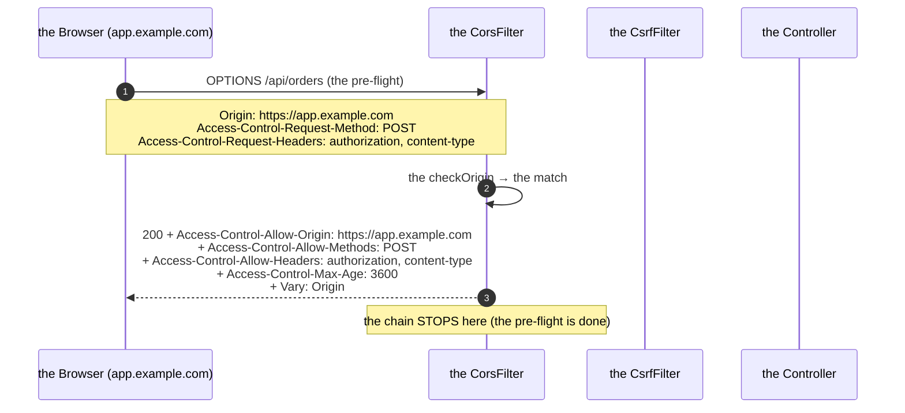
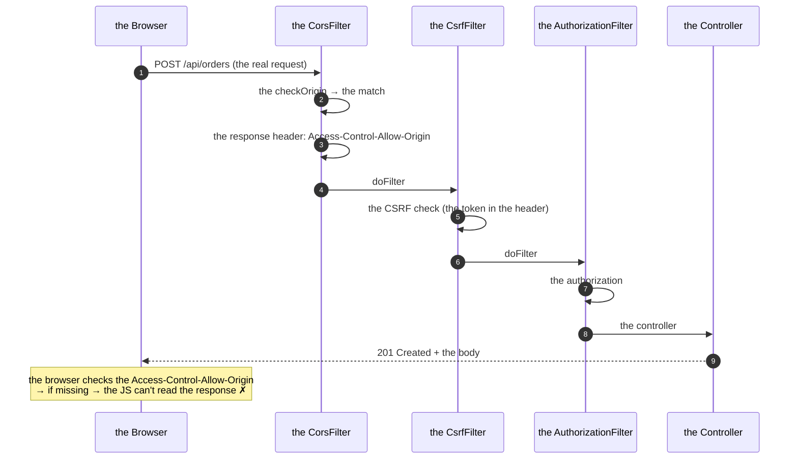
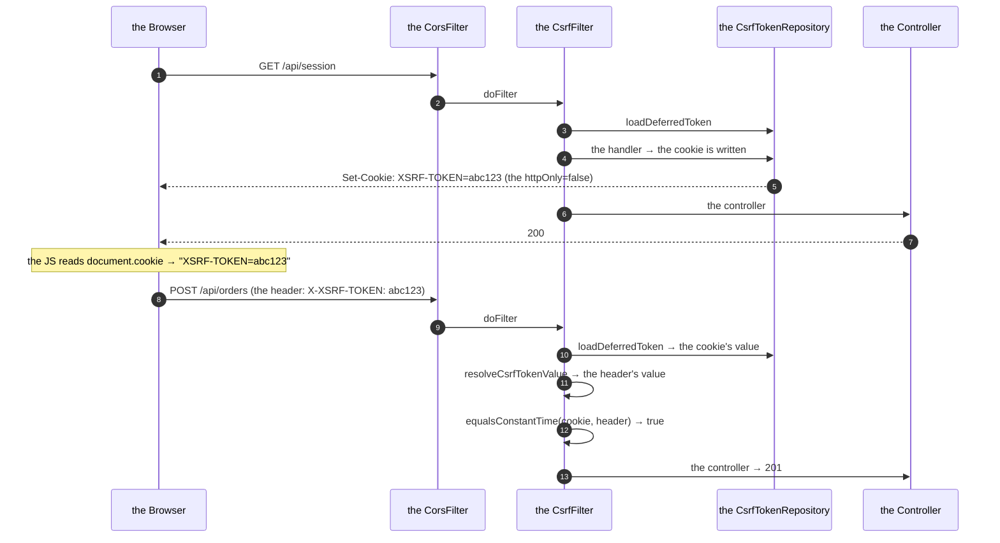
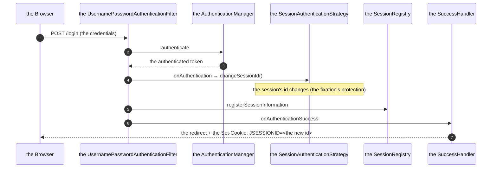

# 04 · CORS, CSRF & Session Management

> **Level:** Beginner → Advanced
> **Interview Frequency:** ★★★★☆ ("Why is my CORS failing? How do you prevent CSRF?")
> **Prerequisite:** [01 · Security Architecture](./01-Security-Architecture-and-Filter-Chain.md)
> **Last Updated:** 2026

---

## 📋 Table of Contents
- [0. TL;DR — The 30-Second Answer](#0-tldr--the-30-second-answer)
- [1. What & Why](#1-what--why)
- [2. Mental Model — The Browser's Rules](#2-mental-model--the-browsers-rules)
- [3. Deep Dive — Theory](#3-deep-dive--theory)
- [4. Internal Working Mechanism](#4-internal-working-mechanism)
- [5. Step-by-Step Execution Flow](#5-step-by-step-execution-flow)
- [6. Architecture Diagrams](#6-architecture-diagrams)
- [7. Production-Level Use Cases](#7-production-level-use-cases)
- [8. Code Examples — Production-Grade](#8-code-examples--production-grade)
- [9. Common Mistakes & Gotchas](#9-common-mistakes--gotchas)
- [10. Performance Considerations](#10-performance-considerations)
- [11. Security Considerations](#11-security-considerations)
- [12. Best Practices — The Checklist](#12-best-practices--the-checklist)
- [13. Hands-On Exercises](#13-hands-on-exercises)
- [14. Code Challenges](#14-code-challenges)
- [15. Scenario-Based Questions](#15-scenario-based-questions)
- [16. Interview Q&A — Level-wise](#16-interview-qa--level-wise)
- [17. Counter-Questions & Traps](#17-counter-questions--traps)
- [18. Tricky Interview Questions](#18-tricky-interview-questions)
- [19. Follow-Up Questions Asked by Interviewers](#19-follow-up-questions-asked-by-interviewers)
- [20. Real 3–5 Year Experience Scenarios](#20-real-35-year-experience-scenarios)
- [21. Frequently Asked Production Issues](#21-frequently-asked-production-issues)
- [22. Debugging Scenarios](#22-debugging-scenarios)
- [23. Architecture Design Questions](#23-architecture-design-questions)
- [24. Rapid-Fire MCQs](#24-rapid-fire-mcqs)
- [25. Cheat Sheet — One-Page Summary](#25-cheat-sheet--one-page-summary)
- [26. Real-World Production Notes](#26-real-world-production-notes)
- [27. Follow-up Learning](#27-follow-up-learning)

---

## 0. TL;DR — The 30-Second Answer

- **CORS is the browser's rule, not the server's.** The server can only *tell* the browser
  "you're allowed" via the `Access-Control-Allow-*` headers. The browser enforces it. A
  non-browser client (the curl, the mobile app, the server-to-server) ignores CORS entirely.
- **The CORS is not a security feature** — it's a *sharing* feature. The protection against the
  cross-origin attacks is the **authentication/authorization**, not the CORS. A common
  misconception worth correcting in an interview.
- **The simple request vs the pre-flight:** a `GET`/`POST` with the "simple" headers
  (`Content-Type: application/x-www-form-urlencoded`, `multipart/form-data`, `text/plain`) →
  the browser sends it directly (with the `Origin`) and the server must answer with
  `Access-Control-Allow-Origin`. Anything else (the `Authorization` header, the `PUT/DELETE`,
  the `application/json`) → the browser sends the **pre-flight** `OPTIONS` first → the server
  must answer it with the allow-list.
- **The Spring Security's `CorsFilter`** must run **before** the `CsrfFilter` (the pre-flight
  must not require the CSRF token) → use `http.cors()` (it places the filter correctly) or
  register the `CorsFilter` with a high precedence.
- **`allowCredentials(true)` + `allowedOrigins("*")` is illegal** — the browser rejects it.
  Use the explicit origins or `allowedOriginPatterns`.
- **The CSRF:** the browser attaches the cookies automatically → a malicious site can make the
  browser POST to your API → the cookies ride along → the action executes. The defence: the
  **synchroniser token** (a random value the server issues and the client must echo) or the
  **double-submit cookie**, plus the `SameSite` cookie attribute as the defence in depth.
- **Disable the CSRF only when the credentials are NOT sent automatically** (the
  `Authorization: Bearer` header). A JWT in a cookie → the CSRF is still needed.
- **The session management:** the `SessionCreationPolicy` (the `STATELESS` for the APIs), the
  **session fixation** protection (`changeSessionId()` — the default), the **the concurrency
  control** (`maximumSessions`), the **the session's timeout**, the **the distributed sessions**
  (the Spring Session with the Redis), the **the session's storage**.
- **The one-liner:** *"CORS tells the browser which origins may call the API — it's a
  browser-level sharing rule, not a security control. CSRF protects the state-changing requests
that carry the cookies automatically. If the auth is a header, the CSRF goes away; if it's a
cookie, it doesn't."*

---

## 1. What & Why

These three topics are the most common "it works on my machine" bugs in a Spring Boot API, and
the interview questions about them are frequent because they're the classic "the developer
copied a Stack Overflow answer" territory. This chapter builds the mental model so the
answers are reasoned, not memorized.

---

## 2. Mental Model — The Browser's Rules

```text
   THE BROWSER'S SECURITY MODEL
   ────────────────────────────
   ① the SAME-ORIGIN POLICY — a page may only read the responses from its own origin
   ② the CORS — the "may I read that?" negotiation (the browser-enforced)
   ③ the COOKIES — attached AUTOMATICALLY to the same-site AND the cross-site requests
      (the subject to the SameSite attribute since 2020)
   ④ the PRE-FLIGHT — the browser's "let me check first" for the non-simple requests
```

**The two attacks this chapter defends against:**

```text
   the CSRF (the cross-site request forgery)
   ─────────────────────────────────────
   the user is logged in (the cookie!)
   the user visits evil.com
   evil.com's JS → fetch("https://api.bank.com/transfer", {method:"POST", body:...})
   → the BROWSER attaches the bank's cookie automatically!
   → the transfer executes. The user never noticed.

   the CORS misconfiguration (the "it's not really a security feature")
   ──────────────────────────────────────────────────────────────
   evil.com's JS → fetch("https://api.bank.com/balance")
   → the browser attaches the cookie
   → the server responds (the data!)
   → BUT the browser blocks the READ because the CORS headers are missing
   → so evil.com can't see the balance ✓
   → but the TRANSFER already happened ✗ (that's the CSRF)
```

> **Caption:** The CORS protects the **read**; the CSRF protects the **write**. They're
> different problems and neither replaces the authorization.

---

## 3. Deep Dive — Theory

### 3.1 CORS — the specification's vocabulary

**The request headers:**
| The header | The meaning |
|------------|-------------|
| `Origin` | The origin of the page making the request (`scheme://host:port`) |
| `Access-Control-Request-Method` | The pre-flight only: the intended method |
| `Access-Control-Request-Headers` | The pre-flight only: the intended headers |

**The response headers:**
| The header | The meaning |
|------------|-------------|
| `Access-Control-Allow-Origin` | The allowed origin (`*` or the exact one) |
| `Access-Control-Allow-Methods` | The allowed methods (the pre-flight) |
| `Access-Control-Allow-Headers` | The allowed headers (the pre-flight) |
| `Access-Control-Allow-Credentials` | Whether the credentials (the cookies, the `Authorization`) may be sent (`true`) |
| `Access-Control-Expose-Headers` | The response headers the JS may read (e.g. `Location`, `X-Request-Id`) |
| `Access-Control-Max-Age` | How long the pre-flight's result may be cached (the seconds) |
| `Vary: Origin` | ⚠ The cache key must include the origin (the CDN!) |

**The "the origin" definition:** `scheme://host:port`. The **path** is not part of it.
`https://app.example.com` ≠ `https://app.example.com:8443` ≠ `http://app.example.com`.

**The simple request vs the pre-flight:**

```text
   THE SIMPLE REQUEST (no pre-flight)
   ─────────────────────────────────
   the method ∈ {GET, HEAD, POST}
   AND the headers ∈ {Accept, Accept-Language, Content-Language, Content-Type}
   AND the Content-Type ∈ {application/x-www-form-urlencoded,
                           multipart/form-data, text/plain}
   → the browser sends the request directly (with the Origin)
   → the server responds with the Access-Control-Allow-Origin

   THE PRE-FLIGHT (the OPTIONS)
   ─────────────────────────────
   anything else (the PUT/DELETE/PATCH, the application/json,
                  the Authorization header, the X-Custom-Header)
   → the browser sends OPTIONS with the Access-Control-Request-* headers
   → the server answers with the allow-list
   → if OK → the browser sends the real request
```

**The consequences for the APIs:** a JSON API with the `Authorization` header **always** triggers
the pre-flight → the `OPTIONS` handling must be correct and must not require the
authentication (or the CSRF token).

### 3.2 The CORS in Spring — the `CorsConfigurationSource`

```java
@Bean
CorsConfigurationSource corsConfigurationSource() {
    CorsConfiguration config = new CorsConfiguration();
    config.setAllowedOrigins(List.of("https://app.example.com"));
    config.setAllowedMethods(List.of("GET", "POST", "PUT", "PATCH", "DELETE", "OPTIONS"));
    config.setAllowedHeaders(List.of("Authorization", "Content-Type", "X-CSRF-TOKEN", "X-Request-Id"));
    config.setExposedHeaders(List.of("Location", "X-Request-Id"));
    config.setAllowCredentials(true);
    config.setMaxAge(Duration.ofHours(1).toSeconds());

    UrlBasedCorsConfigurationSource source = new UrlBasedCorsConfigurationSource();
    source.registerCorsConfiguration("/api/**", config);
    return source;
}
```

**The `CorsConfiguration`'s fields:**

| The field | The notes |
|-----------|----------|
| `allowedOrigins` | The exact origins. `*` is illegal with the credentials |
| `allowedOriginPatterns` | The patterns (`https://*.example.com`) — Spring 5.3+. Can be `*` with the credentials |
| `allowedMethods` | The methods. The default: only the simple ones (GET/HEAD/POST) |
| `allowedHeaders` | `*` allows any (but the credentials + `*` is illegal for the origin only) |
| `exposedHeaders` | The response headers the JS may read |
| `allowCredentials` | The cookies / the `Authorization` |
| `maxAge` | The pre-flight's cache (the default 1800s) |
| `allowPrivateNetwork` | The Chrome's private network access (the newer) |

**The `allowedOrigins` vs `allowedOriginPatterns`:**
```java
config.setAllowedOrigins(List.of("https://app.example.com"));
// → the exact match only

config.setAllowedOriginPatterns(List.of("https://*.example.com"));
// → the pattern match; the matched origin is ECHOED back in the response
//   (not the literal "*") → this works with the credentials
```

**The `CorsConfigurationSource` vs the `@CrossOrigin`:**
```java
@RestController
@CrossOrigin(origins = "https://app.example.com", maxAge = 3600)
public class ProductController { ... }
```
**The `@CrossOrigin` is convenient but:**
- It's per-controller/class/method (the config is scattered).
- It doesn't handle the credentials' configuration as centrally.
- The `allowedOrigins = "*"` (the default!) + the credentials → the 403 from the Spring.
- The `maxAge` is capped at 1800 by the default in some versions.

**The production recommendation:** the central `CorsConfigurationSource` bean.

**The `CorsConfiguration` in the `application.yml`:**
```yaml
spring:
  mvc:
    cors:
      allowed-origins: "https://app.example.com"
      allowed-methods: "GET,POST,PUT,PATCH,DELETE,OPTIONS"
      allowed-headers: "*"
      allow-credentials: true
      max-age: 3600
```
**The caveat:** the property-based CORS applies to the MVC's `@RequestMapping` handlers — but the
**Spring Security's `CorsFilter`** (when `http.cors()` is enabled) takes precedence and uses the
`CorsConfigurationSource` **bean** if one exists. If the bean is missing, the `http.cors()`
uses the MVC's `HandlerMappingIntrospector`-based source → the property-based config.

**The `CorsFilter` — the manual registration (the wrong order!):**
```java
@Bean
FilterRegistrationBean<CorsFilter> corsFilter() {
    CorsConfiguration config = new CorsConfiguration();
    config.setAllowedOrigins(List.of("https://app.example.com"));
    // ...
    UrlBasedCorsConfigurationSource source = new UrlBasedCorsConfigurationSource();
    source.registerCorsConfiguration("/**", config);

    FilterRegistrationBean<CorsFilter> bean = new FilterRegistrationBean<>(new CorsFilter(source));
    bean.setOrder(Ordered.HIGHEST_PRECEDENCE);   // ← the key: before the security's filter
    return bean;
}
```
**The `FilterChainProxy` is registered with the order `SecurityProperties.DEFAULT_FILTER_ORDER`
= `Integer.MAX_VALUE - 100` → the manual `CorsFilter` must be registered with a **lower** order
(earlier) → `HIGHEST_PRECEDENCE`.

### 3.3 The CORS's pre-flight handling in Spring

```java
public class CorsFilter extends OncePerRequestFilter {

    @Override
    protected void doFilterInternal(HttpServletRequest request, HttpServletResponse response, FilterChain chain) {
        if (this.corsConfigurationSource != null) {
            CorsConfiguration corsConfiguration = this.corsConfigurationSource.getCorsConfiguration(request);
            if (corsConfiguration != null) {
                boolean isValid = this.corsProcessor.processRequest(corsConfiguration, request, response);
                if (!isValid || CorsUtils.isPreFlightRequest(request)) {
                    return;   // the pre-flight → the response is already written
                }
            }
        }
        chain.doFilter(request, response);
    }
}
```

**The `DefaultCorsProcessor.processRequest`:**
```java
public boolean processRequest(CorsConfiguration config, HttpServletRequest request, HttpServletResponse response) {
    Collection<String> varyHeaders = response.getHeaders(HttpHeaders.VARY);
    ...
    String requestOrigin = request.getHeader(HttpHeaders.ORIGIN);
    String allowOrigin = checkOrigin(config, requestOrigin);
    if (allowOrigin == null) {
        rejectRequest(response);
        return false;    // the 403 with the "Invalid CORS request"
    }

    response.setHeader(HttpHeaders.VARY, HttpHeaders.ORIGIN);
    response.setHeader(HttpHeaders.ACCESS_CONTROL_ALLOW_ORIGIN, allowOrigin);
    ...
    if (CorsUtils.isPreFlightRequest(request)) {
        response.setHeader(HttpHeaders.ACCESS_CONTROL_ALLOW_METHODS, ...);
        response.setHeader(HttpHeaders.ACCESS_CONTROL_ALLOW_HEADERS, ...);
        response.setHeader(HttpHeaders.ACCESS_CONTROL_MAX_AGE, ...);
        response.setStatus(HttpServletResponse.SC_OK);
        return false;    // the pre-flight is done
    }
    ...
}
```

**The `rejectRequest` → the 403 with the body `Invalid CORS request`.**

**The `checkOrigin` — the key logic:**
```java
protected String checkOrigin(CorsConfiguration config, String requestOrigin) {
    if (StringUtils.hasText(requestOrigin)) {
        // ① the exact match
        String allowOrigin = config.checkOrigin(requestOrigin);
        if (allowOrigin != null) return allowOrigin;

        // ② the patterns
        allowOrigin = config.checkOriginPattern(requestOrigin);
        if (allowOrigin != null) return allowOrigin;
    }
    return null;
}
```

**The `CorsConfiguration.checkOrigin`:**
```java
public String checkOrigin(@Nullable String requestOrigin) {
    if (!StringUtils.hasText(requestOrigin)) return null;
    String originToCheck = trimTrailingSlash(requestOrigin);
    if (!ObjectUtils.isEmpty(this.allowedOrigins)) {
        if (this.allowedOrigins.contains(ALL)) {
            if (this.allowCredentials != Boolean.TRUE) return ALL;
            return null;   // the illegal combination → the rejection
        }
        for (String allowedOrigin : this.allowedOrigins) {
            if (originToCheck.equalsIgnoreCase(trimTrailingSlash(allowedOrigin))) {
                return allowedOrigin;   // the exact echo
            }
        }
    }
    return null;
}
```

### 3.4 The CSRF — the attack in detail

```text
   ① the user logs in → the server sets the session cookie (the browser's automatic)
   ② the user opens evil.com in another tab
   ③ evil.com's page has:
        <form action="https://api.bank.com/transfer" method="POST">
          <input name="to" value="attacker">
          <input name="amount" value="10000">
        </form>
        <script>document.forms[0].submit()</script>
   ④ the browser submits the form to api.bank.com
   ⑤ the browser ATTACHES the bank's session cookie (the SameSite=Lax blocks it for the
      cross-site POST — since 2020, the modern browsers default to Lax!)
   ⑥ the server sees a valid session → executes the transfer
```

**The attacker's constraints:** the classic form-based attack can only send the "simple"
content types → the JSON APIs with the `Authorization` header are immune (the browser can't
set the header from a form) → **unless** the token is in a cookie.

**The defences:**

**A — The synchroniser token (the classic, the server-side state):**
```text
   the server: generates a random token → stores it in the session → embeds it in the form
   the client: submits the form with the hidden field _csrf
   the server: compares the session's token with the request's token → a mismatch → the 403
```
**The Spring's implementation:** the `CsrfTokenRepository` (the `HttpSessionCsrfTokenRepository`
by default → the token is in the session).

**B — The double-submit cookie:**
```text
   the server: generates a random token → sets it as a cookie (XSRF-TOKEN) AND embeds it in
              the form/response
   the client: sends the cookie back in the request (automatically) + the token in the
              header/body (X-XSRF-TOKEN)
   the server: compares the cookie's token with the header's token → a mismatch → the 403
```
**The property:** the attacker on `evil.com` can cause the browser to send the cookie, but
**cannot read it** (the same-origin policy) → they cannot echo it in the header → the defence
holds. **The requirement:** the cookie must be **readable by the JS** (`httpOnly = false`) —
that's the point (the SPA reads it and sends the header).

**C — The `SameSite` cookie attribute (the modern, the defence in depth):**
```text
   SameSite=Strict → the cookie is NEVER sent on a cross-site request
   SameSite=Lax     → the cookie is sent on the top-level GET navigation (but not the POST)
   SameSite=None    → the cookie is sent everywhere (requires Secure)
```
**The modern browsers' default is `Lax`** → the classic form-based POST attack is blocked by
default. **But**: `Lax` doesn't cover everything (the top-level GET navigation — the CSRF via
the GET, e.g. the "the logout" or the "the money transfer via the GET" — and the browsers'
varied defaults, and the same-site subdomains, and the older browsers).

**D — The custom header requirement (the "the API-only" pattern):**
```text
   the client MUST send the X-Requested-With: XMLHttpRequest (or any custom header)
   → a cross-origin form/HTML can't set a custom header without a pre-flight
   → and the pre-flight fails (the CORS doesn't allow it)
   → the attack is blocked
```
**This is why the "the header-based auth is CSRF-immune" claim works** — but only because the
custom header triggers the pre-flight, which the attacker's page can't pass.

### 3.5 The CSRF in Spring Security

```java
http.csrf(csrf -> csrf
    .csrfTokenRepository(CookieCsrfTokenRepository.withHttpOnlyFalse())
    .csrfTokenRequestHandler(new CsrfTokenRequestAttributeHandler())
    .ignoringRequestMatchers("/api/webhook/**"));
```

**The `CsrfTokenRepository` — the implementations:**

| The implementation | The storage | The use |
|--------------------|-------------|-------|
| `HttpSessionCsrfTokenRepository` (the default) | The session | The server-rendered apps |
| `CookieCsrfTokenRepository` | The cookie | The SPAs (the double-submit) |
| `HttpSessionCsrfTokenRepository` + the `header` | The header | The SPA reading the token from the response |

**The `CookieCsrfTokenRepository`:**
```java
public class CookieCsrfTokenRepository implements CsrfTokenRepository {
    private static final String DEFAULT_CSRF_COOKIE_NAME = "XSRF-TOKEN";
    private static final String HEADER_NAME = "X-XSRF-TOKEN";
    private String cookieName = DEFAULT_CSRF_COOKIE_NAME;
    private String headerName = HEADER_NAME;
    private String parameterName = "_csrf";
    private boolean cookieHttpOnly = true;     // ← set to FALSE for the SPA
    private boolean secure = true;
    private String cookiePath = "/";
    private Duration cookieMaxAge = Duration.ofMinutes(30);
    ...
}
```

**The Spring Security 6's "the deferred token" (the big change):**

In Spring Security 6, the `CsrfToken` is **deferred** — the token is only **generated** when
it's actually accessed (the `DeferredCsrfToken`). The reason: the eager generation caused the
token to be set on **every** response (including the static resources) → the performance and the
cache issues.

**The consequence for the SPAs:** the `XSRF-TOKEN` cookie is only set when the server **reads**
the token. The `CsrfTokenRequestAttributeHandler` (the default) exposes the token as a request
attribute → the view (the Thymeleaf) reads it. For the **the SPA (the JS)**, you need the
`CsrfTokenRequestAttributeHandler` (the default) and the **the cookie must be written** → the
Spring's docs recommend the `SpaCsrfTokenRequestHandler` (the custom) or the
`CsrfTokenRequestAttributeHandler` with the `setCsrfRequestAttributeName(null)` for the
`XorCsrfTokenRequestAttributeHandler`...

**The practical, working SPA configuration (Spring Security 6):**
```java
http.csrf(csrf -> csrf
    .csrfTokenRepository(CookieCsrfTokenRepository.withHttpOnlyFalse())
    .csrfTokenRequestHandler(new SpaCsrfTokenRequestHandler())   // the custom, below)
    .ignoringRequestMatchers("/api/webhook/**"));
```

```java
/**
 * The "the SPA" handler: the XorCsrfTokenRequestAttributeHandler for the rendering
 * (the BREACH protection) and the plain CsrfTokenRequestAttributeHandler for the
 * header/parameter resolution (the SPA's X-XSRF-TOKEN header).
 */
public final class SpaCsrfTokenRequestHandler extends CsrfTokenRequestAttributeHandler {

    private final CsrfTokenRequestHandler delegate = new XorCsrfTokenRequestAttributeHandler();

    @Override
    public void handle(HttpServletRequest request, HttpServletResponse response, Supplier<CsrfToken> csrfToken) {
        this.delegate.handle(request, response, csrfToken);
        // ① the token is rendered (the XOR) for the HTML
        // ② the raw token is set as a request attribute for the header resolution
        request.setAttribute(HttpServletResponse.class.getName() + ".CSRF_TOKEN", csrfToken.get());
    }
}
```
**The simpler alternative (widely used):** the `CsrfTokenRequestAttributeHandler` (not the XOR
one) + the `CookieCsrfTokenRepository.withHttpOnlyFalse()` — the token is written to the cookie
when the handler handles it, and the `XorCsrfTokenRequestAttributeHandler` (the default in 6.x)
**doesn't** write the raw token to the cookie → the SPA can't read it → the 403.

**The reliable, simple approach (the most common in the production):**
```java
@Bean
FilterRegistrationBean<CsrfCookieFilter> csrfCookieFilter() {
    CsrfCookieFilter filter = new CsrfCookieFilter();
    FilterRegistrationBean<CsrfCookieFilter> registration = new FilterRegistrationBean<>(filter);
    registration.setOrder(Ordered.HIGHEST_PRECEDENCE + 10);
    return registration;
}
```
Hmm, that's a bit involved. The **simplest** that works: the `CookieCsrfTokenRepository` + the
`CsrfTokenRequestAttributeHandler` (the plain, not the XOR) + the SPA reads the `XSRF-TOKEN`
cookie and sends the `X-XSRF-TOKEN` header.

**The `XorCsrfTokenRequestAttributeHandler` — the BREACH protection:**
```java
public class XorCsrfTokenRequestAttributeHandler extends CsrfTokenRequestAttributeHandler {
    // the token is XOR-ed with a random per-request mask
    // → the response is different each time (the BREACH mitigation)
    // → the client must decode it (the JS's helper) — the complication for the SPAs
}
```
**The BREACH attack:** the HTTP compression + the reflected secret in the response body + the
attacker's ability to observe the size → the secret is extracted byte by byte. The XOR
defeats it (the masked value changes every time).

### 3.6 The session management

**The `SessionCreationPolicy`:**

| The policy | The behaviour | The use |
|------------|--------------|-------|
| `ALWAYS` | A session for every request | The legacy |
| `NEVER` | Never (the app manages it) | The custom |
| `IF_REQUIRED` (the default) | Only if it's needed (the state is saved) | The standard web apps |
| `STATELESS` | Never (the `SecurityContext` isn't persisted) | The APIs (the JWT) |

**The `SessionManagementConfigurer`:**
```java
http.sessionManagement(session -> session
    .sessionCreationPolicy(SessionCreationPolicy.STATELESS)
    .sessionFixation(sessionFixation -> sessionFixation.changeSessionId())
    .maximumSessions(1)
    .maxSessionsPreventsLogin(false)
    .sessionConcurrency(registry -> registry
        .maximumSessions(1)
        .expiredSessionStrategy(event -> {
            // the session was expired by the concurrency control
        }))
    .invalidSessionUrl("/login?invalid")
    .sessionAuthenticationError((request, response, exception) -> {
        response.sendError(HttpServletResponse.SC_UNAUTHORIZED, "Session expired");
    }));
```

**The session fixation:**
```text
   THE ATTACK
   ① the attacker gets a valid session id from the server (or predicts it)
   ② the attacker tricks the victim into using that session id (a link with the JSESSIONID)
   ③ the victim logs in → the session is now authenticated
   ④ the attacker uses the same session id → he's authenticated as the victim
```

**The defence (the `changeSessionId()` — the default since Spring Security 4):**
```text
   the login → the session id is CHANGED → the old id is invalidated
   → the attacker's id is useless ✓
```
**The alternatives:** `migrateSession()` (the id is changed + the attributes are copied) and
`none()` (no protection — the legacy).

**The concurrency control:**
```java
.sessionConcurrency(registry -> registry
    .maximumSessions(1)                       // the max concurrent sessions per user
    .maxSessionsPreventsLogin(false)          // the false → the oldest is expired
    .expiredSessionStrategy(event -> { ... }))
```
**The mechanics:** the `SessionRegistry` (the `SessionRegistryImpl` — **in-memory, per
instance**!) tracks the active sessions. On the login, if the limit is exceeded → the
`expiredSessionStrategy` or the login is prevented.

**The production limitation:** the `SessionRegistryImpl` is per-JVM → in a cluster, the "the max
1 session" is per node. The fix: the **Spring Session with the Redis** (the shared registry).

**The session's timeout:**
```properties
server.servlet.session.timeout=30m
server.servlet.session.cookie.http-only=true
server.servlet.session.cookie.secure=true
server.servlet.session.cookie.same-site=lax
```
**Or in Java:**
```java
http.sessionManagement(session -> session
    .sessionFixation(sf -> sf.changeSessionId())
    .invalidSessionUrl("/login?invalid"));
```
**The `SessionManagementConfigurer`'s session timeout:**
```java
ServletContextConfigurer(context -> context.getSession().setMaxInactiveInterval(1800));
```

**The `SessionCookieConfig`:**
```java
http.sessionManagement(session -> session
    .sessionFixation(...)
    .maximumSessions(1));
```
**The cookie's attributes (the Spring Boot's properties):**
```yaml
server:
  servlet:
    session:
      timeout: 30m
      cookie:
        name: SESSION
        http-only: true
        secure: true
        same-site: lax
```

### 3.7 The distributed sessions (the Spring Session)

```java
@Bean
RedisHttpSessionConfiguration redisSessionConfiguration() {
    return new RedisHttpSessionConfiguration();
}
```
**or (the Spring Boot's auto-configuration):**
```yaml
spring:
  session:
    store-type: redis
    redis:
      namespace: myapp:session
  data:
    redis:
      host: localhost
      port: 6379
```

**The `SpringSessionBackedSessionRepository` / the `RedisIndexedSessionRepository`:**
```java
@Bean
SecurityContextRepository securityContextRepository() {
    return new DelegatingSecurityContextRepository(
            new RequestAttributeSecurityContextRepository(),
            new SpringSessionBackedSessionRepository());
}
```
**The `RedisIndexedSessionRepository` vs the `RedisSessionRepository`:**
- The **`RedisIndexedRepository`** — indexes the sessions by the principal → the "the list of
  the active sessions" and the "the expire all the sessions of this user" work (the
  `FindByIndexNameAndIndexValue`).
- The **`RedisSessionRepository`** — simpler, no the principal's index → the concurrency control
  doesn't work across the nodes.

**The production configuration:**
```yaml
server:
  servlet:
    session:
      timeout: 30m
      cookie:
        http-only: true
        secure: true
        same-site: lax
spring:
  session:
    store-type: redis
    redis:
      namespace: orders:session
      flush-mode: on_save
      save-mode: on_set_attribute
```

**The `save-mode: on_set_attribute`** — the important one: by default, the Spring Session saves
the session on every request (`ON_SAVE`) → the Redis write per request. With
`ON_SET_ATTRIBUTE`, it only writes when an attribute actually changes → the performance
improvement.

### 3.8 The session's storage — the alternatives

| The approach | The storage | The notes |
|--------------|-------------|-----------|
| The container's session | The Tomcat's memory (the `StandardSession`) | The default; the sticky sessions or the local-only |
| The Spring Session + the Redis | The Redis | The distributed; the sticky sessions not needed |
| The Spring Session + the JDBC | The DB | The simple; the write load on the DB |
| The Spring Session + the Hazelcast | The Hazelcast | The distributed cache |
| The JWT (the stateless) | The client | The no server state; the revocation is harder |

**The `spring-session`'s `JdbcIndexedSessionRepository` (the DB):**
```yaml
spring:
  session:
    store-type: jdbc
    jdbc:
      initialize-schema: always
```

### 3.9 The `SecurityContextRepository` — the custom persistence

```java
@Bean
SecurityContextRepository securityContextRepository() {
    return new DelegatingSecurityContextRepository(
            new RequestAttributeSecurityContextRepository(),
            new HttpSessionSecurityContextRepository());
}
```

**The `HttpSessionSecurityContextRepository`:**
```java
public class HttpSessionSecurityContextRepository implements SecurityContextRepository {

    public static final String SPRING_SECURITY_CONTEXT = "SPRING_SECURITY_CONTEXT";

    @Override
    public SecurityContext loadEmptyContext(HttpServletRequest request) {
        HttpSession session = request.getSession(false);
        if (session == null) return SecurityContextHolder.createEmptyContext();
        synchronized (session.getServletContext()) {
            SecurityContext context = (SecurityContext) session.getAttribute(SPRING_SECURITY_CONTEXT);
            if (context == null) {
                context = SecurityContextHolder.createEmptyContext();
                session.setAttribute(SPRING_SECURITY_CONTEXT, context);
            }
            return context;
        }
    }

    @Override
    public void saveContext(SecurityContext context, HttpServletRequest request, HttpServletResponse response) {
        HttpSession session = request.getSession(false);
        if (session == null) {
            session = request.getSession(true);
        }
        session.setAttribute(SPRING_SECURITY_CONTEXT, context);
        // ① the session fixation's protection
        String sessionId = request.getRequestedSessionId();
        if (!StringUtils.hasText(sessionId) || !session.getId().equals(sessionId)) {
            // the new session → the request's session id was changed
            request.changeSessionId();
        }
    }
}
```

**The custom repository (the JWT in the header):**
```java
public class HeaderSecurityContextRepository implements SecurityContextRepository {

    @Override
    public SecurityContext loadEmptyContext(HttpServletRequest request) {
        String header = request.getHeader("Authorization");
        if (header == null || !header.startsWith("Bearer ")) {
            return SecurityContextHolder.createEmptyContext();
        }
        // the decoding is done by the BearerTokenAuthenticationFilter
        return SecurityContextHolder.createEmptyContext();
    }

    @Override
    public void saveContext(SecurityContext context, HttpServletRequest request, HttpServletResponse response) {
        // nothing to save (the stateless)
    }
}
```
**Note:** the modern way is the `BearerTokenAuthenticationFilter` (the framework's) — the custom
repository is for the exotic cases.

### 3.10 The `SessionRegistry` — the active sessions

```java
@Bean
SessionRegistry sessionRegistry() {
    return new SessionRegistryImpl();
}
```

```java
@Autowired SessionRegistry sessionRegistry;

public List<SessionInfo> activeSessions(String username) {
    UserDetails principal = userDetailsService.loadUserByUsername(username);
    return sessionRegistry.getAllSessions(principal, false);
}

public void expireAllSessions(String username) {
    UserDetails principal = userDetailsService.loadUserByUsername(username);
    sessionRegistry.getAllSessions(principal, true).forEach(SessionInformation::expireNow);
}
```

**The production use:** the "the active sessions" page (the user can see and revoke), the
"the password change → expire all the sessions", the "the admin forces the logout".

**The limitation:** the `SessionRegistryImpl` is in-memory → per-instance. The **the Spring
Session** provides the `FindByIndexNameAndIndexValue` (the Redis's index) → the cross-node.

### 3.11 The `logout` — the session's termination

```java
http.logout(logout -> logout
    .logoutUrl("/api/auth/logout")
    .logoutSuccessHandler((request, response, auth) -> {
        response.setStatus(HttpServletResponse.SC_NO_CONTENT);
    })
    .deleteCookies("JSESSIONID", "SESSION")
    .invalidateHttpSession(true)
    .clearAuthentication(true)
    .addLogoutHandler((request, response, authentication) -> {
        // the audit
    }));
```

**The `LogoutHandler`s:**
- The `SecurityContextLogoutHandler` — clears the `SecurityContext` and invalidates the session.
- The `CookieClearingLogoutHandler` — deletes the cookies.
- The custom ones — the audit, the token's revocation.

**The CSRF's interaction:** the `POST /logout` requires the CSRF token (the default) → the
logout from the SPA must include it.

### 3.12 The `remember-me` (the session's extension)

```java
http.rememberMe(remember -> remember
    .key("a-long-random-key")
    .tokenValiditySeconds(1209600)   // 14 days
    .rememberMeParameter("remember-me")
    .userDetailsService(userDetailsService)
    .alwaysRemember(false)
    .useSecureCookie(true));
```

**The `TokenBasedRememberMeServices` — the cookie's structure:**
```text
   base64(username + "|" + expirationTimestamp + "|" + MAC(username + "|" + expirationTimestamp + "|" + key))
```
**The vulnerability:** the MAC covers the username and the expiry — **not** the password → if the
key leaks, the attacker can forge a cookie for **any** user. The mitigations: the long random
key (from the config, not the code), the rotation, the HTTPS-only.

**The `PersistentTokenBasedRememberMeServices` (the revocable):**
```text
   the cookie = a random token (the UUID) → the DB stores the token series + the token + the
   username + the last used → the user can see and revoke the devices
```
**The `TokenRepository` (the JPA):**
```java
@Entity
@Table(name = "remember_me_tokens")
public class PersistentToken {
    @Id @GeneratedValue(strategy = GenerationType.IDENTITY)
    private Long id;
    private String username;
    private String series;      // the "the device" identifier
    private String token;       // the random value
    private LocalDateTime tokenLastUsed;
    private LocalDateTime expiresAt;
}
```

---

## 4. Internal Working Mechanism

### 4.1 The `CorsFilter`'s position in the chain

```text
   the FilterChainProxy
      │
      ├─ ① HeaderWriterFilter
      ├─ ② CorsFilter            ← the CORS (before the CSRF!)
      ├─ ③ CsrfFilter            ← the CSRF (the pre-flight must not need the token)
      ├─ ④ LogoutFilter
      ├─ ⑤ UsernamePasswordAuthenticationFilter
      ...
```

**The `HttpSecurity`'s configurer order:**
```java
private List<SecurityConfigurerAdapter<HttpSecurity, ?>> defaultConfigurers(...) {
    List<SecurityConfigurerAdapter<HttpSecurity, ?>> configurers = new ArrayList<>(12);
    configurers.add(new DisableEncodeUrlConfigurer<>(this));
    configurers.add(new WebAsyncManagerIntegrationConfigurer<>(this));
    configurers.add(new SecurityContextConfigurer<>(this, securityContextRepository));
    configurers.add(new HeaderWriterConfigurer<>(this));
    configurers.add(new CorsConfigurer<>(this));
    configurers.add(new CsrfConfigurer<>(this));
    configurers.add(new LogoutConfigurer<>(this));
    ...
}
```
**The `CorsConfigurer` before the `CsrfConfigurer`** → the pre-flight (the `OPTIONS`) is handled
by the `CorsFilter` and **stops** the chain (it returns without calling `doFilter`) → the
`CsrfFilter` never sees it. ✓

### 4.2 The `CsrfFilter`

```java
public class CsrfFilter extends OncePerRequestFilter {

    private final RequestMatcher requireCsrfProtectionMatcher;
    private final CsrfTokenRepository csrfTokenRepository;
    private final CsrfTokenRequestHandler requestHandler;

    @Override
    protected void doFilterInternal(HttpServletRequest request, HttpServletResponse response, FilterChain chain) {
        DeferredCsrfToken deferredCsrfToken = this.tokenRepository.loadDeferredToken(request, response);
        request.setAttribute(DeferredCsrfToken.class.getName(), deferredCsrfToken);
        this.requestHandler.handle(request, response, deferredCsrfToken::get);

        if (!this.requireCsrfProtectionMatcher.matches(request)) {
            filterChain.doFilter(request, response);
            return;
        }

        CsrfToken csrfToken = deferredCsrfToken.get();
        String actualToken = this.requestHandler.resolveCsrfTokenValue(request, csrfToken);

        if (!equalsConstantTime(csrfToken.getToken(), actualToken)) {
            AccessDeniedException exc = (!deferredCsrfToken.isGenerated())
                    ? new MissingCsrfTokenException(actualToken)
                    : new InvalidCsrfTokenException(csrfToken, actualToken);
            this.accessDeniedHandler.handle(request, response, exc);
            return;
        }
        filterChain.doFilter(request, response);
    }
}
```

**The `requireCsrfProtectionMatcher` (the default):**
```java
private static RequestMatcher createDefaultCsrfMatcher() {
    HttpMethod method = HttpMethod.resolve("GET");
    return new OrRequestMatcher(
        new IgnoredRequestMatcher(new AntPathRequestMatcher("/login", "GET")),
        new IgnoredRequestMatcher(new AntPathRequestMatcher("/logout", "GET")),
        new NegatedRequestMatcher(new AntPathRequestMatcher("/**", "GET")),
        new NegatedRequestMatcher(new AntPathRequestMatcher("/**", "HEAD")),
        new NegatedRequestMatcher(new AntPathRequestMatcher("/**", "TRACE"),
                new MediaTypeRequestMatcher(MediaType.APPLICATION_FORM_URLENCODED),
                new MediaTypeRequestMatcher(MediaType.MULTIPART_FORM_DATA),
                new MediaTypeRequestMatcher(MediaType.TEXT_PLAIN)));
}
```
**The semantics:** the CSRF is required for everything **except** the GET, the HEAD, the TRACE,
and (the 2.3+ fix) the requests with the simple content types.

**The `equalsConstantTime` — the timing-safe comparison:**
```java
private static boolean equalsConstantTime(String a, String b) {
    if (a == null || b == null) return false;
    byte[] aBytes = a.getBytes(StandardCharsets.UTF_8);
    byte[] bBytes = b.getBytes(StandardCharsets.UTF_8);
    return MessageDigest.isEqual(aBytes, bBytes);
}
```

**The `CsrfTokenRepository` — the deferred loading:**
```java
public class HttpSessionCsrfTokenRepository implements CsrfTokenRepository {
    @Override
    public DeferredCsrfToken loadDeferredToken(HttpServletRequest request, HttpServletResponse response) {
        return new RepositoryDeferredCsrfToken(this, request, response);
    }
}
```
**The `RepositoryDeferredCsrfToken` — the laziness:**
```java
final class RepositoryDeferredCsrfToken implements DeferredCsrfToken {
    private final Supplier<CsrfToken> csrfTokenSupplier;
    private CsrfToken csrfToken;

    @Override
    public CsrfToken get() {
        if (this.csrfToken == null) {
            this.csrfToken = this.csrfTokenSupplier.get();
        }
        return this.csrfToken;
    }
    @Override
    public boolean isGenerated() { return this.csrfToken != null; }
}
```

### 4.3 The `SessionManagementFilter` — the session's creation

```java
public class SessionManagementFilter extends OncePerRequestFilter {

    @Override
    protected void doFilterInternal(HttpServletRequest request, HttpServletResponse response, FilterChain chain) {
        Authentication authentication = SecurityContextHolder.getContext().getAuthentication();
        if (authentication != null && authentication.isAuthenticated()) {
            String sessionId = request.getRequestedSessionId();
            String requestedUrl = this.requestCache.getRequestUri(request);
            if (sessionId == null || !sessionId.equals(this.sessionIdStrategy.getSessionId(request))) {
                // ① the session's fixation protection
                this.sessionAuthenticationStrategy.onAuthentication(authentication, request, response);
                // ② the request's cache (the "the friendly login")
                this.requestCache.saveRequest(request, response);
            }
        }
        chain.doFilter(request, response);
    }
}
```

### 4.4 The `SessionAuthenticationStrategy` — the fixation's protection

```java
public class ChangeSessionIdAuthenticationStrategy implements SessionAuthenticationStrategy {

    @Override
    public void onAuthentication(Authentication authentication, HttpServletRequest request, HttpServletResponse response) {
        boolean hasSessionId = request.getRequestedSessionId() != null;
        String originalSessionId = request.getRequestedSessionId();
        if (!hasSessionId || !originalSessionId.equals(request.getSession().getId())) {
            request.changeSessionId();     // the id is changed → the old one is invalidated
        }
    }
}
```

**The `changeSessionId()` — the servlet 3.1+ API:** the container changes the id but **keeps
the attributes** → the `SecurityContext` survives.

### 4.5 The `ConcurrentSessionFilter` — the concurrency control

```java
public class ConcurrentSessionFilter extends OncePerRequestFilter {
    @Override
    protected void doFilterInternal(HttpServletRequest request, HttpServletResponse response, FilterChain chain) {
        HttpSession session = request.getSession(false);
        if (session == null) return;

        SessionInformation sessionInformation = this.sessionRegistry.getSessionInformation(session.getId());
        if (sessionInformation != null) {
            if (sessionInformation.isExpired()) {
                // the session was expired → the 401 / the redirect
                this.sessionAuthenticationStrategy.onExpiredSessionDetected(sessionInformation, request, response);
                return;
            }
            if (this.expireSessionAtTimeOfCreation) {
                sessionInformation.refreshLastRequest();
            }
        }
        chain.doFilter(request, response);
    }
}
```

### 4.6 The `RequestCache` — the "the friendly login"

```java
public class HttpSessionRequestCache implements RequestCache {
    public static final String DEFAULT_TARGET_URL_PARAMETER = "continue";
    private static final String SAVED_REQUEST = "SPRING_SECURITY_SAVED_REQUEST";
    ...
}
```

---

## 5. Step-by-Step Execution Flow

### 5.1 The CORS's pre-flight



### 5.2 The CORS's simple request (the actual call)



### 5.3 The CSRF's flow (the SPA, the double-submit)



### 5.4 The session's lifecycle (the login)



---

## 6. Architecture Diagrams

### 6.1 The three protections' positions

```text
   the request
      │
      ▼
   ┌────────────────────────────────────────────────┐
   │ the CorsFilter (the pre-flight)                │
   │  → the browser's "may I?" → the 200, stop      │
   └───────────────────┬────────────────────────────┘
                       ▼
   ┌────────────────────────────────────────────────┐
   │ the CsrfFilter (the token check)               │
   │  → the GET/HEAD: skipped                       │
   │  → the POST/PUT: the token must match          │
   └───────────────────┬────────────────────────────┘
                       ▼
   ┌────────────────────────────────────────────────┐
   │ the SessionManagementFilter                    │
   │  → the session's fixation's protection         │
   │  → the request's cache (the friendly login)    │
   └───────────────────┬────────────────────────────┘
                       ▼
   ┌────────────────────────────────────────────────┐
   │ the ConcurrentSessionFilter                    │
   │  → the expired session's detection             │
   └───────────────────┬────────────────────────────┘
                       ▼
   the controller
```

### 6.2 The CORS's decision flow

```text
   the request (with the Origin)
        │
        ▼
   the CorsConfigurationSource.getCorsConfiguration(request)
        │ (null → no CORS → the chain continues)
        ▼
   the CorsProcessor.processRequest
        │
        ├─ the origin is allowed?
        │     ├─ the exact match → the echo
        │     ├─ the pattern match → the echo
        │     └─ no → the 403 "Invalid CORS request"
        │
        ├─ the pre-flight?
        │     ├─ yes → the Allow-Methods/Headers/Max-Age → the 200, STOP
        │     └─ no → the Allow-Origin (+ the Expose-Headers) → CONTINUE
        │
        └─ the Vary: Origin is always set (the CDN's cache key)
```

### 6.3 The CSRF's defences (the layers)

```text
   LAYER 1 — the token (the primary)
   ──────────────────────────────
   the synchroniser (the session) or the double-submit (the cookie)
   → the attacker can't read the token → can't echo it → the 403

   LAYER 2 — the SameSite cookie (the defence in depth)
   ─────────────────────────────────────────────────
   SameSite=Strict/Lax → the browser doesn't attach the cookie cross-site
   → the form-based POST attack dies at the browser

   LAYER 3 — the custom header (the API's pattern)
   ────────────────────────────────────────────────
   the X-Requested-With / the Authorization header
   → a cross-origin form can't set it → the pre-flight fails

   LAYER 4 — the origin check (the belt and braces)
   ────────────────────────────────────────────────
   the server validates the Origin/Referer for the state-changing requests
   → the cross-origin requests are rejected
```

### 6.4 The session's storage options

```text
   THE LOCAL (the container's memory)
   ───────────────────────────────
   the Tomcat's heap → fast → the scale-up breaks
   → the sticky sessions (the load balancer) OR the Spring Session

   THE SHARED (the Spring Session + the Redis)
   ──────────────────────────────────────────
   the Redis → the scale-out works → the no sticky sessions
   → the Redis's availability is the session's availability
   → the serialization (the JSON) → the class's compatibility

   THE STATELESS (the JWT)
   ──────────────────────
   the client holds the token → the server holds nothing
   → the perfect scale-out
   → the revocation is harder (the blocklist)
   → the size (the header) + the expiry trade-offs
```

---

## 7. Production-Level Use Cases

| Use case | The technique |
|----------|---------------|
| **The SPA + the API (the different origin)** | The `CorsConfigurationSource` with the explicit origins + the credentials |
| **The JWT in a cookie (the SPA)** | The CSRF **enabled** + the double-submit + the `SameSite=Strict` |
| **The JWT in the header (the mobile/the M2M)** | The CSRF **disabled** (the header is not automatic) + the CORS for the web |
| **The third-party webhooks** | The CSRF **ignored** for the webhook's path + the signature verification (the HMAC) instead |
| **The multi-origin (the staging + the prod)** | The `allowedOriginPatterns` from the config per the profile |
| **The file upload (the `multipart`)** | The simple content type → the no pre-flight (but the `Authorization` header → the pre-flight) |
| **The server-rendered (the Thymeleaf)** | The session's CSRF + the `th:action` (the auto-inserted token) |
| **The microservices (no browser)** | The CORS is irrelevant (the browser isn't involved) — but the CSRF is also irrelevant (the header's auth) |
| **The admin's panel (the different subdomain)** | The CORS with the explicit origin + the `SameSite=None; Secure` (if the cross-site cookies are needed) + the CSRF |
| **The file download (the `Location` header)** | The `exposedHeaders("Location")` → the JS can read the redirect's URL |

---

## 8. Code Examples — Production-Grade

### 8.1 The production CORS configuration

```java
package com.example.config;

import lombok.extern.slf4j.Slf4j;
import org.springframework.beans.factory.annotation.Value;
import org.springframework.context.annotation.Bean;
import org.springframework.context.annotation.Configuration;
import org.springframework.web.cors.CorsConfiguration;
import org.springframework.web.cors.CorsConfigurationSource;
import org.springframework.web.cors.UrlBasedCorsConfigurationSource;

import java.time.Duration;
import java.util.List;

@Configuration
@Slf4j
public class CorsConfig {

    private final List<String> allowedOrigins;
    private final List<String> allowedOriginPatterns;
    private final boolean allowCredentials;

    public CorsConfig(
            @Value("${app.cors.allowed-origins:}") List<String> allowedOrigins,
            @Value("${app.cors.allowed-origin-patterns:}") List<String> allowedOriginPatterns,
            @Value("${app.cors.allow-credentials:true}") boolean allowCredentials) {
        this.allowedOrigins = allowedOrigins;
        this.allowedOriginPatterns = allowedOriginPatterns;
        this.allowCredentials = allowCredentials;
    }

    @Bean
    public CorsConfigurationSource corsConfigurationSource() {
        CorsConfiguration configuration = new CorsConfiguration();

        // ① the exact origins (the preferred)
        if (!allowedOrigins.isEmpty()) {
            configuration.setAllowedOrigins(allowedOrigins);
        }

        // ② the patterns (the wildcards) — the matched origin is echoed back
        if (!allowedOriginPatterns.isEmpty()) {
            configuration.setAllowedOriginPatterns(allowedOriginPatterns);
        }

        configuration.setAllowedMethods(List.of("GET", "POST", "PUT", "PATCH", "DELETE", "OPTIONS"));
        configuration.setAllowedHeaders(List.of(
                "Authorization", "Content-Type", "X-CSRF-TOKEN", "X-XSRF-TOKEN",
                "X-Request-Id", "Idempotency-Key", "Accept", "Origin"));
        configuration.setExposedHeaders(List.of("Location", "X-Request-Id", "X-Total-Count"));
        configuration.setAllowCredentials(allowCredentials);
        configuration.setMaxAge(Duration.ofHours(1).toSeconds());

        UrlBasedCorsConfigurationSource source = new UrlBasedCorsConfigurationSource();
        source.registerCorsConfiguration("/api/**", configuration);
        return source;
    }
}
```

**The `application.yml`:**
```yaml
app:
  cors:
    allowed-origins:
      - https://app.example.com
      - https://admin.example.com
    allowed-origin-patterns:          # the dev environments
      - https://*.localhost:3000
    allow-credentials: true
```

### 8.2 The CORS's validation (the fail-fast at the startup)

```java
@Component
@RequiredArgsConstructor
public class CorsConfigurationValidator implements InitializingBean {

    private final CorsConfigurationSource corsConfigurationSource;

    @Override
    public void afterPropertiesSet() {
        CorsConfiguration config = corsConfigurationSource.getCorsConfiguration(
                new MockHttpServletRequest("GET", "/api/test"));

        if (config == null) {
            log.warn("No CORS configuration found for /api/**");
            return;
        }
        if (config.getAllowCredentials() == Boolean.TRUE
                && config.getAllowedOrigins().contains("*")) {
            throw new IllegalStateException(
                    "allowCredentials=true with allowedOrigins=* is rejected by browsers");
        }
        if (config.getAllowedOrigins().isEmpty() && config.getAllowedOriginPatterns().isEmpty()) {
            throw new IllegalStateException("The CORS configuration allows no origins");
        }
    }
}
```

### 8.3 The security's configuration (the CORS + the CSRF, the API)

```java
@Bean
SecurityFilterChain apiFilterChain(HttpSecurity http) throws Exception {
    http
        .cors(cors -> cors.configurationSource(corsConfigurationSource))   // the bean
        .csrf(csrf -> csrf
                // the header-based auth → the CSRF is not needed
                .disable())
        .sessionManagement(session -> session
                .sessionCreationPolicy(SessionCreationPolicy.STATELESS))
        .authorizeHttpRequests(auth -> auth
                .requestMatchers("/api/auth/**").permitAll()
                .anyRequest().authenticated());
    return http.build();
}
```

### 8.4 The CSRF's SPA configuration (the double-submit)

```java
package com.example.config;

import jakarta.servlet.http.HttpServletRequest;
import jakarta.servlet.http.HttpServletResponse;
import org.springframework.security.web.csrf.CsrfToken;
import org.springframework.security.web.csrf.CsrfTokenRequestAttributeHandler;
import org.springframework.security.web.csrf.CsrfTokenRequestHandler;
import org.springframework.security.web.csrf.XorCsrfTokenRequestAttributeHandler;

import java.util.function.Supplier;

/**
 * The SPA's handler: the BREACH protection (the XOR) for the HTML rendering,
 * and the plain token for the header/parameter resolution.
 */
public final class SpaCsrfTokenRequestHandler extends CsrfTokenRequestAttributeHandler {

    private final CsrfTokenRequestHandler delegate = new XorCsrfTokenRequestAttributeHandler();

    @Override
    public void handle(HttpServletRequest request, HttpServletResponse response, Supplier<CsrfToken> csrfToken) {
        this.delegate.handle(request, response, csrfToken);
        // the raw token is available for the header resolution
        request.setAttribute(HttpServletResponse.class.getName() + ".CSRF_TOKEN", csrfToken.get());
    }
}
```

```java
@Bean
SecurityFilterChain webFilterChain(HttpSecurity http) throws Exception {
    http
        .cors(Customizer.withDefaults())
        .csrf(csrf -> csrf
                .csrfTokenRepository(CookieCsrfTokenRepository.withHttpOnlyFalse())
                .csrfTokenRequestHandler(new SpaCsrfTokenRequestHandler()))
        .authorizeHttpRequests(auth -> auth
                .requestMatchers("/api/auth/**").permitAll()
                .anyRequest().authenticated());
    return http.build();
}
```

**The SPA's side (the JS):**
```javascript
// ① the token comes from the cookie
function getCookie(name) {
  const match = document.cookie.match(new RegExp('(^|;\\s*)' + name + '=([^;]*)'));
  return match ? decodeURIComponent(match[2]) : null;
}

// ② every mutating request carries it
async function apiFetch(url, options = {}) {
  const token = getCookie('XSRF-TOKEN');
  const headers = { ...(options.headers || {}) };
  if (token) headers['X-XSRF-TOKEN'] = token;
  if (!headers['Content-Type'] && options.body) headers['Content-Type'] = 'application/json';

  const response = await fetch(url, { ...options, headers, credentials: 'include' });
  if (response.status === 403 && response.headers.get('X-CSRF-ERROR')) {
    // ③ the token expired → refresh the page (the token is re-issued)
    window.location.reload();
    return;
  }
  return response;
}
```

### 8.5 The CSRF's error signalling (the SPA's detection)

```java
@Bean
AccessDeniedHandler accessDeniedHandler() {
    return (request, response, ex) -> {
        if (ex instanceof CsrfException) {
            response.setStatus(HttpServletResponse.SC_FORBIDDEN);
            response.setHeader("X-CSRF-ERROR", "1");
            return;
        }
        response.sendError(HttpServletResponse.SC_FORBIDDEN, "Access Denied");
    };
}
```

### 8.6 The session's configuration (the production web app)

```java
@Bean
SecurityFilterChain webFilterChain(HttpSecurity http) throws Exception {
    http
        .cors(Customizer.withDefaults())
        .csrf(Customizer.withDefaults())
        .sessionManagement(session -> session
                .sessionCreationPolicy(SessionCreationPolicy.IF_REQUIRED)
                .sessionFixation(sessionFixation -> sessionFixation.changeSessionId())
                .maximumSessions(2)
                .maxSessionsPreventsLogin(false)
                .invalidSessionUrl("/login?session=expired")
                .sessionAuthenticationError((request, response, exception) ->
                        response.sendError(HttpServletResponse.SC_UNAUTHORIZED, "Session expired")))
        .logout(logout -> logout
                .logoutUrl("/api/auth/logout")
                .logoutSuccessHandler((request, response, authentication) ->
                        response.setStatus(HttpServletResponse.SC_NO_CONTENT))
                .deleteCookies("JSESSIONID", "SESSION", "XSRF-TOKEN")
                .invalidateHttpSession(true)
                .clearAuthentication(true)
                .addLogoutHandler(new SecurityContextLogoutHandler()))
        .formLogin(form -> form
                .loginProcessingUrl("/api/auth/login")
                .successHandler(jsonSuccessHandler)
                .failureHandler(jsonFailureHandler));
    return http.build();
}
```

**The `application.yml` (the cookies):**
```yaml
server:
  servlet:
    session:
      timeout: 30m
      cookie:
        name: SESSION
        http-only: true
        secure: true
        same-site: lax
```

### 8.7 The distributed session (the Spring Session + the Redis)

```yaml
spring:
  session:
    store-type: redis
    redis:
      namespace: myapp:session
      flush-mode: on_save
      save-mode: on_set_attribute      # ① only write when an attribute changes
      cleanup-cron: "0 * * * * *"     # ② the expired sessions' cleanup
  data:
    redis:
      host: ${REDIS_HOST:localhost}
      port: 6379
      timeout: 2s
```

```java
@Bean
SecurityContextRepository securityContextRepository() {
    return new DelegatingSecurityContextRepository(
            new RequestAttributeSecurityContextRepository(),
            new SpringSessionBackedSessionRepository());
}
```

### 8.8 The session's management (the "the active sessions" feature)

```java
@RestController
@RequestMapping("/api/sessions")
@RequiredArgsConstructor
public class SessionController {

    private final SessionRegistry sessionRegistry;
    private final UserDetailsService userDetailsService;

    @GetMapping("/active")
    public List<SessionInfoResponse> active(Authentication authentication) {
        UserDetails principal = userDetailsService.loadUserByUsername(authentication.getName());
        return sessionRegistry.getAllPrincipals().stream()
                .filter(p -> p.getUsername().equals(authentication.getName()))
                .flatMap(p -> sessionRegistry.getAllSessions(p, false).stream())
                .map(info -> new SessionInfoResponse(
                        info.getSessionId(),
                        info.getRequest().getRemoteAddr(),
                        info.getLastRequest(),
                        info.isExpired()))
                .toList();
    }

    @DeleteMapping("/{sessionId}")
    @ResponseStatus(HttpStatus.NO_CONTENT)
    public void revoke(@PathVariable String sessionId) {
        SessionInfo info = sessionRegistry.getSessionInformation(sessionId);
        if (info != null) {
            info.expireNow();
        }
    }

    @DeleteMapping("/all")
    @ResponseStatus(HttpStatus.NO_CONTENT)
    public void revokeAll(Authentication authentication) {
        UserDetails principal = userDetailsService.loadUserByUsername(authentication.getName());
        sessionRegistry.getAllSessions(principal, true).forEach(SessionInformation::expireNow);
    }
}
```

### 8.9 The password change → the sessions' invalidation

```java
@Service
@RequiredArgsConstructor
public class PasswordService {

    private final UserRepository userRepository;
    private final PasswordEncoder passwordEncoder;
    private final SessionRegistry sessionRegistry;
    private final UserDetailsService userDetailsService;

    @Transactional
    public void changePassword(Long userId, String currentPassword, String newPassword) {
        User user = userRepository.findById(userId).orElseThrow();
        if (!passwordEncoder.matches(currentPassword, user.getPasswordHash())) {
            throw new BadCredentialsException("The current password is incorrect");
        }
        user.setPasswordHash(passwordEncoder.encode(newPassword));
        user.setPasswordChangedAt(Instant.now());
        userRepository.save(user);

        // ① expire all the sessions of this user (the stolen sessions die too)
        UserDetails principal = userDetailsService.loadUserByUsername(user.getUsername());
        sessionRegistry.getAllSessions(principal, true).forEach(SessionInformation::expireNow);
    }
}
```

### 8.10 The webhook's endpoint (the CSRF ignored + the signature)

```java
@Bean
SecurityFilterChain webhookChain(HttpSecurity http) throws Exception {
    http
        .securityMatcher("/api/webhooks/**")
        .csrf(csrf -> csrf.ignoringRequestMatchers("/api/webhooks/**"))
        .sessionManagement(s -> s.sessionCreationPolicy(SessionCreationPolicy.STATELESS))
        .authorizeHttpRequests(auth -> auth
                .requestMatchers("/api/webhooks/**").permitAll())   // the signature is the auth
        .addFilterBefore(webhookSignatureFilter, UsernamePasswordAuthenticationFilter.class);
    return http.build();
}
```

```java
@Component
@RequiredArgsConstructor
public class WebhookSignatureFilter extends OncePerRequestFilter {

    private static final String SIGNATURE_HEADER = "X-Webhook-Signature";
    private static final String TIMESTAMP_HEADER = "X-Webhook-Timestamp";

    private final WebhookSecretService secretService;

    @Override
    protected void doFilterInternal(HttpServletRequest request, HttpServletResponse response, FilterChain chain)
            throws ServletException, IOException {

        String signature = request.getHeader(SIGNATURE_HEADER);
        String timestamp = request.getHeader(TIMESTAMP_HEADER);
        String body = request.getInputStream().readAllBytes() != null ? "" : "";   // the body must be cached

        if (signature == null || timestamp == null) {
            response.sendError(HttpServletResponse.SC_UNAUTHORIZED);
            return;
        }
        if (!secretService.verify(timestamp, body, signature)) {
            response.sendError(HttpServletResponse.SC_UNAUTHORIZED);
            return;
        }
        chain.doFilter(request, response);
    }
}
```
**The note:** the body must be read via a `ContentCachingRequestWrapper` (the filter consumes the
stream) → the controller can't read it afterwards.

### 8.11 The `Origin` validation (the belt-and-braces layer)

```java
@Component
public class SameOriginRequestFilter extends OncePerRequestFilter {

    private static final Set<String> SAFE_METHODS = Set.of("GET", "HEAD", "OPTIONS", "TRACE");
    private final List<String> allowedOrigins;

    @Override
    protected void doFilterInternal(HttpServletRequest request, HttpServletResponse response, FilterChain chain)
            throws ServletException, IOException {
        if (!SAFE_METHODS.contains(request.getMethod())) {
            String origin = request.getHeader("Origin");
            if (origin != null && !allowedOrigins.contains(origin)) {
                response.sendError(HttpServletResponse.SC_FORBIDDEN, "Cross-origin request rejected");
                return;
            }
        }
        chain.doFilter(request, response);
    }
}
```

### 8.12 The `ContentCachingRequestWrapper` (the webhook's body)

```java
@Component
public class ContentCachingFilter extends OncePerRequestFilter {
    @Override
    protected void doFilterInternal(HttpServletRequest request, HttpServletResponse response, FilterChain chain)
            throws ServletException, IOException {
        ContentCachingRequestWrapper wrapped = new ContentCachingRequestWrapper(request);
        chain.doFilter(wrapped, response);
    }
}
```
**Better:** the Spring's `RequestBodyAdvice` or the `WebhookSignatureVerifier` that reads the
`@RequestBody` and verifies it (the controller-level, the simplest).

---

## 9. Common Mistakes & Gotchas

| # | ❌ Wrong | ✅ Right | Why |
|---|----------|----------|-----|
| 1 | `allowedOrigins("*")` + `allowCredentials(true)` | The explicit origins / the patterns | The browser rejects it |
| 2 | The CSRF disabled with the cookie-based auth | The CSRF enabled (the double-submit) | The CSRF vulnerability |
| 3 | The `CorsFilter` registered after the security's filter | The `HIGHEST_PRECEDENCE` / the `http.cors()` | The pre-flight hits the security's filter first (the 401) |
| 4 | The `Vary: Origin` missing | It's added by Spring (the CDN's cache!) | The CDN caches the wrong CORS headers |
| 5 | The `Access-Control-Expose-Headers` missing | The explicit list | The JS can't read `Location` |
| 6 | The `SameSite=None` without `Secure` | The `Secure` is required | The browser rejects the cookie |
| 7 | The `changeSessionId()` not used | The default (the fixation's protection) | The session fixation |
| 8 | The `SessionRegistryImpl` in a cluster | The Spring Session's Redis index | The per-instance registry |
| 9 | The `maximumSessions` with the local registry | The distributed session | The limit isn't enforced globally |
| 10 | The SPA's CSRF with the XOR handler (the default in 6.x) | The `SpaCsrfTokenRequestHandler` | The token can't be read → the 403 |
| 11 | The `X-XSRF-TOKEN` header without the `XSRF-TOKEN` cookie | Both | The double-submit needs both |
| 12 | The `logout` as a GET | The POST (the CSRF) | The the logout CSRF (the unwanted logout) |
| 13 | The `csrf.ignoringRequestMatchers("/**")` | The narrow ignoring | The CSRF is disabled everywhere |
| 14 | The CORS's origins hardcoded | The config per the environment | The environment mismatch |
| 15 | The `exposedHeaders` not set for the pagination headers | The explicit list | The JS can't read the total |
| 16 | The `SameSite=Strict` breaking the OAuth2's redirect | The `Lax` (the top-level GET is sent) | The login's redirect breaks |
| 17 | The `maxAge` = 0 | The 3600 | The pre-flight on every request |
| 18 | The `Access-Control-Allow-Origin` = the request's origin, echoed blindly | The allow-list | The CORS becomes useless |

---

## 10. Performance Considerations

| Aspect | Impact | Guidance |
|--------|--------|----------|
| **The pre-flight** | An extra round trip per the non-simple request | The `maxAge` (the browser caches it) — 3600s |
| **The CORS's header computation** | Negligible | — |
| **The CORS's config lookup** | The map's lookup | The `UrlBasedCorsConfigurationSource`'s pattern matching |
| **The CSRF's token generation** | The random + the session write (the eager version) | The **deferred token** (the 6.x) — the token is generated only when it's used |
| **The CSRF's session write** | The write per the token's generation | The `CookieCsrfTokenRepository` (no the session) |
| **The session's read** | The Redis/DB round trip per request | The Spring Session's `save-mode: on_set_attribute` (the write only on the change) |
| **The session's serialization** | The JSON per the write | The `save-mode`; the short session |
| **The `SessionRegistry`'s growth** | The memory leak (the sessions accumulate) | The `maximumSessions`; the Redis's TTL; the cleanup |
| **The `SameSite`/cookie's size** | The 4KB limit per the cookie | The minimal cookie (the `JWT` in the cookie is the risk) |

---

## 11. Security Considerations

| Risk | Mitigation |
|------|-----------|
| **The CSRF** | The token; the `SameSite`; the custom header; the `Origin` validation |
| **The CORS's misconfiguration (the `*` + the credentials)** | The explicit origins; the startup's validation |
| **The CORS's misconfiguration (the reflected origin)** | The allow-list; never echo the request's `Origin` blindly |
| **The session fixation** | The `changeSessionId()` |
| **The session's hijacking (the XSS)** | The `httpOnly` cookie; the CSP; the `X-XSS-Protection` (legacy) |
| **The session's theft (the network)** | The `secure` cookie; the HTTPS; the `HSTS` |
| **The session's CSRF-logout** | The POST for the logout + the CSRF |
| **The CDN's CORS cache poisoning** | The `Vary: Origin`; the cache's key |
| **The cookie's size overflow** | The `httpOnly` + the minimal session; the JWT in the header (not the cookie) |
| **The session's enumeration (the id)** | The 128-bit random ids; the rotation on the login |
| **The `Origin`'s spoofing (the non-browser)** | The CORS is not a security control — the authorization is |

---

## 12. Best Practices — The Checklist

- [ ] **The central `CorsConfigurationSource` bean** (not the scattered `@CrossOrigin`).
- [ ] **The explicit origins** (never the `*` with the credentials).
- [ ] **The `http.cors()`** (the filter's position is handled).
- [ ] **The `Vary: Origin`** (the CDN).
- [ ] **The `exposedHeaders`** for the `Location` and the pagination.
- [ ] **The `maxAge`** = 3600 (the pre-flight's cache).
- [ ] **The CSRF enabled by default**; disabled **only** in the dedicated stateless chain.
- [ ] **The `CookieCsrfTokenRepository.withHttpOnlyFalse()`** + the `SpaCsrfTokenRequestHandler`
  for the SPAs.
- [ ] **The `SameSite=Strict` (or `Lax`)** on the session's cookie; `Secure`; `httpOnly`.
- [ ] **The `changeSessionId()`** (the default, but be explicit).
- [ ] **The `maximumSessions`** (the limit) + the distributed session in the cluster.
- [ ] **The session's timeout** (the 15–30 minutes) + the absolute timeout (the "the idle" vs
  the "the absolute").
- [ ] **The `save-mode: on_set_attribute`** for the Spring Session.
- [ ] **The `logout` as a POST** with the CSRF.
- [ ] **The narrow `csrf.ignoringRequestMatchers`** (the webhooks) + the signature.
- [ ] **The startup's validation** of the CORS's config.

---

## 13. Hands-On Exercises

**🧪 Lab 1 — The CORS's pre-flight**
1. `curl -X OPTIONS http://localhost:8080/api/orders -H "Origin: https://evil.com" -H "Access-Control-Request-Method: POST" -H "Access-Control-Request-Headers: authorization" -i`
2. Read the 403 "Invalid CORS request" → the origin isn't allowed.
3. Add the origin → the 200 with the allow-headers.

**🧪 Lab 2 — The `*` + the credentials**
```java
config.setAllowedOrigins(List.of("*"));
config.setAllowCredentials(true);
```
→ the 403 with the "the combination is illegal" (the Spring rejects it) → the browser would
reject it too.

**🧪 Lab 3 — The CSRF's protection**
1. Log in (the session's cookie).
2. `curl -X POST http://localhost:8080/api/orders -b "SESSION=..." -H "Content-Type: application/json" -d '{}'` → the 403.
3. Add the `X-XSRF-TOKEN` → the 200.

**🧪 Lab 4 — The session's fixation**
1. Log in → note the `Set-Cookie` (the session's id).
2. Log in again → the id **changes** (the fixation's protection).

**🧪 Lab 5 — The cluster's session**
1. Start the 2 instances with the local sessions.
2. Log in on one → the request on the other → the 401 (the session isn't shared).
3. Add the Spring Session's Redis → it works.

---

## 14. Code Challenges

### Challenge 1 — A CORS's configuration service (medium)
**Goal:** The CORS's configuration served dynamically per the tenant (the subdomain), with the
hot reload and the audit.
**Requirements:** the `CorsConfigurationSource` (the custom), the caching, the admin's API, the
tests (the pre-flight's matrix), the documentation.

### Challenge 2 — A CSRF's token strategy for a multi-app platform (medium-hard)
**Goal:** The SPAs (the double-submit) + the mobile (the header, no CSRF) + the webhooks (the
signature) in one platform.
**Requirements:** the per-chain configuration, the `SpaCsrfTokenRequestHandler`, the
`X-XSRF-TOKEN` handling, the tests, the documentation.

### Challenge 3 — A session's management dashboard (hard)
**Goal:** The "the active sessions" page with the revocation, the anomalies (the location, the
device), and the distributed support.
**Requirements:** the `SessionRegistry` (the Redis's index), the revocation, the anomaly
detection, the API, the UI's integration, the tests.

---

## 15. Scenario-Based Questions

**S1.** *"The frontend team says the API's CORS is broken: the browser's console shows 'CORS
policy: No 'Access-Control-Allow-Origin' header'."**
>
> **Ideal answer:** (1) **The diagnosis**: a systematic, layer-by-layer check (the browser's
console is the ground truth, and it tells you which request failed): (a) **the failing
request type** — is it the **pre-flight** (`OPTIONS`) or the actual request? The console shows
the URL and the method; a failing `OPTIONS` with the 403 "Invalid CORS request" is the Spring's
`CorsProcessor` rejecting it; a failing `GET` with a 200 but no header means the CORS's filter
never ran for that path. (b) **the origin's exact match** — the `Origin` is
`scheme://host:port`; the trailing slash, the `www`, the port, and the `http` vs `https` all
matter. A config of `https://app.example.com` doesn't match `https://app.example.com/` (the
Spring trims the trailing slash, but a config of `https://app.example.com/` with a request of
`https://app.example.com` — the Spring trims both, OK — but a config with the `www` and the
request without, doesn't match). (c) **the `Access-Control-Request-Headers`** — the pre-flight
asks for the headers (`authorization`, `content-type`, `x-csrf-token`); if the response's
`Access-Control-Allow-Headers` doesn't include them, the browser rejects. (d) **the credentials**
— if the JS uses `credentials: 'include'`, the response needs `Access-Control-Allow-Credentials:
true` → and then the `Access-Control-Allow-Origin` must be an **exact** origin (the `*` is
rejected). (e) **the filter's order** — the CORS's filter must run before the security's
filter (else the pre-flight gets the 401 without the CORS's headers) and before the CSRF's
filter. (f) **the `Vary`** — the CDN's cache serving the wrong origin's headers.
(2) **The fix** (by the cause): (a) the **the origin's allow-list** (the exact origins, the
`allowedOriginPatterns` for the wildcards); (b) the **the allowed headers** (the explicit list
including the custom ones — `Authorization`, `X-CSRF-TOKEN`, `X-Request-Id`); (c) the **the
`allowCredentials`** (only if the cookies are used); (d) the **the filter's position** (use
`http.cors()` — the Spring places it correctly; the manual `FilterRegistrationBean` needs
`HIGHEST_PRECEDENCE`); (e) the **the CDN's config** (the `Vary: Origin` + the per-origin
caching). (3) **The systemic fix**: (a) the **the central `CorsConfigurationSource`** (the
config, not the annotations); (b) the **the startup's validation** (the illegal combinations
fail fast); (c) the **the environment's parity** — the CORS's origins are environment-specific,
so they're a config (the dev's `localhost:3000`, the prod's domain) and the **the pre-flight's
smoke test** in the CI (a script that asserts the headers for the known origins); (d) the
**the documentation** (the API's consumers need to know the allowed origins and the
credentials' requirement). (4) **The nuance**: the interviewer wants to hear that the CORS
is **not a security control** — the CORS failing is a **client-side** protection, and the API's
real protection is the authorization. Also worth mentioning: the CORS doesn't apply to the
non-browser clients (the mobile, the curl) — so "the CORS is broken" is always a frontend
problem, not an API's security problem. (5) The senior framing: "**the CORS's failures are
almost always one of four things: the origin's string mismatch, the missing allowed header, the
credentials' combination, or the filter's order.** The first three are the configuration; the
fourth is the integration. And the right fix is a central configuration with a startup's
validation and a pre-flight's smoke test in the pipeline — not another `@CrossOrigin` on the
controller."

**S2.** *"A security consultant found that our API doesn't protect against CSRF, and the
argument with the team is that 'the API is stateless'."**
>
> **Ideal answer:** (1) **The analysis**: the claim is **conditionally true** and the consultant
is **conditionally right**. The CSRF requires the browser to **automatically attach** the
credentials. The **header-based** auth (`Authorization: Bearer`) → the browser doesn't attach
it → the CSRF is impossible → the protection is unnecessary. The **cookie-based** auth (the
session's cookie, or the JWT in a cookie) → the cookie IS attached automatically → the CSRF is
possible → the protection is **required**. The key question: **where is the credential stored?**
The interviewer's trap: "the stateless" ≠ "the no cookies" — a stateless **JWT in a cookie** is
a real and common pattern. (2) **The specifics of the risk**: the **the state-changing
endpoints** — the `POST /transfer`, the `DELETE /order`, the `PATCH /profile` — would be
executed with the victim's session. The **the read** endpoints are safe (the CORS blocks the
read). The **the same-site subdomain attacks** — an `evil.example.com` (a sibling subdomain, the
XSS on the marketing's site) is **same-site** → the `SameSite=Lax` doesn't block it → the CSRF
token is needed. (3) **The recommendation** (the layered): (a) **the CSRF enabled by default**;
disabled **only** in the dedicated stateless chain (the `securityMatcher("/api/**")` with the
bearer-token auth) — never globally; (b) **the `SameSite=Strict`** on the session's cookie (the
primary modern defence — the browsers' default is `Lax` since 2020, but `Strict` is stronger);
(c) **the double-submit token** for the SPAs; (d) **the `Origin`/`Referer` validation** as the
belt-and-braces (the server-side check of the `Origin` on the state-changing requests); (e)
**the `X-Requested-With`/the custom header** pattern (the API-only clients). (4) **The
architectural advice**: (a) **the auth in the header** (not the cookie) is the strongest CSRF
posture — the httpOnly cookie is the best XSS defence, but it reintroduces the CSRF → the
trade-off is explicit; (b) **the `SameSite=None` is the danger** (the cross-site cookies — the
embedded iframes, the third-party integrations) → the `SameSite=None` requires the CSRF token
to be mandatory; (c) **the CSRF in the API's design** — the **idempotency keys** (the
`Idempotency-Key` header) protect against the duplicate execution (a related but different
concern — a good answer shows the awareness of the difference). (5) The senior framing: "**the
CSRF is a property of the credential's transport, not of the API's style** — the header-based
auth is immune; the cookie-based auth is not. The right answer is a decision made
**explicitly and documented** per chain, with the `SameSite` as the defence in depth and the
`Origin` validation as the backstop. And the testing: the CSRF's test suite (the state-changing
request without the token → the 403) is a cheap regression test that belongs in the CI."

**S3.** *"Users are being logged out randomly in production, but only in the clustered
environment."**
>
> **Ideal answer:** (1) **The diagnosis**: the **the local sessions** — each instance has its own
in-memory session store → the load balancer sends the next request to a different instance →
the session isn't found → the 401 → the login loop. The confirmation: the single-instance
environment works; the reproduction with the sticky sessions enabled works. The related causes:
(a) the **the sticky sessions not configured** (or the LB's config was changed); (b) the
**the session's `save-mode`** (the `ON_SAVE` → the write per request — a performance issue, not
the logout); (c) the **the session's serialization** (the Spring Session's JSON — a class's
change → the deserialization fails → the session is lost!); (d) the **the Redis's eviction**
(the `maxmemory-policy` → the sessions evicted → the logout!); (e) the **the session's TTL**
mismatch (the Spring Session's TTL vs the cookie's max-age); (f) the **the LB's health check**
(an instance restarted → the in-flight sessions are gone). (2) **The proof**: (a) the
**the response's `Set-Cookie`** (the session's id) and the **the session's presence** in each
instance (the `springSessionBackedSessionRepository`); (b) the **the Redis's keys** (the
`session:...` keys — are they there?); (c) the **the LB's config** (the affinity); (d) the
**the correlation** — the 401's rate by the instance (the access log's instance id). (3) **The
fix**: (a) **the Spring Session with the Redis** (the shared session) — the canonical solution;
(b) **the `RedisIndexedSessionRepository`** (not the plain one) — the principal's index → the
concurrency control and the "the active sessions" work across the nodes; (c) **the sticky
sessions** as a **temporary** measure (the bridge while the Spring Session is deployed) — with
the caveat that it's a band-aid (the failover, the scaling, the deploys still break the
sessions); (d) **the session's serialization's compatibility** (the JSON's versioned DTOs, the
`@JsonIgnoreProperties(ignoreUnknown = true)`, the rolling deploys' compatibility); (e) **the
Redis's configuration** (the `maxmemory-policy` — `noeviction` for the sessions, the separate
instance, the persistence). (4) **The systemic fix**: (a) the **the session's store is part of
the deployment's topology** — the scaling decision, the LB's config, the Redis's HA — they
must be designed together (the "the stateful service" is a dependency!); (b) the **the health
checks** (the graceful shutdown → the `server.shutdown: graceful` + the session's draining); (c)
the **the smoke test** in the pipeline (the login → the request on a different instance → the
200 — the test that would have caught this); (d) the **the monitoring** (the session's creation
rate, the 401's rate after the login, the Redis's memory). (5) The senior framing: "**the
session is state, and state in a clustered environment is a shared responsibility** — the
moment you scale out, you need a shared session store, and that's a deployment-level decision,
not an application detail. The sticky sessions buy you time but they hide the problem: they
don't survive the failover, the autoscaling, or the deploy. And the smoke test (the login
across the instances) belongs in the pipeline, because this failure is invisible in the
single-instance environment."

---

## 16. Interview Q&A — Level-wise

### 🟢 Beginner
**Q: What is CORS and why does my browser complain about it?**
**A:** CORS (Cross-Origin Resource Sharing) is the browser's mechanism that lets a page on one
origin read a response from another origin. The server declares the allowed origins in the
`Access-Control-Allow-Origin` header; the browser enforces it. The complaint means the
response lacked (or mismatched) the header — check the origin's exact string, the allowed
headers, and the credentials' combination.

**Q: What is CSRF?**
**A:** Cross-Site Request Forgery: an attack where a malicious site makes the user's browser
send a state-changing request to your app, and the browser **automatically attaches the
cookies** → the action executes as the logged-in user. The defence is the **CSRF token** (a
random value the server issues and the client must echo) plus the `SameSite` cookie attribute.

**Q: When do I disable the CSRF?**
**A:** When the credentials are **not sent automatically** by the browser — i.e. the
`Authorization: Bearer` header (the JWT in the header). If the auth is a **cookie** (the
session, or the JWT in a cookie), the CSRF is still required.

### 🟡 Intermediate
**Q: What is the difference between a simple request and a pre-flight?**
**A:** A **simple request** is a GET/HEAD/POST with a simple `Content-Type`
(`application/x-www-form-urlencoded`, `multipart/form-data`, `text/plain`) and only the
safelisted headers → the browser sends it directly and the server just adds the
`Access-Control-Allow-Origin`. Anything else (the PUT/DELETE/PATCH, `application/json`, the
`Authorization` header, any custom header) triggers the **pre-flight**: the browser first sends
an `OPTIONS` with `Access-Control-Request-Method`/`-Headers`, and the server must answer with
the allow-list before the real request is sent.

**Q: How is the CORS configured in Spring Boot?**
**A:** The central `CorsConfigurationSource` bean (the `UrlBasedCorsConfigurationSource` with
the `CorsConfiguration`) + `http.cors()` in the security's configuration (so the `CorsFilter` is
placed before the `CsrfFilter` in the chain). The properties-based
(`spring.mvc.cors.*`) also work but are less expressive.

**Q: What is the session fixation and how is it prevented?**
**A:** The attack: the attacker plants a session id in the victim's browser; after the victim
logs in, that session is authenticated and the attacker uses it. The prevention: on the
authentication, the session id is **changed** (`changeSessionId()` — the default since Spring
Security 4) → the planted id is invalidated.

**Q: What is `SessionCreationPolicy.STATELESS`?**
**A:** The server never creates or uses an HTTP session for the security context → the app is
stateless (the JWT pattern). The `SecurityContext` is available for the request's duration (via
the `RequestAttributeSecurityContextRepository`).

### 🔴 Advanced / Senior
**Q: Why does `allowCredentials=true` with `allowedOrigins("*")` fail?**
**A:** The CORS specification forbids it: the `*` in `Access-Control-Allow-Origin` means "any
origin", but a credentialed response must name the **exact** origin (the browser refuses the
wildcard with the credentials, and it refuses to expose the response). The Spring's
`CorsConfiguration.checkOrigin` returns `null` for that combination → the 403 "Invalid CORS
request". The fix: the explicit origins, or the `allowedOriginPatterns` (the Spring 5.3+) —
the patterns are matched and the **matched origin is echoed back** (not the `*`), which is
spec-compliant with the credentials.

**Q: Explain the CSRF's double-submit and why it works.**
**A:** The server generates a random token, puts it in a **readable-by-JS cookie**
(`XSRF-TOKEN`, `httpOnly=false`) and embeds it in the form/response. The client reads the
cookie and echoes it in a header (`X-XSRF-TOKEN`) or a field. The server compares the cookie's
value with the header's value. It works because of the **same-origin policy**: the attacker's
page on `evil.com` can cause the browser to *send* the cookie (cross-site), but it **cannot
read** it → it cannot echo the value → the comparison fails → the 403. The requirement: the
comparison must be **constant-time** (the Spring's `MessageDigest.isEqual`) and the token must
be **unpredictable** (a CSPRNG).

**Q: How do you handle the sessions in a clustered environment?**
**A:** The **Spring Session** with the shared store (the Redis — the `RedisIndexedSessionRepository`
for the principal's index). The `SpringSessionBackedSessionRepository` persists the session
(the attributes) outside the instance → the load balancer can route the requests freely. The
additional benefits: the `SessionRegistry` works across the nodes (the concurrency control, the
"the active sessions", the revoke-all), the `save-mode: on_set_attribute` avoids the write per
request, and the sessions survive the restart. The alternatives: the sticky sessions (the
band-aid) and the JWT (the stateless, but the revocation is harder).

**Q: What is the BREACH attack and how does the XOR token handler mitigate it?**
**A:** BREACH exploits the HTTP compression + a secret reflected in the response + the
attacker observing the response's size → the secret is extracted byte by byte (the compression
makes the size depend on the content). The `XorCsrfTokenRequestAttributeHandler` masks the
token with a **random per-request value** (the XOR) → the rendered value differs on every
response → the size no longer correlates with the secret → the attack fails. The side effect:
the client must **decode** the masked token (the JS's helper) — which is why the SPAs often use
the `SpaCsrfTokenRequestHandler` (the XOR for the rendering, the plain for the header).

**Q: What happens with the `OPTIONS` request in the Spring Security?**
**A:** With `http.cors()` enabled, the `CorsFilter` handles the pre-flight: it answers the
`OPTIONS` with the allow-list headers and **stops the chain** (the controller is never
reached) → the 200. Without the CORS's configuration, the `OPTIONS` reaches the security's
chain → it's likely a 401 (the unauthenticated) → the browser reports the CORS error. The
`DispatcherServlet`'s `OPTIONS` handling (the `Allow` header) is a different mechanism (the
"the CORS's pre-flight" is handled earlier).

### ⚫ Expert / Principal
**Q: Design the cross-origin strategy for a platform with a web app, 3 SPAs, a mobile app,
partner integrations, and embedded third-party widgets.**
> **Answer structure:** (1) The **the inventory** — the origins, the clients, the credentials'
transport, the state-changing operations. (2) The **the policy** — the allow-list per the client
type (the exact origins; the patterns for the dev's environments), the credentials' rule, the
exposed headers, the `maxAge`. (3) The **the credential's transport** — the decision: the
header (the CSRF-free) vs the cookie (the XSS-resistant but the CSRF-prone) → the hybrid (the
web: the cookie; the API: the header) with the `SameSite` and the double-submit. (4) The
**the embedded widgets** — the third-party iframe → the `frame-ancestors` (the CSP) + the
`SameSite=None` (the cookies) + the CSRF's token (the cross-origin) + a dedicated origin. (5)
The **the partners** — the server-to-server → the CORS is irrelevant (no browser) → the
`client_credentials`/the mTLS. (6) The **the operations** — the config's management (the
per-tenant origins, the hot reload), the monitoring (the CORS's rejection rate — a spike = an
attack or a misconfiguration), the CDN's `Vary: Origin` (the cache's correctness).

---

## 17. Counter-Questions & Traps

### CQ1. "Is the CORS a security mechanism?"
- **Naive answer:** "Yes, it prevents the cross-origin requests."  ← the trap
- **The trap:** The interviewer wants you to distinguish the CORS's *read* protection from the
*write* protection.
- **Expert answer:** No — the CORS is a **sharing** mechanism that the browser enforces on the
**response reading**. It stops `evil.com`'s JS from *reading* your API's response (the data
exfiltration), but it does **not** stop the request from being **sent** → a state-changing
request with the cookies **still executes** (that's the CSRF). And it applies **only to the
browsers** — a curl, a mobile app, or a server can call the API regardless. The real security
controls are the **authentication**, the **authorization**, and the **CSRF token** (for the
cookie-based auth). The corollary: "the CORS is misconfigured" is rarely a security incident
by itself (the misconfigurations that matter are the `*` + the credentials and the reflected
origin, which are about the browser's protection of the read).

### CQ2. "Why can't I use `allowedOrigins("*")` with the cookies?"
- **Naive answer:** "The browser doesn't allow it."  ← the trap
- **The trap:** The interviewer wants the reason and the alternative.
- **Expert answer:** The CORS specification forbids the wildcard with the credentials: a
credentialed response must name the **exact** origin (the `*` means "any origin, without the
credentials"). The browser refuses to expose such a response, and the Spring's
`CorsConfiguration.checkOrigin` returns `null` (→ the 403 "Invalid CORS request") for the
combination. The alternatives: the **explicit origin list** (the best), the
**`allowedOriginPatterns`** (the Spring 5.3+ — the patterns are matched and the actual origin
is echoed back), or the **no credentials** (the `Authorization` header without the cookies — the
CORS's `*` then works, but the `Authorization` header itself triggers the pre-flight, and the
browsers still require the `Access-Control-Allow-Headers: authorization`).

### CQ3. "If the API is stateless, why do I still need the CSRF protection?"
- **Naive answer:** "You don't."  ← conditionally right
- **The trap:** "the stateless" ≠ "the no cookies".
- **Expert answer:** The CSRF is possible exactly when the browser **automatically attaches**
the credentials. A **stateless** API can still hold the JWT in a **cookie** (a very common
pattern — the httpOnly cookie is the best defence against the token's theft by XSS) → the
browser attaches it → the CSRF is live. The **header**-based stateless API (`Authorization:
Bearer`) → the browser doesn't attach it → the CSRF is impossible → the protection is
unnecessary. So the question is never "the API's style" but "**where does the credential
live, and does the browser attach it?**". The production answer: decide it explicitly, per
chain, and document it; enable the CSRF by default; use the `SameSite` as the defence in depth.

### CQ4. "Why does the session's id change on the login?"
- **Naive answer:** "For the security."  ← the trap
- **The trap:** The interviewer wants the mechanism (the fixation).
- **Expert answer:** The **session fixation** defence. The attack: the attacker gets a valid
session id (or plants one in the victim's browser via a link with the `JSESSIONID`); the victim
logs in on that session → the session is now authenticated → the attacker uses the same id and
is authenticated too. The defence: **on the authentication, the session's id is changed**
(`changeSessionId()` — the servlet 3.1+ API, the attributes are preserved) → the planted id
points to nothing (the container invalidates the old id). The alternatives: `migrateSession()`
(the id changes and the attributes are copied — the older approach) and `none()` (no
protection). The Spring Security's default since 4.x is `changeSessionId()`.

### CQ5. "Does the CORS block the request or just the response?"
- **Naive answer:** "It blocks the request."  ← the trap
- **The trap:** This is a precise question about the browser's behaviour.
- **Expert answer:** For a **simple request**, the browser **sends** it and then blocks the
**response** from the JS (the "the CORS error" in the console; the request still hit your
server and the side effects happened!). For a **pre-flighted** request, the browser blocks it
**before** sending (the `OPTIONS` fails → the actual request is never sent). This is exactly
why the CORS is not a substitute for the CSRF protection: the state-changing "simple" request
(POST with a form's content type) **reaches your server and executes** — the CORS only
prevents the *reading* of the response.

### CQ6. "Why is the `Vary: Origin` header important?"
- **Naive answer:** "It's a caching best practice."  ← the trap
- **The trap:** The interviewer wants the concrete failure mode.
- **Expert answer:** Because the response's CORS headers **depend on the request's `Origin`** —
the same URL returns different headers for the different origins. A shared cache (the CDN, the
reverse proxy) that caches the response **without** varying on the origin would serve the
`Access-Control-Allow-Origin: https://app-a.com` to the request from `https://app-b.com` → the
browser rejects it (a mysterious, hard-to-debug CORS error that only happens behind the CDN),
or worse, serve the `*` (with the credentials' risk). The `Vary: Origin` tells the cache to
key on the origin. Spring's `CorsProcessor` sets it automatically — but a **custom** CORS
implementation (or a manual header setting) often forgets it.

---

## 18. Tricky Interview Questions

**T1. "What is the `XorCsrfTokenRequestAttributeHandler` and when would you use it?"**
> The handler that masks the token with a random per-request value (the XOR) to defeat the
BREACH attack (the compression + the size oracle). The default in Spring Security 6. The cost:
the client must **decode** the masked value → the SPAs (which read the raw token) use the
`SpaCsrfTokenRequestHandler` (the XOR for the rendering, the plain for the header). The
server-rendered apps (the Thymeleaf) use the default as-is.

**T2. "What is the difference between the `CsrfTokenRepository` and the
`CsrfTokenRequestHandler`?"**
> The **repository** decides **where the token is stored** (the session, the cookie) and how
it's compared. The **handler** decides **how the token is exposed to the client** (the request
attribute, the masked attribute) and **how the submitted value is extracted** (the header, the
parameter). The repository is the storage; the handler is the transport.

**T3. "Why is the CSRF token generated lazily (the deferred token) in Spring Security 6?"**
> Because the eager generation wrote the token on **every** response (including the static
resources, the health checks) → the session's write per response (the performance) and the
cookie's churn. The deferred token generates it only when it's **accessed** (the handler's
`handle` or the repository's `get`). The consequence for the developers: the `XSRF-TOKEN`
cookie is only set when the server actually reads the token → the SPA must **trigger** it (the
first API call, or a dedicated endpoint) or the handler must be configured to force it.

**T4. "What happens if the CSRF token is missing vs invalid?"**
> The Spring distinguishes them: the `MissingCsrfTokenException` (no token was presented) vs
the `InvalidCsrfTokenException` (the token was presented but didn't match) → both are the
`AccessDeniedException` subclasses → the 403. The distinction is diagnostic (the log, the
metric): the "missing" usually means the client isn't sending it (the SPA's configuration), the
"invalid" means it's stale (the session's timeout, the multiple tabs) or tampered.

**T5. "How do you log out from all the devices?"**
> The `SessionRegistry` (the `getAllSessions(principal, true)` → the `expireNow()` on each) —
but the `SessionRegistryImpl` is per-instance. In a cluster, the **Spring Session's
`RedisIndexedSessionRepository`** provides the principal's index (the `FindByIndexNameAndIndexValue`
→ the `PRINCIPAL_NAME` index) → the cross-node enumeration. The JWT variant: the **the token
version** in the user record (the increment → all the issued tokens are invalid) or the
**the blocklist** (the revoked tokens' `jti`s).

**T6. "What's the difference between the `SameSite=None` and no `SameSite`?"**
> No `SameSite` → the browser's default (`Lax` in the modern Chrome/Firefox, `None` in the old
Safari/IE) → the **inconsistent** behaviour across the browsers. `SameSite=None` → explicitly
the cross-site sending (it requires `Secure`). `SameSite=Strict` → never cross-site. `Lax` →
the top-level navigations with the safe methods only. The production guidance: **always set it
explicitly** (the browsers' defaults changed over time — the "the 2020's SameSite-by-default
change" broke a lot of the legacy apps).

**T7. "Can you do the authorization in the CORS?"**
> No — the CORS is a browser's sharing control, not an authorization. The authorization must be
in the request handling (the filter chain, the method security). The CORS is *complementary*:
it prevents the *reading* of a response that the browser shouldn't expose.

**T8. "What is the `Access-Control-Expose-Headers` for and why do the file downloads need
it?"**
> The CORS restricts which response headers the JS can **read** — by default, only the "the
CORS-safelisted" ones (`Cache-Control`, `Content-Language`, `Content-Length`, `Content-Type`,
`Expires`, `Last-Modified`, `Pragma`). The `Location` (the redirect's URL for the file
download), the `X-Request-Id` (the tracing), the pagination's `X-Total-Count` → must be
explicitly exposed, or the JS sees `undefined`.

**T9. "How do you handle the CORS for the file uploads?"**
> The `multipart/form-data` is a "the simple content type" → no pre-flight **for the content
type** — but the `Authorization` header (if used) triggers the pre-flight → the allowed headers
must include it. The pre-flight's `Access-Control-Max-Age` is the key for the large uploads
(each pre-flight is a round trip). And the `Content-Length` — the pre-flight doesn't carry the
body, so it's fine.

**T10. "What is the 'the CORS's pre-flight's cache' and where is it stored?"**
> In the **browser** (per the origin + the URL + the method + the headers), for the
`Access-Control-Max-Age` seconds. It's the browser's HTTP cache (not the server's). The
implication: changing the CORS's configuration doesn't take effect in the already-cached
pre-flights until the max-age expires (or the browser's cache is cleared) → during the
development, use a small `maxAge` (or 0) and a production value of 3600.

**T11. "What is the `Referer`-based CSRF defence and why is it not enough?"**
> The server checks the `Referer` (or the `Origin`) of the state-changing requests against the
allowed origins. It's a decent **secondary** defence (the modern browsers send the `Origin` on
all the POSTs, even the cross-site ones). The weaknesses: the `Referer` can be **stripped**
(the `Referrer-Policy: no-referrer`, some the proxies, the old browsers) → the check must
**fail closed** (the missing referer → reject — which breaks the legitimate clients); the
`Origin` can be `null` (the privacy extensions, the sandboxed iframes, some the redirects);
and the same-site subdomains. So: a good defence in depth, never the primary.

**T12. "What is the `HttpSessionCsrfTokenRepository`'s behaviour with the session's rotation?"**
> The token is stored in the session's attribute (`SPRING_SECURITY_CONTEXT`'s sibling,
`CSRF`); when the session's id is changed (the fixation's protection), the attributes are
preserved → the token survives. But when the session is **invalidated** (the logout, the
expiry), the token is gone → the next request needs a new one → the SPA's stale token → the
403. The `CookieCsrfTokenRepository` doesn't have this problem (the cookie survives the
session's rotation, but it has its own TTL).

---

## 19. Follow-Up Questions Asked by Interviewers

**F1** (after "the CORS") → *"What if the frontend and the API are on the same origin?"*
→ No CORS needed (the same-origin policy allows it) — the CORS's config is harmless (the
browser doesn't send the pre-flight for the same-origin requests). The advice: keep the CORS's
config in place (the dev's `localhost:3000` vs the prod's subdomain may differ), but you don't
need it for the same-origin.

**F2** (after "the CSRF") → *"Your SPA's `XSRF-TOKEN` cookie is missing. Why?"*
→ The **deferred token**: in Spring Security 6, the token is only generated when it's
**accessed**. The `XorCsrfTokenRequestAttributeHandler` (the default) doesn't write the raw
token to the cookie → the SPA can't read it. The fixes: the `SpaCsrfTokenRequestHandler` (the
XOR for the rendering, the plain for the header) or the plain `CsrfTokenRequestAttributeHandler`.

**F3** (after "the sessions") → *"How do you know which instance a user's session is on?"*
→ You don't (and you shouldn't need to) — that's the point of the shared store. With the local
sessions, the **sticky session** (the LB's affinity) is the answer, and the "the instance's
id" is the LB's concern.

**F4** (after "the concurrency control") → *"How do you implement the 'the user can only be
logged in on one device'?"*
→ The `maximumSessions(1)` + the `maxSessionsPreventsLogin(false)` (the new login expires the
old) — **with the distributed session** (the Redis's indexed repository), otherwise the limit
is per-instance.

**F5** (after "the CORS") → *"How would you allow a new customer's origin without a
redeploy?"*
→ The CORS's configuration in a shared store (the database, the Redis, the config service)
read by a **custom `CorsConfigurationSource`** (the cached, the hot-reloaded) — the same pattern
as the multi-tenancy's origins. The alternative: a wildcard's subdomain pattern (with the
caveat of the `allowedOriginPatterns` and the cookies).

---

## 20. Real 3–5 Year Experience Scenarios

**R1. "After the Spring Boot 3 upgrade, the SPA's POST requests all fail with a 403
(CSRF)."**
>
> **Ideal answer:** (1) **The diagnosis**: the **Spring Security 6's deferred CSRF token** +
the `XorCsrfTokenRequestAttributeHandler` (the new default). In 5.x, the token was eagerly
generated and the `CookieCsrfTokenRepository` wrote it to the cookie on every response. In 6.x,
the token is **lazy** (the `DeferredCsrfToken`) and the default handler (the XOR one) renders
the **masked** token, not the raw one → the `XSRF-TOKEN` cookie is either not set at all (the
token was never accessed) or contains a value the SPA can't use. (2) **The proof**: (a) the
**the browser's network tab** — the `OPTIONS` (the pre-flight) succeeds, the `POST` gets the 403
with the `InvalidCsrfTokenException`; (b) the **the cookies** — is the `XSRF-TOKEN` present? Is
its value masked? (c) the **the response's headers** on the first call — is there a
`Set-Cookie: XSRF-TOKEN`?; (d) the **the Spring's upgrade notes** (the CSRF's section). (3)
**The fix**: (a) the **`SpaCsrfTokenRequestHandler`** (the XOR for the rendering, the plain for
the header) — the recommended approach for the SPAs; or (b) the plain
`CsrfTokenRequestAttributeHandler` (no the XOR → the raw token in the cookie — but it loses the
BREACH protection for the HTML rendering); (c) the **the token's endpoint** (a dedicated
`GET /api/auth/csrf` that accesses the token → the cookie is set) — the simplest workaround for
the clients that can't be changed; (d) the **the frontend's change** (the SPA reads the cookie
and sends the `X-XSRF-TOKEN` header — it should already be doing that, but the token was never
issued). (4) **The systemic fix**: (a) the **the CSRF's integration test** (the SPA-like flow:
the GET → the cookie → the POST with the header → the 200) — it's the test that would have
caught this in the CI; (b) the **the upgrade checklist** (the Spring Security 6's migration
guide: the `WebSecurityConfigurerAdapter`, the `authorizeRequests`, the `requireExplicitSave`,
the CSRF's deferred token, the `PathPattern` matchers, the `authorizeHttpRequests`); (c) the
**the documentation** (the API's consumers: how to obtain and send the token). (5) The senior
framing: "**the Spring Security 6's CSRF change is a good example of a 'the default changed
under you' migration** — the token's generation became lazy, which is a performance
improvement, but it means the token appears only when the server actually uses it. The fix is
the `SpaCsrfTokenRequestHandler` (the framework's own recommendation), and the lesson is that
the CSRF's flow is an **API contract with the frontend** — it belongs in the integration tests
and the documentation, not in a README nobody reads."

**R2. "Our API is behind a CDN and intermittently the CORS fails for some users but not
others."**
>
> **Ideal answer:** (1) **The diagnosis**: the **CDN's cache not varying on the `Origin`**. The
CORS's response headers depend on the request's `Origin`; if the CDN caches the response
without the `Vary: Origin`, the first origin's response (with its
`Access-Control-Allow-Origin`) is served to the other origins → the browser rejects → the
intermittent, "some users" symptom. The related causes: (a) the **the cache's key** doesn't
include the origin; (b) the **the pre-flight's caching** (the `OPTIONS` cached with the wrong
headers); (c) **the `Vary` missing** because the CORS's filter is not the Spring's (a manual
implementation, a gateway that strips the headers); (d) the **the CDN's edge differences** (some
the PoPs cached, some not — the "some users" pattern!); (e) the **the compression** (the
BREACH-adjacent variance). (2) **The proof**: (a) the **the `curl` with the different
origins** against the CDN's edge (the `Access-Control-Allow-Origin` differs from the origin's
request → the smoking gun); (b) the **the origin's response** comparison (the PoP A vs the
PoP B); (c) the **the cache's headers** (`X-Cache: HIT`, `Age`, `Vary`); (d) the **the
bypassing the CDN** (the origin's direct response is correct). (3) **The fixes**: (a) the
**the CDN's cache key includes the `Origin`** (the Fastly/Cloudflare's
`Vary: Origin` support, or a custom key); (b) the **the `Vary: Origin`** is present in the
response (the Spring's `CorsProcessor` sets it — verify it isn't stripped by the proxy); (c)
the **the pre-flight's caching** is configured correctly (the `OPTIONS` is cached with the
`Vary: Origin` too); (d) the **the origin's direct** responses are unaffected. (4) **The
systemic fix**: (a) the **the CDN's configuration in the repo** (the IaC — the cache's rules are
code); (b) the **the monitoring** (the CORS's error rate by the origin — the spike is the
signal); (c) the **the multi-origin's test** in the CI (the pre-flight's test with 2-3 origins
against the CDN); (d) the **the CORS's contract** (the allowed origins are explicit → the
number of the origins is small → the alternative: **the per-origin caching** (the cache key)
rather than the `Vary` (the CDN's limits on the vary dimensions). (5) The senior framing:
"**the CORS is a per-origin response, so the cache must be per-origin** — the `Vary: Origin` is
the HTTP's way of saying that, and the CDNs implement it variably. The 'some users, not
others' pattern is the tell: it's the edge's cache divergence. The fix is in the CDN's config
(and it's the kind of thing that belongs in the IaC and the integration test, not in a
wiki)."

**R3. "We want to deploy the same WAR to 20 instances with the sticky sessions at the load
balancer, but the security team says the sessions must be in a shared store."**
>
> **Ideal answer:** (1) **The analysis**: both approaches are legitimate, but the **sticky
sessions** have real limitations and the security team's concern is about the **availability and
the session's integrity**, not the performance. The sticky's limitations: (a) the **the failover**
(the instance dies → the users on it are logged out); (b) the **the autoscaling** (the scale-down
logs out the users on the departing instance); (c) the **the deploys** (every rolling deploy
logs out the users on the replaced instances — with 20 instances, that's a rolling logout
storm); (d) the **the LB's cookie** (the affinity's cookie, the `route`), the `SameSite`/
`Secure` interactions, the mobile clients that don't keep the cookie; (e) the **the
asymmetry** (the sticky's traffic is uneven — the hash's distribution). The security team's
concern: with the local sessions, the **the session's data is in the instance's memory** → the
instance's compromise exposes the sessions; the sticky sessions make the instance's identity
**a part of the auth** (the routing). (2) **The recommendation**: the **the shared session
store** (the Spring Session with the Redis) — it makes the instances **stateless** (the
horizontal scaling is clean, the failover is transparent, the rolling deploys are seamless) —
with the caveats: (a) the **Redis becomes a critical dependency** (the HA, the persistence, the
`maxmemory-policy` — `noeviction` for the sessions, the monitoring, the failover); (b) the
**serialization** (the JSON → the class's changes break the deserialization → the versioned
DTOs, the rolling-deploy's compatibility, the `ignoreUnknown`); (c) the **the latency** (the
Redis round trip per request — the `save-mode: on_set_attribute` mitigates the writes); (d)
the **the session's size** (the Redis's memory — the session's data must be small; the big
blobs go to the object storage). (3) **The migration plan**: (a) the **the dual mode** (the
sticky sessions + the shared store, the gradual switchover — the Spring Session's
`RedisIndexedSessionRepository` can read the local ones? no — the migration means the users
re-login once, which is acceptable with a maintenance window or a scheduled re-login);
(b) the **the announcement** (the re-login's notice, the support's readiness); (c) the **the
canary** (the 2 instances with the shared store, the sticky sessions removed for them, the
comparison); (d) the **the rollback** (the config's flag, the sticky sessions back on). (4)
**The systemic fix**: (a) the **the session's store is a production dependency** — the
monitoring (the Redis's latency, the memory, the eviction), the HA (the Sentinel/Cluster), the
runbook (what happens when the Redis is down — the sessions are lost → the 401s → the
re-login storm → the capacity planning for the login's endpoints!); (b) the **the absolute
session's timeout** (the idle timeout isn't enough — a session that keeps getting touched never
expires); (c) the **the `save-mode` and the `flush-mode`** tuning; (d) the **the documentation**
(the runbook: "the Redis is down → the users re-login"). (5) The senior framing:
"**the sticky sessions are a topology decision masquerading as a configuration** — they
couple the user's identity to a specific instance, and every operational event (the deploy, the
scale, the failure) becomes a logout event. The shared store is the right architecture for a
horizontally-scaled deployment, and the cost is a new critical dependency, which must be
treated as such (the HA, the monitoring, the runbook, the re-login storm's capacity). The
security team's point is a real one: the local session ties the authentication to a machine,
which makes the machine's compromise an auth compromise."

---

## 21. Frequently Asked Production Issues

| Symptom | Cause | Diagnosis | Fix |
|---------|-------|-----------|-----|
| The CORS's error in the console | The origin's mismatch / the missing allowed header | The network tab | The allow-list / the allowed headers |
| The 403 "Invalid CORS request" | The origin's rejection | The response's body | The allowed origins / the patterns |
| The pre-flight's 401 | The CORS's filter is after the security's | The chain's order | `http.cors()` / `HIGHEST_PRECEDENCE` |
| The `XSRF-TOKEN` cookie missing | The deferred token (6.x) | The response's headers | The `SpaCsrfTokenRequestHandler` |
| The intermittent CORS (behind the CDN) | The cache not varying on the origin | The `Vary` / the `X-Cache` | The cache's key |
| The random logouts (the cluster) | The local sessions | The instance's correlation | The Spring Session's Redis |
| The 403 on the POST (the SPA) | The CSRF's token missing/stale | The exception's type | The token's flow |
| The CORS broken for one origin | The trailing slash / the `www` / the port | The exact comparison | The exact origins |
| The `Location` header is `undefined` in the JS | Not exposed | The response's headers | The `exposedHeaders` |
| The session's id doesn't change on the login | The fixation's protection disabled | The `Set-Cookie` | `changeSessionId()` |

---

## 22. Debugging Scenarios

**D1. "What does the browser think the CORS's problem is?"**
The browser's console: the exact message ("the missing header", "the wildcard with the
credentials", "the pre-flight's failure"), the failing URL, and the request's type (the
pre-flight vs the actual). The network tab: the request's `Origin`, the response's
`Access-Control-*`.

**D2. "Simulate the pre-flight from the command line"**
```bash
curl -i -X OPTIONS http://localhost:8080/api/orders \
  -H "Origin: https://app.example.com" \
  -H "Access-Control-Request-Method: POST" \
  -H "Access-Control-Request-Headers: authorization,content-type"
```

**D3. "Is the CSRF's token being issued?"**
```bash
curl -i http://localhost:8080/api/session -H "Origin: https://app.example.com"
# → the Set-Cookie: XSRF-TOKEN=... (if the token was accessed)
```

**D4. "What's in the session?"**
```java
HttpSession session = request.getSession(false);
session.getAttributeNames();   // the SPRING_SECURITY_CONTEXT, the CSRF
```

**D5. "Is the session's id changing on the login?"**
```bash
curl -i -c cookies.txt -X POST http://localhost:8080/login -d "username=a&password=b"
curl -i -b cookies.txt -c cookies.txt -X POST http://localhost:8080/login -d "username=a&password=b"
# → the Set-Cookie's JSESSIONID should differ
```

---

## 23. Architecture Design Questions

**Q1. 🏗️ Design the session management for a high-traffic platform (the 50k rps, the 2M
concurrent users).**
> **Answer structure:** (1) The **the store** — the Redis (clustered, the sharded, the HA) or
the Hazelcast; the sizing (the session's size × the concurrency × the TTL). (2) The **the
lifecycle** — the idle timeout (the 15–30 min), the **absolute** timeout (the 8–12 h, enforced
by the token's expiry or the session's creation-time check — the idle timeout alone means a
perpetually-refreshed session never ends), the remember-me (the separate, the 30 days, the
revocable). (3) The **the traffic** — the `save-mode: on_set_attribute` (the write only on the
change), the session's read (the Redis's pipeline, the local caching with the invalidation), the
sticky sessions (as an optimization for the Redis's locality, if the shards are per-instance —
but it reintroduces the stickiness!). (4) The **the capacity** — the Redis's memory, the
eviction's policy (`noeviction` + the TTL), the `maxmemory` and the OOM. (5) The **the
resilience** — the Redis's failover (the sessions are lost → the re-login storm → the login
endpoint's capacity!), the degradation (the read-only mode). (6) The **the security** — the
cookie's flags, the rotation, the revoke-all, the audit.

**Q2. 🏗️ Design the CSRF's strategy for a platform with the web app, the SPAs, the mobile app,
the partner webhooks, and the embedded widgets.**
> **Answer structure:** (1) The **the inventory** — the clients, the credential's transport, the
state-changing operations. (2) The **the per-chain policy** — the web: the session + the token;
the SPAs: the cookie + the double-submit; the mobile: the header (no CSRF); the webhooks: the
signature (the CSRF ignored narrowly); the widgets: the dedicated origin + the token + the
`frame-ancestors`. (3) The **the `SameSite` matrix** (the Strict/Lax/None per the client) — and
the consequences (the OAuth2's redirect needs the `Lax`). (4) The **the CORS's policy** (the
exact origins per the client, the `frame-ancestors`, the `credentials`). (5) The **the
operations** — the config's management (the per-tenant origins), the monitoring, the
documentation for the consumers.

**Q3. 🏗️ Design the authentication for a platform that must survive a regional outage (the
active-active, the GDPR's data residency).**
> (The session's dimension: the sessions are pinned to the region (the data's residency) → the
sticky sessions at the region level (the DNS/geo-routing) → the failover (the region's outage →
the sessions are lost → the re-login; or the replicated session store with the residency's
caveat — the replicated sessions cross the borders, which the GDPR may prohibit). The trade-off:
the availability vs the residency — the decision is a business/legal one, and the engineering
delivers the options with the data-flow diagram.)

---

## 24. Rapid-Fire MCQs

**1.** The CORS is enforced by:
A) The server  B) The browser  C) The firewall  D) The gateway
**✅ B**

**2.** The CORS applies to:
A) The browsers only  B) All the clients  C) The browsers and the mobile  D) Only the HTML
**✅ A** (the non-browser clients ignore it)

**3.** A pre-flight is triggered by:
A) Any POST  B) The PUT/DELETE or the non-simple headers  C) Any request with the Origin  D) The cookies
**✅ B**

**4.** `allowedOrigins("*")` with `allowCredentials(true)`:
A) Works  B) Is rejected  C) Only affects the pre-flight  D) Works in the Chrome only
**✅ B**

**5.** The CSRF is needed when:
A) The API is RESTful  B) The browser attaches the credentials automatically  C) The token is a JWT  D) The app is stateless
**✅ B**

**6.** The session fixation's protection:
A) `changeSessionId()`  B) `invalidateSession()`  C) `renewSession()`  D) The CSRF
**✅ A**

**7.** The `SessionCreationPolicy.STATELESS`:
A) Creates a session per request  B) Never uses a session  C) Requires a session  D) Suspends the session
**✅ B**

**8.** The `Vary: Origin` is needed for:
A) The security  B) The cache's correctness  C) The CSRF  D) The compression
**✅ B**

**9.** The `Access-Control-Expose-Headers`:
A) The request's headers  B) The response's headers the JS may read  C) The allowed methods  D) The pre-flight's cache
**✅ B**

**10.** The `SameSite=Strict`:
A) Sends the cookie cross-site  B) Never sends the cookie cross-site  C) Sends it for the GETs  D) Disables the cookies
**✅ B**

**11.** The `maxSessionsPreventsLogin(false)`:
A) The new login is rejected  B) The oldest session is expired  C) The session's timeout is reset  D) The registry is cleared
**✅ B**

**12.** The BREACH's attack is defeated by:
A) The HTTPS  B) The XOR'd CSRF token  C) The `Vary: Origin`  D) The `SameSite`
**✅ B**

**13.** The `SessionRegistryImpl` in a cluster:
A) Works globally  B) Is per-instance  C) Requires the Redis  D) Is deprecated
**✅ B** (the Redis is the fix)

**14.** The CSRF's token must be compared:
A) With `==`  B) In constant time  C) With the `equals`  D) Only in the dev
**✅ B**

**15.** The `Access-Control-Max-Age`:
A) The token's TTL  B) The pre-flight's cache duration  C) The session's timeout  D) The CORS's origin list
**✅ B**

---

## 25. Cheat Sheet — One-Page Summary

```text
┌──────────────────────────────────────────────────────────────────────────────┐
│  CORS (the browser's rule)                                                   │
│  ✓ The pre-flight (OPTIONS) for the non-simple requests                      │
│  ✓ The CORS filter BEFORE the CSRF filter (http.cors())                      │
│  ✓ The exact origins (never * with the credentials)                         │
│  ✓ The Vary: Origin (the CDN's cache!)                                       │
│  ✓ The exposedHeaders (Location, X-Request-Id)                               │
│  ✗ NOT a security control (the authorization is)                             │
├──────────────────────────────────────────────────────────────────────────────┤
│  CSRF (the protection of the cookie-based writes)                            │
│  ✓ The token (the synchroniser or the double-submit)                         │
│  ✓ The SameSite=Strict/Lax (the defence in depth)                           │
│  ✓ Enabled by default; disabled ONLY for the header-based bearer chains      │
│  ✓ The narrow ignoring for the webhooks (+ the signature)                    │
│  ✓ The SpaCsrfTokenRequestHandler (the 6.x's deferred token)                 │
├──────────────────────────────────────────────────────────────────────────────┤
│  SESSIONS                                                                    │
│  ✓ The STATELESS for the APIs; the IF_REQUIRED for the web                   │
│  ✓ The changeSessionId() (the fixation's protection)                         │
│  ✓ The maximumSessions + the DISTRIBUTED store (the Redis) in a cluster      │
│  ✓ The cookie: httpOnly + Secure + SameSite                                  │
│  ✓ The idle timeout AND the absolute timeout                                 │
│  ✓ The logout = a POST (with the CSRF)                                       │
└──────────────────────────────────────────────────────────────────────────────┘
```

---

## 26. Real-World Production Notes

- **The CORS is a browser's contract, not a security boundary.** Say it out loud in the
  interview; it's the difference between understanding and copying.
- **The CSRF's decision is about the credential's transport.** The "the stateless → no CSRF"
  slogan is dangerous.
- **The session's store is a production dependency.** The Redis's outage = the logout storm.
- **The `SameSite` is the modern first line** — but set it **explicitly** (the browsers'
  defaults moved).
- **The deferred CSRF token** is the biggest Spring Security 6's gotcha for the SPAs.

---

## 27. Follow-up Learning

- → [05 · Method-Level Security & Custom Guards](./05-Method-Level-Security-and-Guards.md) —
  the deeper method security.
- → [06 · Production Security Patterns](./06-Production-Security-Patterns.md) — the real-world
  patterns.
- → [07 · Spring Security Best Practices](./07-Security-Best-Practices.md) — the checklist.
- → [06 · JWT Authentication](../06-JWT-Authentication/README.md) — the stateless auth.

---
**Next Chapter:** → [05 · Method-Level Security & Custom Guards](./05-Method-Level-Security-and-Guards.md)
**Previous Chapter:** ← [03 · Authorization, Roles & Permissions](./03-Authorization-Roles-and-Permissions.md)
