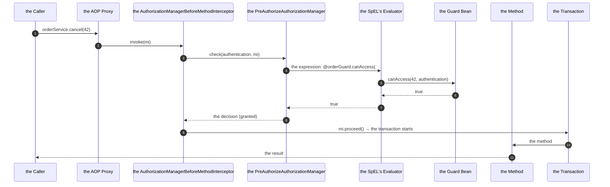
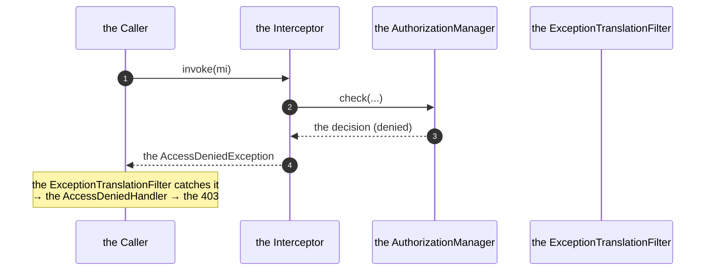
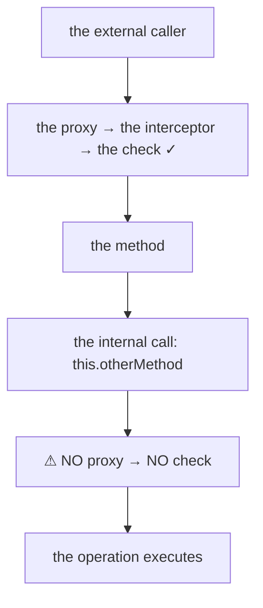

# 05 · Method-Level Security & Custom Guards

> **Level:** Intermediate → Advanced
> **Interview Frequency:** ★★★★☆ ("How would you implement a custom authorization rule?")
> **Prerequisite:** [03 · Authorization, Roles & Permissions](./03-Authorization-Roles-and-Permissions.md)
> **Last Updated:** 2026

---

## 📋 Table of Contents
- [0. TL;DR — The 30-Second Answer](#0-tldr--the-30-second-answer)
- [1. What & Why](#1-what--why)
- [2. Mental Model — The Interceptor Chain](#2-mental-model--the-interceptor-chain)
- [3. Deep Dive — Theory](#3-deep-dive--theory)
- [4. Internal Working Mechanism](#4-internal-working-mechanism)
- [5. Step-by-Step Execution Flow](#5-step-by-step-execution-flow)
- [6. Architecture Diagrams](#6-architecture-diagrams)
- [7. Production-Level Use Cases](#7-production-level-use-cases)
- [8. Code Examples — Production-Grade](#8-code-examples--production-grade)
- [9. Common Mistakes & Gotchas](#9-common-mistakes--gotchas)
- [10. Performance Considerations](#10-performance-considerations)
- [11. Security Considerations](#11-security-considerations)
- [12. Best Practices — The Checklist](#12-best-practices--the-checklist)
- [13. Hands-On Exercises](#13-hands-on-exercises)
- [14. Code Challenges](#14-code-challenges)
- [15. Scenario-Based Questions](#15-scenario-based-questions)
- [16. Interview Q&A — Level-wise](#16-interview-qa--level-wise)
- [17. Counter-Questions & Traps](#17-counter-questions--traps)
- [18. Tricky Interview Questions](#18-tricky-interview-questions)
- [19. Follow-Up Questions Asked by Interviewers](#19-follow-up-questions-asked-by-interviewers)
- [20. Real 3–5 Year Experience Scenarios](#20-real-35-year-experience-scenarios)
- [21. Frequently Asked Production Issues](#21-frequently-asked-production-issues)
- [22. Debugging Scenarios](#22-debugging-scenarios)
- [23. Architecture Design Questions](#23-architecture-design-questions)
- [24. Rapid-Fire MCQs](#24-rapid-fire-mcqs)
- [25. Cheat Sheet — One-Page Summary](#25-cheat-sheet--one-page-summary)
- [26. Real-World Production Notes](#26-real-world-production-notes)
- [27. Follow-up Learning](#27-follow-up-learning)

---

## 0. TL;DR — The 30-Second Answer

- **The method security is an AOP advisor** (`AuthorizationManagerBeforeMethodInterceptor`)
  around the annotated method → the SpEL expression is evaluated against the `Authentication`
  and the method's arguments.
- **`@PreAuthorize`** — before the method (the veto). **`@PostAuthorize`** — after (the
  return value's filtering). **`@PreAuthorize` + `@PostAuthorize`** — the write and the read
  control.
- **The SpEL's roots:** `authentication`, `principal`, `roles`, `authorities`, `return`
  (`@PostAuthorize` only), `#argName` (the method's arguments), and `@beanName` (the Spring
  beans).
- **The `@EnableMethodSecurity`** (Spring Security 6) enables it; the `@EnableGlobalMethodSecurity`
  is deprecated. The defaults: `prePostEnabled = true`, `securedEnabled = true`,
  `jsr250Enabled = true`.
- **The self-invocation bypasses the check** — the proxy is not involved. The fix: a separate
  bean (or the `AopContext.currentProxy()`).
- **The custom guards** (the beans referenced as `@orderGuard.canAccess(#id, authentication)`)
  are the production pattern for the object-level checks. The bean name in the SpEL must match
  the bean's name (or the `@Component("orderGuard")`).
- **The argument names** require the `-parameters` compiler flag (or the debug info) → otherwise
  the `#arg0`.
- **The `AuthorizationManager`** (the modern API) can be used for the method level too (the
  `MethodAuthorizationContext`) — it's composable (`and()`/`or()`).
- **The one-liner:** *"The method security is an interceptor that evaluates a SpEL expression
  before (or after) the call. The expression can use the authentication, the arguments, and any
  Spring bean — which is how you implement the object-level and the business-rule
  authorization."*

---

## 1. What & Why

The URL-level rules can't express "the user can cancel their own order only if it's not
shipped". That's the method level — and the place where most of the real authorization
business logic lives. The interviews ask how you'd implement a custom rule, and the answer
should show that you know the extension mechanism, not just the annotations.

---

## 2. Mental Model — The Interceptor Chain

```text
   the caller
      │
      ▼
   ┌────────────────────────────────────┐
   │ the AOP proxy                     │
   │   the AuthorizationManagerBefore.. │
   │   → the SpEL's evaluation         │
   │   → the AuthorizationDecision     │
   └──────────────┬─────────────────────┘
                  │ granted
                  ▼
   ┌────────────────────────────────────┐
   │ the method                        │
   │   → the @Transactional's proxy    │   ← the transaction's advisor (the order: the
   │   → the business logic            │      security is 200, the transaction is the lowest)
   └────────────────────────────────────┘
```

---

## 3. Deep Dive — Theory

### 3.1 The three annotations

```java
@PreAuthorize("hasRole('ADMIN')")
@PostAuthorize("return.owner.id == principal.id")
@Secured("ROLE_ADMIN")
@RolesAllowed("ADMIN")
```

**The evaluation points:**

| The annotation | The point | The SpEL's `return` |
|----------------|-----------|---------------------|
| `@PreAuthorize` | Before the method | ✗ |
| `@PostAuthorize` | After the method | ✓ |
| `@Secured` | Before | ✗ (the roles only) |
| `@RolesAllowed` | Before | ✗ (the roles only) |

**The combination that matters:**
```java
@PreAuthorize("hasAuthority('ORDER_UPDATE')")     // the capability
@PostAuthorize("return.customerId == principal.id || hasRole('ADMIN')")   // the ownership
@Transactional
public Order update(Long id, UpdateOrderRequest request) { ... }
```

**The `@PostAuthorize`'s caveat:** the method **runs** and the data is **loaded** before the
check → the data was in the JVM's memory → the "the read filtering" is a convenience, not a
protection. **The query-level scoping is the real protection.**

### 3.2 The SpEL's context

```java
@PreAuthorize("hasRole('ADMIN') or (#id != null and @orderService.isOwnedBy(#id, authentication.name))")
```

**The roots:**
| The name | The value |
|----------|----------|
| `authentication` | The `Authentication` object |
| `principal` | `authentication.getPrincipal()` (the shorthand) |
| `roles` | `authentication.getAuthorities()` |
| `authorities` | The same |
| `return` | The method's return value (`@PostAuthorize` only) |
| `#paramName` | The method's arguments |
| `@beanName` | The Spring beans (the `BeanFactory` resolver) |
| `request` | The `RequestAttributes` (the web only) |
| `p` | The `Authentication` (the legacy alias) |

**The methods on the `Authentication`:**
```java
authentication.getName()          // the username
authentication.getPrincipal()     // the principal object
authentication.getAuthorities()   // the collection
authentication.isAuthenticated()
authentication.getDetails()       // the WebAuthenticationDetails (the IP)
```

**The argument's names:** with the `-parameters` compile flag (the Spring Boot's Gradle/Maven
plugins set it by default):
```java
@PreAuthorize("#orderId == principal.id")
public Order get(@PathVariable Long orderId) { ... }
```
Without it → `#p0` / `#a0` (the positional).

**The beans in the SpEL:**
```java
@PreAuthorize("@orderGuard.canAccess(#id, authentication)")
@PreAuthorize("@permissionService.has(authentication, 'ORDER', 'DELETE')")
@PreAuthorize("@tenantGuard.matches(authentication, #tenantId)")
```

### 3.3 The custom guard — the pattern

```java
@Component("orderGuard")
@RequiredArgsConstructor
public class OrderGuard {

    private final OrderRepository orderRepository;

    public boolean canAccess(Long orderId, Authentication authentication) {
        if (hasRole(authentication, "ROLE_ADMIN")) {
            return true;
        }
        Long ownerId = currentUserId(authentication);
        return orderRepository.existsByIdAndCustomerId(orderId, ownerId);
    }
}
```

**The design rules for the guards:**
1. **The bean name must match** the SpEL's reference (or the `@Component("name")`).
2. **The guard must be a bean** (the proxying) — but a guard doesn't need the proxying (no
   `@Transactional`); still, a bean is needed for the SpEL's resolution.
3. **The guard should be stateless and fast** — it's on the hot path.
4. **The guard should return `boolean`** (the SpEL's truthiness) — or a richer object for the
   `hasPermission` style.
5. **The guard should fail closed** (any exception → the deny, or the exception propagates →
   the 500 — both are "not a grant"; the exception is louder and better for the debugging).

### 3.4 The `AuthorizationManager` for the method level

```java
@Component
@RequiredArgsConstructor
public class OrderAuthorizationManager implements AuthorizationManager<MethodAuthorizationContext> {

    private final OrderRepository orderRepository;

    @Override
    public AuthorizationDecision check(Supplier<Authentication> authentication,
                                       MethodAuthorizationContext context) {
        Authentication auth = authentication.get();
        if (auth == null || !auth.isAuthenticated()) {
            return AuthorizationDecision.deny();
        }
        Long orderId = context.getArguments()[0] instanceof Long id ? id : null;
        boolean granted = orderId != null
                && orderRepository.existsByIdAndCustomerId(orderId, currentUserId(auth));
        return granted ? AuthorizationDecision.grant() : AuthorizationDecision.deny();
    }
}
```

**The registration (the custom annotation + the `AuthorizationManager`):**
```java
@Target({ElementType.METHOD, ElementType.TYPE})
@Retention(RetentionPolicy.RUNTIME)
@Documented
@PreAuthorize("@orderAuthorizationManager")
public @interface OrderAccess {
}
```
**The `PreAuthorize` with a bean reference** — the SpEL's expression `@orderAuthorizationManager`
evaluates the bean (but the `AuthorizationManager`'s `check` isn't invoked by the SpEL). The
**proper** way is a **custom `AuthorizationManagerBeforeMethodInterceptor`** — or simpler: the
`@PreAuthorize` with a **method call** on a bean that internally calls the manager:
```java
@PreAuthorize("@orderAuthorizationManager.canAccess(#id, authentication)")
```
where the manager exposes a `canAccess` method. **The practical recommendation:** use the
**guard bean** (the method call) for the simplicity; use the custom
`AuthorizationManager` (the `AuthorizationManagerBeforeMethodInterceptor`) when you need the
**composed** decision (the `and()`/`or()`) or the **custom metadata**.

**The custom `AuthorizationManager` + the custom advisor (the full pattern):**
```java
@Bean
static Advisor orderAccessAdvisor(OrderAuthorizationManager manager) {
    AuthorizationManagerBeforeMethodInterceptor interceptor =
            new AuthorizationManagerBeforeMethodInterceptor(
                    manager, new AnnotationMatchingPointcut(null, OrderAccess.class, true), null);
    interceptor.setOrder(AuthorizationInterceptorsOrder.PRE_AUTHORIZE);
    return interceptor;
}
```
**The `AnnotationMatchingPointcut`** — the `classAnnotationType`, the `methodAnnotationType`, and
the `checkInherited`.

### 3.5 The `@PostAuthorize` — the read filtering

```java
@PostAuthorize("hasRole('ADMIN') or return.customer.id == principal.id")
@Transactional(readOnly = true)
public List<Order> findAll() {
    return orderRepository.findAll();
}
```

**The problem:** the **whole list** is loaded, then the expression is evaluated **once** (on
the returned object) → for a `List`, the expression sees the list, not the elements → you need:
```java
@PostAuthorize("return.stream().allMatch(o -> o.customer.id == principal.id or hasRole('ADMIN'))")
```
→ the semantics are awkward and the data is already loaded.

**The better alternative — the query-level filtering:**
```java
@PreAuthorize("hasAuthority('ORDER_READ')")
@Transactional(readOnly = true)
public List<Order> findAll() {
    return orderRepository.findByCustomerId(currentUserId());
}
```

**Where the `@PostAuthorize` IS right:** the single-object retrieval with a **role-dependent
field masking**:
```java
@PostAuthorize("hasRole('SUPPORT') or return.customer.pii == null")
public CustomerView getCustomer(Long id) { ... }
```

### 3.6 The `hasPermission` — the legacy `PermissionEvaluator`

```java
public interface PermissionEvaluator {
    boolean hasPermission(Authentication authentication, Object targetDomainObject, Object permission);
    boolean hasPermission(Authentication authentication, Object targetDomainObject,
                           String permission, Object... args);
}
```

```java
@PreAuthorize("hasPermission(#order, 'WRITE')")
```

**The status:** the `hasPermission` is still supported but the modern approach is the
`AuthorizationManager` with a **custom metadata**:
```java
@PreAuthorize("@orderGuard.canAccess(#order, 'WRITE')")
```
or the `AuthorizationManager` with a `MethodAuthorizationContext` carrying the custom
annotation's attributes.

### 3.7 The `@AuthenticationPrincipal` — the typed principal in the method

```java
@GetMapping("/{id}")
public OrderResponse get(@PathVariable Long id,
                          @AuthenticationPrincipal UserPrincipal principal) {
    return orderService.getOrder(id);
}
```

**The `expression` variant:**
```java
public Long userId(@AuthenticationPrincipal(expression = "id") Long id) { ... }
public boolean isAdmin(@AuthenticationPrincipal(expression = "admin") boolean admin) { ... }
```

**The `errorOnInvalidType`:**
```java
@AuthenticationPrincipal(errorOnInvalidType = false) UserPrincipal principal
```
→ `null` instead of the exception (for the anonymous).

### 3.8 The `@PreAuthorize` with the async / the reactive

**The async (`@Async`):** the `SecurityContext` is **not** propagated → the `SecurityContextHolder`
is empty in the async thread → the SpEL's `authentication` is null → the NPE or the deny. The
fixes: the `DelegatingSecurityContextExecutor`, the `TransmittableThreadLocal`, or the
explicit data passing.

**The reactive (WebFlux):** the `ReactorSecurityContextHolder` → the
`ReactiveExpressionHandler` → the `@PreAuthorize` works, but the expression's evaluation is
deferred (the `Mono` context). The `@AuthenticationPrincipal` resolves the reactive way.

### 3.9 The method security's interaction with the `@Transactional`

**The advisor's order:**
```java
public class AuthorizationInterceptorsOrder {
    public static final int PRE_AUTHORIZE = 200;          // the @PreAuthorize
    public static final int POST_AUTHORIZE = 300;         // the @PostAuthorize
    public static final int PRE_FILTER = 100;             // the filter-level
}
```
**The `TransactionInterceptor`'s order:** `Ordered.LOWEST_PRECEDENCE` (the lowest) → the
**security's advisor is outside** the transaction's → the denied call **doesn't open a
transaction** → no wasted connection, no rollback.

**The `@PostAuthorize`:** the order 300 → it's still **before** the transaction's advisor? No —
the lower the number, the higher the priority (the outer). So the `@PreAuthorize` (200) is
outside the transaction, and the `@PostAuthorize` (300) is also outside (300 < MAX_VALUE) →
both run before the transaction. Hmm — wait, the `@PostAuthorize` must run **after** the method
(it's a post-interceptor) but **inside** the transaction (so the transaction's commit happens
after the check). With the order 300 < the transaction's LOWEST_PRECEDENCE, the `@PostAuthorize`
interceptor is **outside** the transaction's interceptor → the transaction commits before the
`@PostAuthorize` check → a denied `@PostAuthorize` after a successful commit → the data was
written and the exception is thrown afterwards. **The nuance worth knowing.**

### 3.10 The custom `SecurityExpressionHandler`

```java
public class OrderExpressionHandler extends DefaultMethodSecurityExpressionHandler {

    @Override
    public EvaluationContext createEvaluationContext(Authentication authentication,
                                                      MethodInvocation mi) {
        EvaluationContext context = super.createEvaluationContext(authentication, mi);
        context.setVariable("orderId", extractOrderId(mi));
        return context;
    }
}
```

```java
@PreAuthorize("@orderGuard.canAccess(orderId, authentication)")
```

**The registration:**
```java
@Bean
static MethodSecurityExpressionHandler methodExpressionHandler() {
    return new OrderExpressionHandler();
}
```
**The static `BeanFactory`:** the `MethodSecurityExpressionHandler` must be a **static**
`@Bean` (to avoid the early initialisation of the `ApplicationContext`).

### 3.11 The `@PreAuthorize` on the class level

```java
@Service
@PreAuthorize("hasRole('SERVICE')")
public class InternalBillingService {
    // every method requires the SERVICE role
}
```
**The class-level + the method-level:** the method-level **overrides** the class-level (the
`AnnotationMatchingPointcut` for the method wins) — the class-level is **not** combined. **The
trap:** the class-level `@PreAuthorize` silently stops applying when a method has its own.

### 3.12 The "the deny by default" pattern

```java
@Service
@PreAuthorize("hasAuthority('BILLING_READ')")
public class BillingReadService { ... }

@Service
@PreAuthorize("hasAuthority('BILLING_WRITE')")
public class BillingWriteService { ... }
```
**The pattern:** one bean per permission (the "the capability-per-bean" design) → the
annotation can't be forgotten (the class-level applies to all the methods) and the beans stay
small.

**The alternative (the annotation's meta):**
```java
@Target(ElementType.METHOD)
@Retention(RetentionPolicy.RUNTIME)
@PreAuthorize("hasAuthority(#requiredPermission)")
public @interface RequiresPermission {
    String value();
}
```
**The catch:** the `#requiredPermission` refers to the **annotation's attribute** — the SpEL's
`#requiredPermission` resolves the annotation's attribute (the `AnnotationParameterNameDiscoverer`
supports it) → **this works**! (The Spring Security's `SecurityAnnotationParameterNameDiscoverer`
looks up the annotation's attributes by name.)

**The usage:**
```java
@RequiresPermission("ORDER_DELETE")
public void delete(Long id) { ... }
```
**The caveat:** the custom annotation's SpEL must use the attribute's name — and the
`@PreAuthorize`'s meta-annotation support requires the `PrePostTemplateDefaults`... The
**production recommendation:** keep it simple — the explicit `@PreAuthorize` with the literal
string, or the guard beans.

---

## 4. Internal Working Mechanism

### 4.1 The `AuthorizationManagerBeforeMethodInterceptor`

```java
public class AuthorizationManagerBeforeMethodInterceptor extends AuthorizationManagerBeforeMethodInterceptor
        implements AopAlliance Advisor {

    private final AuthorizationManager<MethodAuthorizationContext> authorizationManager;
    private final Pointcut pointcut;
    private final SecurityExpressionHandler expressionHandler;

    @Override
    public Object invoke(MethodInvocation mi) throws Throwable {
        AuthorizationDecision decision = this.authorizationManager.check(
                this::getAuthentication, mi.getThis(), mi.getArguments());
        this.eventPublisher.publishEvent(new AuthorizationEvent(this, decision,
                getAuthentication().orElse(null), mi.getArguments()));
        if (decision.isGranted()) {
            return mi.proceed();
        }
        throw new AccessDeniedException("Access Denied");
    }

    private Supplier<Authentication> getAuthentication() {
        return () -> {
            Authentication authentication = SecurityContextHolder.getContext().getAuthentication();
            if (authentication == null) return null;
            // the method's Authentication parameter takes precedence
            for (Object arg : getAuthenticationArguments()) { ... }
            return authentication;
        };
    }
}
```

### 4.2 The `PreAuthorizeAuthorizationManager`

```java
public class PreAuthorizeAuthorizationManager extends AuthorizationManagerBeforeMethodInterceptor
        implements AuthorizationManager<MethodAuthorizationContext> {

    @Override
    public AuthorizationDecision check(Supplier<Authentication> authentication, MethodInvocation mi) {
        Collection<PreAuthorize> annotations = findPreAuthorizeAnnotations(mi);
        if (annotations.isEmpty()) return new AuthorizationDecision(true);
        PreAuthorize annotation = annotations.iterator().next();
        Expression expression = this.expressionParser.parseExpression(annotation.value());
        EvaluationContext ctx = this.expressionHandler.createEvaluationContext(
                authentication.get(), mi);
        return new AuthorizationDecision((Boolean) expression.getValue(ctx, Boolean.class));
    }
}
```

**The `findPreAuthorizeAnnotations`:**
```java
protected Collection<PreAuthorize> findPreAuthorizeAnnotations(MethodInvocation mi) {
    MergedAnnotations mergedAnnotations = MergedAnnotations.from(
            mi.getMethod(), SecurityAnnotationParameterNameDiscoverer.forParameter(
                    mi.getMethod().getParameters(), "value"),
            MergedAnnotationSelectors.metaAnnotation(PreAuthorize.class),
            MergedAnnotationSelectors.closestMatch());
    return mergedAnnotations.stream(PreAuthorize.class).toList();
}
```
**The `metaAnnotation` selector** → the `@PreAuthorize` on a **meta-annotation** is supported
(the `MergedAnnotationSelectors.metaAnnotation`) — so a custom annotation **can** be meta-annotated
with `@PreAuthorize`!

### 4.3 The `DefaultMethodSecurityExpressionHandler`

```java
public class DefaultMethodSecurityExpressionHandler extends DefaultWebSecurityExpressionHandler
        implements MethodSecurityExpressionHandler {

    @Override
    public EvaluationContext createEvaluationContext(Authentication authentication, MethodInvocation mi) {
        EvaluationContext ctx = super.createEvaluationContext(authentication, mi.getThis());
        ctx.setVariable("return", null);   // the placeholder
        return ctx;
    }

    @Override
    public Object evaluate(Authentication authentication, MethodInvocation mi, String expression) {
        EvaluationContext ctx = createEvaluationContext(authentication, mi);
        return getExpressionRoot(ctx).getValue(expression, Object.class);
    }
}
```

**The `MethodSecurityExpressionRoot` — the extra roots:**
```java
public class MethodSecurityExpressionRoot extends SecurityExpressionRoot {
    private MethodInvocation mi;

    public void setFilter(Object filter) { ... }
    public Object getReturn() { return this.filter; }
    public void setReturn(Object returnValue) { this.filter = returnValue; }
}
```
**The `return` is the `filter` field** — the `@PostAuthorize` sets it after the method returns.

### 4.4 The `AuthorizationManagerAfterMethodInterceptor` (the `@PostAuthorize`)

```java
public class AuthorizationManagerAfterMethodInterceptor implements MethodInterceptor {

    @Override
    public Object invoke(MethodInvocation mi) throws Throwable {
        Object result = mi.proceed();     // ① the method runs
        AuthorizationDecision decision = this.authorizationManager.check(
                this::getAuthentication, mi.getThis(), mi.getArguments(), result);
        if (decision.isGranted()) {
            return result;
        }
        throw new AccessDeniedException("Access Denied");
    }
}
```

**The order (300) vs the transaction's (the lowest)** → the `@PostAuthorize` interceptor is
**outside** the transaction → the transaction commits before the check → the "the write
succeeded but the read was denied" nuance.

### 4.5 The `AopUtils` — the annotation's lookup

```java
public static Method getMostSpecificMethod(Method invocationMethod, Class<?> targetClass) { ... }
public static boolean canApply(Pointcut pc, TargetClass targetClass, boolean hasIntroductions) { ... }
```

**The `AnnotationMatchingPointcut` (the class + the method):**
```java
public AnnotationMatchingPointcut(Class<? extends Annotation> classAnnotationType,
                                  Class<? extends Annotation> methodAnnotationType,
                                  boolean checkInherited) {
    this.classAnnotationType = classAnnotationType;
    this.methodAnnotationType = methodAnnotationType;
    this.checkInherited = checkInherited;
}

@Override
public boolean matches(Method method, Class<?> targetClass) {
    if (matchesMethod(method)) return true;
    // the proxy's method
    if (Proxy.isProxyClass(targetClass)) return false;
    // the specific method
    Method specificMethod = AopUtils.getMostSpecificMethod(method, targetClass);
    return matchesMethod(specificMethod);
}

private boolean matchesMethod(Method method) {
    if (this.methodAnnotationType != null) {
        return AnnotatedElementUtils.hasAnnotation(method, this.methodAnnotationType);
    }
    if (this.classAnnotationType != null) {
        return AnnotatedElementUtils.hasAnnotation(method.getDeclaringClass(), this.classAnnotationType);
    }
    return false;
}
```

**The key:** the `hasAnnotation` (the Spring's `AnnotatedElementUtils`) → the **meta-annotations**
are supported (the composed annotations).

---

## 5. Step-by-Step Execution Flow

### 5.1 The `@PreAuthorize`'s evaluation



### 5.2 The denied path



### 5.3 The self-invocation (the bypass)



---

## 6. Architecture Diagrams

### 6.1 The advisor's chain (the real order)

```text
   the caller
      │
      ▼
   ┌──────────────────────────────────────┐
   │ the @PreAuthorize (the order 200)    │  ← the security's advisor
   └──────────────┬───────────────────────┘
                  ▼
   ┌──────────────────────────────────────┐
   │ the @Transactional (the lowest)      │  ← the transaction's advisor
   └──────────────┬───────────────────────┘
                  ▼
               the method

   the @PostAuthorize (the order 300) is ALSO outside the transaction
   → the transaction commits BEFORE the @PostAuthorize's check
```

### 6.2 The guard's architecture

```text
   @PreAuthorize("@orderGuard.canAccess(#id, authentication)")
        │
        ▼
   the SpEL's evaluation context
        │  the BeanFactoryResolver → the orderGuard bean
        ▼
   ┌──────────────────────────────────┐
   │ the OrderGuard (a @Component)   │
   │   canAccess(id, authentication)  │
   │   ① the admin's bypass           │
   │   ② the ownership's check        │
   │   ③ the state's check            │
   └──────────────────────────────────┘
        │
        ▼
   the boolean → the AuthorizationDecision
```

### 6.3 The three layers of the object-level authorization

```text
   ① the QUERY level (the strongest)
      findByIdAndCustomerId(id, currentUserId)
      → the data is never loaded
      → the 404 for the foreign

   ② the GUARD level (the flexible)
      @PreAuthorize("@orderGuard.canAccess(#id, authentication)")
      → the extra query (the cost)
      → the 403

   ③ the SERVICE level (the explicit)
      if (!order.getCustomerId().equals(currentUserId())) throw ...
      → the easy to forget
```

---

## 7. Production-Level Use Cases

| Use case | The technique |
|----------|---------------|
| **The ownership** | The guard bean + the query-level scoping |
| **The state-based** (the "the order can only be cancelled if not shipped") | The guard (the state check) or the domain logic |
| **The amount-based** (the "the refunds over $1000 need the manager") | The guard (the threshold) |
| **The feature-based** (the "the beta feature") | The `hasAuthority("FEATURE_BETA")` (the role/permission from the DB) |
| **The tenant-based** | The guard or the `@TenantId` (the automatic) |
| **The time-based** (the "the business hours only") | The guard (the `Clock`!) |
| **The multi-approval** (the maker-checker) | The domain logic (the workflow) + the guard for the permission |
| **The impersonation** | The custom `Authentication` + the guard's check on the "the actor" |
| **The field masking** | The `@PostAuthorize` (the role-dependent) or the DTO's serialization |
| **The consistency across the services** | The shared `Guard` library (the common module) |

---

## 8. Code Examples — Production-Grade

### 8.1 The production guard

```java
package com.example.security.guard;

import lombok.RequiredArgsConstructor;
import org.springframework.security.core.Authentication;
import org.springframework.security.core.GrantedAuthority;
import org.springframework.stereotype.Component;
import org.springframework.transaction.annotation.Transactional;

@Component("orderGuard")
@RequiredArgsConstructor
public class OrderGuard {

    private static final Set<OrderStatus> CANCELLABLE = Set.of(
            OrderStatus.CREATED, OrderStatus.PAID, OrderStatus.PREPARING);

    private final OrderRepository orderRepository;
    private final CurrentUserService currentUserService;

    @Transactional(readOnly = true)
    public boolean canAccess(Long orderId, Authentication authentication) {
        if (isAdmin(authentication)) {
            return true;
        }
        if (orderId == null) {
            return false;
        }
        return orderRepository.existsByIdAndCustomerId(orderId, currentUserId(authentication));
    }

    @Transactional(readOnly = true)
    public boolean canCancel(Long orderId, Authentication authentication) {
        if (isAdmin(authentication)) {
            return true;
        }
        return orderRepository.findByIdAndCustomerId(orderId, currentUserId(authentication))
                .map(order -> CANCELLABLE.contains(order.getStatus()))
                .orElse(false);
    }

    public boolean canRefund(Long orderId, Authentication authentication) {
        if (!hasAuthority(authentication, "ORDER_REFUND")) {
            return false;
        }
        return orderRepository.findById(orderId)
                .map(order -> order.getTotalAmount().compareTo(REFUND_APPROVAL_THRESHOLD) < 0)
                .orElse(false);
    }

    private boolean isAdmin(Authentication authentication) {
        return hasAuthority(authentication, "ROLE_ADMIN");
    }

    private boolean hasAuthority(Authentication authentication, String authority) {
        return authentication != null && authentication.getAuthorities().stream()
                .map(GrantedAuthority::getAuthority)
                .anyMatch(authority::equals);
    }

    private Long currentUserId(Authentication authentication) {
        return currentUserService.currentUserId(authentication);
    }
}
```

### 8.2 The service with the layered security

```java
@Service
@RequiredArgsConstructor
public class OrderService {

    private final OrderRepository orderRepository;
    private final OrderEventPublisher eventPublisher;

    @PreAuthorize("hasAuthority('ORDER_CREATE')")
    @Transactional
    public Order create(CreateOrderRequest request, Authentication authentication) {
        Order order = Order.builder()
                .customerId(currentUserId(authentication))
                .status(OrderStatus.CREATED)
                .build();
        Order saved = orderRepository.save(order);
        eventPublisher.publish(new OrderCreatedEvent(saved.getId()));
        return saved;
    }

    @PreAuthorize("@orderGuard.canAccess(#id, authentication)")
    @Transactional(readOnly = true)
    public Order get(Long id, Authentication authentication) {
        return orderRepository.findByIdAndCustomerId(id, currentUserId(authentication))
                .orElseThrow(() -> new OrderNotFoundException(id));
    }

    @PreAuthorize("@orderGuard.canCancel(#id, authentication)")
    @Transactional
    public void cancel(Long id, Authentication authentication) {
        Order order = orderRepository.findByIdAndCustomerId(id, currentUserId(authentication))
                .orElseThrow(() -> new OrderNotFoundException(id));
        order.cancel();
        orderRepository.save(order);
    }

    @PreAuthorize("hasAuthority('ORDER_REFUND') and @orderGuard.canRefund(#id, authentication)")
    @Transactional
    public void refund(Long id, String reason) {
        Order order = orderRepository.findById(id)
                .orElseThrow(() -> new OrderNotFoundException(id));
        order.refund(reason);
    }
}
```

### 8.3 The `@PreAuthorize` with the composed expressions

```java
@PreAuthorize("hasRole('ADMIN') or (hasAuthority('ORDER_READ') and @orderGuard.canAccess(#id, authentication))")
@Transactional(readOnly = true)
public OrderView getOrder(Long id, Authentication authentication) { ... }
```

**The `or`/`and` in the SpEL** — the operators work on the booleans:
```java
@PreAuthorize("hasRole('ADMIN') and hasAuthority('AUDIT')")
```

### 8.4 The custom `AuthorizationManager` (the method level)

```java
package com.example.security.manager;

@Component
@RequiredArgsConstructor
public class OrderAuthorizationManager implements AuthorizationManager<MethodAuthorizationContext> {

    private final OrderRepository orderRepository;
    private final CurrentUserService currentUserService;

    @Override
    public AuthorizationDecision check(Supplier<Authentication> authentication,
                                       MethodAuthorizationContext context) {
        Authentication auth = authentication.get();
        if (auth == null || !auth.isAuthenticated()) {
            return AuthorizationDecision.deny();
        }
        Object[] args = context.getArguments();
        if (args.length == 0 || !(args[0] instanceof Long orderId)) {
            return AuthorizationDecision.deny();
        }
        boolean granted = orderRepository.existsByIdAndCustomerId(
                orderId, currentUserService.currentUserId(auth));
        return granted ? AuthorizationDecision.grant() : AuthorizationDecision.deny();
    }
}
```

### 8.5 The custom annotation + the custom advisor

```java
package com.example.security.annotation;

@Target({ElementType.METHOD, ElementType.TYPE})
@Retention(RetentionPolicy.RUNTIME)
@Documented
public @interface OrderAccess {
    /** the access mode */
    AccessMode value() default AccessMode.READ;

    enum AccessMode { READ, WRITE, DELETE }
}
```

```java
@Target({ElementType.METHOD, ElementType.TYPE})
@Retention(RetentionPolicy.RUNTIME)
@Documented
@PreAuthorize("@orderAuthorizationManager.check(#root, #orderId, #p0)")
public @interface RequiresOrderAccess {
    String orderId() default "";
}
```
**The simpler, working version (the meta-annotation with a literal):**
```java
@Target(ElementType.METHOD)
@Retention(RetentionPolicy.RUNTIME)
@Documented
@PreAuthorize("@orderGuard.canAccess(#id, authentication)")
public @interface RequiresOrderOwnership {
}
```
**The usage:**
```java
@RequiresOrderOwnership
public Order get(Long id) { ... }
```
**The caveat:** the `#id` refers to the **annotated method's** argument, so the method's
parameter must be named `id` (or the annotation's own expression must match).

### 8.6 The `@PostAuthorize` (the role-dependent field masking)

```java
@Getter
public class CustomerView {
    private final Long id;
    private final String name;
    private final String email;        // the masked for the non-support
    private final String phone;
    private final String ssn;          // the null for the non-compliance
}
```

```java
@PreAuthorize("hasAuthority('CUSTOMER_READ')")
@PostAuthorize("hasRole('SUPPORT') or hasRole('COMPLIANCE')")
@Transactional(readOnly = true)
public CustomerView getCustomer(Long id) {
    Customer customer = customerRepository.findById(id)
            .orElseThrow(() -> new CustomerNotFoundException(id));
    return CustomerView.from(customer);
}
```
**The masking is done in the DTO's factory (based on the caller's authorities) — the
`@PostAuthorize` is the coarse gate.**

### 8.7 The DTO's role-dependent masking (the better pattern)

```java
@Component
@RequiredArgsConstructor
public class CustomerViewFactory {

    private final MaskingService maskingService;

    public CustomerView toView(Customer customer, Authentication authentication) {
        boolean canSeePii = hasAuthority(authentication, "CUSTOMER_PII_VIEW");
        boolean canSeeSsn = hasAuthority(authentication, "CUSTOMER_SSN_VIEW");

        return CustomerView.builder()
                .id(customer.getId())
                .name(customer.getName())
                .email(canSeePii ? customer.getEmail() : maskingService.maskEmail(customer.getEmail()))
                .phone(canSeePii ? customer.getPhone() : null)
                .ssn(canSeeSsn ? customer.getSsn() : null)
                .build();
    }
}
```

### 8.8 The custom `SecurityExpressionHandler` (the extra variables)

```java
public class OrderSecurityExpressionHandler extends DefaultMethodSecurityExpressionHandler {

    @Override
    public EvaluationContext createEvaluationContext(Authentication authentication, MethodInvocation mi) {
        EvaluationContext context = super.createEvaluationContext(authentication, mi);
        context.setVariable("orderId", extractOrderId(mi));
        context.setVariable("callerIp", extractIp(authentication));
        return context;
    }

    private Long extractOrderId(MethodInvocation mi) {
        for (Object arg : mi.getArguments()) {
            if (arg instanceof Long id) return id;
        }
        return null;
    }
}
```

```java
@PreAuthorize("@orderGuard.canAccess(orderId, authentication) and @ipGuard.isInternal(callerIp)")
```

### 8.9 The `@AuthenticationPrincipal` (the controller)

```java
@RestController
@RequestMapping("/api/orders")
@RequiredArgsConstructor
public class OrderController {

    private final OrderService orderService;

    @GetMapping("/{id}")
    public OrderResponse get(@PathVariable Long id,
                              @AuthenticationPrincipal UserPrincipal principal) {
        return OrderResponse.from(orderService.get(id, principal));
    }

    @GetMapping("/mine")
    public List<OrderResponse> mine(@AuthenticationPrincipal UserPrincipal principal) {
        return orderService.listFor(principal.getId()).stream().map(OrderResponse::from).toList();
    }
}
```

### 8.10 The "the capability-per-bean" pattern

```java
@Service
@PreAuthorize("hasAuthority('BILLING_READ')")
@RequiredArgsConstructor
public class BillingReadService {

    private final InvoiceRepository invoiceRepository;

    public List<Invoice> list() {
        return invoiceRepository.findAll();
    }

    public Invoice get(Long id) {
        return invoiceRepository.findById(id).orElseThrow();
    }
}
```

```java
@Service
@PreAuthorize("hasAuthority('BILLING_WRITE')")
@RequiredArgsConstructor
public class BillingWriteService {

    private final InvoiceRepository invoiceRepository;

    public void markPaid(Long id) {
        invoiceRepository.findById(id).orElseThrow().markPaid();
    }
}
```
**The benefit:** the class-level annotation covers every method (and the method-level one
would override it — so the split-beans design avoids the trap).

### 8.11 The test for the method security

```java
@SpringBootTest
@AutoConfigureMockMvc
class OrderServiceSecurityTest {

    @Autowired OrderService orderService;
    @Autowired OrderRepository orderRepository;

    @Test
    @DisplayName("The owner can read their own order")
    @WithMockUser(username = "alice", roles = "USER")
    void ownerCanRead() {
        Order order = orderRepository.save(Order.builder().customerId(1L).build());
        assertThat(orderService.get(order.getId(), currentAuth())).isNotNull();
    }

    @Test
    @DisplayName("Another user is denied (the guard)")
    @WithMockUser(username = "mallory", roles = "USER")
    void otherUserDenied() {
        Order order = orderRepository.save(Order.builder().customerId(1L).build());
        assertThatThrownBy(() -> orderService.get(order.getId(), currentAuth()))
                .isInstanceOf(AccessDeniedException.class);
    }

    @Test
    @DisplayName("The method-level permission is enforced")
    @WithMockUser(username = "alice", roles = "USER")
    void refundRequiresPermission() {
        assertThatThrownBy(() -> orderService.refund(1L, "test"))
                .isInstanceOf(AccessDeniedException.class);
    }
}
```

### 8.12 The `AopContext.currentProxy()` (the self-invocation's escape hatch)

```java
@Service
public class OrderService implements ApplicationContextAware {

    private ApplicationContext applicationContext;

    @PreAuthorize("hasRole('ADMIN')")
    public void adminOnly() { ... }

    public void callAdminOnly() {
        OrderService self = applicationContext.getBean(OrderService.class);  // the proxy
        self.adminOnly();   // the check applies
    }
}
```
**The advice:** prefer the **separate bean** — the `AopContext` requires the `exposeProxy = true`
and it's fragile.

---

## 9. Common Mistakes & Gotchas

| # | ❌ Wrong | ✅ Right | Why |
|---|----------|----------|-----|
| 1 | The self-invocation of an annotated method | The separate bean | The proxy is bypassed |
| 2 | The private/final/static annotated method | The public, non-final | The Spring AOP's limitation |
| 3 | The missing `-parameters` compile flag | The flag (the Boot's plugins set it) | The `#id` doesn't resolve |
| 4 | The `@PreAuthorize` on a private method | The public API | Never advised |
| 5 | The class-level + the method-level `@PreAuthorize` | The method-level overrides | The class-level is silently lost |
| 6 | The `@PostAuthorize` as the only protection | The query-level scoping | The data is already loaded |
| 7 | The guard bean's name not matching the SpEL | The `@Component("name")` | The SpEL's resolution fails (the 500) |
| 8 | The `#id` referring to a different argument's name | The consistent naming | The SpEL's evaluation error |
| 9 | The `hasRole` on a method with the `ROLE_` prefix | The consistency | The 403 |
| 10 | The `@PreAuthorize` on the entity (the JPA's entity) | The service | The proxying + the layering |
| 11 | The guard's DB query per call (the N+1) | The scoped query / the caching | The performance |
| 12 | The `@PreAuthorize` with the `@Transactional` on the same class | The separate beans | The advisor's order |
| 13 | The `Authentication` in the `@Async` method | The explicit passing | The thread-local doesn't propagate |
| 14 | The SpEL's exception → the 500 (not the 403) | The guard's try/catch or the fail-closed | The error's semantics |
| 15 | The `@PreAuthorize` on the interface's method only | The implementation's class (the JDK's proxies) | The annotation's lookup |

---

## 10. Performance Considerations

| Aspect | Impact | Guidance |
|--------|--------|----------|
| **The SpEL's evaluation** | ~1–5µs | The parsed expressions are cached; the guard's bean lookup is a map |
| **The guard's query** | A DB round trip | The scoped query (the index); the caching (the short TTL) |
| **The proxy's overhead** | ~100ns per call | Negligible; but the proxy is created for **every** bean with the annotations (the startup's cost) |
| **The `@PostAuthorize`'s extra work** | The expression on the result | The DTO's factory instead |
| **The advisor's order** | The denied call doesn't open a transaction | ✅ (the security is outside the transaction) |
| **The `@Transactional` + the security on the same bean** | Two proxies | The separate beans |

---

## 11. Security Considerations

| Risk | Mitigation |
|------|-----------|
| **The bypassed check (the self-invocation)** | The code review; the ArchUnit rule; the tests (the direct call) |
| **The missing check on the new endpoints** | The class-level annotations; the capability-per-bean pattern; the test matrix |
| **The `@PostAuthorize`'s data exposure** | The query-level scoping |
| **The guard's fail-open** | The guard must never return `true` on an error; the exceptions must propagate (the 500) or deny |
| **The SpEL's injection** | The SpEL's expressions are **static** (in the code) — never built from the user input (that would be a RCE vector!) |
| **The IDOR in the guard** | The guard's query must be the scoped one (`existsByIdAndCustomerId`) |
| **The confused deputy** (the service called with a client's id) | The id must come from the authentication, never from the request |
| **The `hasRole` on the entity's method** | The service layer (the consistent enforcement) |

---

## 12. Best Practices — The Checklist

- [ ] **The `@EnableMethodSecurity`** (the explicit).
- [ ] **The service layer** for the annotations (not the controller, not the entity).
- [ ] **The capability-per-bean** (the class-level annotation, the small beans) or the
  consistent method-level.
- [ ] **The guard beans** in a shared package (the reuse) with the explicit bean names.
- [ ] **The query-level scoping** as the primary (the guard is the secondary).
- [ ] **The `-parameters`** compile flag.
- [ ] **The separate beans** for the self-invocation-sensitive flows.
- [ ] **The tests**: the direct calls (not just the MockMvc) + the denied cases.
- [ ] **The static analysis** (the ArchUnit: "the `@PreAuthorize`d methods must not be
  self-invoked").
- [ ] **The DTOs** (never the entity in the response).
- [ ] **The audit** of the sensitive operations (the `AuthorizationEvent`).

---

## 13. Hands-On Exercises

**🧪 Lab 1 — The self-invocation**
1. Annotate `delete()` with `@PreAuthorize("hasRole('ADMIN')")`.
2. Call it from `deleteInternal()` with a non-admin → the operation executes → the bypass.

**🧪 Lab 2 — The argument's name**
1. Remove the `-parameters` flag → the `@PreAuthorize("#id == principal.id")` → the
   `IllegalArgumentException` (the "the no property found").

**🧪 Lab 3 — The class-level's override**
1. Put `@PreAuthorize("hasRole('ADMIN')")` on the class and `@PreAuthorize("permitAll()")` on
   one method → the class-level is silently lost for that method.

**🧪 Lab 4 — The guard's bean name**
1. Reference `@orderGuard` but name the bean `orderGuardBean` → the SpEL's evaluation error
   (the 500).

---

## 14. Code Challenges

### Challenge 1 — A reusable guard library (medium-hard)
**Goal:** The shared module with the guards (the ownership, the role, the state, the tenant) and
the SpEL's helpers.
**Requirements:** the module, the guards, the test suite, the documentation, the versioning
(the compatibility with the apps).

### Challenge 2 — A policy engine with the SpEL (hard)
**Goal:** The rules in the DB, evaluated by a custom `AuthorizationManager` (the composed
decision), with the caching and the audit.
**Requirements:** the rule model, the evaluator, the `AuthorizationManager`, the integration
with the `@PreAuthorize` (the custom advisor), the test matrix, the performance.

### Challenge 3 — A field-level authorization engine (hard)
**Goal:** The response shaping based on the caller's permissions.
**Requirements:** the annotation (`@VisibleFields({"name", "email"})`), the serializer's
filter, the leak's prevention, the tests, the performance.

---

## 15. Scenario-Based Questions

**S1.** *"A developer wrote `@PreAuthorize("hasRole('ADMIN')")` on a service method, and
another developer calls it from the same class. The test passes but the admin-only operation
is reachable by a normal user."**
>
> **Ideal answer:** (1) **The diagnosis**: the **self-invocation** bypassing the AOP proxy. The
`@PreAuthorize` is enforced by the `AuthorizationManagerBeforeMethodInterceptor` on the
**proxy**; the internal call (`this.method()`) goes directly to the target object → no
interceptor → no check. The **why it happens**: the Spring AOP is proxy-based, and the
developers think of the annotation as a "the method is protected" (a compile-time property)
rather than "the **call through the proxy** is protected" (a runtime property). (2) **The proof**:
(a) the reproduction (the non-admin's internal call → the operation executes); (b) the **the
Spring's AOP limitations** documentation; (c) the code review (the `this.` call). (3) **The
fixes**: (a) the **separate bean** (the cleanest — the caller injects the secured bean); (b) the
**self-injection** (the `ApplicationContextAware` + `getBean(X.class)` → the proxy) — works but
is ugly; (c) the **`AopContext.currentProxy()`** (needs `exposeProxy = true`); (d) the
**refactor** (make the method `private` and expose a public secured entry point → the internal
calls go to the private method, the external calls go through the proxy). (4) **The systemic
fix**: (a) the **the code review rule** — "a method that calls another `this.`-annotated
method needs a justification"; (b) the **the ArchUnit rule** — "a class with `@PreAuthorize`
methods must not call its own annotated methods" (a static check that catches it before the
merge!); (c) the **the tests** — the **the direct unit test** of the service (not just the
MockMvc): the non-admin calls the method → the `AccessDeniedException`. The MockMvc test goes
through the proxy (the controller → the service bean) → it wouldn't catch the self-invocation;
the direct call test would. (d) the **the team's conventions** — "the authorization's
annotations are on the **public API** of the bean; the internal helpers are `private` and
unannotated" (the "the annotated method is the public contract" rule). (5) The senior framing:
"**the method security is a property of the call path, not of the method** — the annotation
protects the *entry* into the bean. That's the mental model shift: the internal call is a
different entry point. The systemic answer is the static check (the ArchUnit rule) and the
convention that the annotated methods are the public API, with the private helpers doing the
work."

**S2.** *"We have 200 service methods and the `@PreAuthorize` strings are inconsistent — some
use `hasRole('ADMIN')`, some `hasAuthority('ADMIN')`, some `hasAuthority('ROLE_ADMIN')`."**
>
> **Ideal answer:** (1) **The analysis**: the **the authorization's vocabulary is not
centralized** — the strings are scattered as literals, so the inconsistency is inevitable and
the 403s are hard to diagnose (the developer adds a `hasRole` where the authorities are
`ADMIN`-prefixed, etc.). The root causes: (a) the **no convention** (the roles vs the
permissions confusion); (b) the **the literals** (no compile-time checking, no refactoring
support); (c) the **the roles' and the permissions' mix** (the role for the coarse, the
permission for the fine — but the developers don't know which to use). (2) **The fix**:
(a) **the constants** (the enum or the constants class) — the compile-time safety:
```java
public final class Authorities {
    private Authorities() {}
    public static final String ROLE_ADMIN = "ROLE_ADMIN";
    public static final String ROLE_MANAGER = "ROLE_MANAGER";
    public static final String ORDER_CREATE = "ORDER_CREATE";
    public static final String ORDER_REFUND = "ORDER_REFUND";
}
```
(b) **the enums** (the best for the roles — the `hasRole` needs a `String` literal, but a
`@PreAuthorize` with a constant reference works: `@PreAuthorize("hasRole(T('...Authorities').ROLE_ADMIN)")`
— the `T()` is the SpEL's type operator, which allows the enum's constant!):
```java
public enum Role { ADMIN, MANAGER, USER }
@PreAuthorize("hasRole(T(com.example.security.Role).ADMIN)")
```
(c) **the custom meta-annotations** (the domain-specific, the intention-revealing):
```java
@PreAuthorize("hasAuthority('ORDER_REFUND')")
public @interface RequiresRefundPermission {}
```
(d) **the single convention** — the roles (`ROLE_*`) and the permissions (the domain-prefixed,
no prefix) and the **one place** that maps the DB's data to the authorities. (3) **The
migration**: (a) the inventory (the grep for the `hasRole`/`hasAuthority`/`permitAll` strings);
(b) the codemod (the OpenRewrite's recipe — the automated refactoring to the constants);
(c) the **the test** that asserts the vocabulary (a test that scans the source for the
`@PreAuthorize` strings and fails if they're not from the constants — the ArchUnit-style
enforcement!); (d) the **the 403's diagnosis** (the log the authorities + the expression at the
decision point → the mismatch is obvious). (4) **The systemic fix**: (a) the **the vocabulary's
documentation** (the list of the roles and the permissions, and the rule "the roles for the
coarse, the permissions for the fine"); (b) the **the permission's catalogue** (the product's
language); (c) the **the static enforcement** (the ArchUnit rule: "the `@PreAuthorize`'s
expression must use a constant"); (d) the **the code review checklist** (the new endpoint → the
correct check). (5) The senior framing: "**the authorization's vocabulary is a contract between
the product, the code, and the database** — when it's scattered as literals, it drifts. The
fix is the constants (the compile-time safety) plus the enforcement (the static check), and
the migration is mechanical (the codemod) once the inventory is done. The deeper fix is the
**permission-based model** where the code checks the capabilities, so the new role is a data
change."

**S3.** *"A user can cancel an order that has already shipped — the developer put the check in
the service, but the endpoint was added by a different team."**
>
> **Ideal answer:** (1) **The diagnosis**: the **the business rule's placement** (the
state-based authorization) — the check isn't a permission (the capability) but a **state
transition's precondition** (the "the order can only be cancelled if it's in the cancellable
status"). The error: (a) the check was **omitted** (the different team, the new endpoint);
(b) the check was **in the wrong layer** (the controller's endpoint instead of the domain's
transition); (c) the check was **racy** (the read-then-write without the lock — two concurrent
cancels, or the ship happening between the check and the update). (2) **The proof**: (a) the
reproduction; (b) the **the state machine**'s review (the `cancel()` on the entity — does it
validate the status?); (c) the code review (the missing check). (3) **The fix** — the key
insight: **the state-based rule belongs in the domain model, not in the security layer**:
```java
@Entity
public class Order {
    public void cancel(String reason) {
        if (!this.status.canTransitionTo(OrderStatus.CANCELLED)) {
            throw new InvalidOrderTransitionException(this.status, OrderStatus.CANCELLED);
        }
        this.status = OrderStatus.CANCELLED;
        this.cancellationReason = reason;
    }
}
```
```java
public enum OrderStatus {
    CREATED, PAID, PREPARING, SHIPPED, DELIVERED, CANCELLED;

    private static final Map<OrderStatus, Set<OrderStatus>> TRANSITIONS = Map.of(
            CREATED,    Set.of(PAID, CANCELLED),
            PAID,       Set.of(PREPARING, CANCELLED),
            PREPARING,  Set.of(SHIPPED, CANCELLED),
            SHIPPED,    Set.of(DELIVERED),
            DELIVERED,  Set.of(),
            CANCELLED,  Set.of());

    public boolean canTransitionTo(OrderStatus target) {
        return TRANSITIONS.getOrDefault(this, Set.of()).contains(target);
    }
}
```
**Why this is better than the security check:** (a) it's **impossible to bypass** (every path
to the state change goes through the entity's method); (b) it covers **all the callers** (the
REST, the message consumer, the batch job, the admin's tool); (c) it's **testable** without
the security's context; (d) it **fails fast** with the domain's exception (the 409, not the
403). (4) **The layered result**: the **security** answers "may this user cancel an order?"
(the permission + the ownership); the **domain** answers "may this order be cancelled?" (the
state). Both are needed; neither replaces the other. (5) **The systemic fix**: (a) the
**the state machine's explicitness** (the entity's transitions, the test matrix of the
transitions); (b) the **the concurrency** (the `@Version` for the optimistic locking → the
concurrent modification's detection; the pessimistic lock for the critical transitions); (c) the
**the code review rule** — "the state change happens only through the entity's method, never
through a setter" (the encapsulation); (d) the **the integration tests** (the transition
matrix — the API's test for every (status, action) pair). (5) The senior framing: "**not every
authorization rule is an authorization** — the permission is the *who*, the state is the *what*.
Putting the state rule in the security layer is a category error: it belongs in the domain,
where it's enforced for every caller and can't be bypassed. The security layer asks 'may this
user do this operation?'; the domain asks 'is this operation valid right now?'."

---

## 16. Interview Q&A — Level-wise

### 🟢 Beginner
**Q: What is `@PreAuthorize`?**
**A:** An annotation that puts a SpEL-based access control on a method. Before the method runs,
the expression is evaluated with the current `Authentication`; if it's false, an
`AccessDeniedException` is thrown (the 403). Example:
`@PreAuthorize("hasRole('ADMIN')")`.

**Q: What's the difference between `@PreAuthorize` and `@PostAuthorize`?**
**A:** `@PreAuthorize` runs **before** the method (the veto — the operation never happens).
`@PostAuthorize` runs **after** (the expression sees the `return` value — the read filtering).
For the write operations, use `@PreAuthorize`.

**Q: What does `hasRole('ADMIN')` check?**
**A:** That the current `Authentication` has the authority `ROLE_ADMIN` (the `ROLE_` prefix is
added automatically).

### 🟡 Intermediate
**Q: How does the method-level security work internally?**
**A:** The `@EnableMethodSecurity` registers an AOP advisor
(`AuthorizationManagerBeforeMethodInterceptor`) with a pointcut that matches the annotated
methods. When the method is called **through the proxy**, the interceptor asks the
`PreAuthorizeAuthorizationManager` to evaluate the expression: the `SpelExpressionParser` parses
it (the cached), the `SecurityExpressionHandler` creates the `EvaluationContext` (the
`Authentication`, the bean resolver, the method's arguments), and the expression is evaluated →
the `AuthorizationDecision` → the granted → `mi.proceed()`; the denied → the
`AccessDeniedException`.

**Q: What can I use in the SpEL's expression?**
**A:** `authentication` (the `Authentication`), `principal` (the shorthand),
`roles`/`authorities`, `#argName` (the method's arguments — the names need the `-parameters`
flag), `@beanName` (the Spring beans), `return` (the `@PostAuthorize` only), and `request` (the
web).

**Q: Why isn't my `@PreAuthorize` being applied?**
**A:** The likely causes: (1) the missing `@EnableMethodSecurity`; (2) the **self-invocation**
(the internal call bypasses the proxy); (3) the method is `private`/`final`/`static` (the
Spring AOP's limitations); (4) the method is called on a manually-constructed object (not the
bean); (5) the bean isn't proxied (the `@Transactional` on the same class can interfere); (6)
the expression's evaluation silently failed (the `permitAll` by default? no — the failure is
the 500).

### 🔴 Advanced / Senior
**Q: How would you implement the "the user can only access their own data" at the method
level?**
**A:** Three layers, in order of strength: (1) the **query-level** (the best): the repository's
method takes the principal's id (`findByIdAndCustomerId(id, currentUserId())`) → the foreign
record is never loaded → the 404; (2) the **guard bean** referenced in the SpEL
(`@PreAuthorize("@orderGuard.canAccess(#id, authentication)")`) — the guard does the ownership
check (with the admin's bypass); (3) the **explicit service-level check** (the easiest to
forget). The production recommendation: the query-level as the primary, the guard for the
complex cases, and the **test matrix** (the direct unit tests with the mocked authentication)
to prove it.

**Q: What is the difference between the guard bean and the custom `AuthorizationManager`?**
**A:** The **guard** is a bean's method called from the SpEL — simple, composable with the
boolean operators (`and`/`or`), and it can take any parameters. The **custom
`AuthorizationManager`** is the framework's decision interface — it gets the typed
`MethodAuthorizationContext` (the method, the arguments, the metadata), it returns an
`AuthorizationDecision` (with the **abstain**), and it can be composed with the framework's
(`and()`/`or()`) and used by both the URL and the method levels. Use the guard for the
simplicity; the manager when you need the metadata or the composition at the framework's
level.

**Q: What is the interaction between the `@PreAuthorize` and the `@Transactional`?**
**A:** Both are AOP advisors. The security's `@PreAuthorize` advisor has the order 200 (the
`AuthorizationInterceptorsOrder.PRE_AUTHORIZE`) and the transaction's advisor has
`Ordered.LOWEST_PRECEDENCE` → the **security's proxy is the outer one** → the authorization is
checked **before** the transaction starts → a denied call doesn't open a transaction (no
connection, no rollback). The `@PostAuthorize` (the order 300) is also outside the
transaction → its check runs **after** the transaction's commit → the nuance: a
`@PostAuthorize` on a write operation would deny **after** the commit.

**Q: How do you make the method security's expressions maintainable?**
**A:** (1) The **constants or the enums** (the `T(com.example.Role).ADMIN` in the SpEL, or the
`Authorities.ORDER_REFUND` constants) — the compile-time safety; (2) the **custom
meta-annotations** for the domain-specific intentions (`@RequiresRefundPermission`); (3) the
**the guard beans** (the logic in Java, the testable); (4) the **the vocabulary's
documentation**; (5) the **the static enforcement** (the ArchUnit rule: "the `@PreAuthorize`'s
expression must use a constant, not a literal").

### ⚫ Expert / Principal
**Q: Design the authorization architecture for a codebase with 500+ endpoints.**
> **Answer structure:** (1) The **the model** — the RBAC (the roles) + the permissions (the
capabilities) + the ABAC (the ownership, the state, the tenancy) with the **one decision
point** (`can(subject, action, resource)`). (2) The **the enforcement layers** — the URL level
(the coarse), the method level (the fine, the service), the query level (the ownership), the
DB's RLS (the last line). (3) The **the vocabulary** — the constants, the catalogue, the
documented conventions. (4) The **the migration** — the inventory, the codemod, the phased
adoption, the coverage's metric. (5) The **the testing** — the matrix (the role × the
endpoint × the expected status), the direct unit tests (the proxies), the ArchUnit rules. (6)
The **the operations** — the audit (the denied decisions), the alerting, the review.

---

## 17. Counter-Questions & Traps

### CQ1. "Is `@PreAuthorize` applied to the private methods?"
- **Naive answer:** "Yes, it protects the method."  ← the trap
- **The trap:** The interviewer wants the AOP's mechanics.
- **Expert answer:** No — the Spring AOP is **proxy-based** and it can only advise the
**public** methods of the proxied object (the CGLIB's subclass proxy can override the public
and the protected methods, but not the private/final/static ones; and the JDK's proxy only the
interface's methods). A `@PreAuthorize` on a private method is **silently ignored** (no error,
no protection!) — which is a dangerous trap because the developer believes the method is
protected. The convention: the annotations go on the **public API** of the bean; the private
helpers are the implementation detail (and they're only reachable through the secured public
methods, so they're safe by construction).

### CQ2. "Does the `@PreAuthorize` protect the method if another bean calls it?"
- **Naive answer:** "Yes, it's on the method."  ← the trap
- **The trap:** The interviewer wants the difference between the self-invocation and the
cross-bean call.
- **Expert answer:** **Yes** — the cross-bean call goes through the **proxy** (the other bean
has the proxy injected) → the check applies. That's the difference from the **self-invocation**
(`this.method()`), which bypasses the proxy (the target object is called directly). The rule:
"**the annotation protects the call through the proxy** — the entry into the bean. Every
entry point must go through the proxy." This is also why the annotation belongs on the
**service's public API** (the boundary) — the other beans call it through the proxy.

### CQ3. "What's the difference between `hasRole('ADMIN')` and `hasAuthority('ROLE_ADMIN')`?"
- **Naive answer:** "They're identical."  ← literally true
- **The trap:** The interviewer wants the prefix's nuance and the practical trap.
- **Expert answer:** By default, `hasRole("ADMIN")` → the `ROLE_ADMIN` (the prefix is added if
absent) → they're equivalent. But: (1) the prefix is **configurable** (`defaultRolePrefix`); (2)
the `hasRole` is the **idiomatic** choice for the roles and the `hasAuthority` for the
permissions (the granular, the domain-prefixed, no prefix) — the semantic distinction matters
for the readability and for the mapping from the DB; (3) the practical trap: the authorities
loaded from the DB as `ADMIN` (no prefix) → the `hasRole` fails → the mysterious 403 → the
fix is the consistent prefixing in the authority's creation.

### CQ4. "Why use `@PostAuthorize` at all if it loads the data first?"
- **Naive answer:** "For the read filtering."  ← the trap
- **The trap:** The interviewer wants the trade-off and the better alternatives.
- **Expert answer:** The `@PostAuthorize` is a **convenience** for the **single-object** reads
where the ownership/role check depends on the **loaded state** (e.g. "the customer can see
this order only if it's not yet shipped" — a property of the loaded object). Its limitations:
(1) the data is loaded before the check (the wasted work, the data in the memory, the "the
accidental serialisation" risk if the check is later bypassed); (2) for a collection, the
expression sees the collection (not the elements) — the semantics are awkward; (3) the check is
**post-hoc** (a race window). The production preference: the **query-level** scoping (the
ownership in the query), the **guard** (the pre-check with the state), and the `@PostAuthorize`
only for the **role-dependent field masking** (where the DTO's factory is the better
implementation anyway).

### CQ5. "What happens if the SpEL's expression throws an exception?"
- **Naive answer:** "The 403."  ← the trap
- **The trap:** The behaviour is a 500 (the SpEL's evaluation error propagates).
- **Expert answer:** The SpEL's evaluation errors (the `IllegalArgumentException` for the
unknown property, the `BeanNotFoundException` for a missing bean's name, the NPE) **propagate**
→ the 500 (not the 403). That's the right behaviour (a fail-loud approach for a programming
error) but it means a typo in an expression is a **runtime** failure on that endpoint (not at
the startup). The mitigations: (1) the **the tests** (every secured method's expression is
exercised — the direct unit test with a mocked authentication); (2) the **the ArchUnit rule**
(the literal-free expressions); (3) the **the guard's defensive coding** (the null checks, the
fail-closed). **Never** build the expression from the user input (that would be a SpEL
injection → the RCE).

### CQ6. "Why is the `@PreAuthorize` outside the `@Transactional`? Is that good?"
- **Naive answer:** "The security should be first."  ← half-right
- **The trap:** The interviewer wants the advisor's order and the consequences.
- **Expert answer:** The advisor's order determines the proxy's nesting: the **lower** the
order, the **outer** the proxy. The security's `PRE_AUTHORIZE` = 200 and the transaction's =
`Ordered.LOWEST_PRECEDENCE` (the maximum) → the security's proxy is **outer** → the check runs
before the transaction starts. The consequences: **good** — the denied call doesn't acquire a
DB connection, doesn't open a transaction, doesn't need a rollback (a real efficiency gain
under load); **also good** — the authorization decision isn't made inside a transaction (a
consistent view); **the nuance** — the `@PostAuthorize` (the order 300) is *also* outside the
transaction → for a write method, the transaction **commits before** the `@PostAuthorize`
check → the "the write succeeded but the read was denied" case. So: the `@PreAuthorize` is
ideally placed; the `@PostAuthorize` on a write is a design smell (the state-based rules
belong in the domain anyway).

---

## 18. Tricky Interview Questions

**T1. "Can the `@PreAuthorize` reference a method's parameter by name?"**
> Yes, with the `-parameters` compile flag (the Spring Boot's Gradle/Maven plugins enable it
by default): `@PreAuthorize("#orderId == principal.id")`. Without the flag, the parameter names
aren't in the bytecode → the SpEL falls back to the positional (`#p0`, `#a0`) and the
`#orderId` fails with the "no property found" error. The IDE also needs the flag to show the
parameter names in the completion.

**T2. "What's the difference between the `principal` and the `authentication` in the SpEL?"**
> `authentication` is the whole `Authentication` object (the credentials, the details, the
authorities); `principal` is the shorthand for `authentication.getPrincipal()` (the
`UserDetails` object). With a custom `UserPrincipal`, `principal.id` works (the property
access on the object). The `principal` in the method-security's root is the `principal` from the
`SecurityExpressionRoot`.

**T3. "Can the `@PreAuthorize` be applied to a class?"**
> Yes — the class-level annotation applies to all the methods. But: the **method-level
annotation overrides the class-level** (the `AnnotationMatchingPointcut` for the method wins) —
they are **not combined**. So the class-level `@PreAuthorize("hasRole('SERVICE')")` silently
stops applying to a method that has its own `@PreAuthorize`. The production pattern (the
"capability-per-bean") uses separate beans per capability so the class-level always applies.

**T4. "What is the `@PreAuthorize` on a Spring Data's repository method?"**
> It works (the repository's bean is proxied by the Spring Data's proxy and the security's
advisor applies to it) — but it's unusual. The recommendation: the authorization belongs in the
service layer; the repository is the data access.

**T5. "How do you get the `Authentication` inside the SpEL when the method has an
`Authentication` parameter?"**
> The `AuthorizationManagerBeforeMethodInterceptor` resolves the authentication from the
**method's arguments** if the method has an `Authentication` parameter (the
`SecurityContextHolder` is the fallback). This is the pattern for the `@PreAuthorize` with the
`#authentication` variable or for the methods that need the authentication in the body.

**T6. "What is the difference between the `@Secured` and the `@PreAuthorize`?"**
> `@Secured("ROLE_ADMIN")` is the legacy (Spring Security 2.x): the simple role check, no the
expression, no the arguments. `@PreAuthorize` is the SpEL-based one (the arguments, the beans,
the composition). Both are enabled by the `@EnableMethodSecurity` (the `securedEnabled`/
`jsr250Enabled` default true). Use the `@PreAuthorize` (the superset).

**T7. "What happens with the `@PreAuthorize` in a `@SpringBootTest` without the Spring
context?"**
> If the service is instantiated with `new` (a unit test), there's no proxy → the annotation is
never evaluated → the method runs unguarded. The unit test must use the Spring context
(`@SpringBootTest`) or the mock the proxy. The production lesson: the **direct unit tests**
don't test the security (a common gap) → the security's tests must go through the Spring
context (or use the `AuthorizationManager` directly).

**T8. "How do you test the method security in isolation?"**
> (1) The `AuthorizationManager` directly: `new PreAuthorizeAuthorizationManager(...).check(...)`
→ the `AuthorizationDecision`; (2) the `TestingAuthenticationToken` (the `authentication` with
the authorities) as the supplier; (3) the `@SpringBootTest` with the `@WithMockUser` (the
integration through the proxy); (4) the `MockMvc` (the end-to-end). Spring Security 6.2+ also
has the `AuthorizationManagerTester` for the standalone testing.

**T9. "What is the `exposeProxy` for?"**
> It makes the AOP proxy available via `AopContext.currentProxy()` (the `ThreadLocal`) — the
escape hatch for the self-invocation. It requires `exposeProxy = true` on the
`AbstractAutoProxyCreator` (the `@EnableAspectJAutoProxy(exposeProxy = true)`). It's a
last-resort (the separate bean is cleaner).

**T10. "Can the SpEL call a method on the argument object?"**
> Yes — the expression's root includes the arguments as `#argName`, and the SpEL can call the
methods on them: `@PreAuthorize("#order.total < 1000")`. The caveat: the argument's methods
must be **public** (the SpEL's property access uses the standard JavaBeans' introspection), and
the calls are **not** subject to the authorization (a method on the argument could bypass the
logic) — keep the argument's methods simple.

---

## 19. Follow-Up Questions Asked by Interviewers

**F1** (after "the guard") → *"How do you avoid the guard's extra query per request?"*
→ The **query-level scoping** (the ownership in the main query — zero extra cost); or a
**cached decision** (the short TTL + the invalidation on the ownership's change); or a
**projection query** (`existsBy...` with the index — it's a cheap query, but still a round
trip). The production answer: make the guard's query a **covering index** lookup (the
`existsByIdAndCustomerId` on a `(id, customer_id)` index is a single index probe — a few
hundred microseconds).

**F2** (after "the method security") → *"What if the same operation is needed by a user and by
an admin, with different behaviour?"*
→ Don't encode the caller's role in the method's signature (the "the role as the parameter"
smell). Instead: (a) the method takes the **acting context** explicitly (the
`@AuthenticationPrincipal`), and the difference is the **data scope** (the admin sees all, the
user sees their own) — the service decides based on the authentication; (b) or two methods
(`listMine()` / `listAll()`) with the guards; (c) or the **policy service** (the single
`can()` decision). The interviewer's real question: "**how do you keep the business logic from
becoming role-aware spaghetti?**" — the answer: the domain stays role-agnostic; the
authorization is a separate layer.

**F3** (after "the `@PostAuthorize`") → *"How do you implement the 'the field is only visible
to the admin'?"*
→ The **DTO** (never the entity in the response) with the **factory** that takes the
authentication and masks the fields (the `maskingService`) — the `@PostAuthorize` as the coarse
gate. The serialization-level alternative (the `@JsonView`) has the leak's risk (the view's
misconfiguration → the field's exposure) and the performance's cost (the per-serialization
filtering).

**F4** (after "the SpEL") → *"Can the user influence the SpEL's expression?"*
→ **Never.** The expressions are the static literals in the annotations (or the constants) —
if you build the expression from the request's data (`@PreAuthorize` can't, but a custom
`AuthorizationManager` building the expression dynamically could), you create a **SpEL injection
→ the RCE**. The safe pattern: the user's data is passed as the **argument** (the method's
parameters), not as part of the expression.

**F5** (after "the guard") → *"Where do you put the guard — the service or the controller?"*
→ The **service** (the domain boundary). The controller-level guard is bypassable (the
internal callers) and scatters the logic. The service-level guard protects every caller (the
REST, the consumer, the job).

---

## 20. Real 3–5 Year Experience Scenarios

**R1. "We found 30 endpoints that were missing the authorization check. How do we fix it
systemically?"**
>
> **Ideal answer:** (1) **The analysis**: this is the **the authorization's coverage problem**,
and the fix is **not** "add 30 annotations" (that's the symptom's treatment). The root causes:
(a) the **no default** (nothing forces a check — the developer must remember); (b) the **no
inventory** (nobody knows the full list of the endpoints and their protection); (c) the **the
inconsistent patterns** (the URL level for some, the method level for others, the guards for
others) → the coverage can't be reasoned about; (d) the **the review's gap** (the PRs didn't
ask). (2) **The immediate containment**: (a) the **the default-deny** at the URL level (the
`anyRequest().authenticated()` → the unprotected endpoints are at least authenticated); (b) the
**the inventory** — a test that enumerates the `RequestMappingHandlerMapping`'s mappings and
lists them with their protection (the coverage's report); (c) the **the priority** (the
sensitive ones first: the PII, the money, the admin). (3) **The systemic fix**: (a) the
**the capability-per-bean pattern** — the service beans are protected at the class level
(`@PreAuthorize("hasAuthority('X')")`), so a new method in a protected bean is covered by
default; (b) the **the ArchUnit rule** — "a `@RestController` method must delegate to a
`@PreAuthorize`d service method" (a static check that fails the build); (c) the **the
authorization test matrix** — a generated test that, for every endpoint, asserts the 401/403
for the insufficiently-privileged principal (and the 200 for the privileged) — the CI gate;
(d) the **the review checklist** (the new endpoint → the permission → the test); (e) the
**the "the default-deny"** at the URL level so the URL-level is the backstop. (4) **The
process**: (a) the **the security's champion** (the ownership of the pattern, the reviews, the
office hours); (b) the **the metric** (the coverage's percentage, trending up); (c) the
**the debt's tracking** (the remaining gaps as the tickets, the SLA). (5) The senior framing:
"**the missing check is a design failure — the system allowed an unprotected method to
exist**. The fix is a **default**: the class-level protection, the architectural rule, and the
generated test matrix. Thirty manual annotations fix thirty endpoints and leave the thirty-first
unprotected; the default fixes the class of bug. And the inventory (the generated report of every
endpoint and its protection) is the diagnostic that makes the problem measurable — without it,
you're guessing."

**R2. "The `hasRole` checks are duplicated in 150 places, and we need to add a new role."**
>
> **Ideal answer:** (1) **The analysis**: this is the **the role-in-the-code antipattern**. The
cost is not just the edit (the 150 places): the **the missed call site** (a privilege bug), the
**the review's burden**, the **the inconsistency** (the `hasRole` vs the `hasAuthority`), and
the **the onboarding cost**. (2) **The fix** (the layered): (a) **the permission-based model**
(the code checks the capabilities; the roles map to the capabilities in the data) → the new
role is a **data change** (a row in the role-permission table) → **zero code changes**; (b) the
**the `RoleHierarchy`** for the immediate "the new role includes the old one" case (a
configuration change, no code) — the `ROLE_SUPERVISOR > ROLE_MANAGER` → the supervisors inherit
the manager's permissions → the existing `hasRole("MANAGER")` checks pass; (c) the **the
constants** (the vocabulary's centralization) for the compile-time safety; (d) the **the
guard beans** (the logic in Java, the testable, the reusable). (3) **The migration**: (a) the
inventory (the grep for the `hasRole`/`hasAuthority` literals, the classification: the
role-level vs the permission-level); (b) the **the codemod** (the OpenRewrite's recipe → the
mechanical replacement with the constants); (c) the **the phased migration** (the new code uses
the permissions; the old code is converted as it's touched); (d) the **the test matrix** (the
regression: the 150 endpoints' behaviour must be unchanged — the matrix's snapshot before and
after). (4) **The systemic fix**: (a) the **the vocabulary's documentation** (the catalogue:
which permission for which operation); (b) the **the static enforcement** (the ArchUnit rule:
no the string literals in the `@PreAuthorize`); (c) the **the review's checklist** (the new
endpoint → the permission, not the role); (d) the **the decision's log** (which authority was
checked — the audit's usefulness). (5) The senior framing: "**the roles in the code make the
authorization a compile-time concern of the business** — that's the wrong layer. The roles
belong in the data (the RBAC's configuration), the capabilities in the code. The
`RoleHierarchy` is the bridge that lets you move without touching the 150 call sites: the new
role inherits the old one, and the gradual migration to the permissions happens behind it."

**R3. "The `@PreAuthorize` on a service method is slow in production (the 200ms). We suspect the
guard's query."**
>
> **Ideal answer:** (1) **The analysis**: the method security's overhead is normally
**microseconds** (the SpEL's evaluation) — 200ms means something else is on the path. The
candidates: (a) the **the guard's DB query** (the round trip + the query's plan — the classic:
the `existsByIdAndCustomerId` without the composite index → the full scan on a big table); (b)
the **the lock contention** (the guard's query inside a transaction that's holding locks); (c)
the **the connection pool's queueing** (the guard's query competes for the connections — the
`Hikari`'s pending); (d) the **the first-call overhead** (the JIT, the class's loading — the
p99 vs the p50); (e) the **the SpEL's evaluation is not the issue** (the profiler would show
the DB's time). (2) **The diagnosis**: the **the profiling** — the async-profiler (the flame
graph) or the DB's slow query log (the guard's query's plan with the `EXPLAIN ANALYZE`); the
Micrometer's timers. The classic finding: the guard's query does an **index scan on
`customer_id`** and then a filter on `id` (the wrong index) → the 200ms on a 50M-row table. (3)
**The fixes**: (a) **the composite index** (`(id, customer_id)` — the exact query's shape) → the
index probe (the sub-millisecond); (b) **the query-level scoping** (the main query is already
scoped → the guard's query disappears → **zero** extra cost — the best fix); (c) the
**caching** (the decision's cache with the short TTL + the invalidation on the ownership's
change); (d) the **the pool's tuning** (if the queueing was the issue). (4) **The systemic
fix**: (a) the **the review rule** — "the guard's query must be a covering index probe (the
`EXPLAIN` in the review) or the query-level scoping"; (b) the **the performance test with the
realistic volume** (the dev's 1,000 rows vs the production's 50M); (c) the **the metric** (the
guard's latency as a tracked metric with the SLO); (d) the **the pattern** — "**the
authorization should be free**": the ownership belongs in the main query. (5) The senior
framing: "**the method security's framework overhead is negligible — a 200ms regression is
always the code the guard runs, not the guard's mechanism**. And the fix that matters is
architectural: put the ownership in the query, and the authorization becomes free. The index's
review is the second-order fix. The lesson: **the authorization's cost belongs in the same
review as the query's performance** — it's a query, and it deserves the same scrutiny."

---

## 21. Frequently Asked Production Issues

| Symptom | Cause | Diagnosis | Fix |
|---------|-------|-----------|-----|
| The `@PreAuthorize` doesn't fire | The self-invocation | The `this.` call | The separate bean |
| The `@PreAuthorize` doesn't fire | The private/final method | The modifier | The public API |
| The "the property not found" error | The missing `-parameters` | The compile flags | The flag |
| The 500 on the secured endpoint | The SpEL's evaluation error | The stack trace | The correct expression / the constants |
| The 403 for everyone | The `ROLE_` prefix | The authorities' log | The consistent prefixing |
| The class-level check is ignored | The method-level's override | The code | The capability-per-bean |
| The slow secured method (200ms) | The guard's unindexed query | The slow query log | The composite index / the query-level |
| The `@PostAuthorize` returns the 403 after the write | The advisor's order | The logs | The query-level / the domain rule |
| The direct unit test passes but the API is unprotected | The unit test has no proxy | The test | The `@SpringBootTest` |

---

## 22. Debugging Scenarios

**D1. "Is the method security even enabled?"**
```properties
logging.level.org.springframework.security.authorization=TRACE
```
Or: a temporary `@PreAuthorize("permitAll()")` vs `@PreAuthorize("denyAll()")` on a method →
the behaviour difference proves the advisor is active.

**D2. "What does the SpEL evaluate to?"**
```java
@Component
public class DebugExpressionHandler extends DefaultMethodSecurityExpressionHandler {
    @Override
    public EvaluationContext createEvaluationContext(Authentication authentication, MethodInvocation mi) {
        log.info("Method: {}, Args: {}, Auth: {}", mi.getMethod(), Arrays.toString(mi.getArguments()),
                authentication);
        return super.createEvaluationContext(authentication, mi);
    }
}
```

**D3. "What are the caller's authorities?"**
```java
Authentication auth = SecurityContextHolder.getContext().getAuthentication();
log.info("Authorities: {}", auth.getAuthorities());
```

**D4. "Is the call going through the proxy?"**
```java
log.info("this class: {}", this.getClass().getName());
// → com.example.OrderService$$SpringCGLIB$$0 → the proxy ✓
```

**D5. "Which guard bean's name is wrong?"**
The 500's stack trace: `EL1008E: Property or field 'orderGuard' cannot be found on null` or
`NoSuchBeanDefinitionException` → the SpEL's resolution.

---

## 23. Architecture Design Questions

**Q1. 🏗️ Design the method-level authorization for a codebase with 500+ endpoints.**
> (Covered in the Expert Q&A — the model, the layers, the vocabulary, the migration, the
testing, the operations.)

**Q2. 🏗️ Design the authorization for a workflow engine (the multi-step, the multi-approver).**
> **Answer structure:** (1) The **the state machine** (the domain's transitions, the guards per
transition — the "the maker-checker" as a transition's precondition, not a security's
annotation); (2) The **the actor's model** (the initiator, the approvers, the delegate, the
system) → the `Authentication` carries the actor; (3) The **the rules** (the ABAC: the
transition's precondition = the role + the amount + the state + the delegation's rules) — the
policy's engine; (4) The **the separation of the layers** (the domain's transition rules vs
the security's capability checks); (5) The **the audit** (the workflow's history, the immutable);
(6) The **the operations** (the stuck instances, the delegation's expiry, the escalation).

**Q3. 🏗️ Design the field-level authorization for a system with the PII (the GDPR).**
> **Answer structure:** (1) The **the classification** (the field's tiers: the public, the
internal, the confidential, the restricted); (2) The **the DTO's factory** (the masking per the
caller's permissions — the decision at the serialization's boundary); (3) The **the purpose's
limitation** (the reason-for-access, the audit); (4) The **the crypto** (the field-level
encryption for the high tiers, the KMS); (5) The **the data's minimisation** (the API's
responses carry only what's needed — the DTO, not the entity); (6) The **the ops** (the
right-to-erasure, the export, the retention).

---

## 24. Rapid-Fire MCQs

**1.** The `@PreAuthorize` is enforced by:
A) The `AuthorizationFilter`  B) An AOP advisor  C) The `InterceptorRegistry`  D) The `UserDetailsService`
**✅ B**

**2.** The `@PostAuthorize` sees:
A) The request  B) The method's return value  C) The authentication  D) The arguments
**✅ B**

**3.** In the SpEL, the `principal` is:
A) The `Authentication`  B) `authentication.getPrincipal()`  C) The user's id  D) The session
**✅ B**

**4.** The SpEL's `@beanName` refers to:
A) The method's parameter  B) The Spring bean  C) The HTTP header  D) The annotation
**✅ B**

**5.** The self-invocation:
A) Is checked  B) Bypasses the check  C) Throws  D) Is logged
**✅ B**

**6.** The argument's names in the SpEL require:
A) The `-parameters` flag  B) The debug info  C) The Javadoc  D) Nothing
**✅ A**

**7.** The class-level and the method-level `@PreAuthorize`:
A) Are combined  B) The method-level overrides  C) Both are ignored  D) The class-level wins
**✅ B**

**8.** The `@EnableMethodSecurity`:
A) Enables the web security  B) Enables the method-level security  C) Enables the CORS  D) Enables the CSRF
**✅ B**

**9.** The `@PreAuthorize`'s advisor's order (200) vs the transaction's (the lowest):
A) The security is inside the transaction  B) The security is outside the transaction  C) They're the same  D) The order doesn't matter
**✅ B**

**10.** The `@PreAuthorize` on a private method:
A) Works  B) Is ignored  C) Throws  D) Applies only to the final
**✅ B**

**11.** The `hasRole("ADMIN")` checks:
A) `ADMIN`  B) `ROLE_ADMIN`  C) `SCOPE_ADMIN`  D) `ADMIN_ROLE`
**✅ B**

**12.** The `AuthorizationManager`'s decision:
A) A boolean  B) An `AuthorizationDecision`  C) An exception  D) A void
**✅ B**

**13.** The `guard` bean referenced as `@orderGuard` must:
A) Be a `@Service`  B) Be a bean with that name  C) Be static  D) Be final
**✅ B**

**14.** The `@PostAuthorize` on a write method:
A) Runs before the commit  B) Runs after the commit  C) Prevents the transaction  D) Is not supported
**✅ B** (its advisor is outside the transaction's)

**15.** The safest place for the object-level check:
A) The controller  B) The service's method/query  C) The frontend  D) The entity's setter
**✅ B**

---

## 25. Cheat Sheet — One-Page Summary

```text
┌──────────────────────────────────────────────────────────────────────────────┐
│  @PreAuthorize("...")  → the SpEL, BEFORE the method (the veto)            │
│  @PostAuthorize("...") → the SpEL, AFTER (the return's filtering)          │
│  the SpEL's roots: authentication | principal | #arg | @bean | return       │
├──────────────────────────────────────────────────────────────────────────────┤
│  the three object-level patterns                                            │
│    ① the QUERY level  → findByIdAndOwnerId(id, userId)  (the strongest)    │
│    ② the GUARD bean   → @orderGuard.canAccess(#id, authentication)           │
│    ③ the SERVICE check → the explicit if (the easy to forget)               │
├──────────────────────────────────────────────────────────────────────────────┤
│  ⚠ The proxy protects the CALL PATH, not the method (the self-invocation)  │
│  ⚠ The public + non-final only (the Spring AOP's limitations)              │
│  ⚠ The -parameters flag (the argument's names)                             │
│  ⚠ The class-level is OVERRIDDEN by the method-level                        │
│  ⚠ The @PostAuthorize loads the data FIRST (the query-level instead)      │
│  ⚠ The security's advisor is OUTSIDE the transaction (the good)            │
│  ⚠ Never build the expression from the user input (the SpEL injection)      │
│  ⚠ The direct unit tests don't test the security (the proxy!)              │
└──────────────────────────────────────────────────────────────────────────────┘
```

---

## 26. Real-World Production Notes

- **The annotation protects the call path.** Every entry into a secured bean must go through
  the proxy.
- **The permissions in the code, the roles in the data.**
- **The ownership in the query** — the authorization should be free.
- **The constants, not the literals** — the vocabulary's drift is the silent killer.
- **The business rules (the state) live in the domain**, not in the security layer.

---

## 27. Follow-up Learning

- → [06 · Production Security Patterns](./06-Production-Security-Patterns.md) — the real-world
  patterns.
- → [07 · Security Best Practices](./07-Security-Best-Practices.md) — the checklist.
- → [13 · Testing](../13-Testing/README.md) — the security test suite.
- → [06 · JWT Authentication](../06-JWT-Authentication/README.md) — the stateless auth.

---
**Next Chapter:** → [06 · Production Security Patterns](./06-Production-Security-Patterns.md)
**Previous Chapter:** ← [04 · CORS, CSRF & Session Management](./04-CORS-CSRF-and-Session-Management.md)
