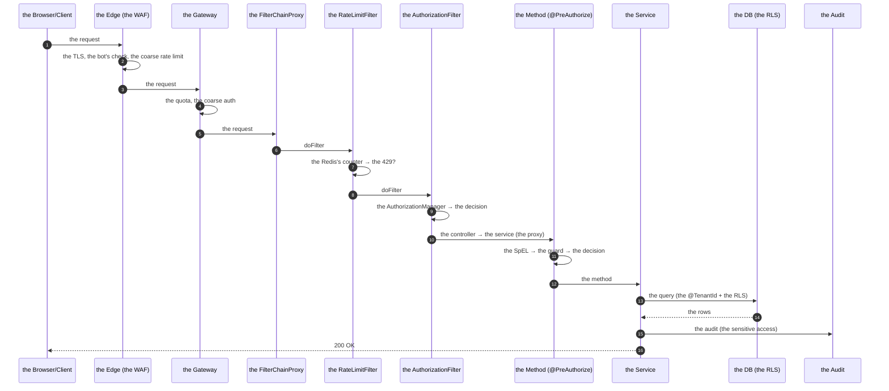

# 06 · Production Security Patterns

> **Level:** Advanced → Expert
> **Interview Frequency:** ★★★★☆ ("How would you secure this in production?")
> **Prerequisite:** [01 · Security Architecture](./01-Security-Architecture-and-Filter-Chain.md)
> **Last Updated:** 2026

---

## 📋 Table of Contents
- [0. TL;DR — The 30-Second Answer](#0-tldr--the-30-second-answer)
- [1. What & Why](#1-what--why)
- [2. Mental Model — The Defence Layers](#2-mental-model--the-defence-layers)
- [3. The Production Patterns](#3-the-production-patterns)
  - [3.1 The API's security chain](#31-the-apis-security-chain)
  - [3.2 The hybrid (the web + the API)](#32-the-hybrid-the-web--the-api)
  - [3.3 The service-to-service](#33-the-service-to-service)
  - [3.4 The multi-tenant](#34-the-multi-tenant)
  - [3.5 The audit trail](#35-the-audit-trail)
  - [3.6 The MFA](#36-the-mfa)
  - [3.7 The impersonation](#37-the-impersonation)
  - [3.8 The rate limiting](#38-the-rate-limiting)
  - [3.9 The security headers](#39-the-security-headers)
  - [3.10 The secrets](#310-the-secrets)
  - [3.11 The step-up authentication](#311-the-step-up-authentication)
  - [3.12 The account lockout](#312-the-account-lockout)
- [4. Architecture Diagrams](#4-architecture-diagrams)
- [5. Execution Flow](#5-execution-flow)
- [6. Production-Level Use Cases](#6-production-level-use-cases)
- [7. Code Examples — Production-Grade](#7-code-examples--production-grade)
- [8. Common Mistakes & Gotchas](#8-common-mistakes--gotchas)
- [9. Performance Considerations](#9-performance-considerations)
- [10. Security Considerations](#10-security-considerations)
- [11. Best Practices — The Checklist](#11-best-practices--the-checklist)
- [12. Hands-On Exercises](#12-hands-on-exercises)
- [13. Code Challenges](#13-code-challenges)
- [14. Scenario-Based Questions](#14-scenario-based-questions)
- [15. Interview Q&A — Level-wise](#15-interview-qa--level-wise)
- [16. Counter-Questions & Traps](#16-counter-questions--traps)
- [17. Tricky Interview Questions](#17-tricky-interview-questions)
- [18. Follow-Up Questions Asked by Interviewers](#18-follow-up-questions-asked-by-interviewers)
- [19. Real 3–5 Year Experience Scenarios](#19-real-35-year-experience-scenarios)
- [20. Frequently Asked Production Issues](#20-frequently-asked-production-issues)
- [21. Debugging Scenarios](#21-debugging-scenarios)
- [22. Architecture Design Questions](#22-architecture-design-questions)
- [23. Rapid-Fire MCQs](#23-rapid-fire-mcqs)
- [24. Cheat Sheet — One-Page Summary](#24-cheat-sheet--one-page-summary)
- [25. Real-World Production Notes](#25-real-world-production-notes)
- [26. Follow-up Learning](#26-follow-up-learning)

---

## 0. TL;DR — The 30-Second Answer

- **The production security is a chain of layers**, not a config class: the edge (the CDN/WAF),
  the gateway (the rate limiting, the coarse auth), the app (the filter chain, the method
  security, the ownership), the data (the RLS, the encryption), and the operations (the audit,
  the monitoring, the incident response).
- **The API's chain:** stateless + the bearer token + the CSRF disabled + the JSON's 401/403 +
  the CORS's explicit origins + the rate limiting.
- **The hybrid:** two `SecurityFilterChain` beans with the `securityMatcher` — the API is
  stateless, the web is session-based. **The order matters** (`@Order`).
- **The multi-tenancy:** the tenant's resolution → the tenant's claim in the `Authentication` →
  the **query-level** scoping (the `@TenantId` — the automatic) → the DB's RLS.
- **The audit trail:** the `AuthenticationEvent` + the `AuthorizationEvent` + the business
  events (the sensitive data access) → an append-only store (the DB, the S3, the SIEM).
- **The MFA:** a state machine (the password step → the pending-MFA state → the second factor) —
  the TOTP, the WebAuthn, the SMS (the weakest), the push.
- **The impersonation:** a custom `Authentication` (the actor + the target), a short TTL, the
  mandatory audit, and the read-only default.
- **The rate limiting:** the edge (the coarse, per IP) + the app (the per user, per endpoint,
  the Redis's token bucket).
- **The security headers:** the CSP (the report-only first), the HSTS, the `X-Content-Type-Options`,
  the frame options, the referrer policy, the permissions policy.
- **The one-liner:** *"The production security isn't a config class — it's a layered
architecture where each layer assumes the others might fail, and every security-relevant
decision is audited."*

---

## 1. What & Why

The chapters 01–05 covered the mechanisms. This chapter assembles them into the patterns you
actually ship: the API's chain, the hybrid, the multi-tenant, the audit, the MFA, the
impersonation, the rate limiting, the headers, and the secrets. This is the chapter that
separates "I know the annotations" from "I can design a secure system".

---

## 2. Mental Model — The Defence Layers

```text
   the request
      │
      ▼
 ┌──────────────────────────────────────────────────────────┐
 │ ① the EDGE (the CDN, the WAF, the DDoS protection)      │
 │    the rate limiting, the bot's detection, the geo        │
 ├──────────────────────────────────────────────────────────┤
 │ ② the GATEWAY (the API gateway, the service mesh)        │
 │    the coarse auth, the mTLS, the quota                  │
 ├──────────────────────────────────────────────────────────┤
 │ ③ the APPLICATION (the Spring Security's chain)          │
 │    the authentication, the authorization, the ownership   │
 │    the validation, the rate limiting, the audit           │
 ├──────────────────────────────────────────────────────────┤
 │ ④ the DATA (the RLS, the encryption, the least privilege)│
 ├──────────────────────────────────────────────────────────┤
 │ ⑤ the OPERATIONS (the monitoring, the alerting, the IR)  │
 └──────────────────────────────────────────────────────────┘
```

> **Caption:** Each layer's job is to make the next layer's job easier. The application's layer
> must assume the edge might be bypassed (the internal traffic, the direct DB access).

---

## 3. The Production Patterns

### 3.1 The API's security chain

```java
@Bean
@Order(1)
SecurityFilterChain apiChain(HttpSecurity http) throws Exception {
    http
        .securityMatcher("/api/**")
        .csrf(csrf -> csrf.disable())                    // the header-based auth
        .cors(cors -> cors.configurationSource(corsConfigurationSource))
        .sessionManagement(session -> session
                .sessionCreationPolicy(SessionCreationPolicy.STATELESS))
        .securityContext(context -> context
                .securityContextRepository(new RequestAttributeSecurityContextRepository()))
        .headers(headers -> headers
                .contentSecurityPolicy(csp -> csp.policyDirectives(
                        "default-src 'self'; frame-ancestors 'none'"))
                .httpStrictTransportSecurity(hsts -> hsts
                        .includeSubDomains(true)
                        .maxAgeInSeconds(31536000))
                .frameOptions(frame -> frame.deny())
                .referrerPolicy(referrer -> referrer.policy(
                        ReferrerPolicyHeaderWriter.ReferrerPolicy.STRICT_ORIGIN_WHEN_CROSS_ORIGIN)))
        .authorizeHttpRequests(auth -> auth
                .requestMatchers("/api/auth/**", "/actuator/health", "/v3/api-docs/**").permitAll()
                .anyRequest().authenticated())
        .oauth2ResourceServer(oauth2 -> oauth2
                .jwt(jwt -> jwt.jwtAuthenticationConverter(converter()))
                .authenticationEntryPoint(new JsonAuthenticationEntryPoint(objectMapper))
                .accessDeniedHandler(new JsonAccessDeniedHandler(objectMapper)))
        .sessionManagement(session -> session
                .sessionCreationPolicy(SessionCreationPolicy.STATELESS));

    return http.build();
}
```

**The production checklist for the API's chain:**
- The stateless (no `JSESSIONID` is ever set).
- The CSRF disabled (the header-based auth) — **documented** in the chain's comment.
- The explicit CORS's origins.
- The JSON's 401/403 (the API's contract).
- The security's headers.
- The `requestMatchers` with the default-deny.
- The rate limiting (a filter or the gateway).
- The `X-Request-Id` (the tracing) — the `OncePerRequestFilter`.

### 3.2 The hybrid (the web + the API)

```java
@Bean
@Order(1)
SecurityFilterChain apiChain(HttpSecurity http) throws Exception {
    http.securityMatcher("/api/**")
        .csrf(csrf -> csrf.disable())
        .sessionManagement(s -> s.sessionCreationPolicy(SessionCreationPolicy.STATELESS))
        .authorizeHttpRequests(a -> a.anyRequest().authenticated())
        .oauth2ResourceServer(o -> o.jwt(Customizer.withDefaults()));
    return http.build();
}

@Bean
@Order(2)
SecurityFilterChain webChain(HttpSecurity http) throws Exception {
    http
        .authorizeHttpRequests(a -> a
            .requestMatchers("/", "/login", "/css/**", "/js/**", "/images/**").permitAll()
            .anyRequest().authenticated())
        .formLogin(form -> form
            .loginPage("/login")
            .loginProcessingUrl("/api/auth/login")
            .successHandler(authenticationSuccessHandler)
            .failureHandler(authenticationFailureHandler))
        .logout(logout -> logout.logoutUrl("/api/auth/logout").logoutSuccessHandler(...));
    return http.build();
}
```

**The critical rules:**
1. **The order** — the API's chain first (`@Order(1)`), the web's second. The **first match
   wins**.
2. **The `securityMatcher`** — the API's chain handles `/api/**`; the web's handles the rest.
   **The web's chain must NOT also match `/api/**`** (or the order decides).
3. **The CSRF** — the web's chain keeps it; the API's disables it. **The `csrf.disable()` in
   one chain doesn't affect the other.**
4. **The sessions** — the API's is stateless; the web's is not.

### 3.3 The service-to-service

```java
@Bean
@Order(1)
SecurityFilterChain internalChain(HttpSecurity http) throws Exception {
    http.securityMatcher("/internal/**")
        .csrf(csrf -> csrf.disable())
        .sessionManagement(s -> s.sessionCreationPolicy(SessionCreationPolicy.STATELESS))
        .authorizeHttpRequests(a -> a.anyRequest().hasAuthority("SCOPE_internal"))
        .oauth2ResourceServer(o -> o.jwt(Customizer.withDefaults()));
    return http.build();
}
```

**The production patterns:**
- **The OAuth2 client credentials** (the service's own token) — the short-lived, the scoped,
  the rotated.
- **The mTLS** (the service mesh's sidecar or the `X509` authentication) — the strongest.
- **The API keys** (the hashed, the scoped, the revocable) — the simplest, the weakest.
- **The `X509AuthenticationToken`** (the certificate) — the `http.x509(x509 -> x509.subjectPrincipalRegex(...))`.
- **The internal endpoints are network-isolated** (the private subnets, the NetworkPolicy) —
  the app-level auth is the second layer.

### 3.4 The multi-tenant

```text
   the request
      │
      ▼
   ① the tenant's resolution (the subdomain / the header / the JWT's claim)
      │
      ▼
   ② the TenantContext (the thread-local) + the tenant's claim in the Authentication
      │
      ▼
   ③ the authorization (the user must belong to the tenant)
      │
      ▼
   ④ the query's scoping (the @TenantId — the automatic, the Hibernate 6)
      │
      ▼
   ⑤ the DB's RLS (the PostgreSQL's row-level security — the last defence)
```

**The `Hibernate`'s `@TenantId`:**
```java
@Entity
@Table(name = "documents")
public class Document {
    @Id @GeneratedValue(strategy = GenerationType.IDENTITY)
    private Long id;

    @TenantId
    @Column(name = "tenant_id", nullable = false, updatable = false)
    private Long tenantId;
}
```
**The setup:**
```java
@Bean
CurrentTenantIdentifierResolver currentTenantIdentifierResolver() {
    return new CurrentTenantIdentifierResolver() {
        @Override
        public String resolveCurrentTenantIdentifier() {
            Long tenantId = TenantContext.get();
            return tenantId == null ? null : tenantId.toString();
        }

        @Override
        public boolean validateExistingCurrentSessions() {
            return false;   // the current tenant's sessions are not validated (the performance)
        }
    };
}
```
**The caveat:** the `@TenantId` requires the Hibernate's session to know the tenant — the
`CurrentTenantIdentifierResolver` is consulted per session; the `validateExistingCurrentSessions`
must be `false` for the pooled sessions (otherwise the performance collapses — the validation
per query).

**The alternative (the Spring Data's specification):**
```java
public interface DocumentRepository extends JpaRepository<Document, Long>, JpaSpecificationExecutor<Document> {}

// the service
Specification<Document> tenantSpec = (root, query, cb) ->
        cb.equal(root.get("tenantId"), TenantContext.get());
```

### 3.5 The audit trail

**The three sources:**
```text
   ① the AUTHENTICATION events (the login's success/failure)
   ② the AUTHORIZATION events (the decisions, especially the denials)
   ③ the BUSINESS events (the sensitive data access, the state changes)
```

**The implementation:**
```java
@Component
@RequiredArgsConstructor
public class SecurityAuditListener {

    private final AuditService auditService;

    @EventListener
    public void onAuthenticationSuccess(AuthenticationSuccessEvent event) {
        auditService.record(AuthEvent.LOGIN_SUCCESS,
                event.getAuthentication().getName(),
                extractIp(event.getAuthentication()),
                event.getAuthentication().getDetails());
    }

    @EventListener
    public void onAuthenticationFailure(AbstractAuthenticationFailureEvent event) {
        auditService.record(AuthEvent.LOGIN_FAILURE,
                event.getAuthentication().getName(),
                extractIp(event.getAuthentication()),
                event.getException().getClass().getSimpleName());
    }

    @EventListener
    public void onAuthorization(AuthorizationEvent event) {
        if (!event.getDecision().isGranted()) {
            auditService.record(AuthEvent.AUTHORIZATION_DENIED,
                    event.getAuthentication().getName(),
                    event.getObject().toString());
        }
    }
}
```

**The audit's requirements:**
- **The append-only** (the DB with the triggers, or a dedicated store — the S3, the SIEM).
- **The sensitive data's exclusion** (never log the password, the token, the full card number).
- **The correlation id** (the `X-Request-Id`).
- **The tamper-evidence** (the hash chain, the signed entries).
- **The retention** (the compliance's requirement — 1-7 years).
- **The alerting** (the spike in the denials, the impossible travel, the new device).

### 3.6 The MFA

**The state machine:**
```text
   the login attempt (the password)
        │
        ├─ the password is wrong → the failure
        │
        └─ the password is right
              │
              ▼
        the MFA is required?
              │
              ├─ no → the full authentication → the session/token
              │
              └─ yes → the PENDING_MFA state
                        │  (a short-lived, the Redis: the pending challenge, the TTL 5 min,
                        │   the attempt counter)
                        ▼
                  the second factor (the TOTP / the WebAuthn / the push / the SMS)
                        │
                        ├─ wrong → the failure (the counter → the lockout)
                        └─ right → the full authentication
```

**The implementation (the API):**
```java
@Service
@RequiredArgsConstructor
public class MfaService {

    private final MfaChallengeRepository challengeRepository;
    private final TotpService totpService;

    public MfaChallenge startChallenge(String username, Authentication partialAuth) {
        MfaChallenge challenge = new MfaChallenge(
                username,
                partialAuth,
                challengeRepository.nextOtpSecret(username),
                Instant.now().plus(Duration.ofMinutes(5)),
                0);
        challengeRepository.save(challenge);
        return challenge;
    }

    public Authentication verify(String challengeId, String code) {
        MfaChallenge challenge = challengeRepository.findById(challengeId)
                .orElseThrow(() -> new InvalidMfaException());
        if (challenge.isExpired()) {
            challengeRepository.delete(challenge);
            throw new InvalidMfaException("The challenge has expired");
        }
        if (challenge.attempts() >= MAX_ATTEMPTS) {
            challengeRepository.delete(challenge);
            throw new TooManyAttemptsException();
        }
        if (!totpService.verify(challenge.otpSecret(), code)) {
            challengeRepository.incrementAttempts(challengeId);
            throw new InvalidMfaException();
        }
        challengeRepository.delete(challenge);   // the one-time use
        return challenge.partialAuthentication();
    }
}
```

**The factor's ranking:**
| The factor | The security | The UX |
|-----------|-------------|-------|
| The TOTP (the authenticator app) | ★★★★ | ★★★★★ |
| The WebAuthn (the passkey) | ★★★★★ | ★★★★ |
| The push (the app's approval) | ★★★★ | ★★★★★ |
| The SMS (the OTP) | ★★ | ★★★ |
| The email (the link) | ★★ | ★★★ |
| The security questions | ★ | ★★ |

**The production rules:**
- The **mandatory** for the admins, the high-privilege operations, the money.
- The **optional** for the regular users (the progressive).
- The **recovery codes** (the single-use, the printed, the hashed).
- The **the rate limiting** on the verification (the 5 attempts → the challenge's deletion).
- **Never** log the code or the secret.

### 3.7 The impersonation

```java
@Service
@RequiredArgsConstructor
public class ImpersonationService {

    private final UserService userService;
    private final AuditService auditService;
    private final ImpersonationSessionRepository repository;

    public ImpersonationSession impersonate(UserPrincipal actor, Long targetUserId, Duration ttl) {
        if (!actor.hasAuthority("ROLE_ADMIN")) {
            throw new AccessDeniedException("Admin only");
        }
        if (actor.getId().equals(targetUserId)) {
            throw new IllegalArgumentException("Cannot impersonate yourself");
        }
        UserPrincipal target = userService.loadPrincipal(targetUserId);

        ImpersonationSession session = new ImpersonationSession(
                actor.getId(), targetUserId(), Instant.now().plus(ttl));
        repository.save(session);

        auditService.recordImpersonationStart(actor.getId(), targetUserId());
        return session;
    }

    public void end(ImpersonationSession session) {
        repository.delete(session);
        auditService.recordImpersonationEnd(session.actorId(), session.targetUserId());
    }
}
```

**The `Authentication` (the actor + the target):**
```java
public class ImpersonatingAuthenticationToken extends AbstractAuthenticationToken {

    private final Authentication actor;         // the real admin
    private final UserPrincipal target;         // the impersonated user
    private final boolean readOnly;

    public UserPrincipal getPrincipal() { return target; }
    public Object getCredentials() { return null; }
    public Authentication getActor() { return actor; }
    public boolean isReadOnly() { return readOnly; }
}
```

**The rules:** the short TTL (the 15 minutes), the **read-only** by default (the explicit
elevation for the writes), the mandatory audit (the start and the end), the **the notification to
the target** (the email — a best practice and a compliance requirement in many domains), the
**the UI's banner**, and the ban on the sensitive operations (the password change, the MFA's
setup, the payments' details, the API key's creation).

**The alternative (the safer design):** the **"the support view"** — a separate, audited,
read-only mode that doesn't change the session's identity at all. Many mature systems prefer it
precisely because the "the confused deputy" problem disappears.

### 3.8 The rate limiting

**The layers:**
```text
   the EDGE: the per-IP, the per-ASN, the coarse (the CDN/WAF)
   the GATEWAY: the per-client, the per-endpoint, the quota
   the APP: the per-user, the per-account (the login!), the fine-grained
```

**The app's implementation (the Redis's token bucket):**
```java
@Component
@RequiredArgsConstructor
public class RateLimitFilter extends OncePerRequestFilter {

    private final StringRedisTemplate redisTemplate;
    private final RateLimitProperties properties;

    @Override
    protected void doFilterInternal(HttpServletRequest request, HttpServletResponse response,
                                    FilterChain chain) throws ServletException, IOException {

        String key = resolveKey(request);
        RateLimit rule = properties.ruleFor(request.getRequestURI());
        if (rule == null || key == null) {
            chain.doFilter(request, response);
            return;
        }

        long count = increment(key, rule.windowSeconds());
        response.setHeader("X-RateLimit-Limit", String.valueOf(rule.limit()));
        response.setHeader("X-RateLimit-Remaining", String.valueOf(Math.max(0, rule.limit() - count)));

        if (count > rule.limit()) {
            response.setStatus(429);
            response.setHeader("Retry-After", String.valueOf(rule.windowSeconds()));
            response.setContentType(MediaType.APPLICATION_JSON_VALUE);
            response.getWriter().write("{\"code\":\"RATE_LIMITED\",\"message\":\"Too many requests\"}");
            return;
        }
        chain.doFilter(request, response);
    }

    private String resolveKey(HttpServletRequest request) {
        Authentication authentication = SecurityContextHolder.getContext().getAuthentication();
        if (authentication != null && authentication.isAuthenticated()
                && !(authentication instanceof AnonymousAuthenticationToken)) {
            return "rl:user:" + authentication.getName();
        }
        String ip = extractClientIp(request);
        return ip == null ? null : "rl:ip:" + ip;
    }

    private long increment(String key, int windowSeconds) {
        String redisKey = key + ":" + (System.currentTimeMillis() / (windowSeconds * 1000L));
        Long count = redisTemplate.opsForValue().increment(redisKey);
        if (count != null && count == 1L) {
            redisTemplate.expire(redisKey, Duration.ofSeconds(windowSeconds + 1));
        }
        return count == null ? 0 : count;
    }
}
```

**The rules (the production defaults):**

| The endpoint | The limit | Why |
|-------------|----------|-----|
| `/api/auth/login` | 5 / 15 min / per account **and** per IP | The brute force |
| `/api/auth/password-reset` | 3 / hour / per email | The enumeration, the abuse |
| `/api/auth/mfa/verify` | 5 / attempt | The 6-digit's brute force (1M combos) |
| `/api/auth/register` | 3 / hour / per IP | The spam, the enumeration |
| The general API | 1000 / min / per user | The abuse, the fair use |
| The uploads | 10 / hour | The cost |

**The `Retry-After` and the standard headers:** the `X-RateLimit-*` and the RFC's
`RateLimit-Limit`/`RateLimit-Remaining`/`RateLimit-Reset` (the newer IETF draft).

### 3.9 The security headers

```java
http.headers(headers -> headers
    .contentSecurityPolicy(csp -> csp
        .policyDirectives("default-src 'self'; script-src 'self'; object-src 'none'; "
            + "frame-ancestors 'none'; base-uri 'self'; form-action 'self'")
        .reportOnly(false))
    .httpStrictTransportSecurity(hsts -> hsts
        .includeSubDomains(true)
        .maxAgeInSeconds(31536000)
        .preload(true))
    .frameOptions(frame -> frame.deny())
    .contentTypeOptions(Customizer.withDefaults())
    .referrerPolicy(referrer -> referrer.policy(
        ReferrerPolicyHeaderWriter.ReferrerPolicy.STRICT_ORIGIN_WHEN_CROSS_ORIGIN))
    .permissionsPolicyHeader(policy -> policy.policy(
        "camera=(), microphone=(), geolocation=(), payment=()")));
```

**The CSP's rollout:** **the report-only mode first** (the `reportOnly(true)` + the
`report-to`/`report-uri`) → collect the violations → fix → enforce. The strict CSP with the
hashes/nonces is the goal; the `unsafe-inline` is the starting point of most apps.

**The `X-Frame-Options: DENY`** (the clickjacking) — superseded by the CSP's `frame-ancestors`
(modern), but keep both (the old browsers).

### 3.10 The secrets

```text
   the RULES
   ① never in the code (the git history is forever)
   ② never in the config file in the repo (even the encrypted)
   ③ externalised (the env vars, the vault, the KMS)
   ④ rotated (the schedule, the dual-key period, the audit)
   ⑤ the least exposure (the per-service, the per-environment, the short-lived)
```

**The patterns:**
- **The environment variables** (the simplest; the orchestrator's secret manager injects them).
- **The Spring Cloud Config + the Vault** (`spring-cloud-starter-vault`) → the `@Value` with the
  the `config:` prefix.
- **The AWS Secrets Manager / the GCP's Secret Manager** → the SDK.
- **The Kubernetes' secrets** (the base64 — **not encrypted**! → the etcd's encryption at rest
  or the external secrets operator).
- **The Spring's `Encryptor`/`StringEncryptor`** (the Jasypt) — the encrypted properties.

**The rotation's pattern (the dual-key):**
```java
@Component
@RequiredArgsConstructor
public class RotatingJwtDecoder implements JwtDecoder {

    private final JwtDecoder activeDecoder;
    private final JwtDecoder previousDecoder;   // the verification only

    @Override
    public Jwt decode(String token) throws JwtException {
        try {
            return activeDecoder.decode(token);
        } catch (JwtException ex) {
            return previousDecoder.decode(token);   // the tokens signed with the old key
        }
    }
}
```

### 3.11 The step-up authentication

```java
@PreAuthorize("authentication.details instanceof T(org.springframework.security.web.authentication.WebAuthenticationDetails) "
        + "and @recentAuthenticationService.isRecent(authentication, 300)")
```
**Or at the URL level:**
```java
.requestMatchers("/api/payouts/**").fullyAuthenticated()
```

**The "the recent authentication" tracking:**
```java
@Component
public class RecentAuthenticationService {

    private final Map<String, Instant> lastFullAuth = new ConcurrentHashMap<>();

    public void record(Authentication authentication) {
        lastFullAuth.put(authentication.getName(), Instant.now());
    }

    public boolean isRecent(Authentication authentication, int maxAgeSeconds) {
        Instant last = lastFullAuth.get(authentication.getName());
        return last != null && last.isAfter(Instant.now().minusSeconds(maxAgeSeconds));
    }
}
```
**The production alternative:** a **claim in the JWT** (`"amr": ["pwd", "otp"]`, the
authentication's methods reference) → the step-up is stateless.

### 3.12 The account lockout

```java
@Service
@RequiredArgsConstructor
public class LoginAttemptService {

    private static final int MAX_ATTEMPTS = 5;
    private static final Duration LOCK_DURATION = Duration.ofMinutes(15);

    private final StringRedisTemplate redisTemplate;

    public void recordFailure(String username, String ip) {
        String key = "login:fail:" + username;
        Long attempts = redisTemplate.opsForValue().increment(key);
        if (attempts != null && attempts == 1) {
            redisTemplate.expire(key, LOCK_DURATION);
        }
        // the per-IP's counter (the distributed attack)
        String ipKey = "login:fail:ip:" + ip;
        Long ipAttempts = redisTemplate.opsForValue().increment(ipKey);
        if (ipAttempts != null && ipAttempts == 1) {
            redisTemplate.expire(ipKey, LOCK_DURATION);
        }
    }

    public boolean isLocked(String username, String ip) {
        return getAttempts("login:fail:" + username) >= MAX_ATTEMPTS
                || getAttempts("login:fail:ip:" + ip) >= MAX_ATTEMPTS * 10;
    }

    public void reset(String username) {
        redisTemplate.delete("login:fail:" + username);
    }
}
```

**The production nuances:**
- The **per-account** lockout (5 attempts → the 15-minute lock).
- The **per-IP** counter (the distributed brute force — the higher threshold).
- The **exponential backoff** instead of the hard lock (the better UX, the same protection).
- The **the enumeration-safe** message (the generic "the invalid credentials" even when
  locked — or a deliberate "the account is temporarily locked" that reveals the existence; the
  trade-off).
- The **the lockout's storage** — the Redis (the shared, the TTL) — the DB's `locked_until` (the
  durable, the cross-cutting).

---

## 4. Architecture Diagrams

### 4.1 The complete production architecture

```text
                        the internet
                             │
                    ┌────────▼─────────┐
                    │ the CDN + the WAF │  the TLS termination, the DDoS,
                    │                   │  the bot's detection, the geo
                    └────────┬─────────┘
                             │
                    ┌────────▼─────────┐
                    │ the API Gateway  │  the coarse auth, the rate limiting,
                    │                   │  the quota, the routing
                    └────────┬─────────┘
                             │
              ┌──────────────┼──────────────┐
              │              │              │
      ┌───────▼──────┐ ┌─────▼──────┐ ┌─────▼──────┐
      │ the API (the │ │ the API    │ │ the Web    │
      │ the JWT)     │ │ (the web)  │ │ (the SPA)  │
      └───────┬──────┘ └─────┬──────┘ └─────┬──────┘
              │              │              │
              └──────────────┼──────────────┘
                             │
                    ┌────────▼─────────┐
                    │ the Spring       │  the filter chain, the method
                    │ Security's chain │  security, the ownership
                    └────────┬─────────┘
                             │
                    ┌────────▼─────────┐
                    │ the DB (the RLS) │  the encryption, the least privilege
                    └──────────────────┘

              the side channels: the audit → the SIEM, the metrics → the monitoring
```

### 4.2 The hybrid's chain routing

```text
   the request
      │
      ▼
   the FilterChainProxy
      │
      ├─ the chain #1 (the securityMatcher: /api/**)   → the stateless, the JWT
      │     ✗ doesn't match /web/**
      │
      └─ the chain #2 (the default: /**)               → the session, the form login
            ✓ matches
```

### 4.3 The multi-tenant's isolation layers

```text
   the query: SELECT * FROM documents WHERE ...
        │
        ▼
   ① the application (the @TenantId → the automatic WHERE tenant_id = ?)
        │
        ▼
   ② the database (the RLS → the policy: tenant_id = current_setting('app.tenant_id'))
        │
        ▼
   the rows (the tenant's only)
```

### 4.4 The MFA's state machine

```text
              ┌────────────┐
   login ────► │ PASSWORD   │
              │ (verified) │
              └─────┬──────┘
                    │ the MFA is required?
          ┌─────────┴─────────┐
          │ no                │ yes
          ▼                   ▼
    ┌───────────┐      ┌────────────┐
    │ COMPLETE  │      │ PENDING_MFA│
    │ (the token│      │ (the Redis)│
    │  or the   │      └─────┬──────┘
    │  session) │            │ the OTP
          │                  ▼
          │            ┌───────────┐
          │            │  VERIFY   │
          │            └─────┬─────┘
          │        ok        │  fail (the counter)
          │            ┌─────┴─────┐
          └────────────┤           │
                       ▼           ▼
                 ┌──────────┐  ┌──────────┐
                 │ COMPLETE │  │  LOCKED  │
                 └──────────┘  └──────────┘
```

---

## 5. Execution Flow

### 5.1 The full request (the production)



---

## 6. Production-Level Use Cases

| Use case | The pattern |
|----------|-------------|
| **A public API (the developers)** | The API's chain + the OAuth2 client credentials + the quota + the docs' scopes |
| **A web app + a SPA** | The hybrid's chains + the CORS + the CSRF's double-submit |
| **A fintech** | The MFA (the mandatory), the step-up (the transfers), the audit's immutability, the RLS, the separation of duties |
| **A health data (the HIPAA)** | The encryption at rest + in transit, the audit's access log, the consent, the break-glass, the RBAC + the ABAC |
| **A multi-tenant SaaS** | The `@TenantId` + the RLS + the tenant's claim + the per-tenant's keys (the encryption) |
| **An internal platform** | The mTLS + the OAuth2's scopes + the network's isolation + the audit |
| **A partner integration** | The API keys (the hashed, the scoped, the revocable) + the IP allow-list + the rate limiting |
| **An admin's console** | The separate chain + the MFA + the short session + the read-only by default + the immutable audit |

---

## 7. Code Examples — Production-Grade

### 7.1 The `X-Request-Id` filter (the tracing's backbone)

```java
@Component
@RequiredArgsConstructor
public class RequestIdFilter extends OncePerRequestFilter {

    public static final String HEADER = "X-Request-Id";
    private static final String MDC_KEY = "requestId";

    @Override
    protected void doFilterInternal(HttpServletRequest request, HttpServletResponse response,
                                    FilterChain chain) throws ServletException, IOException {
        String requestId = request.getHeader(HEADER);
        if (requestId == null || requestId.isBlank() || requestId.length() > 64) {
            requestId = UUID.randomUUID().toString();
        }
        MDC.put(MDC_KEY, requestId);
        response.setHeader(HEADER, requestId);
        try {
            chain.doFilter(request, response);
        } finally {
            MDC.remove(MDC_KEY);
        }
    }
}
```
**Why it matters for the security:** the audit's entries, the logs, and the traces all carry
the same id → the incident's investigation is a single query.

### 7.2 The complete production `SecurityConfig`

```java
package com.example.config;

@Configuration
@EnableWebSecurity
@EnableMethodSecurity
@RequiredArgsConstructor
public class SecurityConfig {

    private final CorsConfigurationSource corsConfigurationSource;
    private final ObjectMapper objectMapper;
    private final JwtAuthenticationConverter jwtAuthenticationConverter;

    @Bean
    @Order(1)
    SecurityFilterChain apiChain(HttpSecurity http) throws Exception {
        http
            .securityMatcher("/api/**")
            .csrf(csrf -> csrf.disable())          // the bearer token in the header
            .cors(cors -> cors.configurationSource(corsConfigurationSource))
            .sessionManagement(session -> session
                .sessionCreationPolicy(SessionCreationPolicy.STATELESS))
            .securityContext(context -> context
                .securityContextRepository(new RequestAttributeSecurityContextRepository()))
            .headers(this::applySecurityHeaders)
            .authorizeHttpRequests(auth -> auth
                .requestMatchers("/api/auth/login", "/api/auth/refresh",
                                 "/api/public/**", "/actuator/health").permitAll()
                .anyRequest().authenticated())
            .oauth2ResourceServer(oauth2 -> oauth2
                .jwt(jwt -> jwt.jwtAuthenticationConverter(jwtAuthenticationConverter))
                .authenticationEntryPoint(new JsonAuthenticationEntryPoint(objectMapper))
                .accessDeniedHandler(new JsonAccessDeniedHandler(objectMapper)));
        return http.build();
    }

    @Bean
    @Order(2)
    SecurityFilterChain internalChain(HttpSecurity http) throws Exception {
        http.securityMatcher("/internal/**")
            .csrf(csrf -> csrf.disable())
            .sessionManagement(s -> s.sessionCreationPolicy(SessionCreationPolicy.STATELESS))
            .authorizeHttpRequests(auth -> auth
                .requestMatchers("/internal/actuator/**").permitAll()
                .anyRequest().hasAuthority("SCOPE_internal"))
            .oauth2ResourceServer(oauth2 -> oauth2.jwt(Customizer.withDefaults()));
        return http.build();
    }

    @Bean
    @Order(3)
    SecurityFilterChain webChain(HttpSecurity http) throws Exception {
        http
            .cors(Customizer.withDefaults())
            .csrf(csrf -> csrf
                .csrfTokenRepository(CookieCsrfTokenRepository.withHttpOnlyFalse())
                .csrfTokenRequestHandler(new SpaCsrfTokenRequestHandler()))
            .sessionManagement(session -> session
                .sessionCreationPolicy(SessionCreationPolicy.IF_REQUIRED)
                .sessionFixation(sf -> sf.changeSessionId())
                .maximumSessions(3)
                .maxSessionsPreventsLogin(false))
            .authorizeHttpRequests(auth -> auth
                .requestMatchers("/", "/login", "/assets/**", "/actuator/health").permitAll()
                .anyRequest().authenticated())
            .formLogin(form -> form
                .loginProcessingUrl("/api/auth/login")
                .successHandler(authenticationSuccessHandler())
                .failureHandler(authenticationFailureHandler()))
            .logout(logout -> logout
                .logoutUrl("/api/auth/logout")
                .logoutSuccessHandler((req, res, auth) -> res.setStatus(HttpServletResponse.SC_NO_CONTENT))
                .invalidateHttpSession(true)
                .clearAuthentication(true));
        return http.build();
    }

    private void applySecurityHeaders(HeaderConfigurer<HttpSecurity> headers) {
        headers
            .contentSecurityPolicy(csp -> csp.policyDirectives(
                    "default-src 'self'; frame-ancestors 'none'; base-uri 'self'; form-action 'self'"))
            .httpStrictTransportSecurity(hsts -> hsts
                    .includeSubDomains(true).maxAgeInSeconds(31536000).preload(true))
            .frameOptions(frame -> frame.deny())
            .contentTypeOptions(Customizer.withDefaults())
            .referrerPolicy(referrer -> referrer.policy(
                    ReferrerPolicyHeaderWriter.ReferrerPolicy.STRICT_ORIGIN_WHEN_CROSS_ORIGIN));
    }
}
```

### 7.3 The audit's service (the append-only)

```java
@Service
@RequiredArgsConstructor
public class AuditService {

    private final AuditRepository auditRepository;
    private final String currentUserId;

    @Transactional
    public void record(AuthEvent event, String actor, String target, String details) {
        AuditEntry entry = AuditEntry.builder()
                .event(event)
                .actor(actor)
                .target(target)
                .details(sanitize(details))
                .requestId(MDC.get("requestId"))
                .ip(currentUserId)
                .occurredAt(Instant.now())
                .build();
        auditRepository.save(entry);
    }

    /** Never log the secrets. */
    private String sanitize(String details) {
        if (details == null) return null;
        return details.replaceAll("(?i)(password|token|secret|authorization)=[^&\\s]+", "$1=[REDACTED]");
    }
}
```

### 7.4 The MFA's challenge (the Redis's state)

```java
@Component
@RequiredArgsConstructor
public class MfaChallengeStore {

    private final StringRedisTemplate redisTemplate;

    public void save(MfaChallenge challenge) {
        redisTemplate.opsForValue().set(
                "mfa:challenge:" + challenge.id(),
                objectMapper.writeValueAsString(challenge),
                challenge.expiresAt().minus(Instant.now()));
    }

    public Optional<MfaChallenge> find(String id) {
        String json = redisTemplate.opsForValue().get("mfa:challenge:" + id);
        return json == null ? Optional.empty() : Optional.of(objectMapper.readValue(json, MfaChallenge.class));
    }

    public void consume(String id) {
        redisTemplate.delete("mfa:challenge:" + id);   // the one-time use
    }
}
```

### 7.5 The impersonation's `Authentication`

```java
public class ImpersonatingAuthenticationToken extends AbstractAuthenticationToken {

    private final Authentication actor;
    private final UserPrincipal target;
    private final boolean readOnly;

    public ImpersonatingAuthenticationToken(Authentication actor, UserPrincipal target, boolean readOnly) {
        super(target.getAuthorities());
        this.actor = actor;
        this.target = target;
        this.readOnly = readOnly;
        setAuthenticated(true);
    }

    @Override public Object getCredentials() { return null; }
    @Override public Object getPrincipal() { return target; }
    @Override public String getName() { return target.getUsername(); }
    public Authentication getActor() { return actor; }
    public boolean isReadOnly() { return readOnly; }
}
```

**The guard (the read-only's enforcement):**
```java
@PreAuthorize("!isImpersonated(authentication) or !authentication.readOnly")
```
```java
@Component("impersonation")
public class ImpersonationExpressions {
    public boolean isImpersonated(Authentication authentication) {
        return authentication instanceof ImpersonatingAuthenticationToken;
    }
}
```

### 7.6 The rate limiter's properties

```java
@ConfigurationProperties(prefix = "app.rate-limit")
public class RateLimitProperties {

    private final Map<String, Rule> rules = new HashMap<>();

    public record Rule(int limit, int windowSeconds) {}

    public Rule ruleFor(String path) {
        if (path.startsWith("/api/auth/login")) {
            return new Rule(5, 900);
        }
        if (path.startsWith("/api/auth/password-reset")) {
            return new Rule(3, 3600);
        }
        if (path.startsWith("/api/auth/mfa")) {
            return new Rule(5, 300);
        }
        if (path.startsWith("/api/uploads")) {
            return new Rule(10, 3600);
        }
        return new Rule(1000, 60);
    }
}
```

### 7.7 The account lockout (the service)

```java
@Service
@RequiredArgsConstructor
public class LoginAttemptService {

    private static final int MAX_ACCOUNT_ATTEMPTS = 5;
    private static final int MAX_IP_ATTEMPTS = 50;
    private static final Duration WINDOW = Duration.ofMinutes(15);

    private final StringRedisTemplate redisTemplate;

    public void recordFailure(String username, String ip) {
        increment("lock:user:" + username);
        increment("lock:ip:" + ip);
    }

    public boolean isLocked(String username, String ip) {
        return attempts("lock:user:" + username) >= MAX_ACCOUNT_ATTEMPTS
                || attempts("lock:ip:" + ip) >= MAX_IP_ATTEMPTS;
    }

    public void reset(String username) {
        redisTemplate.delete("lock:user:" + username);
    }

    private void increment(String key) {
        Long count = redisTemplate.opsForValue().increment(key);
        if (count != null && count == 1L) {
            redisTemplate.expire(key, WINDOW);
        }
    }

    private long attempts(String key) {
        String value = redisTemplate.opsForValue().get(key);
        return value == null ? 0 : Long.parseLong(value);
    }
}
```

### 7.8 The `AuthenticationProvider` with the lockout

```java
@Component
@RequiredArgsConstructor
public class LockoutAwareAuthenticationProvider implements AuthenticationProvider {

    private final UserDetailsService userDetailsService;
    private final PasswordEncoder passwordEncoder;
    private final LoginAttemptService attemptService;
    private final ClientIpService clientIpService;

    @Override
    public Authentication authenticate(Authentication authentication) throws AuthenticationException {
        String username = authentication.getName();
        String ip = clientIpService.currentIp();

        if (attemptService.isLocked(username, ip)) {
            throw new LockedException("Too many failed attempts. Try again later.");
        }

        UserDetails user = userDetailsService.loadUserByUsername(username);
        if (user == null) {
            attemptService.recordFailure(username, ip);
            throw new BadCredentialsException("Invalid credentials");
        }
        if (!passwordEncoder.matches(authentication.getCredentials().toString(), user.getPassword())) {
            attemptService.recordFailure(username, ip);
            throw new BadCredentialsException("Invalid credentials");
        }
        attemptService.reset(username);
        return new UsernamePasswordAuthenticationToken(user, null, user.getAuthorities());
    }

    @Override
    public boolean supports(Class<?> authentication) {
        return UsernamePasswordAuthenticationToken.class.isAssignableFrom(authentication);
    }
}
```

### 7.9 The tenant's resolution (the filter) + the `CurrentTenantIdentifierResolver`

```java
@Component
@RequiredArgsConstructor
public class TenantResolutionFilter extends OncePerRequestFilter {

    private final TenantService tenantService;

    @Override
    protected void doFilterInternal(HttpServletRequest request, HttpServletResponse response,
                                    FilterChain chain) throws ServletException, IOException {
        try {
            String identifier = resolveIdentifier(request);
            if (identifier != null) {
                Tenant tenant = tenantService.requireByIdentifier(identifier);
                TenantContext.set(tenant.getId());
                request.setAttribute("tenantId", tenant.getId());
            }
            chain.doFilter(request, response);
        } finally {
            TenantContext.clear();
        }
    }

    private String resolveIdentifier(HttpServletRequest request) {
        String header = request.getHeader("X-Tenant-Id");
        if (header != null && !header.isBlank()) {
            return header;
        }
        String host = request.getServerName();
        int dot = host.indexOf('.');
        return dot > 0 ? host.substring(0, dot) : null;
    }
}
```

```java
@Bean
CurrentTenantIdentifierResolver currentTenantIdentifierResolver() {
    return new CurrentTenantIdentifierResolver() {
        @Override
        public String resolveCurrentTenantIdentifier() {
            Long tenantId = TenantContext.get();
            return tenantId == null ? null : tenantId.toString();
        }

        @Override
        public boolean validateExistingCurrentSessions() {
            return false;   // the performance: the validation per query is expensive
        }
    };
}
```

### 7.10 The `SecurityContext` propagation for the async

```java
@Configuration
public class AsyncSecurityConfig {

    @Bean
AsyncTaskExecutor taskExecutor() {
    ThreadPoolTaskExecutor executor = new ThreadPoolTaskExecutor();
    executor.setCorePoolSize(10);
    executor.setMaxPoolSize(50);
    executor.setTaskDecorator(new SecurityContextTaskDecorator());
    executor.initialize();
    return executor;
}
```

```java
public class SecurityContextTaskDecorator implements TaskDecorator {

    @Override
    public Runnable decorate(Runnable runnable) {
        Authentication authentication = SecurityContextHolder.getContext().getAuthentication();
        Map<String, Object> context = SecurityContextHolder.getContext().getAttributes();
        return () -> {
            try {
                SecurityContextHolder.setContext(createContext(authentication, context));
                runnable.run();
            } finally {
                SecurityContextHolder.clearContext();
            }
        };
    }
}
```

### 7.11 The `AuthorizationEvent`'s audit (the denials)

```java
@Bean
AuthorizationEventPublisher authorizationEventPublisher(ApplicationEventPublisher publisher) {
    return new SpringAuthorizationEventPublisher(publisher);
}
```

```java
@Component
@RequiredArgsConstructor
public class AuthorizationAuditListener {

    private final AuditService auditService;

    @EventListener
    public void onAuthorization(AuthorizationEvent event) {
        if (!event.getDecision().isGranted() && event.getAuthentication() != null) {
            auditService.record(AuthEvent.AUTHORIZATION_DENIED,
                    event.getAuthentication().getName(),
                    String.valueOf(event.getObject()),
                    "denied");
        }
    }
}
```

### 7.12 The `JWT`'s scopes → the authorities (the service-to-service)

```java
@Bean
JwtAuthenticationConverter jwtAuthenticationConverter() {
    JwtGrantedAuthoritiesConverter authoritiesConverter = new JwtGrantedAuthoritiesConverter();
    authoritiesConverter.setAuthoritiesClaimName("scope");
    authoritiesConverter.setAuthorityPrefix("SCOPE_");

    JwtAuthenticationConverter converter = new JwtAuthenticationConverter();
    converter.setJwtGrantedAuthoritiesConverter(authoritiesConverter);
    converter.setPrincipalClaimName("sub");
    return converter;
}
```

### 7.13 The `SecretManager` (the vault's integration)

```java
@Component
@RequiredArgsConstructor
public class DatabaseSecretProvider {

    private final VaultTemplate vaultTemplate;

    public String databasePassword() {
        VaultResponse response = vaultTemplate.read("secret/data/myapp/db");
        return response.getData().get("password");
    }
}
```

```yaml
spring:
  cloud:
    vault:
      uri: ${VAULT_URI}
      authentication: TOKEN
      token: ${VAULT_TOKEN}
```

---

## 8. Common Mistakes & Gotchas

| # | ❌ Wrong | ✅ Right | Why |
|---|----------|----------|-----|
| 1 | The CSRF disabled globally | Disabled per the stateless chain | The cookie-based endpoints are exposed |
| 2 | The CORS's `*` with the credentials | The explicit origins | The browser rejects it |
| 3 | The `SecurityContext` not cleared | The `SecurityContextHolderFilter` | The cross-user's leak |
| 4 | The rate limiting only at the edge | The edge + the app (the per-user) | The distributed attacks |
| 5 | The audit's logging the secrets | The sanitization | The audit's store becomes a secret's store |
| 6 | The MFA's code reusable | The one-time use (the consume) | The replay |
| 7 | The impersonation without the audit | The mandatory audit | The compliance |
| 8 | The tenant's scoping only in the service | The query level + the RLS | The forgotten filter |
| 9 | The secrets in the `application.yml` | The env vars / the vault | The repo's leak |
| 10 | The security's headers off in the dev | The same in all the environments (or the report-only) | The prod's surprise |
| 11 | The lockout's message revealing the account's existence | The generic message | The enumeration |
| 12 | The `SecurityContextHolder` in the `@Async` | The `TaskDecorator` / the explicit passing | The lost identity |
| 13 | The `HSTS` without the `preload` / the subdomains | The full configuration | The partial protection |
| 14 | The rate limiting's key by the IP only (behind the proxy) | The correct client IP (`X-Forwarded-For` with the trusted proxy) | All the users share the bucket |
| 15 | The CSP's `unsafe-inline` in production | The nonce/hash (the report-only first) | The XSS |
| 16 | The `X-Request-Id` accepted from the client blindly | The validated/regenerated | The log's injection / the spoofing |
| 17 | The multiple `SecurityFilterChain`s without the `@Order` | The explicit order | The wrong chain |
| 18 | The service-to-service trusting the internal network | The app-level auth (the scope) | The lateral movement |

---

## 9. Performance Considerations

| Aspect | Impact | Guidance |
|--------|--------|----------|
| **The rate limiting's Redis call** | A round trip per request | The local's in-memory limiter (the Caffeine) + the periodic sync; the edge's offload |
| **The audit's write** | A DB write per event | The async (the queue), the batching, the sampling for the routine events |
| **The MFA's Redis round trip** | Only on the login | Fine |
| **The lockout's Redis calls** | 2 per failed login | Fine |
| **The `@TenantId`'s validation** | A query per query (!) if `validateExistingCurrentSessions` is true | Set it to `false` |
| **The `AuthorizationEvent`'s publication** | An event per request | The listener's filtering (only the denials) |
| **The security's headers** | Negligible | — |
| **The JWT's verification** | The RSA's ~0.1ms / the ECDSA's ~0.05ms | The JWKS's caching (the `NimbusJwtDecoder`'s cache) |
| **The BCrypt** | 100-250ms per login | The calibration; the async |
| **The `SecurityContextHolder`'s ThreadLocal** | Negligible | — |

---

## 10. Security Considerations

| Risk | The mitigation |
|------|---------------|
| **The credential's stuffing** | The rate limiting + the lockout + the MFA + the breached-password's check |
| **The IDOR** | The query-level ownership + the RLS |
| **The CSRF** | The token + the `SameSite` |
| **The XSS** | The CSP + the output encoding + the httpOnly cookies |
| **The token's theft (the XSS)** | The httpOnly cookie (the header's alternative) + the CSP + the short expiry |
| **The privilege escalation** | The method-level + the ownership + the audit |
| **The tenant's leakage** | The `@TenantId` + the RLS + the tests |
| **The audit's tampering** | The append-only store + the hash chain |
| **The secrets' leak** | The vault + the rotation + the least exposure |
| **The admin's abuse** | The separation of duties + the immutable audit + the anomaly detection |
| **The internal's lateral movement** | The mTLS + the scopes + the network's isolation |
| **The replay** | The idempotency keys + the one-time tokens |

---

## 11. Best Practices — The Checklist

- [ ] **The layered architecture** (the edge, the gateway, the app, the data, the ops).
- [ ] **The default-deny** at the URL level; the method-level for the fine; the query-level for
  the ownership.
- [ ] **The stateless API chain** (the CSRF off) **and** the web chain (the CSRF on).
- [ ] **The MFA** for the admins and the sensitive operations.
- [ ] **The rate limiting** at the edge and in the app (the login!).
- [ ] **The account lockout** (the per-account + the per-IP).
- [ ] **The audit trail** (the authentication, the authorization's denials, the sensitive data
  access) — the append-only, the sanitized, the correlated.
- [ ] **The security's headers** (the CSP, the HSTS, the frame options, the referrer policy).
- [ ] **The secrets** in the vault, rotated, the least exposed.
- [ ] **The `X-Request-Id`** everywhere (the logs, the traces, the audit).
- [ ] **The monitoring** (the denials' rate, the failed logins' rate, the privileged actions,
  the anomalies) with the alerts.
- [ ] **The incident's runbook** (the credential's compromise → the rotation, the revocation).
- [ ] **The dependency's scanning** (the SCA, the `spring-boot-dependencies`' CVEs).
- [ ] **The SAST** (the Semgrep's rules for the Spring Security's misconfigurations).

---

## 12. Hands-On Exercises

**🧪 Lab 1 — The chain's routing**
1. Add the API's chain with the `securityMatcher("/api/**")` and the web's chain.
2. Call `/api/x` and `/web/x` → observe the different behaviours (the 401 vs the redirect).

**🧪 Lab 2 — The rate limiting**
1. Send 10 logins in a minute → the 429.
2. Check the `X-RateLimit-*` headers.

**🧪 Lab 3 — The audit's correlation**
1. Make a request → find the `requestId` in the log and in the audit's table.

**🧪 Lab 4 — The tenant's isolation**
1. Create the data for the tenant A and B.
2. Query as the tenant A → only A's data.
3. Try the raw id of B → the 404.

---

## 13. Code Challenges

### Challenge 1 — A complete production security module (hard)
**Goal:** The reusable starter with the chains, the MFA, the audit, the rate limiting, the
headers, the tenant's resolution.
**Requirements:** the module, the configuration properties, the tests, the documentation, the
versioning.

### Challenge 2 — An anomaly-detection engine for the logins (hard)
**Goal:** The detection of the impossible travel, the new device, the credential's stuffing.
**Requirements:** the event's ingestion (Kafka), the feature's extraction, the rules, the
scoring, the alerting, the dashboard.

### Challenge 3 — A secrets' rotation without a downtime (hard)
**Goal:** The dual-key rotation for the JWT's signing keys and the DB's passwords.
**Requirements:** the key's versioning, the JWKS's publication, the grace period, the
migration, the tests, the runbook.

---

## 14. Scenario-Based Questions

**S1.** *"We're launching an API for third-party developers. What security do we put in place
before the launch?"**
>
> **Ideal answer:** (1) **The design**: (a) the **the auth model** — the OAuth2 client
credentials (the developer gets a client id/secret → a scoped, the short-lived token) or the
API keys (the simpler, the scoped, the revocable); the decision depends on the developer's
maturity and the automation (the OAuth2 supports the token's rotation, the scopes, the
consent; the API keys are the easier onboarding). (b) The **the scopes** — the fine-grained
(`orders:read`, `orders:write`, `webhooks:manage`) → the least privilege per developer.
(c) the **the JWT's claims** — the `iss`, the `aud`, the `exp` (the 15 minutes), the `jti`,
the `scope`, the `sub` (the developer). (2) **The perimeter**: (a) the **the rate limiting**
(the per-client, per-endpoint, the burst + the sustained); (b) the **the WAF** (the bot's
detection, the IP's reputation, the geo); (c) the **the gateway** (the quota, the request's
size, the timeout, the circuit breaker); (d) the **the DDoS** (the CDN's protection, the
provider's scrubbing). (3) **The data's protection**: (a) the **the encryption** in transit
(TLS 1.3) and at rest; (b) the **the PII's minimisation** (the API's responses carry only the
needed fields); (c) the **the tenancy** (the developer's data is isolated — the API keys are
scoped to the tenant). (4) **The abuse's prevention**: (a) the **the API's monitoring** (the
per-client's usage, the anomaly's detection, the quota's alerts); (b) the **the abuse's
reporting** (the endpoint, the SLA, the takedown's process); (c) the **the sandbox** (the
test's environment, the fake data, the rate limits). (5) **The operational readiness**: (a)
the **the key's management** (the issue, the rotation, the revocation, the self-service for
the developers); (b) the **the audit** (who accessed what, per developer); (c) the **the
documentation** (the auth's guide, the scopes' reference, the examples, the errors'
reference); (d) the **the status page** + the **the deprecation's policy** (the versioning, the
the sunset, the the migration's window). (6) **The common mistakes** to avoid: the shared
secret (the per-developer credentials), the no rotation, the unscoped keys, the no rate limiting
(a single developer can take the whole platform down), the no versioning (the breaking change
on day 1), the PII in the logs. (7) The senior framing: "**a public API's security is a
multi-tenancy problem** — every developer is a tenant, and the blast radius of one developer's
bug is the whole platform. That's why the scopes, the rate limiting, the quotas, and the
monitoring are not 'nice to have' — they're the platform's stability. And the design decision
that ages best is the one that keeps the options open: the OAuth2 with the scopes, because
the scopes map to the permissions and the rotation is built in."

**S2.** *"The compliance audit requires that every access to the customer's personal data be
logged, attributable, and tamper-proof. How do you implement that?"**
>
> **Ideal answer:** (1) **The design**: (a) the **the audit's events** — the three sources (the
authentication, the authorization's decisions, the **the data access** — the third is the one
the audit is about: "the PII was read"); (b) the **the data access's capture point** — a
**`@RestControllerAdvice`/an interceptor** that logs the response's metadata (the endpoint, the
principal, the timestamp, the row count, the fields) — or, better, an **explicit annotation**
(`@Audited("CUSTOMER_PII")`) on the methods that return the PII, so the log is explicit and
not accidental; (c) the **the correlation** (the `X-Request-Id` → the audit, the logs, the
traces). (2) **The tamper-proof's design**: (a) the **the append-only store** — a dedicated
table with the DB's triggers that **reject** the updates and the deletes (the `BEFORE UPDATE`
/ `BEFORE DELETE` triggers that raise an exception), plus the DB's role that the app **has no
UPDATE/DELETE privilege** on the audit's table; (b) the **the hash chain** — each entry
contains the hash of the previous entry (`entry_hash = SHA256(previous_hash + entry_content)`)
→ any modification breaks the chain → the verification job detects it; (c) the **the
off-box replication** — the periodic export to the WORM storage (the S3's Object Lock, the
GCP's retention bucket) → the infra's compromise can't rewrite the history; (d) the **the
signing** — the entries are signed with the KMS's key (the tamper's evidence, not just the
tamper's detection). (3) **The attributes**: (a) the **who** (the principal, the actor, the
impersonation's real actor); (b) the **the what** (the resource's type + id, the action, the
fields' list); (c) the **the when** (the timestamp, the UTC, the trusted); (d) the **the where**
(the IP, the device, the session); (e) the **the why** (the purpose/reason, the ticket); (f)
the **the context** (the tenant, the request id, the correlation). (4) **The privacy's
preservation** (the paradox: the audit of the PII's access must not itself leak the PII): (a)
the
**the metadata, not the payload** (the field names, the row count — not the values); (b) the
**the redaction** at the ingestion; (c) the **the retention** (the audit's own retention
policy, the GDPR's minimization — the audit is a legitimate interest, but it must be
proportionate). (5) **The operational side**: (a) the **the alerting** (the anomaly's
detection — the unusual volume, the new access's pattern, the off-hours); (b) the **the
querying** (the "who read customer 42's data" — a fast, indexed query; the partitioning by
the time for the volume); (c) the **the retention's enforcement** (the partition's drop, the
legal's hold); (d) the **the performance** (the async ingestion — the audit's write must not
block the request → the queue, the batched insert). (6) The senior framing: "**the audit trail
is a security product, not a log file** — it has to survive the compromise of the very system it
observes. That's why the design is: the app has no privilege to alter it, the history is
chained and signed, and a copy lives outside the system's blast radius. And the privacy's
paradox is real: the audit of the PII's access must record the *fact* of the access, not the
data — the metadata, not the payload. The last mile is the querying: an audit nobody can
search is a compliance artefact, not a control."

**S3.** *"Our security team wants to add MFA to the admin login. The developers say it will
break the automated tooling that logs in as an admin."**
>
> **Ideal answer:** (1) **The analysis**: the conflict is real, and the right resolution is **not**
"no MFA" — it's **the separate identity for the non-human actors**. The automated tooling is
a **service account**, and a human's MFA is exactly the wrong control for it (the MFA proves a
human's presence; the automation has no human). (2) **The design**: (a) **the humans** (the
admins, the support) → the MFA (the TOTP/WebAuthn), ideally enforced at the **IdP** (the
corporate SSO's MFA) rather than in the app; (b) **the non-humans** → the **service
accounts** with a **different authentication path**: the OAuth2 client credentials (the
scoped, the rotated, the vault-stored secret), the API keys (the hashed, the scoped, the
revocable), the mTLS (the workload's identity); (c) the **the separation of the
authentication's methods** — the `AuthenticationProvider` per method, the `AuthenticationManager`
dispatching by the token's type; (d) the **the access's restrictions** — the service accounts
get the **scoped** permissions (not the admin's full power), the **read-only** where possible,
the **the network's restriction** (the CI runners' IPs), the **the expiry** (the short-lived
credentials). (3) **The migration**: (a) the **the inventory** of the automated logins (who
logs in as an admin, from where, how often); (b) the **the classification** (the humans vs the
machines); (c) the **the service accounts' creation** (the vault-stored, the scoped, the
rotated, the owned by the team); (d) the **the tooling's update** (the CI's config → the
service account's credentials, the environment's secrets); (e) the **the enforcement** — the
MFA's requirement **only for the human's path**; the service account's path is a separate
`AuthenticationProvider` (the `supports()` on the token's type) → no conflict. (4) **The
governance**: (a) the **the inventory of the service accounts** (the owner, the purpose, the
scopes, the last-used → the stale ones are revoked); (b) the **the review** (the quarterly);
(c) the **the expiry** (the 90-day rotation, the 6-monthly re-issue); (d) the **the break-glass**
(the emergency access with the alerting, the time-boxed, the audited). (5) The senior framing:
"**the MFA is a human control — asking a machine for a factor it cannot provide is a category
error**. The mature answer is to separate the identities: the humans authenticate with the
MFA (ideally at the IdP), the machines authenticate as themselves with the scoped, the
rotated, the vault-stored credentials, and the permissions are the *least* they need — not the
admin's full power. That also gives you the governance you actually want: an inventory of the
service accounts with the owners and the last-used timestamps, which is the thing you never
have but always wish you did."

---

## 15. Interview Q&A — Level-wise

### 🟢 Beginner
**Q: What does "the production-ready security configuration" include?**
**A:** At minimum: the password's hashing (the BCrypt/Argon2), the stateless/session decision,
the CSRF (the token or the justified disable), the CORS (the explicit origins), the
authorization (the default-deny + the role checks), the method-level security, the security's
headers, the secrets' externalisation, and the audit of the logins.

**Q: Why is the rate limiting a security control?**
**A:** It limits the brute force (the password's guessing, the credential's stuffing), the
scraping, and the abuse's amplification. The login's endpoint must be limited per account
(and per IP) — otherwise the password's entropy is the only defence.

### 🟡 Intermediate
**Q: How would you secure an API for both browsers and mobile apps?**
**A:** Two chains with the `securityMatcher`: the browser-facing API (the cookies, the CSRF's
token, the CORS) and the mobile-facing one (the `Authorization: Bearer`, the stateless, the
CSRF off) — or one chain with the header-based auth for both (the SPA can hold the token in
memory). The `SecurityContext` is per-request in both cases.

**Q: What is the multi-tenancy's data isolation and how do you enforce it?**
**A:** The layers: the tenant's resolution (the subdomain/header/claim) → the tenant's claim in
the `Authentication` → the **query-level scoping** (the Hibernate 6's `@TenantId` — the
automatic `tenant_id = ?` in every query; or the Spring Data's `Specification`) → the **DB's
row-level security** (the PostgreSQL's RLS — the last defence). The tenant's tests must prove
the cross-tenant's access fails at each layer.

**Q: How do you audit the security events?**
**A:** The `AuthenticationEvent` (the login's success/failure) and the `AuthorizationEvent`
(the decisions, especially the denials) via the Spring's `ApplicationEventPublisher` → the
listener writes to the audit's store. Plus the business-level events (the sensitive data's
access) via an explicit annotation or an advice. The store should be append-only and the
entries correlated by the request id.

### 🔴 Advanced / Senior
**Q: How do you implement the MFA in a stateless API?**
**A:** The state machine: the login's endpoint (the password) → if the MFA is required, the
app creates a **short-lived challenge** (in the Redis: the challenge id, the partial
authentication, the expiry, the attempt counter) and returns it to the client (the challenge
id + the factor's instruction). The client submits the code to the verify's endpoint → the app
validates it (the TOTP's window, the WebAuthn's signature, the push's approval), **consumes**
the challenge (the one-time use), and issues the real access/refresh tokens. The key
properties: the challenge is short-lived, single-use, attempt-limited, and stored outside the
token (the token's `amr`/`acr` claims record that the MFA happened, for the step-up and the
audit).

**Q: How do you rotate the JWT's signing keys without invalidating the tokens?**
**A:** The **key's versioning** with the **JWKS's publication of multiple keys**: the tokens
carry a `kid` (the key's id) in the header; the verification's `JwtDecoder` uses the
`NimbusJwtDecoder.withJwkSetUri(...)` (the JWKS's cache) → the old key stays published for the
duration of the maximum access token's TTL (the grace period) → then it's removed. The
signing's key rotates to the new one immediately. The **the pitfalls**: the JWKS's cache's
TTL (the `cacheTTL` — it must be shorter than the token's TTL, or the new key's tokens fail
until the cache refreshes), the `kid`'s absence (a token without a `kid` → the decoder can't
choose the key), and the clock's skew (`ClockSkew` — the default 60s).

**Q: How do you secure a multi-tenant system against the "the tenant's data leaks to another
tenant" class of bugs?**
**A:** Defence in depth: (1) the **the automatic scoping** (the `@TenantId` — the "forgot the
filter" becomes impossible); (2) the **the DB's RLS** (the "the raw SQL's mistake" is caught);
(3) the **the API's scoping** (the tenant's id in the path, derived from the authentication —
never from the request body); (4) the **the tests** (the cross-tenant's access is rejected, at
every layer); (5) the **the monitoring** (a cross-tenant's query → the alert). The design
principle: the tenant's identity must be **derived** from the authentication (the claim, the
membership), never taken from the client's input.

**Q: How do you protect the service-to-service calls?**
**A:** The OAuth2 client credentials (the scoped, the short-lived tokens) or the mTLS (the
workload's identity) or the API keys (the hashed, the scoped, the revocable). Plus: the
network's isolation (the private subnets, the network policies), the app-level authorization
(the scopes), the rate limiting, and the audit. The key point: **the service account gets the
least privilege** — the narrow scopes, not the admin's power.

### ⚫ Expert / Principal
**Q: Design the security architecture for a platform handling 100M users with a global
footprint and a strict compliance regime.**
> **Answer structure:** (1) The **the identity** — the OIDC (the IdP) + the local accounts
(the break-glass) + the service accounts; the MFA (the risk-based); the account's recovery. (2)
The **the authorization** — the RBAC + the ABAC, the policy's engine, the layers (the gateway,
the app, the query, the RLS), the separation of duties. (3) The **the data's protection** — the
encryption (at rest, in transit, the field-level for the high tiers), the residency (the
regional deployment, the data's placement), the minimisation. (4) The **the audit's
architecture** — the append-only, the tamper-evident, the off-box replication, the correlation,
the retention. (5) The **the operations** — the key's rotation, the vulnerability's management
(the SCA, the SAST, the DAST, the pen tests), the incident's response (the runbooks, the
on-call), the bug's bounty. (6) The **the governance** — the access's reviews, the data's
inventory, the DPIA, the vendor's risk.

---

## 16. Counter-Questions & Traps

### CQ1. "Is the rate limiting a security requirement or a performance one?"
- **Naive answer:** "Performance."  ← the trap
- **The trap:** The interviewer wants the security's role.
- **Expert answer:** **Both, and the security role is the more important one.** The rate
limiting directly caps the attacker's throughput: the password's brute force (the 6-char
password = 200B combinations; the hash's verification at 4/s per core → the 5000/s cap makes it
impossible), the credential's stuffing (the leaked list), the scraping (the data's
exfiltration), the resource's abuse (the expensive endpoint), the DDoS's amplification (the
outbound — the email's sending, the webhooks), and the enumeration's cost. The performance
angle (the fair use, the noisy neighbours) is the secondary but real one. The production
specifics: the login's endpoint needs the **per-account** limit (not just the per-IP — the
attacker rotates the IPs), the MFA's verify needs a tight limit (the 6-digit's code = 1M
combinations, the 5-attempt limit is essential), and the limit must be **distributed** (the
Redis) in a clustered deployment.

### CQ2. "If the app has the JWT's signature verification, do I need the gateway to verify it too?"
- **Naive answer:** "No, the app does it."  ← the trap
- **The trap:** The interviewer wants the defence-in-depth and the operational trade-offs.
- **Expert answer:** The **app is the authority** (the app's authorization is the real
enforcement) — the gateway's verification is a **coarse filter** with real value: (1) it
**rejects the invalid tokens before they reach the app** (the CPU savings, the reduced attack
surface, the DDoS's absorption); (2) it can enforce the **the coarse scopes/routing** (the
internal endpoints, the per-tenant's routing); (3) it provides a **single place** for the
rate limiting and the quota. The trade-offs: the **the duplicated configuration** (the JWKS's
fetch, the key's rotation — the gateway and the app must agree) and the **the added latency**.
The mature answer: the gateway verifies the token's **signature and the expiry** (the cheap
filter) and the app does the **the full authorization** (the scopes, the ownership, the
business rules) — and the two share the same JWKS's source.

### CQ3. "Is the CSRF protection needed if the API is behind a gateway?"
- **Naive answer:** "No, the gateway handles it."  ← the trap
- **The trap:** The gateway doesn't do the CSRF.
- **Expert answer:** The CSRF is about the **browser's automatic cookie attachment** — a
gateway in front of the app doesn't change that (the cookies are sent to the gateway, which
forwards them). The gateway *could* implement a CSRF's defence (the `Origin` validation), but
that's unusual and it doesn't remove the app's responsibility. The app-level rule stands: the
**cookie-based** endpoints need the CSRF's protection, the **header-based** ones don't. If the
gateway terminates the TLS and the app is internal, the **origin-based** check at the gateway
becomes a reasonable alternative (but the app's defence is still the correct one — the
defence in depth).

### CQ4. "Do I need MFA for the internal services?"
- **Naive answer:** "No, they're internal."  ← the trap
- **The trap:** The "the internal network is trusted" fallacy.
- **Expert answer:** No — the MFA is for the **humans** (it proves a human's presence). The
services need a **machine-appropriate** identity: the OAuth2's client credentials (the scoped,
the short-lived tokens), the mTLS (the workload's identity — the strongest), or the API keys.
The "the internal network is trusted" assumption is the flaw: the lateral movement (the
compromised service → the other services, the flat network) is a top threat in the modern
incidents (the lateral movement is the standard post-breach step). The service-to-service
calls need the **the mutual authentication** (the caller is known) and the **the least
privilege** (the narrow scopes).

### CQ5. "Why store the audit in the same database as the app?"
- **Naive answer:** "Convenience."  ← the trap
- **The trap:** The interviewer wants the tamper-resistance's thinking.
- **Expert answer:** The convenience is real (the transaction, the query's simplicity), but the
**the blast radius** is the problem: whoever compromises the app's DB credentials (or the app
itself) can also **alter the audit's history** → the audit becomes worthless exactly when it's
needed. The mitigations, in increasing order of strength: (1) the **the app's DB user has no
UPDATE/DELETE on the audit's table** (the triggers reject it — the cheap, effective fix);
(2) the **the hash chain** (the tamper's evidence); (3) the **the off-box replication** (the
S3's Object Lock, the SIEM) — the history survives the system's compromise; (4) the **the
separate, hardened store** (the dedicated audit's DB with its own credentials and network
segmentation). The mature design: write to the app's DB for the immediate queryability, and
**replicate to the immutable store** on a schedule or via the queue.

### CQ6. "Why not just use the IP allow-list for the admin area?"
- **Naive answer:** "It's simpler."  ← the trap
- **The trap:** The interviewer wants the operational's fragility.
- **Expert answer:** The IP allow-list is a **coarse network control** — useful as a layer
(the VPN's IP range, the corporate's egress) but weak alone because: (1) the **the IPs are
shared** (the NAT, the cloud's egress ranges, the mobile's carrier-grade NAT, the corporate's
proxy) → the allow-list becomes huge and meaningless; (2) the **the IPs are spoofable at the
network level** (it depends on the infrastructure — the TCP's handshake makes the pure
spoofing hard, but the proxies and the cloud's misconfiguration are real); (3) the **the
admin's mobility** (the travel, the home's network) → the operational friction (the
emergency's access when the VPN is down → the "the break-glass" exception); (4) it's not an
**identity** control (it doesn't say *who*, it says *where* — no accountability). The right
combination: the IP allow-list (the defence in depth, the VPN) **+** the strong authentication
(the MFA) **+** the authorization (the roles) **+** the audit. The IP is a signal, not an
identity.

---

## 17. Tricky Interview Questions

**T1. "What is the difference between the authentication and the authorization in the audit's
log?"**
> The authentication's events (the login's success/failure) tell you **who the user proved
themselves to be**; the authorization's events (the decisions) tell you **what they tried to
do**. For the investigations, the second is often more valuable: a pattern of denials is an
attack's signature, while a pattern of failures is a user's confusion. Log both.

**T2. "How do you handle the security's configuration across the environments?"**
> The same code, the different values — the **externalised config** (the origins, the secrets,
the rate limits, the CSP's directives) with the per-environment profiles. The **danger** is the
"the permissive dev config that ships" (the `permitAll()` in the dev, the CSP's
`unsafe-eval`). The mitigations: (1) the **the startup's validation** (the fail-fast
assertion: "the `permitAll` on the `/**` is not allowed outside the dev profile"); (2) the
**the security's smoke test in the pipeline** (the deployed environment: the unauthenticated
→ the 401, the user → the 403, the admin → the 200); (3) the **the IaC's policy checks**.

**T3. "What is the difference between the `X-Frame-Options` and the CSP's `frame-ancestors`?"**
> The `X-Frame-Options` is the **legacy** header (the `DENY`/`SAMEORIGIN`) — the clickjacking's
defence in the old browsers. The CSP's `frame-ancestors` is the **modern** equivalent (and it
supports the per-origin's allow-list: `frame-ancestors 'self' https://partner.com`). The
recommendation: set both (the CSP's `frame-ancestors` takes precedence in the modern
browsers, but the legacy header covers the old ones).

**T4. "How do you prevent the JWT's revocation problem?"**
> The stateless JWT can't be revoked before its expiry. The options: (1) the **short access
token's TTL** (the 5-15 minutes) + the **refresh token's rotation** (the server-side state) →
the effective revocation is at most the access token's TTL; (2) the **the blocklist** (the
revoked `jti`s in the Redis, checked on each request — the write amplification); (3) the **the
user's token version** (a counter in the user record, in the token's claim → a version mismatch
= invalid → the "revoke all" is one increment; the check is a cheap DB/cache read); (4) the
**the short-lived sessions** (the server-side session = the instant revocation) — the
opposite trade-off. The production standard: the short access token + the refresh's rotation +
the version/blocklist for the "the compromised account" scenario.

**T5. "What is the 'the confused deputy' problem in the security's design?"**
> A service with the broad privileges acts on behalf of a less-privileged user without
propagating (or checking) the user's identity — e.g. the order service (with the DB's access)
reads a customer's data on behalf of the support agent's request without the agent's
authorization being re-checked. The mitigations: the **the user's context propagation**
(the token's propagation, the `on-behalf-of` flow) so the downstream can authorize on the
user's behalf; the **the narrow service's permissions** (the service can't do more than the
user); the **the explicit delegation** (the scoped, the audited). The impersonation is the
related pattern — and the "the support view" (the read-only, the audited) is safer than the
session's takeover.

**T6. "How do you test the security's headers?"**
> Assert them in the integration test (`MockMvc`'s `header().string("Strict-Transport-Security", ...)`)
— the headers are the easiest thing to accidentally break in a refactor (the security's config
change, the filter's order). And the CSP: a test that the `Content-Security-Policy` header is
present with the expected directives.

**T7. "What is the 'the security's misconfiguration' in the cloud?"**
> The classic ones: the S3's bucket publicly readable, the security group's wide ingress (the
0.0.0.0/0 on the 22/3389), the IAM's wildcard (`Action: "*"`), the public's RDS, the
over-permissioned service accounts, the unencrypted's volumes. The mitigations: the IaC's
policy checks (the Terrascan/Checkov), the CSPM (the cloud's posture's management), the
least-privilege by default, the CI's scanning, and the drift's detection.

**T8. "Why is the `sameSite=Lax` the default, not `Strict`?"**
> Because `Strict` breaks the legitimate cross-site flows: the OAuth2's redirect (the identity
provider redirects back to the app — with `Strict`, the cookie isn't sent on that navigation →
the user appears logged out) and the email's links (the top-level GET navigation). The modern
browsers default to `Lax` (the 2020's change) as the balance. For the apps that can tolerate
it, `Strict` is stronger (the deeper defence against the CSRF); for the OAuth2's flows, `Lax` is
the practical choice.

**T9. "How do you handle the 'the token leaked in the logs' incident?"**
> (1) **The immediate** — invalidate the token (the blocklist, the version's increment, the
session's invalidation) and the credential's rotation (if it's a refresh token or a password);
(2) **the containment** — the audit's review for the token's usage (who used it, what did they
do — the incident's scope); (3) **the root cause** — the log's hygiene (the redaction, the
structured logging, the "the never log the Authorization header" rule); (4) **the prevention** —
the log's access controls (the short retention, the PII's redaction at the ingestion), the
scanning for the leaked credentials (the secret's scanning in the CI), the automated
redaction.

**T10. "What's the difference between the authentication's rate limiting and the API's rate
limiting?"**
> The authentication's is a **security** control (per account, per IP, the tight limits — the
brute force). The API's is a **fairness/abuse** control (per client, per user, the generous
limits — the normal usage). Mixing them is a common mistake: the API's generous limit doesn't
protect the login, and the login's tight limit breaks the legitimate users (the shared NAT's
IP, the corporate's proxy → the whole office locked out).

---

## 18. Follow-Up Questions Asked by Interviewers

**F1** (after "the layers") → *"Where would you put the rate limiting for the login?"*
→ The **app** (the per-account is only known there) + the **edge** (the per-IP, the coarse, the
bot's absorption). The app's limit is the accurate one (the account's identity); the edge's
protects the platform's capacity.

**F2** (after "the MFA") → *"How do you do the MFA in a mobile app with a push notification?"*
→ The **the challenge/response** (the app registers the device's push token; the server sends
the push with the challenge; the app signs the response with the device's key — the
**the device-bound credential**, the FIDO2's model). The approve/reject alone (without the
device's signature) is weaker (a push-hijack on a compromised device can approve).

**F3** (after "the audit") → *"How do you make the audit's entries tamper-proof?"*
→ The DB's triggers (the app can't update/delete), the hash chain, the KMS's signing, and the
off-box replication (the WORM's storage).

**F4** (after "the multi-tenant") → *"How do you handle the tenant's data in the caches?"*
→ The **tenant-aware cache keys** (the `tenantId` in the key) or a per-tenant cache
namespace; and the **the invalidation** on the tenant's change. A shared cache without the
tenant's key = the cross-tenant's data leak. (This is a great follow-up — it shows the
thinking beyond the DB.)

**F5** (after "the rotation") → *"How do you rotate the JWT's signing key without the
downtime?"*
→ The `kid` + the JWKS with the multiple keys (the old one published for the max token's TTL)
+ the `NimbusJwtDecoder`'s `cacheTTL` tuned below the token's TTL.

---

## 19. Real 3–5 Year Experience Scenarios

**R1. "We got a security audit finding: the API's rate limiting is only at the CDN, and a
single client can take the whole database down with the expensive endpoint."**
>
> **Ideal answer:** (1) **The diagnosis**: the **the defence's depth is missing** — the edge's
limiting is the *first* line, and it's bypassable (the direct origin's IP, the internal
traffic, the different endpoint's path) and it can't express the **per-account/per-user**
semantics (the CDN sees the IP; a legitimate user behind a corporate NAT shares a bucket,
while an attacker with a botnet rotates the IPs). The expensive endpoint (the report's
generation, the export, the search) is a **the resource's amplification** vector: one request
can cost thousands of DB's queries. (2) **The fix**: (a) the **the app's rate limiting** (the
Redis's token bucket, per user/per API key, per endpoint's class) — the accurate semantics;
(b) the **the cost-based limiting** — not just the request's count but the **the resource's
weight** (the expensive endpoints get a much lower quota; the `Bulkhead`/the `Semaphore` for
the concurrency); (c) the **the concurrency's isolation** (a dedicated thread pool/semaphore
for the expensive operations → the "the report generation" can't starve the "the read" — the
bulkhead pattern); (d) the **the gateway's quota** (the per-client's plan's limits); (e) the
**the caching** of the expensive results (the report's cache with the short TTL) so the
repeated calls are cheap; (f) the **the DB's protection** (the query's timeout, the `statement
_timeout`, the read replica's routing for the reports). (3) **The systemic fix**: (a) the
**the endpoint's classification** (the costly ones are labelled → the limits are derived);
(b) the **the budgets** (the per-tenant/per-plan quotas, the observable, the alert on the
burn rate — the "the 80% of the quota" warning); (c) the **the load's testing** (the expensive
endpoint's test in the CI to catch the regressions); (d) the **the observability** (the
per-endpoint's rate, the latency, the resource's consumption per request — the "the cost per
request" is the metric that matters); (e) the **the circuit breaker** (the DB's saturation →
the fast failure instead of the collapse). (4) **The nuance**: the rate limiting is a
**blunt instrument** — the better lever for the expensive endpoints is the **caching** and the
**the async execution** (the report's job → the 202 + the job's ID → the user polls). (5) The
senior framing: "**the edge's limiting protects the platform's capacity; the app's limiting
protects the user and the database** — and for the expensive endpoints, the limiting is the last
line, not the first. The real fixes are the caching, the async, and the bulkhead's isolation. My
rule: every endpoint has a declared cost class, the cost class drives the limit, the
concurrency's budget, and the caching's strategy — and the 'the cost per request' is a metric I
want on the dashboard, because that's what tells you the platform's actual burn."

**R2. "The security's requirements changed: we now have 3 enterprise customers, each requiring
the SSO (OIDC), the audit's export, and the data's residency. Our monolith's security is a
single hardcoded config. How do we evolve?"**
>
> **Ideal answer:** (1) **The assessment**: the **the monolith's single config is the
constraint**, and the naive fix (the `if (customerId.equals("acme"))` branches in the security's
config) is a **the scaling's trap** — it makes the security's code untestable, unconfigurable,
and unexplainable. The real requirement is **the multi-tenancy of the identity and the policy**
(three customers, three IdPs, three audit's destinations, three data's locations). (2) **The
design**: (a) **the identity's abstraction** — the `AuthenticationProvider` per identity source
(a "the tenant-aware" provider that dispatches to the right IdP's config per tenant) or,
better, the **the OIDC's client registration per tenant** (the `ClientRegistrationRepository`
that resolves the registration by the tenant → the Spring Security 6 supports a **the dynamic
`ClientRegistrationRepository`** — the `ReactiveClientRegistrationRepository`/the custom bean
that resolves by the issuer); (b) **the configuration's externalisation** — the tenants' config
in the DB/config service, loaded and cached (the `TenantSecurityConfig` with the per-tenant's
`SecurityFilterChain`s is **not** practical — the chains are beans, resolved at the startup);
**the practical approach**: a single chain with the **the dynamic `AuthenticationManager`/
`AuthorizationManager`** that consults the tenant's policy (the decision's point reads the
tenant's config); (c) **the audit's export** — the audit's events to a queue → the per-tenant's
sink (the S3's bucket, the Splunk, the customer's SIEM) with the format's negotiation (the
OTel/OTLP is the standard answer); (d) **the data's residency** — the regional deployment
(the routing by the tenant at the DNS/gateway level → the region → the data stays there), with
the control plane (the identity, the config) shared and the data plane regional. (3) **The
migration's plan**: (a) the **the seams** — introduce the `TenantContext` and the
`TenantAware*` components (the `AuthenticationManager`, the `AuthorizationManager`, the audit's
sink) behind the existing config, with the single-tenant behaviour as the default (the
**strangler** pattern); (b) the **the feature flag** per tenant (the tenant's SSO off until the
customer's contract's start); (c) the **the tests** (the per-tenant's scenarios, the isolation's
tests); (d) the **the observability** (the per-tenant's metrics — the identity's failures per
tenant). (4) **The systemic thinking**: (a) the **the identity as a pluggable dependency** — the
`ClientRegistrationRepository` and the `AuthenticationProvider` are exactly the extension
points the framework provides; (b) the **the policy's data, not the code** (the per-tenant's
rules in the DB, the decision's point reads them) — this is the "the config as data" pattern
that scales; (c) the **the compliance's evidence** (the audit's export's format, the
retention, the tamper's evidence — designed once, for all). (5) The senior framing:
"**the enterprise's requirements are the forcing function for the multi-tenancy's architecture
— and the answer is not the branching config, it's the pluggable identity (the framework's
`ClientRegistrationRepository`/`AuthenticationProvider` extension points) plus the policy as
data.** The data's residency is the hard one: it forces the regional deployment, which means
the control plane and the data plane have to be split consciously — and that decision is
cheaper to make now, on a monolith, than after you've built a global, tightly-coupled
data model. The strangler's approach (the seams first, the single-tenant as the default)
keeps it reversible."

**R3. "We're a small team (4 devs) — what's the minimum viable security setup for a SaaS
launch?"**
>
> **Ideal answer:** (1) **The framing**: the goal is the **the biggest risks, covered, with the
least operational overhead** — not the enterprise's checklist. The small team's constraint is
**the operational surface**: every component you add is another thing to run, monitor, and
patch. (2) **The must-haves (the non-negotiables)**: (a) the **the password's hashing** (the
BCrypt via the `DelegatingPasswordEncoder` — one line, no ops); (b) the **the authorization**
(the default-deny + the method-level + the **the query-level ownership** — the IDOR is the
most common real breach, and it costs one repository method); (c) the **the secrets'
externalisation** (the env vars — free, and it prevents the "the secret in the git" incident);
(d) the **the TLS + the HSTS + the security's headers** (one config block, the CSP's
report-only); (e) the **the dependency's updates** (the Dependabot/Renovate — free, and the
majority of the breaches); (f) the **the backup's restore test** (an untested backup is not a
backup — the "the data's loss" is the existential risk); (g) the **the error's handling**
(no the stack traces in the responses, no the SQL's details). (3) **The cheap wins (the high
value, the low ops)**: (a) the **the rate limiting on the login** — a single in-memory
`Bucket4j`/the bucket's algorithm (or the gateway's) — it protects against the credential's
stuffing which is the most common attack against a small SaaS; (b) the **the account lockout**
(the DB's column, the simple counter); (c) the **the audit's log** (the login's success/failure
to a table or the logs — the compliance's requirement and the incident's evidence);
(d) the **the `X-Request-Id`** (one filter — the debugging's superpower); (e) the **the
security's headers**; (f) the **the `SameSite=Strict/Lax`** on the cookies. (4) **The defer
explicitly** (and say why): the **the MFA** (the effort; revisit when the first customer
demands it or the credential's stuffing hits); the **the key's rotation** (the manual
rotation with a documented procedure is fine at the small scale — the automation's overhead
isn't); the **the SIEM** (the logs + the alerts on the metrics); the **the WORM's audit**
(revisit at the enterprise's scale); the **the service mesh** (no — the operational overhead
is enormous relative to the team). (5) **The set the expectations**: the small team's
realistic threat model is the **the opportunistic** (the credential's stuffing, the leaked
dependency, the misconfiguration, the "the developer pushed the secret"), not the **the
targeted** (the APT, the zero-day). Prioritise accordingly, and revisit the model when the
company's value rises (the more valuable you are, the more targeted you become). (6) The
senior framing: "**the small team's security is a portfolio choice, not a checklist** — the
highest-value, lowest-ops controls first: the password's hashing, the default-deny with the
ownership checks, the secrets out of the code, the automatic dependency's updates, the login's
rate limiting, and the tested backups. The MFA, the rotation's automation, and the SIEM are the
second wave — triggered by the customer contracts or the revenue's threshold, not by the
fashion. And be honest about the threat model: you're defending against the opportunistic
attacks, and the honest response to an APT is the managed provider's services, not your four
developers."

---

## 20. Frequently Asked Production Issues

| Symptom | Cause | Diagnosis | Fix |
|---------|-------|-----------|-----|
| The 401 on the pre-flight | The CORS's filter after the security's | The chain's order | `http.cors()` |
| The random logouts (the cluster) | The local sessions | The instance's correlation | The Spring Session's Redis |
| The 403 for the admins | The `ROLE_` prefix | The authorities' log | The consistent prefixing |
| The SPA's 403 (the CSRF) | The deferred token (6.x) | The cookie's absence | The `SpaCsrfTokenRequestHandler` |
| The CORS's intermittent failure | The CDN's cache | The `Vary` | The cache's key |
| The slow login (the 800ms) | The hash's cost | The profiling | The calibration |
| The audit's table is empty | The event's listener isn't registered | The bean | The `@EventListener` |
| The tenant's data leak | The unscoped query | The SQL log | The `@TenantId` / the RLS |
| The 429s for the whole office | The per-IP's limit behind the NAT | The key's construction | The per-user's key + the trusted proxy's IP |
| The MFA's code rejected | The clock's skew | The server's time | The `ClockSkew` (the NTP) |

---

## 21. Debugging Scenarios

**D1. "Is the request hitting the right security chain?"**
```properties
logging.level.org.springframework.security.web=DEBUG
```
The log: "Securing POST /api/orders" + the chain's matcher.

**D2. "What are the security's headers on the response?"**
```bash
curl -sI https://api.example.com/api/orders | grep -iE "strict-transport|content-security|x-frame|x-content-type|referrer"
```

**D3. "Which tenant is the request using?"**
```java
log.info("tenant={} principal={}", TenantContext.get(), SecurityContextHolder.getContext().getAuthentication());
```

**D4. "What is the token's claims (without the signature's verification)?"**
```bash
echo $TOKEN | cut -d. -f2 | base64 -d | jq .
```

**D5. "Is the rate limiter's key correct?"**
Log the resolved key (the user vs the IP) — the "the whole office is limited" bug is almost
always the IP's extraction behind a proxy.

---

## 22. Architecture Design Questions

**Q1. 🏗️ Design the security architecture for a multi-tenant B2B platform (the SSO, the
residency, the audit).**
> (Covered in the Expert Q&A — the identity, the authorization, the data's protection, the
audit's architecture, the operations, the governance.)

**Q2. 🏗️ Design the authentication for a platform with the SPAs, the mobile apps, the partner
integrations, and the internal services — one codebase.**
> **Answer structure:** (1) The **the identity's sources** — the OIDC (the users), the
client credentials (the partners), the mTLS/the service accounts (the internal), the API keys
(the legacy). (2) The **the chain's routing** — the `securityMatcher` per the surface (the
`/api/public`, the `/api/user`, the `/internal`, the `/actuator`) with the per-surface policy
(the CSRF, the session, the CORS, the rate limit). (3) The **the token's strategy** — the
short-lived JWT + the refresh's rotation for the users; the client-credentials' tokens for the
partners; the mTLS for the internal. (4) The **the authorization's model** — the scopes for
the partners, the roles for the users, the scopes for the internal. (5) The **the operations**
— the key's rotation, the audit, the monitoring, the incident's response.

**Q3. 🏗️ Design the security's monitoring and the alerting for a platform.**
> **Answer structure:** (1) The **the signals** — the authentication's events (the failure's
rate, the distinct users/IPs), the authorization's events (the denial's rate, the per-endpoint),
the rate limiter's rejections, the MFA's failures, the privilege's escalations, the
configuration's changes, the admin's actions, the data's access volume. (2) The **the
detection's rules** — the credential's stuffing (the failures across the accounts from one IP),
the enumeration, the privilege's probing (the denials' spike), the impossible's travel, the
off-hours's access, the abnormal's volume. (3) The **the pipeline** — the events → the queue →
the stream processing (the Flink/Kafka Streams) or the SIEM's correlation. (4) The **the
response** — the runbooks (the credential's compromise → the rotate + the revoke; the
privilege's escalation → the disable + the investigate), the on-call, the SLA. (5) The **the
metrics' governance** — the false-positive's tuning, the alert's fatigue, the quarterly's
review.

---

## 23. Rapid-Fire MCQs

**1.** The MFA is required for:
A) Every request  B) The privileged/sensitive operations  C) Only the admins, never  D) Only the mobile
**✅ B**

**2.** The rate limiting's best place for the login:
A) The browser  B) The app (the per-account) + the edge (the per-IP)  C) The DB  D) The frontend's code
**✅ B**

**3.** The `Hibernate`'s `@TenantId`:
A) Adds the tenant filter to the queries automatically  B) Encrypts the tenant  C) Is the JWT's claim  D) Creates a schema per tenant
**✅ A**

**4.** The audit's tamper-resistance's strongest layer:
A) The app's DB with the triggers  B) The hash chain  C) The off-box WORM's replication  D) The read-only's user
**✅ C** (the layers combine, but the off-box is the strongest)

**5.** The service-to-service's strongest identity:
A) The API key  B) The OAuth2's client credentials  C) The mTLS (the workload's identity)  D) The IP's allow-list
**✅ C**

**6.** The CSP's `frame-ancestors`:
A) The clickjacking's defence  B) The XSS's defence  C) The CSP's report's destination  D) The CORS's origin
**✅ A**

**7.** The refresh token's rotation's purpose:
A) The performance  B) The refresh's reuse's detection (the replay)  C) The compression  D) The CORS
**✅ B**

**8.** The `SameSite=Strict` blocks:
A) The API's calls  B) The cross-site's requests (the CSRF)  C) The third-party's cookies  D) The OAuth2's redirect
**✅ B** (and D — it breaks the OAuth2's redirect flow!)

**9.** The `X-Request-Id` is for:
A) The authentication  B) The correlation across the logs/traces/audit  C) The CSRF  D) The rate limiting
**✅ B**

**10.** The JWT's `kid` (the key's id) is for:
A) The compression  B) The key's selection during the rotation  C) The CSRF  D) The user's id
**✅ B**

**11.** The audit's log should never contain:
A) The timestamp  B) The principal  C) The password/token  D) The request id
**✅ C**

**12.** The step-up authentication:
A) The MFA on every request  B) The re-authentication for the sensitive operations  C) The SSO  D) The API key
**✅ B**

**13.** The best place for the object-level ownership's check:
A) The gateway  B) The query  C) The frontend  D) The URL's matcher
**✅ B**

**14.** The "the impersonation" audit's requirement:
A) Optional  B) Mandatory  C) Only the admin's  D) Never
**✅ B**

**15.** The `HSTS` with `includeSubDomains` and `preload`:
A) The XSS's defence  B) The HTTPS's enforcement  C) The CSRF  D) The CORS
**✅ B**

---

## 24. Cheat Sheet — One-Page Summary

```text
┌──────────────────────────────────────────────────────────────────────────────┐
│  the LAYERS: the EDGE → the GATEWAY → the APP → the DATA → the OPS        │
├──────────────────────────────────────────────────────────────────────────────┤
│  the API's chain: the stateless + the bearer + the CSRF off + the JSON 401  │
│  the WEB's chain: the session + the CSRF on + the form login                │
│  the MULTI-chain: the @Order (the first match wins) + the securityMatcher   │
├──────────────────────────────────────────────────────────────────────────────┤
│  the MFA: the password → the PENDING_MFA (the Redis) → the factor → the OK │
│  the IMPERSONATION: the actor + the target + the short TTL + the audit    │
│  the RATE LIMITING: the edge (the IP) + the app (the user, the account)   │
│  the AUDIT: the auth events + the authorization events + the data access  │
│  the HEADERS: the CSP + the HSTS + the frame options + the referrer       │
│  the SECRETS: the vault + the rotation + the least exposure                │
│  the TENANCY: the @TenantId (the automatic) + the RLS (the last defence) │
├──────────────────────────────────────────────────────────────────────────────┤
│  ⚠ The MFA is for the HUMANS (the machines get the scoped credentials)    │
│  ⚠ The CSRF: off only for the header-based bearer chains                  │
│  ⚠ The tenant's id: DERIVED from the auth, never from the request body    │
│  ⚠ The audit: append-only, sanitized, correlated, replicated off-box      │
│  ⚠ The X-Request-Id: everywhere (the logs, the traces, the audit)         │
│  ⚠ The security's config is the SAME across the environments (the values) │
└──────────────────────────────────────────────────────────────────────────────┘
```

---

## 25. Real-World Production Notes

- **The layers, not the config class.** A secure app is an architecture.
- **The MFA is a human control.** The machines get their own identity.
- **The tenant's id is derived, never supplied.**
- **The audit's value is in the correlation and the immutability**, not the volume.
- **The rate limiting is a blunt instrument** — the caching, the async, and the bulkhead are
  the real levers.
- **The small team's priorities:** the password's hashing, the default-deny with the ownership,
  the secrets out of the code, the dependency's updates, the login's limiting, the tested
  backups.

---

## 26. Follow-up Learning

- → [07 · Security Best Practices](./07-Security-Best-Practices.md) — the consolidated
  checklist.
- → [06 · JWT Authentication](../06-JWT-Authentication/README.md) — the token's design.
- → [07 · OAuth2 & OIDC](../07-OAuth2-OIDC/README.md) — the identity providers.
- → [14 · Deployment & DevOps](../14-Deployment-DevOps/README.md) — the secrets, the
  monitoring, the CI/CD.

---
**Next Chapter:** → [07 · Security Best Practices](./07-Security-Best-Practices.md)
**Previous Chapter:** ← [05 · Method-Level Security & Custom Guards](./05-Method-Level-Security-and-Guards.md)
