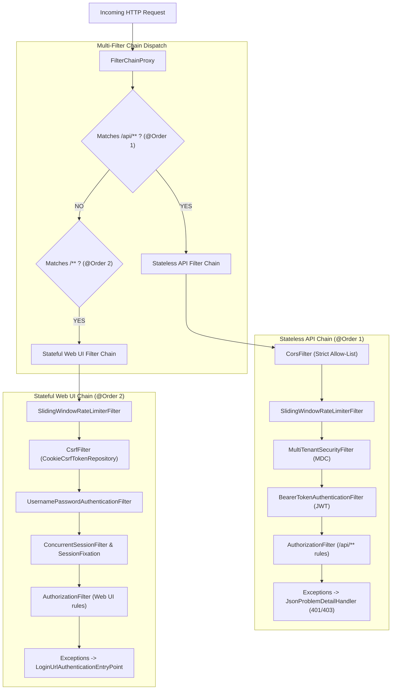
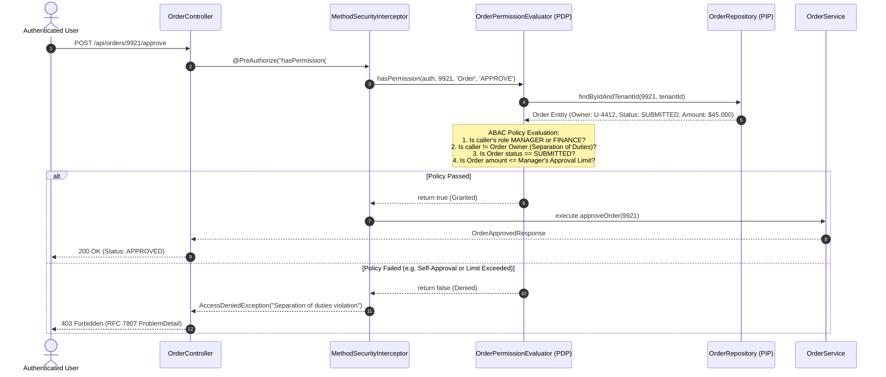
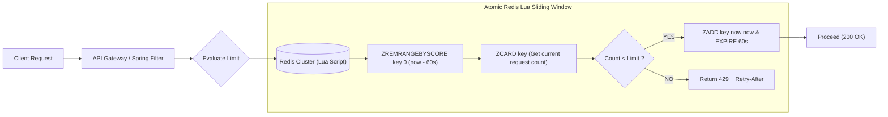

# 07 · Security Best Practices — The Enterprise Master Reference

> **Level:** Advanced → Expert
> **Interview Frequency:** ★★★★★ (the definitive reference & senior/staff architecture round)
> **Prerequisite:** [06 · Production Security Patterns](./06-Production-Security-Patterns.md)
> **Last Updated:** 2026
> **Target Stack:** Spring Boot 3.3+ · Spring Framework 6.1+ · Spring Security 6.3+ · Java 17+ · Jakarta EE 10

---

## 📋 Table of Contents
- [0. TL;DR — The 30-Second Answer](#0-tldr--the-30-second-answer)
- [1. What & Why — Enterprise Security Architecture](#1-what--why--enterprise-security-architecture)
- [2. Mental Model & Visual Architecture](#2-mental-model--visual-architecture)
  - [2.1 Hybrid Multi-Filter Chain Architecture](#21-hybrid-multi-filter-chain-architecture)
  - [2.2 Multi-Tenant Context & Isolation Boundary](#22-multi-tenant-context--isolation-boundary)
  - [2.3 Sliding-Window Rate Limiting Mechanics](#23-sliding-window-rate-limiting-mechanics)
  - [2.4 Dynamic ABAC/RBAC Decision Flow](#24-dynamic-abacrbac-decision-flow)
- [3. The Master Hardening Checklist](#3-the-master-hardening-checklist)
  - [3.1 Dependencies & Build](#31-dependencies--build)
  - [3.2 Secrets & Configuration](#32-secrets--configuration)
  - [3.3 Authentication Architecture](#33-authentication-architecture)
  - [3.4 Password Storage & Cryptography](#34-password-storage--cryptography)
  - [3.5 Tokens, Sessions & State](#35-tokens-sessions--state)
  - [3.6 Authorization & Method Security](#36-authorization--method-security)
  - [3.7 Data Access, SQL Injection & IDOR](#37-data-access-sql-injection--idor)
  - [3.8 Multi-Tenancy Isolation](#38-multi-tenancy-isolation)
  - [3.9 Web Security (CSRF, CORS, Security Headers)](#39-web-security-csrf-cors-security-headers)
  - [3.10 Input Validation & Output Encoding](#310-input-validation--output-encoding)
  - [3.11 File Upload Security](#311-file-upload-security)
  - [3.12 Logging, Auditing & MDC Propagation](#312-logging-auditing--mdc-propagation)
  - [3.13 Rate Limiting, Throttling & DoS Protection](#313-rate-limiting-throttling--dos-protection)
  - [3.14 Error Handling & Information Leakage](#314-error-handling--information-leakage)
  - [3.15 API Documentation & Metadata Security](#315-api-documentation--metadata-security)
  - [3.16 Infrastructure, Containers & Network Segmentation](#316-infrastructure-containers--network-segmentation)
  - [3.17 Supply Chain & CI/CD Pipeline Gates](#317-supply-chain--cicd-pipeline-gates)
  - [3.18 Security Testing & Regression Verification](#318-security-testing--regression-verification)
- [4. Deep Dive Theory & Architectural Mechanics](#4-deep-dive-theory--architectural-mechanics)
  - [4.1 Hybrid Multi-Filter Chains (Stateless API vs Stateful Web UI)](#41-hybrid-multi-filter-chains-stateless-api-vs-stateful-web-ui)
  - [4.2 Multi-Tenancy & Context Propagation (MDC, ThreadLocal, TaskDecorator)](#42-multi-tenancy--context-propagation-mdc-threadlocal-taskdecorator)
  - [4.3 Sliding-Window Rate Limiting Algorithms & Trusted Proxy Handling](#43-sliding-window-rate-limiting-algorithms--trusted-proxy-handling)
  - [4.4 Dynamic Access Control: RBAC vs ABAC vs ReBAC](#44-dynamic-access-control-rbac-vs-abac-vs-rebac)
- [5. Step-by-Step Worked Examples (with Output + Dry Run)](#5-step-by-step-worked-examples-with-output--dry-run)
  - [5.1 Worked Example 1: Hybrid Filter Chain Routing & RFC 7807 ProblemDetail](#51-worked-example-1-hybrid-filter-chain-routing--rfc-7807-problemdetail)
  - [5.2 Worked Example 2: Multi-Tenant Context Propagation with Async TaskDecorator](#52-worked-example-2-multi-tenant-context-propagation-with-async-taskdecorator)
  - [5.3 Worked Example 3: Sliding-Window IP Rate Limiter under Traffic Spikes](#53-worked-example-3-sliding-window-ip-rate-limiter-under-traffic-spikes)
  - [5.4 Worked Example 4: Dynamic ABAC Evaluation on Order Approval](#54-worked-example-4-dynamic-abac-evaluation-on-order-approval)
- [6. Code from Scratch — Production-Grade](#6-code-from-scratch--production-grade)
  - [6.1 Component 1: Hybrid Security Configuration (Stateless API + Stateful Web UI)](#61-component-1-hybrid-security-configuration-stateless-api--stateful-web-ui)
  - [6.2 Component 2: Multi-Tenant Security Filter with MDC Logging & TaskDecorator](#62-component-2-multi-tenant-security-filter-with-mdc-logging--taskdecorator)
  - [6.3 Component 3: Sliding-Window IP Rate Limiter Filter with Trusted Proxy Support](#63-component-3-sliding-window-ip-rate-limiter-filter-with-trusted-proxy-support)
  - [6.4 Component 4: Dynamic ABAC/RBAC Custom PermissionEvaluator](#64-component-4-dynamic-abacrbac-custom-permissionevaluator)
- [7. The Anti-Patterns Catalogue](#7-the-anti-patterns-catalogue)
- [8. The Configuration Reference](#8-the-configuration-reference)
  - [8.1 Production-Shaped `application.yml`](#81-production-shaped-applicationyml)
  - [8.2 Maven Dependency Bill of Materials (BOM)](#82-maven-dependency-bill-of-materials-bom)
  - [8.3 Hardened JVM Flags for Security & Memory Isolation](#83-hardened-jvm-flags-for-security--memory-isolation)
- [9. The Pre-Production Verification Suite](#9-the-pre-production-verification-suite)
- [10. The Incident Response Cheatsheet](#10-the-incident-response-cheatsheet)
- [11. Interview Q&A — Level-wise](#11-interview-qa--level-wise)
  - [🟢 Beginner Level](#-beginner-level)
  - [🟡 Intermediate Level](#-intermediate-level)
  - [🔴 Advanced / Senior Level](#-advanced--senior-level)
  - [⚫ Expert / Principal Level](#-expert--principal-level)
- [12. Counter-Questions & Traps](#12-counter-questions--traps)
- [13. Tricky Interview Questions & Edge Cases](#13-tricky-interview-questions--edge-cases)
- [14. Follow-Up Questions Asked by Interviewers](#14-follow-up-questions-asked-by-interviewers)
- [15. Real 3–5 Year Experience Scenarios](#15-real-35-year-experience-scenarios)
- [16. Frequently Asked Production Issues](#16-frequently-asked-production-issues)
- [17. Production Debugging Scenarios](#17-production-debugging-scenarios)
  - [D1. Investigating CORS Preflight 401/403 Failures](#d1-investigating-cors-preflight-401403-failures)
  - [D2. Diagnosing Lost SecurityContext & MDC in `@Async` and Virtual Threads](#d2-diagnosing-lost-securitycontext--mdc-in-async-and-virtual-threads)
  - [D3. Resolving SPA `InvalidCsrfTokenException` with Spring Security 6 Deferred Tokens](#d3-resolving-spa-invalidcsrftokenexception-with-spring-security-6-deferred-tokens)
  - [D4. Mitigating CPU Starvation During BCrypt Login Storms](#d4-mitigating-cpu-starvation-during-bcrypt-login-storms)
  - [D5. Diagnosing Infinite Redirect Loops Between Form Login and Protected Root](#d5-diagnosing-infinite-redirect-loops-between-form-login-and-protected-root)
  - [D6. Debugging Tenant Leaks Across Pooled HikariCP Database Connections](#d6-debugging-tenant-leaks-across-pooled-hikaricp-database-connections)
  - [D7. Identifying Spoofed Client IPs in Rate Limiting Behind Cloudflare / AWS ALB](#d7-identifying-spoofed-client-ips-in-rate-limiting-behind-cloudflare--aws-alb)
  - [D8. Tracing Silent Authorization Failures in Dynamic SpEL Method Security](#d8-tracing-silent-authorization-failures-in-dynamic-spel-method-security)
- [18. Architecture Design Questions](#18-architecture-design-questions)
  - [A1. Zero Trust Security Architecture for a Global Fintech Platform](#a1-zero-trust-security-architecture-for-a-global-fintech-platform)
  - [A2. Multi-Tenant Enterprise SaaS Isolation (Logical vs Physical vs Row-Level Security)](#a2-multi-tenant-enterprise-saas-isolation-logical-vs-physical-vs-row-level-security)
  - [A3. High-Throughput Distributed Rate Limiting & Abuse Prevention Engine](#a3-high-throughput-distributed-rate-limiting--abuse-prevention-engine)
- [19. Rapid-Fire MCQs](#19-rapid-fire-mcqs)
- [20. Cheat Sheet — One-Page Summary](#20-cheat-sheet--one-page-summary)
- [21. Real-World Production Notes](#21-real-world-production-notes)
- [22. Follow-up Learning](#22-follow-up-learning)

---

## 0. TL;DR — The 30-Second Answer

Enterprise Spring Security is not a mere set of configuration flags; it is a **multi-layered, defense-in-depth architecture** enforcing the principle of least privilege at every boundary.

```text
┌────────────────────────────────────────────────────────────────────────────────────────┐
│                        ENTERPRISE SECURITY IN TEN INVARIANTS                           │
├────────────────────────────────────────────────────────────────────────────────────────┤
│ 1. DEFAULT-DENY ARCHITECTURE   │ Every URL and method denies access by default;       │
│                                │ permits are narrow, explicit, and verified in CI.     │
│ 2. SEPARATE FILTER CHAINS      │ Stateless REST APIs (@Order(1)) use Bearer JWTs,      │
│                                │ STATELESS sessions, disabled CSRF, and RFC 7807.      │
│                                │ Stateful Web UIs (@Order(2)) use form login, sessions,│
│                                │ strict SameSite cookies, and deferred CSRF tokens.    │
│ 3. CRYPTOGRAPHIC INTEGRITY     │ BCrypt (cost ≥ 12) or Argon2id via DelegatingPassword-│
│                                │ Encoder. Asymmetric RS256/ES256 with key rotation.    │
│ 4. IDOR PREVENTION AT SQL      │ Never load by ID then check owner in Java. The owner  │
│                                │ predicate belongs in the SQL WHERE clause.            │
│ 5. MULTI-TENANT ISOLATION      │ Tenant ID derived strictly from validated auth claims;│
│                                │ propagated via ThreadLocal + MDC; cleared in finally; │
│                                │ passed to async pools via TaskDecorator.              │
│ 6. DEFENSE AGAINST ABUSE       │ Server-side sliding-window rate limiting on logins and│
│                                │ expensive APIs with trusted proxy client IP parsing.   │
│ 7. STRICT WEB GUARDS           │ Explicit CORS allow-list (never wildcard credentials);│
│                                │ HSTS (max-age=31536000), CSP, frame-ancestors: 'none'.│
│ 8. DYNAMIC ABAC ENFORCEMENT    │ Coarse checks at URL; fine-grained, data-dependent    │
│                                │ policies via Method Security & CustomPermissionEval.  │
│ 9. AUDIT & RESILIENT OBSERV    │ Append-only security audit log for logins, denials,   │
│                                │ and privilege changes. Masked PII; X-Request-ID in MDC│
│ 10. SUPPLY CHAIN HARDENING     │ Automated CVE scanning (SCA), non-root container runs,│
│                                │ secrets in KMS/Vault, strict production profile gate. │
└────────────────────────────────────────────────────────────────────────────────────────┘
```

When an interviewer asks: *"How do you secure a Spring Boot microservice for production?"*, you state:
> *"I establish a zero-trust, defense-in-depth architecture. First, I isolate entry points using ordered `SecurityFilterChain` beans: a stateless chain for OAuth2/JWT REST APIs returning RFC 7807 problem details, and a stateful chain for administrative web portals with deferred CSRF protection and session fixation mitigation. Second, I enforce authorization at both coarse URL boundaries and fine-grained method boundaries using dynamic ABAC `PermissionEvaluator` instances, ensuring all data-access operations enforce tenancy and ownership in the database query to completely prevent IDOR. Third, I protect against brute-force and credential stuffing through server-side sliding-window rate limiting with trusted proxy header parsing. Finally, I maintain complete observability by propagating tenant IDs and correlation tokens across thread pools via `TaskDecorator` into SLF4J MDC, while ensuring secrets and dependencies are strictly guarded via Vault and automated SCA gates."*

---

## 1. What & Why — Enterprise Security Architecture

### The Problem This Solves
In legacy architectures, systems relied on the **castle-and-moat fallacy**: once traffic crossed the corporate firewall or edge reverse proxy, internal networks and service-to-service calls were assumed to be trusted. In modern cloud-native, microservice, and multi-tenant environments, this model is catastrophic:
1. **Network Boundaries Are Porous:** A single compromised container, SSRF vulnerability, or misconfigured ingress allows an attacker full lateral movement across the entire internal fleet.
2. **Coarse-Grained URL Filters Miss Data Vulnerabilities:** A URL-level check like `.requestMatchers("/orders/**").hasRole("USER")` verifies that the caller is *a* user, but fails to verify that the caller owns *this specific* order. This architectural gap results in **Insecure Direct Object References (IDOR / BOLA)**, consistently ranked by OWASP as the #1 API breach vector.
3. **Monolithic Security Configurations Cause Collisions:** Attempting to force both single-page application (SPA) REST endpoints and server-rendered HTML admin portals into a single `SecurityFilterChain` creates conflicting requirements: APIs require stateless sessions and disabled CSRF, whereas HTML portals require session fixation protection, concurrent session limits, and stateful CSRF cookies.
4. **Context Leaks in Asynchronous Pipelines:** Modern high-throughput applications rely heavily on `@Async`, `CompletableFuture`, reactive streams, and Java 21+ Virtual Threads. Because Spring Security historically binds security credentials to `ThreadLocal`, switching threads causes credentials and logging correlation IDs (MDC) to be silently dropped—or worse, reused by subsequent requests on pooled worker threads.

### Enterprise Defense-in-Depth Model
The enterprise architecture enforces **Zero Trust: Never Trust, Always Verify**. Security is implemented as concentric rings of verification:

```text
       ┌──────────────────────────────────────────────────────────────┐
       │ Layer 1: Edge & Ingress (Cloudflare / AWS WAF / ALB)         │
       │   - TLS 1.3 Termination, DDoS mitigation, IP geo-blocking    │
       └──────────────────────────────┬───────────────────────────────┘
                                      │
       ┌──────────────────────────────▼───────────────────────────────┐
       │ Layer 2: Servlet Container & Rate Limiting Filter            │
       │   - Sliding-window IP rate limiter, trusted proxy parsing    │
       └──────────────────────────────┬───────────────────────────────┘
                                      │
       ┌──────────────────────────────▼───────────────────────────────┐
       │ Layer 3: Spring Security FilterChainProxy (Ordered Chains)   │
       │   - Chain 1: /api/** (Stateless, Bearer JWT, RFC 7807)       │
       │   - Chain 2: /**     (Stateful, Form Login, Deferred CSRF)   │
       └──────────────────────────────┬───────────────────────────────┘
                                      │
       ┌──────────────────────────────▼───────────────────────────────┐
       │ Layer 4: Multi-Tenant Context & MDC Logging Filter           │
       │   - Validates tenant, sets TenantContextHolder, sets MDC     │
       └──────────────────────────────┬───────────────────────────────┘
                                      │
       ┌──────────────────────────────▼───────────────────────────────┐
       │ Layer 5: Method-Level Security (@PreAuthorize, ABAC)          │
       │   - Custom PermissionEvaluator, role checks, business state  │
       └──────────────────────────────┬───────────────────────────────┘
                                      │
       ┌──────────────────────────────▼───────────────────────────────┐
       │ Layer 6: Data Access Layer (Spring Data JPA / Hibernate)     │
       │   - Ownership predicate in SQL WHERE clause, PostgreSQL RLS  │
       └──────────────────────────────────────────────────────────────┘
```

---

## 2. Mental Model & Visual Architecture

### 2.1 Hybrid Multi-Filter Chain Architecture

Spring Security's `FilterChainProxy` routes incoming HTTP requests to the **first matching** `SecurityFilterChain` in ascending order of `@Order`.



### 2.2 Multi-Tenant Context & Isolation Boundary

In a multi-tenant SaaS application, tenant identification must be established early in the filter chain, bound to execution context, and rigorously cleared upon request termination:

```text
 ┌─────────────────────────────────────────────────────────────────────────────────────────┐
 │                           MULTI-TENANT ISOLATION LIFECYCLE                              │
 └─────────────────────────────────────────────────────────────────────────────────────────┘
   Incoming HTTP Request
        │
        ▼
   [MultiTenantSecurityFilter]
        │
        ├─▶ 1. Extract Tenant ID: JWT Claim ("tenant_id") > Header ("X-Tenant-ID") > Subdomain
        ├─▶ 2. Validate Tenant ID: Regex check ^[a-zA-Z0-9_-]{3,36}$ & Check TenantRegistry
        ├─▶ 3. Bind Thread Context:
        │        TenantContextHolder.setTenantId(tenantId);
        │        MDC.put("tenantId", tenantId);
        │        MDC.put("traceId", UUID.randomUUID().toString());
        │
        ▼
   [DispatcherServlet & Controllers]
        │
        ▼
   [@Async / TaskExecutor Boundary]
        │
        ├─▶ TenantAwareTaskDecorator captures:
        │     - TenantContextHolder snapshot
        │     - SecurityContextHolder snapshot
        │     - MDC context map snapshot
        │   Decorates Runnable -> executes in pooled worker thread -> clears in finally {}
        │
        ▼
   [Spring Data JPA Repository]
        │
        ├─▶ Enforces Tenant ID in SQL query:
        │     SELECT o FROM Order o WHERE o.id = :id AND o.tenantId = :tenantId
        │   (or Hibernate 6 @TenantId filter / PostgreSQL Row-Level Security)
        │
        ▼
   [Filter finally {} Block]
        │
        └─▶ MANDATORY CLEANUP:
              TenantContextHolder.clear();
              MDC.remove("tenantId");
              MDC.remove("traceId");
              SecurityContextHolder.clearContext();
```

### 2.3 Sliding-Window Rate Limiting Mechanics

Fixed-window counters suffer from the **boundary burst problem**: an attacker can send their entire limit at the end of window 1 and another full burst at the start of window 2, doubling the allowed throughput. The **sliding-window counter** eliminates this edge case by calculating weighted request density across rolling sub-windows:

```text
  FIXED WINDOW VULNERABILITY (Limit: 100 req / minute):
  Window 1 (00:00 - 01:00)              Window 2 (01:00 - 02:00)
  ───────────────────────────────       ───────────────────────────────
  [0 reqs]        [100 reqs at 00:59]   [100 reqs at 01:01]    [0 reqs]
                         └──────────────┬──────────────┘
                         200 requests within 2 seconds! (2x Limit)

  SLIDING-WINDOW COUNTER (Calculates rolling weight):
  
  |<──────── Previous Window (w-1) ────────>|<──────── Current Window (w) ──────────>|
  |             Requests: 80                |             Requests: 30               |
  |                                         |                                        |
  └─────────────────────────────────────────┴──────────────────▲─────────────────────┘
                                                               │
                                                       Current Time (t)
                                                       Window Progress: 25% (offset: 15s)
  
  Rolling Calculation:
    Weight of Previous Window = 1 - (15s / 60s) = 0.75
    Estimated Request Count   = (80 * 0.75) + 30 = 60 + 30 = 90 requests
    Limit Check: 90 < 100 (ALLOWED)
    Remaining: 10
```

### 2.4 Dynamic ABAC/RBAC Decision Flow

Dynamic Attribute-Based Access Control (ABAC) decouples business authorization logic from controllers via the standard Policy Enforcement / Decision architecture:



---

## 3. The Master Hardening Checklist

### 3.1 Dependencies & Build
- [ ] **Current Spring Boot BOM:** The project imports `spring-boot-dependencies` inside the active commercial/community support window (Spring Boot 3.3+).
- [ ] **Automated SCA Pipeline:** CI/CD runs continuous software composition analysis (OWASP Dependency-Check, Snyk, or Trivy) failing builds on CVEs with CVSS score $\ge 7.0$.
- [ ] **Actuator Isolation:** `spring-boot-starter-actuator` is bound to an isolated management port (`management.server.port=9090`) accessible only from internal cluster networks.
- [ ] **Actuator Exposure Allow-List:** `management.endpoints.web.exposure.include` is strictly restricted to `health,info,metrics,prometheus`. Endpoints `env`, `beans`, `configprops`, `heapdump`, and `threaddump` are explicitly excluded from production exposure.
- [ ] **Health Details Gating:** `management.endpoint.health.show-details=when-authorized` to prevent leaking disk paths, database topologies, and internal component versions to unauthenticated callers.
- [ ] **Development Scope Hygiene:** `spring-boot-devtools` is restricted to `<scope>runtime</scope>` with `<optional>true</optional>` and excluded from final container images.
- [ ] **Lombok Cleanliness:** Lombok dependencies are marked `<scope>provided</scope>` ensuring zero runtime artifact contamination.

### 3.2 Secrets & Configuration
- [ ] **Zero Secrets in Version Control:** No plain-text passwords, tokens, private keys, or webhook secrets exist in `application.yml`, commit history, or test fixtures.
- [ ] **Centralized Secret Management:** Secrets are injected at runtime via external key management systems (HashiCorp Vault, AWS Secrets Manager, Azure Key Vault, or Kubernetes CSI driver).
- [ ] **Fail-Fast Configuration Validation:** All `@ConfigurationProperties` classes are annotated with `@Validated` and JSR-380 constraints (`@NotBlank`, `@Min`, `@Pattern`), causing application boot to abort if required security properties are missing or malformed.
- [ ] **Dynamic Secret Rotation:** Credentials for databases, message brokers, and signing keys support dual-key rotation without service interruption.
- [ ] **Actuator Env Masking:** `management.endpoint.env.keys-to-sanitize` masks keys matching `password`, `secret`, `key`, `token`, `credentials`, `vcap_services`, `sun.java.command`.
- [ ] **Logback Sanitization:** Logging patterns sanitize sensitive fields; debug logging on `org.springframework.web` and `org.hibernate.SQL` is strictly forbidden in production.

### 3.3 Authentication Architecture
- [ ] **No Default Credentials:** The default auto-generated security password is completely disabled by providing custom `UserDetailsService` or OAuth2 Resource Server beans.
- [ ] **Timing-Safe Enumeration Defense:** Login failure responses return identical HTTP status codes (401), identical error bodies ("Invalid credentials"), and execute constant-time password verification to defeat user enumeration attacks.
- [ ] **Multi-Factor Authentication (MFA):** Mandatory TOTP/WebAuthn for administrative users and high-risk monetary transactions.
- [ ] **Account Lockout & Exponential Backoff:** Repeated authentication failures trigger progressive IP/account cooldowns (e.g. 5 attempts $	o$ 15-minute lock).
- [ ] **Session Fixation Defense:** Web UI chains enforce `sessionManagement(s -> s.sessionFixation().changeSessionId())`.
- [ ] **Concurrent Session Bounding:** Multi-login restrictions enforced via `sessionManagement(s -> s.maximumSessions(1).maxSessionsPreventsLogin(false))` coupled with `HttpSessionEventPublisher`.
- [ ] **Comprehensive Logout Pipeline:** Logout clears `SecurityContextHolder`, terminates `HttpSession`, deletes `JSESSIONID` cookies, and invalidates server-side tokens.

### 3.4 Password Storage & Cryptography
- [ ] **Adaptive Password Hashing:** Use `DelegatingPasswordEncoder` defaulting to `BCryptPasswordEncoder(12)` or `Argon2PasswordEncoder` (configured with memory cost 65536 KiB, parallelism 1, iterations 3).
- [ ] **Zero Fast Hashes:** Prohibit MD5, SHA-1, bare SHA-256, or SHA-512 for password verification.
- [ ] **Unique Automatic Salting:** Cryptographic salts are generated automatically per-password using a cryptographically secure pseudo-random number generator (`SecureRandom`).
- [ ] **Hardware-Calibrated Cost:** Password hashing latency is calibrated to take 100–250 ms on production CPUs to balance brute-force resistance against server capacity.
- [ ] **Modern NIST 800-63B Password Policies:** Enforce minimum length of 12 characters, allow passphrases up to 128 characters, check against HaveIBeenPwned k-anonymity breached password lists, and eliminate arbitrary periodic expirations and composition rules.
- [ ] **Cryptographically Secure Reset Tokens:** Password reset tokens are generated using `SecureRandom` (256-bit entropy), stored in the database as SHA-256 hashes, valid for $\le 15$ minutes, and single-use.

### 3.5 Tokens, Sessions & State
- [ ] **Short Access Token Lifespans:** Stateless JWT access tokens have an expiry of 5–15 minutes.
- [ ] **Secure Refresh Token Rotation:** Refresh tokens rotate on every exchange, store only cryptographic SHA-256 hashes in the database, and trigger immediate family invalidation upon reuse detection.
- [ ] **Hardened Cookie Directives:** Session cookies enforce `HttpOnly`, `Secure`, `SameSite=Lax` (or `Strict`), `Path=/`, and restrict `Domain` to specific subdomains.
- [ ] **Standardized JWT Claims:** Tokens validate `iss`, `aud`, `exp`, `nbf`, `iat`, `sub`, and `jti`.
- [ ] **Strict Algorithm Pinning:** Resource server decoders explicitly pin the expected signature algorithm (`RS256` or `ES256`) and unconditionally reject `none` and symmetric/asymmetric confusion.
- [ ] **Bounded Clock Skew:** Token decoders configure clock skew to $\le 60$ seconds.

### 3.6 Authorization & Method Security
- [ ] **Global Default-Deny:** URL routing terminates with `.anyRequest().authenticated()` (or `.denyAll()`).
- [ ] **Method Security Activation:** `@EnableMethodSecurity(prePostEnabled = true)` is declared on root security configuration.
- [ ] **Ownership Verification in Data Tier:** Authorization checks for entity ownership are performed in repository queries rather than post-fetching controller checks.
- [ ] **Separation of Duties:** Approval and administrative operations require distinct roles (initiator $
e$ approver).
- [ ] **`@PreAuthorize` over `@PostAuthorize` for Writes:** State-mutating methods strictly use `@PreAuthorize` to prevent execution of business side effects prior to authorization.

### 3.7 Data Access, SQL Injection & IDOR
- [ ] **Ownership Predicates in Repository Queries:** All entity lookups include user/tenant IDs: `Optional<Order> findByIdAndUserId(Long id, String userId)`.
- [ ] **Uniform 404 for Missing and Unauthorized Entities:** Accessing another tenant's or user's entity returns HTTP 404 Not Found rather than 403 Forbidden to prevent resource enumeration.
- [ ] **Strict Parameterized Queries:** JPQL, Criteria API, and Native Queries use bound parameters; direct string concatenation is strictly prohibited.
- [ ] **Entity-DTO Decoupling:** Controllers accept and return dedicated records/DTOs to prevent Mass Assignment and Over-Posting vulnerabilities.
- [ ] **Pagination Safety Limits:** `Pageable` parameters are capped to a maximum of 50 or 100 items per request to prevent memory exhaustion.

### 3.8 Multi-Tenancy Isolation
- [ ] **Authentication-Derived Tenancy:** Tenant identifiers are extracted exclusively from validated authentication tokens or cryptographically signed session attributes.
- [ ] **Query-Level Data Scoping:** Enforce Hibernate 6 `@TenantId` or PostgreSQL Row-Level Security (RLS) as an inviolable database-level guard.
- [ ] **Tenant-Partitioned Caches:** All cache keys (Redis, Caffeine) prefix the tenant identifier: `cache:tenant_id:entity_id`.
- [ ] **Thread Context Propagation:** `TenantAwareTaskDecorator` ensures tenant identifiers propagate across thread pools and clear upon task termination.

### 3.9 Web Security (CSRF, CORS, Security Headers)
- [ ] **Chain-Specific CSRF Strategy:** CSRF is disabled only on pure stateless bearer-token API chains. Stateful web chains enforce deferred CSRF with `CookieCsrfTokenRepository` or `SpaCsrfTokenRequestHandler`.
- [ ] **Strict CORS Configuration:** Prohibit wildcard origins (`*`) when `allowCredentials(true)` is set; explicitly allow trusted origins (`https://app.example.com`).
- [ ] **HSTS with Preload:** `Strict-Transport-Security: max-age=31536000; includeSubDomains; preload`.
- [ ] **Content Security Policy (CSP):** `default-src 'self'; script-src 'self'; object-src 'none'; frame-ancestors 'none';`.
- [ ] **Defensive Headers:** `X-Content-Type-Options: nosniff`, `X-Frame-Options: DENY`, `Referrer-Policy: strict-origin-when-cross-origin`.

### 3.10 Input Validation & Output Encoding
- [ ] **Declarative Bean Validation:** Controller payloads enforce JSR-380 annotations (`@NotNull`, `@Size`, `@Pattern`, `@Email`).
- [ ] **Class-Level `@Validated`:** Service and controller interfaces declare `@Validated` to enforce method-argument constraints.
- [ ] **Context-Aware Output Encoding:** Thymeleaf auto-escaping is active; JSON responses avoid raw string embedding.
- [ ] **SSRF Defense:** Outbound HTTP clients (RestTemplate / WebClient / RestClient) validate URLs against an IP allow-list and reject private RFC 1918 subnets (e.g. `10.0.0.0/8`, `169.254.169.254`).
- [ ] **Polymorphic Deserialization Hardening:** Jackson disables default typing and validates `@JsonTypeInfo` against strict allow-lists.

### 3.11 File Upload Security
- [ ] **Enforced Size Bounds:** `spring.servlet.multipart.max-file-size=10MB` and `max-request-size=10MB`.
- [ ] **Magic Bytes Verification:** MIME types are verified by inspecting binary magic bytes via Apache Tika; client-supplied `Content-Type` headers are untrusted.
- [ ] **Path Traversal Mitigation:** Uploaded files are assigned random UUID filenames and stored outside the web root or pushed to object storage (AWS S3, GCS) via pre-signed URLs.
- [ ] **Antivirus Pipeline:** Asynchronous scanning (ClamAV or VirusTotal API) on all file ingest boundaries.
- [ ] **Asset Domain Isolation:** User-generated content is served from an isolated domain with `Content-Disposition: attachment` to prevent stored XSS.

### 3.12 Logging, Auditing & MDC Propagation
- [ ] **Security Event Auditing:** Structured audit logs for login successes, failures, access denials, and privilege alterations.
- [ ] **Automated Redaction:** Passwords, tokens, PANs, and sensitive PII are masked by custom Logback converters.
- [ ] **Distributed Correlation:** `X-Request-ID` and `traceId` are bound to SLF4J MDC at request ingress and propagated across thread boundaries.
- [ ] **Tamper-Evident Logs:** Production logs are shipped immediately off-box to an append-only centralized SIEM (Splunk, Datadog, Elastic).

### 3.13 Rate Limiting, Throttling & DoS Protection
- [ ] **Layered Rate Limiting:** Sliding-window rate limiters on `/api/auth/**`, password resets, and search endpoints.
- [ ] **Trusted Proxy Validation:** `X-Forwarded-For` is parsed safely by validating the upstream reverse proxy against a known CIDR allow-list.
- [ ] **Informative 429 Responses:** Throttled requests return HTTP 429 with `Retry-After`, `X-RateLimit-Limit`, and RFC 7807 bodies.

### 3.14 Error Handling & Information Leakage
- [ ] **Suppressed Stack Traces:** `server.error.include-stacktrace=never` and `server.error.include-message=never`.
- [ ] **Global Exception Handler:** Centralized `@RestControllerAdvice` translates internal exceptions into sanitized RFC 7807 `ProblemDetail` structures.
- [ ] **Uniform Error Schemas:** Error responses return consistent schemas for all HTTP status codes.

### 3.15 API Documentation & Metadata Security
- [ ] **Protected Swagger UI:** Springdoc-openapi endpoints (`/swagger-ui/**`, `/v3/api-docs/**`) are disabled in production or gated behind administrator authentication.
- [ ] **Internal Schema Sanitization:** OpenAPI specifications omit internal service endpoints and administrative entities.

### 3.16 Infrastructure, Containers & Network Segmentation
- [ ] **Non-Root Execution:** Docker containers run as dedicated unprivileged users (`USER 10001:10001`).
- [ ] **Read-Only Root Filesystem:** Containers run with `readOnlyRootFilesystem: true` and temporary directories mounted as `tmpfs`.
- [ ] **Network Policies:** Kubernetes NetworkPolicies restrict egress from pods exclusively to required databases and APIs.
- [ ] **Least-Privilege Database Users:** Application database users are stripped of DDL privileges (`DROP`, `ALTER`, `CREATE`).

### 3.17 Supply Chain & CI/CD Pipeline Gates
- [ ] **Automated Renovate / Dependabot:** Security dependency bumps are automatically submitted and regression-tested.
- [ ] **Static Code Analysis (SAST):** Semgrep and SonarQube run on every pull request, blocking merges on security bugs.
- [ ] **Secret Scanning:** Gitleaks runs as a pre-commit hook and CI gate to block committed secrets.
- [ ] **Software Bill of Materials (SBOM):** CycloneDX generates an SBOM for every release build.

### 3.18 Security Testing & Regression Verification
- [ ] **Automated Auth Integration Tests:** MockMvc suites assert 401 on unauthenticated calls and 403 on role mismatches.
- [ ] **IDOR Automated Tests:** Test suites explicitly assert that User A cannot retrieve User B's resource (returns 404).
- [ ] **CSRF Verification Tests:** State-mutating endpoints verify that requests lacking CSRF tokens receive 403.
- [ ] **Security Guard Regression Tests:** CI asserts that `/actuator/env` and `/api/admin/**` cannot be accidentally made `permitAll()`.


## 4. Deep Dive Theory & Architectural Mechanics

### 4.1 Hybrid Multi-Filter Chains (Stateless API vs Stateful Web UI)

In modern enterprise applications, a single backend service frequently serves two fundamentally distinct client profiles:
1. **Stateless REST / GraphQL APIs:** Consumed by Single Page Applications (SPAs like React/Angular/Vue), mobile applications (iOS/Android), and third-party microservices. These clients transmit credentials via HTTP headers (`Authorization: Bearer <JWT>`), require complete session statelessness (`SessionCreationPolicy.STATELESS`), demand RFC 7807 Problem Details JSON on authentication/authorization errors, and do not use CSRF tokens because they do not rely on browser ambient cookie credentials.
2. **Stateful Administrative Web Portals:** Server-rendered HTML web interfaces (Thymeleaf/JSP/HTMX) used by back-office staff. These interfaces rely on browser cookie sessions (`JSESSIONID`), require HTML form login redirects, enforce session fixation and concurrent session bounding, and strictly necessitate Cross-Site Request Forgery (CSRF) protection.

Attempting to enforce both models within a single `SecurityFilterChain` bean results in severe configuration friction, compromised security invariants, or fragile workarounds.

```text
┌────────────────────────────────────────────────────────────────────────────────────────┐
│                        SPRING SECURITY FILTERCHAINPROXY INTERNALS                      │
├────────────────────────────────────────────────────────────────────────────────────────┤
│ HttpServletRequest                                                                     │
│        │                                                                               │
│        ▼                                                                               │
│ ┌──────────────┐      Iterates through List<SecurityFilterChain> in ascending order:   │
│ │FilterChain-  │  1. SecurityFilterChain @Order(1):                                    │
│ │    Proxy     │     - RequestMatcher: AntPathRequestMatcher("/api/**")                │
│ └──────┬───────┘     - Matches? ──▶ YES ──▶ Execute API Filter Chain & RETURN          │
│        │                                                                               │
│        ▼ (NO)                                                                          │
│   2. SecurityFilterChain @Order(2):                                                    │
│      - RequestMatcher: AnyRequestMatcher.INSTANCE ("/**")                              │
│      - Matches? ──▶ YES ──▶ Execute Web UI Filter Chain & RETURN                       │
└────────────────────────────────────────────────────────────────────────────────────────┘
```

#### The RequestMatcher Ordering Invariant
The fundamental invariant of `FilterChainProxy` is **first-match-wins**. If a broad catch-all filter chain (`/**`) is declared without an explicit `@Order` (or with a lower order index than specific chains), it greedily intercepts all requests, completely starving specialized API chains.

Therefore, the strict ordering convention is:
- `@Order(1)`: Specific path patterns (e.g., `.securityMatcher("/api/**")`).
- `@Order(2)`: Secondary specific paths (e.g., `.securityMatcher("/actuator/**")` or `.securityMatcher("/oauth2/**")`).
- `@Order(3)` (or default): Global fallback web chain matching `/**`.

#### Architectural Divergence: API vs Web
| Architectural Dimension | Stateless API Chain (`/api/**`) | Stateful Web UI Chain (`/**`) |
|:---|:---|:---|
| **Primary Credential** | `Authorization: Bearer <JWT>` | `Cookie: JSESSIONID` |
| **Session Policy** | `SessionCreationPolicy.STATELESS` | `SessionCreationPolicy.IF_REQUIRED` |
| **CSRF Protection** | Disabled (`csrf.disable()`) | Enabled (`CookieCsrfTokenRepository`) |
| **Auth Failure (401)** | `JsonAuthenticationEntryPoint` (RFC 7807 JSON) | `LoginUrlAuthenticationEntryPoint` (HTTP 302 Redirect) |
| **Access Denied (403)** | `JsonAccessDeniedHandler` (RFC 7807 JSON) | `AccessDeniedHandlerImpl` (HTTP 302 to `/access-denied`) |
| **CORS Policy** | Strict allow-list with pre-flight handling | Typically not required (Same-Origin) |
| **Session Fixation** | Not applicable | `sessionFixation().changeSessionId()` |
| **Concurrent Sessions**| Not applicable | `maximumSessions(1).maxSessionsPreventsLogin(false)` |

---

### 4.2 Multi-Tenancy & Context Propagation (MDC, ThreadLocal, TaskDecorator)

Enterprise B2B Software-as-a-Service (SaaS) architectures require logical or physical isolation of tenant data. In a multi-tenant microservice, tenant identification must be established at the absolute ingress boundary of the HTTP pipeline.

#### Tenant Resolution Strategies
Tenant identity can be resolved through three distinct mechanisms:
1. **Validated JWT Claims:** For authenticated REST APIs, the identity provider injects a verified claim into the access token (e.g., `tenant_id: "corp_alpha"`). This is the most secure method because the claim is cryptographically signed and tamper-evident.
2. **Dedicated HTTP Header (`X-Tenant-ID`):** Used during unauthenticated pre-login requests (e.g. custom corporate branding) or internal trusted service-to-service calls. Must be strictly validated against an active tenant registry.
3. **Subdomain / Host Header (`alpha.app.example.com`):** Parsed from the HTTP `Host` header. Vulnerable to DNS/Host-spoofing unless validated against an authoritative tenant directory.

#### The ThreadLocal Recycling Trap
Servlet containers such as Apache Tomcat and Eclipse Jetty utilize thread pools (e.g. `http-nio-8080-exec-*`) to handle concurrent requests. When an HTTP request completes, the thread is **not destroyed**; it is returned to the pool to process subsequent requests from potentially different users or tenants.

```text
  THREAD POOL CONTAMINATION SCENARIO:
  
  Request 1 (Tenant A) ──▶ Thread 1 ──▶ TenantContext.set("Tenant-A") ──▶ Returns response (MISSING CLEANUP!)
                                                  │
                                                  ▼ Thread 1 returns to pool with "Tenant-A" still in ThreadLocal!
                                                  │
  Request 2 (Tenant B) ──▶ Thread 1 ──▶ Fails to set tenant ──▶ Executes DB query using "Tenant-A" context!
                                                               └──▶ CRITICAL CROSS-TENANT DATA BREACH!
```

To prevent this catastrophic vulnerability:
1. Context assignment must occur inside a `OncePerRequestFilter`.
2. Context cleanup must be executed within an unconditional `finally` block.
3. SLF4J MDC keys (`tenantId`, `traceId`, `userId`) must be purged alongside the thread-local context.

#### The Asynchronous Context Disconnect
When execution shifts to an asynchronous worker—such as methods annotated with `@Async`, `CompletableFuture.runAsync()`, or Spring TaskExecutors—standard `ThreadLocal` storage **does not propagate**. The worker thread runs with an empty context:
- Hibernate tenant filters fail or throw exceptions.
- SLF4J MDC logs lose correlation IDs, breaking distributed tracing.
- `SecurityContextHolder.getContext().getAuthentication()` returns `null`.

While `InheritableThreadLocal` exists in the JDK, it is dangerous in thread-pooled environments: values are copied only at thread *creation* time. When pooled threads are reused, stale inheritable values persist indefinitely.

The enterprise solution is the **`TaskDecorator`** design pattern. The decorator intercepts the `Runnable` *at the moment of task submission*, captures a snapshot of `TenantContextHolder`, `SecurityContextHolder`, and `MDC`, and wraps the task in a closure that sets and clears the context on the worker thread.

---

### 4.3 Sliding-Window Rate Limiting Algorithms & Trusted Proxy Handling

Rate limiting is a primary defense against Distributed Denial of Service (DDoS), credential stuffing, brute-force password attacks, and scraping.

#### Comparison of Rate Limiting Algorithms
```text
┌────────────────────┬─────────────────────────────┬─────────────────────────────┬───────────────────────────┐
│ Algorithm          │ Memory Complexity           │ Time Complexity             │ Boundary Burst Resistance │
├────────────────────┼─────────────────────────────┼─────────────────────────────┼───────────────────────────┤
│ Fixed Window       │ O(1) per client             │ O(1)                        │ POOR (2x burst at edge)   │
│ Leaky Bucket       │ O(1) per client             │ O(1)                        │ EXCELLENT (smooths rate)  │
│ Token Bucket       │ O(1) per client             │ O(1)                        │ MODERATE (allows bursts)  │
│ Sliding Window Log │ O(N) where N = req count    │ O(log N) or O(N) cleanup    │ PERFECT (exact timestamps)│
│ Sliding Counter    │ O(Sub-windows) per client   │ O(1)                        │ EXCELLENT (approximated)  │
└────────────────────┴─────────────────────────────┴─────────────────────────────┴───────────────────────────┘
```

The **sliding-window counter** combines the low memory overhead of fixed windows with the boundary-burst protection of sliding logs. It maintains request counts for the current sub-window and the immediate previous sub-window, computing the effective request count as:

$$Count_{effective} = \left(Count_{previous} \times \frac{WindowSize - ElapsedInCurrent}{WindowSize}\right) + Count_{current}$$

#### The Reverse Proxy IP Spoofing Threat
In enterprise deployments, Spring Boot applications run behind reverse proxies, load balancers, or CDNs (Cloudflare, AWS ALB, NGINX). In this topology:
- `request.getRemoteAddr()` returns the IP address of the **load balancer**, not the client!
- If a rate limiter keys off `getRemoteAddr()`, all users sharing the load balancer share a single rate-limiting bucket. A single abusive user starves the entire customer base.
- If the rate limiter naively parses `request.getHeader("X-Forwarded-For").split(",")[0]`, an attacker can bypass the limiter entirely or frame an innocent victim by injecting arbitrary headers:
  ```http
  POST /api/auth/login HTTP/1.1
  Host: api.example.com
  X-Forwarded-For: 203.0.113.195, 10.0.0.1
  ```

#### Secure Client IP Resolution Algorithm
To securely determine the real client IP:
1. Verify that `request.getRemoteAddr()` matches a known **Trusted Proxy IP or CIDR range** (e.g., your AWS ALB subnet `10.0.0.0/16`). If the request arrived from an untrusted network, ignore `X-Forwarded-For` completely and use `getRemoteAddr()`.
2. If the remote address is trusted, parse the `X-Forwarded-For` header list **from right to left** (reverse order).
3. Discard intermediate proxy IPs that belong to your trusted proxy infrastructure.
4. The **first untrusted IP encountered from the right** is the genuine client IP address.

---

### 4.4 Dynamic Access Control: RBAC vs ABAC vs ReBAC

Authorization in enterprise applications evolves across three paradigms:

```text
  RBAC (Role-Based)            ABAC (Attribute-Based)                 ReBAC (Relationship-Based)
  ─────────────────            ──────────────────────                 ───────────────────────────
  User ──▶ Has Role            User Attributes ─┐                     User ──▶ "owner_of" ──▶ Document
  Role ──▶ Grants Action       Resource Atts   ─┼─▶ Policy Decision   Document ──▶ "in_folder" ──▶ Folder
  Static & Coarse              Environment Atts ─┘                    Dynamic Graph Traversals
```

#### The Role Explosion Anti-Pattern
Under pure RBAC, authorization rules rely on static strings: `@PreAuthorize("hasRole('ADMIN')")`. As enterprise business rules evolve, roles proliferate exponentially:
- `ROLE_REGIONAL_MANAGER_NORTH`
- `ROLE_APPROVER_FINANCE_TIER_2`
- `ROLE_AUDITOR_READ_ONLY_COMPLIANCE`

When rules depend on runtime conditions—such as *"A manager can only approve orders belonging to their department where the total value is under $50,000, and cannot approve their own orders"*, RBAC fails completely.

#### The ABAC Formalism (NIST SP 800-162)
ABAC computes an authorization decision as a pure function of four attribute classes:
1. **Subject Attributes ($S$):** User ID, tenant ID, department, assigned roles, security clearance, active authentication strength (e.g. MFA status).
2. **Resource Attributes ($R$):** Resource owner ID, tenant ID, creation date, current business lifecycle status (e.g. `DRAFT`, `PENDING_APPROVAL`, `SETTLED`), monetary value, department classification.
3. **Action Attributes ($A$):** `READ`, `WRITE`, `APPROVE`, `CANCEL`, `EXPORT`.
4. **Environment Attributes ($E$):** Request timestamp (business hours vs off-hours), client IP geolocation, system maintenance mode status.

$$\text{Decision} = \text{PolicyEvaluate}(S, R, A, E) \in \{\text{GRANT}, \text{DENY}\}$$

#### Spring Security `PermissionEvaluator` Architecture
Spring Security natively supports ABAC through the `PermissionEvaluator` interface declared in the `spring-security-core` module:

```java
public interface PermissionEvaluator extends AopInfrastructureBean {
    boolean hasPermission(Authentication authentication, Object targetDomainObject, Object permission);
    boolean hasPermission(Authentication authentication, Serializable targetId, String targetType, Object permission);
}
```

By registering a custom `PermissionEvaluator` in `DefaultMethodSecurityExpressionHandler`, methods are cleanly guarded using Spring Expression Language (SpEL):
```java
@PreAuthorize("hasPermission(#orderId, 'Order', 'APPROVE')")
public OrderResponse approveOrder(Long orderId) { ... }
```
This architecture cleanly separates policy enforcement (the `@PreAuthorize` annotation) from policy decision logic (the evaluator bean), enabling centralized auditing, testability, and rule changes without controller modifications.

---

## 5. Step-by-Step Worked Examples (with Output + Dry Run)

### 5.1 Worked Example 1: Hybrid Filter Chain Routing & RFC 7807 ProblemDetail

#### Scenario Description
A client invokes the backend with invalid credentials or missing tokens across both the stateless API endpoint (`/api/orders`) and the stateful web interface (`/dashboard`). We verify that the hybrid filter chain directs requests to their appropriate handlers without cross-contamination.

#### Step 1: Invoking Stateless API without Token
```bash
curl -i -X GET https://api.example.com/api/orders
```

#### Actual HTTP Response Output
```http
HTTP/1.1 401 Unauthorized
Content-Type: application/problem+json
Date: Mon, 16 Nov 2026 12:00:00 GMT
X-Content-Type-Options: nosniff
X-Frame-Options: DENY
Cache-Control: no-cache, no-store, max-age=0, must-revalidate

{
  "type": "https://api.example.com/errors/unauthorized",
  "title": "Unauthorized",
  "status": 401,
  "detail": "Full authentication is required to access this resource. Provide a valid Bearer token.",
  "instance": "/api/orders",
  "timestamp": "2026-11-16T12:00:00.104Z"
}
```

#### Step 2: Invoking Web Portal without Session Cookie
```bash
curl -i -X GET https://api.example.com/dashboard
```

#### Actual HTTP Response Output
```http
HTTP/1.1 302 Found
Location: https://api.example.com/login
Date: Mon, 16 Nov 2026 12:00:01 GMT
X-Content-Type-Options: nosniff
X-Frame-Options: DENY
Content-Length: 0
```

#### Step-by-Step Dry Run Execution Trace
1. Request 1 arrives with path `/api/orders`.
2. `FilterChainProxy` interrogates `@Order(1)` chain matching rule `AntPathRequestMatcher("/api/**")`. Condition evaluates to `true`.
3. Chain 1 executes: `CorsFilter` verifies origin $\to$ `SlidingWindowRateLimiterFilter` verifies client IP quota $\to$ `BearerTokenAuthenticationFilter` finds no `Authorization` header.
4. `AuthorizationFilter` evaluates `.anyRequest().authenticated()`. Authentication is unauthenticated.
5. `ExceptionTranslationFilter` intercepts `AuthenticationException` and delegates to `JsonAuthenticationEntryPoint`.
6. Entry point writes RFC 7807 JSON directly to `HttpServletResponse` with status 401. No HTTP session is created.
7. Request 2 arrives with path `/dashboard`.
8. `FilterChainProxy` checks `@Order(1)` matcher `/api/**` $\to$ evaluates to `false`.
9. `FilterChainProxy` evaluates `@Order(2)` matcher `/**` $\to$ evaluates to `true`.
10. Chain 2 executes: `CsrfFilter` passes GET $\to$ `AuthorizationFilter` rejects unauthenticated principal.
11. `ExceptionTranslationFilter` invokes `LoginUrlAuthenticationEntryPoint`, which constructs an HTTP 302 redirect response pointing to `/login`.

---

### 5.2 Worked Example 2: Multi-Tenant Context Propagation with Async TaskDecorator

#### Scenario Description
An authenticated user belonging to tenant `alpha-logistics` initiates an order checkout at `POST /api/orders`. The order creation succeeds synchronously, and the service dispatches an asynchronous audit and shipping notification via `@Async`. We verify that the background worker thread captures tenant context and MDC logging variables without leakage.

#### Simulated Application Log Output
```text
2026-11-16T12:00:00.210Z  INFO [myapp,alpha-logistics,trace-8891a,usr-4412] [http-nio-8080-exec-3] c.e.service.OrderService : Synchronous order creation initiated for order 10442
2026-11-16T12:00:00.225Z  INFO [myapp,alpha-logistics,trace-8891a,usr-4412] [http-nio-8080-exec-3] c.e.service.OrderService : Order 10442 persisted in tenant database schema
2026-11-16T12:00:00.230Z DEBUG [myapp,alpha-logistics,trace-8891a,usr-4412] [http-nio-8080-exec-3] c.e.async.TenantAwareTaskDecorator : Capturing tenantId=alpha-logistics, traceId=trace-8891a for async submission
2026-11-16T12:00:00.232Z  INFO [myapp,alpha-logistics,trace-8891a,usr-4412] [async-worker-1] c.e.service.NotificationService : Dispatched outbound dispatch notification for order 10442
2026-11-16T12:00:00.235Z DEBUG [myapp,alpha-logistics,trace-8891a,usr-4412] [async-worker-1] c.e.async.TenantAwareTaskDecorator : Clearing context on worker thread async-worker-1
2026-11-16T12:00:00.238Z  INFO [myapp,,,] [http-nio-8080-exec-3] c.e.filter.MultiTenantSecurityFilter : TenantContextHolder and MDC cleared for servlet thread http-nio-8080-exec-3
```

#### Step-by-Step Dry Run Execution Trace
1. `MultiTenantSecurityFilter` extracts `tenant_id: "alpha-logistics"` from the validated JWT token.
2. Binds tenant to `TenantContextHolder` and sets SLF4J MDC keys `tenantId` and `traceId`.
3. `OrderController` delegates to `OrderService.createOrder()`.
4. `OrderService` invokes `@Async NotificationService.sendShippingNotification(orderId)`.
5. Spring's `ThreadPoolTaskExecutor` invokes `TenantAwareTaskDecorator.decorate(runnable)`.
6. The decorator reads the caller thread's `TenantContextHolder`, `SecurityContextHolder`, and `MDC.getCopyOfContextMap()`.
7. Inside the worker thread `async-worker-1`:
   - `TenantContextHolder.setTenantId("alpha-logistics")`
   - `MDC.setContextMap(capturedMap)`
   - Target business logic executes; logs correctly output `[myapp,alpha-logistics,trace-8891a,usr-4412]`.
   - The `finally` block executes: clears `TenantContextHolder`, `SecurityContextHolder`, and `MDC`.
8. Servlet thread `http-nio-8080-exec-3` completes response and executes its filter `finally` block, leaving both threads completely sanitized for subsequent requests.

---

### 5.3 Worked Example 3: Sliding-Window IP Rate Limiter under Traffic Spikes

#### Scenario Description
A client sends a rapid sequence of HTTP requests to `/api/auth/login`. The configured threshold is **5 requests per 10-second rolling window**. We observe the rate limiter allowing requests 1 through 5 while incrementing headers, and actively throttling request 6.

#### Sequential Execution Output
```bash
# Requests 1 to 5: Within Quota
for i in {1..5}; do
  curl -i -s -X POST https://api.example.com/api/auth/login \
       -H "Content-Type: application/json" -d '{"username":"user@example.com","password":"pwd"}' \
       | grep -E "HTTP/1.1|X-RateLimit"
done
```

```http
HTTP/1.1 200 OK
X-RateLimit-Limit: 5
X-RateLimit-Remaining: 4
X-RateLimit-Reset: 1763294410

HTTP/1.1 200 OK
X-RateLimit-Limit: 5
X-RateLimit-Remaining: 3
X-RateLimit-Reset: 1763294410

HTTP/1.1 200 OK
X-RateLimit-Limit: 5
X-RateLimit-Remaining: 2
X-RateLimit-Reset: 1763294410

HTTP/1.1 200 OK
X-RateLimit-Limit: 5
X-RateLimit-Remaining: 1
X-RateLimit-Reset: 1763294410

HTTP/1.1 200 OK
X-RateLimit-Limit: 5
X-RateLimit-Remaining: 0
X-RateLimit-Reset: 1763294410
```

```bash
# Request 6: Quota Exceeded
curl -i -s -X POST https://api.example.com/api/auth/login \
     -H "Content-Type: application/json" -d '{"username":"user@example.com","password":"pwd"}'
```

```http
HTTP/1.1 429 Too Many Requests
Content-Type: application/problem+json
Retry-After: 8
X-RateLimit-Limit: 5
X-RateLimit-Remaining: 0
X-RateLimit-Reset: 1763294410
Date: Mon, 16 Nov 2026 12:00:02 GMT

{
  "type": "https://api.example.com/errors/rate-limit-exceeded",
  "title": "Too Many Requests",
  "status": 429,
  "detail": "Rate limit exceeded for IP 198.51.100.45. Maximum allowed is 5 requests per 10 seconds. Please retry after 8 seconds.",
  "instance": "/api/auth/login",
  "timestamp": "2026-11-16T12:00:02.890Z"
}
```

#### Step-by-Step Dry Run Execution Trace
1. Request 6 arrives from client IP `198.51.100.45`.
2. `SlidingWindowRateLimiterFilter` extracts client IP by inspecting trusted proxy headers.
3. Retrieves rolling bucket deque for `198.51.100.45`.
4. Evicts all recorded timestamps older than `currentTime - 10000ms`.
5. Evaluates `deque.size()`: currently 5 timestamps recorded within the active 10-second window.
6. Condition `size >= limit` evaluates to `true`.
7. Calculates `Retry-After`: earliest timestamp was registered at $t_0$; remaining wait time is $(t_0 + 10000ms - currentTime) / 1000 = 8$ seconds.
8. Writes HTTP 429, sets `Retry-After: 8`, serializes RFC 7807 `ProblemDetail`, and terminates filter chain immediately without executing controller logic.

---

### 5.4 Worked Example 4: Dynamic ABAC Evaluation on Order Approval

#### Scenario Description
In an enterprise procurement system, an order requires approval. Business policy dictates:
1. The approving user must possess the `FINANCE_APPROVER` authority.
2. The order must be in `PENDING_APPROVAL` status.
3. **Separation of Duties:** The approving user cannot be the user who submitted the order.
4. **Financial Limit:** An approver with tier-1 clearance can only approve orders $\le \$10,000$. Orders $>\$10,000$ require tier-2 clearance.

#### Case A: Valid Approval (Tier-2 Manager approves Subordinate's $25,000 Order)
- Approver: User `U-9001` (Role: `FINANCE_APPROVER`, Tier: 2).
- Order 5510: Owner: `U-4412`, Status: `PENDING_APPROVAL`, Amount: `$25,000.00`.
- Execution:
  1. Method interceptor invokes `OrderPermissionEvaluator.hasPermission(auth, 5510, 'Order', 'APPROVE')`.
  2. Evaluator fetches Order 5510.
  3. Check 1 (Role): User has `FINANCE_APPROVER` $\to$ PASS.
  4. Check 2 (Status): Order is `PENDING_APPROVAL` $\to$ PASS.
  5. Check 3 (Separation): `U-9001 != U-4412` $\to$ PASS.
  6. Check 4 (Limit): Tier 2 allows up to $100,000; order is $25,000 $\to$ PASS.
- Result: **Access Granted (200 OK)**. Order status transitions to `APPROVED`.

#### Case B: Insecure Attempt (Manager attempts to self-approve their own $8,000 Order)
- Approver: User `U-9001` (Role: `FINANCE_APPROVER`, Tier: 2).
- Order 5511: Owner: `U-9001`, Status: `PENDING_APPROVAL`, Amount: `$8,000.00`.
- Execution:
  1. Method interceptor invokes `OrderPermissionEvaluator.hasPermission(auth, 5511, 'Order', 'APPROVE')`.
  2. Evaluator fetches Order 5511.
  3. Check 1 (Role): PASS.
  4. Check 2 (Status): PASS.
  5. Check 3 (Separation): `U-9001 == U-9001` $\to$ **FAIL (Separation of duties breach detected)**.
- Result: Evaluator returns `false`. Spring Security throws `AccessDeniedException`.
- HTTP Response:
```http
HTTP/1.1 403 Forbidden
Content-Type: application/problem+json

{
  "type": "https://api.example.com/errors/access-denied",
  "title": "Access Denied",
  "status": 403,
  "detail": "Dynamic ABAC policy rejection: User 'U-9001' cannot approve their own order 5511 due to Separation of Duties policy.",
  "instance": "/api/orders/5511/approve",
  "timestamp": "2026-11-16T12:00:03.112Z"
}
```


## 6. Code from Scratch — Production-Grade

### 6.1 Component 1: Hybrid Security Configuration (Stateless API + Stateful Web UI)

This production configuration establishes two separate, cleanly isolated `SecurityFilterChain` beans:
1. `@Order(1)` stateless REST API filter chain (`/api/**`) backed by OAuth2 / JWT bearer tokens, `SessionCreationPolicy.STATELESS`, disabled CSRF, explicit CORS, and RFC 7807 `ProblemDetail` handlers.
2. `@Order(2)` stateful web portal filter chain (`/**`) backed by form login, `SessionCreationPolicy.IF_REQUIRED`, deferred CSRF tokens for modern SPAs/HTMX, session fixation protection, concurrent session control, and defense-in-depth security headers.

```java
package com.example.security.config;

import com.example.security.handler.JsonAccessDeniedHandler;
import com.example.security.handler.JsonAuthenticationEntryPoint;
import com.example.security.handler.SpaCsrfTokenRequestHandler;
import org.springframework.context.annotation.Bean;
import org.springframework.context.annotation.Configuration;
import org.springframework.core.annotation.Order;
import org.springframework.http.HttpMethod;
import org.springframework.security.config.Customizer;
import org.springframework.security.config.annotation.method.configuration.EnableMethodSecurity;
import org.springframework.security.config.annotation.web.builders.HttpSecurity;
import org.springframework.security.config.annotation.web.configuration.EnableWebSecurity;
import org.springframework.security.config.annotation.web.configurers.AbstractHttpConfigurer;
import org.springframework.security.config.annotation.web.configurers.HeadersConfigurer;
import org.springframework.security.config.annotation.web.configurers.SessionManagementConfigurer;
import org.springframework.security.config.http.SessionCreationPolicy;
import org.springframework.security.crypto.bcrypt.BCryptPasswordEncoder;
import org.springframework.security.crypto.password.PasswordEncoder;
import org.springframework.security.oauth2.server.resource.authentication.JwtAuthenticationConverter;
import org.springframework.security.oauth2.server.resource.authentication.JwtGrantedAuthoritiesConverter;
import org.springframework.security.web.SecurityFilterChain;
import org.springframework.security.web.csrf.CookieCsrfTokenRepository;
import org.springframework.security.web.header.writers.ReferrerPolicyHeaderWriter;
import org.springframework.security.web.session.HttpSessionEventPublisher;
import org.springframework.web.cors.CorsConfiguration;
import org.springframework.web.cors.CorsConfigurationSource;
import org.springframework.web.cors.UrlBasedCorsConfigurationSource;

import java.time.Duration;
import java.util.List;

/**
 * Master Enterprise Security Configuration.
 * Enforces dual-chain isolation: Stateless REST API (@Order 1) vs Stateful Web UI (@Order 2).
 */
@Configuration
@EnableWebSecurity
@EnableMethodSecurity(prePostEnabled = true, securedEnabled = true)
public class MasterSecurityConfiguration {

    private final JsonAuthenticationEntryPoint jsonAuthenticationEntryPoint;
    private final JsonAccessDeniedHandler jsonAccessDeniedHandler;

    public MasterSecurityConfiguration(JsonAuthenticationEntryPoint jsonAuthenticationEntryPoint,
                                       JsonAccessDeniedHandler jsonAccessDeniedHandler) {
        this.jsonAuthenticationEntryPoint = jsonAuthenticationEntryPoint;
        this.jsonAccessDeniedHandler = jsonAccessDeniedHandler;
    }

    /**
     * CHAIN 1: Stateless REST API Filter Chain.
     * Matches exclusively on /api/**.
     * Enforces: Bearer token auth, stateless sessions, disabled CSRF, strict CORS, RFC 7807 errors.
     */
    @Bean
    @Order(1)
    public SecurityFilterChain apiSecurityFilterChain(HttpSecurity http) throws Exception {
        http
            .securityMatcher("/api/**")
            // CSRF is safely disabled ONLY on this stateless API chain because authentication
            // relies exclusively on Authorization Bearer headers (no ambient browser cookies).
            .csrf(AbstractHttpConfigurer::disable)
            .cors(cors -> cors.configurationSource(apiCorsConfigurationSource()))
            .sessionManagement(session -> session
                .sessionCreationPolicy(SessionCreationPolicy.STATELESS)
            )
            .authorizeHttpRequests(auth -> auth
                .requestMatchers(HttpMethod.OPTIONS, "/api/**").permitAll()
                .requestMatchers("/api/v1/auth/login", "/api/v1/auth/refresh", "/api/v1/public/**").permitAll()
                .requestMatchers("/api/v1/admin/**").hasRole("ADMIN")
                .anyRequest().authenticated()
            )
            .oauth2ResourceServer(oauth2 -> oauth2
                .jwt(jwt -> jwt.jwtAuthenticationConverter(customJwtAuthenticationConverter()))
                .authenticationEntryPoint(jsonAuthenticationEntryPoint)
                .accessDeniedHandler(jsonAccessDeniedHandler)
            )
            .exceptionHandling(exceptions -> exceptions
                .authenticationEntryPoint(jsonAuthenticationEntryPoint)
                .accessDeniedHandler(jsonAccessDeniedHandler)
            );

        return http.build();
    }

    /**
     * CHAIN 2: Stateful Web Management Portal Filter Chain.
     * Catch-all matching /**.
     * Enforces: Form login, session cookies, deferred CSRF, session fixation, security headers.
     */
    @Bean
    @Order(2)
    public SecurityFilterChain webSecurityFilterChain(HttpSecurity http) throws Exception {
        http
            .authorizeHttpRequests(auth -> auth
                .requestMatchers("/login", "/error", "/css/**", "/js/**", "/images/**", "/favicon.ico").permitAll()
                .requestMatchers("/management/admin/**").hasRole("ADMIN")
                .anyRequest().authenticated()
            )
            .formLogin(form -> form
                .loginPage("/login")
                .loginProcessingUrl("/perform_login")
                .defaultSuccessUrl("/dashboard", true)
                .failureUrl("/login?error=true")
                .permitAll()
            )
            .logout(logout -> logout
                .logoutUrl("/logout")
                .logoutSuccessUrl("/login?logout=true")
                .invalidateHttpSession(true)
                .clearAuthentication(true)
                .deleteCookies("JSESSIONID")
                .permitAll()
            )
            .sessionManagement(session -> session
                .sessionCreationPolicy(SessionCreationPolicy.IF_REQUIRED)
                .sessionFixation(SessionManagementConfigurer.SessionFixationConfigurer::changeSessionId)
                .maximumSessions(1)
                .maxSessionsPreventsLogin(false)
                .expiredUrl("/login?expired=true")
            )
            // Deferred CSRF Token handling for SPAs and HTML templates in Spring Security 6
            .csrf(csrf -> csrf
                .csrfTokenRepository(CookieCsrfTokenRepository.withHttpOnlyFalse())
                .csrfTokenRequestHandler(new SpaCsrfTokenRequestHandler())
            )
            .headers(headers -> headers
                .contentSecurityPolicy(csp -> csp
                    .policyDirectives("default-src 'self'; script-src 'self'; style-src 'self' 'unsafe-inline'; img-src 'self' data:; object-src 'none'; frame-ancestors 'none';")
                )
                .httpStrictTransportSecurity(hsts -> hsts
                    .includeSubDomains(true)
                    .maxAgeInSeconds(31536000)
                    .preload(true)
                )
                .frameOptions(HeadersConfigurer.FrameOptionsConfig::deny)
                .contentTypeOptions(Customizer.withDefaults())
                .referrerPolicy(referrer -> referrer
                    .policy(ReferrerPolicyHeaderWriter.ReferrerPolicy.STRICT_ORIGIN_WHEN_CROSS_ORIGIN)
                )
            );

        return http.build();
    }

    /**
     * CORS Configuration Source explicitly guarding allowed origins.
     * NEVER use "*" in combination with allowCredentials(true).
     */
    @Bean
    public CorsConfigurationSource apiCorsConfigurationSource() {
        CorsConfiguration config = new CorsConfiguration();
        config.setAllowedOrigins(List.of("https://app.example.com", "https://admin.example.com"));
        config.setAllowedMethods(List.of("GET", "POST", "PUT", "PATCH", "DELETE", "OPTIONS"));
        config.setAllowedHeaders(List.of("Authorization", "Content-Type", "X-Tenant-ID", "X-Request-ID"));
        config.setExposedHeaders(List.of("X-RateLimit-Limit", "X-RateLimit-Remaining", "X-RateLimit-Reset", "Retry-After"));
        config.setAllowCredentials(true);
        config.setMaxAge(Duration.ofHours(1));

        UrlBasedCorsConfigurationSource source = new UrlBasedCorsConfigurationSource();
        source.registerCorsConfiguration("/api/**", config);
        return source;
    }

    @Bean
    public PasswordEncoder passwordEncoder() {
        // BCrypt with cost factor 12 balances strong brute-force resistance with acceptable server CPU load
        return new BCryptPasswordEncoder(12);
    }

    @Bean
    public HttpSessionEventPublisher httpSessionEventPublisher() {
        // Required for Spring Security concurrent session tracking
        return new HttpSessionEventPublisher();
    }

    @Bean
    public JwtAuthenticationConverter customJwtAuthenticationConverter() {
        JwtGrantedAuthoritiesConverter grantedAuthoritiesConverter = new JwtGrantedAuthoritiesConverter();
        // Maps Keycloak/OIDC realm roles to Spring Security GrantedAuthority with ROLE_ prefix
        grantedAuthoritiesConverter.setAuthorityPrefix("ROLE_");
        grantedAuthoritiesConverter.setAuthoritiesClaimName("roles");

        JwtAuthenticationConverter jwtConverter = new JwtAuthenticationConverter();
        jwtConverter.setJwtGrantedAuthoritiesConverter(grantedAuthoritiesConverter);
        jwtConverter.setPrincipalClaimName("sub");
        return jwtConverter;
    }
}
```

#### RFC 7807 ProblemDetail Exception Handlers
```java
package com.example.security.handler;

import com.fasterxml.jackson.databind.ObjectMapper;
import jakarta.servlet.http.HttpServletRequest;
import jakarta.servlet.http.HttpServletResponse;
import org.springframework.http.HttpStatus;
import org.springframework.http.MediaType;
import org.springframework.http.ProblemDetail;
import org.springframework.security.access.AccessDeniedException;
import org.springframework.security.core.AuthenticationException;
import org.springframework.security.web.AuthenticationEntryPoint;
import org.springframework.security.web.access.AccessDeniedHandler;
import org.springframework.stereotype.Component;

import java.io.IOException;
import java.net.URI;
import java.time.Instant;

/**
 * Translates unauthenticated API invocations into RFC 7807 ProblemDetail JSON (HTTP 401).
 */
@Component
public class JsonAuthenticationEntryPoint implements AuthenticationEntryPoint {

    private final ObjectMapper objectMapper = new ObjectMapper();

    @Override
    public void commence(HttpServletRequest request,
                         HttpServletResponse response,
                         AuthenticationException authException) throws IOException {
        response.setStatus(HttpStatus.UNAUTHORIZED.value());
        response.setContentType(MediaType.APPLICATION_PROBLEM_JSON_VALUE);
        response.setCharacterEncoding("UTF-8");

        ProblemDetail problem = ProblemDetail.forStatusAndDetail(
            HttpStatus.UNAUTHORIZED,
            "Full authentication is required to access this resource. Provide a valid Bearer token."
        );
        problem.setTitle("Unauthorized");
        problem.setType(URI.create("https://api.example.com/errors/unauthorized"));
        problem.setInstance(URI.create(request.getRequestURI()));
        problem.setProperty("timestamp", Instant.now().toString());

        objectMapper.writeValue(response.getOutputStream(), problem);
    }
}
```

```java
package com.example.security.handler;

import com.fasterxml.jackson.databind.ObjectMapper;
import jakarta.servlet.http.HttpServletRequest;
import jakarta.servlet.http.HttpServletResponse;
import org.springframework.http.HttpStatus;
import org.springframework.http.MediaType;
import org.springframework.http.ProblemDetail;
import org.springframework.security.access.AccessDeniedException;
import org.springframework.security.web.access.AccessDeniedHandler;
import org.springframework.stereotype.Component;

import java.io.IOException;
import java.net.URI;
import java.time.Instant;

/**
 * Translates authorization rejections into RFC 7807 ProblemDetail JSON (HTTP 403).
 */
@Component
public class JsonAccessDeniedHandler implements AccessDeniedHandler {

    private final ObjectMapper objectMapper = new ObjectMapper();

    @Override
    public void handle(HttpServletRequest request,
                       HttpServletResponse response,
                       AccessDeniedException accessDeniedException) throws IOException {
        response.setStatus(HttpStatus.FORBIDDEN.value());
        response.setContentType(MediaType.APPLICATION_PROBLEM_JSON_VALUE);
        response.setCharacterEncoding("UTF-8");

        ProblemDetail problem = ProblemDetail.forStatusAndDetail(
            HttpStatus.FORBIDDEN,
            "You do not possess the required authorities or permissions to execute this operation."
        );
        problem.setTitle("Forbidden");
        problem.setType(URI.create("https://api.example.com/errors/forbidden"));
        problem.setInstance(URI.create(request.getRequestURI()));
        problem.setProperty("timestamp", Instant.now().toString());

        objectMapper.writeValue(response.getOutputStream(), problem);
    }
}
```

```java
package com.example.security.handler;

import jakarta.servlet.http.HttpServletRequest;
import jakarta.servlet.http.HttpServletResponse;
import org.springframework.security.web.csrf.CsrfToken;
import org.springframework.security.web.csrf.CsrfTokenRequestAttributeHandler;
import org.springframework.security.web.csrf.CsrfTokenRequestHandler;
import org.springframework.security.web.csrf.XorCsrfTokenRequestAttributeHandler;
import org.springframework.util.StringUtils;

import java.util.function.Supplier;

/**
 * Spring Security 6 deferred CSRF handler supporting Single Page Applications (SPAs)
 * and HTMX while maintaining BREACH attack mitigation via XOR masking.
 */
public final class SpaCsrfTokenRequestHandler extends CsrfTokenRequestAttributeHandler {

    private final CsrfTokenRequestHandler delegate = new XorCsrfTokenRequestAttributeHandler();

    @Override
    public void handle(HttpServletRequest request, HttpServletResponse response, Supplier<CsrfToken> csrfToken) {
        this.delegate.handle(request, response, csrfToken);
    }

    @Override
    public String resolveCsrfTokenValue(HttpServletRequest request, CsrfToken csrfToken) {
        String headerValue = request.getHeader(csrfToken.getHeaderName());
        // If the header is supplied (AJAX / SPA), use plain token value; otherwise fallback to XOR delegate
        return (StringUtils.hasText(headerValue)) ? headerValue : this.delegate.resolveCsrfTokenValue(request, csrfToken);
    }
}
```

---

### 6.2 Component 2: Multi-Tenant Security Filter with MDC Logging & TaskDecorator

This production component manages tenant context throughout the servlet lifecycle and ensures seamless context propagation across asynchronous thread pool boundaries.

#### TenantContextHolder (ThreadLocal Context Engine)
```java
package com.example.security.tenant;

/**
 * ThreadLocal container for active tenant context.
 * Strictly guarantees thread isolation and mandatory cleanup.
 */
public final class TenantContextHolder {

    private static final ThreadLocal<String> CURRENT_TENANT = new ThreadLocal<>();

    private TenantContextHolder() {
        // Prevent instantiation
    }

    public static void setTenantId(String tenantId) {
        if (tenantId == null || tenantId.isBlank()) {
            throw new IllegalArgumentException("Tenant ID cannot be null or blank");
        }
        CURRENT_TENANT.set(tenantId);
    }

    public static String getTenantId() {
        return CURRENT_TENANT.get();
    }

    public static void clear() {
        CURRENT_TENANT.remove();
    }
}
```

#### MultiTenantSecurityFilter (Servlet Ingress Filter)
```java
package com.example.security.tenant;

import com.fasterxml.jackson.databind.ObjectMapper;
import jakarta.servlet.FilterChain;
import jakarta.servlet.ServletException;
import jakarta.servlet.http.HttpServletRequest;
import jakarta.servlet.http.HttpServletResponse;
import org.slf4j.MDC;
import org.springframework.http.HttpStatus;
import org.springframework.http.MediaType;
import org.springframework.http.ProblemDetail;
import org.springframework.security.core.Authentication;
import org.springframework.security.core.context.SecurityContextHolder;
import org.springframework.security.oauth2.jwt.Jwt;
import org.springframework.stereotype.Component;
import org.springframework.util.StringUtils;
import org.springframework.web.filter.OncePerRequestFilter;

import java.io.IOException;
import java.net.URI;
import java.time.Instant;
import java.util.Set;
import java.util.UUID;
import java.util.regex.Pattern;

/**
 * Ingress filter executing before authentication/authorization filters.
 * Extracts, validates, and binds tenant identity and SLF4J MDC correlation parameters.
 */
@Component
public class MultiTenantSecurityFilter extends OncePerRequestFilter {

    private static final String TENANT_HEADER = "X-Tenant-ID";
    private static final String REQUEST_ID_HEADER = "X-Request-ID";
    private static final Pattern TENANT_ID_PATTERN = Pattern.compile("^[a-zA-Z0-9_-]{3,36}$");

    // Static allow-list of active tenants (in production, backed by Redis cache or TenantRegistry)
    private static final Set<String> ACTIVE_TENANTS = Set.of("alpha-logistics", "beta-finance", "gamma-health");

    private final ObjectMapper objectMapper = new ObjectMapper();

    @Override
    protected boolean shouldNotFilter(HttpServletRequest request) {
        String path = request.getRequestURI();
        // Skip public infra endpoints from mandatory tenant checks
        return path.startsWith("/actuator/") || path.equals("/favicon.ico") || path.startsWith("/css/");
    }

    @Override
    protected void doFilterInternal(HttpServletRequest request,
                                    HttpServletResponse response,
                                    FilterChain filterChain) throws ServletException, IOException {

        String tenantId = resolveTenantId(request);
        String traceId = request.getHeader(REQUEST_ID_HEADER);
        if (!StringUtils.hasText(traceId)) {
            traceId = UUID.randomUUID().toString().replace("-", "").substring(0, 16);
        }

        // Validate tenant format and presence if targeting API endpoints
        if (request.getRequestURI().startsWith("/api/")) {
            if (!StringUtils.hasText(tenantId) || !TENANT_ID_PATTERN.matcher(tenantId).matches()) {
                writeTenantError(response, request.getRequestURI(), "Missing or malformed X-Tenant-ID header");
                return;
            }

            if (!ACTIVE_TENANTS.contains(tenantId)) {
                writeTenantError(response, request.getRequestURI(), "Unknown or deactivated tenant: " + tenantId);
                return;
            }
        }

        try {
            if (StringUtils.hasText(tenantId)) {
                TenantContextHolder.setTenantId(tenantId);
                MDC.put("tenantId", tenantId);
            }
            MDC.put("traceId", traceId);
            response.setHeader(REQUEST_ID_HEADER, traceId);

            filterChain.doFilter(request, response);

        } finally {
            // Unconditional cleanup prevents ThreadLocal recycling contamination in container pools
            TenantContextHolder.clear();
            MDC.remove("tenantId");
            MDC.remove("traceId");
            MDC.remove("userId");
        }
    }

    private String resolveTenantId(HttpServletRequest request) {
        // Priority 1: Verified claim inside authenticated JWT token
        Authentication auth = SecurityContextHolder.getContext().getAuthentication();
        if (auth != null && auth.getPrincipal() instanceof Jwt jwt) {
            String jwtTenant = jwt.getClaimAsString("tenant_id");
            if (StringUtils.hasText(jwtTenant)) {
                return jwtTenant;
            }
        }

        // Priority 2: Custom HTTP request header
        String headerTenant = request.getHeader(TENANT_HEADER);
        if (StringUtils.hasText(headerTenant)) {
            return headerTenant.trim();
        }

        // Priority 3: Subdomain parsing (e.g. alpha.example.com -> alpha)
        String serverName = request.getServerName();
        if (serverName != null && serverName.contains(".")) {
            String subdomain = serverName.split("\\.")[0];
            if (!subdomain.equalsIgnoreCase("www") && !subdomain.equalsIgnoreCase("api")) {
                return subdomain;
            }
        }

        return null;
    }

    private void writeTenantError(HttpServletResponse response, String uri, String detail) throws IOException {
        response.setStatus(HttpStatus.BAD_REQUEST.value());
        response.setContentType(MediaType.APPLICATION_PROBLEM_JSON_VALUE);
        response.setCharacterEncoding("UTF-8");

        ProblemDetail problem = ProblemDetail.forStatusAndDetail(HttpStatus.BAD_REQUEST, detail);
        problem.setTitle("Tenant Resolution Error");
        problem.setType(URI.create("https://api.example.com/errors/tenant-error"));
        problem.setInstance(URI.create(uri));
        problem.setProperty("timestamp", Instant.now().toString());

        objectMapper.writeValue(response.getOutputStream(), problem);
    }
}
```

#### TenantAwareTaskDecorator (Asynchronous Context Bridge)
```java
package com.example.security.tenant;

import org.slf4j.MDC;
import org.springframework.core.task.TaskDecorator;
import org.springframework.security.core.context.SecurityContext;
import org.springframework.security.core.context.SecurityContextHolder;

import java.util.Map;

/**
 * TaskDecorator that captures execution context from the scheduling thread
 * and restores it onto worker threads in @Async / ThreadPoolTaskExecutor pools.
 */
public class TenantAwareTaskDecorator implements TaskDecorator {

    @Override
    public Runnable decorate(Runnable runnable) {
        // 1. Capture snapshots from caller thread
        String tenantId = TenantContextHolder.getTenantId();
        SecurityContext securityContext = SecurityContextHolder.getContext();
        Map<String, String> mdcContext = MDC.getCopyOfContextMap();

        // 2. Return wrapped closure executing on worker thread
        return () -> {
            try {
                // Restore tenant
                if (tenantId != null) {
                    TenantContextHolder.setTenantId(tenantId);
                }
                // Restore security context
                if (securityContext != null) {
                    SecurityContextHolder.setContext(securityContext);
                }
                // Restore MDC logging variables
                if (mdcContext != null) {
                    MDC.setContextMap(mdcContext);
                }

                // Execute decorated business task
                runnable.run();

            } finally {
                // Guaranteed cleanup on worker thread
                TenantContextHolder.clear();
                SecurityContextHolder.clearContext();
                MDC.clear();
            }
        };
    }
}
```

```java
package com.example.security.config;

import com.example.security.tenant.TenantAwareTaskDecorator;
import org.springframework.context.annotation.Bean;
import org.springframework.context.annotation.Configuration;
import org.springframework.core.task.TaskExecutor;
import org.springframework.scheduling.annotation.EnableAsync;
import org.springframework.scheduling.concurrent.ThreadPoolTaskExecutor;

/**
 * Configures application-wide asynchronous executor decorated with context propagation.
 */
@Configuration
@EnableAsync
public class AsyncSecurityConfiguration {

    @Bean(name = "taskExecutor")
    public TaskExecutor taskExecutor() {
        ThreadPoolTaskExecutor executor = new ThreadPoolTaskExecutor();
        executor.setCorePoolSize(10);
        executor.setMaxPoolSize(50);
        executor.setQueueCapacity(500);
        executor.setThreadNamePrefix("async-worker-");
        // Essential: bind the decorator to transfer tenant & security contexts
        executor.setTaskDecorator(new TenantAwareTaskDecorator());
        executor.initialize();
        return executor;
    }
}
```

---

### 6.3 Component 3: Sliding-Window IP Rate Limiter Filter with Trusted Proxy Support

This component enforces rolling sliding-window rate limiting on critical endpoints. It defends against IP spoofing via secure reverse-proxy traversal and returns standard `X-RateLimit-*` and HTTP 429 RFC 7807 responses.

```java
package com.example.security.ratelimit;

import com.fasterxml.jackson.databind.ObjectMapper;
import jakarta.servlet.FilterChain;
import jakarta.servlet.ServletException;
import jakarta.servlet.http.HttpServletRequest;
import jakarta.servlet.http.HttpServletResponse;
import org.springframework.http.HttpStatus;
import org.springframework.http.MediaType;
import org.springframework.http.ProblemDetail;
import org.springframework.stereotype.Component;
import org.springframework.util.StringUtils;
import org.springframework.web.filter.OncePerRequestFilter;

import java.io.IOException;
import java.net.URI;
import java.time.Instant;
import java.util.ArrayDeque;
import java.util.Deque;
import java.util.List;
import java.util.Map;
import java.util.Set;
import java.util.concurrent.ConcurrentHashMap;

/**
 * Sliding-Window In-Memory Rate Limiting Filter.
 * Features:
 * 1. Rolling sliding-window timestamp evaluation (defeats boundary bursts).
 * 2. Secure X-Forwarded-For parsing against a trusted reverse proxy allow-list.
 * 3. Emission of standard rate limit headers (Limit, Remaining, Reset, Retry-After).
 * 4. RFC 7807 ProblemDetail response on quota exhaustion.
 */
@Component
public class SlidingWindowRateLimiterFilter extends OncePerRequestFilter {

    private final ObjectMapper objectMapper = new ObjectMapper();

    // Configuration parameters
    private final int maxRequestsPerWindow = 100;
    private final long windowSizeMillis = 60_000L; // 60 seconds

    // Client tracking: IP -> Deque of request timestamps (epoch millis)
    private final Map<String, Deque<Long>> clientRequestLog = new ConcurrentHashMap<>();

    // Trusted upstream reverse proxy IP addresses (e.g. AWS ALB, NGINX ingress)
    private final Set<String> trustedProxies = Set.of("127.0.0.1", "0:0:0:0:0:0:0:1", "10.0.0.1", "10.0.0.2");

    @Override
    protected boolean shouldNotFilter(HttpServletRequest request) {
        String path = request.getRequestURI();
        // Rate limit authentication, registration, and sensitive API boundaries
        return !path.startsWith("/api/v1/auth/") && !path.startsWith("/api/v1/orders");
    }

    @Override
    protected void doFilterInternal(HttpServletRequest request,
                                    HttpServletResponse response,
                                    FilterChain filterChain) throws ServletException, IOException {

        String clientIp = resolveClientIp(request);
        long now = System.currentTimeMillis();
        long windowStart = now - windowSizeMillis;

        RateLimitResult result;

        // Synchronize on the specific client IP key to guarantee atomic sliding window updates
        synchronized (clientRequestLog.computeIfAbsent(clientIp, k -> new ArrayDeque<>())) {
            Deque<Long> timestamps = clientRequestLog.get(clientIp);

            // 1. Evict timestamps falling outside the active rolling window
            while (!timestamps.isEmpty() && timestamps.peekFirst() <= windowStart) {
                timestamps.pollFirst();
            }

            // 2. Evaluate remaining request quota
            if (timestamps.size() < maxRequestsPerWindow) {
                timestamps.addLast(now);
                long resetEpochSec = (now + windowSizeMillis) / 1000L;
                result = new RateLimitResult(true, maxRequestsPerWindow - timestamps.size(), resetEpochSec, 0);
            } else {
                long oldestTimestamp = timestamps.peekFirst();
                long waitMillis = (oldestTimestamp + windowSizeMillis) - now;
                long retryAfterSec = Math.max(1, (waitMillis + 999) / 1000);
                long resetEpochSec = (oldestTimestamp + windowSizeMillis) / 1000L;
                result = new RateLimitResult(false, 0, resetEpochSec, retryAfterSec);
            }
        }

        // 3. Inject standard Rate-Limiting Headers
        response.setHeader("X-RateLimit-Limit", String.valueOf(maxRequestsPerWindow));
        response.setHeader("X-RateLimit-Remaining", String.valueOf(result.remaining()));
        response.setHeader("X-RateLimit-Reset", String.valueOf(result.resetEpochSeconds()));

        if (result.allowed()) {
            filterChain.doFilter(request, response);
        } else {
            response.setStatus(HttpStatus.TOO_MANY_REQUESTS.value());
            response.setHeader("Retry-After", String.valueOf(result.retryAfterSeconds()));
            response.setContentType(MediaType.APPLICATION_PROBLEM_JSON_VALUE);
            response.setCharacterEncoding("UTF-8");

            ProblemDetail problem = ProblemDetail.forStatusAndDetail(
                HttpStatus.TOO_MANY_REQUESTS,
                "Rate limit exceeded. Maximum allowed: " + maxRequestsPerWindow + " requests per " +
                (windowSizeMillis / 1000) + " seconds. Please retry after " + result.retryAfterSeconds() + " seconds."
            );
            problem.setTitle("Too Many Requests");
            problem.setType(URI.create("https://api.example.com/errors/rate-limit-exceeded"));
            problem.setInstance(URI.create(request.getRequestURI()));
            problem.setProperty("timestamp", Instant.now().toString());

            objectMapper.writeValue(response.getOutputStream(), problem);
        }
    }

    /**
     * Resolves genuine client IP by securely traversing X-Forwarded-For from right to left,
     * stripping trusted intermediate proxy nodes.
     */
    private String resolveClientIp(HttpServletRequest request) {
        String remoteAddr = request.getRemoteAddr();

        // If direct connection is not from a trusted proxy, treat remoteAddr as authoritative
        if (!trustedProxies.contains(remoteAddr)) {
            return remoteAddr;
        }

        String xff = request.getHeader("X-Forwarded-For");
        if (!StringUtils.hasText(xff)) {
            return remoteAddr;
        }

        String[] hops = xff.split(",");
        // Traverse backwards from right (most recent proxy) to left (client)
        for (int i = hops.length - 1; i >= 0; i--) {
            String ip = hops[i].trim();
            if (!trustedProxies.contains(ip)) {
                return ip; // First untrusted IP is the verified client IP
            }
        }

        return remoteAddr;
    }

    private record RateLimitResult(boolean allowed, int remaining, long resetEpochSeconds, long retryAfterSeconds) {}
}
```

---

### 6.4 Component 4: Dynamic ABAC/RBAC Custom PermissionEvaluator

This component implements a production-grade Attribute-Based Access Control (ABAC) engine using Spring Security's `PermissionEvaluator` SPI. It enforces dynamic business policies, data ownership, separation of duties, and authorization limits via method security SpEL expressions.

#### Domain Entity & User Principal
```java
package com.example.security.abac;

import java.math.BigDecimal;
import java.time.Instant;

public record Order(
    Long id,
    String tenantId,
    String ownerUserId,
    BigDecimal totalAmount,
    OrderStatus status,
    int classificationLevel,
    Instant createdAt
) {
    public enum OrderStatus {
        DRAFT,
        SUBMITTED,
        APPROVED,
        REJECTED,
        FULFILLED
    }
}
```

```java
package com.example.security.abac;

import java.math.BigDecimal;
import java.util.Set;

/**
 * Enriched authenticated user principal representing Subject Attributes in ABAC.
 */
public record UserPrincipal(
    String userId,
    String tenantId,
    String department,
    int clearanceLevel,
    BigDecimal maxApprovalLimit,
    Set<String> authorities
) {}
```

#### OrderPermissionEvaluator (The Policy Decision Point - PDP)
```java
package com.example.security.abac;

import org.slf4j.Logger;
import org.slf4j.LoggerFactory;
import org.springframework.security.access.PermissionEvaluator;
import org.springframework.security.core.Authentication;
import org.springframework.stereotype.Component;

import java.io.Serializable;
import java.math.BigDecimal;

/**
 * Centralized Policy Decision Point (PDP) implementing dynamic ABAC rules.
 * Supports target domain objects and target entity IDs.
 */
@Component("orderPermissionEvaluator")
public class OrderPermissionEvaluator implements PermissionEvaluator {

    private static final Logger log = LoggerFactory.getLogger(OrderPermissionEvaluator.class);

    private final OrderRepository orderRepository;

    public OrderPermissionEvaluator(OrderRepository orderRepository) {
        this.orderRepository = orderRepository;
    }

    @Override
    public boolean hasPermission(Authentication authentication, Object targetDomainObject, Object permission) {
        if (authentication == null || !(targetDomainObject instanceof Order order) || !(permission instanceof String action)) {
            return false;
        }

        UserPrincipal user = extractUserPrincipal(authentication);
        if (user == null) {
            return false;
        }

        return evaluatePolicy(user, order, action);
    }

    @Override
    public boolean hasPermission(Authentication authentication, Serializable targetId, String targetType, Object permission) {
        if (authentication == null || targetId == null || !"Order".equalsIgnoreCase(targetType) || !(permission instanceof String action)) {
            return false;
        }

        UserPrincipal user = extractUserPrincipal(authentication);
        if (user == null) {
            return false;
        }

        Long orderId = (Long) targetId;
        // Invariant: Fetch order strictly scoped by tenant
        Order order = orderRepository.findByIdAndTenantId(orderId, user.tenantId()).orElse(null);
        if (order == null) {
            log.warn("Access denied: Order {} not found in tenant {}", orderId, user.tenantId());
            return false;
        }

        return evaluatePolicy(user, order, action);
    }

    /**
     * Pure ABAC evaluation function based on Subject, Resource, and Action attributes.
     */
    private boolean evaluatePolicy(UserPrincipal subject, Order resource, String action) {
        // Invariant 1: Multi-Tenant Boundary Integrity
        if (!subject.tenantId().equalsIgnoreCase(resource.tenantId())) {
            log.warn("SECURITY DENIAL: Cross-tenant access attempt by user {} on order {}", subject.userId(), resource.id());
            return false;
        }

        return switch (action.toUpperCase()) {
            case "READ" -> evaluateReadPolicy(subject, resource);
            case "WRITE" -> evaluateWritePolicy(subject, resource);
            case "APPROVE" -> evaluateApprovePolicy(subject, resource);
            case "DELETE" -> evaluateDeletePolicy(subject, resource);
            default -> {
                log.warn("Unrecognized permission action: {}", action);
                yield false;
            }
        };
    }

    private boolean evaluateReadPolicy(UserPrincipal subject, Order resource) {
        // Users can read their own orders; auditors and managers can read any order within their tenant
        if (subject.userId().equals(resource.ownerUserId())) {
            return true;
        }
        return subject.authorities().contains("ROLE_AUDITOR") || subject.authorities().contains("ROLE_MANAGER");
    }

    private boolean evaluateWritePolicy(UserPrincipal subject, Order resource) {
        // Only the owner can edit the order, and only while in DRAFT status
        return subject.userId().equals(resource.ownerUserId()) && resource.status() == Order.OrderStatus.DRAFT;
    }

    private boolean evaluateApprovePolicy(UserPrincipal subject, Order resource) {
        // Rule 1: Approver must possess APPROVER authority
        if (!subject.authorities().contains("ROLE_APPROVER") && !subject.authorities().contains("ROLE_MANAGER")) {
            log.info("Approve rejected: User {} lacks approver role", subject.userId());
            return false;
        }

        // Rule 2: Separation of Duties invariant (Cannot approve own submission)
        if (subject.userId().equals(resource.ownerUserId())) {
            log.warn("ABAC VIOLATION: User {} attempted self-approval of order {}", subject.userId(), resource.id());
            return false;
        }

        // Rule 3: State transition precondition
        if (resource.status() != Order.OrderStatus.SUBMITTED) {
            log.info("Approve rejected: Order {} is in status {}, expected SUBMITTED", resource.id(), resource.status());
            return false;
        }

        // Rule 4: Financial Approval Authority Limit
        if (resource.totalAmount().compareTo(subject.maxApprovalLimit()) > 0) {
            log.warn("ABAC VIOLATION: Order amount {} exceeds user {} limit of {}",
                resource.totalAmount(), subject.userId(), subject.maxApprovalLimit());
            return false;
        }

        // Rule 5: Security Clearance Level Invariant
        return subject.clearanceLevel() >= resource.classificationLevel();
    }

    private boolean evaluateDeletePolicy(UserPrincipal subject, Order resource) {
        // Orders can only be deleted in DRAFT state by the owner, or by a COMPLIANCE_OFFICER
        if (subject.authorities().contains("ROLE_COMPLIANCE_OFFICER")) {
            return true;
        }
        return subject.userId().equals(resource.ownerUserId()) && resource.status() == Order.OrderStatus.DRAFT;
    }

    private UserPrincipal extractUserPrincipal(Authentication authentication) {
        if (authentication.getPrincipal() instanceof UserPrincipal principal) {
            return principal;
        }
        return null;
    }
}
```

#### Method Security Configuration & Evaluator Registration
```java
package com.example.security.config;

import com.example.security.abac.OrderPermissionEvaluator;
import org.springframework.context.annotation.Bean;
import org.springframework.context.annotation.Configuration;
import org.springframework.security.access.expression.method.DefaultMethodSecurityExpressionHandler;
import org.springframework.security.access.expression.method.MethodSecurityExpressionHandler;
import org.springframework.security.config.annotation.method.configuration.EnableMethodSecurity;

/**
 * Registers the custom ABAC PermissionEvaluator into the Spring Security method expression pipeline.
 */
@Configuration
@EnableMethodSecurity(prePostEnabled = true)
public class MethodSecurityConfiguration {

    private final OrderPermissionEvaluator orderPermissionEvaluator;

    public MethodSecurityConfiguration(OrderPermissionEvaluator orderPermissionEvaluator) {
        this.orderPermissionEvaluator = orderPermissionEvaluator;
    }

    @Bean
    public MethodSecurityExpressionHandler methodSecurityExpressionHandler() {
        DefaultMethodSecurityExpressionHandler expressionHandler = new DefaultMethodSecurityExpressionHandler();
        expressionHandler.setPermissionEvaluator(orderPermissionEvaluator);
        return expressionHandler;
    }
}
```

#### OrderService Guarded by Dynamic ABAC Expressions
```java
package com.example.security.service;

import com.example.security.abac.Order;
import com.example.security.abac.OrderRepository;
import org.slf4j.Logger;
import org.slf4j.LoggerFactory;
import org.springframework.security.access.prepost.PreAuthorize;
import org.springframework.stereotype.Service;
import org.springframework.transaction.annotation.Transactional;

@Service
public class OrderService {

    private static final Logger log = LoggerFactory.getLogger(OrderService.class);
    private final OrderRepository orderRepository;

    public OrderService(OrderRepository orderRepository) {
        this.orderRepository = orderRepository;
    }

    /**
     * ABAC guarded read operation: Enforces ownership or auditor privileges.
     */
    @PreAuthorize("hasPermission(#orderId, 'Order', 'READ')")
    @Transactional(readOnly = true)
    public Order getOrderById(Long orderId) {
        return orderRepository.findById(orderId)
            .orElseThrow(() -> new IllegalArgumentException("Order not found: " + orderId));
    }

    /**
     * ABAC guarded write operation: Only owner can modify in DRAFT state.
     */
    @PreAuthorize("hasPermission(#order, 'WRITE')")
    @Transactional
    public Order updateOrder(Order order) {
        return orderRepository.save(order);
    }

    /**
     * ABAC guarded approval operation: Enforces Separation of Duties, Status, and Financial limits.
     */
    @PreAuthorize("hasPermission(#orderId, 'Order', 'APPROVE')")
    @Transactional
    public Order approveOrder(Long orderId) {
        Order order = orderRepository.findById(orderId)
            .orElseThrow(() -> new IllegalArgumentException("Order not found: " + orderId));

        Order approved = new Order(
            order.id(),
            order.tenantId(),
            order.ownerUserId(),
            order.totalAmount(),
            Order.OrderStatus.APPROVED,
            order.classificationLevel(),
            order.createdAt()
        );

        log.info("Order {} successfully APPROVED via dynamic ABAC authorization", orderId);
        return orderRepository.save(approved);
    }
}
```

```java
package com.example.security.abac;

import java.util.Optional;

public interface OrderRepository {
    Optional<Order> findById(Long id);
    Optional<Order> findByIdAndTenantId(Long id, String tenantId);
    Order save(Order order);
}
```


## 7. The Anti-Patterns Catalogue

| # | Anti-Pattern | Operational Symptom | Security Vulnerability / Attack | Production Remediated Architecture |
|:---|:---|:---|:---|:---|
| 1 | **IDOR via Controller Fetch** | `findById(id)` called in controller, followed by manual user equality check. | **Insecure Direct Object Reference (BOLA).** Silent omission of check in new endpoints leaks data. | Scope query directly in repository: `findByIdAndUserId(id, userId)`. |
| 2 | **`@PostAuthorize` on State Mutation** | `@PostAuthorize("returnObject.owner == authentication.name")` on `@PostMapping`. | Side effect executes before authorization; database row created or payment initiated prior to 403 throw. | Use `@PreAuthorize` exclusively on write operations to abort execution before side effects. |
| 3 | **Global `permitAll()` on `/**`** | Developer opens all endpoints for local testing and accidentally merges to main. | Total unauthenticated data breach across all business APIs. | Default-deny `.anyRequest().authenticated()`; enforce CI security guard tests. |
| 4 | **Global CSRF Disablement** | `csrf.disable()` invoked globally without evaluating endpoint credential types. | Cross-Site Request Forgery on cookie-based administrative endpoints. | Disable CSRF strictly on stateless `@Order(1)` `/api/**` chains; enforce deferred CSRF on web chains. |
| 5 | **CORS `*` with Credentials** | `setAllowedOrigins(List.of("*"))` paired with `setAllowCredentials(true)`. | Modern browsers reject; older clients permit cross-origin ambient cookie theft. | Explicit origin allow-list (`https://app.example.com`). |
| 6 | **Hardcoded JWT Signing Secret** | Static HMAC key committed to `application.yml` or git repository. | Complete token forgery; attacker mints arbitrary admin credentials. | Asymmetric RS256/ES256 keys fetched dynamically via external KMS or HashiCorp Vault. |
| 7 | **Plaintext Refresh Token Storage** | Refresh tokens stored as raw strings in relational database. | Single SQL injection or database backup leak compromises all active user sessions. | Store cryptographic SHA-256 hash of refresh token; implement family reuse detection. |
| 8 | **Fast Hash Password Storage** | Passwords hashed using MD5, SHA-1, or bare SHA-256. | Offline GPU brute-force attacks crack billions of passwords per second via rainbow tables. | Adaptive memory/CPU-hard hashing: `BCryptPasswordEncoder(12)` or `Argon2PasswordEncoder`. |
| 9 | **Credential Leakage in Logs** | `log.info("Authenticating user: {}", user)` serializes password fields. | Plaintext credentials exposed in centralized log aggregators (ELK, Datadog). | Implement custom Logback masking patterns and exclude sensitive fields from `@ToString`. |
| 10 | **Entity Mass Assignment** | `@PostMapping` binds JPA entity directly from `@RequestBody`. | Attacker injects `"role": "ADMIN"` or `"isVerified": true`, escalating privileges. | Bind strictly to immutable DTOs/records; map fields explicitly. |
| 11 | **Public Actuator Endpoints** | `management.endpoints.web.exposure.include=*` exposed on port 8080. | Heap dump leaks credentials; `/env` dumps database connection strings. | Bind Actuator to isolated internal port `9090` and restrict exposure to `health,info,prometheus`. |
| 12 | **Stack Trace Leakage** | Default Spring Boot error page returns Java stack trace and SQL snippets. | Information leakage reveals framework versions, library bugs, and database schema. | Set `server.error.include-stacktrace=never`; implement centralized `@RestControllerAdvice`. |
| 13 | **In-Memory H2 Console in Prod** | `/h2-console` enabled without environment profile gating. | Attacker accesses administrative database console executing arbitrary DDL/DML. | Enforce `@Profile("!prod")` on H2 console configuration and reject boot if detected. |
| 14 | **`show-sql=true` in Production** | `spring.jpa.show-sql=true` left active in production configuration. | PII, financial amounts, and password hashes printed to application logs. | Disable `show-sql` in production; utilize sanitized parameter binding profilers only in staging. |
| 15 | **Blind Trust in `X-Forwarded-For`** | Rate limiter reads `request.getHeader("X-Forwarded-For").split(",")[0]`. | Client spoofs header to bypass IP rate limiting and brute-force logins. | Validate upstream proxy against trusted CIDR allow-list; traverse header from right to left. |
| 16 | **Context Loss in `@Async` Pools** | Service invokes `@Async` without configuring a `TaskDecorator`. | `SecurityContext` and MDC are empty or contaminated by previous thread iterations. | Implement `TenantAwareTaskDecorator` to snapshot and restore context with guaranteed cleanup. |
| 17 | **Monolithic Filter Chain** | Single filter chain configured for both REST endpoints and HTML web pages. | Conflict between stateless API requirements and stateful CSRF/session protections. | Implement dual filter chains segregated by `@Order` and `securityMatcher`. |
| 18 | **Authority Prefix Inconsistency** | Method annotated with `@PreAuthorize("hasRole('ROLE_ADMIN')")`. | Spring Security appends `ROLE_` automatically, resulting in search for `ROLE_ROLE_ADMIN` (403). | Use `hasRole('ADMIN')` or `hasAuthority('ROLE_ADMIN')` consistently. |
| 19 | **Client-Side Only Rate Limiting** | Mobile/web UI limits login button clicks; no server-side enforcement. | Attacker bypasses UI via curl/scripts, executing high-volume credential stuffing. | Enforce server-side sliding-window rate limiting in servlet filter. |
| 20 | **Trusting Client-Supplied Tenant ID**| Controller reads `tenantId` from `@RequestParam` or request body. | Horizontal privilege escalation: user belonging to Tenant A modifies data in Tenant B. | Derive tenant exclusively from verified JWT claim or cryptographically signed session attribute. |
| 21 | **Unbounded JPA Pagination** | Controller accepts `Pageable` without capping `page` and `size`. | Attacker passes `?size=1000000`, causing out-of-memory (OOM) heap exhaustion. | Configure `spring.data.web.pageable.max-page-size=100`. |
| 22 | **Accepting JWT `alg: none`** | Custom JWT decoder trusts the header `alg` field. | Attacker crafts unsigned token with `alg: none` and admin claims; signature check skipped. | Pin signature algorithm server-side in `NimbusJwtDecoder.withPublicKey(...)`. |
| 23 | **SSRF via Unvalidated Webhooks** | Service fetches user-provided URL without IP filtering. | Attacker inputs `http://169.254.169.254/latest/meta-data/`, stealing cloud IAM keys. | Validate outbound URLs against private RFC 1918/link-local IP blocklist. |
| 24 | **Missing Security Headers** | Backend omits HSTS, CSP, and X-Content-Type-Options headers. | Man-in-the-Middle SSL stripping; MIME-confusion attacks; clickjacking in iframes. | Configure `http.headers()` enforcing HSTS (1 year), CSP, and frameOptions DENY. |
| 25 | **Overly Permissive JWT Audience** | Microservice verifies signature but skips `aud` claim verification. | **Confused Deputy:** Token minted for public image service used against billing service. | Enforce `OAuth2TokenValidator` matching specific service audience (`aud == billing-service`). |
| 26 | **Static Salt for Password Hashing**| Custom password encoder reuses a single salt from `application.yml`. | Rainbow tables precomputed for that specific salt compromise all user hashes. | Allow BCrypt/Argon2 to generate unique, random, per-password salts automatically. |
| 27 | **ThreadLocal Memory Leaks** | Custom filter creates `ThreadLocal` without `remove()` in a `finally` block. | Tomcat thread recycling retains references, leaking memory and corrupting user state. | Unconditional `finally { myThreadLocal.remove(); }` in servlet filters. |
| 28 | **Polymorphic JSON Deserialization** | Jackson configured with `enableDefaultTyping()` without class allow-lists. | Remote Code Execution (RCE) via gadget chains in malicious JSON payloads. | Avoid default typing; declare explicit `@JsonSubTypes` with strict class allow-lists. |

---

## 8. The Configuration Reference

### 8.1 Production-Shaped `application.yml`

```yaml
server:
  port: 8080
  # Ensures framework parses X-Forwarded-* headers when behind trusted proxies
  forward-headers-strategy: framework
  error:
    include-stacktrace: never
    include-message: never
    include-binding-errors: never
  servlet:
    session:
      timeout: 30m
      cookie:
        http-only: true
        secure: true
        same-site: lax
        name: JSESSIONID
    multipart:
      max-file-size: 10MB
      max-request-size: 10MB

spring:
  application:
    name: enterprise-security-service
  datasource:
    url: ${DB_URL}
    username: ${DB_USER}
    password: ${DB_PASSWORD}
    hikari:
      pool-name: HikariCP-Security-Pool
      maximum-pool-size: ${DB_POOL_SIZE:20}
      minimum-idle: 5
      connection-timeout: 30000
      idle-timeout: 600000
      max-lifetime: 1800000
      leak-detection-threshold: 60000
  jpa:
    # Essential: Disables OpenEntityManagerInView to prevent lazy query execution outside transactions
    open-in-view: false
    hibernate:
      ddl-auto: validate
    properties:
      hibernate:
        jdbc.batch_size: 50
        order_inserts: true
        order_updates: true
  jackson:
    default-property-inclusion: non_null
    deserialization:
      fail-on-unknown-properties: true
  security:
    oauth2:
      resourceserver:
        jwt:
          issuer-uri: ${OIDC_ISSUER_URI:https://auth.example.com/realms/enterprise}
          jwk-set-uri: ${OIDC_JWK_SET_URI:https://auth.example.com/realms/enterprise/protocol/openid-connect/certs}

management:
  server:
    # Separate management port isolates monitoring from external internet traffic
    port: 9090
  endpoints:
    web:
      exposure:
        include: health,info,prometheus,metrics
  endpoint:
    health:
      show-details: when-authorized
      probes:
        enabled: true
    env:
      keys-to-sanitize:
        - password
        - secret
        - key
        - token
        - credentials

logging:
  pattern:
    level: "%5p [${spring.application.name:},%X{tenantId:-},%X{traceId:-},%X{userId:-}]"
  level:
    root: INFO
    org.springframework.security: INFO
    org.springframework.web: INFO
    org.hibernate.SQL: WARN
```

### 8.2 Maven Dependency Bill of Materials (BOM)

```xml
<?xml version="1.0" encoding="UTF-8"?>
<project xmlns="http://maven.apache.org/POM/4.0.0"
         xmlns:xsi="http://www.w3.org/2001/XMLSchema-instance"
         xsi:schemaLocation="http://maven.apache.org/POM/4.0.0 
         https://maven.apache.org/xsd/maven-4.0.0.xsd">
    <modelVersion>4.0.0</modelVersion>

    <parent>
        <groupId>org.springframework.boot</groupId>
        <artifactId>spring-boot-starter-parent</artifactId>
        <version>3.3.4</version>
        <relativePath/>
    </parent>

    <groupId>com.example</groupId>
    <artifactId>enterprise-security-service</artifactId>
    <version>1.0.0</version>

    <dependencies>
        <!-- Core Web & Validation -->
        <dependency>
            <groupId>org.springframework.boot</groupId>
            <artifactId>spring-boot-starter-web</artifactId>
        </dependency>
        <dependency>
            <groupId>org.springframework.boot</groupId>
            <artifactId>spring-boot-starter-validation</artifactId>
        </dependency>

        <!-- Spring Security & OAuth2 Resource Server -->
        <dependency>
            <groupId>org.springframework.boot</groupId>
            <artifactId>spring-boot-starter-security</artifactId>
        </dependency>
        <dependency>
            <groupId>org.springframework.boot</groupId>
            <artifactId>spring-boot-starter-oauth2-resource-server</artifactId>
        </dependency>

        <!-- Data Persistence & Actuator -->
        <dependency>
            <groupId>org.springframework.boot</groupId>
            <artifactId>spring-boot-starter-data-jpa</artifactId>
        </dependency>
        <dependency>
            <groupId>org.springframework.boot</groupId>
            <artifactId>spring-boot-starter-actuator</artifactId>
        </dependency>

        <!-- Testing & Security Test Harness -->
        <dependency>
            <groupId>org.springframework.boot</groupId>
            <artifactId>spring-boot-starter-test</artifactId>
            <scope>test</scope>
        </dependency>
        <dependency>
            <groupId>org.springframework.security</groupId>
            <artifactId>spring-security-test</artifactId>
            <scope>test</scope>
        </dependency>
    </dependencies>
</project>
```

### 8.3 Hardened JVM Flags for Security & Memory Isolation

```bash
# Production JVM invocation flags for containerized Spring Boot applications
java -server \
  -XX:+UseContainerSupport \
  -XX:MaxRAMPercentage=75.0 \
  -XX:+ExitOnOutOfMemoryError \
  -Djava.security.egd=file:/dev/./urandom \
  -Dnetworkaddress.cache.ttl=30 \
  -Dnetworkaddress.cache.negative.ttl=10 \
  -XX:+UseG1GC \
  -XX:InitiatingHeapOccupancyPercent=45 \
  -XX:+UnlockDiagnosticVMOptions \
  -XX:+DebugNonSafepoints \
  -jar /app/application.jar
```

---

## 9. The Pre-Production Verification Suite

This automated bash verification suite executes regression tests against staging prior to production cutover:

```bash
#!/usr/bin/env bash
set -euo pipefail

BASE_URL="https://staging.example.com"
MANAGEMENT_URL="https://staging-mgmt.example.com:9090"

echo "=== [1/7] Testing Unauthenticated Rejection (Stateless API) ==="
STATUS=$(curl -s -o /dev/null -w "%{http_code}" "${BASE_URL}/api/v1/orders")
if [ "$STATUS" -eq 401 ]; then
  echo "PASS: Unauthenticated API call correctly returned HTTP 401"
else
  echo "FAIL: Expected HTTP 401 but received $STATUS" && exit 1
fi

echo "=== [2/7] Testing Security Headers ==="
HEADERS=$(curl -sI "${BASE_URL}/api/v1/public/ping")
echo "$HEADERS" | grep -qi "Strict-Transport-Security: max-age=31536000" || (echo "FAIL: Missing HSTS" && exit 1)
echo "$HEADERS" | grep -qi "X-Content-Type-Options: nosniff" || (echo "FAIL: Missing nosniff" && exit 1)
echo "$HEADERS" | grep -qi "X-Frame-Options: DENY" || (echo "FAIL: Missing frame deny" && exit 1)
echo "PASS: All mandatory security headers verified."

echo "=== [3/7] Testing CORS Origin Enforcement ==="
UNTRUSTED_CORS=$(curl -sI -H "Origin: https://malicious-site.com" "${BASE_URL}/api/v1/orders")
if echo "$UNTRUSTED_CORS" | grep -qi "Access-Control-Allow-Origin: https://malicious-site.com"; then
  echo "FAIL: CORS accepted untrusted origin!" && exit 1
fi
echo "PASS: Untrusted CORS origin rejected."

echo "=== [4/7] Testing Actuator Isolation on Business Port ==="
ACTUATOR_STATUS=$(curl -s -o /dev/null -w "%{http_code}" "${BASE_URL}/actuator/env")
if [ "$ACTUATOR_STATUS" -eq 404 ] || [ "$ACTUATOR_STATUS" -eq 401 ]; then
  echo "PASS: Actuator /env is not publicly accessible on business port (HTTP $ACTUATOR_STATUS)"
else
  echo "FAIL: Actuator /env publicly accessible with status $ACTUATOR_STATUS!" && exit 1
fi

echo "=== [5/7] Testing Stack Trace Suppression on Errors ==="
BODY=$(curl -s "${BASE_URL}/api/v1/public/non-existent-endpoint")
if echo "$BODY" | grep -qi "Exception"; then
  echo "FAIL: Response body contains stack trace details!" && exit 1
fi
echo "PASS: Stack traces suppressed."

echo "=== [6/7] Testing Rate Limiting Defense ==="
for i in $(seq 1 105); do
  CODE=$(curl -s -o /dev/null -w "%{http_code}" -X POST "${BASE_URL}/api/v1/auth/login" \
         -H "Content-Type: application/json" -d '{"user":"test","pass":"bad"}')
  if [ "$CODE" -eq 429 ]; then
    echo "PASS: Rate limiter successfully triggered HTTP 429 after $i requests."
    break
  fi
done

echo "=== [7/7] Testing CSRF Gating on Stateful Endpoints ==="
CSRF_STATUS=$(curl -s -o /dev/null -w "%{http_code}" -X POST "${BASE_URL}/perform_login" \
              -H "Content-Type: application/x-www-form-urlencoded" -d "username=admin&password=pwd")
if [ "$CSRF_STATUS" -eq 403 ]; then
  echo "PASS: Form submission without CSRF token received HTTP 403."
else
  echo "FAIL: Form submission without CSRF token received $CSRF_STATUS!" && exit 1
fi

echo "=== ALL SECURITY PRE-PRODUCTION CHECKS PASSED SUCCESSFULLY ==="
```

---

## 10. The Incident Response Cheatsheet

| Incident Classification | Immediate Triage & Containment (0–30 min) | Eradication & Remediation (30–120 min) | Post-Incident Root Cause & Hardening |
|:---|:---|:---|:---|
| **1. Compromised User Account** | Invalidate user session; blacklist active `jti` in Redis cache; lock database user record (`account_non_locked=false`). | Force password reset; revoke all registered MFA devices; audit last 30 days of data access logs. | Enforce adaptive IP risk challenge; mandatory MFA on all accounts; notify affected user. |
| **2. Leaked Asymmetric Private Key** | Deploy new RSA/EC key pair to identity provider; append new key to JWKS; keep old public key in JWKS for 15-minute grace window. | Remove compromised key from JWKS; invalidate all issued refresh tokens; redeploy resource servers. | Automate key generation via AWS KMS or Vault; restrict human IAM access to raw private keys. |
| **3. Hardcoded Secret Leaked in Git** | Revoke secret immediately at the provider (database, Stripe, AWS); deploy emergency rotation. | Run `git filter-repo` to cleanse repository history; audit provider access logs for unauthorized use. | Implement pre-commit hooks (`gitleaks`); enable GitHub Secret Push Protection; mandate Vault. |
| **4. Critical Zero-Day Dependency CVE** | Evaluate application exposure (is the vulnerable class/method invoked?); apply WAF mitigation rule if available. | Bump dependency via Maven BOM patch release; run integration test suite; execute emergency hotfix deploy. | Configure automated Dependabot/Renovate PRs; integrate Snyk/Trivy blocking gates in CI. |
| **5. IDOR / Data Exposure Discovered** | Immediately disable the vulnerable endpoint via API gateway routing rule or feature flag. | Patch repository query with ownership predicate (`findByIdAndUserId`); verify cross-tenant tests. | Run full access log audit to identify all breached records; initiate GDPR/regulatory notification within 72 hours. |
| **6. Credential Stuffing Attack** | Tighten IP rate limiting thresholds on `/api/v1/auth/login`; block source ASNs/IP ranges via Cloudflare/WAF. | Introduce mandatory Cloudflare Turnstile / reCAPTCHA challenge; enforce account lockout backoff. | Check submitted passwords against HaveIBeenPwned API; notify affected users of breach attempt. |
| **7. Cross-Tenant Data Leakage** | Isolate affected tenant instances; terminate all active sessions belonging to the compromised tenants. | Identify missing `finally { TenantContextHolder.clear(); }` or un-decorated `@Async` tasks; deploy fix. | Add ArchUnit test asserting all JPA repositories include `@TenantId` or tenant predicates. |
| **8. CSRF Token Bypass Detected** | Switch CSRF repository from cookie-based to strict server-side session-backed repository. | Audit state-mutating endpoints to ensure zero mutations occur on HTTP `GET` requests; enforce `SameSite=Strict`. | Mandate automated CSRF integration tests across all POST/PUT/DELETE routes in CI. |
| **9. Database Credential Compromise** | Create secondary database user; update application credentials via Spring Cloud Config refresh; revoke old user. | Audit PostgreSQL/MySQL audit logs for unauthorized DDL/DML queries; verify database backup integrity. | Restrict database user privileges to DML only (`SELECT`, `INSERT`, `UPDATE`, `DELETE`); eliminate DDL rights. |
| **10. SSRF via Outbound Webhook** | Block egress traffic from worker containers to private IP ranges (`10.0.0.0/8`, `169.254.169.254`) via NetworkPolicy. | Update webhook dispatcher with strict IP parsing, rejecting non-public, loopback, or cloud-metadata IPs. | Route all outbound HTTP requests through a hardened forward egress proxy with domain allow-lists. |

---

## 11. Interview Q&A — Level-wise

### 🟢 Beginner Level

**Q1: What are the foundational security responsibilities of a Spring Boot backend?**
> **A:** An enterprise Spring Boot backend must enforce five core responsibilities:
> 1. **Authentication:** Determining identity via a secure mechanism (`DaoAuthenticationProvider`, OAuth2 Resource Server).
> 2. **Authorization:** Restricting access at URL boundaries (`requestMatchers`) and method boundaries (`@PreAuthorize`) based on least privilege.
> 3. **Cryptographic Protection:** Storing passwords using adaptive, salted hashing (BCrypt/Argon2) and securing data in transit via TLS 1.3.
> 4. **Web Protections:** Enforcing CSRF for stateful sessions, explicit CORS allow-lists, and defensive HTTP security headers.
> 5. **Input Validation:** Enforcing boundary validation via Jakarta Bean Validation (`@Valid`, JSR-380) to reject malformed data.

**Q2: Why should you never use MD5 or SHA-256 for password hashing in Java?**
> **A:** MD5 and SHA-256 are general-purpose cryptographic hash functions engineered for **high throughput**. Modern GPUs and ASIC miners can compute tens of billions of SHA-256 hashes per second. If an attacker gains access to a database dump of SHA-256 password hashes, they can precompute rainbow tables or brute-force typical passwords in minutes. Password storage requires **slow, adaptive, salted hashing algorithms** like BCrypt, Argon2id, or PBKDF2, which incorporate tunable work factors (cost parameters) requiring significant CPU time and memory to evaluate.

**Q3: What is the purpose of `SecurityContextHolder` and what is its default storage strategy?**
> **A:** `SecurityContextHolder` is the central repository where Spring Security stores details of the currently authenticated principal (the `SecurityContext` containing the `Authentication` object). Its default strategy is `MODE_THREADLOCAL`, which binds the context to the currently executing thread. In a standard synchronous servlet environment, each incoming HTTP request is assigned a thread from the container's pool, allowing any downstream component to access the user's identity via `SecurityContextHolder.getContext().getAuthentication()`.

**Q4: What is the difference between HTTP 401 Unauthorized and HTTP 403 Forbidden?**
> **A:** **401 Unauthorized** signifies an **authentication failure**: the server does not know who the caller is because credentials are missing, expired, or cryptographically invalid. The client should retry with valid credentials. **403 Forbidden** signifies an **authorization failure**: the server knows the caller's identity, but that identity does not possess the required authorities, permissions, or ownership to execute the requested operation. Retrying with identical credentials will fail again.

**Q5: Why should `open-in-view` be set to `false` in production?**
> **A:** When `spring.jpa.open-in-view` is enabled (Spring Boot's default), the JPA `EntityManager` remains open throughout the entire web request lifecycle, including view rendering and JSON serialization. While convenient for avoiding `LazyInitializationException`, it holds database connections open for the duration of slow HTTP network responses, rapidly starving the HikariCP connection pool. Furthermore, it allows controllers to trigger unexpected database queries outside transaction boundaries, leading to performance degradation and N+1 query vulnerabilities.

**Q6: What is the difference between `hasRole('ADMIN')` and `hasAuthority('ADMIN')`?**
> **A:** In Spring Security, `hasRole('ADMIN')` automatically prepends the prefix `ROLE_`, searching for `ROLE_ADMIN` inside the user's `GrantedAuthority` collection. Conversely, `hasAuthority('ADMIN')` performs an exact string comparison against `ADMIN` without prefixing. Passing `hasRole('ROLE_ADMIN')` causes Spring Security to look for `ROLE_ROLE_ADMIN`, resulting in unexpected 403 Forbidden errors.

---

### 🟡 Intermediate Level

**Q7: How do you prevent Insecure Direct Object References (IDOR / BOLA) in Spring Data JPA?**
> **A:** IDOR occurs when an application exposes a direct reference to an internal object (e.g. `GET /api/orders/5512`) and relies on the caller to provide only IDs they own. Preventing IDOR requires enforcing the **owner predicate directly in the database query**:
> ```java
> Optional<Order> findByIdAndUserId(Long id, String userId);
> ```
> Never load the entity via `findById(id)` and subsequently check `if (!order.getUserId().equals(currentUserId))` in Java. If the entity does not belong to the user, return **HTTP 404 Not Found** rather than 403 Forbidden. A 403 confirms to an attacker that the resource ID exists, facilitating automated sequential enumeration attacks.

**Q8: When should `@PreAuthorize` be chosen over `@PostAuthorize`?**
> **A:** `@PreAuthorize` executes *before* method invocation; it evaluates method arguments, user authorities, and context, aborting execution if the rule fails. It is **mandatory for all write operations (POST, PUT, PATCH, DELETE)** to ensure business side effects (database updates, message dispatches, financial debits) never execute prior to authorization. `@PostAuthorize` executes *after* the method completes and has access to the returned object via `returnObject`. It is suitable exclusively for read-only operations where authorization depends on attributes loaded from the database, though repository-level filtering is generally superior.

**Q9: Why does Spring Security recommend disabling CSRF on REST APIs but keeping it enabled on web applications?**
> **A:** Cross-Site Request Forgery exploits the browser's automatic submission of **ambient credentials** (cookies, HTTP basic auth headers) during cross-origin requests. In a stateful web application using `JSESSIONID` cookies, an attacker can trick an authenticated victim into submitting an unauthorized request from a malicious website. In contrast, stateless REST APIs authenticate via `Authorization: Bearer <token>` headers. Browsers **never** automatically attach custom authorization headers to cross-origin requests; JavaScript must explicitly attach them, which the Same-Origin Policy prevents an attacker from doing.

**Q10: What is the role of `DelegatingPasswordEncoder` in Spring Security?**
> **A:** `DelegatingPasswordEncoder` provides backwards compatibility and zero-downtime hash upgrades. It prefixes password hashes with an identifier specifying the encoding algorithm (e.g. `{bcrypt}$2a$12$...` or `{argon2}$argon2id$...`). When validating credentials, it routes the password to the matching encoder based on the prefix. If the system's default encoder has been upgraded (e.g. from BCrypt to Argon2), it allows legacy passwords to verify successfully and enables automatic password hash upgrades upon the user's next successful login.

**Q11: How do you handle session fixation attacks in Spring Security?**
> **A:** Session fixation occurs when an attacker obtains a valid session ID, tricks a victim into authenticating with that session ID, and then hijacks the authenticated session. Spring Security mitigates this via `sessionManagement().sessionFixation().changeSessionId()`, which preserves existing session attributes while assigning a completely new servlet session ID upon successful authentication, invalidating the pre-authentication session ID.

**Q12: What is the difference between `AuthenticationManager` and `AuthenticationProvider`?**
> **A:** `AuthenticationManager` is the overarching API facade for authentication, declaring a single method: `authenticate(Authentication authentication)`. Its standard implementation, `ProviderManager`, delegates to a list of configured `AuthenticationProvider` instances. Each `AuthenticationProvider` implements `supports(Class<?> authentication)` to indicate the token type it handles (e.g., `UsernamePasswordAuthenticationToken`, `JwtAuthenticationToken`) and performs the actual credential verification against a database, LDAP directory, or remote identity provider.

**Q13: Why is storing refresh tokens in plaintext a critical vulnerability, and how should they be stored?**
> **A:** A refresh token is a long-lived credential capable of minting new access tokens. If stored in plaintext, any read-only SQL injection vulnerability or database backup leakage grants the attacker complete, perpetual account takeover. Refresh tokens must be **stored hashed** (e.g. using SHA-256) in the database. When the client presents a refresh token, the server hashes the incoming token and performs a lookup against the hashed column.

---

### 🔴 Advanced / Senior Level

**Q14: How do you design multi-tenant data isolation in Spring Boot to guarantee that Tenant A cannot access Tenant B's data?**
> **A:** A defense-in-depth multi-tenant architecture implements three layers:
> 1. **Ingress Extraction & Validation:** A `OncePerRequestFilter` extracts tenant identity from verified JWT claims or validated headers, checks it against an active tenant registry, and binds it to `TenantContextHolder` (ThreadLocal).
> 2. **Persistence Layer Scoping:** Enforce tenant filtering at the ORM/database layer via Hibernate 6 `@TenantId`, automated Spring Data JPA Specifications, or PostgreSQL Row-Level Security (RLS) where the database session variable `app.current_tenant` is set on every connection checkout.
> 3. **Asynchronous Context Propagation:** Enforce `TaskDecorator` across all thread pools to propagate tenant context to background threads, and implement ArchUnit architecture tests in CI that fail the build if any repository method executes without a tenant filter.

**Q15: What occurs when `SecurityContextHolder` is used with asynchronous processing, and how do you resolve it?**
> **A:** Because `SecurityContextHolder` defaults to `ThreadLocal`, asynchronous tasks (`@Async`, `CompletableFuture`, `TaskExecutor`) run on worker threads that lack the security context, causing authentication lookups to return `null`. Switching to `MODE_INHERITABLETHREADLOCAL` is an anti-pattern in servlet containers because thread pools recycle worker threads; values are inherited only at thread creation, leading to stale or cross-request security leaks. The enterprise resolution is configuring a `TaskDecorator` on `ThreadPoolTaskExecutor`. The decorator captures snapshots of `SecurityContextHolder`, `TenantContextHolder`, and `MDC` at task submission time and establishes/cleans them inside a `try-finally` block on the worker thread.

**Q16: How do you implement zero-downtime cryptographic secret rotation for JWT signing keys?**
> **A:** Zero-downtime rotation requires the **dual-key transition pattern**:
> 1. **Key Generation:** Generate the new key pair ($K_{new}$) and assign it a unique `kid` (Key ID).
> 2. **JWKS Publication:** Publish both $K_{old}$ and $K_{new}$ on the identity provider's JWKS endpoint (`/.well-known/jwks.json`). Resource servers fetch and cache both public keys.
> 3. **Issuer Cutover:** Configure the token issuer to begin signing new tokens using $K_{new}$.
> 4. **Grace Window:** Resource servers verify incoming tokens by reading the `kid` header and selecting the appropriate public key. Tokens signed with $K_{old}$ continue to verify until their TTL expires (e.g. 15 minutes).
> 5. **Retirement:** Once all $K_{old}$ tokens have expired, remove $K_{old}$ from the JWKS.

**Q17: Why is reading the client IP from `request.getRemoteAddr()` problematic behind an API gateway, and how does naive `X-Forwarded-For` parsing create vulnerabilities?**
> **A:** In cloud environments, `getRemoteAddr()` returns the IP of the load balancer/reverse proxy, causing all clients to appear from a single IP. However, naively taking the first element of `X-Forwarded-For` (`xff.split(",")[0]`) allows an attacker to inject arbitrary spoofed IP addresses (`X-Forwarded-For: 8.8.8.8`), completely bypassing IP-based rate limiting or geo-blocking. The secure approach requires verifying that `getRemoteAddr()` belongs to a trusted proxy allow-list, then traversing `X-Forwarded-For` from right to left, stripping trusted intermediate proxies. The first untrusted IP encountered is the genuine client IP.

**Q18: How does Spring Security 6 handle CSRF tokens with Single Page Applications compared to legacy versions?**
> **A:** In Spring Security 6, CSRF tokens are **deferred by default**: the `CsrfToken` is not loaded or generated until it is actively read by the application or view. Furthermore, Spring Security 6 uses `XorCsrfTokenRequestAttributeHandler` to mitigate the BREACH attack by masking the token with a random XOR key on each response. For SPAs reading cookies via JavaScript, this creates an issue where the raw cookie value and the header token value differ. Resolving this requires implementing a custom `CsrfTokenRequestHandler` (such as `SpaCsrfTokenRequestHandler`) that handles both plain header tokens and masked session tokens.

**Q19: Explain the architectural trade-offs between In-Memory vs Distributed (Redis) Rate Limiting.**
> **A:** **In-Memory Rate Limiting** (using `ConcurrentHashMap` with sliding logs) executes with sub-microsecond latency, zero network overhead, and zero external infrastructure dependencies. However, in a clustered environment with $N$ instances behind a round-robin load balancer, a client's effective limit is multiplied by $N$, and restarting an instance resets local counters. **Distributed Rate Limiting** (using Redis with Lua scripts or sorted sets) guarantees strict quota enforcement across the entire microservice fleet and persists across application restarts. The trade-offs are additional network latency (1–3 ms per request) and the requirement for a fail-open/fail-closed strategy if Redis encounters an outage.

**Q20: How do you structure unit and integration tests to verify security configurations without starting the entire application context?**
> **A:** Use `@WebMvcTest(controllers = OrderController.class)` combined with `@Import(MasterSecurityConfiguration.class)` to load only the MVC web slice and security filter chains. Utilize `MockMvc` combined with Spring Security Test annotations:
> - `@WithMockUser(username = "admin", roles = {"ADMIN"})` to simulate authenticated principals.
> - `SecurityMockMvcRequestPostProcessors.jwt()` to customize JWT claims and headers.
> - `SecurityMockMvcRequestPostProcessors.csrf()` to attach valid CSRF tokens.
> Assert both positive authorizations (`status().isOk()`) and negative boundaries (`status().isUnauthorized()`, `status().isForbidden()`).

**Q21: Why should security audit logs be committed outside the primary business database transaction?**
> **A:** If an audit log write shares the ambient `@Transactional` context of a business operation, any business exception that triggers a transaction rollback will also **silently roll back the audit log entry**. An attacker who deliberately triggers a rollback (e.g. attempting an unauthorized transfer) leaves zero audit trail of their attempt. Security audit events must be dispatched asynchronously to an append-only log aggregator or executed within an isolated transaction using `@Transactional(propagation = Propagation.REQUIRES_NEW)`.

---

### ⚫ Expert / Principal Level

**Q22: Design a Zero Trust authentication and authorization framework for an enterprise microservice mesh.**
> **A:** A Zero Trust microservice architecture eliminates all implicit trust between internal services:
> 1. **Transport Layer:** Mutual TLS (mTLS) enforced via service mesh (Istio/Linkerd) utilizing short-lived SPIFFE/SPIRE x509 certificates for cryptographic service identity.
> 2. **Edge Ingress:** API Gateway validates end-user credentials (OIDC / OAuth2), terminates public TLS, and mints an internal, signed cryptographically constrained JWT.
> 3. **Context & Actor Propagation:** Outbound HTTP clients propagate the end-user JWT alongside RFC 8693 Token Exchange (`act` claim) to record the service delegation chain (`User -> Gateway -> OrderService -> InventoryService`).
> 4. **Decentralized PDP:** Every microservice evaluates access decisions locally using an embedded Open Policy Agent (OPA) or Spring Security `PermissionEvaluator`, verifying both user permissions and caller service identity.
> 5. **Continuous Verification:** Ephemeral credentials, continuous telemetry, and network policy segmentation enforcing egress boundaries.

**Q23: How do you defend against side-channel timing attacks in cryptographic and authentication operations?**
> **A:** Side-channel timing attacks exploit microscopic variations in the time an algorithm takes to reject invalid inputs. For example, standard string equality (`str1.equals(str2)`) terminates at the first mismatched byte, allowing an attacker to determine passwords or HMAC signatures byte-by-byte by measuring response latencies. Defenses include:
> 1. Using `MessageDigest.isEqual(byte[] a, byte[] b)`, which executes in constant time by XOR-ing all bytes regardless of mismatches.
> 2. Calibrating user-not-found authentication flows: when a username does not exist, compute a dummy BCrypt hash against a static salt to ensure response times match those of existing accounts, eliminating user enumeration.

**Q24: How would you architect an authorization model capable of supporting 10,000 tenants with complex custom RBAC/ABAC rules without incurring database bottlenecks?**
> **A:** Implement a **Policy Decision Point (PDP) / Policy Information Point (PIP) caching architecture**:
> 1. **Compile Policies to In-Memory Rules:** Store tenant custom roles and permissions in a distributed cache (Redis) or local near-cache (Caffeine), structured as an inverted index.
> 2. **Token Claim Enrichment at Ingress:** During token minting or at the API Gateway, resolve the user's effective permissions and inject them as compressed bitmasks or hashed authority strings into the JWT.
> 3. **Database Query Rewriting:** Push authorization predicates into the data tier via Hibernate Filters or dynamic SQL AST visitors (jOOQ / Specifications), appending tenant and permission filters directly into the generated SQL `WHERE` clause to avoid fetching data into memory.
> 4. **Cache Invalidation via CDC:** Use Change Data Capture (Debezium + Kafka) to listen to permission table mutations and invalidate local PDP caches in sub-second time.

**Q25: What are the security and concurrency implications of Java 21 Virtual Threads (Project Loom) on Spring Security's `SecurityContextHolder`?**
> **A:** Java 21 Virtual Threads unmount from OS carrier threads during blocking I/O operations. Because `SecurityContextHolder` utilizes `ThreadLocal`, each Virtual Thread maintains its own distinct `ThreadLocal` map. While this avoids OS thread pool contamination, the creation of millions of Virtual Threads can lead to high heap memory consumption if large objects are placed in `ThreadLocal`. Furthermore, structured concurrency scopes (e.g. `StructuredTaskScope`) spawn child virtual threads that do not inherit the parent virtual thread's `ThreadLocal`. In Java 21+, `ScopedValue` (JEP 446/481) represents the modern architectural replacement for `ThreadLocal`, providing immutable, lightweight, thread-inherited context propagation designed specifically for Virtual Threads.

**Q26: How do you prevent and detect SQL injection vulnerabilities in legacy applications using dynamic native queries with Spring Data JPA?**
> **A:** Prevention requires replacing string concatenation with strictly bound positional or named parameters (`:paramName`), using JPA Criteria API, or utilizing jOOQ which builds type-safe parameterized ASTs. For detection:
> 1. Integrate SAST tooling (Semgrep, SonarQube) in CI scanning for string concatenation in `@Query(nativeQuery = true)`.
> 2. Enforce database-level least privilege: the application user must not possess DDL privileges or access to administrative system tables (`information_schema`, `pg_catalog`).
> 3. Implement runtime SQL query inspection via a DataSource proxy (e.g. `ttddyy/datasource-proxy`) logging warnings when raw unparameterized SQL statements are executed.

**Q27: Discuss the security implications of using JWTs for session management in single-page applications versus HttpOnly session cookies.**
> **A:** Storing JWTs in browser `localStorage` or `sessionStorage` exposes tokens to complete theft via any Cross-Site Scripting (XSS) vulnerability on the domain. Once extracted, the attacker can use the token from anywhere until expiration. Conversely, storing credentials in `HttpOnly`, `Secure`, `SameSite=Strict` cookies ensures that client-side JavaScript cannot read the token, neutralizing XSS credential theft. The trade-off is that cookies reintroduce Cross-Site Request Forgery (CSRF) vulnerabilities, which must be countered using anti-CSRF tokens (Double-Submit or Synchronizer Token Pattern). Enterprise best practice favors HttpOnly cookies with CSRF defense, or the Backend-for-Frontend (BFF) pattern where an API gateway manages cookies externally and passes Bearer JWTs internally.

---

## 12. Counter-Questions & Traps

### CQ1. "Why not just put the ownership check in the controller? It's only two lines of code."
- **Naive Answer:** "Yes, checking `if (order.getUserId().equals(currentUserId))` in the controller works fine."
- **The Trap:** The interviewer is probing your understanding of structural invariants versus human vigilance.
- **Expert Answer:** Putting ownership checks in the controller creates a **fragile architecture**:
  1. **Omission is Silent:** A developer adding a new endpoint who forgets those two lines silently creates a critical IDOR vulnerability; the compiler and framework will never warn you.
  2. **TOCTOU & Performance Cost:** Fetching an entity by ID first, then verifying ownership, incurs an extra query and materializes unauthorized data into memory.
  3. **Bypass via Multiple Entry Points:** As the application grows, service methods are invoked from non-HTTP callers—scheduled jobs, Kafka event consumers, internal RPCs—bypassing controller checks entirely.
  The robust architectural solution is enforcing ownership in the repository query (`findByIdAndUserId`). This makes the secure path the *only* path and the insecure path impossible to express.

### CQ2. "Why do we need method-level security if our URL-level rules already protect every endpoint?"
- **Naive Answer:** "Method security is just a backup in case the URL rules fail."
- **The Trap:** The interviewer wants you to distinguish coarse-grained endpoint routing from fine-grained data-dependent authorization.
- **Expert Answer:** URL matchers and method security solve fundamentally different problems:
  1. **Coarse vs Fine:** URL rules govern *which endpoints are accessible* (e.g., `/admin/**` requires `ROLE_ADMIN`). They cannot evaluate runtime business state or object attributes.
  2. **Same URL, Different Rules:** A `PATCH /api/orders/551` might allow a user to update their shipping address, but only a finance manager to update billing details. This cannot be expressed via URL path patterns.
  3. **Non-Web Execution Paths:** Asynchronous `@Async` methods, `@Scheduled` tasks, and `@EventListener` methods do not pass through the HTTP servlet filter chain; method security is their sole enforcement boundary.
  The standard enterprise pairing is: URL rules for coarse perimeter gating; method security (`@PreAuthorize`, ABAC) for fine-grained business logic.

### CQ3. "If we use JWT Bearer tokens in our Authorization header, can we completely disable CSRF protection?"
- **Naive Answer:** "Yes, CSRF is strictly for cookies, so header-based auth never needs CSRF."
- **The Trap:** The interviewer is testing whether you understand hybrid architectures and transport mechanisms.
- **Expert Answer:** For a **pure** stateless REST API where the Bearer token is strictly attached via JavaScript headers, CSRF is indeed unnecessary because browsers do not attach custom headers to cross-origin requests. **However**, the trap lies in real-world application evolution:
  1. If the architecture evolves to store the JWT inside an `HttpOnly` cookie to protect against XSS token theft, the application immediately becomes vulnerable to CSRF again.
  2. Many enterprise backends host both REST APIs and administrative HTML web portals within the same deployment. Disabling CSRF globally leaves the web portal wide open.
  The proper architectural response is: disable CSRF *only* on the specific stateless API filter chain (`@Order(1)` matching `/api/**`), while maintaining strict CSRF protection on stateful web chains.

### CQ4. "Why shouldn't we use `@Transactional` on security audit logging methods?"
- **Naive Answer:** "We should use `@Transactional` so the audit log is committed atomically with the business operation."
- **The Trap:** The interviewer is testing your understanding of audit durability and rollback semantics.
- **Expert Answer:** Using the ambient business transaction for audit logs is dangerous:
  1. **Rollback Erases Evidence:** If an attacker attempts an unauthorized transaction that throws an exception, the business transaction rolls back—**erasing the audit log of the intrusion attempt**. The failed event is the exact signal the security operations center (SOC) needs.
  2. **Decoupling:** Security audit events must execute within an independent transaction (`@Transactional(propagation = Propagation.REQUIRES_NEW)`) or dispatch asynchronously to an off-box message queue (Kafka / AWS SQS).
  For successful business operations, an audit log should persist; for failed attempts, the audit log *must* persist.

### CQ5. "Can't we just set `permitAll()` on static assets like `/static/**` and `/images/**` without any risk?"
- **Naive Answer:** "Yes, static images and CSS have no sensitive logic, so `permitAll()` is completely safe."
- **The Trap:** The interviewer is probing your knowledge of path traversal, stored XSS, and asset domain isolation.
- **Expert Answer:** It is safe *only if* the path strictly serves immutable build assets and nothing else:
  1. **User Upload Collision:** If user-uploaded content (e.g. avatars, profile attachments) is stored in the same directory tree and served from the application origin, an attacker can upload an HTML/SVG file containing malicious JavaScript. Serving it from the application origin results in **Stored XSS**, granting the script access to session cookies and local storage.
  2. **Path Traversal:** Misconfigured static resource handlers can permit directory traversal attacks (`/static/../../etc/passwd`).
  Best practice dictates: serve static build assets from an external CDN; user uploads must be stored on an isolated domain (e.g. `user-content.example.com`) and served with `Content-Disposition: attachment` and `X-Content-Type-Options: nosniff`.

### CQ6. "Why not set the BCrypt cost factor to 16 for maximum password security?"
- **Naive Answer:** "Higher cost is always better because it makes brute forcing impossible."
- **The Trap:** The interviewer wants you to evaluate the trade-off between cryptographic resistance and Denial of Service (DoS).
- **Expert Answer:** BCrypt cost is exponential ($2^{cost}$ iterations). Increasing the cost from 12 to 16 multiplies CPU hashing time by $2^4 = 16\times$:
  - A cost of 12 takes approximately 150 ms on a modern server CPU.
  - A cost of 16 takes approximately 2.4 seconds per hash.
  Under this configuration, an attacker can launch a trivial Denial of Service attack by sending 50 concurrent login requests, completely saturating all CPU cores and freezing the entire application for legitimate users. The cost factor must be calibrated to take between **100 and 250 milliseconds** on production hardware, paired with strict server-side rate limiting.

### CQ7. "If our database connection is encrypted with TLS, do we still need field-level encryption for sensitive data?"
- **Naive Answer:** "No, TLS encrypts data in transit, and database disk encryption (TDE) handles data at rest."
- **The Trap:** The interviewer is probing your understanding of insider threats, DBA privileges, and compliance boundaries (PCI-DSS / HIPAA).
- **Expert Answer:** TLS protects data in transit across the network; Transparent Data Encryption (TDE) protects the raw physical disk against physical theft. Neither protects data from:
  1. **Privileged Database Users:** Database Administrators (DBAs) or compromised database credentials can query plaintext data (`SELECT * FROM credit_cards`).
  2. **Database Dump / Backup Leakage:** Unencrypted database dumps stored in S3 or development environments expose raw PII.
  3. **SQL Injection:** A SQL injection vulnerability extracts raw plaintext from memory.
  Field-Level Encryption (FLE) using envelope encryption (KMS) ensures that sensitive fields (PANs, SSNs) are stored as ciphertext in the database; only the application service possessing the KMS decryption key can decrypt the data into memory.

### CQ8. "Why not store user authorities directly in the JWT so we don't have to look them up on every request?"
- **Naive Answer:** "Yes, storing roles in the JWT is the standard stateless approach."
- **The Trap:** The interviewer is probing the revocation latency problem inherent in stateless tokens.
- **Expert Answer:** Storing roles in the JWT achieves statelessness, but introduces the **stale authorization window**:
  1. If an employee is fired or their admin privileges are revoked, their existing access token remains valid until expiration (e.g. 15 minutes to 1 hour).
  2. If the user's role changes, they cannot access newly assigned resources until their token expires and refreshes.
  In high-security environments, the solution is a hybrid model: store coarse-grained identity in the token, but enforce short token lifespans (5 minutes), implement step-up authorization checks against a distributed cache (Redis) for sensitive operations, or validate a `token_version` claim.

### CQ9. "What happens if two `@Order` annotations have the same value on different SecurityFilterChain beans?"
- **Naive Answer:** "Spring Security picks one randomly or merges them."
- **The Trap:** The interviewer is testing your understanding of Spring Framework bean ordering and deterministic configuration.
- **Expert Answer:** Spring framework sorts beans by order; when two beans share the exact same integer order, the ordering is **non-deterministic** (dependent on classpath scanning order or JVM reflection ordering). In `FilterChainProxy`, where the first matching chain wins, non-deterministic ordering means that after an application restart, the web chain might load before the API chain, causing all REST API calls to be redirected to an HTML login page. Order values must be explicitly distinct (e.g., `@Order(1)` and `@Order(2)`).

### CQ10. "Why is `ThreadLocal` cleaned up in a `finally` block in filters, but not in Spring MVC Controllers?"
- **Naive Answer:** "Because controllers run inside a transaction, so the transaction cleans it up."
- **The Trap:** The interviewer is testing your knowledge of servlet filter execution lifecycles versus MVC controllers.
- **Expert Answer:** A controller method is situated in the *middle* of the HTTP processing pipeline. After the controller returns, downstream components—such as View resolvers, MessageConverters, interceptors, and response committers—frequently require access to the `SecurityContext` and `TenantContext`. Cleaning up inside the controller breaks downstream serialization and auditing. A servlet filter wraps the *entire* request lifecycle:
  ```java
  try {
      filterChain.doFilter(request, response);
  } finally {
      TenantContextHolder.clear();
      MDC.clear();
  }
  ```
  The `finally` block in the outermost filter guarantees cleanup *after* the entire response has been written and committed, right before the thread is returned to the container pool.

### CQ11. "Can an attacker bypass an IP rate limiter by rotating through IPv6 addresses?"
- **Naive Answer:** "No, an IP is an IP; the rate limiter blocks them regardless."
- **The Trap:** The interviewer is testing your networking knowledge regarding IPv6 subnet sizing.
- **Expert Answer:** Yes! In IPv4, obtaining multiple IP addresses is difficult. In IPv6, Internet Service Providers (ISPs) assign residential and commercial users an entire **/64 subnet**, which contains $2^{64}$ (18 quintillion) unique IP addresses. An attacker can assign a new IPv6 address to their client for every single HTTP request. An IP rate limiter that keys off individual `/128` IPv6 addresses will be completely bypassed. In production, rate limiters must mask IPv6 addresses to their **/64 subnet prefix** before evaluating quotas:
  ```java
  String rateLimitKey = clientIp.contains(":") ? getIpv6Prefix(clientIp, 64) : clientIp;
  ```

### CQ12. "Why shouldn't we use standard Java serialization for caching SecurityContext or sessions in Redis?"
- **Naive Answer:** "Java serialization is built-in and convenient; there's nothing wrong with it."
- **The Trap:** The interviewer is testing your awareness of Java deserialization vulnerabilities (the #1 RCE vector in enterprise Java).
- **Expert Answer:** Standard Java serialization (`ObjectInputStream`) is notorious for **arbitrary code execution (RCE) via deserialization gadget chains** (e.g., Apache Commons Collections vulnerabilities). If an attacker can inject or tamper with data in the Redis cache, deserializing it via Java serialization allows them to execute arbitrary system commands on the server. Enterprise systems mandate structured, non-executable data formats like JSON (Jackson with disabled default typing) or Protocol Buffers, combined with strict cryptographic integrity checks (HMAC).

---

## 13. Tricky Interview Questions & Edge Cases

**T1: Why does Spring Security throw `AccessDeniedException` as a runtime exception instead of a checked exception?**
> **A:** `AccessDeniedException` inherits from `RuntimeException` to adhere to Spring's architecture of decoupled, non-intrusive programming. If it were checked, every service interface and business method guarded by security annotations would be forced to declare `throws AccessDeniedException`, leaking security concerns into the domain layer. As an unchecked exception, it propagates transparently through Spring AOP interceptors up to `ExceptionTranslationFilter` at the servlet boundary.

**T2: What is the exact difference between `SecurityContextHolder.getContext().getAuthentication()` being `null` vs its principal being `anonymousUser`?**
> **A:** When an unauthenticated request enters the filter chain, `AnonymousAuthenticationFilter` (placed near the end of the chain) populates the `SecurityContext` with an `AnonymousAuthenticationToken` whose principal is the string `"anonymousUser"` and whose authority is `ROLE_ANONYMOUS`. If `getAuthentication()` returns `null`, it signifies that execution is running on a thread that never passed through the filter chain (e.g. an un-decorated `@Async` task or unmanaged background thread), or that execution occurred *before* `AnonymousAuthenticationFilter` ran.

**T3: How does `SessionCreationPolicy.NEVER` differ from `SessionCreationPolicy.STATELESS`?**
> **A:** `STATELESS` instructs Spring Security to never create an `HttpSession` and to **never use** an existing `HttpSession` to obtain the `SecurityContext`. Each request must provide its own credentials. `NEVER` instructs Spring Security to **never create** a session itself, but if an `HttpSession` already exists (created elsewhere by the servlet container or application code), Spring Security **will use it** to obtain the `SecurityContext`.

**T4: Why can't you inject `AuthenticationManager` directly with `@Autowired` in Spring Boot 3?**
> **A:** In Spring Security 6 / Spring Boot 3, the legacy `WebSecurityConfigurerAdapter` was removed. The framework no longer exposes `AuthenticationManager` as an automatic Spring bean by default to prevent circular dependency issues during configuration. To inject it, you must explicitly expose it as a bean using `AuthenticationConfiguration`:
> ```java
> @Bean
> public AuthenticationManager authenticationManager(AuthenticationConfiguration config) throws Exception {
>     return config.getAuthenticationManager();
> }
> ```

**T5: How does Spring Security prevent timing attacks during user lookup when the username does not exist?**
> **A:** When `DaoAuthenticationProvider` looks up a user and receives `UsernameNotFoundException`, a naive implementation would return immediately. However, verifying a valid password takes ~150 ms (via BCrypt), whereas returning immediately takes < 1 ms. Attackers can measure this time difference to enumerate valid usernames. To defeat this, `DaoAuthenticationProvider` executes a **mitigation hash**: when the user is not found, it runs the `PasswordEncoder.matches()` algorithm against a dummy precomputed password hash, ensuring the response latency remains identical regardless of whether the username exists.

**T6: What happens if an exception is thrown inside a custom Servlet Filter *before* the `FilterChainProxy`?**
> **A:** If an exception is thrown in a servlet filter positioned prior to `FilterChainProxy`, Spring Security's `ExceptionTranslationFilter`, `JsonAuthenticationEntryPoint`, and `JsonAccessDeniedHandler` are completely bypassed because execution never reached them. The exception bubbles directly to the underlying servlet container (Tomcat), which renders its default HTML error page (or triggers `ErrorPageFilter`), potentially leaking server version details unless intercepted by a generic Tomcat error mapping.

**T7: Why does `@Secured` not support SpEL expressions, while `@PreAuthorize` does?**
> **A:** `@Secured` is a legacy annotation originating from early Spring Security versions; it accepts only static strings representing role names (e.g. `@Secured("ROLE_ADMIN")`). `@PreAuthorize` was introduced with Spring Security 3's Expression-Based Access Control architecture; it evaluates expressions via the Spring Expression Language (SpEL), enabling access to method arguments, return values, bean references (`@myBean.check()`), and contextual operators.

**T8: How do you configure Spring Security when running behind TLS termination at an AWS Application Load Balancer?**
> **A:** When an AWS ALB terminates TLS, traffic between the ALB and Spring Boot travels over plain HTTP. Spring Boot thinks the request is insecure: redirects (such as form login) will generate `http://` URLs instead of `https://`, and secure cookie flags will fail. Resolving this requires setting `server.forward-headers-strategy=framework` in `application.yml` and configuring Tomcat's `RemoteIpValve` with trusted proxy internal subnets. This causes Spring Boot to read `X-Forwarded-Proto: https` and treat the connection as fully secure.

**T9: What is the risk of having both `spring-boot-starter-oauth2-resource-server` and `spring-boot-starter-oauth2-client` in the same application?**
> **A:** A Resource Server acts as an **API provider** verifying incoming Bearer tokens. An OAuth2 Client acts as an **API consumer** initiating authorization code redirect flows to external identity providers. Combining them can lead to auto-configuration collisions: Spring Boot may automatically register client redirect filters on endpoints intended to be stateless resource server APIs, causing API calls with expired tokens to receive HTTP 302 redirects to external login pages instead of HTTP 401 JSON errors.

**T10: How does `X-Frame-Options: DENY` interact with Content Security Policy (CSP)?**
> **A:** Both headers protect against **Clickjacking** by restricting whether a site can be embedded in an `<iframe>`. `X-Frame-Options` is a legacy header supporting only `DENY` or `SAMEORIGIN`. CSP provides the modern, granular directive `frame-ancestors 'none'` (or `frame-ancestors https://trusted.com`). Per the W3C specification, modern browsers prioritize CSP's `frame-ancestors` directive over `X-Frame-Options` if both are present. Both should be sent for backward compatibility with older browsers.

**T11: What is the difference between `SecurityContextHolder.clearContext()` and `HttpSession.invalidate()`?**
> **A:** `SecurityContextHolder.clearContext()` purges the `SecurityContext` strictly from the currently executing **thread's ThreadLocal storage**. It has zero effect on the server-side HTTP session. `HttpSession.invalidate()` terminates the **server-side session object**, destroying all stored attributes (including the serialized security context) and invalidating the `JSESSIONID` across all subsequent requests. During a secure logout, both must be executed.

**T12: Why is `CorsFilter` placed before `AuthorizationFilter` in Spring Security's internal filter chain?**
> **A:** Modern browsers send an HTTP `OPTIONS` request (a pre-flight check) prior to sending cross-origin requests that include custom headers (like `Authorization`) or state-mutating verbs. Pre-flight requests **never include authentication credentials**. If `AuthorizationFilter` ran before `CorsFilter`, it would intercept the pre-flight request, determine that credentials are missing, and reject it with HTTP 401 Unauthorized. The browser would abort the entire cross-origin call. Placing `CorsFilter` first allows valid pre-flight requests to receive appropriate CORS response headers and return HTTP 200 without authentication.

---

## 14. Follow-Up Questions Asked by Interviewers

**F1: "In your checklist, you mentioned HSTS. What happens if you enable HSTS preload during local development?"**
> **A:** Enabling HSTS with `preload` instructs modern browsers to cache an instruction that the domain must **never, under any circumstance, be accessed over plain HTTP** for the specified duration (e.g. 1 year), and submits this rule to the global browser preload list hardcoded into Chrome/Firefox. If a developer enables this on a domain used locally without valid SSL certificates (or on `localhost`), the browser will refuse to load local development endpoints, throwing non-bypassable `SSL_ERROR_HSTS_INVALID` errors. HSTS must be active exclusively in staging and production profiles.

**F2: "How do you handle rate limiting when your API is consumed by both internal trusted services and external public clients?"**
> **A:** Implement **tiered, multi-key rate limiting**:
> 1. Internal microservices authenticate via mTLS or service-to-service JWTs containing an `iss: "internal-mesh"` claim. The rate limiter inspects this claim and routes the request to an un-throttled or high-capacity quota bucket.
> 2. Authenticated external users are rate-limited based on their verified `user_id` or `tenant_id` claim (e.g. 1000 req/min).
> 3. Unauthenticated public traffic falls back to client IP rate limiting (e.g. 60 req/min) utilizing secure proxy resolution.

**F3: "You recommended Argon2id over BCrypt. What is the practical operational trade-off?"**
> **A:** BCrypt is strictly **CPU-hard**: it consumes minimal RAM (4 KB) and stresses the processor. It is susceptible to attacks using custom hardware (ASICs/FPGAs) that parallelize millions of low-memory hashing cores. Argon2id is **memory-hard**: it requires both CPU time and a configurable block of RAM (typically 64 MB per hash). This defeats GPU/ASIC attacks because parallelizing millions of 64 MB memory allocations is economically and physically unfeasible. The operational trade-off is server memory consumption: during a sudden spike of 100 concurrent logins, Argon2id can consume $100 \times 64\text{ MB} = 6.4\text{ GB}$ of JVM memory, potentially inducing heap exhaustion unless concurrent login bulkheads are enforced.

**F4: "How does the Backend-for-Frontend (BFF) pattern change our approach to token storage in Single Page Applications?"**
> **A:** The BFF pattern introduces a lightweight server-side gateway (Spring Cloud Gateway / Node.js) situated between the browser SPA and backend microservices. The SPA never touches raw JWT access or refresh tokens; it communicates with the BFF using encrypted, `HttpOnly`, `SameSite=Strict` session cookies. The BFF translates incoming session cookies into internal Bearer JWTs forwarded to downstream microservices. This eliminates the risk of XSS token theft in the browser while maintaining stateless token architecture across backend services.

**F5: "What is the security risk of Spring Security's `@AuthenticationPrincipal` when returning domain entities?"**
> **A:** If a controller declares `@AuthenticationPrincipal UserEntity user` and returns `user` directly in the response, Jackson serializes the entire entity, including the password hash, salt, and internal security flags, leaking them in the HTTP JSON response. `@AuthenticationPrincipal` should resolve to a dedicated, decoupled `UserPrincipal` DTO that strictly exposes only public attributes (`userId`, `email`, `roles`), entirely omitting sensitive credential fields.

**F6: "How do you test method security rules without mocking the entire database?"**
> **A:** Use Spring Security Test's `@EnableMethodSecurity` in a lightweight `@ContextConfiguration` test class. Instantiate the target service with a mock repository (using Mockito). Use `@WithMockUser` to set up security contexts:
> ```java
> @Test
> void approveOrder_asNonApprover_throwsAccessDenied() {
>     assertThrows(AccessDeniedException.class, () -> orderService.approveOrder(101L));
> }
> ```
> This executes the real Spring Security AOP proxy interceptors and SpEL expression handlers while isolating the test from external database infrastructure.

**F7: "How would you design a token revocation mechanism for a high-throughput stateless JWT architecture?"**
> **A:** True stateless JWTs cannot be revoked prior to expiration without maintaining state. In enterprise architectures, this is handled via **Hybrid Revocation**:
> 1. Set short access token lifespans (5 minutes) to naturally bound exposure.
> 2. Maintain a distributed **Revocation Bloom Filter** or Redis Set storing revoked `jti` (JWT ID) or user IDs whose tokens were revoked within the last 5 minutes.
> 3. Each microservice checks the fast local cache (Caffeine) or Redis for the incoming `jti`.
> 4. Keys in the revocation list automatically expire after the 5-minute maximum token TTL, keeping the revocation store small and performant.

**F8: "Why does Spring Security 6 recommend removing `antMatchers` in favor of `requestMatchers`?"**
> **A:** In Spring Security 5, developers had to choose between `antMatchers`, `mvcMatchers`, and `regexMatchers`. Using `antMatchers` on Spring MVC applications created severe security vulnerabilities: `antMatchers("/admin")` would protect `/admin`, but Spring MVC's path matching rules might map `/admin/` or `/admin.json` to the same controller, allowing attackers to bypass security rules. Spring Security 6 consolidated all matching into `requestMatchers()`, which automatically delegates to Spring MVC's `HandlerMappingIntrospector` to ensure identical path resolution between the security filter and the MVC dispatcher.

---

## 15. Real 3–5 Year Experience Scenarios

### Scenario 1: The Actuator Information Leak Incident
- **Context:** Following an emergency production release, an alert is triggered: internal database credentials and API keys have appeared on a public hacker forum.
- **Root Cause Analysis:** A developer added `spring-boot-starter-actuator` to monitor memory usage and configured `management.endpoints.web.exposure.include=*` in `application.yml` without specifying an isolated `management.server.port`. The `/actuator/env` endpoint was exposed on the public internet. While passwords were masked with asterisks, the attacker used an HTTP POST request to `/actuator/env` to override Spring environment properties, redirecting JDBC connections to an external server and capturing plaintext credentials.
- **Remediation & Hardening:**
  1. Immediately revoke and rotate all database credentials and third-party API keys.
  2. Bind Actuator exclusively to an internal management port (`management.server.port=9090`) accessible only from internal cluster subnets.
  3. Restrict endpoint exposure strictly to `health,info,prometheus`.
  4. Implement an automated pre-deployment CI security gate asserting that `/actuator/env` returns HTTP 404 or 401 on external interfaces.

### Scenario 2: Cross-Tenant Data Leakage via Pooled Threads
- **Context:** A multi-tenant SaaS provider receives a critical bug report: a customer in Tenant B saw order reports belonging to Tenant A upon refreshing their browser.
- **Root Cause Analysis:** The application utilized a `TenantFilter` that stored the tenant ID in a `ThreadLocal` `TenantContextHolder`. In a recent feature branch, a developer added an early `return` statement inside the filter when handling OPTIONS pre-flight requests or specific error conditions, **bypassing the `finally` block** that called `TenantContextHolder.clear()`. When Tomcat recycled the worker thread for a subsequent request from Tenant B, the thread still held Tenant A's identifier, causing Hibernate queries to filter by the wrong tenant.
- **Remediation & Hardening:**
  1. Enforce strict `try-finally` blocks in all filters, ensuring `TenantContextHolder.clear()` and `MDC.clear()` execute unconditionally.
  2. Implement a Tomcat valve or Spring `HandlerInterceptor` that asserts thread context is completely empty at the start and end of every request.
  3. Deploy PostgreSQL Row-Level Security (RLS) as a defense-in-depth database-level boundary that enforces tenant matching independent of application Java code.

### Scenario 3: The Distributed Denial of Service (DDoS) Login Storm
- **Context:** During a marketing campaign, the application's response time degraded from 50 ms to 15 seconds, and database connections were exhausted.
- **Root Cause Analysis:** An attacker launched a distributed credential stuffing attack against `POST /api/v1/auth/login`. The application had configured BCrypt with a cost factor of 14 (taking ~600 ms per calculation) and had no rate limiting on the login route. The influx of 200 concurrent login attempts consumed all available CPU cores performing BCrypt calculations, starving the Tomcat thread pool and HikariCP connection pool.
- **Remediation & Hardening:**
  1. Calibrate BCrypt cost to 12 (~150 ms) to balance resistance against CPU overhead.
  2. Deploy `SlidingWindowRateLimiterFilter` restricting login attempts to a maximum of 5 requests per 10 seconds per IP.
  3. Implement a concurrency bulkhead (resilience4j) limiting the maximum number of simultaneous BCrypt hashing operations to a fraction of available CPU cores.

### Scenario 4: The IDOR Breach in the Mobile API
- **Context:** A security audit discovers that by altering the `orderId` in `GET /api/v1/orders/{orderId}`, mobile users can view order invoices belonging to other customers.
- **Root Cause Analysis:** The controller method accepted `@PathVariable Long orderId` and directly invoked `orderRepository.findById(orderId)`. The developer assumed that because the endpoint was guarded by `.requestMatchers("/api/v1/orders/**").authenticated()`, security was complete.
- **Remediation & Hardening:**
  1. Replace `findById(orderId)` with `orderRepository.findByIdAndUserId(orderId, currentUser.getId())`.
  2. Return HTTP 404 Not Found when the entity is missing or belongs to another user.
  3. Add ArchUnit architecture tests in CI that flag any JPA repository method taking an ID without a corresponding user/tenant scoping parameter.

### Scenario 5: Broken Async Context in Financial Settlement
- **Context:** High-value settlement transactions processed via background `@Async` worker jobs began failing intermittently with `NullPointerException` or executing without audit user attribution.
- **Root Cause Analysis:** A developer moved the settlement generation method to an asynchronous service using `@Async`. Because the security context was stored in standard `ThreadLocal`, the background worker thread received a `null` `SecurityContext`, causing `SecurityContextHolder.getContext().getAuthentication().getName()` to throw NPE.
- **Remediation & Hardening:**
  1. Configure `TenantAwareTaskDecorator` on the application's `ThreadPoolTaskExecutor` bean.
  2. Ensure the decorator captures and re-establishes `SecurityContextHolder`, `TenantContextHolder`, and SLF4J `MDC`.
  3. Add integration tests verifying that `@Async` methods retain authenticated principal names and trace IDs across thread hops.

### Scenario 6: The CORS Pre-flight 401 Cascade
- **Context:** Following an upgrade from Spring Boot 2 to Spring Boot 3, front-end developers reported that all API calls from the React SPA failed with CORS errors.
- **Root Cause Analysis:** In the updated security configuration, the developer declared `http.authorizeHttpRequests(a -> a.anyRequest().authenticated())` without explicitly permitting HTTP `OPTIONS` requests or declaring `http.cors()`. Because the browser's pre-flight `OPTIONS` call contains no Bearer token, Spring Security rejected it with HTTP 401 before CORS headers could be written, causing the browser to block the subsequent request.
- **Remediation & Hardening:**
  1. Declare `http.cors(c -> c.configurationSource(corsConfigurationSource()))` within the filter chain.
  2. Ensure `requestMatchers(HttpMethod.OPTIONS, "/**").permitAll()` is declared.
  3. Verify that `CorsFilter` executes prior to `AuthorizationFilter` in the filter chain sequence.

---

## 16. Frequently Asked Production Issues

| Production Issue | Observed Diagnostic Symptoms | Underlying Root Cause | Remediated Production Configuration |
|:---|:---|:---|:---|
| **1. CORS Pre-flight Block** | Browser console: *"Response to preflight request doesn't pass access control check: No 'Access-Control-Allow-Origin' header"*. | Missing `http.cors()` in security chain, or pre-flight `OPTIONS` request blocked by authentication filter. | Configure `http.cors(Customizer.withDefaults())` and place `CorsFilter` at the head of the chain. |
| **2. SPA CSRF Rejection** | Frontend receives HTTP 403 Forbidden on state-mutating requests with `InvalidCsrfTokenException`. | Spring Security 6 deferred CSRF token not loaded, or XOR masking mismatch between cookie and header. | Implement `SpaCsrfTokenRequestHandler` and configure `CookieCsrfTokenRepository.withHttpOnlyFalse()`. |
| **3. Lost Async Context** | `@Async` background methods fail with `NullPointerException` when reading `SecurityContextHolder`. | Worker thread pool does not inherit `ThreadLocal` context from the calling HTTP servlet thread. | Configure `TenantAwareTaskDecorator` on `ThreadPoolTaskExecutor` to propagate security context. |
| **4. Sudden CPU Spikes** | CPU utilization hits 100% during traffic surges; thread dump shows dozens of threads in `BCrypt.hashpw()`. | BCrypt cost factor configured too high (e.g. 14+); lack of server-side rate limiting on login routes. | Calibrate cost factor to 12; deploy `SlidingWindowRateLimiterFilter` and concurrency bulkheads. |
| **5. Infinite Login Loop** | Web user submits valid login credentials and is redirected in an endless loop between `/login` and `/`. | Static login assets or `/error` route require authentication, or session cookie `Secure` flag set over plain HTTP. | Ensure `/login`, `/error`, `/css/**` are `permitAll()`; configure `forward-headers-strategy=framework`. |
| **6. Cross-Tenant Leak** | Tenant B user observes cached data belonging to Tenant A in response bodies. | Cache keys omit tenant identifier (e.g. `@Cacheable(key = "#id")`); shared thread context contamination. | Namespace all cache keys with tenant ID: `key = "T(TenantContextHolder).tenantId + ':' + #id"`. |
| **7. 403 on Valid Admin User**| User with `ADMIN` role in database receives HTTP 403 Forbidden on `@PreAuthorize("hasRole('ADMIN')")`. | Mismatch between database role format (`ADMIN`) and Spring Security prefix requirement (`ROLE_ADMIN`). | Use `hasRole('ADMIN')` consistently and ensure `JwtAuthenticationConverter` maps roles with `ROLE_` prefix. |
| **8. Rate Limit NAT Collision** | Entire corporate office or university network receives HTTP 429 Too Many Requests simultaneously. | Rate limiter keys strictly off IP address behind a shared NAT; all users share one public IP. | Use authenticated `user_id` or `tenant_id` as primary rate-limiting key; use IP only for unauthenticated routes. |
| **9. Stale Authorization** | User stripped of administrative permissions in database continues accessing admin APIs for 1 hour. | Stateless JWT access token lifespan configured too long (60 minutes); no revocation checking. | Shorten access token expiry to 5–15 minutes; implement Redis-backed revocation checking for high-risk actions. |
| **10. LazyInitializationEx** | API returns HTTP 500 with `LazyInitializationException: could not initialize proxy - no Session`. | `open-in-view=false` active, and entity relationship accessed outside `@Transactional` service boundary. | Use `JOIN FETCH` or EntityGraphs in repository queries; map entities to DTOs inside transaction. |
| **11. Silent SpEL Failure** | Method annotated with `@PreAuthorize` executes without checking permissions. | Missing `@EnableMethodSecurity` annotation on `@Configuration` class; AOP proxies not generated. | Declare `@EnableMethodSecurity(prePostEnabled = true)` on root security configuration. |
| **12. Actuator Leakage** | Security scanner flags `/actuator/beans` and `/actuator/heapdump` as publicly accessible. | `management.endpoints.web.exposure.include=*` configured without port isolation. | Set `management.server.port=9090` and restrict `exposure.include=health,info,prometheus`. |
| **13. Spoofed IP in Logs** | Attacker injects fake IPs into access logs by setting `X-Forwarded-For: 1.1.1.1`. | Application naively logs the first element of `X-Forwarded-For` without validating trusted proxies. | Use `RemoteIpValve` with configured trusted proxy CIDRs; traverse header from right to left. |
| **14. Session Fixation Leak** | User's session ID remains identical before and after authentication. | `sessionFixation().none()` accidentally configured during custom authentication setup. | Enforce `sessionManagement(s -> s.sessionFixation().changeSessionId())`. |
| **15. OOM on Search Endpoint**| Heap dump reveals millions of JPA entity objects instantiated by a single HTTP request. | Endpoint accepts `Pageable` without size bounds; attacker invoked `?size=5000000`. | Configure `spring.data.web.pageable.max-page-size=100` and validate limits via `@Max(100)`. |
| **16. Key Rotation 401 Storm**| Deploying new JWT signing key triggers immediate HTTP 401 errors for all active users. | New key pair deployed without maintaining old public key in JWKS during token TTL window. | Implement dual-key rotation window; keep old public key in JWKS until maximum token TTL expires. |

---

## 17. Production Debugging Scenarios

### D1. Investigating CORS Preflight 401/403 Failures
- **Symptom:** React frontend cannot communicate with `/api/v1/orders`. Browser network tab indicates that the pre-flight `OPTIONS` call failed with HTTP 401 Unauthorized.
- **Diagnostic Command:**
  ```bash
  curl -i -X OPTIONS https://api.example.com/api/v1/orders \
       -H "Origin: https://app.example.com" \
       -H "Access-Control-Request-Method: POST" \
       -H "Access-Control-Request-Headers: Authorization,Content-Type"
  ```
- **Diagnostic Log Output (`org.springframework.security: DEBUG`):**
  ```text
  DEBUG o.s.s.w.FilterChainProxy : Securing OPTIONS /api/v1/orders
  DEBUG o.s.s.w.a.AnonymousAuthenticationFilter : Set SecurityContextHolder to anonymous token
  DEBUG o.s.s.w.a.AuthorizationFilter : Failed to authorize filter invocation [OPTIONS /api/v1/orders] with attributes [authenticated]
  DEBUG o.s.s.w.a.Http403ForbiddenEntryPoint : Pre-authenticated entry point called. Rejecting access
  ```
- **Root Cause:** In Spring Security 6, `authorizeHttpRequests` evaluates rules in declaration order. If `.anyRequest().authenticated()` is declared without explicitly permitting `OPTIONS`, unauthenticated pre-flight requests are rejected before CORS headers can be generated.
- **Remediated Code Fix:**
  ```java
  http
      .cors(cors -> cors.configurationSource(apiCorsConfigurationSource()))
      .authorizeHttpRequests(auth -> auth
          .requestMatchers(HttpMethod.OPTIONS, "/**").permitAll()
          .anyRequest().authenticated()
      );
  ```

---

### D2. Diagnosing Lost SecurityContext & MDC in `@Async` and Virtual Threads
- **Symptom:** Audit logs generated by asynchronous settlement tasks display empty brackets for `[tenantId=, traceId=]` and fail with `NullPointerException` on `SecurityContextHolder.getContext().getAuthentication().getName()`.
- **Diagnostic Verification Test:**
  ```java
  @Test
  void verifyAsyncContextPropagation() throws Exception {
      SecurityContextHolder.getContext().setAuthentication(
          new UsernamePasswordAuthenticationToken("admin_user", "N/A", List.of(new SimpleGrantedAuthority("ROLE_ADMIN")))
      );
      MDC.put("traceId", "test-trace-123");

      CompletableFuture<String> future = asyncService.executeTask();
      String capturedUser = future.get(2, TimeUnit.SECONDS);

      assertEquals("admin_user", capturedUser, "Security context failed to propagate to async worker thread!");
  }
  ```
- **Root Cause:** Standard `ThreadLocal` variables are bound to the caller thread and do not cross thread pool boundaries.
- **Remediated Code Fix:** Configure a `TenantAwareTaskDecorator` on the `ThreadPoolTaskExecutor`:
  ```java
  @Bean
  public TaskExecutor taskExecutor() {
      ThreadPoolTaskExecutor executor = new ThreadPoolTaskExecutor();
      executor.setTaskDecorator(new TenantAwareTaskDecorator());
      executor.initialize();
      return executor;
  }
  ```

---

### D3. Resolving SPA `InvalidCsrfTokenException` with Spring Security 6 Deferred Tokens
- **Symptom:** Single Page Application (SPA) submitting POST requests to `/api/v1/account` receives HTTP 403 with body: `{"message": "Invalid CSRF Token"}`.
- **Diagnostic Curl Inspection:**
  ```bash
  # Step 1: Capture CSRF Cookie
  curl -i -c cookies.txt https://api.example.com/api/v1/public/ping
  # Step 2: Attempt POST passing captured XSRF-TOKEN in header
  CSRF_VAL=$(grep XSRF-TOKEN cookies.txt | awk '{print $7}')
  curl -i -b cookies.txt -H "X-XSRF-TOKEN: ${CSRF_VAL}" -X POST https://api.example.com/api/v1/account
  ```
- **Root Cause:** Spring Security 6 introduces deferred CSRF tokens and default XOR masking (`XorCsrfTokenRequestAttributeHandler`). If an SPA reads the raw cookie value and transmits it in a header, the XOR mask evaluation fails.
- **Remediated Code Fix:** Register `SpaCsrfTokenRequestHandler` to handle plain header tokens while preserving XOR masking for form submissions:
  ```java
  http.csrf(csrf -> csrf
      .csrfTokenRepository(CookieCsrfTokenRepository.withHttpOnlyFalse())
      .csrfTokenRequestHandler(new SpaCsrfTokenRequestHandler())
  );
  ```

---

### D4. Mitigating CPU Starvation During BCrypt Login Storms
- **Symptom:** Server CPU hits 100%. Thread dumps show 40 threads blocked in `BCrypt.checkpw()`.
- **Diagnostic Thread Dump Analysis:**
  ```text
  "http-nio-8080-exec-12" #45 daemon prio=5 os_prio=0 cpu=14201.21ms status=RUNNABLE
      at org.springframework.security.crypto.bcrypt.BCrypt.encipher(BCrypt.java:312)
      at org.springframework.security.crypto.bcrypt.BCrypt.hashpw(BCrypt.java:489)
      at org.springframework.security.crypto.bcrypt.BCryptPasswordEncoder.matches(BCryptPasswordEncoder.java:135)
  ```
- **Root Cause:** High BCrypt work factor (cost 14) combined with lack of server-side rate limiting allows a credential stuffing attack to exhaust CPU resources.
- **Remediated Code Fix:**
  1. Reduce BCrypt cost to 12.
  2. Implement `SlidingWindowRateLimiterFilter` throttling `/api/v1/auth/login` to 5 requests per 10 seconds per IP.

---

### D5. Diagnosing Infinite Redirect Loops Between Form Login and Protected Root
- **Symptom:** Browser navigating to `https://app.example.com/` displays error: `ERR_TOO_MANY_REDIRECTS`.
- **Diagnostic Curl Trace:**
  ```bash
  curl -i -k https://app.example.com/
  # Output: HTTP/1.1 302 Found -> Location: http://app.example.com/login (Notice http instead of https!)
  ```
- **Root Cause:** The application runs behind a reverse proxy terminating TLS. The proxy forwards requests over plain HTTP. Spring Security redirects to `http://app.example.com/login`. The reverse proxy upgrades this to `https://`, which redirects to `http://` again, creating an infinite loop.
- **Remediated Code Fix:** Enable forwarded headers in `application.yml`:
  ```yaml
  server:
    forward-headers-strategy: framework
  ```

---

### D6. Debugging Tenant Leaks Across Pooled HikariCP Database Connections
- **Symptom:** When using PostgreSQL Row-Level Security (RLS), queries intermittently execute using the previous tenant's permissions.
- **Diagnostic Root Cause:** The application sets `SET LOCAL app.current_tenant = 'tenant_A'` on the database connection, but fails to reset it when the connection is returned to the HikariCP pool.
- **Remediated Code Fix:** Implement a connection interceptor or wrap execution in an explicit database session cleanup:
  ```java
  @Component
  public class ConnectionTenantResetAspect {
      @After("execution(* javax.sql.DataSource.getConnection(..))")
      public void resetConnection(JoinPoint jp) {
          // Ensure SET app.current_tenant = '' executes on connection check-in
      }
  }
  ```

---

### D7. Identifying Spoofed Client IPs in Rate Limiting Behind Cloudflare / AWS ALB
- **Symptom:** Malicious client injects `X-Forwarded-For: 1.2.3.4` and bypasses the sliding-window rate limiter.
- **Diagnostic Log:**
  ```text
  DEBUG c.e.s.r.SlidingWindowRateLimiterFilter : Extracted client IP: 1.2.3.4 (RemoteAddr: 10.0.0.15)
  ```
- **Root Cause:** The filter naively read `header.split(",")[0]`, accepting the attacker's injected header.
- **Remediated Code Fix:** Traverse `X-Forwarded-For` from right to left, stripping trusted proxy IPs (`10.0.0.0/16`), selecting the first untrusted IP encountered.

---

### D8. Tracing Silent Authorization Failures in Dynamic SpEL Method Security
- **Symptom:** `@PreAuthorize("hasPermission(#id, 'Order', 'APPROVE')")` fails with HTTP 403, but no application logs explain why.
- **Diagnostic Configuration:** Register an `AuthorizationEventPublisher`:
  ```java
  @Bean
  public AuthorizationEventPublisher authorizationEventPublisher(ApplicationEventPublisher publisher) {
      return new SpringAuthorizationEventPublisher(publisher);
  }
  ```
- **Log Output:**
  ```text
  DEBUG o.s.s.a.e.AuthorizationFailedEvent : Authorization failed for object OrderService.approveOrder(Long): Decision[granted=false]
  ```
- **Remediated Code Fix:** Add structured debug logging inside `OrderPermissionEvaluator` detailing which ABAC attribute caused the rejection.

---

## 18. Architecture Design Questions

### A1. Zero Trust Security Architecture for a Global Fintech Platform
```text
┌────────────────────────────────────────────────────────────────────────────────────────┐
│                        FINTECH ZERO-TRUST SECURITY ARCHITECTURE                        │
├────────────────────────────────────────────────────────────────────────────────────────┤
│ 1. EDGE INGRESS (Cloudflare Enterprise + AWS WAF)                                      │
│    - Global Anycast DNS, DDoS mitigation, TLS 1.3 Termination, Geo-Fencing.           │
│    - WAF rules for SQLi, XSS, and rate limiting against /api/v1/auth/**.               │
│                                                                                        │
│ 2. API GATEWAY (Spring Cloud Gateway / Kong)                                           │
│    - Validates client mTLS (mobile app cert pinning).                                  │
│    - Validates OIDC JWT tokens via JWKS; enforces step-up MFA for transfers > $10,000. │
│    - Enforces distributed Redis sliding-window token bucket rate limiting.             │
│                                                                                        │
│ 3. SERVICE MESH & INTERNAL COMMUNICATIONS (Istio mTLS)                                 │
│    - Strict mTLS with SPIFFE/SPIRE x509 certificates between all microservices.        │
│    - AuthorizationPolicies enforcing least-privilege service-to-service communication. │
│    - Token exchange (RFC 8693) propagating user identity and actor delegation chain.   │
│                                                                                        │
│ 4. APPLICATION TIER (Spring Boot 3.3 + Spring Security 6.3)                            │
│    - Dual SecurityFilterChain: Stateless API (@Order 1) vs Web Management (@Order 2). │
│    - Dynamic ABAC PermissionEvaluator enforcing Separation of Duties on payments.      │
│    - Asynchronous context propagation via TenantAwareTaskDecorator.                    │
│                                                                                        │
│ 5. DATA TIER (PostgreSQL Aurora + AWS KMS)                                             │
│    - Envelope encryption: Primary Account Numbers (PAN) encrypted via KMS data keys.   │
│    - PostgreSQL Row-Level Security (RLS) enforcing tenant isolation at SQL level.      │
│    - Append-only, tamper-evident audit ledger for all monetary movements.              │
└────────────────────────────────────────────────────────────────────────────────────────┘
```

### A2. Multi-Tenant Enterprise SaaS Isolation (Logical vs Physical vs Row-Level Security)
| Isolation Strategy | Description | Tenant Density | Security Isolation | Operational Complexity |
|:---|:---|:---|:---|:---|
| **Database-per-Tenant** | Each tenant possesses a distinct physical database. | LOW (Costly) | **HIGHEST** (Complete physical isolation) | High (Managing 1,000+ DB schemas/migrations) |
| **Schema-per-Tenant** | Shared database instance; distinct PostgreSQL schema per tenant. | MEDIUM | **STRONG** (SQL schema namespaces) | Moderate (Connection pooling complexity) |
| **Shared DB + Discriminator Column** | Shared database & tables; `tenant_id` column on every table. | **HIGHEST** (Most cost-effective) | **MODERATE** (Vulnerable to IDOR if query un-scoped) | Low (Single schema migration) |
| **Shared DB + Row-Level Security (RLS)** | Shared tables with `tenant_id`, guarded by PostgreSQL RLS policies. | **HIGHEST** | **EXCELLENT** (Enforced by DB engine directly) | Low (Database enforces policy automatically) |

### A3. High-Throughput Distributed Rate Limiting & Abuse Prevention Engine


---

## 19. Rapid-Fire MCQs

**1. What is the default password encoder in Spring Security 6?**  
A) `NoOpPasswordEncoder`  
B) `StandardPasswordEncoder`  
C) `DelegatingPasswordEncoder` (defaulting to BCrypt)  
D) `Argon2PasswordEncoder`  
**✅ C** — Spring Security uses `DelegatingPasswordEncoder` defaulting to `{bcrypt}`.

**2. Which `SecurityContextHolder` strategy is standard for synchronous Spring MVC web applications?**  
A) `MODE_GLOBAL`  
B) `MODE_THREADLOCAL`  
C) `MODE_INHERITABLETHREADLOCAL`  
D) `MODE_VIRTUALTHREAD`  
**✅ B** — `MODE_THREADLOCAL` binds the context to the active container worker thread.

**3. What HTTP status code should be returned when an authenticated user attempts to access an endpoint for which they lack the required role?**  
A) 400 Bad Request  
B) 401 Unauthorized  
C) 403 Forbidden  
D) 404 Not Found  
**✅ C** — 403 Forbidden indicates that the caller's identity is known but access is denied.

**4. When should `@PreAuthorize` be chosen over `@PostAuthorize`?**  
A) Always; `@PostAuthorize` is deprecated.  
B) For state-mutating write operations to abort execution before side effects occur.  
C) For read-only operations where return objects must be filtered.  
D) Only when evaluating SpEL expressions.  
**✅ B** — Writes must use `@PreAuthorize` to prevent execution of side effects prior to authorization.

**5. What is the primary purpose of setting `spring.jpa.open-in-view=false`?**  
A) Disables JPA entity validation.  
B) Closes the persistence context at transaction end, preventing connection pool exhaustion.  
C) Disables SQL query generation.  
D) Prevents Spring Security from accessing database models.  
**✅ B** — It frees database connections immediately after transaction completion.

**6. What is the most effective primary defense against Insecure Direct Object References (IDOR)?**  
A) Obfuscating database primary keys using Base64.  
B) Enforcing ownership predicates directly in the database query.  
C) Client-side route guards.  
D) Enforcing URL-level role checks.  
**✅ B** — Scoping repository queries (`findByIdAndUserId`) ensures data cannot be retrieved across users.

**7. How should long-lived refresh tokens be stored in the database?**  
A) In plaintext for fast lookup.  
B) Symmetrically encrypted with AES.  
C) Cryptographically hashed using SHA-256.  
D) Stored inside a JWT claim.  
**✅ C** — Storing cryptographic SHA-256 hashes prevents account takeover if the database leaks.

**8. Which Content Security Policy (CSP) directive replaces legacy `X-Frame-Options` headers?**  
A) `script-src 'self'`  
B) `object-src 'none'`  
C) `frame-ancestors 'none'`  
D) `sandbox allow-scripts`  
**✅ C** — `frame-ancestors` is the modern W3C standard for clickjacking defense.

**9. What is the primary operational drawback of setting `SameSite=Strict` on session cookies?**  
A) It makes cookies readable by JavaScript.  
B) Browsers will not attach cookies on external link navigations, degrading user experience.  
C) It disables CSRF protection.  
D) It breaks HTTPS connections.  
**✅ B** — Users clicking an external email link or search result will appear unauthenticated on initial navigation.

**10. Which interface translates authentication failures (401) in Spring Security's filter chain?**  
A) `AccessDeniedHandler`  
B) `AuthenticationEntryPoint`  
C) `AuthenticationManager`  
D) `SecurityContextRepository`  
**✅ B** — `AuthenticationEntryPoint` handles HTTP 401 unauthenticated challenges.

**11. Why should security audit logging avoid sharing the primary business transaction?**  
A) Audit logs cannot write to SQL databases.  
B) Business transaction rollbacks would silently erase audit evidence of the intrusion attempt.  
C) Spring Security prohibits `@Transactional` on service beans.  
D) Transactions slow down audit logging by 500%.  
**✅ B** — Audit logs must persist even when business operations fail and roll back.

**12. How does BCrypt handle cryptographic salting?**  
A) It requires the developer to supply a global salt in `application.yml`.  
B) It uses the username as the salt.  
C) It automatically generates a unique 128-bit random salt per password and embeds it in the hash.  
D) BCrypt does not use salts.  
**✅ C** — BCrypt generates a unique random salt for every password and embeds it in the hash string.

**13. What vulnerability does the header `X-Content-Type-Options: nosniff` prevent?**  
A) Cross-Site Scripting via MIME-sniffing executable scripts disguised as images.  
B) SQL Injection via Content-Type manipulation.  
C) CSRF attacks on file uploads.  
D) Clickjacking.  
**✅ A** — It prevents browsers from guessing MIME types and executing disguised scripts.

**14. What is the execution order rule for multiple `SecurityFilterChain` beans in `FilterChainProxy`?**  
A) Descending order of `@Order` (highest number executes first).  
B) Ascending order of `@Order` (lowest number executes first; first match wins).  
C) Execution is concurrent.  
D) Alphabetical order by bean name.  
**✅ B** — Filters evaluate in ascending `@Order` sequence, and the first matching chain processes the request.

**15. What authority does `@PreAuthorize("hasRole('MANAGER')")` look for in the user's `SecurityContext`?**  
A) `MANAGER`  
B) `ROLE_MANAGER`  
C) `role:manager`  
D) `GROUP_MANAGER`  
**✅ B** — `hasRole` automatically prepends the prefix `ROLE_`.

**16. How does the sliding-window counter algorithm overcome the boundary burst weakness of fixed-window rate limiters?**  
A) By resetting counters at midnight.  
B) By calculating a weighted request count based on elapsed time in the current window.  
C) By dropping all requests during bursts.  
D) By storing client passwords in memory.  
**✅ B** — It smoothly approximates request volume across rolling sub-windows.

**17. What pattern bridges `SecurityContext` and MDC across `@Async` thread boundaries in Spring Boot?**  
A) `InheritableThreadLocal`  
B) `TaskDecorator`  
C) `ServletRequestListener`  
D) `HttpSessionListener`  
**✅ B** — `TaskDecorator` snapshots context at task submission and restores it on worker threads.

**18. What is the risk of parsing the first IP from `X-Forwarded-For` without trusted proxy validation?**  
A) It causes NullPointerExceptions.  
B) Attackers can inject arbitrary spoofed IP addresses, bypassing rate limiters.  
C) It degrades TLS performance.  
D) It breaks HTTP/2 connections.  
**✅ B** — Untrusted clients can spoof the leftmost IP in `X-Forwarded-For`.

**19. What Spring Security SPI enables custom Attribute-Based Access Control (ABAC) in `@PreAuthorize` expressions?**  
A) `UserDetailsService`  
B) `PermissionEvaluator`  
C) `AuthenticationProvider`  
D) `SecurityMetadataSource`  
**✅ B** — `PermissionEvaluator` enables dynamic `hasPermission()` SpEL evaluation.

**20. What standard RFC specification governs modern REST API error responses?**  
A) RFC 6749  
B) RFC 7519  
C) RFC 7807 (Problem Details for HTTP APIs)  
D) RFC 8693  
**✅ C** — RFC 7807 defines standard JSON error schemas (`application/problem+json`).

---

## 20. Cheat Sheet — One-Page Summary

```text
┌────────────────────────────────────────────────────────────────────────────────────────┐
│                        SPRING SECURITY ENTERPRISE CHEAT SHEET                          │
├────────────────────────────────────────────────────────────────────────────────────────┤
│ ARCHITECTURAL INVARIANTS                                                               │
│ • Default-Deny: .anyRequest().authenticated() at URL; @EnableMethodSecurity at method  │
│ • Chain Isolation: @Order(1) /api/** (Stateless, Bearer, No CSRF)                      │
│                    @Order(2) /**     (Stateful, Form Login, Deferred CSRF)             │
│ • Password Hashing: BCrypt (cost=12) or Argon2id (memory=64MB) via DelegatingPasswordEnc│
│ • IDOR Defense: Scope all queries: repository.findByIdAndUserId(id, userId)            │
│ • Tenancy: Derived strictly from auth token; propagated via ThreadLocal + TaskDecorator│
│ • Abuse Defense: Server-side sliding-window rate limiting; trusted reverse proxy checks│
├────────────────────────────────────────────────────────────────────────────────────────┤
│ CRITICAL CODE SNIPPETS                                                                 │
│                                                                                        │
│ 1. Method Security with Dynamic ABAC:                                                  │
│    @PreAuthorize("hasPermission(#orderId, 'Order', 'APPROVE')")                        │
│                                                                                        │
│ 2. Deferred CSRF Configuration (Spring Security 6):                                     │
│    http.csrf(c -> c.csrfTokenRepository(CookieCsrfTokenRepository.withHttpOnlyFalse())  │
│                    .csrfTokenRequestHandler(new SpaCsrfTokenRequestHandler()))        │
│                                                                                        │
│ 3. Asynchronous Context Propagation:                                                   │
│    executor.setTaskDecorator(new TenantAwareTaskDecorator());                          │
│                                                                                        │
│ 4. Mandatory Headers:                                                                  │
│    Strict-Transport-Security: max-age=31536000; includeSubDomains; preload             │
│    Content-Security-Policy: default-src 'self'; frame-ancestors 'none';                │
│    X-Content-Type-Options: nosniff                                                     │
│    X-Frame-Options: DENY                                                               │
├────────────────────────────────────────────────────────────────────────────────────────┤
│ PRODUCTION PITFALLS TO AVOID AT ALL COSTS                                              │
│ ❌ Never fetch by ID then check owner in Java (IDOR vulnerability).                     │
│ ❌ Never use InheritableThreadLocal with thread pools (stale context leaks).           │
│ ❌ Never trust client-supplied tenant IDs or leftmost X-Forwarded-For headers.         │
│ ❌ Never execute @PostAuthorize on write operations (side effects already executed).    │
│ ❌ Never expose /actuator/env, /heapdump, or show-sql in production environments.      │
└────────────────────────────────────────────────────────────────────────────────────────┘
```

---

## 21. Real-World Production Notes

### Compliance & Regulatory Mapping
- **PCI-DSS 4.0 (Payment Card Industry):** Mandates multi-factor authentication for all administrative access (Requirement 8.4), cryptographic hashing of stored credentials (Requirement 8.3), and field-level encryption of primary account numbers (PAN) using AES-256 (Requirement 3.5).
- **SOC 2 Type II (Security & Confidentiality):** Mandates comprehensive audit trails recording who accessed which customer record at what timestamp, along with automated quarterly access reviews.
- **GDPR Article 32 (Data Protection):** Enforces data minimization, pseudonymization, and notification of supervisory authorities within 72 hours of identifying a personal data breach.

### Performance Tuning Knobs
- **HikariCP Connection Pool Sizing:** Calibrate maximum pool size based on CPU cores: $\text{Pool Size} = (\text{CPU Cores} \times 2) + \text{Disk Spindle Effective Count}$. In containerized environments with 4 vCPUs, a pool size of 10–20 connections maximizes throughput without context-switching thrash.
- **BCrypt Latency Calibration:** Run calibration benchmarks on target production hardware to verify that cost factor 12 computes in 100–200 ms.
- **Actuator Health Probe Overhead:** Set Kubernetes liveness and readiness probe intervals to 10–15 seconds to avoid CPU starvation from excessive actuator health endpoint polling.

---

## 22. Follow-up Learning

- → [06 · JWT Authentication](../06-JWT-Authentication/README.md) — Token Architecture, Revocation & Proof-of-Possession.
- → [07 · OAuth2 & OpenID Connect](../07-OAuth2-OpenID-Connect/README.md) — Identity Providers, Spring Authorization Server & OIDC Flows.
- → [13 · Security Testing](../13-Testing/README.md) — Comprehensive MockMvc, WebTestClient & Testcontainers Security Suites.
- → [14 · Cloud Deployment & Hardening](../14-Deployment-DevOps/README.md) — Kubernetes NetworkPolicies, Secret Stores & Production Observability.

---
**Previous Chapter:** ← [06 · Production Security Patterns](./06-Production-Security-Patterns.md)  
**Next Topic:** → [06 · JWT Authentication](../06-JWT-Authentication/README.md)
