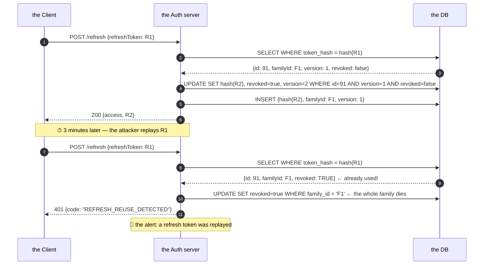

# 03 · Access & Refresh Tokens — Rotation, Revocation & the Token Lifecycle

> **Level:** Intermediate → Advanced
> **Interview Frequency:** ★★★★☆ ("How do you revoke a JWT?")
> **Prerequisite:** [02 · Stateless Authentication & Flow](./02-Stateless-Authentication-and-Flow.md)
> **Last Updated:** 2026

---

## 📋 Table of Contents
- [0. TL;DR — The 30-Second Answer](#0-tldr--the-30-second-answer)
- [1. What & Why](#1-what--why)
- [2. Mental Model — Three Lifetimes, Three Purposes](#2-mental-model--three-lifetimes-three-purposes)
- [3. Deep Dive — Theory](#3-deep-dive--theory)
  - [3.1 The three token's types](#31-the-three-tokens-types)
  - [3.2 The access token's design](#32-the-access-tokens-design)
  - [3.3 The refresh token's design](#33-the-refresh-tokens-design)
  - [3.4 The rotation's strategies](#34-the-rotations-strategies)
  - [3.5 The revocation's strategies](#35-the-revocations-strategies)
  - [3.6 The identity token (the OIDC)](#36-the-identity-token-the-oidc)
  - [3.7 The claims' reference](#37-the-claims-reference)
  - [3.8 The `jti` and the blocklist](#38-the-jti-and-the-blocklist)
  - [3.9 The token's versioning](#39-the-tokens-versioning)
- [4. Visualizations](#4-visualizations)
- [5. Worked Examples](#5-worked-examples)
- [6. Code from Scratch — Production-Grade](#6-code-from-scratch--production-grade)
- [7. Common Pitfalls & Gotchas](#7-common-pitfalls--gotchas)
- [8. Interview Q&A — Level-wise](#8-interview-qa--level-wise)
- [9. Counter-Questions & Traps](#9-counter-questions--traps)
- [10. Rapid-Fire MCQs](#10-rapid-fire-mcqs)
- [11. Hands-On Exercises](#11-hands-on-exercises)
- [12. Code Challenges](#12-code-challenges)
- [13. Scenario-Based Questions](#13-scenario-based-questions)
- [14. Tricky Interview Questions](#14-tricky-interview-questions)
- [15. Follow-Up Questions Asked by Interviewers](#15-follow-up-questions-asked-by-interviewers)
- [16. Real 3–5 Year Scenarios](#16-real-35-year-scenarios)
- [17. Frequently Asked Production Issues](#17-frequently-asked-production-issues)
- [18. Debugging Scenarios](#18-debugging-scenarios)
- [19. Architecture Design Questions](#19-architecture-design-questions)
- [20. Cheat Sheet — One-Page Summary](#20-cheat-sheet--one-page-summary)
- [21. Follow-up Learning](#21-follow-up-learning)

---

## 0. TL;DR — The 30-Second Answer

- **Three token types, three purposes:**
  | Type | Format | Lifetime | Purpose | Stored by the server? |
  |------|--------|----------|---------|----------------------|
  | **Access** | JWT | 5–15 min | The API's authorization | No (the signature only) |
  | **Refresh** | Opaque (random) | 7–30 days | The re-issuance | **Yes** (hashed) |
  | **ID** | JWT | ~5–10 min | The user's identity (the OIDC) | No (for the client) |
- **Rotation** = the refresh token is single-use; every refresh creates a new one and revokes
  the old. The **reuse detection** (an already-used token coming back) revokes the entire
  **family** (the lineage) → the theft's signal.
- **Revocation strategies**, from the cheapest to the strongest:
  1. **The TTL's bound** (no revocation; just wait) — the default.
  2. **The `jti`'s blocklist** (a Redis's set of the revoked ids) — the per-token's kill.
  3. **The user's version counter** (a `ver` claim) — the per-user's kill, instant for all.
  4. **The introspection** (the RFC 7662 — the server asks the auth server) — the strongest,
     the most latency.
  5. **The short TTL + the event-driven's invalidation** — the hybrid used in the microservices.
- **The rotation's decision:** *reuse detection* (the strict — the old token dies, the reuse
  kills the family) vs *grace window* (the lenient — the old token stays valid for N seconds
  to survive the network's race). **Most production systems use a small grace window (30–60s)
  + the reuse detection**, because the strict-only version causes spurious logouts on flaky
  mobile networks.
- **The one-liner:** *"The access token is a fast, cheap, forgettable credential; the refresh
token is a slow, precious, revocable one. Revocation lives in the refresh, and every
mechanism that makes the access token revocable costs you a lookup on the hot path — which is
exactly why you don't."*

---

## 1. What & Why

### The problem being solved

A JWT's selling point is that it's self-contained. Its Achilles' heel is the same property:
**you cannot un-issue it.** Once signed, it's valid until it expires. That breaks the three
things real systems need:

| Need | Why the stateless JWT fails |
|------|----------------------------|
| "The user changed their password — log them out everywhere" | The old tokens are still valid |
| "The user was fired this morning" | Same |
| "The admin's role was revoked" | The token still says `ROLE_ADMIN` |
| "The token was stolen — kill it now" | No mechanism |

**And the refresh token is the answer**, because it is *not* stateless. It lives in a table.
Kill the row, and the refresh is dead — and since every future access token comes from a
refresh, the whole chain dies with it.

### The design's goal

```
   15 minutes of statelessness  +  30 days of revocable state
   ───────────────────────────    ──────────────────────────────
   the hot path (every request)   the cold path (every 15 min)
```

---

## 2. Mental Model — Three Lifetimes, Three Purposes

```text
  ┌──────────────────────────────────────────────────────────────────────────┐
  │  the ACCESS token      "the door's ticket"                               │
  │  · every request, the Authorization header                              │
  │  · 5-15 min, JWT, self-contained                                         │
  │  · grants the API access to the scopes/roles                             │
  │  · the server does NOT store it                                          │
  │  · IF STOLEN: the thief has up to TTL minutes of access                  │
  └──────────────────────────────────────────────────────────────────────────┘
                              │ expired
                              ▼
  ┌──────────────────────────────────────────────────────────────────────────┐
  │  the REFRESH token     "the re-entry's voucher"                         │
  │  · rarely, the POST /refresh                                             │
  │  · 7-30 days, opaque, the server stores the HASH                        │
  │  · buys a new access token                                               │
  │  · IF STOLEN: the reuse detection kills the family within one cycle     │
  └──────────────────────────────────────────────────────────────────────────┘
                              │ (the OIDC's sibling)
                              ▼
  ┌──────────────────────────────────────────────────────────────────────────┐
  │  the ID token           "the name badge"                                 │
  │  · the client only, never to the API                                   │
  │  · the IDENTITY: the user id, the name, the email, the picture          │
  │  · NEVER used as an access token (that's the classic confusion)         │
  └──────────────────────────────────────────────────────────────────────────┘
```

**The critical separation:** the **ID token** proves *who the user is* (to the client);
the **access token** proves *what the caller may do* (to the API). Mixing them up is a
well-known vulnerability class.

---

## 3. Deep Dive — Theory

### 3.1 The three token's types

| | **Access** | **Refresh** | **ID** |
|---|---|---|---|
| **Consumer** | The API (the resource server) | The auth server (the authorization server) | The client (the app/browser) |
| **Audience (`aud`)** | The API | The auth server | The client id |
| **Format** | JWT | Opaque (or a JWT with the state) | JWT |
| **Signed?** | Yes | N/A (random) | Yes |
| **Contains the scopes?** | Yes | No | No |
| **Contains the identity?** | Sometimes (`sub`) | No | **Yes** |
| **Lifetime** | 5-15 min | 7-30 days | 5-10 min |
| **Revocable?** | Only via the TTL (or the blocklist) | **Yes, instantly** | No |
| **Leaked to the browser?** | Yes (in the JS's memory) | No (the httpOnly's cookie) | Yes |

### 3.2 The access token's design

**The claims' selection.** Put in the token only what the API will check on **every**
request, and only what is **stable for the token's lifetime**:

```json
{
  "iss": "https://auth.example.com",
  "sub": "42",
  "aud": ["orders-api", "profile-api"],
  "iat": 1735689000,
  "nbf": 1735689000,
  "exp": 1735689900,
  "jti": "b1c2d3e4-5f6a-7890-b1c2-d3e4f5a67890",
  "scope": "orders:read orders:write profile:read",
  "roles": ["USER", "ORDER_MANAGER"],
  "tenant_id": "t-7",
  "ver": 3
}
```

**The claims' rules of thumb:**

| Rule | Why |
|------|-----|
| **Never put the PII** (the email, the name, the address) | The token is base64, **not encrypted** — anyone can decode it. It goes into the logs, the browser's storage, the analytics. |
| **Never put the secrets** (the password, the keys) | Same — it's readable. |
| **Keep the `sub` as the opaque's id** (not the email) | The email changes; the id doesn't. And the `sub` shouldn't be the PII. |
| **Include `aud`** | A token for API A must not work on API B. |
| **Include `jti`** | The unique id — the audit, the blocklist, the replay's detection, the idempotency. |
| **Include the scopes, not the roles** (if possible) | The scopes are the API's language; the roles are the domain's. The API should depend on the scope, not on your user model's roles. |
| **Include `iss`** | Prevents the token from another issuer (the multi-tenant's setup). |
| **Include the tenant** (if multi-tenant) | The token's tenant must match the request's tenant. |

**The size's budget.** A JWT is sent on **every request** and stored by the client. A token
with 20 fat claims can be 2–4 KB. The rule: **< 1 KB** (the typical gateway's header's
limit is 8 KB, and the proxies' default is often 1 KB for the whole header's set). Split
the fat claims into an endpoint (a `/me` call) or a reference token.

### 3.3 The refresh token's design

**Why the opaque?** Because the refresh token's job is to be **stateful** — revocable,
rotatable, and reusable-detection-capable. A JWT can't do that without the state.

**The generation:**
```java
public String generateRefreshToken() {
    // 256 bits of entropy from a CSPRNG
    byte[] bytes = new byte[32];
    secureRandom.nextBytes(bytes);
    return Base64.getUrlEncoder().withoutPadding().encodeToString(bytes);
}
```

**The storage:**
```sql
CREATE TABLE refresh_tokens (
    id           BIGSERIAL PRIMARY KEY,
    user_id      BIGINT      NOT NULL REFERENCES users(id),
    token_hash   CHAR(64)    NOT NULL UNIQUE,   -- sha256 hex
    family_id    UUID        NOT NULL,          -- the rotation's lineage
    device_id    VARCHAR(64),
    user_agent   TEXT,
    ip_address   INET,
    version      INT         NOT NULL DEFAULT 1,
    revoked      BOOLEAN     NOT NULL DEFAULT FALSE,
    revoked_at   TIMESTAMPTZ,
    expires_at   TIMESTAMPTZ NOT NULL,
    created_at   TIMESTAMPTZ NOT NULL DEFAULT now(),
    last_used_at TIMESTAMPTZ
);
CREATE INDEX idx_refresh_user   ON refresh_tokens(user_id) WHERE revoked = FALSE;
CREATE INDEX idx_refresh_family ON refresh_tokens(family_id);
```

**Why SHA-256 and not BCrypt for the refresh token's hash?**
- The refresh token is **32 bytes of full-entropy randomness** — there's no dictionary to
  attack, so the slow hash's cost buys nothing.
- The verification happens on **every refresh** — the slow hash adds latency to the cold
  path for no security's gain.
- (The same reasoning applies to the API's keys: the high-entropy secret → SHA-256. The
  low-entropy password → BCrypt/Argon2. The rule: **hash the passwords slow, hash the random
  secrets fast**.)

**The row's fields that matter:**

| Field | Purpose |
|-------|---------|
| `family_id` | The rotation's lineage — the reuse detection's blast radius |
| `version` | The optimistic's locking — the concurrent's rotation's detection |
| `revoked` / `revoked_at` | The revocation + the audit |
| `device_id` | The per-device's listing and the revoke |
| `ip_address` / `user_agent` | The "the new device" alert, the session's management UI |
| `expires_at` | The **server's** authority on the lifetime (the client's persistence is irrelevant) |

### 3.4 The rotation's strategies

#### (a) The strict rotation (the reuse → the family dies)

```text
  login → R1
  refresh(R1) → R1 revoked, R2 issued (same family)
  refresh(R2) → R2 revoked, R3 issued (same family)
  refresh(R1) again  → ⚠ R1 was already used → revoke the whole family (R2, R3)
```

**Pros:** the maximum's theft's detection — a stolen token is caught on its next use.
**Cons:** the **network's race** kills legitimate users (the mobile's flaky network sends
the refresh twice → the second is a "reuse" → the family dies → the user is logged out).

#### (b) The grace window (the production's standard)

```text
  login → R1
  refresh(R1) → R1 revoked, R2 issued, but R1 is remembered as "already rotated"
                and remains acceptable for 60 seconds
  refresh(R1) again (within 60s) → return the SAME R2 (idempotent) — not a reuse
  refresh(R1) again (after 60s)  → ⚠ a genuine reuse → revoke the family
```

**The implementation:** keep the previous token's hash in the row (or a short-lived's
"recently rotated" cache) with a TTL equal to the grace window.

```sql
-- the row keeps the previous hash for the grace window
UPDATE refresh_tokens
   SET token_hash = :new_hash,
       previous_hash = :old_hash,      -- the grace window
       previous_valid_until = now() + interval '60 seconds',
       revoked = TRUE,
       version = version + 1
 WHERE id = :id AND version = :expected AND revoked = FALSE;
```

```java
public Optional<String> findRecentSuccessor(String presentedHash) {
    // the previous hash's window
    return jdbc.sql("""
            SELECT token_hash FROM refresh_tokens
             WHERE previous_hash = :hash
               AND previous_valid_until > now()
            """)
            .param("hash", presentedHash)
            .query(String.class)
            .optional();
}
```

**The rule:** the reuse detection **only** fires when the token is presented *after* its
grace window. That's the difference between a "the network's hiccup" and a "the thief".

#### (c) The no rotation (the simple, the weaker)

```text
  refresh(R1) → R1 stays valid, a new access token is issued
```
**Only acceptable** for the low-risk, the internal, the short-lived sessions. You lose the
theft's detection entirely.

#### (d) The rotation with the "the whole family" vs "the whole user"

| Scope | When to revoke |
|-------|----------------|
| **The token** | The single's theft |
| **The family** (the lineage) | The refresh's token's theft — the standard |
| **The user** (all the families) | The credential's compromise (the password's change) — **all the families die** |
| **The device** | The device's loss |

**The password's change** must revoke **all the families** AND bump the version (the
access tokens) — otherwise the old access token keeps working.

### 3.5 The revocation's strategies

```text
   the STRENGTH
   ──────────────────────────────────────────────────────────────►
   ①  ②  ③  ④  ⑤
   │  │  │  │  │
   │  │  │  │  └── the INTROSPECTION (RFC 7662) — the strongest, the
   │  │  │  │        most expensive: the API calls the auth server on
   │  │  │  │        EVERY request (or uses a cache)
   │  │  │  └───── the EVENT-driven's invalidation — the auth server
   │  │  │          publishes "the user X's sessions died"; the APIs
   │  │  │          bump their local cache
   │  │  └──────── the USER's VERSION counter — a `ver` claim; the
   │  │             API checks it against a cached value; the
   │  │             increment invalidates all the user's tokens at once
   │  └──────────── the `jti`'s BLOCKLIST — a Redis's set of the
   │                revoked token ids; checked on every request
   └─────────────── the TTL's BOUND — no revocation, just wait
                    (the default; free)
```

#### ① The TTL's bound

```yaml
app.jwt.access-token-ttl: 15m
```
**The cost:** zero. **The gap:** up to TTL of exposure after the compromise.

#### ② The `jti`'s blocklist

```java
@Service
public class TokenBlocklistService {

    private final StringRedisTemplate redis;

    public void block(String jti, Instant expiresAt) {
        // the block only needs to live as long as the token
        Duration ttl = Duration.between(Instant.now(), expiresAt);
        if (ttl.isNegative()) return;
        redis.opsForValue().set("jwt:blocked:" + jti, "1", ttl);
    }

    public boolean isBlocked(String jti) {
        return Boolean.TRUE.equals(redis.hasKey("jwt:blocked:" + jti));
    }
}
```

**The problem: the hot path.** Every request now hits Redis. That turns a stateless design
into a stateful one — you've just re-created the session store with extra steps.

**The mitigation:** the **blocklist's cache**. Pull the blocklist into a local Caffeine cache
with a short TTL (30-60s) → the revocation's effect is delayed by up to the cache's TTL
but the hot path is a local's lookup.

**When it's worth it:** a small number of the targeted's revocations (the specific's
compromised token, the admin's forced logout) — the blocklist holds only the *revoked* ids
(not all the ids), so it stays small.

#### ③ The user's version counter

```java
// at the issuance
long version = user.getTokenVersion();    // 0, 1, 2, ...
claims.put("ver", version);

// at the verification (the cached read)
if (jwt.getClaimAsInteger("ver") != cachedUserTokenVersion(jwt.getSubject())) {
    throw new InvalidBearerTokenException("The token has been revoked");
}
```

```java
// the revocation
@Transactional
public void revokeAllSessions(Long userId) {
    userRepository.incrementTokenVersion(userId);       // UPDATE users SET token_version = token_version + 1
    refreshTokenRepository.revokeAllForUser(userId);    // the refresh's rows
}
```

**The properties:** one field, one increment, kills **every** the user's tokens (the access
**and** the refresh), instantly (modulo the cache's TTL). **The cost:** the API must read
the user's version — from a **cache** (a local Caffeine with a 30s TTL, or the Redis), not
the DB on every request.

**This is the best cost/benefit for "the password's change" and "the user is fired".**

#### ④ The introspection (RFC 7662)

```text
  API → POST /oauth2/introspect  (the token, the client credentials)
  auth server → { "active": true, "sub": "42", "scope": "...", "exp": ... }
```

**The strongest** — the auth server decides, in real time. **The cost:** the hot path now
depends on the auth server's availability and the latency. Use it for the **high-value**
operations (the payment's approval, the admin's actions) — not for every request.

#### ⑤ The event-driven's invalidation

```text
  the auth server → publishes "session.revoked {userId, reason}"
  the APIs → consume → bump the local's version cache → the tokens die
```

**The hybrid** — the immediacy of the push with the locality of the cache. The caveats: the
**eventual consistency** (the API that missed the event keeps the stale cache), the
**ordering** (the events must be per-user ordered), and the **the delivery's guarantee**
(the consumer's group, the retry, the DLQ).

### 3.6 The identity token (the OIDC)

The **ID token** is the OIDC's addition. It is signed by the issuer and consumed **only by
the client** to establish who the user is.

```json
{
  "iss": "https://accounts.google.com",
  "sub": "1024234928342",
  "aud": "client-id-123.apps.googleusercontent.com",
  "azp": "client-id-123.apps.googleusercontent.com",
  "exp": 1735689900,
  "iat": 1735689000,
  "nonce": "xyz789",
  "name": "Alice Sharma",
  "email": "alice@example.com",
  "email_verified": true,
  "picture": "https://lh3.googleusercontent.com/..."
}
```

**The rules:**
- **Never** send the ID token to the API as a bearer token. The API doesn't need the
  identity's details; it needs the access token's scopes.
- The **`nonce`** must be echoed from the auth request → it prevents the **replay** of a
  captured ID token.
- The **`aud`** must be **your** client id → it prevents a token minted for another client
  from being accepted.
- The **`azp`** (the authorized party) is checked when there are multiple audiences.
- The `email_verified` matters for the **the account's linking** (an unverified email must
  not be trusted to link to an existing account).

### 3.7 The claims' reference

| Claim | Meaning | The standard? |
|-------|---------|---------------|
| `iss` | The issuer (who signed it) | RFC 7519 |
| `sub` | The subject (the user's id) | RFC 7519 |
| `aud` | The audience (who may consume it) | RFC 7519 |
| `exp` | The expiry (the epoch seconds) | RFC 7519 |
| `nbf` | Not before | RFC 7519 |
| `iat` | Issued at | RFC 7519 |
| `jti` | The JWT id (the unique id) | RFC 7519 |
| `scope` | The space-separated's scopes | RFC 8693 / OAuth 2 |
| `client_id` | The OAuth's client | — |
| `azp` | The authorized party | OIDC |
| `nonce` | The replay's protection | OIDC |
| `name`, `email`, `picture` | The user's profile | OIDC |
| `ver` | The user's token's version (the revocation) | Custom |

### 3.8 The `jti` and the blocklist

```java
// the issuance
String jti = UUID.randomUUID().toString();
claims.put("jti", jti);

// the blocklist's check (the cached)
if (blocklist.isBlocked(jti)) {
    throw new InvalidBearerTokenException("The token has been revoked");
}

// the blocking (the TTL-aligned)
blocklist.block(jti, jwt.getExpiresAt());
```

**The `jti`'s other uses:**
- **The idempotency's key** — a request's replay's protection.
- **The audit's correlation** — "which token issued this action?"
- **The session's listing** — the DB of the active's tokens (a heavy's alternative to the
  blocklist).
- **The logout's correlation** — the refresh's row can point at the access's `jti`.

### 3.9 The token's versioning

The `ver` claim is the most under-used, high-value pattern:

```text
  the user's row: { id: 42, token_version: 3, ... }
  the issued token: { "sub": "42", "ver": 3, ... }

  the revocation:  UPDATE users SET token_version = 4 WHERE id = 42
  → every token with ver < 4 is invalid
  → one UPDATE, thousands of tokens die
```

**The verification (the hot path's design):**
```java
// the cache's layer
private final Cache<Long, Long> versionCache = Caffeine.newBuilder()
        .expireAfterWrite(Duration.ofSeconds(30))
        .maximumSize(100_000)
        .build();

private boolean isVersionCurrent(Jwt jwt) {
    Long userId = Long.valueOf(jwt.getSubject());
    long current = versionCache.get(userId, id -> userRepository.findTokenVersionById(id));
    long tokenVersion = jwt.getClaimAsInteger("ver");
    return tokenVersion == current;
}
```

**The trade-off:** the revocation's effect is delayed by up to 30 seconds. For most
businesses, that's fine. If it isn't, reduce the TTL or use the event-driven's invalidation.

---

## 4. Visualizations

### 4.1 The token's lifecycle (the timeline)

```text
  t=0          t=5min              t=15min                    t=30days
  │            │                   │                          │
  ▼            ▼                   ▼                          ▼
  ┌─────────┐  ┌───────────────┐  ┌──────────────────────┐  ┌────────┐
  │ access  │  │  access #2    │  │     access #N        │  │ access │
  │ (JWT)   │──│  (JWT)        │──│     (JWT)            │──│        │
  └────┬────┘  └───────┬───────┘  └──────────┬───────────┘  └────────┘
       │                │                     │                │
       │           each access is               │                │
       │           obtained by a refresh         │                │
       │                │                     │                │
       ▼                ▼                     ▼                ▼
  ┌─────────┐  ┌───────────────┐  ┌──────────────────────┐  ┌────────┐
  │ refresh │→ │  refresh #2   │→ │     refresh #N       │→ │ (the   │
  │  R1     │  │  R2           │  │     R3               │  │ family │
  └─────────┘  └───────────────┘  └──────────────────────┘  └────────┘
     (revoked)     (revoked)          (active)              the whole
                                                           family dies
                                                           on a reuse
```

### 4.2 The rotation's sequence (the strict)



### 4.3 The rotation's sequence (the grace window)

```text
  t=0    client sends R1
  t=0    the server rotates: R1 → R2, and remembers (previous_hash=hash(R1), valid until t=60s)

  t=5s   the client's request times out; it retries with R1
         → the server finds previous_hash = hash(R1) and the window is open
         → returns the SAME R2 (idempotent) — no family revocation ✅

  t=90s  the attacker replays R1
         → the window is closed
         → THE REUSE IS DETECTED → the family dies 🚨
```

### 4.4 The revocation's strategies compared

```text
 ┌──────────────┬────────────┬──────────────┬──────────────┬──────────────────┐
 │  the TTL     │ the block  │ the version  │ the intros-  │ the event-driven │
 │              │ list (jti) │ counter      │ pection      │                  │
 ├──────────────┼────────────┼──────────────┼──────────────┼──────────────────┤
 │ cost: 0      │ cost: a    │ cost: a      │ cost: a      │ cost: a          │
 │              │ Redis hit  │ cached read  │ HTTP call    │ consumer         │
 │ immediacy:   │ immediacy: │ immediacy:   │ immediacy:   │ immediacy: ~ms   │
 │ up to TTL    │ instant    │ instant*     │ instant      │ (the consumer's)  │
 │ scope: 1 tok │ 1 token    │ 1 user       │ 1 token      │ 1 user           │
 │ complexity:  │ complex    │ simple       │ very complex │ complex          │
 │  none        │            │              │              │                  │
 ├──────────────┴────────────┴──────────────┴──────────────┴──────────────────┤
 │  * the version's immediacy is bounded by the cache's TTL (the local's delay)    │
 └───────────────────────────────────────────────────────────────────────────────┘
```

### 4.5 The token's tree (the families)

```text
  login (device A) ──► family F1 ──► R1 ──► R2 ──► R3 (active)
  login (device B) ──► family F2 ──► R4 (active)

  the password's change → revoke ALL the families + bump the version
  the F1's theft's detection → revoke F1 only
  the "the device A is lost" → revoke F1 only
```

---

## 5. Worked Examples

### 5.1 The access token's generation (the dry run)

```text
  the user's row: { id: 42, email: "alice@example.com", roles: ["USER"], token_version: 3 }

  the claims:
    iss   = "https://auth.example.com"
    sub   = "42"                                  ← the id, not the email
    aud   = ["orders-api"]
    iat   = 1735689000
    nbf   = 1735689000
    exp   = 1735689900                            ← 1735689000 + 900
    jti   = "b1c2d3e4-5f6a-7890-b1c2-d3e4f5a67890"
    scope = "orders:read orders:write"
    roles = ["USER"]
    ver   = 3                                      ← the user's token_version

  the header: { "alg": "RS256", "typ": "JWT", "kid": "k-2026-01" }

  the size: the header (48 chars) + the claims (~200 chars) + the signature (342 chars)
            → base64url → ~790 characters  ✅ (well under the 1 KB's budget)

  ⚠ note: the token contains NO email, NO name, NO password.
```

### 5.2 The refresh's rotation (the dry run)

```text
  the row before:  { id: 91, user_id: 42, token_hash: "aa11...", family_id: "F1",
                     version: 1, revoked: false, expires_at: 2026-02-20 }

  POST /refresh { "refreshToken": "R1_raw" }

  ① the hash:  sha256("R1_raw") = "aa11..."   → SELECT → the row
  ② the checks:
       revoked?  = false  ✓
       expired?  = false  ✓
       version?  = 1      ✓
  ③ the ATOMIC's rotation:
       UPDATE refresh_tokens
          SET token_hash = "bb22...", revoked = TRUE, version = 2,
              previous_hash = "aa11...", previous_valid_until = now() + 60s
        WHERE id = 91 AND version = 1 AND revoked = FALSE
       → 1 row updated ✓   (if 0 → the race → the reuse's detection)
  ④ INSERT { id: 92, user_id: 42, token_hash: "bb22...", family_id: "F1", version: 1 }
  ⑤ the response: { accessToken: "<the new JWT>", refreshToken: "R2_raw", expiresIn: 900 }
```

### 5.3 The reuse's detection (the dry run)

```text
  POST /refresh { "refreshToken": "R1_raw" }    ← the SAME one, 3 minutes later

  ① sha256("R1_raw") = "aa11..." → SELECT
       → { id: 91, family_id: "F1", revoked: TRUE, previous_valid_until: <60s ago }
  ② the checks:
       revoked = TRUE
       the grace's window: previous_valid_until is in the PAST → the reuse is genuine
  ③ THE REUSE'S DETECTION:
       UPDATE refresh_tokens SET revoked = TRUE, revoked_at = now()
        WHERE family_id = 'F1'
       → R2 and R3 (if any) die too
  ④ the response: 401 { "code": "REFRESH_REUSE_DETECTED",
                        "message": "This session has been revoked. Please sign in again." }
  ⑤ the alert: the security's event → the user's email → "a suspicious sign-in was detected"
```

### 5.4 The version's revocation (the dry run)

```text
  the "change password" flow:
    UPDATE users SET token_version = token_version + 1 WHERE id = 42
      → token_version: 3 → 4
    UPDATE refresh_tokens SET revoked = TRUE WHERE user_id = 42 AND revoked = FALSE
      → all the families die

  the effect on the outstanding access tokens:
    the token with "ver": 3 → the API's cached version is 4 → MISMATCH → 401 ✅
    the token with "ver": 4 → matches → valid ✅
    the effect: within 30 seconds (the cache's TTL), every old access token is dead
```

---

## 6. Code from Scratch — Production-Grade

### 6.1 The `RefreshToken` entity

```java
package com.example.auth.token;

import jakarta.persistence.*;
import lombok.*;
import java.time.Instant;
import java.util.UUID;

@Entity
@Table(name = "refresh_tokens", indexes = {
        @Index(name = "idx_refresh_user", columnList = "user_id"),
        @Index(name = "idx_refresh_family", columnList = "family_id")
})
@Getter
@Setter
@NoArgsConstructor
@AllArgsConstructor
@Builder
public class RefreshToken {

    @Id
    @GeneratedValue(strategy = GenerationType.IDENTITY)
    private Long id;

    @Column(name = "user_id", nullable = false)
    private Long userId;

    @Column(name = "token_hash", nullable = false, unique = true, length = 64)
    private String tokenHash;

    @Column(name = "family_id", nullable = false)
    private UUID familyId;

    @Column(name = "previous_hash", length = 64)
    private String previousHash;

    @Column(name = "previous_valid_until")
    private Instant previousValidUntil;

    @Column(name = "device_id", length = 64)
    private String deviceId;

    @Column(name = "user_agent")
    private String userAgent;

    @Column(name = "ip_address", length = 45)
    private String ipAddress;

    @Version
    @Column(name = "version", nullable = false)
    private Integer version;

    @Column(name = "revoked", nullable = false)
    private boolean revoked;

    @Column(name = "revoked_at")
    private Instant revokedAt;

    @Column(name = "revoked_reason", length = 64)
    private String revokedReason;

    @Column(name = "expires_at", nullable = false)
    private Instant expiresAt;

    @Column(name = "created_at", nullable = false)
    private Instant createdAt;

    @Column(name = "last_used_at")
    private Instant lastUsedAt;

    public boolean isExpired(Instant now) {
        return expiresAt.isBefore(now);
    }
}
```

### 6.2 The `RefreshTokenRepository` (the atomic's operations)

```java
package com.example.auth.token;

import lombok.RequiredArgsConstructor;
import org.springframework.jdbc.core.simple.JdbcClient;
import org.springframework.stereotype.Repository;

import java.sql.Timestamp;
import java.time.Instant;
import java.util.Optional;
import java.util.UUID;

@Repository
@RequiredArgsConstructor
public class RefreshTokenRepository {

    private final JdbcClient jdbc;

    public Optional<RefreshToken> findByTokenHash(String hash) {
        return jdbc.sql("SELECT * FROM refresh_tokens WHERE token_hash = :hash")
                .param("hash", hash)
                .query(RefreshToken.class)
                .optional();
    }

    /** the grace's window: the recently rotated's token's successor */
    public Optional<String> findSuccessorWithinGraceWindow(String presentedHash, Instant now) {
        return jdbc.sql("""
                SELECT token_hash FROM refresh_tokens
                 WHERE previous_hash = :hash
                   AND previous_valid_until > :now
                """)
                .param("hash", presentedHash)
                .param("now", Timestamp.from(now))
                .query(String.class)
                .optional();
    }

    /**
     * The ATOMIC's rotation. The version's check + the revoked's check in the WHERE clause
     * → only one concurrent's rotation succeeds; the loser detects the reuse.
     */
    public boolean rotate(Long id, int expectedVersion, String newHash,
                          String previousHash, Instant previousValidUntil, Instant newExpiresAt) {
        int updated = jdbc.sql("""
                        UPDATE refresh_tokens
                           SET token_hash           = :newHash,
                               previous_hash        = :previousHash,
                               previous_valid_until = :previousValidUntil,
                               expires_at           = :newExpiresAt,
                               revoked              = TRUE,
                               revoked_at           = now(),
                               revoked_reason       = 'ROTATED',
                               version              = version + 1
                         WHERE id = :id
                           AND version = :expectedVersion
                           AND revoked = FALSE
                        """)
                .param("newHash", newHash)
                .param("previousHash", previousHash)
                .param("previousValidUntil", Timestamp.from(previousValidUntil))
                .param("newExpiresAt", Timestamp.from(newExpiresAt))
                .param("id", id)
                .param("expectedVersion", expectedVersion)
                .update();
        return updated == 1;
    }

    public void revokeFamily(UUID familyId, String reason) {
        jdbc.sql("""
                UPDATE refresh_tokens
                   SET revoked = TRUE, revoked_at = now(), revoked_reason = :reason
                 WHERE family_id = :familyId AND revoked = FALSE
                """)
                .param("reason", reason)
                .param("familyId", familyId)
                .update();
    }

    public void revokeAllForUser(Long userId, String reason) {
        jdbc.sql("""
                UPDATE refresh_tokens
                   SET revoked = TRUE, revoked_at = now(), revoked_reason = :reason
                 WHERE user_id = :userId AND revoked = FALSE
                """)
                .param("reason", reason)
                .param("userId", userId)
                .update();
    }

    public void revokeAllBefore(Instant cutoff) {
        // the housekeeping: the expired's rows
        jdbc.sql("DELETE FROM refresh_tokens WHERE expires_at < :cutoff")
                .param("cutoff", Timestamp.from(cutoff))
                .update();
    }
}
```

### 6.3 The `TokenService` (the issuance & the rotation's orchestration)

```java
package com.example.auth.token;

import lombok.RequiredArgsConstructor;
import org.springframework.stereotype.Service;
import org.springframework.transaction.annotation.Transactional;

import java.time.Clock;
import java.time.Duration;
import java.time.Instant;
import java.util.Optional;
import java.util.UUID;

@Service
@RequiredArgsConstructor
public class TokenService {

    private final RefreshTokenRepository repository;
    private final JwtService jwtService;
    private final UserRepository userRepository;
    private final TokenProperties properties;
    private final Clock clock;

    @Transactional
    public TokenPair issueNewFamily(UserPrincipal principal, DeviceInfo device) {
        String raw = jwtService.generateRefreshToken();
        String hash = jwtService.hashRefreshToken(raw);

        RefreshToken token = RefreshToken.builder()
                .userId(principal.getId())
                .tokenHash(hash)
                .familyId(UUID.randomUUID())
                .deviceId(device.deviceId())
                .userAgent(device.userAgent())
                .ipAddress(device.ipAddress())
                .expiresAt(clock.instant().plus(properties.getRefreshTokenTtl()))
                .createdAt(clock.instant())
                .build();

        repository.insert(token);
        return buildPair(principal, raw);
    }

    @Transactional
    public TokenPair rotate(RefreshToken existing, UserPrincipal principal) {
        Instant now = clock.instant();

        String newRaw = jwtService.generateRefreshToken();
        String newHash = jwtService.hashRefreshToken(newRaw);
        Instant newExpiry = now.plus(properties.getRefreshTokenTtl());
        Instant graceUntil = now.plus(properties.getRefreshGraceWindow());

        boolean rotated = repository.rotate(
                existing.getId(), existing.getVersion(),
                newHash, existing.getTokenHash(), graceUntil, newExpiry);

        if (!rotated) {
            // the concurrent's rotation won → the reuse's detection
            repository.revokeFamily(existing.getFamilyId(), "REUSE_DETECTED");
            throw new RefreshTokenReuseDetectedException(existing.getFamilyId());
        }

        return buildPair(principal, newRaw);
    }

    /**
     * The grace's window's handling: the recently rotated's token returns the SAME successor.
     */
    @Transactional(readOnly = true)
    public Optional<String> resolveGraceWindow(String presentedHash) {
        return repository.findSuccessorWithinGraceWindow(presentedHash, clock.instant());
    }

    private TokenPair buildPair(UserPrincipal principal, String rawRefresh) {
        String access = jwtService.generateAccessToken(principal, UUID.randomUUID().toString());
        return new TokenPair(access, rawRefresh, properties.getAccessTokenTtl().toSeconds());
    }
}
```

### 6.4 The `JwtService` (the claims' construction)

```java
package com.example.auth.token;

import io.jsonwebtoken.Jwts;
import io.jsonwebtoken.SignatureAlgorithm;
import lombok.RequiredArgsConstructor;
import org.springframework.beans.factory.annotation.Value;
import org.springframework.stereotype.Service;

import java.io.InputStream;
import java.security.KeyFactory;
import java.security.PrivateKey;
import java.security.spec.PKCS8EncodedKeySpec;
import java.time.Clock;
import java.util.Date;
import java.util.List;
import java.util.UUID;

@Service
@RequiredArgsConstructor
public class JwtService {

    private final TokenProperties properties;
    private final Clock clock;
    private final UserRepository userRepository;

    @Value("${app.jwt.private-key}")
    private org.springframework.core.io.Resource privateKeyResource;

    private PrivateKey privateKey;

    @jakarta.annotation.PostConstruct
    void init() throws Exception {
        try (InputStream in = privateKeyResource.getInputStream()) {
            this.privateKey = KeyFactory.getInstance("RSA")
                    .generatePrivate(new PKCS8EncodedKeySpec(in.readAllBytes()));
        }
    }

    public String generateAccessToken(UserPrincipal principal, String tokenId) {
        Date now = Date.from(clock.instant());
        Date expiry = Date.from(clock.instant().plus(properties.getAccessTokenTtl()));

        return Jwts.builder()
                .header(h -> h.keyId(properties.getKeyId())
                              .algorithm(SignatureAlgorithm.RS256)
                              .type("JWT"))
                .subject(String.valueOf(principal.getId()))
                .issuer(properties.getIssuer())
                .audience().add(properties.getAudience()).and()
                .issuedAt(now)
                .notBefore(now)
                .expiration(expiry)
                .id(tokenId)
                .claim("scope", String.join(" ", principal.getScopes()))
                .claim("roles", principal.getRoles())
                .claim("ver", userRepository.findTokenVersionById(principal.getId()))
                .signWith(privateKey, Jwts.SIG.RS256)
                .compact();
    }

    public String generateRefreshToken() {
        byte[] bytes = new byte[32];
        new java.security.SecureRandom().nextBytes(bytes);
        return java.util.Base64.getUrlEncoder().withoutPadding().encodeToString(bytes);
    }

    public String hashRefreshToken(String raw) {
        return org.apache.commons.codec.digest.DigestUtils.sha256Hex(raw);
    }
}
```

### 6.5 The `AuthService` (the login & the refresh, the complete version)

```java
package com.example.auth;

import lombok.RequiredArgsConstructor;
import org.springframework.security.authentication.AuthenticationManager;
import org.springframework.security.authentication.UsernamePasswordAuthenticationToken;
import org.springframework.security.core.Authentication;
import org.springframework.stereotype.Service;
import org.springframework.transaction.annotation.Transactional;

import java.time.Clock;
import java.util.Optional;

@Service
@RequiredArgsConstructor
public class AuthService {

    private final AuthenticationManager authenticationManager;
    private final TokenService tokenService;
    private final RefreshTokenRepository refreshTokenRepository;
    private final UserRepository userRepository;
    private final Clock clock;
    private final SecurityEventPublisher securityEventPublisher;

    @Transactional
    public AuthResponse login(LoginRequest request, DeviceInfo device) {
        Authentication authentication = authenticationManager.authenticate(
                new UsernamePasswordAuthenticationToken(request.email(), request.password()));

        UserPrincipal principal = (UserPrincipal) authentication.getPrincipal();
        TokenPair pair = tokenService.issueNewFamily(principal, device);
        return AuthResponse.from(pair);
    }

    @Transactional
    public AuthResponse refresh(String rawRefreshToken) {
        String hash = jwtService.hashRefreshToken(rawRefreshToken);

        // ① the grace's window: the recently rotated's token → the same successor
        Optional<String> successor = tokenService.resolveGraceWindow(hash);
        if (successor.isPresent()) {
            UserPrincipal principal = loadPrincipalForHash(successor.get());
            return AuthResponse.from(buildPair(principal, successor.get()));
        }

        // ② the normal's path
        RefreshToken existing = refreshTokenRepository.findByTokenHash(hash)
                .orElseThrow(() -> new InvalidRefreshTokenException("The refresh token is invalid"));

        if (existing.isRevoked()) {
            // ⚠ THE REUSE'S DETECTION
            refreshTokenRepository.revokeFamily(existing.getFamilyId(), "REUSE_DETECTED");
            securityEventPublisher.publishRefreshReuseDetected(existing);
            throw new RefreshTokenReuseDetectedException();
        }
        if (existing.isExpired(clock.instant())) {
            throw new InvalidRefreshTokenException("The refresh token has expired");
        }

        UserPrincipal principal = loadPrincipal(existing.getUserId());
        TokenPair pair = tokenService.rotate(existing, principal);
        return AuthResponse.from(pair);
    }

    @Transactional
    public void logout(String rawRefreshToken) {
        String hash = jwtService.hashRefreshToken(rawRefreshToken);
        refreshTokenRepository.findByTokenHash(hash).ifPresent(token ->
                refreshTokenRepository.revokeFamily(token.getFamilyId(), "LOGOUT"));
    }

    @Transactional
    public void logoutEverywhere(Long userId) {
        refreshTokenRepository.revokeAllForUser(userId, "LOGOUT_ALL");
        userRepository.incrementTokenVersion(userId);   // the access's tokens die too
    }

    @Transactional
    public void onPasswordChange(Long userId) {
        logoutEverywhere(userId);   // the same handling — the credential's compromise
    }
}
```

### 6.6 The version's check (the hot path's filter)

```java
package com.example.auth.filter;

import io.jsonwebtoken.Claims;
import jakarta.servlet.FilterChain;
import jakarta.servlet.ServletException;
import jakarta.servlet.http.HttpServletRequest;
import jakarta.servlet.http.HttpServletResponse;
import lombok.RequiredArgsConstructor;
import org.springframework.stereotype.Component;
import org.springframework.web.filter.OncePerRequestFilter;

import java.io.IOException;
import java.time.Duration;
import java.util.concurrent.TimeUnit;

@Component
@RequiredArgsConstructor
public class TokenVersionValidator extends OncePerRequestFilter {

    private final com.github.benmanes.caffeine.cache.Cache<Long, Long> versionCache;
    private final UserRepository userRepository;

    @Override
    protected void doFilterInternal(HttpServletRequest request, HttpServletResponse response,
                                    FilterChain chain) throws ServletException, IOException {
        Claims claims = (Claims) request.getAttribute("jwt.claims");
        if (claims != null) {
            Long userId = Long.valueOf(claims.getSubject());
            Integer tokenVersion = claims.get("ver", Integer.class);

            long current = versionCache.get(userId, id -> userRepository.findTokenVersionById(id));
            if (tokenVersion == null || tokenVersion != current) {
                response.setStatus(HttpServletResponse.SC_UNAUTHORIZED);
                response.setContentType("application/json");
                response.getWriter().write(
                        "{\"code\":\"TOKEN_REVOKED\",\"message\":\"This session has been revoked\"}");
                return;
            }
        }
        chain.doFilter(request, response);
    }
}
```

### 6.7 The `TokenProperties`

```java
package com.example.auth.token;

import lombok.Getter;
import lombok.Setter;
import org.springframework.boot.context.properties.ConfigurationProperties;
import org.springframework.stereotype.Component;

import java.time.Duration;

@Component
@ConfigurationProperties(prefix = "app.jwt")
@Getter
@Setter
public class TokenProperties {

    private String issuer;
    private String audience;
    private String keyId;
    private Duration accessTokenTtl = Duration.ofMinutes(15);
    private Duration refreshTokenTtl = Duration.ofDays(30);
    private Duration refreshGraceWindow = Duration.ofSeconds(60);
    private Duration versionCacheTtl = Duration.ofSeconds(30);
}
```

```yaml
app:
  jwt:
    issuer: https://auth.example.com
    audience: orders-api
    key-id: k-2026-01
    access-token-ttl: 15m
    refresh-token-ttl: 30d
    refresh-grace-window: 60s
```

---

## 7. Common Pitfalls & Gotchas

| # | ❌ Wrong | ✅ Right | Why |
|---|----------|----------|-----|
| 1 | The strict rotation with no grace window | The grace window (30-60s) + the detection | The mobile's network race → the mass's logout |
| 2 | The rotation without the `version`'s check | The atomic's `UPDATE ... WHERE version = ?` | The concurrent's rotation isn't detected |
| 3 | The reuse revokes only the presented token | Revoke the **whole family** | The thief holds a valid's successor |
| 4 | The refresh token stored in the plain | Hashed (SHA-256) | The DB's leak = a takeover |
| 5 | BCrypt for the refresh token | SHA-256 | The token is full-entropy; the slow's hash buys nothing |
| 6 | The PII in the access token's claims | The `sub` as the id; the profile via `/me` | The token is readable (base64, not encrypted) |
| 7 | The ID token used as the access token | Separate them | The scope's confusion; the security's risk |
| 8 | The `aud` omitted | Always set it | A token for API A works on API B |
| 9 | The `iss` omitted | Always set it | The multi-tenant's / the multi-issuer's confusion |
| 10 | The refresh's expiry trusted from the client | The server's `expires_at` | The client can forge |
| 11 | The blocklist checked on the hot path (a Redis hit) | The cached blocklist | The statelessness is gone |
| 12 | The version's check hitting the DB per request | The cached read (30s) | The latency |
| 13 | The `exp` set but no `nbf`/`iat` | Set all three | The clock's skew; the audit |
| 14 | The token with a 1-hour TTL "for convenience" | 5-15 min | The theft's window |
| 15 | The refresh's rows never cleaned up | The scheduled's cleanup | The table's growth |
| 16 | The "the logout" that only clears the client | The row's revocation | The stolen token survives |
| 17 | The same refresh token for all the devices | Per-device rows | The per-device's revocation |
| 18 | The `scope` derived from the roles at the API | The scopes are the API's contract | The coupling |
| 19 | The refresh's endpoint without the rate limiting | The limit | The brute force |
| 20 | The token's `kid` not rotating | The `kid` + the JWKS's overlap | The key's rotation |

---

## 8. Interview Q&A — Level-wise

### 🟢 Beginner
**Q: What's the difference between an access token and a refresh token?**
**A:** The access token is short-lived (5-15 min), self-contained, and sent on every request to
authorize the API call. The refresh token is long-lived (7-30 days), opaque, stored by the
server, and used only to obtain a new access token when the old one expires.

**Q: Why not just make the access token last a month?**
**A:** Because then you can't revoke it. If it's stolen, the attacker has a month of access.
The short access token + the revocable refresh token gives you both a bounded theft window
and the ability to kill a session.

**Q: Where do you store the refresh token?**
**A:** Server-side, hashed. Client-side: an httpOnly cookie (the web) or the secure keystore
(the mobile).

### 🟡 Intermediate
**Q: Explain the refresh token rotation and why it's done.**
**A:** On every refresh, the presented refresh token is revoked and a new one is issued (in
the same "family" or lineage). Rotation means a refresh token is single-use, so a stolen
token is detected the next time it's presented — the server sees an already-revoked token and
revokes the entire family, forcing a re-login. Production systems add a short grace window
(30-60s) so that a duplicated request from a flaky network doesn't trigger a false
revocation.

**Q: How do you revoke a JWT?**
**A:** You don't, directly — a signed JWT is valid until it expires. Instead: (1) keep the
access token short-lived and put the revocable state in the refresh token; (2) optionally
maintain a `jti` blocklist (Redis, TTL-aligned) checked via a local cache; (3) embed the
user's token version (`ver`) in the token and bump it on the user record to invalidate all
that user's tokens at once.

**Q: What's the `jti` claim for?**
**A:** A unique id for the token. It's used for the revocation blocklist, the audit
correlation, the replay detection, and the idempotency key.

### 🔴 Advanced / Senior
**Q: A user's access token is valid for 15 minutes. An admin demotes them. How long until
the change takes effect?**
**A:** Up to 15 minutes with the plain TTL. To make it immediate, use the version counter: the
token carries `ver` and the API compares it against a cached value; the demotion increments
the version, so the effect is bounded by the cache TTL (e.g. 30s). For the truly sensitive
operations, re-check against the source of truth at the point of action.

**Q: How do you handle the refresh token rotation's race between two concurrent requests?**
**A:** Server-side: the atomic update (`UPDATE ... WHERE id = ? AND version = ? AND revoked =
false`) — only one concurrent rotation affects a row; the loser detects it and treats it as a
reuse. Client-side: the single-flight (all concurrent 401s share one refresh promise) and,
for the multi-tab case, the refresh token in an httpOnly cookie so the tabs share the
state. The layering is: the client reduces the race, the server detects it.

**Q: How would you implement 'log out from all devices'?**
**A:** In one transaction: revoke all the user's refresh token rows (all the families) and
increment the user's `token_version`. Every outstanding access token carries the old
version, so the API's version check rejects it (bounded by the cache TTL). Optionally publish
an event to invalidate the APIs' caches immediately.

### ⚫ Expert / Principal
**Q: Design the token's lifecycle for a platform with 40 microservices, the SPAs, the mobile
apps, and the third-party integrations.**
> **Answer structure:** (1) The **the trust's zones** — the internal's services (the workload
identity — the SPIFFE/mTLS, no JWT), the external's clients (the OAuth's client, the
scoped's tokens), the third-party (the partner's tokens, the narrowest's scopes, the
quota). (2) The **the token's formats per zone** — the internal: mTLS/SPIRE; the external:
the short's JWT; the partner: the API's key + the signed's requests. (3) The **the
revocation's strategy per zone** — the internal: the cert's revocation (the short's TTL);
the external: the version + the blocklist; the partner: the key's rotation. (4) The **the key's
management** — the asymmetric's signing (the JWKS's rotation with the overlap, the `kid`),
the KMS/HSM, the separation of the duties. (5) The **the observability** — the issuance's
rates, the refresh's reasons, the reuse's detections, the revocation's counts, the
per-client's usage. (6) The **the incident's runbook** — the key's compromise (rotate, the
overlap, the audit's replay), the user's compromise (the version, the family), the
partner's abuse (the quota, the revocation).

---

## 9. Counter-Questions & Traps

### CQ1. "If the access token can't be revoked, why not just make the refresh token a JWT too
and store the state in a cache?"
- **Naive answer:** "It's the same thing."  ← the trap
- **The trap:** The interviewer wants the trade-off's precision.
- **Expert answer:** It *is* the same thing, and that's the point: the moment you store the
state, the token becomes stateful and you've moved the cost, not removed it. The opaque
refresh token is simply the **minimal** expression of that state — "does this token exist,
is it revoked, which family does it belong to" — with no crypto's overhead, no signature's
verification, and no key's management. The JWT-with-a-cache variant adds the signing's cost
and the key's rotation's complexity to carry *less* information than the opaque. The
opaque wins on simplicity. The JWT's refresh token only makes sense when you need the
**claims to be readable offline** (e.g. a distributed revocation's check without a DB) or
when the **partner** must be able to validate the token without calling you.

### CQ2. "Why hash the refresh token with SHA-256 and not BCrypt?"
- **Naive answer:** "BCrypt is more secure."  ← the trap
- **The trap:** The interviewer wants the entropy's reasoning.
- **Expert answer:** The security of a password hash comes from its **slowness**, which
defeats the brute force of a **low-entropy** secret. The refresh token is 256 bits of
CSPRNG output — the brute force is computationally infeasible regardless of the hash's
speed, so the slowness buys nothing. Meanwhile the slow hash is paid on every refresh
(the cold path) and, more importantly, a slow hash at 32 bytes is unusual and can trip
the DoS's protections (the login's rate limit's per-username's cost). The rule: **the
passwords → Argon2id/bcrypt; the random's secrets → SHA-256/HMAC**. If you want the
best of both, use **HMAC-SHA-256 with a server's secret** (a pepper) — it prevents a DB-only
compromise from being sufficient.

### CQ3. "The rotation detects the theft. But what if the attacker refreshes *first* and the
legitimate user refreshes second — who gets logged out?"
- **Naive answer:** "The legitimate user, because their token is the old one."  ← the trap
- **The trap:** The interviewer wants the race's handling and the UX's consequences.
- **Expert answer:** In the strict rotation, the legitimate user gets the "reuse detected"
error and is logged out — because the server cannot distinguish the two. That's the
**correct and safe** behaviour (one of the two is an attacker), but it's a bad **UX**, which
is exactly why production uses the **grace window**: the legitimate user's replay of the
previous token within 30-60 seconds returns the same successor (idempotent) instead of
triggering the family revocation. The grace window is precisely the "the network's race is
not a theft" heuristic. The **client-side single-flight** is the other half — it prevents
the race from happening at all. The residual risk (the attacker and the user refresh within
the window) is small and the safe outcome (the family dies) is acceptable. The DPoP (the
device-bound tokens) eliminates the class entirely by making the stolen token useless
without the device's private key.

### CQ4. "Why is the token's TTL so short? Why not 24 hours so the user isn't refreshed
constantly?"
- **Naive answer:** "Security."  ← the trap
- **The trap:** The interviewer wants the cost/benefit with the numbers.
- **Expert answer:** The TTL trades the **refresh's frequency** against the **theft's
window**. A 24-hour access token means a stolen token works for a day; a 15-minute one means
15 minutes. The cost of the short TTL is a refresh every 15 minutes — which is trivial
(one HTTP request per 15 minutes per user) and, with the client's single-flight and the
refresh token in a cookie, invisible. The **the real reason** for the short TTL isn't only
the theft: it's the **the claims' freshness** (a demotion, a role's change, a permission's
revocation) and the **the blast radius** of the key's compromise. The number to quote: with
a 15-minute TTL and 1M active users, you're issuing ~1.8M access tokens per day — trivial
for a token's service; with a 24-hour TTL you'd have 1M. The refresh's load is not the
constraint; the security's exposure is.

### CQ5. "Why not put the roles in the access token and check them at the API? Isn't that the
whole point of a JWT?"
- **Naive answer:** "Yes, that's the standard."  ← the trap
- **The trap:** The interviewer wants the coupling and the staleness's discussion.
- **Expert answer:** Putting the roles in the token is right *for the API* — the API should
not need a DB hit to authorize a request. But the **the producer** (the auth service) is
now coupled to the **consumer's** authorization model: the auth service must know the
domain's roles and re-issue them when they change. The better decoupling is the **scopes** —
an API-level vocabulary ("orders:read", "orders:write") that the API owns and the auth
service merely maps to. The mapping (the scope → the role) stays in the auth service, the API
depends only on the scopes, and a new API can define its own scopes without touching the
identity's service. The trade-off: the scopes are less expressive (no hierarchical
inheritance, no object-level conditions) — for the object-level rules ("can edit *this*
order"), the API must consult its own data anyway.

---

## 10. Rapid-Fire MCQs

**1.** The refresh token should be:
A) A JWT  B) An opaque random string  C) Encrypted  D) Signed
**✅ B**

**2.** The access token's default TTL:
A) 5-15 min  B) 1 hour  C) 24 hours  D) 7 days
**✅ A**

**3.** The refresh token's rotation means:
A) The token is reused  B) The token is single-use and replaced  C) The token is encrypted  D) The TTL is reset
**✅ B**

**4.** On the reuse's detection, you revoke:
A) The presented token only  B) The whole family  C) All the users' tokens  D) Nothing
**✅ B**

**5.** The refresh token is stored:
A) In the plain  B) Hashed  C) In the session  D) In the JWT's claims
**✅ B**

**6.** The `jti` claim's purpose:
A) The encryption's key  B) The unique id (the blocklist, the audit)  C) The audience  D) The issuer
**✅ B**

**7.** The `aud` claim prevents:
A) The expired's tokens  B) A token for API A being used on API B  C) The replay  D) The forging
**✅ B**

**8.** The PII in the JWT's claims is:
A) Encrypted  B) Readable by anyone with the token  C) Hashed  D) Compressed
**✅ B**

**9.** The `ver` claim implements:
A) The encryption  B) The instant's revocation for all the user's tokens  C) The issuer's id  D) The nonce
**✅ B**

**10.** The grace window's purpose:
A) The performance  B) Tolerating the network's duplicate requests  C) The encryption  D) The expiry
**✅ B**

**11.** The hash for a refresh token (256-bit random):
A) BCrypt  B) MD5  C) SHA-256  D) No hash
**✅ C**

**12.** The ID token is consumed by:
A) The API  B) The client  C) The database  D) The gateway
**✅ B**

**13.** The blocklist's TTL should be:
A) Forever  B) Until the token's expiry  C) 1 hour  D) 1 day
**✅ B**

**14.** The "the logout everywhere" needs:
A) Only the client's clear  B) The refresh's revocation + the version's bump  C) The JWT's deletion  D) The DNS's change
**✅ B**

**15.** The atomic's rotation relies on:
A) A distributed lock  B) The version's check in the WHERE clause  C) The Redis  D) The transaction's isolation
**✅ B**

---

## 11. Hands-On Exercises

**🧪 Lab 1 — The rotation's lifecycle**
1. Implement the login, the refresh, the logout.
2. Watch the DB's row: the `version` increments, the `revoked` flips, the `family_id` stays.

**🧪 Lab 2 — The reuse's detection**
1. Refresh once. Then present the old token.
2. Assert: 401 with `REFRESH_REUSE_DETECTED`, and **all** the family's rows are revoked.

**🧪 Lab 3 — The grace window**
1. Set the grace to 60s. Refresh, then immediately re-present the old token → the same
   successor is returned (no revocation).
2. Wait 61s, then re-present → the family dies.

**🧪 Lab 4 — The version's revocation**
1. Issue a token. Increment the user's `token_version`.
2. Assert the token is rejected within the cache's TTL.

**🧪 Lab 5 — The concurrency**
1. Fire N parallel refreshes with the same token.
2. Assert: exactly one succeeds; the others detect the reuse.

---

## 12. Code Challenges

### Challenge 1 — The token's service (medium-hard)
**Goal:** The issuance, the rotation, the grace window, the reuse's detection, the family's
revocation, the version's check.
**Requirements:** the atomic's SQL, the transactions, the metrics, the tests (the unit +
the integration with Testcontainers).

### Challenge 2 — The session's management API (medium)
**Goal:** The list the active's sessions (the device, the IP, the user-agent, the last-used),
the revoke one, the revoke all.
**Requirements:** the DTOs, the pagination, the audit's log, the audit's event.

### Challenge 3 — The blocklist (medium)
**Goal:** The `jti`'s blocklist with a TTL-aligned expiry, a local's cache, and the
eviction's policy.
**Requirements:** the Redis's Lua script for the atomic's block+check, the metrics, the
fallback when the Redis is down (fail-open vs fail-closed — the decision must be explicit).

---

## 13. Scenario-Based Questions

**S1.** *"The support team says users are being logged out randomly. The logs show
`REFRESH_REUSE_DETECTED`. What happened?"**
>
> **Ideal answer:** (1) **The diagnosis:** the reuse's detection fires when a **revoked**
> refresh token is presented. The legitimate causes: (a) the **the network's race** — the
> client fired the refresh twice (the retry, the two tabs, the background's refresh and the
> foreground's) → the second is flagged as a reuse → the family dies → the user is logged
> out. (b) the **the multi-tab's race** — the SPA keeps the token in the memory (per-tab);
> tab A refreshes, tab B (with the old token) refreshes → the reuse. (c) the **the client's
> retry's logic** — the client's HTTP layer auto-retried the refresh on a timeout. (d) the
> **the load balancer's duplicate** — rare but real. The **theft** is the other cause and
> must be excluded.
(2) **The distinguishing's evidence:** (a) the **the correlation** — do the affected users
share the same client (the app's version, the browser)? The **the IP's clustering** — the
same IP (the NAT's office) with many the users = the client's race, not the theft. (b) the
**the timing** — the detections within seconds of a successful refresh = the race; the
detections hours later from a different IP = the theft. (c) the **the device's fingerprint**
in the row (the user-agent, the IP) — a changed IP = the theft; the same = the race.
(3) **The fixes, in order:** (a) **the grace window** (the immediate's mitigation — the
duplicates within 30-60s are treated as idempotent); (b) **the client's single-flight** (the
root's cause for the web — all the concurrent 401s share one refresh's promise; and the
`BroadcastChannel` for the cross-tab's coordination, or the refresh token in an httpOnly's
cookie so the tabs share the state); (c) **the client's retry's discipline** (never
auto-retry the refresh on a timeout without the idempotency's key, or make the refresh
idempotent server-side via the grace window); (d) **the mobile's SDK** (a shared's library
— the per-team's reimplementation is the recurring's cause); (e) **the alerting** (the
reuse's detection with a changed IP = a high-severity's alert; the same IP = a warning).
(4) **The prevention's design:** the **the DPoP** (the device-bound's tokens) would have
prevented the theft's class, and the **the client-side's coordination** prevents the race.
(5) The senior framing: "**the reuse's detection is doing its job — the bug is that the
client's retry's model and the server's rotation's model disagreed about idempotency.** The
server assumed one-use-with-no-duplicates; the network said 'at least once'. The fix is to
make the refresh's endpoint **idempotent within a short window**, and to fix the client to
not fire concurrent refreshes. And the distinguishing's rule for the runbook: **the same IP
and the same user-agent within seconds = the race; a different IP = the theft** — that
distinction should be in the alert's payload, not something the on-call has to infer."

**S2.** *"We need to revoke an admin's access immediately when we suspect a compromise. The
access tokens are 15 minutes. What's the plan?"**
>
> **Ideal answer:** (1) **The constraint:** a signed JWT is valid until it expires, and the
admin's tokens are valid for up to 15 minutes. So "immediate" requires a **stateful**
mechanism on the hot path. (2) **The options, with the trade-offs:**
(a) **The version counter** (the `ver` claim) — the cheapest and the best for a
*per-user* revocation. The bump → the tokens with the old version are rejected. The
immediacy = the cache's TTL (30s with a local's cache, ~instant with the event-driven's
bump). **This is the right tool for "revoke one admin".**
(b) **The `jti` blocklist** — for the *specific* tokens you know about (the ones issued
after the compromise's timestamp). The immediacy is instant (the Redis's write), but the
check's latency hits the hot path → mitigate with the local's cache (the delay) or accept
the Redis hit for the admin's traffic only.
(c) **The introspection** (the RFC 7662) — the API asks the auth server per request. The
strongest and the most expensive; use it for the admin's routes only (a path-based
interceptor), not globally.
(d) **The emergency's key rotation** — if the compromise is the *signing key*, rotate it.
The JWKS's overlap (publish the new key, keep the old for a grace window so the in-flight's
tokens still validate) then remove the old.
(3) **The composite's plan for this incident:** (a) immediately bump the admin's
`token_version` (kills the access tokens within the cache's TTL); (b) revoke all the admin's
refresh token families (kills the re-issuance); (c) blocklist the specific `jti`s if you can
enumerate them (the instant's kill); (d) audit: which endpoints did the admin hit in the
last N hours, what data was accessed, what actions were taken (the access's log with the
`sub` + the `jti`); (e) the force's re-login (the password's reset + the MFA's
re-enrollment); (f) the alert: the unusual's activity (the volume, the endpoints, the
geography) — this may be a broader's compromise.
(4) **The prevention:** the admin's routes should have their own **stricter's policy** — a
shorter's TTL (5 min), the MFA's requirement, the IP's allowlist, the separate's claims
(`amr`), the audit's logging of every admin's action, and the privileged's actions
requiring a **step-up** re-authentication.
(5) The senior framing: "**the plan is layered because the layers have different
latencies**: the version's bump (the seconds), the blocklist (the instant, but the hot
path's cost), the key's rotation (the minutes, the broadest), the password's reset (the
forced's re-login). And critically — **the revocation is only half of the incident's
response**; the audit (what did they access?) determines the notification's obligations, and
in many regimes the forced's re-login is the only complete's remedy, because you can't be
sure you found every token."

---

## 14. Tricky Interview Questions

**T1. "Can a JWT be revoked without a blocklist?"**
> Yes — by making the *state* live elsewhere: the version counter in the user's record (the
`ver` claim), the key's rotation (the `kid` is removed from the JWKS), or the
**encryption** (a JWE with a key you can destroy). The blocklist is just the most direct
mechanism. The point: "revocation" is always a *state* problem; the JWT's self-containment
is the source of the difficulty, not an absolute bar.

**T2. "What's the difference between the `jti` blocklist and the token's version?"**
> The granularity and the cost. The `jti` blocklist revokes *one specific token* and is
checked by a key lookup (a Redis hit) — the cost is proportional to the traffic, and the
list grows with the revocations. The version counter revokes *all of a user's tokens* with
one integer comparison, but the comparison needs the user's current version (a cached read)
and it can't revoke a single token. **Use the version for the user-level events (the
password's change, the demotion) and the blocklist for the individual's tokens (a known
compromise).**

**T3. "If the access token is 15 minutes, is a 30-second revocation even possible?"**
> Only with a stateful check on the hot path. If you want sub-minute revocation, you must
accept either a lookup (the blocklist's Redis, the version's cached read) or a shorter TTL.
There's no free lunch — the state's cost is exactly what you're paying for the immediacy.

**T4. "Why rotate the refresh token at all if you already store it in the DB?"**
> Because the rotation converts a *silent* theft into a *detectable* event. Without the
rotation, a stolen refresh token is indistinguishable from a legitimate one — it works
forever until it expires, and you never know. With the rotation, the stolen token's
presentation is recognized (it's already been consumed) and the session is killed. The
rotation is the **theft's detector**, and the DB is only the **theft's store**.

**T5. "What if the refresh token is stored in an httpOnly cookie — is that CSRF-able?"**
> Yes. The cookie is sent automatically by the browser on a cross-site POST to
`/api/auth/refresh`. An attacker can force the victim's browser to rotate the token (a
"login CSRF" that binds the victim's session to the attacker's). The mitigations: the CSRF
token (the double-submit), the `SameSite=Strict` (or `Lax` + the custom's header's
requirement), or the Origin/Referer's check. Note the subtlety: the `SameSite` attribute is
the *primary* defense for a cookie's endpoint; `SameSite=Strict` on the refresh's cookie
works because the refresh is only ever called from your own SPA's JS via a same-site
request.

**T6. "Can the client be trusted to say which `jti` to blocklist?"**
> No — the client can only present the token it has. The server derives the `jti` from the
*verified* token. Otherwise a malicious client could blocklist other users' tokens (a DoS).

**T7. "Why store the refresh token's `family_id` if the row is enough?"**
> Because the family is the *aggregate* the reuse's detection acts on. When an already-used
token is presented, the row tells you "this is a rotation of family F1" — and the revocation
must target the family (the descendants) so the thief's current token dies too. Without the
family, you can only revoke the single row, and the attacker keeps the successor.

**T8. "The refresh token is opaque — how does the client know it's valid?"**
> It doesn't, and it doesn't need to. The client just presents it; the server decides. The
client can only observe success/failure. (The JWT's advantage here — the client can read
the claims — is irrelevant for a refresh token, since the client isn't the audience for it.)

---

## 15. Follow-Up Questions Asked by Interviewers

**F1** (after the rotation) → *"What if the DB is down when the refresh is called?"*
→ The refresh fails → the client's access token keeps working until it expires (up to 15
minutes) → then the user is logged out. Mitigations: the refresh's endpoint returns a
distinguishable `503` (not a `401`) so the client doesn't clear the session; the access
token's TTL gives a buffer; the auth server's HA. The key design point: **the client must
distinguish "your session is invalid" from "the server is having a bad day"** — conflating
them causes mass logouts during a DB's blip.

**F2** (after the TTL) → *"Why not make the access token's TTL configurable per client?"*
→ Yes, and you should — the different clients have the different risk's profiles. The
high-privilege's clients (the admin's console) get a shorter TTL (5 min) and require the
MFA; the low-risk's mobile's clients can get a longer one. The rule: the TTL is a
**risk-based's parameter**, and the default should be conservative.

**F3** (after the version) → *"Where do you store the version's cache in a multi-instance
deployment?"*
→ Either a local's Caffeine (per instance — the revocation's delay is the cache's TTL, and
the instances are independent — simple, and the delay is acceptable) or a shared's Redis (the
revocation is instant but the hot path is a network's hop). The right choice depends on
the immediacy's requirement: 30 seconds' delay → the local; "instant" → the shared or the
event-driven's invalidation.

**F4** (after the storage) → *"How do you clean up the refresh token's table?"*
→ A scheduled job that deletes the expired rows (and the revoked rows older than the
retention). The table's growth is a real production's issue — with 1M users refreshing every
15 minutes, that's ~4M rows per day of churn if you never delete. A batched delete (the
`DELETE ... WHERE expires_at < now() - interval '7 days' LIMIT 10000` in a loop) is better
than a single big delete (the lock's contention). Index on `expires_at`.

---

## 16. Real 3–5 Year Scenarios

**R1. "We're launching a new API and the team wants to reuse the existing auth service's
tokens. Is that a good idea?"**
>
> **Ideal answer:** (1) **The decision's framing:** sharing the auth service is almost
certainly right (don't build a second identity's system), but the **token's audience** must
be decided deliberately. (2) **The options:** (a) **the multi-audience token** (the `aud`
lists both APIs) — the simplest for the client (one token for everything), but the blast
radius grows: a compromise of API A gives the attacker the token for API B too, and every
API must trust every other API's scope's semantics. (b) **the separate's token per API**
(the client does a token's exchange at the auth service to get an API-specific token) —
the best isolation, the most friction (the client SDK must do the exchange, the refresh
must be per-API). (c) **the gateway's pattern** — one token, the API gateway validates it
once and mints the internal's identity (the SPIFFE/mTLS) — the best for the internal's
architecture. (3) **The recommendation for a mature platform:** (a) the **one auth service,
one issuer**, but with **per-API audiences** obtained via a **token's exchange** (the
RFC 8693 — the client trades its broad token for a narrow one); (b) the **the scopes are the
API's contract** — the auth service maps the user's roles to the scopes per audience, so
each API sees only what it needs; (c) the **the internal's traffic** uses the workload's
identity (mTLS), not the user's JWT at all — the user's identity is *propagated* as a
downstream's claim by the gateway, not re-verified by each service. (4) **The operational's
implications** (the ones people forget): (a) the **the JWKS's caching** across the
services; (b) the **the clock's skew** (all the services' NTP); (c) the **the version's
check** — if the `ver` claim is used, the new API must implement the version's check too,
or it will accept the revoked tokens (a security's gap!); (d) the **the key's rotation** —
every service must refresh the JWKS (the `cacheTTL`); (e) the **the audit's correlation** —
the `sub` + the `jti` must be propagated in the logs across the services for a
cross-service's trace. (5) The senior framing: "**the question isn't 'should we share the
tokens' — it's 'what is the trust boundary'.** The user's identity belongs to one issuer
and one source of truth; the *audience* and the *scopes* are how you keep the services from
trusting each other more than they should. And the trap in the new-API's launch: everyone
forgets to implement the **version's check** in the new service, so the revocation's story
has a hole exactly where the new code is. I'd make the version's check a **shared library**,
not a copy-paste per service."

**R2. "The access token's TTL is 15 minutes, but users complain they get logged out when
they're on a flaky mobile network. We've already added the grace window. What else?"**
>
> **Ideal answer:** (1) **The framing:** the user's experience of "being logged out" is not
necessarily a refresh's failure — it could be (a) the refresh's failure, (b) the refresh's
rejection (the reuse), (c) the access's rejection, or (d) the client's state loss. **The
first step is to measure which**, with the reason's codes on the server and the client's
telemetry. (2) **The server's side:** (a) the **the reason's codes** — the refresh's endpoint
must distinguish the expired, the invalid, the reuse, the 5xx, and the DB's timeout; the
client's logs must carry the reason. Without this, you're guessing. (b) **the 5xx's
distinction** — a transient's failure must not clear the client's session; the client
should retry with the backoff and keep the access token until it expires. (c) **the
clock's skew's tolerance** — the `nbf`/`iat` with a 60s's `ClockSkew`; and the **the
device's clock's offset** — the mobile's clock can be minutes off; the client should
measure the offset from the response's `Date` header and correct it locally. (d) **the
refresh's endpoint's availability** — it should be the most available endpoint in the
system; it should not share a fate with the admin's endpoints. (3) **The client's side:**
(a) the **single-flight**; (b) the **the proactive's refresh** — refresh at 80% of the
lifetime (or when the remaining time < 2 min) rather than waiting for the 401; this
removes the whole class of "the request fails because the token expired mid-flight"; (c)
the **the retry's discipline** — the network's error is retried; the 401 triggers exactly
one refresh + one retry; (d) the **the secure's storage** — the token must survive the
app's process death (the Keychain/Keystore), not just the memory; (e) the **the app's
resume** — the app's `onResume`/`onStart` should check the token's state and refresh
proactively. (4) **The systematic's fix:** the **shared's client SDK** — the per-team's
reimplementation is the recurring's cause of these bugs; a single, well-tested SDK with the
single-flight, the proactive's refresh, the error's distinction, and the storage's
handling eliminates the class. (5) The senior framing: "**'users get logged out' is a
symptom, not a diagnosis.** In my experience it's three things: (1) the client treats a
network error or a 5xx as a 401 and clears the session — fix the error's distinction; (2)
the client doesn't refresh proactively and the token expires mid-request — fix the timing's
policy; (3) the app loses the in-memory token when the OS kills the process and doesn't
restore it from the secure's storage — fix the persistence. The server's job is to make the
diagnosis possible: the reason's codes, the client's metadata in the logs. And the
structural's fix is the shared SDK, because otherwise every team writes their own token's
lifecycle and every one of them has its own bug."

---

## 17. Frequently Asked Production Issues

| Symptom | Cause | Fix |
|---------|-------|-----|
| The random's logouts (the mobile) | The network's error mistaken for a 401 | Distinguish the error's types; the retry's discipline |
| The random's logouts (the multi-tab) | The concurrent's refresh | The single-flight; the cookie's approach; the grace window |
| `REFRESH_REUSE_DETECTED` spikes | The client's duplicate's refresh | The grace window; the client's SDK |
| The refresh's 500s | The DB's outage | The HA; the 503's distinction; the access's TTL buffer |
| The table's growth | No cleanup | The scheduled's delete; the index on `expires_at` |
| The slow's refresh (the p99) | The slow's hash (BCrypt) or the DB's contention | SHA-256; the connection's pool; the index |
| The revoked's token still works (the new API) | The version's check not implemented | The shared's library; the code's review |
| The clock's drift (the tokens expired early) | The server's NTP | The monitoring's alert on the clock's offset |
| The 401's loop in the SPA | The generic's error's code | The distinct's codes; the single-flight |

---

## 18. Debugging Scenarios

**D1. "Decode the token's claims:"**
```bash
echo "$TOKEN" | cut -d. -f2 | tr '_-' '/+' | base64 -d 2>/dev/null | jq '{sub, exp, ver, scope, jti}'
```

**D2. "Find the families with the suspicious's activity:"**
```sql
SELECT family_id, user_id, COUNT(*) AS rotations,
       MIN(created_at) AS first_seen, MAX(created_at) AS last_seen,
       array_agg(DISTINCT ip_address) AS ips
  FROM refresh_tokens
 GROUP BY family_id, user_id
HAVING COUNT(DISTINCT ip_address) > 1;
```

**D3. "List the active's sessions for a user:"**
```sql
SELECT id, device_id, user_agent, ip_address, created_at, last_used_at, expires_at
  FROM refresh_tokens
 WHERE user_id = 42 AND revoked = FALSE AND expires_at > now()
 ORDER BY created_at DESC;
```

**D4. "Check the concurrent's rotations:"**
```sql
SELECT family_id, version, created_at FROM refresh_tokens
 WHERE family_id = 'F1' ORDER BY version;
```

**D5. "Kill all the user's sessions (the incident's runbook):"**
```sql
UPDATE refresh_tokens SET revoked = TRUE, revoked_at = now(), revoked_reason = 'INCIDENT'
 WHERE user_id = 42 AND revoked = FALSE;
UPDATE users SET token_version = token_version + 1 WHERE id = 42;
```

**D6. "See the recent's reuse's detections:"**
```sql
SELECT user_id, family_id, ip_address, created_at
  FROM refresh_tokens
 WHERE revoked_reason = 'REUSE_DETECTED'
 ORDER BY created_at DESC LIMIT 100;
```

---

## 19. Architecture Design Questions

**Q1. 🏗️ Design the token's lifecycle for a platform with the SPAs, the mobile, the internal's
services, and the third-party's partners.**
> **Answer structure:** (1) The **the zones** (the internal → mTLS/SPIRE; the external → the
short's JWT; the partner → the scoped's JWT + the quota); (2) the **the per-zone's flows**
(the SPA → the BFF's cookies; the mobile → the Keychain; the partner → the client
credentials); (3) the **the revocation's strategy per zone**; (4) the **the key's management**
(the KMS, the `kid`, the JWKS's overlap, the rotation's runbook); (5) the **the observability
& the audit**; (6) the **the runbooks** (the key's compromise, the user's compromise, the
partner's abuse).

**Q2. 🏗️ Design the "the device's management" for the banking's app.**
> (1) The **the data's model** (the session's rows: the device's id, the model, the OS's
version, the push's token, the trusted's status, the last-used, the location, the risk's
score); (2) the **the token's binding** (the DPoP or the device's key — the tokens are
useless on another device); (3) the **the risk's engine** (the impossible's travel, the new
device, the rooted's device, the emulator, the location's mismatch); (4) the **the step-up's
authentication** (the biometric for the sensitive's actions); (5) the **the notifications**
(the new's device's email/SMS/push, the "the suspicious's transaction" — a push's
notification is bypassed on a rooted device, so use the email/SMS too); (6) the **the UX**
(the devices' page, the revoke, the "it wasn't me"); (7) the **the compliance** (the
session's audit, the retention, the GDPR's erasure).

**Q3. 🏗️ Design the token's rotation's mechanism for 10M users.**
> (1) The **the scale's math** (10M users × 4 refreshes/hour × 24h = ~1B rows/day of
churn; the write's amplification: each refresh = 1 update + 1 insert + 1 select); (2) the
**the storage's partitioning** (the partition by `user_id` or the `family_id`; the hot's
users' rows); (3) the **the write's optimization** (the single-statement upsert instead of
update+insert; the partitioning's key; the batching); (4) the **the cleanup** (the
partitioned's drop vs the delete); (5) the **the idempotency** (the grace window's
idempotent's path must be cheap — a cached lookup of the successor); (6) the **the
observability** (the per-partition's latency, the hot's users).

---

## 20. Cheat Sheet — One-Page Summary

```text
┌──────────────────────────────────────────────────────────────────────────────┐
│  ACCESS:  JWT, 5-15 min, the Authorization header, the server stores NOTHING  │
│  REFRESH: OPAQUE, 7-30 days, the server stores the SHA-256 HASH             │
│  ID:      JWT, the CLIENT only, the identity (never an API's bearer token)    │
├──────────────────────────────────────────────────────────────────────────────┤
│  the ROTATION: the ATOMIC's UPDATE (the version's check) → the family dies    │
│  the REUSE's DETECTION: an already-used token → revoke the WHOLE family       │
│  the GRACE WINDOW (30-60s): the duplicate's requests → the SAME successor     │
├──────────────────────────────────────────────────────────────────────────────┤
│  the REVOCATION: ① the TTL  ② the jti's blocklist  ③ the ver's counter       │
│                   ④ the introspection  ⑤ the event-driven's invalidation      │
├──────────────────────────────────────────────────────────────────────────────┤
│  ⚠ The claims: sub=the id, aud, iss, jti, scope, ver — NEVER the PII          │
│  ⚠ The hash: SHA-256 (the token is full-entropy) — BCrypt only for passwords  │
│  ⚠ The refresh's expiry: the SERVER's row is the authority                   │
│  ⚠ The "the logout everywhere": the rows + the version's bump (both!)         │
│  ⚠ The blocklist: the TTL-ALIGNED, checked via the LOCAL's cache             │
│  ⚠ The 5xx from the auth service ≠ an invalid's session (never log out)      │
│  ⚠ The grace window prevents the mass's logout from the network's race       │
└──────────────────────────────────────────────────────────────────────────────┘
```

---

## 21. Follow-up Learning

- → [04 · Security Risks, Algorithms & Production Design](./04-Security-Risks-and-Production-Design.md)
- → [05 · Spring Security](../05-Spring-Security/README.md) — the filter chain, the method's security.
- → [07 · OAuth2 & OIDC](../07-OAuth2-OIDC/README.md) — the standard's flows, the ID token.

---
**Next Chapter:** → [04 · Security Risks, Algorithms & Production Design](./04-Security-Risks-and-Production-Design.md)
**Previous Chapter:** ← [02 · Stateless Authentication & Flow](./02-Stateless-Authentication-and-Flow.md)
