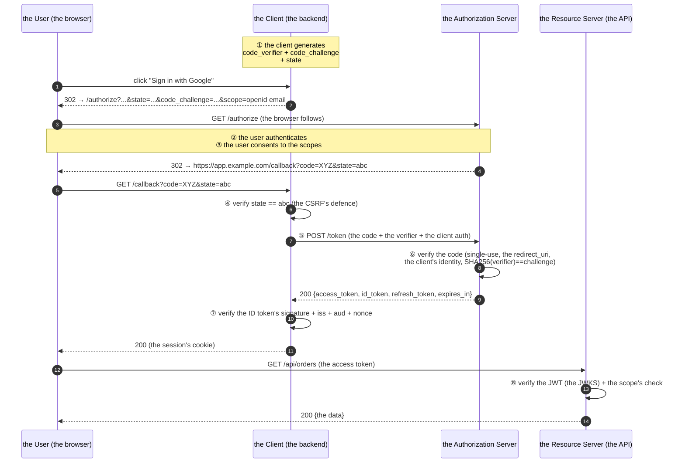

# 01 · OAuth2 Architecture & Core Concepts

> **Level:** Intermediate → Advanced
> **Interview Frequency:** ★★★★☆ ("Explain the OAuth2 authorization code flow")
> **Prerequisite:** [06 · JWT Authentication](../06-JWT-Authentication/README.md)
> **Last Updated:** 2026

---

## 📋 Table of Contents
- [0. TL;DR — The 30-Second Answer](#0-tldr--the-30-second-answer)
- [1. What & Why](#1-what--why)
- [2. Mental Model — The Four Actors](#2-mental-model--the-four-actors)
- [3. Deep Dive — Theory](#3-deep-dive--theory)
  - [3.1 The four's actors](#31-the-fours-actors)
  - [3.2 The two's token's types](#32-the-twos-tokens-types)
  - [3.3 The grant's types](#33-the-grants-types)
  - [3.4 The authorization server's endpoints](#34-the-authorization-servers-endpoints)
  - [3.5 The scopes](#35-the-scopes)
  - [3.6 The consent](#36-the-consent)
  - [3.7 The client's types](#37-the-clients-types)
  - [3.8 The public's key (PKCE)](#38-the-publics-key-pkce)
  - [3.9 The scopes vs the resource's indicators](#39-the-scopes-vs-the-resources-indicators)
  - [3.10 The OAuth2 vs OIDC](#310-the-oauth2-vs-oidc)
- [4. Visualizations](#4-visualizations)
- [5. Worked Examples](#5-worked-examples)
- [6. Code from Scratch — Production-Grade](#6-code-from-scratch--production-grade)
- [7. Common Pitfalls & Gotchas](#7-common-pitfalls--gotchas)
- [8. Interview Q&A — Level-wise](#8-interview-qa--level-wise)
- [9. Counter-Questions & Traps](#9-counter-questions--traps)
- [10. Rapid-Fire MCQs](#10-rapid-fire-mcqs)
- [11. Hands-On Exercises](#11-hands-on-exercises)
- [12. Code Challenges](#12-code-challenges)
- [13. Scenario-Based Questions](#13-scenario-based-questions)
- [14. Tricky Interview Questions](#14-tricky-interview-questions)
- [15. Follow-Up Questions Asked by Interviewers](#15-follow-up-questions-asked-by-interviewers)
- [16. Real 3–5 Year Scenarios](#16-real-35-year-scenarios)
- [17. Frequently Asked Production Issues](#17-frequently-asked-production-issues)
- [18. Debugging Scenarios](#18-debugging-scenarios)
- [19. Architecture Design Questions](#19-architecture-design-questions)
- [20. Cheat Sheet — One-Page Summary](#20-cheat-sheet--one-page-summary)
- [21. Follow-up Learning](#21-follow-up-learning)

---

## 0. TL;DR — The 30-Second Answer

- **OAuth 2.0 is a delegation protocol.** It lets a **client** access a **resource owner's**
  protected resource on the resource owner's behalf, **without** the client ever seeing the
  user's password.
- **The four actors:**
  | Actor | What it is | Example |
  |-------|-----------|---------|
  | **Resource Owner** | The user | Alice |
  | **Client** | The app requesting access | The mobile app |
  | **Authorization Server** | Issues the tokens | Keycloak / Okta |
  | **Resource Server** | Holds the protected data | The Orders API |
- **The two token types:**
  - **Access token** — sent to the **resource server**; carries the **authorization** (the
    scopes). Short-lived (5-60 min).
  - **Refresh token** — sent to the **authorization server**; used to get a new access token.
    Long-lived, revocable, optional.
- **The four legacy grants:** `authorization_code` (the standard for the user-facing apps),
  `client_credentials` (the machine-to-machine), `password` (**deprecated** — never use),
  `implicit` (**deprecated** — never use).
- **The modern additions:** **PKCE** (mandatory for the public clients), the **client's
  authentication** (the confidential clients), and the **refresh's token's rotation**.
- **OAuth2 is NOT an authentication protocol.** It answers *"what may this client do?"*,
  not *"who is the user?"*. **OpenID Connect (OIDC)** adds the ID token for that.
- **The one-liner:** *"OAuth 2.0 is about delegating access; the four actors, the two tokens,
and the authorization code flow with PKCE are the only things you must know. Everything else
is a variation for a specific client type."*

---

## 1. What & Why

### The problem (circa 2005)

A web app wanted to let the user post to their Twitter feed. The naive approach: the app
asks the user for their Twitter password.

```text
   ❌ the app asks for the user's Twitter password
   → the app now holds the user's password
   → the app stores it (maybe in the clear)
   → the app can do ANYTHING the user can do
   → the user can't revoke access to one app without changing their password
   → the app is now a phishing target
```

### The OAuth 2.0's answer

```text
   ✅ the user authenticates at the AUTHORIZATION SERVER (the browser is redirected there)
   → the user grants a SCOPE ("post to my feed")
   → the authorization server issues an ACCESS TOKEN (scoped, time-limited, revocable)
   → the app uses the token to call the API
   → the app NEVER sees the user's password
   → the user can revoke the app's access at the authorization server
```

### The three's properties OAuth 2.0 gives you

| The property | How |
|-------------|-----|
| **The user's credentials are never shared** | The user authenticates at the authorization server |
| **The access is scoped** | The token carries only the granted's scopes |
| **The access is revocable and time-limited** | The token's TTL + the refresh's revocation |

---

## 2. Mental Model — The Four Actors

```text
   ┌──────────────┐                        ┌────────────────────────┐
   │   (A)        │                        │      (B)               │
   │  RESOURCE    │  "may I have access    │   AUTHORIZATION        │
   │  OWNER       │   to your photos?"     │   SERVER               │
   │  = the user  │ ─────────────────────▶ │   (the issuer)         │
   └──────┬───────┘                        │   • authenticates      │
          │                                │   • authorizes         │
          │  (C) the client asks for      │   • issues tokens      │
          │      an access token          └──────────┬─────────────┘
          ▼                                           │
   ┌──────────────┐        "here is the access        │
   │   (D)        │         token for photos"         │
   │   CLIENT     │ ◀────────────────────────────────┘
   │  = your app  │
   └──────┬───────┘
          │  "Bearer <access token>"
          ▼
   ┌──────────────┐
   │  RESOURCE    │  ← the API that holds the photos
   │  SERVER      │
   └──────────────┘
```

**The key's insight:** in the **modern** (2.0) model, the **authorization server** and the
**resource server** are usually **the same application** (or the same vendor's suite) —
Keycloak issues tokens *and* hosts the protected APIs. But conceptually they are separate,
and that separation is what lets you federate (Google's identity for your API, with your
own authorization server validating Google's tokens via the JWKS).

---

## 3. Deep Dive — Theory

### 3.1 The four's actors

| The actor | The RFC's name | The notes |
|-----------|---------------|----------|
| **Resource Owner** | The user | The entity that owns the protected resource. In most flows this is a human in a browser. |
| **Client** | The application | The app making the requests. It has a `client_id` (public) and possibly a `client_secret` (confidential). |
| **Authorization Server** | The issuer | Authenticates the user, collects the consent, issues the tokens. |
| **Resource Server** | The API | Validates the access token, serves the data. **Does not need to talk to the authorization server** (the JWT's self-validation). |

**The client types (this distinction drives everything):**

| | **Confidential client** | **Public client** |
|---|---|---|
| **Can keep a secret?** | Yes (a server-side app) | No (the browser, the mobile, the desktop) |
| **Examples** | The backend's service, the CLI's server, the web's backend | The SPA, the mobile app, the desktop app, the TV app |
| **The code's exchange** | The client authenticates (`client_secret`) | **PKCE** is mandatory |
| **The token's storage** | Server-side (the DB/Redis) | The browser (the memory) / the device (the Keychain) |

> **The 2026 reality:** even the "SPA" is often backed by a **BFF** (the backend-for-frontend)
> which makes it a confidential client. The Mobile apps and the SPAs (without a BFF) are the
> public clients.

### 3.2 The two's token's types

```text
  ┌──────────────────────────────────────────────────────────────────────┐
  │  the ACCESS token                                                   │
  │  · audience: the RESOURCE server                                   │
  │  · contains: the authorization (the scopes, the user)                │
  │  · lifetime: short (5-60 min)                                       │
  │  · format: usually a JWT (opaque is also legal)                     │
  │  · sent to: the API                                                 │
  │  · the client MAY see it (it's the client's own credential)         │
  └──────────────────────────────────────────────────────────────────────┘

  ┌──────────────────────────────────────────────────────────────────────┐
  │  the REFRESH token                                                  │
  │  · audience: the AUTHORIZATION server                              │
  │  · contains: nothing (it's a handle)                                │
  │  · lifetime: long (days to months)                                  │
  │  · format: opaque (recommended) or a JWT                           │
  │  · sent to: the auth server ONLY (never the API)                    │
  │  · the client MUST protect it (the bearer credential)               │
  └──────────────────────────────────────────────────────────────────────┘
```

**The rule that gets violated constantly:** the **refresh token must never be sent to the
resource server.** If your API accepts the refresh token as a bearer token, an attacker who
steals the refresh token gets long-lived access to your API.

### 3.3 The grant's types

| The grant | RFC | The user involved? | The status | Use when |
|-----------|-----|-------------------|-----------|----------|
| **Authorization Code** | — | ✅ Yes | ✅ **The standard** | The web, the mobile, the third-party's app |
| **Client Credentials** | — | ❌ No | ✅ **The standard** | The service-to-service (M2M) |
| **Refresh Token** | — | Indirectly | ✅ The standard | The long-lived's access |
| **PKCE** | 7636 | — | ✅ **Required** for the public's clients | With the authorization code |
| **Password** (ROPC) | — | ✅ Yes | ❌ **Deprecated (RFC 9700)** | **Never** |
| **Implicit** | — | ✅ Yes | ❌ **Deprecated (RFC 9700)** | **Never** |

#### The authorization code flow (the summary)

```text
  1. the user clicks "Sign in with Google" in the app
  2. the app redirects the browser to:
     /authorize?response_type=code
                 &client_id=abc
                 &redirect_uri=https://app.example.com/callback
                 &scope=openid email profile orders:read
                 &state=<random>
                 &code_challenge=<hash>
                 &code_challenge_method=S256
  3. the user authenticates and consents at the authorization server
  4. the authorization server redirects back:
     https://app.example.com/callback?code=xyz&state=<random>
  5. the app (the BACKEND) exchanges the code:
     POST /token
       grant_type=authorization_code
       code=xyz
       redirect_uri=https://app.example.com/callback
       code_verifier=<the original random>
       client_id=abc (+ client_secret, if confidential)
  6. the authorization server responds:
     { "access_token": "...", "refresh_token": "...",
       "token_type": "Bearer", "expires_in": 300, "id_token": "..." }
```

**The critical properties:**
- The **authorization code is single-use** and **short-lived** (60-600 s).
- The code is **bound to the client** and to the **redirect URI** (the exact one).
- The code is **bound to the PKCE verifier** (for the public's clients).
- The **access token is never in the browser's URL** (unlike the implicit flow) — so it
  doesn't leak into the history, the logs, the `Referer`.

#### The client credentials flow (M2M)

```text
  1. the service authenticates itself:
     POST /token
       grant_type=client_credentials
       &scope=orders:read
       &client_id=svc-orders
       &client_secret=***
  2. the response:
     { "access_token": "...", "token_type": "Bearer", "expires_in": 3600 }
     (usually NO refresh token — the service can get a new one anytime)
```

**The key's insight:** there is **no user** in this flow. The token's identity is the
**client** itself. The `sub` is the client's id, and the `scope` is what was requested (or
pre-configured in the client registration).

**The `client_secret`:** the basic's auth (the base64 of `id:secret`) or the
`client_secret_post` (the form's field) or, better, the **private_key_jwt** (the client's
signs a JWT with its own key — RFC 7523) which is the strongest.

#### The password grant (ROPC) — deprecated

```text
  POST /token
    grant_type=password
    &username=alice
    &password=secret
    &scope=orders:read
```

**Why it's deprecated (RFC 9700, 2025):**
1. The app **handles the user's password** — the exact thing OAuth exists to prevent.
2. **No MFA, no consent, no risk's assessment** — the password flow bypasses them.
3. **No the federated's identities** — the user can't use their existing Google login.
4. It encourages the apps to be **password-storing** apps (the credential's stuffing's risk).

**The migration's path:** the **authorization code + PKCE** (the browser redirects) — it's
more clicks for the user but it's the only safe design. The "the native's app's deep link"
is the standard's answer for the mobile's problem (no browser's redirect's friction).

#### The implicit flow — deprecated

```text
  GET /authorize?response_type=token&...
  → the browser's URL fragment: #access_token=...&token_type=Bearer
```

**Why it's deprecated:** the access token lands in the browser's URL, the history, the
`Referer` header, the analytics. The **access token's leakage** is a permanent's compromise
(there's no revocation's lever except the TTL). The authorization code + PKCE solves the
same problem safely.

### 3.4 The authorization server's endpoints

| The endpoint | The method | The purpose | The audience |
|-------------|-----------|-------------|-------------|
| **`/authorize`** | GET (the browser) | The user's authentication + the consent; issues the **code** | The browser |
| **`/token`** | POST (the backend) | The code's exchange; the refresh; the client credentials; issues the tokens | The client's backend |
| **`/revoke`** (RFC 7009) | POST | The token's revocation (the access and/or the refresh) | The client's backend |
| **`/introspect`** (RFC 7662) | POST | The token's status (the `active` flag + the claims) | The resource server (the trusted) |
| **`/userinfo`** (OIDC) | GET/POST | The user's profile (the claims) | The client |
| **`/.well-known/openid-configuration`** | GET | The **discovery** document (the endpoints, the algorithms, the claims) | Everyone |
| **`/.well-known/jwks.json`** | GET | The **JWKS** (the public's keys) | Everyone |
| **`/userinfo`** + the `par` (RFC 9126) | POST | The **Pushed Authorization Requests** (the request is pushed to the server) | The client's backend |

**The discovery document (the metadata):**
```json
{
  "issuer": "https://auth.example.com/realms/prod",
  "authorization_endpoint": "https://auth.example.com/realms/prod/protocol/openid-connect/auth",
  "token_endpoint": "https://auth.example.com/realms/prod/protocol/openid-connect/token",
  "userinfo_endpoint": "https://auth.example.com/realms/prod/protocol/openid-connect/userinfo",
  "jwks_uri": "https://auth.example.com/realms/prod/protocol/openid-connect/certs",
  "end_session_endpoint": "https://auth.example.com/realms/prod/protocol/openid-connect/logout",
  "revocation_endpoint": "https://auth.example.com/realms/prod/protocol/openid-connect/revoke",
  "introspection_endpoint": "https://auth.example.com/realms/prod/protocol/openid-connect/token/introspect",
  "scopes_supported": ["openid", "email", "profile", "offline_access", "orders:read"],
  "response_types_supported": ["code", "id_token", "code id_token"],
  "grant_types_supported": ["authorization_code", "refresh_token", "client_credentials"],
  "token_endpoint_auth_methods_supported": ["client_secret_basic", "client_secret_post", "private_key_jwt"],
  "code_challenge_methods_supported": ["S256"],
  "id_token_signing_alg_values_supported": ["RS256"],
  "claims_supported": ["sub", "iss", "aud", "exp", "iat", "name", "email", "email_verified"]
}
```

**Why the discovery matters:** the client is **configured with one URL** (the issuer) and
discovers everything else. That's how the Spring's, the Angular's, and the mobile's SDKs
work with Google, Okta, Auth0, and Keycloak **without** any per-provider's code.

### 3.5 The scopes

**The scope is the unit of authorization.** The token's `scope` claim lists what the client
may do.

```text
  openid          → the OIDC: "I want an ID token" (the authentication's request)
  profile         → the name, the picture, the locale
  email           → the email + email_verified
  offline_access  → "please issue a refresh token" (the OIDC's specific)
  orders:read     → the domain's scope
  orders:write
  payments:admin
```

**The scope's design rules:**

| Rule | Why |
|------|-----|
| **The hierarchical's naming** (`orders:read` not `read_orders`) | The grouping; the partial's wildcard (`orders:*`) |
| **The fine-grained's actions** | `orders:read` ≠ `orders:write` — a read's token can't write |
| **The read vs the write's separation** | The least's privilege; the damage's bound |
| **The server defines the scopes**, the client requests them | The server is the authority |
| **The requested ≠ the granted** | The user may grant less; the server may narrow it |
| **The scope's hierarchy** (`admin` implies `write` implies `read`) | The mapping's convenience — but the server must compute the expansion |

**The scope's request vs the grant:**
```text
  the client requests:  scope=openid email profile orders:read orders:write payments:admin
  the user grants:      scope=openid email profile orders:read
  the token gets:       scope="openid email profile orders:read"
  ⚠ the client MUST handle a narrower grant than requested (no error — just less)
```

**The standard's scopes (the OIDC's):** `openid` is **mandatory** — its presence is what
makes the response an OIDC's response (with the `id_token`) rather than a plain OAuth2's.

### 3.6 The consent

**The consent's screen** is where the user approves the scopes. It's the AS's UX, and it
matters for security:

| The decision | The policy |
|--------------|-----------|
| **When to show it** | Every time / the first time / never (if the scopes are pre-approved) |
| **What to show** | The client's name + logo, the exact's scopes in plain language, the "the access's expiry" |
| **The phishing's defence** | The **exact** redirect URI (the registered one), the **state** parameter's validation, the client's identity's display |
| **The "the previously's authorized"** | The "the app already has access — continue?" (with the revoke's option) |

**The consent's state:**

```text
  the consent is GRANTED  → the AS records (client, user, scopes, expires_at)
  the consent is REVOKED   → the AS revokes the grant → the refresh tokens die,
                             and (with the RTI) the access tokens die too
```

**The "the consent's revocation"** is a distinct capability from the token's revocation —
and it's the one users actually understand ("remove this app's access").

### 3.7 The client's types

| The type | The secret | The PKCE | The example | The Spring's setup |
|----------|-----------|---------|-----------|--------------------|
| **Confidential (web's backend)** | ✅ | Recommended | The Spring's server-side OAuth2's client | `spring.security.oauth2.client.registration.google.client-secret` |
| **Public (SPA)** | ❌ | **Mandatory** | The React's app | The BFF's pattern (recommended) or the PKCE's flow |
| **Public (mobile)** | ❌ | **Mandatory** | The Android's app | The custom's scheme / the universal's link |
| **Public (desktop/TV)** | ❌ | **Mandatory** | The smart's TV | The loopback's redirect (RFC 8252) |
| **Service (M2M)** | ✅ | N/A | The backend's service | `spring.security.oauth2.client.registration.*.authorization-grant-type=client_credentials` |

**The redirect URI's rules (the strict's matching):**
- It must be **exactly** registered (no wildcards in the path, except the loopback's
  exception for the native's apps).
- The **fragment** is not allowed.
- The native's apps use the **private-use URI scheme** (`com.example.app:/callback`) or the
  **claimed HTTPS** (`https://app.example.com/callback`) or the **loopback**
  (`http://127.0.0.1:PORT/callback`, with the port's wildcards allowed).
- The **exact match** is checked at the token's exchange (the `redirect_uri` must equal the
  one in the authorization request).

### 3.8 The public's key (PKCE)

**The problem PKCE solves (RFC 7636):** in the authorization code flow, the code is
exchanged for the token by the client. If an attacker can intercept the code (via a
malicious app registering the same custom's scheme, or a browser's extension), they could
exchange it. The authorization code flow assumes the client is **confidential** (it can keep
a secret). A **public client** (a mobile app) can't.

**PKCE's solution:** the client generates a random `code_verifier`, sends its SHA-256 hash
(`code_challenge`) in the authorization request, and must present the original `verifier` at
the token's exchange. The authorization server verifies that the hash matches.

```text
  the CLIENT:
    code_verifier  = base64url(random(32 bytes))     ← the secret, kept
    code_challenge = base64url(SHA256(code_verifier))  ← the hash, sent

  the /authorize request:
    ...&code_challenge=<challenge>&code_challenge_method=S256

  the /token request:
    ...&code_verifier=<verifier>

  the AUTHORIZATION SERVER:
    SHA256(code_verifier) == code_challenge ?  → continue : reject
```

**The rules:**
- **`S256` is mandatory** — the `plain` method (the verifier sent directly) is only
  acceptable when the client can't do SHA-256 (i.e. never in practice).
- The verifier's length: 43-128 characters.
- The challenge's length: 43 characters (the base64url of the SHA-256).

**PKCE now applies to the confidential clients too** (the OAuth 2.1 draft makes it
mandatory for all the clients) — it's defence in depth against the code's interception.

### 3.9 The scopes vs the resource's indicators

The **resource indicator** (RFC 8707) is a newer, important extension:

```text
  the /authorize request:
    ...&resource=https://api.orders.example.com/
```

**What it does:** it tells the authorization server **which resource server** the access
token is for. The server then issues a token with the correct `aud` for **that** resource.

**Why it matters:**
- **The multi-resource's API:** one authorization server, many APIs — each token is scoped
  to one audience → a token for API A can't be used on API B.
- **The migration's path:** you can move an API to a new host without re-registering the
  clients.
- **The token's exchange** (RFC 8693) becomes a first-class's flow.

**The audience's construction (the standard's rule):**
```
  the resource URI:  https://api.orders.example.com/orders
  the audience:      https://api.orders.example.com
  (the path and the query are STRIPPED; the scheme, the host, and the port are kept)
```

### 3.10 The OAuth2 vs OIDC

```text
  ┌────────────────────────────────────────────────────────────────────┐
  │  OAuth 2.0        = AUTHORIZATION   "what may this client do?"      │
  │                    (the access token, the scopes)                    │
  │                                                                     │
  │  OpenID Connect   = AUTHENTICATION  "who is the user right now?"    │
  │  (on top of OAuth)                  (the ID token, the UserInfo)     │
  └────────────────────────────────────────────────────────────────────┘
```

| | OAuth 2.0 alone | OAuth 2.0 + OIDC |
|---|---|---|
| The question | What can the app do? | Who is the user? |
| The token | The access token | The access token **+ the ID token** |
| The identity | Not in the protocol | The `sub` in the ID token |
| The endpoint | `/authorize`, `/token` | + `/userinfo`, the `openid` scope, the `nonce` |
| The use | The API's authorization | The **login** ("Sign in with…") |

**The classic confusion (and vulnerability):** using the **ID token** as an API's bearer
token. Never. The ID token is for the **client**; the access token is for the **API**.

**The `nonce`:** the OIDC's replay's protection — the client sends a `nonce` in the
authentication request and the AS **echoes it** in the ID token; the client verifies the
match. It prevents a captured ID token from being replayed.

**The `prompt` parameter (the re-authentication's control):**

| The value | The behaviour |
|----------|--------------|
| `none` | Don't show any UI; fail if the consent is needed |
| `login` | Force the re-authentication (even if the session exists) |
| `consent` | Force the consent's screen again |
| `select_account` | Let the user pick the account (the multi-account's users) |
| `max_age=N` | Only accept a session younger than N seconds |

---

## 4. Visualizations

### 4.1 The authorization code flow (the full sequence)



### 4.2 The four's actors in the modern's deployment

```text
   ┌────────────┐
   │  the USER  │
   └─────┬──────┘
         │ the browser
         ▼
   ┌──────────────────────────────────────────────────────┐
   │  the AUTHORIZATION SERVER (Keycloak / Okta / Auth0)   │
   │  · /authorize (the login + the consent)               │
   │  · /token (the issuance)                              │
   │  · the JWKS (the public's keys)                       │
   │  · the user's store, the client's registry             │
   └───────────────┬──────────────────────────────────────┘
                   │ the access token (a JWT)
                   ▼
   ┌──────────────────────────────────────────────────────┐
   │  the RESOURCE SERVER (your API)                       │
   │  · verifies the JWT locally (the JWKS, cached)        │
   │  · NO call to the auth server on the hot path ✅      │
   └──────────────────────────────────────────────────────┘
```

### 4.3 The grants' comparison

```text
  ┌──────────────┬──────────┬──────────┬────────────────┬──────────────────┐
  │              │ the user │ the code │ the secret      │ the tokens        │
  ├──────────────┼──────────┼──────────┼────────────────┼──────────────────┤
  │ AUTHORIZATION │   ✅     │   ✅     │ optional       │ access + refresh  │
  │ CODE         │          │          │ (PKCE always)  │ + id (OIDC)       │
  ├──────────────┼──────────┼──────────┼────────────────┼──────────────────┤
  │ CLIENT       │   ❌     │   ❌     │ ✅ required     │ access only       │
  │ CREDENTIALS  │          │          │                │                   │
  ├──────────────┼──────────┼──────────┼────────────────┼──────────────────┤
  │ PASSWORD     │   ✅     │   ❌     │ optional       │ access + refresh  │
  │ (deprecated) │          │          │                │ ⚠ NEVER           │
  ├──────────────┼──────────┼──────────┼────────────────┼──────────────────┤
  │ IMPLICIT     │   ✅     │   ❌     │ ❌              │ access in the URL │
  │ (deprecated) │          │          │                │ ⚠ NEVER           │
  └──────────────┴──────────┴──────────┴────────────────┴──────────────────┘
```

### 4.4 The PKCE's flow

```text
   the CLIENT                                  the AUTH SERVER
   ┌────────────────────────┐
   │ verifier  = rand(32)   │──── SHA-256 ────┐
   │ challenge= b64(sha256) │◀───────────────┘
   └───────────┬────────────┘
               │
   /authorize?code_challenge=<challenge>&code_challenge_method=S256
               │                                    │
               │              the server stores the challenge
               │                                    │
   /token     │  code=XYZ&code_verifier=<verifier> │
               └───────────────────────────────────▶│  SHA256(verifier) == challenge?
                                                            │        │
                                                            └──── YES → issue the tokens
                                                                 NO  → reject
```

---

## 5. Worked Examples

### 5.1 The authorization code flow (the dry run)

```text
  STEP 1 — the client prepares:
    state         = "8f2b1c..." (the CSRF's token, stored in the session)
    code_verifier = "dBjftJeZ4CVP-mB92K27uhbUJU1p1r_wW1gFWFOEjXk" (43+ chars)
    code_challenge= "E9Melhoa2OwvFrEMTJguCHaoeK1t8URWbuGJSstw-cM" (the S256's hash)

  STEP 2 — the browser is redirected:
    GET https://auth.example.com/authorize
        ?response_type=code
        &client_id=app-123
        &redirect_uri=https%3A%2F%2Fapp.example.com%2Fcallback
        &scope=openid%20email%20orders%3Aread
        &state=8f2b1c...
        &code_challenge=E9Melhoa2OwvFrEMTJguCHaoeK1t8URWbuGJSstw-cM
        &code_challenge_method=S256
        &nonce=n-42

  STEP 3 — the user authenticates (the password + the MFA) and consents
    the consent's screen: "Example App wants to: know your email, read your orders"

  STEP 4 — the redirect back:
    302 https://app.example.com/callback?code=Ospl0XYZ123&state=8f2b1c...

  STEP 5 — the client verifies the state (it must equal the stored one) ✅
           (if it doesn't match → the CSRF → abort)

  STEP 6 — the code's exchange:
    POST https://auth.example.com/token
      Content-Type: application/x-www-form-urlencoded
      grant_type=authorization_code
      &code=Ospl0XYZ123
      &redirect_uri=https%3A%2F%2Fapp.example.com%2Fcallback
      &code_verifier=dBjftJeZ4CVP-mB92K27uhbUJU1p1r_wW1gFWFOEjXk
      &client_id=app-123
      &client_secret=<the confidential's secret>   ← or the PKCE alone (public)

  STEP 7 — the server's validation:
    · the code exists?              ✅
    · not expired? (60s)            ✅
    · not already used?             ✅ (single-use — it is marked used atomically)
    · the client matches?           ✅
    · the redirect_uri matches?     ✅ (exact)
    · SHA256(verifier)==challenge?  ✅

  STEP 8 — the response:
    200 {
      "access_token": "eyJhbGciOiJSUzI1NiJ9...",   ← to the API
      "token_type": "Bearer",
      "expires_in": 300,
      "refresh_token": "rt_9f2a...",               ← to the AS
      "id_token": "eyJhbGciOiJSUzI1NiJ9...",       ← to the CLIENT (the identity)
      "scope": "openid email orders:read"
    }
```

### 5.2 The refresh's grant (the dry run)

```text
  POST https://auth.example.com/token
    grant_type=refresh_token
    &refresh_token=rt_9f2a...
    &client_id=app-123
    &client_secret=***

  → 200 {
      "access_token": "<a new JWT>",
      "token_type": "Bearer",
      "expires_in": 300,
      "refresh_token": "<a new one, if the rotation is on>",
      "scope": "openid email orders:read"
    }
```

**The rotation's difference:**
- **Without the rotation:** the same refresh token comes back; a stolen one lives until it
  expires.
- **With the rotation:** a new refresh token comes back, the old one is dead, and if the
  old one is presented → the **reuse detection** → the whole's family is revoked.

### 5.3 The client credentials (the dry run)

```text
  POST https://auth.example.com/token
    grant_type=client_credentials
    &scope=orders:read
    &client_id=svc-reporting
    &client_secret=***

  → 200 {
      "access_token": "eyJhbGciOiJSUzI1NiJ9...",
      "token_type": "Bearer",
      "expires_in": 3600,
      "scope": "orders:read"
      // no refresh token — the service can always get a new one
    }

  the token's claims:
    { "sub": "svc-reporting",     ← the CLIENT's identity, not a user
      "aud": ["orders-api"],
      "scope": "orders:read",
      "azp": "svc-reporting",
      "gty": "client-credentials" }   ← the grant's type claim
```

### 5.4 The client's registration (the dry run)

```text
  the CLIENT's registration at the AS:
    client_id:        app-123
    client_secret:    <generated>            (or none, for the public's clients)
    grant_types:      [authorization_code, refresh_token]
    redirect_uris:    [https://app.example.com/callback]     ← the exact's list
    scopes:           [openid, email, profile, orders:read]   ← the allowed's scopes
    token_endpoint_auth_method: client_secret_basic
    require_pkce:    true
    access_token_ttl: 300s
    refresh_token_ttl: 2592000s   (30 days)

  ⚠ the redirect_uris must NOT contain a wildcard in the path
  ⚠ the scopes here are the CEILING — the client can't get more than this
```

---

## 6. Code from Scratch — Production-Grade

### 6.1 The Spring Boot's OAuth2's client (the confidential's web's app)

```yaml
spring:
  security:
    oauth2:
      client:
        registration:
          google:
            client-id: ${GOOGLE_CLIENT_ID}
            client-secret: ${GOOGLE_CLIENT_SECRET}
            scope:
              - openid
              - email
              - profile
            redirect-uri: "{baseUrl}/login/oauth2/code/{registrationId}"
        provider:
          google:
            issuer-uri: accounts.google.com
```

```java
@Configuration
public class OAuth2ClientConfig {

    @Bean
    public SecurityFilterChain securityFilterChain(HttpSecurity http) throws Exception {
        http
            .authorizeHttpRequests(auth -> auth
                .requestMatchers("/", "/error", "/webjars/**").permitAll()
                .anyRequest().authenticated())
            .oauth2Login(oauth2 -> oauth2
                    .authorizationEndpoint(endpoint -> endpoint
                            // the additional's parameters
                            .authorizationRequestResolver(authorizationRequestResolver()))
                    .userInfoEndpoint(userInfo -> userInfo
                            .userService(oauth2UserService()))
                    .successHandler(oauth2AuthenticationSuccessHandler()));
        return http.build();
    }

    /**
     * The additional's parameters: the PKCE's challenge and the resource's indicator.
     * The Spring's generates the PKCE's verifier automatically since 2.1 — but the
     * challenge's method must be S256 (not the default 'plain' in some versions).
     */
    private OAuth2AuthorizationRequestResolver authorizationRequestResolver() {
        DefaultOAuth2AuthorizationRequestResolver resolver =
                new DefaultOAuth2AuthorizationRequestResolver(
                        clientRegistrationRepository());
        resolver.setAuthorizationRequestCustomizer(builder ->
                builder
                        // the resource's indicator (RFC 8707) — the target's API
                        .additionalParameters(params -> {
                            params.put("resource", "https://api.orders.example.com/");
                            params.put("audience", "orders-api");
                        }));
        return resolver;
    }
}
```

### 6.2 The custom `OAuth2UserService` (the profile's mapping)

```java
@Service
@RequiredArgsConstructor
public class CustomOAuth2UserService implements OAuth2UserService<OAuth2UserRequest, OAuth2User> {

    private final OAuth2UserService delegate;
    private final UserService userService;

    @Override
    public OAuth2User loadUser(OAuth2UserRequest request) throws OAuth2AuthenticationException {
        OAuth2User oauth2User = delegate.loadUser(request);

        String provider = request.getClientRegistration().getRegistrationId();
        String email = extractEmail(oauth2User);
        String providerId = oauth2User.getAttribute("sub");

        if (email == null || providerId == null) {
            throw new OAuth2AuthenticationException("The provider did not return an email/sub");
        }

        // the account's linking — the email's verification matters!
        boolean verified = Boolean.TRUE.equals(oauth2User.getAttribute("email_verified"));
        AppUser user = userService.findOrCreate(provider, providerId, email, verified);

        return new DefaultOAuth2User(
                oauth2User.getAuthorities(),
                oauth2User.getAttributes(),
                "sub");   // the name's attribute key
    }

    private String extractEmail(OAuth2User user) {
        Object email = user.getAttribute("email");
        if (email == null) return null;
        // ⚠ the account's LINKING must require email_verified == true
        return email.toString();
    }
}
```

### 6.3 The success's handler (the JWT's issuance for your own API)

```java
@Component
@RequiredArgsConstructor
public class OAuth2AuthenticationSuccessHandler implements AuthenticationSuccessHandler {

    private final JwtService jwtService;
    private final RefreshTokenService refreshTokenService;
    private final ObjectMapper objectMapper;

    @Override
    public void onAuthenticationSuccess(HttpServletRequest request, HttpServletResponse response,
                                        Authentication authentication) throws IOException {
        OAuth2User principal = (OAuth2User) authentication.getPrincipal();

        // ① the user's own record (not the provider's claims!)
        AppUser user = userService.findByEmail(principal.getAttribute("email"));

        // ② issue YOUR tokens for YOUR API
        String accessToken = jwtService.generateAccessToken(user, UUID.randomUUID().toString());
        String refreshToken = refreshTokenService.issue(user);

        // ③ the cookie's session for the SPA (the httpOnly + the secure)
        //    ... or return the tokens in the body for a mobile's client

        response.setContentType("application/json");
        response.setHeader("Cache-Control", "no-store");
        objectMapper.writeValue(response.getOutputStream(),
                new AuthResponse(accessToken, refreshToken, 900));
    }
}
```

### 6.4 The M2M's client (the client credentials)

```java
@Service
@RequiredArgsConstructor
public class PartnerApiClient {

    private final OAuth2AuthorizedClientManager authorizedClientManager;
    private final RestClient restClient;
    private final String registrationId = "partner-service";

    /**
     * The client credentials's grant — the service authenticates ITSELF.
     * There's NO user context (the SecurityContext is empty in a scheduled job
     * or a message's consumer).
     */
    public String fetchPartnerOrders(String partnerId) {
        OAuth2AuthorizeRequest request = OAuth2AuthorizeRequest
                .withClientRegistrationId(registrationId)
                .principal("service-account")     // a synthetic's principal
                .attributes(attrs -> {
                    // the scope's request
                    attrs.put("scope", "orders:read partner:read");
                })
                .build();

        OAuth2AuthorizedClient client = authorizedClientManager.authorize(request);
        String token = client.getAccessToken().getTokenValue();

        return restClient.get()
                .uri("https://partner.example.com/api/orders/{id}", partnerId)
                .header("Authorization", "Bearer " + token)
                .retrieve()
                .body(String.class);
    }
}
```

```yaml
spring:
  security:
    oauth2:
      client:
        registration:
          partner-service:
            client-id: ${PARTNER_CLIENT_ID}
            client-secret: ${PARTNER_CLIENT_SECRET}
            authorization-grant-type: client_credentials
            client-authentication-method: client_secret_basic
            scope:
              - orders:read
              - partner:read
```

### 6.5 The authorization server's configuration (Keycloak, the realm's export)

```json
{
  "realm": "prod",
  "enabled": true,
  "sslRequired": "external",
  "registrationAllowed": false,
  "accessTokenLifespan": 300,
  "ssoSessionIdleTimeout": 1800,
  "ssoSessionMaxLifespan": 36000,
  "clientScopes": [
    { "name": "email",   "protocol": "openid-connect", "attributes": { "include.in.token.scope": "true" } },
    { "name": "profile", "protocol": "openid-connect", "attributes": { "include.in.token.scope": "true" } },
    { "name": "orders:read", "protocol": "openid-connect",
      "attributes": { "include.in.token.scope": "true" } }
  ],
  "clients": [
    {
      "clientId": "app-123",
      "enabled": true,
      "publicClient": false,
      "secret": "***",
      "standardFlowEnabled": true,
      "directAccessGrantsEnabled": false,
      "serviceAccountsEnabled": false,
      "redirectUris": ["https://app.example.com/callback"],
      "webOrigins": ["https://app.example.com"],
      "attributes": {
        "pkce.code.challenge.method": "S256",
        "post.logout.redirect.uris": "https://app.example.com/*"
      },
      "defaultClientScopes": ["openid", "email", "profile", "orders:read"]
    }
  ]
}
```

**The critical's settings:**
- `"directAccessGrantsEnabled": false` — the **password grant is OFF** (the deprecated's
  flow).
- `"pkce.code.challenge.method": "S256"` — the PKCE is enforced.
- `"redirectUris"` — the exact's list, no wildcards in the path.

### 6.6 The resource server (the API's side)

```java
@Configuration
@EnableMethodSecurity
public class ApiSecurityConfig {

    @Bean
    SecurityFilterChain apiChain(HttpSecurity http) throws Exception {
        http
            .sessionManagement(s -> s.sessionCreationPolicy(SessionCreationPolicy.STATELESS))
            .authorizeHttpRequests(auth -> auth
                .requestMatchers(HttpMethod.GET, "/api/orders/**")
                    .hasAuthority("SCOPE_orders:read")
                .requestMatchers(HttpMethod.POST, "/api/orders/**")
                    .hasAuthority("SCOPE_orders:write")
                .anyRequest().authenticated())
            .oauth2ResourceServer(oauth2 -> oauth2.jwt(jwt -> jwt
                    .jwtAuthenticationConverter(scopeConverter())));
        return http.build();
    }

    /** the scope → the authority's mapping ("SCOPE_orders:read") */
    @Bean
    public JwtAuthenticationConverter scopeConverter() {
        JwtAuthenticationConverter converter = new JwtAuthenticationConverter();
        converter.setJwtGrantedAuthoritiesConverter(new JwtGrantedAuthoritiesConverter());
        return converter;
    }
}
```

### 6.7 The introspection (the resource server's check)

```java
@Service
@RequiredArgsConstructor
public class TokenIntrospectionService {

    private final RestClient restClient;
    private final OAuth2ClientProperties properties;

    /**
     * The RFC 7662's introspection — the authoritative's check.
     * Use it for the high-value's operations, or when the access token is opaque.
     */
    public boolean isActive(String token) {
        Map<String, Object> response = restClient.post()
                .uri(properties.getProvider().get("keycloak").getTokenEndpoint() + "/introspect")
                .header("Authorization", "Basic " + base64("svc-introspector:secret"))
                .body(new FormBodyBuilder()
                        .add("token", token)
                        .add("token_type_hint", "access_token")
                        .build())
                .retrieve()
                .body(new ParameterizedTypeReference<Map<String, Object>>() {});
        return Boolean.TRUE.equals(response.get("active"));
    }
}
```

---

## 7. Common Pitfalls & Gotchas

| # | ❌ Wrong | ✅ Right | Why |
|---|----------|----------|-----|
| 1 | The password grant | The authorization code + PKCE | The deprecated (RFC 9700); the app handles the password |
| 2 | The implicit flow | The authorization code + PKCE | The token's leakage in the URL |
| 3 | The ID token used as the API's bearer | The access token | The confusion; the ID token is for the client |
| 4 | The `state` not verified | Always verify (the CSRF) | The attacker's session's injection |
| 5 | The `nonce` not used (the OIDC) | Always send and verify | The ID token's replay |
| 6 | The PKCE's `plain` method | `S256` | The verifier is in the authorization request |
| 7 | The wildcard's redirect URI | The exact's list | The code's interception |
| 8 | The `redirect_uri` omitted in the token's exchange | Always send it | The server can't verify the binding |
| 9 | The refresh token sent to the API | The refresh goes to the AS only | The long-lived's compromise |
| 10 | The scope's request = the scope's grant | Handle the narrower grant | The user may consent to less |
| 11 | The email's linking without `email_verified` | Require the verification | The account's takeover via an unverified email |
| 12 | The client secret in the SPA | The BFF (or PKCE) | The secret is extractable from the browser |
| 13 | The introspection on every request | The JWT's local's validation | The latency; the availability's dependency |
| 14 | The scope's check only in the code | The scope's check at the gateway too | The defense in depth |
| 15 | The `client_secret_basic` only | Support `private_key_jwt` | The secret's storage; the rotation's scale |
| 16 | The tokens in the URL's fragment | The code's flow | The leakage |
| 17 | The same `aud` for all the APIs | The resource's indicator (per API) | The cross-service's reuse |
| 18 | The tokens cached by the CDN | `Cache-Control: no-store` | The shared's cache |
| 19 | The consent's screen skipped for the new's scopes | The incremental's consent | The user's surprise |
| 20 | The `offline_access` requested but the refresh's TTL ignored | The configuration's review | The tokens never expire |

---

## 8. Interview Q&A — Level-wise

### 🟢 Beginner
**Q: What problem does OAuth 2.0 solve?**
**A:** It lets an application access a user's protected resources on the user's behalf
without the app ever handling the user's password. The user authenticates at the
authorization server, which issues a scoped, time-limited access token.

**Q: What are the four actors?**
**A:** The resource owner (the user), the client (the app), the authorization server (which
authenticates and issues the tokens), and the resource server (the API that holds the data).

**Q: What's the difference between the access token and the refresh token?**
**A:** The access token is sent to the API to authorize the calls (short-lived, carries the
scopes). The refresh token is sent only to the authorization server to obtain a new access
token (long-lived, revocable).

### 🟡 Intermediate
**Q: Walk me through the authorization code flow.**
**A:** The client redirects the browser to `/authorize` with the `client_id`, the
`redirect_uri`, the `scope`, the `state`, and the PKCE's `code_challenge`. The user
authenticates and consents at the authorization server. The server redirects back with a
short-lived, single-use `code`. The client's **backend** exchanges the code for the tokens
(`/token`), sending the `code_verifier` for the PKCE's check. The response has the access
token, the refresh token, and (with the `openid` scope) the ID token.

**Q: Why is the authorization code better than the implicit flow?**
**A:** The code is exchanged server-to-server over a back channel, so the access token never
appears in the browser's URL (where it would leak into the history, the logs, and the
`Referer` header). The code is also single-use and short-lived, so the interception's
window is tiny.

**Q: What is PKCE and when is it required?**
**A:** RFC 7636. The client generates a random `code_verifier` and sends its SHA-256 hash
(`code_challenge`) in the authorization request; it must present the original verifier at
the token exchange. It's required for the public clients (the SPAs, the mobile, the desktop
— which can't keep a secret) and recommended for all the clients.

**Q: How is the client authenticated?**
**A:** `client_secret_basic` (the base64 `id:secret` in the `Authorization` header) or
`client_secret_post` (the form's field) or `private_key_jwt` (the client signs a JWT with
its own key — the strongest and the best for the rotation).

### 🔴 Advanced / Senior
**Q: OAuth2 or OIDC — what do I need for a "Sign in with Google" button?**
**A:** OIDC (which is OAuth2 + the ID token). The `openid` scope is what makes it OIDC.
Without it, you'd get an OAuth2 access token with no identity in it — which means the
client can't know *who* logged in, only that *something* was authorized. The ID token
(with the `nonce`, the `iss`, the `aud`, the `exp` validation) is the identity's proof.

**Q: How do you handle the account's linking across the providers (Google + your own
password)?**
**A:** The identity's model: a `user` table plus an `identity` table (`provider`,
`provider_user_id`, `user_id`, `email_at_link_time`). The linking's rules: (1) only link
automatically when the provider asserts `email_verified: true` — otherwise an attacker
could register a Google account with someone else's email and take over the account; (2)
when the provider doesn't verify the email, require the user to prove ownership of the
existing account (the password's re-entry, or an email's confirmation) before linking;
(3) record the `email_at_link_time` so a later email's change doesn't break the link; (4)
handle the "the provider's account was deleted" case (the login's failure — the user must
use another method).

**Q: How do you use OAuth2 between your own microservices?**
**A:** Usually you **don't** use OAuth2 between your own services — you use the workload's
identity (mTLS/SPIRE) and propagate the user's identity as a downstream's claim. OAuth2's
client credentials is for the **third-party's** or the **partner's** access, or when the
consumers are in a different trust's domain. If you do use it, the service-to-service
tokens should have a **short TTL** (5-15 min) and a **narrow scope**, and the
introspection's latency (or the JWT's local's validation) must be considered.

**Q: How do you revoke a user's access to a third-party app?**
**A:** At the authorization server, the **consent's revocation** — the user removes the
grant, which revokes the associated refresh tokens. Note: the already-issued access tokens
may remain valid until they expire (unless the AS supports the **refresh token
introspection** — RFC 7662 — or the short-lived's tokens). This is exactly why the access
tokens should be short-lived (5-15 min) in an OAuth2's deployment.

### ⚫ Expert / Principal
**Q: Design the identity's platform for 40 services, 3 client types, and 2 business
units.**
> (1) The **the identity's provider** (Keycloak/Okta) with a realm per environment and
per business unit; (2) the **the client's types** (the confidential's web, the public's
SPA with the BFF, the public's mobile, the M2M) with the registration's policies per type;
(3) the **the token's design** (the JWT's access with the short's TTL, the opaque's refresh
with the rotation, the ID token); (4) the **the resource's indicators** for the per-API's
audience; (5) the **the federation** (the enterprise's SSO — the SAML/OIDC's federation
with the customer's IdP); (6) the **the key's management** and the rotation; (7) the
**the audit & the reporting** (the consent's logs, the token's issuance, the unusual's
activity); (8) the **the migration's plan** (the password's login → the OIDC's login, with
the account's linking).

---

## 9. Counter-Questions & Traps

### CQ1. "What's the difference between OAuth 2.0 and OpenID Connect?"
- **Naive answer:** "OIDC is OAuth for authentication."  ← the trap
- **The trap:** The interviewer wants the precise's distinction and the consequence.
- **Expert answer:** OAuth 2.0 is an **authorization** framework (RFC 6749) — it defines
how a client gets an access token for a resource owner's protected resource, and it says
nothing about the resource owner's identity. OIDC (OpenID Connect 1.0) is an **identity
layer on top**: it adds the `openid` scope, the **ID token** (a signed JWT with the
user's claims, `iss`/`aud`/`sub`/`nonce`), the `/userinfo` endpoint, the UserInfo's
claims, the `prompt`/`max_age`/`acr`/`amr` parameters, and the discovery's metadata. The
consequence that matters: **the ID token and the access token have different audiences and
different purposes.** The ID token is for the **client** (to establish the user's identity
at login). The access token is for the **resource server** (to authorize the API's calls).
Mixing them up is a real vulnerability class — for instance, an SPA that sends the ID token
as a bearer to the API: the API would be trusting a token that was minted for the client's
identity, bypassing the audience check and (if the API doesn't validate the `aud`) opening
the door to a token minted for a completely different client.

### CQ2. "Why did OAuth 2.0 deprecate the password and implicit grants?"
- **Naive answer:** "They were insecure."  ← the trap
- **The trap:** The interviewer wants the *specific* reasons and the migration.
- **Expert answer:** **The password grant (ROPC)** breaks the fundamental premise: the app
handles the user's password, so the app becomes a credential-storing app (a phishing
target, a breach's amplifier), and it bypasses the identity provider's features — the MFA,
the risk-based assessment, the federated login, the brute-force detection, the consent.
It also has no way to say "the app may only read" (the scopes are still there, but the
password's flow grants the app an interactive's session with a password, which is far
broader). **The implicit grant** was replaced because the access token is returned
**directly in the browser's URL fragment** — it lands in the history, the `Referer` header
to third parties, the analytics, and the screen's shoulder; and there is no
authorization code to bind to the client, so there's no way to prove the token's recipient
is the one who started the flow. The migration for both is the same: the **authorization
code + PKCE**, which keeps the code in the front channel (where it's short-lived,
single-use, and bound to the client and the redirect URI) and puts the token's exchange
in the back channel. For the native's apps, the **RFC 8252**'s guidance (the custom
scheme/claimed HTTPS/loopback redirects) and the **AS's native's app's support** close
the gap that the implicit flow was supposed to fill.

### CQ3. "Why is PKCE required for the public clients? Isn't the redirect URI enough?"
- **Naive answer:** "The redirect URI prevents interception."  ← the trap
- **The trap:** The interviewer wants the attack PKCE actually stops.
- **Expert answer:** The redirect URI stops the **code** from being sent to the wrong
server, but it doesn't stop the **code itself** from being stolen in transit to the
legitimate server. The threat PKCE addresses: on Android, another app can register the
**same custom URI scheme** (`myapp://callback`) and intercept the redirect — the OS will
offer the choice between the two apps, and the user picks the wrong one (or the malicious
one is the default). On a desktop, a local's app can grab the loopback's port. In those
cases, the attacker receives the **authorization code**. If the client is confidential,
the code's exchange requires the secret, so the stolen code is useless. But a public
client has no secret — so the code alone is enough to get the tokens. PKCE closes it: the
authorization request includes the SHA-256 of a random verifier that only the legitimate
client knows; the code is useless without the verifier. And the redirect URI is **not**
enough on its own — the interception's target is the redirect, and the redirect is exactly
what the attacker wants to steal. The broader point: **the public clients cannot keep a
secret, so every secret's factor must be replaced with a proof of possession** (the PKCE
for the code's interception, the DPoP/mTLS for the access token's replay).

### CQ4. "The user consented to the scopes. Can the app later get more without asking again?"
- **Naive answer:** "No, the app must re-consent."  ← the trap
- **The trap:** The interviewer wants the incremental's consent and the "the requested vs
the granted" distinction.
- **Expert answer:** Two separate mechanisms. (1) **The scope's grant is per-request**: the
client requests the scopes on each authorization request; the user can grant more, less, or
different. The client must handle a **narrower grant** than requested (that's the normal
case, not an error) and must **never assume** it got what it asked for. (2) **The
incremental's consent**: many ASes (Keycloak included) let you *skip* the consent screen
for the scopes the user has already approved for that client, and only prompt for the
**newly requested** scopes — this is the "the incremental's consent" pattern, and it's why
a good client asks for the scopes it needs **incrementally** (the "the step-up's scope"
pattern): request `orders:read` at the login, and request `payments:write` later at the
moment it's needed, with a fresh consent. The risk in the incremental's model: a
**scope's creep** — the app quietly requests more and more, and the user clicks "allow"
without reading. The defences: the AS shows **only the new** scopes (and the previously
granted ones as a read-only's summary), the client shows **why** it needs the new one, and
the "the revoke's access" path is always available. The senior framing: *"the consent is
per-scope, and the app's UX is responsible for not abusing it — the AS's incremental
consent is a feature, but it makes the scope's creep easier, so the app has to carry the
burden of asking for the least, at the latest possible time, and explaining the ask."*

### CQ5. "The API validates the access token locally with the JWKS. Does the API ever need
to call the authorization server?"
- **Naive answer:** "No, never."  ← the trap
- **The trap:** The interviewer wants the exceptions and their costs.
- **Expert answer:** For a **JWT** access token, the hot path needs no call — the JWKS's
cache does the job. But there are the cases where it does: (1) **The introspection** (RFC
7662) — the authoritative's check, used when the token is **opaque**, when the revocation's
immediacy is required (the high-value's actions), or when the AS's policy can't be
expressed as a claim. The cost: a network's hop on the hot path (mitigate with the
cached's introspection's result, with a short TTL) and an availability's dependency. (2)
**The key's rotation's event** — a push ("the key k1 is revoked") to invalidate the local
caches immediately, rather than waiting for the cache's TTL. (3) **The consent's
revocation** — with the RTI (the refresh token's introspection), the access token's
immediate's revocation becomes possible. (4) **The user's status** — the "the user was
suspended" event; again, the push's invalidation or the version's claim. So the design
principle: **the hot path is local (the JWT + the cached's JWKS), and the authoritative
checks are either the cold path (the introspection for the rare's cases) or the
event-driven's invalidation.** The trap to avoid is making the introspection the default
"because it's more correct" — that turns a stateless API into a stateful one and puts the
AS on your critical path.

---

## 10. Rapid-Fire MCQs

**1.** OAuth 2.0 is fundamentally a protocol for:
A) Authentication  B) Authorization  C) Encryption  D) Billing
**✅ B**

**2.** In OAuth 2.0, the **resource owner** is:
A) The application  B) The user  C) The API  D) The authorization server
**✅ B**

**3.** The authorization code is:
A) Permanent  B) Short-lived and single-use  C) Encrypted  D) A JWT
**✅ B**

**4.** The token sent to the **API** is:
A) The ID token  B) The access token  C) The refresh token  D) The authorization code
**✅ B**

**5.** The token sent to the **authorization server** to get a new access token:
A) The access token  B) The ID token  C) The refresh token  D) The code
**✅ C**

**6.** The refresh token should ever be sent to the API:
A) Yes, for the long's requests  B) No  C) Only for the GETs  D) Only with a special's header
**✅ B**

**7.** PKCE is mandatory for:
A) All the clients  B) The public's clients  C) The confidential's clients  D) The M2M
**✅ B** (and recommended for all)

**8.** The `code_challenge_method` should be:
A) `plain`  B) `S256`  C) `none`  D) `SHA1`
**✅ B**

**9.** The `state` parameter protects against:
A) The replay  B) The CSRF  C) The MITM  D) The token's theft
**✅ B**

**10.** The `nonce` parameter (OIDC) protects against:
A) The CSRF  B) The ID token's replay  C) The XSS  D) The CORS
**✅ B**

**11.** The `scope=openid` is what makes the response:
A) An OAuth2's  B) An OIDC's (with the ID token)  C) A JWT's  D) A refresh's
**✅ B**

**12.** The client credentials' grant is for:
A) The user-facing's apps  B) The service-to-service  C) The legacy's clients  D) The public's clients
**✅ B**

**13.** The `aud` in the access token should be:
A) The client's id  B) The resource server's identifier  C) The user  D) The scope
**✅ B**

**14.** The deprecated's grants are:
A) The client credentials  B) The password and the implicit  C) The PKCE  D) The refresh
**✅ B**

**15.** The `redirect_uri` in the token's exchange must:
A) Be omitted  B) Match the one in the authorization request exactly  C) Be any URL  D) Be a wildcard
**✅ B**

**16.** The account's linking via a social provider requires:
A) The provider's name  B) `email_verified: true` (or a proof of ownership)  C) The user's password  D) Nothing
**✅ B**

**17.** The `private_key_jwt` client authentication is:
A) The weakest  B) The strongest (the client signs a JWT)  C) The deprecated's  D) The public's clients' only
**✅ B**

**18.** The discovery's document is fetched from:
A) The token's endpoint  B) `/.well-known/openid-configuration`  C) The JWKS  D) The user's info
**✅ B**

**19.** The **resource indicator** (RFC 8707) tells the AS:
A) The user's identity  B) Which resource server the token is for  C) The consent's page  D) The refresh's TTL
**✅ B**

**20.** The consent's revocation (the user removing an app's access) is:
A) The same as the token's revocation  B) A distinct capability at the AS  C) Impossible  D) The client's job
**✅ B**

---

## 11. Hands-On Exercises

**🧪 Lab 1 — The authorization code flow, by hand**
Use `curl` with the redirect's `-L` and a cookie's jar to walk through the flow: the
`/authorize` (with the `state`, the `nonce`, the PKCE), the login, the redirect back, and
the `/token` exchange. Decode the ID token and check the `iss`, the `aud`, the `exp`, and
the `nonce`.

**🧪 Lab 2 — The PKCE's verification**
Generate a verifier and its challenge. Send the challenge in the authorize. Then try the
exchange with a **wrong** verifier → must be rejected. Then with the right one → accepted.

**🧪 Lab 3 — The state and the nonce**
Tamper with the `state` in the callback → the client must reject. Tamper with the `nonce`
in the ID token → the client must reject the login.

**🧪 Lab 4 — The scope's narrowing**
Request `orders:read orders:write`. Consent to only `orders:read`. Verify the token's
`scope` and that the write's endpoint returns 403.

**🧪 Lab 5 — The M2M**
Configure a service account. Get a token with the client credentials. Verify that the
token's `sub` is the service and that there's **no** user context.

**🧪 Lab 6 — The account's linking**
Log in with Google (an unverified email in the test's IdP) → the linking must NOT happen
automatically. Log in with a verified email → the linking works.

---

## 12. Code Challenges

### Challenge 1 — The OIDC's client, from scratch (hard)
**Goal:** A Spring Boot's client that does the authorization code + PKCE, validates the
state and the nonce, verifies the ID token's signature/iss/aud/exp/nonce, and issues its
own tokens for its own API.
**Requirements:** the `OAuth2AuthorizationRequestResolver` (the PKCE's S256), the custom
`OAuth2UserService`, the `AuthenticationSuccessHandler`, the session's cookie's flags, the
tests.

### Challenge 2 — The authorization server's stub (hard)
**Goal:** A minimal AS that implements the `/authorize`, the `/token`, the `/jwks.json`,
the discovery, the PKCE, the `state`, the consent's screen, and the rotation.
**Requirements:** the code's store (single-use, the expiry), the client's registry, the
scopes' enforcement, the tests (the negative's cases).

### Challenge 3 — The multi-provider's federation (medium-hard)
**Goal:** Support Google + GitHub + your own password, with the account's linking, the
unverified-email's handling, and the identity's model.
**Requirements:** the `identity` table, the linking's rules, the provider's
configuration, the tests.

---

## 13. Scenario-Based Questions

**S1.** *"We want to add 'Sign in with Google' to our web app. The team wants to use the
implicit flow because the frontend is a SPA. What do you tell them?"**
>
> **Ideal answer:** (1) **The direct's answer:** the implicit flow is **deprecated by the
spec itself** (RFC 9700, January 2025) and it must not be used. The reason is the access
token's **delivery**: the implicit flow returns the token in the browser's URL fragment,
which means it lands in the browser's history, the `Referer` header sent to every
third-party's resource on the page, the analytics scripts, the browser's extensions, and
the screen's shoulder. And an access token is a **bearer credential** with no
revocation's lever — whoever reads it has it until it expires. (2) **The reason the SPA
seems to need it:** the SPA can't keep a client secret — a secret in the browser's code is
public (the bundle can be downloaded and grepped). That constraint is real, but the
implicit flow is not the solution to it. (3) **The correct's solutions, in order of
preference:** (a) **The BFF** (the backend-for-frontend) — the SPA talks to **your**
backend, and the backend does the authorization code + PKCE and holds the tokens in an
**httpOnly, Secure, SameSite** cookie. The tokens never touch the browser's JS at all.
This is the modern's default and it also solves the XSS's token's theft completely (the
tokens are not in the JS's reach). (b) **The SPA with the PKCE** (no secret) — the tokens
live in the browser's **memory** (not the `localStorage`), and the refresh token is in an
httpOnly cookie with the "the BFF-ish" pattern. The XSS's risk is reduced but not
eliminated (the access token is reachable from the JS). (c) **The SPA with the secret** —
❌ never; the secret is extractable. (4) **The concrete's plan for the team:**
- The backend registers as a confidential client with the exact's redirect URI and the
PKCE enabled.
- The backend's `/login/oauth2/code/google` handles the callback; it validates the
`state`, exchanges the code, verifies the ID token (the signature, the `iss`, the `aud`,
the `exp`, the `nonce`), provisions/links the local's user, and issues **its own** session
(the httpOnly cookie).
- The SPA just calls the backend with `credentials: 'include'`.
- The CORS is configured with the exact's origin and `allowCredentials(true)`.
- The CSRF: the cookie's auth means the state-changing's endpoints need the CSRF's
protection (the double-submit's token or the `SameSite=Strict` + the Origin's check).
(5) **The trade-off's honesty:** the BFF costs an extra's hop and some complexity (the
session's state on the server). If the team wants to avoid it, the SPA + PKCE with the
in-memory's access token is acceptable, with the refresh token in the httpOnly cookie and
the strict's CSP + the XSS's mitigations. (6) The senior framing: "**the implicit flow is
not a 'less secure' choice — it's a deprecated one, and the reason is the token's
delivery, not the code's sophistication.** And the SPAs don't need it: the constraint
that pushed people to the implicit flow (the client can't keep a secret) is solved by
PKCE for the code's interception and by the BFF for the token's storage. My default
architecture for a SPA today is the **BFF** — the tokens never enter the browser's JS,
which kills the XSS's theft class entirely, and the session's cookie gives me the CSRF's
protection story for free. If the team insists on the SPA-only, then the PKCE + the
in-memory's access token + the httpOnly's refresh cookie, and I'd want a strict's CSP and
the dependency's review, because without the BFF the XSS is the boundary."

**S2.** *"We're integrating with a partner's API. They support only the client credentials
grant, and they want our service to pass a static API key. How do we handle this
securely?"**
>
> **Ideal answer:** (1) **The problem's restatement:** the partner's API is a
**resource server** and the partner is acting as the **authorization server** for that
resource (or has a proxy in front). The client credentials grant means our service
authenticates **itself** (as a confidential client) and receives an access token scoped
to what it needs. (2) **The options for the static's API key:** (a) **The proxy's
adapter** — we build a thin **OAuth2's client** in front of the partner: our service uses
the client credentials to get a token, and the proxy (or our adapter) presents the static
API key to the partner. The static key stays in **one** place (the proxy's secret's
store) and never in our services' code. This is the cleanest. (b) **The partner's
migration** — ask them to support the client credentials properly (it's a small change
for them, and the client credentials is the standard's answer for the M2M). Include it in
the integration's plan. (c) **The vault's dynamic's credentials** — if the partner supports
it, issue short-lived's keys from a vault (the AWS's IAM, the Vault's dynamic's secrets)
so the long-lived's static key never exists. (3) **The correct's design on our side, if
we do the client credentials:
- **The registration:** our service is a confidential client with the client id and the
secret in the **secret's manager** (the Vault, the AWS's Secrets Manager, the K8s's
sealed's secrets) — **never** in the config's file, never in the image, never in the git.
- **The token's caching:** the client credentials grant is a **token's endpoint call per
use** — that's a rate-limit and a latency's problem. Use the Spring's
`OAuth2AuthorizedClientManager` with the **refresh-before-expiry** (the
`OAuth2AuthorizedClientProvider`), so the token is fetched and reused, and refreshed a few
minutes before it expires. The default's behaviour (re-fetching on every call) is a
classic performance's bug.
- **The scope's minimization:** request the narrowest's scope the partner offers. If the
partner's scopes are coarse ("full access"), ask them to add the granular's ones, and in
the meantime, the rate-limit and the audit's logging are your compensations.
- **The retry's discipline:** a 401 from the partner = the token's expiry → refresh and
retry **once**. A 403 = the scope's insufficiency → do **not** retry (it will never
succeed) — and alert (it's a misconfiguration).
- **The timeouts & the circuit breaker:** the partner's latency is your latency. Set the
connect/read timeouts explicitly, and put a circuit breaker around the partner's calls so
their outage doesn't exhaust your thread pool.
- **The observability:** the token's acquisition's latency and error's rate, the 401/403's
distribution (the 403's spike = a scope's problem; the 401's spike = a credential's
problem), and the partner's usage's quota.
- **The rotation:** the secret's rotation requires a **client re-registration** at the
partner — a coordination's task. Keep the secret's version in your config so the rotation
is a config's change, not a code's change. (4) **The security's points:** the static key
is a **bearer credential** — it must live only in the secret's store, must not be logged
(the HTTP client's logging must redact it), and must be rotated on a schedule and on
suspicion. (5) The senior framing: "**the static API key is the partner's problem to
solve, but it's our risk until they do.** Our job is to make sure the key appears in
**exactly one place** — the proxy/adapter — so that when the partner does migrate to the
client credentials, the change is a configuration's swap, not a refactor of every
calling service. And on our side, the client credentials' implementation's detail that
people get wrong is the **token's caching**: the Spring's `OAuth2AuthorizedClientManager`
re-fetches on every call by default in a naive setup, which turns every partner's request
into two requests. Use the `refresh-before-expiry` provider. The second detail is the
**401 vs 403's distinction**: a 401 means refresh and retry once; a 403 means your scope
is wrong and retrying is pointless — that distinction is the difference between a self-
healing integration and a hot loop."

---

## 14. Tricky Interview Questions

**T1. "Why does the authorization code flow require the `redirect_uri` in the token
exchange as well as in the authorize request?"**
> The `redirect_uri` in the authorize request tells the AS where to send the user back. In
the exchange, the client sends it again so the AS can verify that the exchange corresponds
to the **same** redirect URI it issued the code for. This closes a subtle attack: without
it, a code obtained for redirect URI A could be exchanged by a client that had registered
URI B, and the AS couldn't detect the mismatch. It also binds the code to the exact
redirect URI (preventing the "the open redirect's variant" where the code is forwarded to
a different URI).

**T2. "What's the difference between `client_secret_basic` and `client_secret_post`?"**
> The transport. `client_secret_basic` sends the credentials in the `Authorization: Basic
base64(id:secret)` header; `client_secret_post` sends them in the form body. Both are
over TLS, so the security is equivalent in practice — but `client_secret_basic` is preferred
because the URL's encoding doesn't mangle the secrets with the special characters
(`+`, `/`, `=`), and the credentials aren't in the request's body where a body-logging
filter might capture them. The strongest is `private_key_jwt` (RFC 7523): the client signs
a short-lived JWT with its private key — no shared secret to store or rotate.

**T3. "What is the `redirect_uri` mismatch attack the `redirect_uri` in the exchange
prevents?"**
> See T1. Concretely: an attacker who intercepts a code for `redirect_uri=https://app/cb`
can't exchange it if their client is registered with a different URI — the AS compares and
rejects.

**T4. "Can the access token be used at a different API?"**
> Only if the audience's validation isn't enforced — which is a vulnerability. The access
token's `aud` should name the specific resource server, and the resource server must
validate it. The **resource indicator** (RFC 8707) makes this explicit at the issuance
time, and the **token's exchange** (RFC 8693) lets a client trade a broad token for a
narrow one. Without those, "the token's reuse across the services" is the default — which
is how a compromised low-privilege's API can escalate.

**T5. "What happens if the user denies consent?"**
> The AS redirects back to the `redirect_uri` with `error=access_denied&state=...` (the
`state` is still echoed — the client can safely read the error). The client must handle
it gracefully (a message, not a crash) and must still validate the `state`.

**T6. "What is the `azp` (the authorized party) claim and when does it matter?"**
> When a token has **multiple audiences** (e.g. an ID token with several `aud` values),
the `azp` identifies the **specific client** the token was issued to. The client must
verify that its own client id is the `azp`. It's the OIDC's defence against a token minted
for a different client being replayed at yours.

**T7. "Why can't you use the refresh token as an access token?"**
> They're for different audiences and different lifetimes. The refresh token is a
**high-value, long-lived credential** — if the APIs accept it, a leak of the refresh token
becomes a month-long API access instead of a 5-minute one. The RFC's model is strict: the
refresh token goes only to the authorization server. The counter-example some frameworks
create is the "the refresh token used as a JWT's access token" pattern — it works, but it
couples the lifecycles and the revocation's semantics, and it means a token that never
expires can be presented to the API.

**T8. "How do you handle the 'the session's expired but the refresh is valid' in a SPA?"**
> The SPA's interceptor catches the 401, calls the refresh endpoint **once** (the
single-flight), and retries the original request. The 401's error body must distinguish
"the token's expired" (refreshable) from "the token's invalid/revoked" (re-login). The
refresh's endpoint itself must be the most reliable endpoint in the system, and its
failures must not be reported as an invalid's session (the 503 vs the 401 distinction) —
otherwise a DB's blip logs out every user.

---

## 15. Follow-Up Questions Asked by Interviewers

**F1** (after the actors) → *"What's the difference between the authorization server and
the resource server in practice?"*
→ In 2010's docs they were separate products (the auth server issued tokens; the API
validated them with a shared secret). Today they're usually the same product (Keycloak
does both) — but the *conceptual* separation is what enables the federation: your API
validates Google's tokens (via Google's JWKS) while your own authorization server issues
your own. The design rule: **the resource server must be able to validate a token
without a live call to the AS** (that's what makes the API horizontally scalable and
available).

**F2** (after the flows) → *"Which flow would you use for a CLI tool (a developer
running `myapp login`)?"*
→ The **authorization code + PKCE**, with the **loopback** redirect (`http://127.0.0.1:<port>/callback`) and the device's flow (the RFC 8628's device authorization: the user goes to a URL on another device and types a short code). The implicit flow is out. The **device's flow** is the RFC 8628's answer for the input-constrained's devices (the TVs, the CLI's without a browser's integration).

**F3** (after the PKCE) → *"What if the client doesn't support PKCE?"*
→ It's deprecated. If you must support a legacy client, put it in a **separate, isolated
client registration** in the AS with the narrowest's scopes, a short access token's TTL,
and an aggressive monitoring — and plan its removal. (Some ASes have a per-client's
"require PKCE" toggle, so you can enforce it for the modern clients and grandfather the
old ones.)

**F4** (after the scopes) → *"How do you model the scopes for a large's product?"*
→ A **hierarchical, resource-based** naming: `<resource>:<action>` (`orders:read`,
`orders:write`, `orders:refund`). The resource is the domain's aggregate, the action is
the verb. The **wildcard** support (`orders:*`) should be an AS's feature if the vendor
supports it, but be careful: a wildcard's grant in the token is often expanded
server-side into the explicit's set, or the API has to handle the wildcard's matching
itself. Keep the **mapping's table** (the scope → the internal's permission) in one
place, and never let the API's logic depend on the *name* of the scope — depend on the
**permission's code** that the scope maps to.

---

## 16. Real 3–5 Year Scenarios

**R1. "We need to migrate 3 enterprise clients from a username/password form to SSO with
our customer's Okta. They're on old browsers. What's the plan?"**
>
> **Ideal answer:** (1) **The discovery's phase (the week 1):** (a) **The client's
inventory** — how many clients, which the browsers, which the integrations (the machine's
clients, the mobile's apps, the partner's APIs)? The enterprise's SSO usually means the
**federation** (your AS delegates the authentication to the customer's IdP via
SAML or OIDC). (b) **The customer's IdP's capabilities** — does it support the OIDC's
authorization code, the SAML's SP-initiated, the Just-in-Time's provisioning? Which
claims does it release (the email, the groups, the department)? (c) **The client's
constraints** — the old browsers (the IE11's lack of the modern's crypto, the CORS's
issues) affect the **frontend's** choices, not the OIDC's flow (the flow happens in the
browser's redirect — the old's browsers handle the redirects fine; the modern's crypto
matters for the *token's exchange*, which is the **backend's** job, not the browser's). This
is an important realization: **the authorization code flow's browser-side is just two
redirects — the old's browsers handle it.** The PKCE's S256 needs `crypto.subtle` (the
SHA-256) — the old's browsers without it can't compute the challenge → that's the real
compatibility's issue, and it's solved by the **BFF's pattern** (the backend does the
PKCE) or by the `plain` method (⚠ weaker, only as a temporary's measure for the legacy's
clients, in a separate's registration). (2) **The architecture's decision:** the
**federation** — your AS (Keycloak) is configured with the customer's IdP as an **identity
provider**; your clients authenticate against **your** AS; the AS redirects to Okta, which
authenticates the user and redirects back with an assertion (SAML or OIDC) → your AS
validates it → issues your tokens. The alternative is to point the clients **directly** at
Okta (the "the AS is bypassed" model) — but then you lose your own user directory, your
own authorization's model, and the local's login (the staff, the admin's console). The
federation is the right answer. (3) **The account's linking's problem (the hard part):**
the user's identity now comes from the customer's IdP with a *customer-scoped* subject
identifier. Your user records are keyed by your own `user_id` (or email). The mapping's
strategy: (a) **the federated's identity's table** — an `identity` table keyed by
(`issuer`, `subject`) → `user_id`, so the linking is explicit and the email's changes don't
break it; (b) the **the JIT's provisioning** (create the local's user on the first's
login) — but only if the customer's IdP asserts a **verified** email and the domain is
one you trust (or the tenant's domain is pre-registered); (c) the **the email's
matching** — the simplest, but the dangerous one: if the customer's IdP doesn't verify
the email, or if the domain's policies allow a user to change their email to someone
else's, the account's takeover is possible. The rule: **the email's matching only when
`email_verified` is true AND the (issuer, email) → user's mapping is checked against a
pre-registered domain's list**; otherwise require the explicit's linking. (4) **The
authorization's mapping:** the customer's IdP releases the **groups** (the roles) — you
map them to your internal's permissions in the AS (the "the groups' mapper" in Keycloak,
or the claim's mapper in a custom's AS). Decide whether the customer's groups are the
**source of truth** for the roles (the customer's AD is the source → your AS just maps)
or the **input** to your own's model. The second is more flexible (you can add your own
roles) but requires a reconciliation's job. (5) **The migration's sequencing:** (a) run
both in parallel (the local's login and the SSO) — the "the SSO's button" appears on the
login's page; (b) pilot with one customer and one client; (c) the **the client-specific's
registration** in the AS (the old's clients without the PKCE's support get a separate
registration with the `plain` method and the narrowest's scopes, and a deprecation's
date); (d) monitor the **the adoption's rate** (the SSO's logins vs the local's logins per
customer) — the migration's completion's metric is the ratio hitting zero for that
customer; (e) the **the fallback's plan** (the break-glass's local's account for the admins
— the SSO's outage would otherwise lock everyone out; it must be tightly controlled and
monitored). (6) **The observability & the runbook:** the login's method's distribution
(per client, per customer), the failed's SSO's logins (the IdP's misconfiguration vs the
user's error), the claims' mapping's failures (a missing's group → the wrong's roles), and
the break-glass's usage's alerting (any use = an investigation). (7) The senior framing:
"**the migration's risk isn't the OIDC's mechanics — it's the identity's mapping.** The
protocol's part is a week; the question 'does Okta's `sub` map to our `user_id`, and what
happens when their employee's email changes or their group's name changes' is a project.
The three decisions that determine the outcome are: (1) **the federation vs the
direct's delegation** — federate through your own AS, because you need your own
authorization's model and the local's admins; (2) **the account's linking's key** — the
(`issuer`, `sub`) pair, never the email, because the email's mutable and, in a federated
's world, unique only within the issuer; (3) **the legacy's client's isolation** — the
old's browsers without the modern's crypto get their own's registration with the `plain`
PKCE and a deadline, so the weak's path is contained rather than spread. And the thing
everybody forgets: **the break-glass's account**. The day the customer's IdP is down and
you have no local's login, you've locked out your own's production."

**R2. "Our API is used by 200 internal services. Each has its own client secret. The
security team wants to reduce the blast radius of a leaked secret. What do you propose?"**
>
> **Ideal answer:** (1) **The diagnosis:** 200 static's secrets is 200 single points of
compromise — each one grants a full access token for that service's scopes. The
blast's radius of a leak is a full's compromise of that service's access, and the rotation
of 200 secrets is a coordination's nightmare. (2) **The layered's fixes:**
(a) **The scope's minimization first** — the most impactful and the cheapest. Audit the 200
clients' actual's scopes; most are over-provisioned (the blanket's `admin` scope from
day one). Each service should have the **narrowest** scope. This reduces the blast's
radius without any new's technology. (b) **The short's access token's TTL** — 5-15
minutes, not hours. The leak's window shrinks to minutes. (c) **The rotation's
automation** — a scripted, scheduled rotation (the secret's manager's rotation with the
overlap's window: publish the new secret, the services pick it up, then revoke the old).
The **zero-downtime's rotation** is the hard part: it requires the clients to support
**two** valid secrets at once (the AS's "the secret's list" or a scheduled's overlap) or
the **private_key_jwt** (the key's rotation is the same problem, but the JWT's assertion
is per-request so the overlap is a key's publish, not a credential's swap). (d)
**The workload's identity instead of the secrets** — this is the real's answer. If the 200
services run in your own's Kubernetes, the **SPIFFE/SPIRE** identities (or the cloud's
workload's identity — the AWS's IRSA, the GCP's Workload Identity, the Azure's Managed
Identity) give each pod a **short-lived, automatically-rotated** identity, with **no
secret at all**. The AS trusts the platform's attestation and issues a token. The
blast's radius of a compromised pod is its own's identity only, and the credentials are
rotated every few minutes automatically. (e) **The mTLS's client certificates** — the
private_key_jwt's sibling: the service proves its identity with a certificate (the
short's lifetime, the automated's rotation by the platform). (f) **The monitoring** — the
per-client's usage's baseline (which service uses which scope, at what rate, from where);
an alert on a **new scope's usage** or a **new's source's IP** for a client is a strong
leak's signal. (g) **The central's token's brokerage** — an internal's token's service
that issues short-lived tokens to the services based on their identity, so the services
never hold a long-lived secret at all. (3) **The migration's plan:** (a) inventory the
clients and their actual's usage (the logs) → the over-provisioned's scopes; (b) the
scoping's cleanup (the quick's win); (c) the short's TTL; (d) the rotation's automation
(the CI/CD's secret's rotation with the overlap); (e) the pilot of the workload's
identity for 5-10 services (the ones on the K8s's platform that supports it); (f) the
expansion. (4) **The trade-offs to state honestly:** the workload's identity requires
the platform's support (the K8s's, the cloud's) and the AS's integration (the SPIFFE's
federation, the cloud's OIDC's federation); the private_key_jwt requires a per-client's
key's management (the key's generation, the distribution, the rotation) — the platform
can automate it, but it's work; the short's TTL increases the token's endpoint's load
(200 services × every 5 minutes = trivial). (5) The senior framing: "**the number of
static's secrets is the problem, not the secrets themselves.** 200 secrets means 200
things to store, rotate, audit, and eventually leak. The **scope's audit** and the **short's
TTL** are the two changes I'd make in the first week — they're free and they cut the
blast's radius by orders of magnitude. The structural's fix is the **workload's identity**
(SPIRE / IRSA / Workload Identity): the credentials become a platform's attestation
rather than a stored's secret, they're short-lived and auto-rotated, and a compromised pod
gets exactly its own's identity and nothing else. The **private_key_jwt** is the
intermediate's step that doesn't need the platform's support — but the real's goal is
**zero** long-lived's credentials in the services. And the monitoring's piece matters:
the per-client's usage's baseline is what lets you detect a leak *before* it's exploited —
a client suddenly requesting a scope it never used, or calling from a new's source, is
the signal."

---

## 17. Frequently Asked Production Issues

| Symptom | Cause | Fix |
|---------|-------|-----|
| The 400 "the redirect_uri doesn't match" | The exact's mismatch (the trailing's slash, the http vs https) | The exact's registration; the `redirect_uri` in the exchange |
| The 400 "the code is invalid" | The code's reuse, the expiry, the client mismatch | The single-use's enforcement; the clock's NTP |
| The 400 "the PKCE's verification failed" | The `plain` vs `S256` mismatch; the wrong's verifier | The `S256` everywhere; the `code_challenge_method` |
| The 401 "the audience's invalid" | The `aud` doesn't include your API | The resource's indicator; the `aud`'s configuration |
| The loop (the redirect's loop) | The session's cookie isn't set (the domain/path's mismatch) | The cookie's configuration; the `SameSite`; the HTTPS |
| The CORS's error on the token's exchange | The token's endpoint doesn't allow the origin | The AS's CORS; do the exchange on the backend |
| The 403 "the insufficient's scope" | The scope's grant is narrower than requested | Handle the narrower's grant; the step-up's scope |
| The high's token's endpoint's traffic | The token's re-fetching on every call (the M2M) | The `OAuth2AuthorizedClientManager`'s caching |
| The user's "the login's loop" (the IdP) | The `state`/`nonce` mismatch, the clock's skew | The validation; the NTP's monitoring |
| The 429 from the AS | The rate's limit on the `/token` | The token's caching; the backoff |

---

## 18. Debugging Scenarios

**D1. "Decode and inspect the tokens:"**
```bash
echo "$ACCESS_TOKEN" | cut -d. -f2 | tr '_-' '/+' | base64 -d 2>/dev/null | jq .
```

**D2. "Check the discovery's document:"**
```bash
curl -s https://auth.example.com/.well-known/openid-configuration | jq '.issuer, .token_endpoint, .code_challenge_methods_supported'
```

**D3. "Check the JWKS:"**
```bash
curl -s https://auth.example.com/.well-known/jwks.json | jq '.keys[] | {kid, alg, use}'
```

**D4. "Inspect the redirect's parameters (the browser's dev tools):"**
```
  ?code=...&state=...   → the state MUST match the session's stored value
```

**D5. "Trace the token's exchange (the curl's rehearsal):"**
```bash
curl -v -X POST https://auth.example.com/token \
  -d "grant_type=authorization_code" \
  -d "code=$CODE" \
  -d "redirect_uri=https://app.example.com/callback" \
  -d "code_verifier=$VERIFIER" \
  -d "client_id=app-123" \
  -d "client_secret=$SECRET"
```

**D6. "Find the scope's mismatches (the token's claims vs the endpoint's requirement):"**
```bash
# the token's scopes
echo "$TOKEN" | cut -d. -f2 | tr '_-' '/+' | base64 -d | jq -r '.scope'
# the API's requirement
grep -rn "hasAuthority\|@PreAuthorize" --include=*.java src/ | grep -i scope
```

**D7. "Check the clock's skew (the AS vs the API):"**
```bash
date -u; curl -sI https://auth.example.com | grep -i '^date'
```

---

## 19. Architecture Design Questions

**Q1. 🏗️ Design the OAuth2/OIDC's architecture for a platform with the SPAs, the mobile
apps, the internal's services, and the third-party's partners.**
> **Answer structure:** (1) The **the identity's provider** (Keycloak, the realms per
environment) and the **the federation** (the enterprise's customers); (2) the **the client's
types** and their registrations (the BFF's SPA, the native's app, the M2M, the partner's);
(3) the **the token's design** (the JWT's access with the short's TTL, the opaque's
refresh with the rotation, the ID token, the `aud` per API); (4) the **the flow per
client** (the BFF's code + PKCE, the native's code + PKCE with the universal's link, the
M2M's client credentials, the partner's code); (5) the **the key's management**; (6) the
**the consent's UX and the account's linking**; (7) the **the observability** (the
consent's logs, the token's issuance, the failure's reasons, the scope's usage); (8) the
**the migration's plan** (the password → OIDC).

**Q2. 🏗️ Design the enterprise's SSO (the federation) for 50 B2B customers.**
> (1) The **the tenancy's model** (the realm per customer vs the shared's realm with the
tenant's claim — the trade-offs: the isolation vs the operational's overhead; the shared
realm with the strict's tenant's isolation is usually the right call at 50); (2) the **the
protocol's choice** (the OIDC if the customer supports it, the SAML's SP-initiated if not —
a SAML's adapter is often needed); (3) the **the claims's mapping** (the groups → the
roles, the JIT's provisioning, the domain's validation); (4) the **the account's linking**
and the **the de-provisioning** (the SCIM's provisioning, the JIT's de-provisioning on the
logout); (5) the **the break-glass's access**; (6) the **the per-customer's
configuration** (the realm's settings, the client's registration, the scope's mapping, the
test's users); (7) the **the support's runbook** (the customer's IdP's certificate's
expiry — the classic's outage!).

**Q3. 🏗️ Design the API's authorization's model for a platform with 200 services and 50
scopes.**
> (1) The **the scope's taxonomy** (the resource:action, the hierarchy, the naming's
convention); (2) the **the mapping's table** (the scope → the internal's permission, the
versioned's registry — the API's code depends on the permission's code, not the scope's
string); (3) the **the enforcement's layers** (the gateway's coarse's check, the service's
method's security, the data's ownership's check — the object-level, which the scopes
can't express); (4) the **the token's audience** (the per-API's audience via the resource's
indicator); (5) the **the service's identity** (the workload's identity, the M2M's tokens);
(6) the **the audit & the review's report** (who's using which scope — the periodic's
review, the over-provisioned's detection); (7) the **the migration's path** (the legacy's
clients on the broad's scopes → the narrowing's campaign).

---

## 20. Cheat Sheet — One-Page Summary

```text
┌──────────────────────────────────────────────────────────────────────────────┐
│  the FOUR's ACTORS: the user | the client | the AUTH server | the RESOURCE    │
│  the TWO's TOKENS: the ACCESS (→ the API, the scopes, 5-60min)              │
│                    the REFRESH (→ the AS only, long, revocable)              │
│  the ID token (OIDC): → the CLIENT only, the identity (never an API bearer)  │
├──────────────────────────────────────────────────────────────────────────────┤
│  the FLOWS: authorization_code (+PKCE) ✅ | client_credentials (M2M) ✅       │
│             password ❌ DEPRECATED | implicit ❌ DEPRECATED                  │
├──────────────────────────────────────────────────────────────────────────────┤
│  the CODE's FLOW: /authorize → the user's login + consent → the callback   │
│                   with the code → /token (the code + the verifier)           │
│  the MANDATORY's CHECKS: the state (CSRF) | the nonce (replay) |            │
│                          the redirect_uri (exact) | the code (single-use)    │
│                          the PKCE (S256) | the iss/aud/nonce (the ID token)  │
├──────────────────────────────────────────────────────────────────────────────┤
│  ⚠ The refresh token NEVER goes to the API                                  │
│  ⚠ The PKCE: S256 always; the plain only for a legacy's client               │
│  ⚠ The state must be verified; the nonce must be echoed + verified           │
│  ⚠ The scope's grant may be NARROWER than the request — handle it            │
│  ⚠ The account's linking needs email_verified (or a proof of ownership)      │
│  ⚠ The access token: short TTL, one audience (per API), no PII               │
│  ⚠ The client_secret_basic > client_secret_post > private_key_jwt           │
│  ⚠ The introspection is the COLD path — never the hot path                   │
└──────────────────────────────────────────────────────────────────────────────┘
```

---

## 21. Follow-up Learning

- → [02 · Authorization Code Flow & PKCE](./02-Authorization-Code-Flow-and-PKCE.md)
- → [03 · Client Credentials, Refresh Tokens & Token Lifecycle](./03-Client-Credentials-and-Token-Lifecycle.md)
- → [04 · OpenID Connect, Social Login & Keycloak](./04-OpenID-Connect-and-Social-Login.md)
- → [06 · JWT Authentication](../06-JWT-Authentication/README.md)

---
**Next Chapter:** → [02 · Authorization Code Flow & PKCE](./02-Authorization-Code-Flow-and-PKCE.md)
**Previous Chapter:** ← [Master Index](./README.md)
