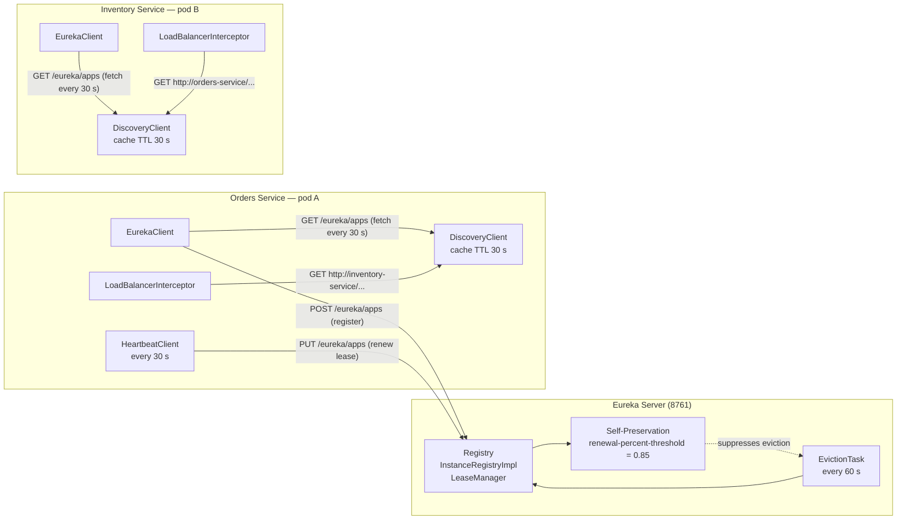
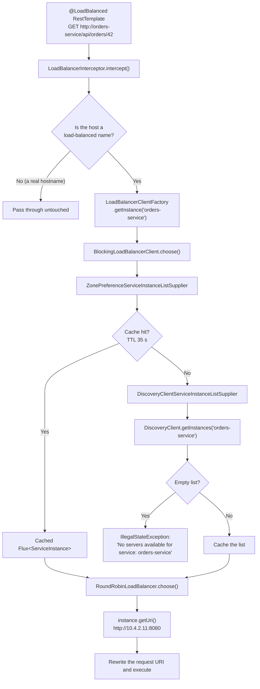
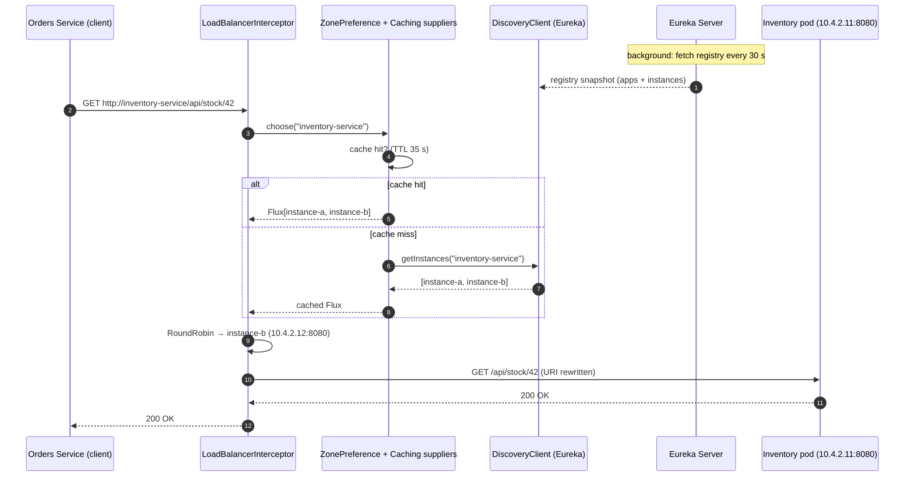

# Monolith vs Microservices & Service Discovery — The Complete Interview Guide

> **Level:** Beginner → Advanced
> **Interview Frequency:** ★★★★★ (the "when do you NOT split?" question is asked in almost every backend interview, and it is the one question where the naive answer is most confidently wrong)
> **Prerequisites:** [07 · OAuth2 & OpenID Connect](../07-OAuth2-OpenID-Connect/README.md) · [README](./README.md)
> **Last Updated:** 2026

> **Target stack:** Spring Boot 3.3+ · Spring Framework 6.1+ · Java 17+ · Jakarta EE 10 ·
> Spring Cloud 2023.x (Netflix Eureka 4.1.x, Spring Cloud LoadBalancer 4.1.x)

---

## 📋 Table of Contents
- [0. TL;DR — The 30-Second Answer](#0-tldr--the-30-second-answer)
- [1. What & Why — The Problem This Solves](#1-what--why--the-problem-this-solves)
- [2. Mental Model — The One Picture](#2-mental-model--the-one-picture)
- [3. Deep Dive — Theory (Beginner → Advanced)](#3-deep-dive--theory-beginner--advanced)
  - [3.1 Beginner Level](#31-beginner-level)
  - [3.2 Intermediate Level](#32-intermediate-level)
  - [3.3 Advanced Level](#33-advanced-level)
  - [3.4 Expert Level](#34-expert-level)
- [4. Internal Working Mechanism](#4-internal-working-mechanism)
- [5. Step-by-Step Execution Flow](#5-step-by-step-execution-flow)
- [6. Visualizations](#6-visualizations)
- [7. Production-Level Use Cases & Real Industry Examples](#7-production-level-use-cases--real-industry-examples)
- [8. Worked Examples (with Output + Dry Run)](#8-worked-examples-with-output--dry-run)
- [9. Code from Scratch — Production-Grade](#9-code-from-scratch--production-grade)
- [10. Common Mistakes & Gotchas](#10-common-mistakes--gotchas)
- [11. Performance Considerations](#11-performance-considerations)
- [12. Security Considerations](#12-security-considerations)
- [13. Best Practices](#13-best-practices)
- [14. Hands-On Exercises & Code Challenges](#14-hands-on-exercises--code-challenges)
- [15. Interview Q&A — Level-wise](#15-interview-qa--level-wise)
  - [🟢 Beginner](#-beginner)
  - [🟡 Intermediate](#-intermediate)
  - [🔴 Advanced / Senior](#-advanced--senior)
  - [⚫ Expert / Principal](#-expert--principal)
- [16. Scenario-Based & Real-Experience Scenarios](#16-scenario-based--real-experience-scenarios)
- [17. Counter-Questions, Tricky Questions & Follow-Ups](#17-counter-questions-tricky-questions--follow-ups)
- [18. Frequently Asked Production Issues & Debugging Scenarios](#18-frequently-asked-production-issues--debugging-scenarios)
- [19. Architecture Design Questions](#19-architecture-design-questions)
- [20. Rapid-Fire MCQs](#20-rapid-fire-mcqs)
- [21. Cheat Sheet / One-Page Summary](#21-cheat-sheet--one-page-summary)
- [22. Real-World Production Notes](#22-real-world-production-notes)
- [23. Follow-up Learning](#23-follow-up-learning)

---

## 0. TL;DR — The 30-Second Answer

- **The default answer is a modular monolith, not microservices.** Microservices buy you *independent deployment*, *independent scaling* and *team autonomy*. They charge you *network failure*, *distributed transactions*, *observability tax* and *CI/CD complexity*. Split only where a **business boundary**, a **scaling boundary** and a **team boundary** all line up.
- **The anti-pattern to name out loud is the "distributed monolith".** Services that must be **deployed together** *and* **share a database** — you have all the distributed-systems costs (network calls, eventual consistency, no transactions) and **none** of the benefits (independent deploy, independent scaling).
- **Split by business capability, never by table.** "One service per database table" produces a service with no business meaning, whose only job is to proxy a SQL query — and it forces every transaction to become a distributed transaction.
- **Conway's Law:** organisations design systems constrained by the communication structures of their organisations. **The inverse Conway Manoeuvre** is the deliberate move — restructure the architecture *and* the teams so the two reinforce each other.
- **A service registry solves one problem:** *the client needs the network address of a service instance.* That's it. Everything else — health checks, heartbeats, eviction — is machinery for keeping that address list honest.
- **Two registration models:** **self-registration** (the service registers itself — Eureka, Consul) and **third-party registration** (a deployment agent registers it — Kubernetes, Consul's sidecar agent, Service Fabric).
- **Two load-balancing models:** **client-side** (the client resolves the address and picks an instance — Eureka + Spring Cloud LoadBalancer) and **server-side** (the client calls a VIP and the load balancer picks — Kubernetes Service, an L7 proxy).
- **Eureka's lease contract:** renew every **30 s** (`eureka.instance.lease-renewal-interval-in-seconds`), expire after **90 s** (`eureka.instance.lease-expiration-duration-in-seconds`). 90 > 30 × 2, so **one missed heartbeat is tolerated; two is not**.
- **Self-preservation mode (85 % threshold) exists to prevent a mass eviction during a network partition.** When renewals start failing, Eureka deliberately keeps possibly-dead instances so the cluster can heal — the cost is that you will be routed to a dead pod.
- **Spring Cloud LoadBalancer replaced Ribbon.** The extension point is `ServiceInstanceListSupplier` (`get(String serviceId)` → `Flux<ServiceInstance>`), and the default implementation is `DiscoveryClientServiceInstanceListSupplier`, wrapped in a caching supplier and a zone-preference supplier.
- **On Kubernetes you probably do not need Eureka.** `K8sServiceInstanceListSupplier` reads the API server, and DNS (`SimpleDiscoveryClient`) already does service discovery. Running Eureka *and* K8s DNS means two sources of truth that will disagree.
- **The registry is a single point of failure** — you must design for "the registry is down but the app should still work", which is exactly what Eureka's client-side cache (`eureka.client.registry.fetch.interval-seconds` = 30 s) gives you: a bounded staleness window.

---

## 1. What & Why — The Problem This Solves

**The problem.** A monolith has one deployment unit. When the team grows past what one pipeline and one JVM can own, three things start to hurt, and *only two* of them are really about scale:

```text
   ❌ WHAT ACTUALLY BREAKS AS A MONOLITH GROWS
   ───────────────────────────────────────────────────────────────
   ① DEPLOYMENT COUPLING     One artifact → every change redeploys
                              everything → 40-minute pipelines, one
                              broken module blocks 30 other teams.
   ② SCALING COUPLING        The "checkout" module needs 40 pods
                              at Black Friday; the "reporting"
                              module needs 1. One deployment unit =
                              one scaling profile = you pay for
                              40 reporting pods.
   ③ TEAM COUPLING           12 teams on one codebase → merge
                              conflicts, one release train, and
                              "who broke my build?" becomes a
                              daily ritual.
```

Note carefully what is **not** in that list: **runtime performance**. A monolith is not "slow" — a monolith is *predictable*. The JVM sees the whole call graph, the JIT can inline across internal calls, a transaction is a transaction. Splitting a monolith into 12 services makes each individual call **40× more expensive** (in-process method call ≈ 0.1 µs vs. same-DC HTTP ≈ 1–5 ms) and turns one failure domain into twelve.

So the honest framing for an interview is:

> **"Microservices are a way to buy organisational independence with distributed-systems cost. They are not a performance optimisation and they are not a default."**

**The solution — when the split IS justified.** When you have a **bounded context** that (a) changes on a different cadence, (b) scales on a different profile, (c) is owned by a different team, and (d) has a **data ownership boundary** you can actually enforce. Typically: **Payments**, **Notifications**, **Search/Reporting**, **Media processing**, **Fraud scoring**, **Identity**.

**The analogy — the office building vs the office park.** A monolith is a **single building**: everyone shares the lift, the fire system, the coffee machine, and the roof. A microservice estate is an **office park**: separate buildings, separate meters, separate teams, separate everything — and now you need a **post room** (the network), a **courier** (the message broker) and a **directory board** (the service registry) to get anything from one building to another. The directory board is Eureka. The buildings that all share one coffee machine *and* one roof are a **distributed monolith** — you took on the courier's cost and kept the coffee machine.

**What breaks when you split?**

| You had (in-process) | You now need (distributed) |
|---|---|
| A method call | A network call with a **connect timeout and a read timeout** |
| A stack trace | A **correlation id** across services + a distributed trace |
| An ACID transaction | **Saga** + eventual consistency + a compensation |
| A `NullPointerException` at the call site | A `500` from a remote host with an opaque body |
| A thread pool of 200 | A **bulkhead** per dependency, or one slow call eats the pool |
| A shared in-memory cache | **Cache invalidation across processes** (or a distributed cache) |
| One deployment | **N deployments, N rollback plans, N version skew** |

**What breaks with the microservices dumping ground.** The second pitfall is the opposite of premature decomposition: teams "microserviced" everything, producing 40 services that each own one table and expose CRUD over HTTP. The symptom is unmistakable — **you cannot complete a business transaction without calling 9 services**, the end-to-end latency is 900 ms, and every failure is a partial failure you cannot roll back. The cure is **not** to merge them back; it is to recognise that the boundary was drawn on the *data model* instead of on the *business capability*, and to re-draw it.

---

## 2. Mental Model — The One Picture

```text
   THE SPECTRUM YOU ARE ACTUALLY CHOOSING ON
   ══════════════════════════════════════════════════════════════════════════

   MONOLITH ────────────────────────────────────────────────────────── MICROSERVICES
      │                                                                    │
      │   ┌──────────────┐   ┌──────────────┐   ┌──────────────┐             │
      │   │ Modular      │   │ Distributed  │   │ True         │             │
      │   │ Monolith     │   │ Monolith     │   │ Microservices│             │
      │   │              │   │  ⚠ ANTI-     │   │              │             │
      │   │ 1 deploy     │   │  PATTERN     │   │ N deploys    │             │
      │   │ 1 DB         │   │ N deploys    │   │ N DBs        │             │
      │   │ N modules    │   │ 1 SHARED DB  │   │ N teams      │             │
      │   │ 1 team-ish   │   │ MUST deploy  │   │ Independently│             │
      │   │              │   │  together    │   │ deployable   │             │
      │   └──────────────┘   └──────────────┘   └──────────────┘             │
      │   ✅ DEFAULT        │   ❌ WORST OF     │   ✅ JUSTIFIED             │
      │      CHOICE         │      BOTH WORLDS │      ONLY                  │
      │                    │                                            │
      └────────────────────┴────────────────────────────────────────────┘
                      THE COST OF CROSSING THE NETWORK
                      ─────────────────────────────────
                      same-DC REST call           ≈  1 – 5 ms
                      cross-region REST call      ≈ 30 – 80 ms
                      in-process method call      ≈  0.0001 ms
                      ─────────────────────────────────────────────────
                      ⇒ 1,000 – 100,000× more expensive per call.

   THE DECISION CRITERIA (all must line up)
   ──────────────────────────────────────────────────────────────
   BUSINESS boundary?   Domain-Driven Design bounded context
   DATA ownership?      Can this service own its tables exclusively?
   SCALING profile?     Does it need a different shape to its neighbours?
   RELEASE cadence?     Does it change on a different clock?
   TEAM ownership?      Does a different team own it?
   FAILURE isolation?   Do you WANT its failures to be isolated?
   ──────────────────────────────────────────────────────────────
   ★ If fewer than ~4 of the 6 line up → MODULAR MONOLITH.
```

**What to look at:** the picture separates the three things people conflate into "microservices":
**(1) the deployment unit**, **(2) the data ownership boundary**, and **(3) the team boundary**.
A **distributed monolith** breaks (1) and (3) but keeps (2) fused — you have paid the cost of
distribution while retaining the coupling that made the monolith manageable. And the decision
criteria panel is the actual interview answer: *count how many of the six line up*, because
"we want microservices" is not one of them.

---

## 3. Deep Dive — Theory (Beginner → Advanced)

### 3.1 Beginner Level

**The definition that actually holds up.** "Microservices" is not a technical term — it is the
name James Lewis and Martin Fowler gave (2014) to an architectural style. The characteristics they
listed, and what each one *forces* you to do:

| # | Characteristic | What it means | What it forces |
|---|---|---|---|
| 1 | **Small** | Sized so a team can understand and own it | Bounded context, not bounded table |
| 2 | **Loosely coupled** | Services know *contracts*, not implementations | Versioned APIs, contract tests |
| 3 | **Independently deployable** | One service can ship without the others | No shared runtime, no shared schema |
| 4 | **Business-capability aligned** | Organised around what the business does | DDD bounded contexts |
| 5 | **Decentralized data** | Each service owns its data store | No cross-service joins, no shared DB |
| 6 | **API-driven** | The *only* integration surface is a network API | REST/gRPC, contract versioning |
| 7 | **Automation** | Every service builds, tests and deploys itself | CI/CD per service, IaC, observability |

Point 7 is the one people forget, and it is the one that most often decides whether a
microservices adoption succeeds or produces a **microservices dumping ground**. "Automated"
does not mean "we have Jenkins" — it means **a single commit to one repository can go all the way
to production for one service without a human and without a coordinated release**. If your
deploy pipeline still requires a coordinated multi-service release, you do not have independent
deployment; you have a distributed monolith with extra network hops.

**The two pitfalls, named.**

```text
   PITFALL 1 — PREMATURE DECOMPOSITION
   ──────────────────────────────────────────────
   "We read a blog post and split the monolith into 8 services."
   RESULT: 8 network hops on the critical path, no transactions,
           no independent scaling benefit, 8× the deployment work.

   PITFALL 2 — THE MICROSERVICES DUMPING GROUND
   ──────────────────────────────────────────────
   "Every new team gets a new service, and every table gets a
    CRUD service."
   RESULT: 40 services, 9 calls per business transaction, 900 ms
           p99, and nobody can complete a feature without touching
           12 repositories.
```

The **cure** for both is the same: **a service must have a business reason to exist**. A service
whose entire API is `GET /{id}`, `POST /{id}`, `PUT /{id}`, `DELETE /{id}` over one table is a
**remote procedure call wearing a REST costume**. If you cannot name the *business capability*
it owns, it should not be a service.

**Service discovery — the problem it solves.** In a monolith, `orderService.findById(id)` compiles
to a method call on a bean in the same JVM; the address is in the classpath. In a distributed
system, the same call needs a **host and a port**, and that address changes every time a pod is
rescheduled, scaled, replaced or restarted. So we need a **registry**: a service that maintains a
mapping of *service id* → *set of live instance addresses*.

```text
   MONOLITH                              MICROSERVICES
   ─────────                             ─────────────
   OrderService orderService             orderService.findById(id)
        │                                        │
        ▼                                        ▼
   Bean lookup in the                ┌──────────────────────────┐
   ApplicationContext                │ "where is order-service?" │
   (address known at compile/        └────────────┬─────────────┘
    start time)                                  │
                                                 ▼
                                    ┌───────────────────────────┐
                                    │  SERVICE REGISTRY (Eureka)│
                                    │  order-service            │
                                    │   → 10.4.2.11:8080        │
                                    │   → 10.4.2.12:8080        │
                                    └────────────┬──────────────┘
                                                 │
                                                 ▼
                                    the client picks one and calls it
```

### 3.2 Intermediate Level

**The decision criteria, in full.** This is the table that answers "should we split?" in an
interview, and the numbers matter more than the opinions.

| Criterion | Signal to **split** | Signal to **stay modular** |
|---|---|---|
| **Team size** | > ~8–10 engineers on one codebase; more than 2 teams per module | One team, or 2–3 teams that co-locate |
| **Domain boundaries** | A clean **bounded context** exists (see §3.3) | Boundaries are fuzzy, or the domain is still changing weekly |
| **Scaling profile** | One part needs 50× the CPU of the rest, or has a totally different shape (streaming vs CRUD) | Everything scales roughly together |
| **Release cadence** | One part releases hourly, another monthly, and the slow one blocks the fast one | One release train is fine |
| **Data ownership** | You can give a service *exclusive* ownership of its tables | Every feature needs a join across "the" tables |
| **Regulatory / isolation** | PCI data must be isolated; a data-residency rule splits the estate | No such constraint |
| **Team autonomy** | Teams want independent deploys and independent on-call | Nobody is asking for it |

**The 2-pizza team heuristic.** Amazon's rule: a team should be small enough to be fed with two
pizzas (≈ **5–10 people**). It exists to keep **communication paths** short, because Brooks's
observation that adding people to a late project makes it later still. The *architectural*
reading — and the one interviewers want — is: **a service should be owned by one pizza team**.
If a service needs two teams to change it safely, it is too big or its boundary is wrong. If one
team owns three services that always change together, they are one bounded context and should
probably be one deployable unit.

**The cost ledger, with numbers.** This is the part candidates hand-wave. Here are the real
costs, quantified for a same-region production system:

| Cost | Same-DC HTTP | Cross-region HTTP | In-process (the thing you had) |
|---|---|---|---|
| Per-call latency | **1–5 ms** | **30–80 ms** | **~0.0001 ms** |
| Failure probability (per call) | ~1e-4 – 1e-3 | ~1e-2 – 1e-1 | ~0 (a `NullPointerException` is deterministic) |
| p99 tail | 20–50 ms (GC, TLS) | 150–400 ms | n/a |
| Serialisation cost | JSON: ~1–3 µs/KB; protobuf: ~0.2 µs/KB | same | none (no copy) |
| Connection pool | finite, must be sized | finite, sized × latency | none |
| Transaction | impossible across the call | impossible across the call | ACID, local |
| Debugging | needs a trace + correlation id | needs a trace + correlation id | a stack trace |
| Deploy | one artifact | one artifact per service | one artifact |
| Version skew | must be tolerated | must be tolerated | impossible |

> 🎯 **The single number that decides the interview:** a **5-hop** request chain at **2 ms** per hop
> adds **10 ms** of pure network latency — and that is the *happy path*. Add one retry at each
> hop and you have multiplied the worst case by 3; add a saga with three compensations and you
> have turned a 200 into a **400 ms** partial-failure path.

**The saga trade, stated plainly.** Replacing one ACID transaction with a saga means:

- the transaction's **atomicity** becomes **eventual consistency** — the system is briefly inconsistent and you must decide what "briefly" means (the *convergence window*);
- the transaction's **rollback** becomes a **compensation** — a *new forward action*, which is not guaranteed to succeed and which may be visible to the user;
- the transaction's **isolation** becomes **nothing** — other transactions can observe intermediate states, so you need to design for "what does a user see while the saga is in flight?";
- in exchange you gain **availability of the parts** and **the ability to scale and deploy each part independently**.

**Conway's Law.** Melvin Conway's observation (1967): *"organizations which design systems are
constrained to produce designs which are copies of the communication structures of these
organizations."* Put simply: **your architecture drifts towards your org chart** whether you want
it or not. If the payments team and the checkout team talk every day and the search team talks
to nobody, then over 18 months you will get a payments-checkout module, a checkout-payments
module, and a search island that nobody else can change.

**The inverse Conway Manoeuvre.** The deliberate move: **use the architecture to change the
communication structure**, not the other way round. Concretely:

1. **Draw the intended team boundaries first**, based on *domain capabilities*, not on the org chart.
2. **Design the system so that each team owns a whole vertical slice** — its own code, its own data, its own deploy, its own on-call.
3. **Make the boundaries expensive to cross** — separate repositories, separate databases, separate CI pipelines — so that "just a small change in the other service" becomes a *negotiation*, and the negotiation forces a conversation.
4. **Measure the boundary crossing** — if team A's PRs routinely touch team B's repository, the boundary is fiction.

The counter-intuitive part, and the part interviewers like: **sometimes you deliberately split a
team in order to split the system.** A team that owns two tightly-coupled modules cannot split
them, because nobody else knows the domain. Giving each half its own team forces the *domain
conversation* to happen — and that conversation is usually what reveals the real boundary.

### 3.3 Advanced Level

**Domain-Driven Design bounded contexts as the service-boundary heuristic.** Eric Evans's DDD
(2003) defines a **bounded context** as "a semantic perimeter in which a particular model is
meaningful". Inside a bounded context, a term has exactly one meaning. `Customer` in the *Sales*
context has a lifetime, a credit limit and a sales rep; `Customer` in the *Support* context has a
ticket history and an SLA. **They are different models with the same name**, and the context
boundary is what makes that legal.

The mapping to services is *not* 1:1 — a bounded context can be several services, and several
bounded contexts can live in one service. But the heuristic is: **a bounded context is the
smallest unit that can have its own data model**. That is the test:

> **Can this candidate context own its tables exclusively — with no other service reading or
> writing them — and still do its job?**

If the answer is no, the boundary is wrong. If the answer is no because *"we need a JOIN"*, you
have found the **distributed monolith** and you need to decide: change the model (denormalise,
use a read model, accept two queries), or merge the contexts.

**The "split by table" anti-pattern vs "split by business capability".**

```text
   ❌ SPLIT BY TABLE (the anti-pattern)
   ──────────────────────────────────────────────
   users-service  → SELECT * FROM users
   orders-service → SELECT * FROM orders
   products-service → SELECT * FROM products
   checkout-service → calls all three, then writes an order

   WHY IT IS WRONG:
   • "checkout" is a business capability — it is where the money is.
     The three "services" are just SQL proxies.
   • The checkout transaction now spans 4 services ⇒ a saga for
     something that was one INSERT.
   • The three services have no business logic, so nobody owns them.
   • Every schema change ripples: users-service adds a column →
     checkout-service's join breaks.

   ✅ SPLIT BY BUSINESS CAPABILITY
   ──────────────────────────────────────────────
   ordering-service   → owns orders + order-lines + the checkout flow
   customer-service    → owns customers, addresses, loyalty
   fulfilment-service  → owns picking, packing, shipment
   pricing-service     → owns price books, promotions, tax rules

   WHY IT IS RIGHT:
   • Each service owns a CAPABILITY and the rules that go with it.
   • "checkout" is inside ordering-service — one transaction, one DB.
   • A change to "how a promotion is priced" touches only pricing.
```

**Domain events as the seam.** When you *do* split, the integration surface should be **domain
events** ("OrderPlaced", "PaymentCaptured", "ShipmentDispatched"), not CRUD endpoints and
certainly not table reads. An event names a *fact that happened*, which means:

- the producer can evolve its schema without breaking the consumer (the consumer only cares about
  the event's meaning);
- the consumer can be added later, and it will work — because the event already happened and is
  replayable;
- you get the **audit trail** for free.

**Service discovery: the two registration models.**

| | **Self-registration** | **Third-party registration** |
|---|---|---|
| Who registers? | The service itself | A separate agent / control plane |
| Mechanism | The service POSTs its own address to the registry | The platform (K8s, Service Fabric, an agent) writes the entry |
| Examples | **Eureka**, Consul agent, Nacos | **Kubernetes** (Endpoints/EndpointSlice), Consul with a sidecar, Service Fabric |
| Failure mode | The service cannot register ⇒ it is invisible | The control plane is down ⇒ nobody is invisible, but updates stop |
| Coupling | The app code depends on the registry client | The app code is registry-agnostic |
| Health signal | The service's own heartbeat | The platform's probes (liveness/readiness) |

The important observation: **Kubernetes is third-party registration.** The kubelet tells the API
server "this pod is ready at this IP"; the API server maintains the `EndpointSlice`; DNS or the
kube-proxy does the balancing. The application code does not know a registry exists. That is why
"you probably don't need Eureka on Kubernetes" is not a slogan — it is a description of who is
already doing the job.

**Client-side vs server-side load balancing.**

```text
   CLIENT-SIDE (Eureka + Spring Cloud LoadBalancer)
   ────────────────────────────────────────────────
   client ──▶ registry ──▶ [A, B, C] ──▶ client picks B ──▶ B
                    ▲
                    └── the client must know how to pick AND how to
                        handle B being dead. The registry returns
                        instance metadata; the client does the rest.

   SERVER-SIDE (Kubernetes Service / L7 proxy / ALB)
   ────────────────────────────────────────────────
   client ──▶ VIP (10.96.0.10:80) ──▶ kube-proxy / proxy picks B ──▶ B
                    ▲
                    └── the client only knows a stable address.
                        The platform handles health, draining, and
                        the "the backend moved" problem.

   CONSEQUENCE: client-side needs the registry to be REACHABLE and FRESH.
                server-side needs only a stable VIP — the registry can
                be down and traffic still flows.
```

**Eureka — the mechanism, with the real numbers.** `spring-cloud-netflix-eureka-server` +
`spring-cloud-netflix-eureka-client`.

| Property | Key | Default | What it really means |
|---|---|---|---|
| Lease renewal interval | `eureka.instance.lease-renewal-interval-in-seconds` | **30 s** | How often the client says "I'm alive" |
| Lease expiration duration | `eureka.instance.lease-expiration-duration-in-seconds` | **90 s** | After this silence, the registry evicts you |
| Auto-renew | `eureka.instance.lease-info.auto-renew` | `true` | Whether the client renews at all |
| Registry fetch interval | `eureka.client.registry.fetch.interval-seconds` | **30 s** | How often the client pulls the registry |
| Registry fetch enabled | `eureka.client.registry.fetch.registry-enabled` | `true` | Whether the client caches the registry at all |
| Self-preservation threshold | `eureka.server.renewal-percent-threshold` | **0.85** | Below 85 % of leases renewed → self-preservation ON |
| Eviction interval | `eureka.server.eviction-interval-timer-in-ms` | **60 000 ms** | How often the server runs the eviction task |
| Response cache update | `eureka.server.response-cache-update-interval-ms` | **30 000 ms** | How often the cached registry response is rebuilt |
| Service URL | `eureka.client.service-url.defaultZone` | `http://localhost:8761/eureka/` | Where the registry is |
| Health check indicator | `eureka.client.healthcheck.enabled` | `false` | Send the client's `/actuator/health` as the heartbeat body |

**Why 30 s / 90 s?** The ratio is 1 : 3. The client renews every 30 s; the registry evicts after
90 s of silence. That means the client can **miss one renewal** (a GC pause, a brief network blip)
and still survive, but **two consecutive misses** (≈ 60 s of silence) is still under 90 s, so it
survives too — only at 90 s of *total* silence does it die. That slack is deliberate: the cost of
evicting a healthy instance (every client in the fleet gets an error for one request) is higher
than the cost of keeping a dead one for up to 90 s (a few requests fail until it is evicted).
**The registry trades a little extra availability for not flapping.**

**Self-preservation mode — the 85 % threshold, explained properly.**

```text
   NORMAL                                 PARTITION / MASS RENEWAL FAILURE
   ──────                                 ────────────────────────────────────
   100 instances, 100 renew  ✔            100 instances, 40 renew  ✘  (network
   renewal rate = 100 %                   partition or a registry slowdown)
        │                                        │
        ▼                                        ▼
   threshold 85 % reached? NO              threshold 85 % reached? YES
        │                                        │
        ▼                                        ▼
   normal eviction ✔                    SELF-PRESERVATION ON
                                        "do not evict ANYTHING"
                                        → the registry KEEPS possibly-dead
                                          instances, so clients keep a
                                          target to reconnect to.
```

The **reason** is the one that makes this an interview answer: during a network partition,
Eureka's own view is *"the clients cannot reach **me**"*, but the clients' view is *"Eureka cannot
reach **us**"* — and in fact both the clients and the registry are perfectly healthy; they just
cannot see each other. If Eureka evicted everything during that window, then when the partition
healed, **every client would have to re-register** — and a thundering herd of re-registrations
against a registry that is already struggling is how a 2-minute partition becomes a 30-minute
outage. Self-preservation trades *some* stale entries for *not* triggering a mass re-registration
storm.

**The cost you pay:** while self-preservation is on, the registry keeps handing out addresses of
instances that may be dead. Your clients will make calls that time out. And because Eureka's
client-side cache only refreshes every 30 s, you may not even *see* the stale entry for another
30 s. The mitigation is that the client should also **not** cache aggressively — and, more
importantly, the client must be resilient (circuit breaker, short timeout) because *by design*
the registry may hand it a dead address.

**The client's local cache and the staleness bound.** `eureka.client.registry.fetch.interval-seconds`
= 30 s. This means:

- the client's view of the world can be up to **30 s stale** (plus the eviction delay, up to 90 s);
- if the registry is **down**, the client keeps serving from its last good cache — which is exactly
  the "the registry is down but the app should still work" requirement;
- the *staleness bound* of a service address is therefore roughly **fetch interval + lease expiry
  ≈ 30 + 90 = 120 s** in the worst case.

That number is what an interviewer wants when they ask *"how stale can your service discovery
be?"*.

### 3.4 Expert Level

**Spring Cloud LoadBalancer — the Ribbon replacement.** Netflix Ribbon entered maintenance mode
in 2017 and was **removed from `spring-cloud-netflix`** in the 2020.0.0 (Hoxton) release train.
Its replacement is **Spring Cloud LoadBalancer** (`spring-cloud-starter-loadbalancer`), and the
extension point is deliberately different — Ribbon used `ServerList<Server>`; LoadBalancer uses a
**reactive `Flux`**:

```java
public interface ServiceInstanceListSupplier extends Supplier<Flux<ServiceInstance>> {
    String getServiceId();
    Flux<ServiceInstance> get();          // all instances of the service
    default Flux<ServiceInstance> get(Request request) { return get(); }  // request-aware
    Flux<ServiceInstance> get();
}
```

The real signature (Spring Cloud Commons 4.x) is:

```java
public interface ServiceInstanceListSupplier extends Supplier<Flux<ServiceInstance>> {

    /** Returns the service id of the instances this supplier provides. */
    String getServiceId();

    /** Returns all the instances for the service. */
    Flux<ServiceInstance> get();

    /** Returns the instances for the service, taking the request into account. */
    default Flux<ServiceInstance> get(Request request) {
        return get();
    }
}
```

The **default supplier chain** in Spring Cloud LoadBalancer 4.x is composed by
`LoadBalancerClientFactory`:

```text
   ZonePreferenceServiceInstanceListSupplier        ← prefers the caller's zone
        │  wraps
        ▼
   CachingServiceInstanceListSupplier                ← caches the list for 35 s by default
        │  wraps
        ▼
   DiscoveryClientServiceInstanceListSupplier         ← calls DiscoveryClient.getInstances()
        │
        ▼
   DiscoveryClient  (EurekaDiscoveryClient / CompositeDiscoveryClient / SimpleDiscoveryClient)
```

The ordering is not arbitrary: **caching must be outside discovery** (otherwise every request
hits the registry) and **zone preference must be outside caching** (otherwise the cache is
per-zone-aware and would need to be re-keyed). `CachingServiceInstanceListSupplier`'s default
TTL is **35 s** (`spring.cloud.loadbalancer.cache.ttl`).

**`DiscoveryClient` and `ServiceInstance`.**

```java
public interface DiscoveryClient {
    List<ServiceInstance> getInstances(String serviceId);
    default List<ServiceInstance> getInstances(String serviceId, @Nullable String instanceId) { ... }
    List<String> getServices();
}

public interface ServiceInstance {
    String getInstanceId();
    String getServiceId();
    String getHost();
    int getPort();
    boolean isSecure();
    URI getUri();
    Map<String, String> getMetadata();
    default String getScheme() { return isSecure() ? "https" : "http"; }
}
```

`EurekaDiscoveryClient` adapts Eureka's `Application`/`InstanceInfo` model onto `ServiceInstance`.
The mapping is not trivial: Eureka's `InstanceInfo` carries `hostName`, `appName`, `ipAddr`,
`port`, `securePort`, `status`, `metadata` and `lastDirtyTimestamp`; `EurekaDiscoveryClient`
maps `metadata` to `Map<String,String>` and prefers `getHostName()` over `getIPAddr()` — which
matters, because the IP is what changes on every pod restart.

**The `ServiceInstanceListSupplier` flowchart is the thing to memorise** for "how does a
`@LoadBalanced RestTemplate` actually resolve a hostname?"

1. The client calls `GET http://orders-service/api/orders/42`.
2. `LoadBalancerInterceptor` (for `RestTemplate`) / `LoadBalancerExchangeFilterFunction` (for
   `WebClient`) sees the URI host `orders-service` — a *logical* name, not a resolvable hostname.
3. It asks the `LoadBalancerClientFactory` for a `LoadBalancer` named `orders-service`.
4. The `LoadBalancer` asks its `ServiceInstanceListSupplier` for the instance list.
5. The supplier chain runs (zone preference → cache → discovery client).
6. `DiscoveryClientServiceInstanceListSupplier` calls `discoveryClient.getInstances("orders-service")`.
7. The `DiscoveryClient` returns `List<ServiceInstance>`; the supplier converts it to a `Flux`.
8. The `LoadBalancer` applies its `ReactorServiceInstanceLoadBalancer` (default:
   `RoundRobinLoadBalancer`, or `RandomLoadBalancer`, or `WeightedResponseTimeLoadBalancer`).
9. It picks one `ServiceInstance` and the interceptor rewrites the URI to `instance.getUri()`.
10. The real HTTP call goes to `http://10.4.2.11:8080/api/orders/42`.

**Why `ServiceInstanceListSupplier` is reactive (`Flux`)** even though `RestTemplate` is
blocking: because the whole ecosystem now supports WebFlux. `RestTemplate` bridges by
`.block()`-ing the `Flux` on the calling thread. This is worth stating in an interview — it
explains why the supplier API is `Flux`-based while the classic example is blocking.

**Kubernetes-native discovery — the "delete Eureka" argument.**

```text
   ON KUBERNETES, DISCOVERY IS ALREADY SOLVED:
   ─────────────────────────────────────────────────────────────
   ① kubelet watches the pod → reports READY + pod IP to the API server
   ② the API server writes an EndpointSlice (modern) / Endpoints (legacy)
   ③ kube-proxy watches EndpointSlices and programs iptables/IPVS
   ④ the ClusterIP Service (10.96.x.x) is a stable virtual IP that
      load-balances to the ready pods
   ⑤ ClusterIP DNS:  orders-service.default.svc.cluster.local
   ─────────────────────────────────────────────────────────────
   ⇒ the platform IS the registry AND the load balancer.
```

- **`K8sServiceInstanceListSupplier`** (`org.springframework.cloud.kubernetes.discovery.K8sServiceInstanceListSupplier`)
  implements `ServiceInstanceListSupplier` and reads the API server's `EndpointSlice` objects
  through the Spring Cloud Kubernetes client. It is the server-side, authoritative view.
- **`SimpleDiscoveryClient`** is the DNS-based fallback: it resolves the service name via DNS and
  returns the resolved addresses as `ServiceInstance`s. `SimpleDiscoveryClientAutoConfiguration`
  registers it when no other `DiscoveryClient` is present, and it can also be configured statically:

  ```yaml
  spring:
    cloud:
      discovery:
        client:
          simple:
            instances:
              orders-service:
                - uri: http://10.4.2.11:8080
                - uri: http://10.4.2.12:8080
  ```

- **Why most K8s shops delete Eureka:** Eureka would be a *second* source of truth. The two will
  disagree (Eureka's 90 s lease vs. Kubernetes' readiness probe + grace period), and the
  disagreement produces the worst class of bug: **the registry says the instance is alive, the
  platform says it is terminating**. You then get requests routed to a pod that is being killed.
  If you keep one, keep only one, and make it the platform.

**The registry comparison table.**

| | **Eureka** | **K8s DNS / EndpointSlice** | **Consul** | **HashiCorp (Vault/Consul/Nomad)** |
|---|---|---|---|---|
| Model | Self-registration, HTTP/REST | Third-party registration by the kubelet | Self-registration or agent | Consul service catalog |
| App code depends on it? | **Yes** (`@EnableEurekaClient`) | **No** | Optional (agent sidecar) | Optional |
| Health signal | Client heartbeat + optional `/actuator/health` | Readiness probe | Agent heartbeat + checks | Agent heartbeat + checks |
| Load balancing | **Client-side** | Server-side (kube-proxy / VIP) | Client-side or DNS | Client-side or sidecar proxy |
| Extra moving parts | Registry server (2+ for HA) | Already there | Consul server + agent | Consul server + agent |
| Watch/consul-template support | No | No | **Yes** (Consul KV + templates) | **Yes** |
| Service mesh integration | Via adapters | Native (Istio/Linkerd) | Via adapters | Via Nomad/Vault |
| Typical footprint | 1–2 JVMs + a DB (Cassandra/MySQL) | Free (part of the platform) | 3–5 servers + a raft log | 3–5 servers |
| Failure impact | Client cache (30 s) keeps it working | CoreDNS is critical | Client cache | Client cache |
| Best for | Non-K8s, VM-based, hybrid | **Kubernetes (default choice)** | Hybrid, service mesh, dynamic config | Enterprise, Vault-centric |

> 🎯 **The advice an interviewer wants:** "On Kubernetes, I would **not** run Eureka. The platform
> already does registration, health and load balancing, and running a second registry creates two
> sources of truth that will disagree — usually during a rolling deploy, which is exactly when you
> cannot afford it. I would use `spring-cloud-starter-loadbalancer` with the Kubernetes
> `ServiceInstanceListSupplier`, and keep the `DiscoveryClient` abstraction so the code does not
> care."

**The "registry down, app must still work" requirement.** This is a hard production
requirement, and the mechanism is the **client-side cache**:

- The client fetches the registry every **30 s** and keeps the last good response in memory.
- If the fetch fails, the client logs a warning and **keeps using the cached list**.
- Consequence: the app survives a registry outage of any duration, but its view of the world
  freezes. Instances that died during the outage stay in the list until the registry returns (or
  until a client-side "dead instance" heuristic evicts them).
- The industry-standard mitigation for the second half is to combine the cached address list with
  a **circuit breaker per service** (chapter 03) — so that a stale entry turns into a fast
  failure rather than a 30-second hang.

---

## 4. Internal Working Mechanism

**Eureka server startup and request handling.**

1. `@EnableEurekaServer` on the server application imports `EurekaServerAutoConfiguration`, which
   registers `EurekaController`, `PeerEurekaNode` (only when `eureka.server.enable-peer-node=true`
   and `eureka.server.peer.*` is configured) and the `EurekaRegistry` bean.
2. `EurekaController` exposes the REST API the clients speak:
   - `POST /eureka/apps/{appName}` — **register** an instance
   - `PUT /eureka/apps/{appName}/{instanceId}` — **heartbeat / renew the lease**
   - `DELETE /eureka/apps/{appName}/{instanceId}` — **cancel the lease / deregister**
   - `GET /eureka/apps` — **fetch the registry** (all applications)
   - `GET /eureka/apps/{appName}` — fetch one application
   - `GET /eureka/vips/{appName}` — fetch the VIP (virtual hostname) form
3. `EurekaController.register` → `AbstractInstanceRegistry.register` → `InstanceRegistryImpl.register`
   → `LeaseManager`/`Lease` → `ResponseCacheImpl` (which is a read-through cache of
   `Applications` → `Application`s).
4. `AbstractInstanceRegistry.renew` → checks the lease is still valid → extends it →
   `registry.renew()` → publishes a `Renewed` event to the `EurekaServerEventBus`.
5. The **eviction task**: `EvictionTask` runs on a `Timer` at
   `eureka.server.eviction-interval-timer-in-ms` (default **60 000 ms**). It asks the lease manager
   for all expired leases and removes them — **but only if self-preservation is off**.
6. **Self-preservation**: `AbstractInstanceRegistry.isExpirationEnabled()` consults
   `RenewalThreshold` — computed as
   `(renewed count / total registered count) >= renewal-percent-threshold (0.85)`. If the renewal
   rate has **dropped below** 85 %, self-preservation turns **on** and `evict()` skips expired
   leases. The check is *inverted* from what people expect: **self-preservation is ON when renewals
   are FAILING**, and it turns back OFF when the renewal rate recovers above 85 %.

**Eureka client startup and the lease.**

1. `@EnableEurekaClient` (or just having `spring-cloud-starter-netflix-eureka-client` on the
   classpath) auto-configures `EurekaClientAutoConfiguration` → `DiscoveryClient` (an
   `EurekaDiscoveryClient`), `EurekaClient`, `EurekaAutoServiceRegistration`,
   `EurekaRegistration`, `HeartbeatClient` and `EurekaWatchList`.
2. `EurekaAutoServiceRegistration.start()` publishes a `RegistrationEvent`; the listener
   `EurekaClientAutoConfiguration`'s `AutoRegistrationProcessor` calls `registration.register()`.
3. `EurekaRegistration.register()` → `DiscoveryClient.register(instanceInfo)` → `EurekaDiscoveryClient`
   → `EurekaClient`'s transport (`RestTemplate`-based `AbstractJerseyEurekaClient` in older
   versions; the modern client uses `RestTemplate`/`HttpClient` under `com.netflix.eureka.http`)
   → `POST http://eureka-host:8761/eureka/apps/{appName}`.
4. The **heartbeat**: `HeartbeatClient` (a `ScheduledExecutorService` task) calls
   `eurekaClient.renewLease(appName, instanceInfo)` every
   `eureka.instance.lease-renewal-interval-in-seconds` (30 s) → `PUT /eureka/apps/{appName}/{instanceId}`.
   If `eureka.instance.lease-info.auto-renew=false`, the task is **not** scheduled at all.
5. The **registry fetch**: `DiscoveryClient` caches the registry. `EurekaDiscoveryClient.getInstances`
   goes through `AbstractDiscoveryClient` → `EurekaClient.getApplicationsByVip` → the local
   `DiscoveryClient` cache, which is refreshed by `EurekaClient`'s internal `DiscoveryClient`
   `DiscoveryTask` every `eureka.client.registry.fetch.interval-seconds` (30 s).
6. `EurekaWatchList` — if `eureka.client.registry.watch.enabled=true`, the client subscribes to the
   server's watch endpoint and receives deltas immediately instead of waiting for the 30 s poll.

**The `@LoadBalanced` call chain, class by class.**

```text
  RestTemplate.getForObject("http://orders-service/api/orders/42", Order.class)
     │
     ▼
  LoadBalancerInterceptor.intercept(...)        (RestTemplate)          ← Ordered
     │  – reads the "host" from the URI: "orders-service"
     │  – if it is NOT a load-balanced name, it passes through untouched
     ▼
  LoadBalancerClientFactory.getInstance("orders-service")
     │  – creates/caches a BlockingLoadBalancerClient
     ▼
  BlockingLoadBalancerClient.choose(serviceId, request)
     │  – delegates to the ReactiveLoadBalancer
     ▼
  RoundRobinLoadBalancer.choose(request)
     │  – supplier.get().next()  → one ServiceInstance
     ▼
  LoadBalancerInterceptor rewrites the URI to instance.getUri()
     │
     ▼
  The actual HTTP call: GET http://10.4.2.11:8080/api/orders/42
```

The `WebClient` equivalent is `LoadBalancerExchangeFilterFunction`, a `ExchangeFilterFunction`
that performs the same resolution but stays reactive.

**The extension point a developer implements.**

```java
/**
 * A supplier that prefers instances in the caller's own availability zone.
 * Implement this to make the load-balancing decision zone-aware.
 */
public class ZoneAwareInstanceListSupplier implements ServiceInstanceListSupplier {

    private final ServiceInstanceListSupplier delegate;
    private final String zone;

    public ZoneAwareInstanceListSupplier(ServiceInstanceListSupplier delegate, String zone) {
        this.delegate = delegate;
        this.zone = zone;
    }

    @Override
    public String getServiceId() {
        return delegate.getServiceId();
    }

    @Override
    public Flux<ServiceInstance> get() {
        return delegate.get().collectList().map(instances -> {
            List<ServiceInstance> local = instances.stream()
                    .filter(i -> zone.equals(i.getMetadata().get("zone")))
                    .toList();
            // Fall back to every instance if the local zone has none —
            // returning an empty Flux here is how you get "no servers available".
            return local.isEmpty() ? instances : local;
        }).flatMapIterable(list -> list);
    }
}
```

> 💡 **The bug everyone writes once:** returning an **empty `Flux`** when no local-zone instance
> exists. Spring Cloud LoadBalancer then reports *"No servers available for service: X"* — which
> looks like a discovery failure but is actually a *load-balancing* failure. Always fall back.

**Service registration attributes in code.**

```java
@SpringBootApplication
@EnableDiscoveryClient   // or @EnableEurekaClient
public class OrdersApplication {
    public static void main(String[] args) {
        SpringApplication.run(OrdersApplication.class, args);
    }
}
```

`@EnableEurekaClient` is now essentially optional: with `spring-cloud-starter-netflix-eureka-client`
on the classpath, the auto-configuration registers the client. `@EnableEurekaClient` remains
useful as an explicit marker (and for `eureka.client.*` shortcuts such as
`@EnableEurekaClient(defaultZone = "...")`), but the modern advice is *"rely on
auto-configuration; use the annotation only where you need its attributes."*

---

## 5. Step-by-Step Execution Flow

**Flow A — a client resolves `orders-service` and makes a call.**

1. The application starts. `DiscoveryClientAutoConfiguration` creates a `DiscoveryClient`
   (`EurekaDiscoveryClient`) and `LoadBalancerAutoConfiguration` creates the
   `LoadBalancerClientFactory` and the `ServiceInstanceListSupplier` chain.
2. `EurekaAutoServiceRegistration` starts and `POST`s the instance to
   `http://eureka-host:8761/eureka/apps/ORDERS-SERVICE` with the instance metadata
   (`instanceId`, `hostName`, `app`, `ipAddr`, `status`, `port`, `securePort`, `vipAddress`,
   `homePageUrl`, `healthCheckUrl`, `dataCenterInfo`, `metadata`).
3. The registry's `InstanceRegistryImpl` stores the lease and marks the instance `UP`.
4. `HeartbeatClient` schedules the renewal at `+30 s, +60 s, +90 s, …` — a fixed-rate schedule,
   so a slow renewal shifts the whole series rather than accumulating drift.
5. The application's **first** `@LoadBalanced` call arrives. `LoadBalancerInterceptor` extracts
   the host `orders-service` from the URI.
6. `LoadBalancerClientFactory` returns the `LoadBalancer` for `orders-service`, creating it if
   this is the first use.
7. The supplier chain runs: `ZonePreferenceServiceInstanceListSupplier` →
   `CachingServiceInstanceListSupplier` (cache hit → **no registry call**) →
   `DiscoveryClientServiceInstanceListSupplier` (cache miss → `DiscoveryClient.getInstances`).
8. `RoundRobinLoadBalancer` picks the next instance from the `Flux`.
9. `LoadBalancerInterceptor` rewrites the request URI to `http://10.4.2.11:8080/...`.
10. The HTTP call goes out on the client's connection pool.
11. The registry fetch task refreshes the client's registry every 30 s in the background.

**Flow B — an instance dies.**

1. The pod is killed. No further `PUT` heartbeats are sent.
2. At `+30 s` the renewal does not happen. The registry's lease still has ~60 s of life.
3. At `+60 s` the renewal still has not happened. Lease life is now ~30 s.
4. At `+90 s` of silence the lease expires.
5. The next eviction tick (every 60 s) removes the instance — **unless** self-preservation is on.
6. Clients learn about the removal on their **next fetch**, up to 30 s later.
7. Total worst-case time for a dead instance to disappear from every client's view:
   **90 s (lease) + ≤60 s (eviction tick) + ≤30 s (client fetch) ≈ 180 s.**

**Flow C — the registry goes down.**

1. The client's renewal `PUT` fails. The client logs a warning and **keeps the lease locally**.
2. The renewal rate on the server drops. If the server itself is down, this is irrelevant; if
   only the *network path* is down, the server sees the drop and turns on self-preservation.
3. The client's registry fetch fails. The client **serves the last cached list** and logs a warning.
4. The application keeps serving traffic using the cached addresses.
5. If one of those addresses is a dead instance, the call fails — and the **circuit breaker**
   (chapter 03) is what turns that into a fast, controlled failure instead of a hang.

---

## 6. Visualizations

### 6.1 The service-discovery topology (Mermaid graph)



**What to look at:** the three arrows into the registry are the whole protocol — **register
once**, **renew every 30 s**, **fetch every 30 s**. Everything else (self-preservation, eviction)
is server-side machinery that exists only because those renewals can fail.

### 6.2 Resolving `orders-service` to a URL (Mermaid flowchart)



**Caption:** the load balancer **never** resolves a DNS name. It asks a supplier for a *list of
concrete instances*, and the supplier chain is the only place where "logical name → address"
is resolved. This is why the same `@LoadBalanced` code works against Eureka, Consul, K8s or a
static list without changing.

### 6.3 The registry comparison (ASCII)

```text
   ┌──────────────┬────────────────┬──────────────────┬─────────────────┬─────────────────┐
   │              │ EUREUA         │ K8s DNS /        │ CONSUL          │ HASHICORP       │
   │              │                │ ENDPOINTSLICE    │                 │ (CONSUL/NOMAD)  │
   ├──────────────┼────────────────┼──────────────────┼─────────────────┼─────────────────┤
   │ Registration │ Self           │ Third-party      │ Self or agent   │ Agent          │
   │              │ (app POSTs)    │ (kubelet → API)  │                 │                 │
   ├──────────────┼────────────────┼──────────────────┼─────────────────┼─────────────────┤
   │ Health       │ Client         │ Readiness probe  │ Agent heartbeat │ Agent heartbeat │
   │              │ heartbeat 30 s │ + grace period   │ + checks        │ + checks       │
   │              │ + /health      │ (default 30 s)   │                 │                 │
   ├──────────────┼────────────────┼──────────────────┼─────────────────┼─────────────────┤
   │ Eviction     │ Lease 90 s +   │ Delete the pod → │ Agent TTL       │ Agent TTL      │
   │              │ eviction tick  │ endpoint removed │ (e.g. 30 s)     │                 │
   │              │ 60 s          │ (~instant)        │                 │                 │
   ├──────────────┼────────────────┼──────────────────┼─────────────────┼─────────────────┤
   │ Load         │ CLIENT-side    │ SERVER-side      │ Client or DNS   │ Client/sidecar  │
   │ balancing    │ (SCLB)         │ (kube-proxy/VIP) │                 │                 │
   ├──────────────┼────────────────┼──────────────────┼─────────────────┼─────────────────┤
   │ App depends  │ YES            │ NO               │ Optional        │ Optional        │
   │ on it?       │ @EnableEureka  │                  │ (agent)         │                 │
   │              │ Client         │                  │                 │                 │
   ├──────────────┼────────────────┼──────────────────┼─────────────────┼─────────────────┤
   │ Config/       │ No             │ No              │ YES (Consul KV) │ YES             │
   │ KV support   │                │                  │ + watch/template│                 │
   ├──────────────┼────────────────┼──────────────────┼─────────────────┼─────────────────┤
   │ Extra infra   │ 1-2 JVMs + DB  │ Already there   │ 3-5 servers     │ 3-5 servers     │
   ├──────────────┼────────────────┼──────────────────┼─────────────────┼─────────────────┤
   │ Verdict on   │ Legacy/VM      │ ★ DEFAULT on K8s │ Hybrid + mesh   │ Enterprise +    │
   │ Kubernetes    │                │                  │                 │ Vault-centric   │
   └──────────────┴────────────────┴──────────────────┴─────────────────┴─────────────────┘
```

**Caption:** the row that decides everything is **"App depends on it?"**. If the answer is *no*,
the platform owns the problem and you have one less distributed component to operate. Eureka is
the only option on this list that makes your application code aware of the registry — which is
exactly why it is the one most K8s shops delete.

### 6.4 The client's lookup and load-balancing choice (Mermaid sequence)



**Caption:** notice that in the happy path there is **no network call to the registry during the
request**. The registry is consulted *out of band* on a 30 s timer, and the request path only
reads a local cache. That is the entire reason the client-side model is fast — and the entire
reason its data can be 30–120 s stale.

---

## 7. Production-Level Use Cases & Real Industry Examples

**1. E-commerce order platform (retail, ~40k orders/min at peak).**

- **Topology:** `orders-service`, `payment-service`, `inventory-service`, `fulfilment-service`,
  `notification-service`, `pricing-service` — 6 services, 3 teams.
- **Why split:** `inventory-service` must scale to 40k reads/min at Black Friday while
  `pricing-service` runs 3 pods all year; `notification-service` is a fire-and-forget consumer
  and must never slow down `orders-service`.
- **Registry:** Eureka (the platform was VM-based, pre-Kubernetes). 3 Eureka servers in a
  peer-replicated cluster, 4 nodes each.
- **Numbers:** p99 end-to-end 410 ms; `inventory-service` p99 45 ms; the inventory lookup is
  **1.8 % of the end-to-end budget**, which is why the team did *not* split pricing out of
  inventory.

**2. Payments / card tokenisation (banking, PCI-DSS scope).**

- **Topology:** a PCI-isolated `card-vault-service` on a separate network segment and a separate
  cluster; everything else talks to it through an internal mTLS endpoint.
- **Why split:** **regulatory isolation**, not scale. The PCI boundary is a hard requirement: the
  vault's network, its logs and its data store have a different compliance posture.
- **Registry:** the vault is registered in a *separate* Eureka server with a different
  `defaultZone`, and the consuming services have a **second, isolated** `DiscoveryClient` — a
  pattern worth knowing because it means two registries, two failure domains and an explicit
  trust boundary.

**3. Media / video processing (SaaS, 12k uploads/hour).**

- **Topology:** `upload-api` (synchronous, tiny) → `transcode-service` (asynchronous, CPU-heavy)
  → `media-metadata-service` (reads the DB).
- **Why split:** the **scaling profile is completely different** — the API needs 2 pods, the
  transcoder needs 200 GPU workers.
- **Communication:** the transcoder is fed by a message queue (topic 09), not HTTP. The API
  returns **202 Accepted** immediately.
- **Registry:** Kubernetes DNS, **no Eureka** — the transcoder pods are `StatefulSet`-ish and
  the team had already fought the "stale Eureka entry during a rolling deploy" bug once.

**4. Ad-tech real-time bidding (low latency, 800 bids/sec per node).**

- **Topology:** `bidder-gateway` (Spring Cloud Gateway) → `bid-scoring-service` → `campaign-service`.
- **Why split:** `campaign-service` is a slow, database-heavy service; `bid-scoring-service` is
  a pure in-memory computation with a **2 ms** budget. Mixing them guarantees the slow path
  dictates the fast path's latency.
- **Registry:** Kubernetes DNS + the Kubernetes `ServiceInstanceListSupplier`.
- **Numbers:** the gateway must add **< 1 ms**; the scoring service's p99 is **0.9 ms**; any
  dependency that breaches 1.5 ms is put behind a circuit breaker with a **200 ms** timeout and
  a `ScoreNotAvailable` fallback (see chapter 03).

**5. Insurance claims (regulated, ~1,200 claims/day, low volume, high complexity).**

- **Topology:** **deliberately NOT split.** A modular monolith with 4 modules (`intake`,
  `assessment`, `settlement`, `reporting`), one Postgres schema per module, and one deployment.
- **Why:** the business domain is still changing weekly (new actuarial rules every sprint),
  the volume does not justify it, and the team is 9 people — under the 2-pizza threshold.
- **The result:** the team shipped **2× faster** than the previous "microservices pilot", and
  when they *did* split, it was only `reporting` (a genuinely separate, read-only, batch-shaped
  workload).

> 📌 **The pattern to take away:** the split should follow the **scaling profile** and the
> **team boundary**, and it should be **deferred** until the boundary is genuinely clean. Most
> successful microservices stories start with "we tried it, went back to a modular monolith,
> and then re-split only the one part that needed it."

<!--APPEND-MARKER-->
