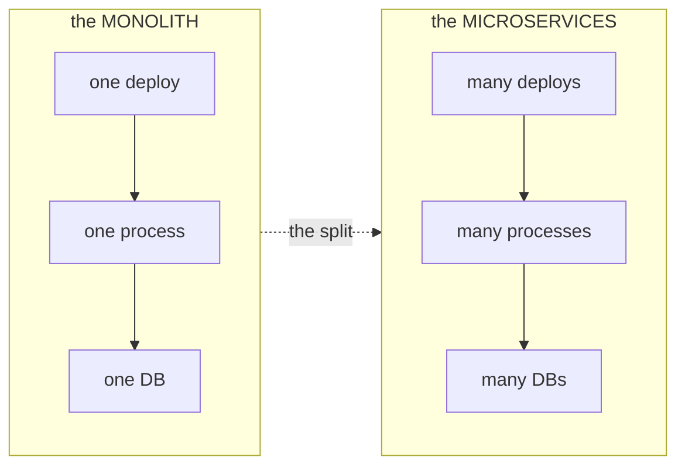

# 01 · Monolith vs Microservices & When to Use Which

> **Level:** Intermediate → Advanced
> **Interview Frequency:** ★★★★★ (The #1 systems-design opener)
> **Prerequisite:** [Topic 07 · OAuth2 & OIDC](../07-OAuth2-OIDC/README.md)
> **Last Updated:** 2026

---

## 📋 Table of Contents
- [0. TL;DR — The 30-Second Answer](#0-tldr--the-30-second-answer)
- [1. What & Why](#1-what--why)
- [2. Mental Model — The Trade-off Map](#2-mental-model--the-trade-off-map)
- [3. Deep Dive — Theory](#3-deep-dive--theory)
  - [3.1 What a monolith actually is](#31-what-a-monolith-actually-is)
  - [3.2 The seven factors of a distributed system](#32-the-seven-factors-of-a-distributed-system)
  - [3.3 The real drivers for the split](#33-the-real-drivers-for-the-split)
  - [3.4 The costs nobody puts in the blog post](#34-the-costs-nobody-puts-in-the-blog-post)
  - [3.5 Decomposition: the domain-driven approach](#35-decomposition-the-domain-driven-approach)
  - [3.6 The strangler fig pattern](#36-the-strangler-fig-pattern)
  - [3.7 The modular monolith](#37-the-modular-monolith)
  - [3.8 The macroservices anti-pattern](#38-the-macroservices-anti-pattern)
  - [3.9 The decision framework](#39-the-decision-framework)
- [4. Visualizations](#4-visualizations)
- [5. Worked Examples](#5-worked-examples)
- [6. Code from Scratch — Production-Grade](#6-code-from-scratch--production-grade)
- [7. Common Pitfalls & Gotchas](#7-common-pitfalls--gotchas)
- [8. Interview Q&A — Level-wise](#8-interview-qa--level-wise)
- [9. Counter-Questions & Traps](#9-counter-questions--traps)
- [10. Rapid-Fire MCQs](#10-rapid-fire-mcqs)
- [11. Hands-On Exercises](#11-hands-on-exercises)
- [12. Code Challenges](#12-code-challenges)
- [13. Scenario-Based Questions](#13-scenario-based-questions)
- [14. Tricky Interview Questions](#14-tricky-interview-questions)
- [15. Follow-Up Questions Asked by Interviewers](#15-follow-up-questions-asked-by-interviewers)
- [16. Real 3–5 Year Scenarios](#16-real-35-year-scenarios)
- [17. Frequently Asked Production Issues](#17-frequently-asked-production-issues)
- [18. Debugging Scenarios](#18-debugging-scenarios)
- [19. Architecture Design Questions](#19-architecture-design-questions)
- [20. Cheat Sheet — One-Page Summary](#20-cheat-sheet--one-page-summary)
- [21. Follow-up Learning](#21-follow-up-learning)

---

## 0. TL;DR — The 30-Second Answer

- **A monolith is not "bad"** — it's a **deployment unit**, not a code's quality. A
  well-modularised monolith with clean boundaries is a perfectly good architecture for
  most products, and it's usually the *right* starting point.
- **The microservices' trade is: you trade the in-process's simplicity for the
  network's failure modes.** Every in-process call becomes a network's call that can
  time out, partially fail, and be duplicated. You gain **independent deployment**,
  **independent scaling**, and **team autonomy** — and you pay with **network's
  latency**, **distributed's debugging**, **eventual's consistency**, and
  **operational's complexity**.
- **The real's drivers for the split** are **team's size** and **the change's rate**,
  not technical's elegance. If two teams deploy the same codebase daily, the
  coordination's cost is the problem. If one team owns everything, the split is
  overhead.
- **Decompose by the domain's boundaries, not by the technical's layers.** A service
  owns a **business capability** and its **data** — not "the controllers" and "the
  services".
- **The modular monolith is the underrated's middle** — one deployment unit, but strict
  internal's modules with **enforced** boundaries (ArchUnit, the module's API, the
  package-private's visibility). You can split later; you cannot un-split easily.
- **The macroservices anti-pattern** — the "distributed monolith" — gets all the cost
  and none of the benefit: the services still deploy together, still share a database,
  and still call each other synchronously.

---

## 1. What & Why

### The story you'll be asked about

```text
  "We have a 3-year-old Spring Boot monolith. 40 developers, 6 squads.
   We want to 'go microservices'. Should we?"
```

**The naive answer** — "Yes, microservices are the modern's best practice" — is wrong
and it will cost you the interview. The **right's answer** is a **diagnosis**:

1. **Is the pain technical or organisational?** Microservices solve an
   **organisation's** problem (the deploy's coordination, the scaling's mismatch, the
   team's autonomy). If the pain is "the code is messy", the answer is a **refactor**,
   not a **decomposition**.
2. **Where is the coupling?** If the teams can't deploy independently because of a
   **shared database**, then splitting the code without splitting the data just
   distributes the coupling.
3. **What does the change's rate look like?** The services that change together
   should live together.

---

## 2. Mental Model — The Trade-off Map

```text
  ┌───────────────────────────────────────────────────────────────────────┐
  │  the MONOLITH's world                                                 │
  │    · one deployment's unit                                            │
  │    · one process's memory (the calls are free)                       │
  │    · one transaction (the ACID's guarantee)                           │
  │    · one database (the joins are free)                                │
  │    · the debugging is a stack's trace                                 │
  │    · the scaling is uniform (the whole app scales)                    │
  │    ❌ the deploy's bottleneck, the team's coupling, the scaling's waste │
  └───────────────────────────────────────────────────────────────────────┘
                            ↕  the split's costs
  ┌───────────────────────────────────────────────────────────────────────┐
  │  the MICROSERVICES's world                                            │
  │    · many deployment's units (independent)                            │
  │    · many processes (the calls can fail, time out, duplicate)         │
  │    · many transactions (eventual's consistency, the saga's)            │
  │    · many databases (the joins are gone, the data's duplicated)        │
  │    · the debugging is a distributed's trace (the correlation's id)    │
  │    · the scaling is per's service (the efficiency's gain)             │
  │    ❌ the network's latency, the eventual's consistency, the ops      │
  └───────────────────────────────────────────────────────────────────────┘
```

**The insight to say out loud in the interview:**

> "Microservices don't make the system more *scalable* by default — they make it
> *independently deployable* and *independently scalable*. If you don't need
> independent deployment, you don't need microservices."

---

## 3. Deep Dive — Theory

### 3.1 What a monolith actually is

```text
  the MONOLITH (the deployment's unit)
  ┌──────────────────────────────────────────────┐
  │  the WEB's layer (the controllers)            │
  ├──────────────────────────────────────────────┤
  │  the SERVICE's layer (the use cases)          │
  ├──────────────────────────────────────────────┤
  │  the DOMAIN's layer (the entities, the rules) │
  ├──────────────────────────────────────────────┤
  │  the DATA's layer (the repositories, the SQL) │
  └──────────────────────────────────────────────┘
              ONE process, ONE DB, ONE deploy
```

**The important's distinction (the interview's favourite):**

| | The layered's monolith | The modular's monolith |
|---|------------------------|------------------------|
| The structure | The horizontal's layers (web → service → data) | The vertical's modules (each with web → service → data) |
| The dependencies | The layers may reach anywhere | The modules may only talk through their published's API |
| The compilation | Everything's together | Everything's together, but the boundaries are **enforced** |
| The splitting later | Hard — the layers' coupling is everywhere | Easy — the modules are already the units |
| The team's autonomy | Poor — everyone's changing the same's files | Good |

**A "layered's monolith" is a monolith that has been structured in a way that makes the
later's split expensive.** A "modular's monolith" is a monolith designed so the split
is a **deployment's change**, not a **rewrite**.

### 3.2 The seven factors of a distributed system

**The classic "Fallacies of Distributed Computing" — the ones that will bite you:**

| The fallacy | What it means in a microservices' world | The mitigation |
|------------|------------------------------------------|----------------|
| **The network is reliable** | It isn't. Packets are dropped, connections reset, DNS fails | The timeouts, the retries (with the jitter), the circuit's breaker, the bulkhead's isolation |
| **The latency is zero** | It isn't. An in-process call is ~1μs; a network's call is ~1-50ms | The timeouts, the caching, the batching, the asynchronous's design |
| **The bandwidth is infinite** | It isn't. The serialisation's cost, the payload's size | The pagination, the compression, the field's selection (the DTOs, not the entities) |
| **The network is secure** | It isn't. It's the least's trusted's part | The TLS's everywhere, the mTLS, the auth's propagation, the encryption's at rest |
| **The topology doesn't change** | It does | The service's discovery, the load's balancing, the retries' policies |
| **There is one administrator** | There isn't | The platform's team, the IaC, the observability's standards |
| **Transport cost is zero** | It isn't | The design's review, the architecture's fitness's functions |

**The one that catches most's juniors:** *the network is reliable*. In a monolith, a
method call either throws or returns. In a microservices' system, a call can
**succeed on the server and fail on the client** (the response is lost). This is the
root of every duplicate's processing, every "the user's order was created twice"
bug, and every idempotency's requirement.

### 3.3 The real drivers for the split

```text
  ① the ORGANISATIONAL's driver (the strongest's one)
     the teams can't deploy independently → the coordination's cost
     · 6 squads, one release's train, 2 weeks' between releases
     · the merge's queue, the environment's contention
     → the split's boundary should follow the TEAM's boundary (the Conway's law)

  ② the SCALING's driver
     one part of the system needs 100x the resources of the rest
     · the report's generator chews CPU, the API's latency is the SLO
     → the split's boundary follows the SCALING's profile

  ③ the RELIABILITY's driver (the isolation)
     one failure's domain must not take down the rest
     · the payments' integration's failure must not take down the catalogue
     → the split's boundary follows the FAILURE's domain

  ④ the DATA's driver
     the data's ownership, the compliance's boundary, the scaling's partition
     · the GDPR's right to erasure for the EU's users
     → the split's boundary follows the DATA's ownership

  ⑤ the CHANGE's RATE's driver
     the pricing's engine changes daily, the catalogue changes monthly
     → the split's boundary follows the VOLATILITY

  ❌ NOT a driver:
     · "microservices are more modern"
     · "we want to use Kafka"
     · "the monolith is ugly" (that's a refactor's problem)
     · "Netflix does it" (Netflix has 1000+ engineers and a dedicated's platform's team)
```

### 3.4 The costs nobody puts in the blog post

**The hidden's bill:**

```text
  ┌───────────────────────────────────────────────────────────────────┐
  │  what you GAIN                        what you PAY                │
  ├───────────────────────────────────────────────────────────────────┤
  │  the independent's deployment    ←→   the CI/CD's complexity       │
  │  the independent's scaling       ←→   the per-service's resources │
  │  the team's autonomy             ←→   the contract's maintenance  │
  │  the technology's diversity      ←→   the polyglot's ops          │
  │  the failure's isolation         ←→   the distributed's debugging │
  │  the clear's boundaries          ←→   the data's duplication      │
  │  the team's focus                ←→   the eventual's consistency  │
  │                                     the on-call's burden          │
  │                                     the security's attack's surface│
  │                                     the testing's complexity      │
  │                                     the latency's budget          │
  └───────────────────────────────────────────────────────────────────┘
```

**The specific's costs worth naming in an interview:**
- **The distributed's debugging** — a single's user journey spans 4 services and 2
  databases. Without a **correlation's id** propagated through every log and every
  header, you're debugging with a **grep**. The tooling: the OpenTelemetry's traces,
  the structured's logs, the correlation's id, the centralised's aggregation.
- **The data's duplication** — the order's service needs the customer's name to render
  a list; now that's a network's call (or a duplicated's copy that must be kept in
  sync). The classic's options: the **synchronous's call** (couples the availability),
  the **the event's replication** (the eventual's consistency), the **the read's model**
  (the CQRS's projection), or the **the API's composition** (the BFF's aggregation).
- **The contract's versioning** — the consumer's code and the producer's code deploy
  at different times. The **backward's compatibility's rule** (never remove a field;
  only add) is what keeps the deploy's windows safe.
- **The testing's complexity** — the unit's tests are the same, but the **integration's
  tests** now need the other services running (the Testcontainers, the contract's tests
  with the Pact, the **the consumer's driven's contracts**).
- **The on-call's burden** — with 12 services, the on-call rotation is 12× the alerts.
  You need the **the platform's team** and the **the golden's paths** (the paved road)
  or the microservices' will just multiply the toil.
- **The security's attack's surface** — every service is a separately's
  authenticated, separately's exposed endpoint. The perimeter's gone; the **zero's
  trust**'s model is the answer, and it's expensive.

### 3.5 Decomposition: the domain-driven approach

**The decomposition's options (and why the technical's ones fail):**

| The axis | The example | Why it fails |
|---------|-----------|--------------|
| **By the technical's layer** | "the controllers' service", "the services' service" | Every request crosses 3 services → the latency's tax and the chatty's coupling. This is the **"the macroservices"** anti-pattern. |
| **By the database's table** | "the orders' service", "the customers' service" | The tables are the *storage*, not the *capability*. A table's split leaves the business's rule fragmented. |
| **By the UI's screen** | "the checkout's service", "the dashboard's service" | The UI's is a view; the same's capability appears on many's screens. |
| **By the noun/entity** | "the order", "the customer" | Better, but an entity is a *thing*, and services should own *behaviours*. |
| **By the business's capability** ✅ | "the fulfilment's capability", "the billing's capability" | The **domain's language**. Each service is a business's noun, a vertical's slice, and it owns its data. |

**The vertical's slice:**
```text
  the ORDERS's service owns:
    · the API (the endpoints, the DTOs, the validation)
    · the use cases (the place the order, cancel the order)
    · the domain (the Order, the OrderStatus, the rules)
    · the data (the orders' table, the schema)
    · the events it publishes (the OrderPlaced)

  and NOTHING else. No service reaches into another's tables. No service calls
  another's repository.
```

**The DDD's toolkit for finding the boundaries:**
- **The bounded context** — the boundary where a term has a *single* meaning. "Customer"
  means something different to the billing's context and to the support's context.
  That's your split's line.
- **The context's map** — the visual map of the contexts and their's relationships
  (the **upstream/downstream**, the **conformist** vs the **ACL** (the anti-corruption
  layer)).
- **The ubiquitous's language** — the shared's vocabulary. If two teams use the same
  word with different's meanings, that's a bounded's context's boundary.
- **The aggregate's boundary** — the consistency's boundary (the unit that must be
  updated atomically). **This defines your transaction's boundary** — you get one
  transaction per aggregate, and an aggregate lives in one service. The aggregate is
  the smallest thing you can be consistent about; if two aggregates must change
  atomically, they're one aggregate.
- **The event's storming** — a workshop that surfaces the domain's events (the
  "OrderPlaced", the "PaymentCaptured", the "OrderShipped"). The events are the
  integration's points.

**The heuristic's questions for the boundary:**
1. Can this be **deployed independently** without coordinating with another's team?
2. Does it need a **consistent** view of the data, or can it work with the eventual's
   consistency?
3. Do they change at a **different's rate**?
4. Do they need to **scale differently**?
5. Does one need to be **available independently** of the other (the isolation's
   requirement)?

### 3.6 The strangler fig pattern

```text
  the MONOLITH (the legacy)                the NEW's services
  ┌────────────────────────┐
  │  /orders  ────────────┼──▶  the ORDERS's service (the new)
  │  /checkout ────────────┼──▶  the CHECKOUT's service (the new)
  │  /catalogue ───────────┼──▶  the CATALOGUE's service (the new)
  │  /legacy-reporting ────┼──▶  the MONOLITH (still)
  │  ...                   │      (the new calls back into the monolith
  └────────────────────────┘       for what it still needs)
                    ▲
                    │  the ROUTER (the gateway / the nginx / the Spring's
                    │  Cloud's Gateway) sends the traffic to the right's place
```

**The mechanics:**
1. **The facade/router** in front (the API's gateway, the reverse's proxy) — the
   clients' URLs don't change.
2. **Route one capability at a time** to the new's service.
3. **The new's service calls back** into the monolith for the data it doesn't own yet
   (the **the anti-corruption's layer** — a translation's boundary so the legacy's
   model doesn't leak into the new's domain).
4. **Migrate the data**: the new's service starts owning the data (usually the
   monolith's code stops writing to it — the **the strangler's "the data's
   migration"** step).
5. **Repeat** until the monolith is empty; then delete it.

**The strangler's benefits and the costs:**
- ✅ **Incremental's risk** — the rollback is a router's config's change.
- ✅ **No's big's bang**.
- ✅ The legacy's code keeps working (it's the source's truth until migrated).
- ❌ The **the strangler's seam** — the new's service calling back into the monolith
  reintroduces the coupling you're trying to remove. It's temporary, but it must be
  **tracked** (the debt's list) and it **must** have an end's date.
- ❌ The **the shared database** during the transition — the monolith and the new
  services may still share the schema. This is the **most common's failure**: the
  split's code but not the data = the macroservices.

### 3.7 The modular monolith

**The underrated's middle:**

```text
  ONE deployment's unit, ONE process, ONE database
  ┌───────────────────────────────────────────────────────────────┐
  │  the ORDERS's MODULE           the BILLING's MODULE           │
  │  ┌───────────────────┐         ┌───────────────────┐         │
  │  │ the API           │         │ the API           │         │
  │  │ the use cases     │         │ the use cases     │         │
  │  │ the domain        │◀───────▶│ the domain        │         │
  │  │ the repositories  │ (a      │ the repositories  │         │
  │  └───────────────────┘  public  └───────────────────┘         │
  │           the API only)                                        │
  ├───────────────────────────────────────────────────────────────┤
  │  the SHARED's KERNEL (the cross-cutting: the money, the ids)  │
  └───────────────────────────────────────────────────────────────┘
```

**The enforcement (this is the whole's point — without it, it's just folders):**
- The **module's API** — a `moduleA.api` package that the other modules may import,
  and a `moduleA.internal` package they may not.
- The **package-private's visibility** (in Java 9+, the JPMS's modules, or just the
  package's convention + the enforcement's tooling).
- **ArchUnit's rules** — the tests that fail the build if `orders` imports `billing`'s
  internal package.
- The **no's shared database's tables** — the schema's ownership's convention (each
  module's tables are named `orders_*`, `billing_*`) plus the enforcement (the
  `orders` module's code can't write to `billing`'s tables — the DB's grants).

```java
// the ArchUnit's rule — the boundary's enforcement
@ArchTest
static final ArchRule modules_must_not_reach_into_each_other =
    noClasses().that().resideInAPackage("..orders..")
        .should().dependOnClassesThat().resideInAPackage("..billing..")
        .because("the modules must communicate through their published's API only");
```

**When the modular's monolith is the right's answer:**
- The team's small (1-3 squads) — the deployment's coordination isn't the pain yet.
- The domain is still **discovering** its boundaries — splitting now locks in
  mistakes.
- The **operational's maturity** is low — no platform's team, no observability's
  stack, no on-call's rotation. The microservices' will amplify the chaos.
- The **data's model** is still changing — the split's data's migration is hard to
  undo.

**The migration's path to microservices:**
```text
  the MODULAR's MONOLITH (the enforced's boundaries)
       │  the teams grow, the deploy's coordination becomes the pain
       │  the platform's team exists, the observability's stack is ready
       ▼
  the FIRST's EXTRACTION (the lowest's-risk one)
       the strangler: one capability's service, its own's data
       ▼
  the INCREMENTAL's EXTRACTION
       one per's quarter, each one's strangled
       ▼
  the MICROSERVICES's estate
```

### 3.8 The macroservices anti-pattern

**The symptoms (all of them are red flags):**
- The services **deploy together** (one's pipeline builds all of them) — you have all
  the distributed's complexity and none of the independent's deployment.
- The services **share one database** and query each other's tables.
- The services are **layers** ("the controllers' service", "the services' service") or
  are split by the **technical's** concern.
- The services **call each other synchronously in a chain** — the user request touches
  5 services in 300ms.
- The team is **one team** — the split's boundary doesn't follow the team's boundary.
- There's a **shared's library** that everyone depends on, and a version's bump
  requires coordination.

**The fix (the order matters):**
1. **Split the data's ownership** — the service's schema, the DB's grants, and the
   code's enforcement. This is the hard's part and the most's important's one.
2. **Establish the deploy's independence** — the per-service's pipeline, the per-
   service's versioning, the backwards's compatible's contracts.
3. **Move the boundary's direction** — if the services are layered, invert them into
   the vertical's slices.
4. **Make the contracts explicit** — the API's schemas (the OpenAPI's spec, the
   event's schemas) with the version's policy.

### 3.9 The decision framework

```text
  ┌──────────────────────────────────────────────────────────────────┐
  │  SHOULD WE GO MICROSERVICES?                                    │
  └──────────────────────────────────────────────────────────────────┘
                            │
     ┌──────────────────────┴──────────────────────┐
     │  Is the pain ORGANISATIONAL (the deploy's    │
     │  coordination, the team's blocking)?         │
     └───┬──────────────────────────────────────┬───┘
         NO                                     YES
          │                                      │
          ▼                                      ▼
  ┌───────────────┐              ┌──────────────────────────────┐
  │  REFACTOR.    │              │  Do the services need to     │
  │  Modularise.  │              │  scale / deploy / fail       │
  │  Fix the code.│              │  INDEPENDENTLY?              │
  │  The monolith │              └───┬──────────────────────┬───┘
  │  is fine.     │                  NO                   YES
  └───────────────┘                   │                      │
                                      ▼                      ▼
                            ┌───────────────┐      ┌────────────────────────┐
                            │  Fix the      │      │  Do you have the       │
                            │  bottleneck   │      │  PLATFORM's maturity?  │
                            │  (the DB,     │      │  · the CI/CD            │
                            │  the cache,   │      │  · the observability   │
                            │  the threads) │      │  · the on-call         │
                            └───────────────┘      │  · the IaC             │
                                                      └───┬─────────────┬───┘
                                                          NO            YES
                                                          │              │
                                                          ▼              ▼
                                                  ┌──────────────┐  ┌──────────────┐
                                                  │  BUILD the   │  │  STRANGLE    │
                                                  │  platform    │  │  the monolith│
                                                  │  FIRST.      │  │  incrementally│
                                                  │  Then split. │  │              │
                                                  └──────────────┘  └──────────────┘
```

---

## 4. Visualizations

### 4.1 The trade-off map



### 4.2 The layered vs the modular's monolith

```text
  ❌ the LAYERED's MONOLITH              ✅ the MODULAR's MONOLITH
  ┌────────────────────────┐             ┌────────────────────────┐
  │  controllers  (all)    │             │ ┌────────┐ ┌────────┐  │
  ├────────────────────────┤             │ │ orders │ │ billing│  │
  │  services     (all)    │             │ │  API   │ │  API   │  │
  ├────────────────────────┤             │ │  use   │ │  use   │  │
  │  repositories  (all)   │             │ │  domain│ │  domain│  │
  ├────────────────────────┤             │ │  repo  │ │  repo  │  │
  │  entities     (all)    │             │ └───┬────┘ └───┬────┘  │
  └────────────────────────┘             │     │  public  │     │
   ⚠ everyone touches everything        │     ▼          ▼     │
   ⚠ the split later is a rewrite       │  the shared's kernel │
                                        └────────────────────────┘
                                         ✅ the boundaries are ENFORCED
```

### 4.3 The strangler's sequence

```text
  step 1        step 2        step 3        step 4        step 5
  ┌──────┐     ┌──────┐     ┌──────┐     ┌──────┐     ┌──────┐
  │ the  │     │ the  │     │ the  │     │ the  │     │ the  │
  │ mono │────▶│ mono │────▶│ mono │────▶│ mono │────▶│ DELET│
  │ + new│     │ + new│     │ + new│     │ + new│     │      │
  │ ord  │     │ ord  │     │ ord  │     │ ord  │     └──────┘
  │ svc  │     │ + chk│     │ + chk│     │ + chk│        ✅ done
  └──────┘     └──────┘     │ + cat│     │ +cat │
                            └──────┘     └──────┘
       ▲            ▲             ▲            ▲
    the ROUTER decides where each request goes
    the monolith is progressively emptied
```

### 4.4 The decision's flowchart

```text
  the PAIN
    │
    ├── organisational? ──NO──▶ REFACTOR / MODULARISE
    │
    └── YES
         │
         ├── needs the independent's deploy/scale/fail-isolation? ──NO──▶ FIX THE BOTTLENECK
         │
         └── YES
              │
              ├── has the platform's maturity (CI/CD, observability, on-call, IaC)? ──NO──▶ BUILD THE PLATFORM
              │
              └── YES ──▶ STRANGLE the monolith incrementally
```

---

## 5. Worked Examples

### 5.1 The e-commerce's decomposition (the dry run)

```text
  the MONOLITH's modules (the starting's point):
    the catalogue (the products, the prices, the stock)
    the cart
    the checkout (the order's creation, the pricing's calculation)
    the payment (the gateway's integration)
    the fulfilment (the shipping)
    the notification (the email, the SMS)
    the reporting (the analytics)

  the DECOMPOSITION's axes:
  ┌────────────────┬──────────────┬───────────┬──────────┬──────────┬──────────┐
  │ the capability │ the change's  │ the       │ the      │ the      │ the      │
  │                │ rate         │ scaling   │ the team │ the data │ the      │
  │                │              │ profile   │          │ ownership│ failure  │
  ├────────────────┼──────────────┼───────────┼──────────┼──────────┼──────────┤
  │ the catalogue  │ weekly       │ read-heavy│ content  │ owns the │ low      │
  │ the checkout   │ daily        │ spiky     │ growth   │ owns the │ HIGH     │
  │ the payment    │ monthly      │ steady    │ payments │ owns the │ HIGH     │
  │ the fulfilment │ monthly      │ steady    │ logistics│ owns the │ medium   │
  │ the notification│ weekly      │ spiky     │ platform │ owns the │ low      │
  │ the reporting  │ rarely      │ batch     │ data     │ READS all│ low      │
  └────────────────┴──────────────┴───────────┴──────────┴──────────┴──────────┘
       ▲             ▲               ▲           ▲         ▲         ▲
       the split's axes → the boundary's decisions

  the RESULT (the first's extraction):
    · the CHECKOUT's service (the spikiest, the highest's failure's risk)
      — the "the strangler's first" because it has the clearest's boundary
    · the PAYMENT's service (the failure's isolation — the gateway's outage
      must not take down the checkout)
    · the NOTIFICATION's service (the spikiest's scaling — the email's
      provider's latency must not block the API)
    · the CATALOGUE, the FULFILMENT, the REPORTING stay in the monolith (later)

  ⚠ the REPORTING's service is the classic's TRAP: it READS everyone's data.
    If you extract it first, you either duplicate all the data (the lake's
    problem) or you make it call everyone (the chatty's dependency). The
    right's answer: the events → a warehouse → the reporting's service.
```

### 5.2 The strangler's migration (the dry run)

```text
  the MONOLITH:  POST /api/checkout  →  CheckoutController → CheckoutService → OrderRepository

  step 1: introduce the ROUTER
    nginx / the Spring's Cloud's Gateway:
      location /api/checkout { proxy_pass http://checkout-service; }
      location /api/catalogue { proxy_pass http://monolith; }

  step 2: the new's CHECKOUT's service (the strangler's first)
    · the new's service reads the CATALOGUE from the MONOLITH
      (the anti-corruption's layer — the CatalogueClient, translating the
       monolith's Product DTO into its own's Product)
    · the new's service writes the ORDERS to its OWN's database
      ⚠ the monolith must STOP writing to the orders' table — this is the
        hard's step and where the "the split's code but not the data"
        macro's services is born
    · the monolith's CheckoutController is DELETED

  step 3: the PAYMENT's service
    · the checkout's service calls it (the synchronous's call — the
      availability's coupling: the checkout is now down when the payment is)
    · the alternative: the asynchronous's call (the checkout's pending's
      state + the payment's webhook/event) — the better's one for the
      availability, the worse's one for the user's UX

  step 4: the NOTIFICATION's service
    · the checkout's service publishes "OrderPlaced" (the Kafka/RabbitMQ)
    · the notification's service consumes it and sends the email
    · the checkout's response no longer waits for the email ✅

  the RESULT's metrics:
    · the checkout's p99 latency: 800ms → 180ms (the notification's
      and the payment's calls are gone from the hot path)
    · the deploy's frequency: 1/week → 12/day
    · the blast's radius: the monolith's bad deploy → everything's down;
      now → the checkout only
```

### 5.3 The "the split's code but not the data" failure (the dry run)

```text
  ❌ the MACROSERVICES:
    the ORDERS's service ────▶ SELECT * FROM customers   (the shared's DB!)
    the BILLING's service ───▶ SELECT * FROM orders      (the shared's DB!)
    the INVENTORY's service ▶ UPDATE stock SET ...        (the shared's DB!)

    the problems:
    · the schema's changes are now a CROSS-SERVICE's coordination
      (the "ALTER TABLE orders ADD COLUMN" needs all 3's teams' sign-off)
    · the data's ownership is ambiguous (who owns the customer row?)
    · you cannot move a service to its own's database (the others depend on
      its tables)
    · the "the split" bought you the deploy's pipeline's complexity and
      nothing else

  ✅ the FIX (the migration's path):
    step 1: the INVENTORY's service starts owning the `stock` table
            (the schema's move; the monolith's code stops touching it)
    step 2: the schema's pattern: `inventory.stock` (the schema-per-service)
            OR the same's DB with the grants + the naming's convention
            (`stock` table, owned by the inventory's role)
    step 3: the others get the data via the API's call or the event's
    step 4: the monolith's code that needed the stock is changed to CALL
            the inventory's service (or consume the event)

    ⚠ the ORDER of this matters: the data's ownership moves FIRST (or
      together with the code), never the code alone.
```

---

## 6. Code from Scratch — Production-Grade

### 6.1 The modular's monolith (the module's boundary's enforcement)

```java
package com.example.orders.api;

import lombok.Builder;
import lombok.Value;

/**
 * The ORDERS's module's PUBLIC's API.
 * ⚠ ONLY this package may be imported by the other modules.
 *   The internal's classes are NOT part of the contract.
 */
@Value
@Builder
public class OrderDto {
    String orderId;
    String customerId;
    String status;
    java.math.BigDecimal total;
    java.time.Instant placedAt;

    public static OrderDto from(com.example.orders.domain.Order order) {
        return OrderDto.builder()
                .orderId(order.getId())
                .customerId(order.getCustomerId())
                .status(order.getStatus().name())
                .total(order.getTotal())
                .placedAt(order.getPlacedAt())
                .build();
    }
}
```

```java
package com.example.orders.internal;

import lombok.RequiredArgsConstructor;
import org.springframework.stereotype.Service;
import com.example.orders.api.OrderDto;

/**
 * ⚠ INTERNAL — the package-private's convention plus the ArchUnit's rule.
 *   The other modules MUST NOT import this class.
 */
@Service
@RequiredArgsConstructor
public class OrderService {

    private final OrderRepository repository;

    public OrderDto place(String customerId, List<String> skuIds) {
        // the domain's rules live here
        Order order = Order.pending(customerId);
        repository.save(order);
        return OrderDto.from(order);
    }
}
```

```java
package com.example.architecture;

import com.tngtech.archunit.core.importer.ImportOption;
import com.tngtech.archunit.lang.ArchRule;
import com.tngtech.archunit.junit.AnalyzeClasses;
import com.tngtech.archunit.junit.ArchTest;
import com.tngtech.archunit.lang.syntax.ArchRuleDefinition;

import static com.tngtech.archunit.lang.syntax.ArchRuleDefinition.noClasses;

@AnalyzeClasses(packages = "com.example", importOptions = ImportOption.DoNotIncludeTests.class)
class ModuleBoundaryTest {

    /**
     * The MODULE's BOUNDARY's enforcement — the build fails if it breaks.
     * ⚠ Without this, the "modular's monolith" is just folders with good
     *   intentions. The enforcement is the whole's value.
     */
    @ArchTest
    static final ArchRule orders_must_not_reach_into_billing =
            noClasses().that().resideInAPackage("..orders..")
                    .should().dependOnClassesThat().resideInAPackage("..billing..")
                    .because("the modules must talk only through their published's API");

    @ArchTest
    static final ArchRule billing_must_not_reach_into_orders =
            noClasses().that().resideInAPackage("..billing..")
                    .should().dependOnClassesThat().resideInAPackage("..orders..")
                    .because("the modules must talk only through their published's API");

    @ArchTest
    static final ArchRule no_module_may_use_anothers_repository =
            noClasses().that().resideInAPackage("..orders..")
                    .should().dependOnClassesThat()
                    .resideInAnyPackage("..billing..repository..", "..payment..repository..")
                    .because("the data's ownership is per's module — the other module's tables are off-limits");

    /**
     * The ENTITIES must not leak across the modules — the DTO's boundary.
     */
    @ArchTest
    static final ArchRule entities_stay_inside_their_module =
            noClasses().that().resideInAnyPackage("..orders.domain..", "..billing.domain..")
                    .should().bePublic()
                    .because("the domain's entities are the module's internal's detail — the API's DTOs cross the boundary");
}
```

### 6.2 The ArchUnit's rule (the services' layering's check)

```java
package com.example.architecture;

import com.tngtech.archunit.core.importer.ImportOption;
import com.tngtech.archunit.junit.AnalyzeClasses;
import com.tngtech.archunit.junit.ArchTest;
import com.tngtech.archunit.lang.ArchRule;

import static com.tngtech.archunit.library.dependencies.SlicesRuleDefinition.slices;

@AnalyzeClasses(packages = "com.example", importOptions = ImportOption.DoNotIncludeTests.class)
class LayeringTest {

    /**
     * The LAYER's rule — the classic's "the controller must not touch the
     * repository" check. Worth having in ANY project, microservices or not.
     */
    @ArchTest
    static final ArchRule layers_are_respected =
            slices().matching("com.example.(*)..")
                    .should().beFreeOfCycles();

    @ArchTest
    static final ArchRule controllers_do_not_touch_repositories =
            com.tngtech.archunit.lang.syntax.ArchRuleDefinition.noClasses()
                    .that().resideInAPackage("..controller..")
                    .should().dependOnClassesThat().resideInAPackage("..repository..")
                    .because("the controller's layer must talk to the service's layer, not the data's");

    @ArchTest
    static final ArchRule entities_do_not_depend_on_spring_web =
            com.tngtech.archunit.lang.syntax.ArchRuleDefinition.noClasses()
                    .that().resideInAPackage("..domain..")
                    .should().dependOnClassesThat().resideInAnyPackage(
                            "org.springframework.web..", "jakarta.servlet..")
                    .because("the domain's model must be framework-agnostic — it is the core's value");
}
```

### 6.3 The strangler's routing (the Spring's Cloud's Gateway)

```yaml
# the gateway's routes — the strangler's control's plane
spring:
  cloud:
    gateway:
      routes:
        # the NEW's service (the strangled)
        - id: checkout-service
          uri: ${CHECKOUT_SERVICE_URL}
          predicates:
            - Path=/api/checkout/**,/api/orders/**
          filters:
            - AddRequestHeader=X-Correlation-Id, ${random.uuid}
            # the retries — ⚠ ONLY for the idempotent's methods
            - name: Retry
              args:
                retries: 2
                statuses: BAD_GATEWAY,SERVICE_UNAVAILABLE
                methods: GET
                backoff:
                  firstBackoff: 100ms
                  maxBackoff: 1s
                  factor: 2

        # the MONOLITH (the not-yet-strangled)
        - id: monolith
          uri: ${MONOLITH_URL}
          predicates:
            - Path=/api/catalogue/**,/api/fulfilment/**,/api/reporting/**
```

```java
package com.example.gateway;

import org.springframework.cloud.gateway.route.RouteLocator;
import org.springframework.cloud.gateway.route.builder.RouteLocatorBuilder;
import org.springframework.context.annotation.Bean;
import org.springframework.context.annotation.Configuration;

@Configuration
public class StranglerRoutingConfig {

    /**
     * The strangler's RULES — the code's route's definition.
     * ⚠ The order matters: the specific's routes come FIRST, the monolith's
     *   catch-all comes LAST.
     */
    @Bean
    public RouteLocator customRoutes(RouteLocatorBuilder builder) {
        return builder.routes()
                .route("checkout", r -> r.path("/api/checkout/**", "/api/orders/**")
                        .and().method(org.springframework.http.HttpMethod.GET,
                                      org.springframework.http.HttpMethod.POST)
                        .uri("lb://checkout-service"))
                .route("catalogue", r -> r.path("/api/catalogue/**")
                        .uri("lb://monolith"))
                .route("catch-all", r -> r.path("/**")
                        .uri("lb://monolith"))
                .build();
    }
}
```

### 6.4 The anti-corruption's layer (the new's service calling the legacy's)

```java
package com.example.checkout.client;

import lombok.RequiredArgsConstructor;
import org.springframework.stereotype.Component;
import org.springframework.web.client.RestClient;

import java.math.BigDecimal;
import java.util.List;

/**
 * The ANTI-CORRUPTION's LAYER — the boundary's translation.
 * ⚠ The legacy's DTOs must NEVER leak past this class. The rest of the
 *   new's service works with ITS OWN's model.
 */
@Component
@RequiredArgsConstructor
public class LegacyCatalogueClient {

    private final RestClient restClient;

    /**
     * The LEGACY's response → the new's domain's model.
     * The legacy's shape: { "id": 1, "title": "...", "priceCents": 1999, "inStock": true }
     * Ours:             { "skuId": "...", "name": "...", "price": 19.99, "available": true }
     */
    public List<Product> fetchProducts(List<String> skuIds) {
        LegacyProduct[] legacy = restClient.get()
                .uri("/api/catalogue/products?ids={ids}", String.join(",", skuIds))
                .retrieve()
                .body(LegacyProduct[].class);

        if (legacy == null) return List.of();

        return java.util.Arrays.stream(legacy)
                .map(p -> new Product(
                        "SKU-" + p.id(),
                        p.title(),
                        BigDecimal.valueOf(p.priceCents(), 2),
                        p.inStock()))
                .toList();
    }

    // the legacy's shape — PRIVATE to this class
    record LegacyProduct(long id, String title, long priceCents, boolean inStock) {}

    public record Product(String skuId, String name, BigDecimal price, boolean available) {}
}
```

### 6.5 The vertical's slice (the service's structure)

```text
  the ORDERS's service — ONE package, all the layers
  ┌──────────────────────────────────────────────────────┐
  │  com.example.orders                                  │
  │    ├── api/          (the REST's controllers, the    │
  │    │                  DTOs, the validation)          │
  │    ├── application/  (the use cases, the ports)     │
  │    ├── domain/       (the entities, the value's     │
  │    │                  objects, the domain's events,  │
  │    │                  the repository's INTERFACES)   │
  │    └── infrastructure/ (the JPA's entities, the      │
  │                       repositories' implementations,  │
  │                       the messaging's publishers)     │
  └──────────────────────────────────────────────────────┘
         ▲ the domain's layer depends on NOTHING
         │ the infrastructure's layer implements the domain's ports
         │ the application's layer orchestrates
         │ the API's layer is the adapter
```

```java
package com.example.orders.domain;

import java.util.List;
import java.util.UUID;

/**
 * The ORDERS's AGGREGATE — the consistency's boundary.
 * ⚠ It is the SMALLEST thing that must change atomically. If two things
 *   must be updated together, they are ONE aggregate.
 */
public class Order {

    private final UUID id;
    private final String customerId;
    private final List<OrderLine> lines;
    private OrderStatus status;
    private final java.time.Instant placedAt;

    private Order(UUID id, String customerId, List<OrderLine> lines,
                  OrderStatus status, java.time.Instant placedAt) {
        this.id = id;
        this.customerId = customerId;
        this.lines = List.copyOf(lines);
        this.status = status;
        this.placedAt = placedAt;
    }

    public static Order pending(String customerId) {
        return new Order(UUID.randomUUID(), customerId, List.of(),
                OrderStatus.PENDING, java.time.Instant.now());
    }

    /**
     * The DOMAIN's RULE — "the order's total must be positive" and
     * "the order can only be placed once".
     * ⚠ The rule lives in the DOMAIN, not in the controller or the service.
     */
    public void place(List<OrderLine> orderLines) {
        if (this.status != OrderStatus.PENDING) {
            throw new IllegalStateException("The order has already been placed");
        }
        if (orderLines == null || orderLines.isEmpty()) {
            throw new IllegalArgumentException("The order must have at least one line");
        }
        java.math.BigDecimal total = orderLines.stream()
                .map(OrderLine::subtotal)
                .reduce(java.math.BigDecimal.ZERO, java.math.BigDecimal::add);
        if (total.signum() <= 0) {
            throw new IllegalArgumentException("The order's total must be positive");
        }
        this.lines.clear();
        this.lines.addAll(orderLines);
        this.status = OrderStatus.PLACED;
    }

    public void cancel() {
        if (this.status == OrderStatus.CANCELLED) return;
        if (this.status == OrderStatus.SHIPPED) {
            throw new IllegalStateException("The shipped order cannot be cancelled");
        }
        this.status = OrderStatus.CANCELLED;
    }

    // the getters
    public UUID getId() { return id; }
    public String getCustomerId() { return customerId; }
    public List<OrderLine> getLines() { return lines; }
    public OrderStatus getStatus() { return status; }
    public java.time.Instant getPlacedAt() { return placedAt; }
}
```

```java
package com.example.orders.domain;

import java.util.List;

/**
 * The REPOSITORY's PORT — declared in the domain, implemented in the
 * infrastructure. This is the hexagonal's architecture's dependency's rule:
 * the domain's layer knows nothing about JPA.
 */
public interface OrderRepository {

    Order save(Order order);

    java.util.Optional<Order> findById(java.util.UUID id);

    List<Order> findByCustomerId(String customerId);

    // ⚠ the SPECIFICATION's pattern for the complex's queries
    List<Order> findAll(OrderSpecification specification);
}
```

### 6.6 The error's contract between the services

```java
package com.example.orders.api;

import lombok.extern.slf4j.Slf4j;
import org.springframework.http.HttpStatus;
import org.springframework.http.ProblemDetail;
import org.springframework.web.bind.annotation.*;
import org.springframework.web.context.request.WebRequest;

import java.net.URI;
import java.util.Map;

/**
 * The RFC 9457's PROBLEM DETAILS — the standard's error's format.
 * ⚠ The microservices' contract's media type: "application/problem+json".
 */
@RestController
@RequestMapping("/api/orders")
@Slf4j
public class OrderErrorHandler {

    @ExceptionHandler(OrderNotFoundException.class)
    ProblemDetail handleNotFound(OrderNotFoundException ex, WebRequest request) {
        ProblemDetail pd = ProblemDetail.forStatusAndDetail(HttpStatus.NOT_FOUND, ex.getMessage());
        pd.setTitle("The order was not found");
        pd.setType(URI.create("https://api.example.com/problems/order-not-found"));
        pd.setInstance(URI.create(request.getDescription(false).replace("uri=", "")));
        pd.setProperty("orderId", ex.getOrderId());
        pd.setProperty("traceId", org.slf4j.MDC.get("traceId"));
        return pd;
    }

    @ExceptionHandler(OrderStateException.class)
    ProblemDetail handleState(OrderStateException ex) {
        ProblemDetail pd = ProblemDetail.forStatusAndDetail(HttpStatus.CONFLICT, ex.getMessage());
        pd.setTitle("The order's state does not allow this operation");
        pd.setProperty("currentState", ex.getCurrentState());
        pd.setProperty("allowedStates", ex.getAllowedStates());
        return pd;
    }
}
```

### 6.7 The contract's test (the consumer's driven's contracts)

```java
package com.example.orders.contract;

import au.com.dius.pact.consumer.dsl.PactDslWithProvider;
import au.com.dius.pact.core.model.RequestResponsePact;
import au.com.dius.pact.core.model.annotations.Pact;
import au.com.dius.pact.provider.junit5.PactVerificationSpringProvider;
import org.junit.jupiter.api.Test;
import org.junit.jupiter.api.extension.ExtendWith;

import static au.com.dius.pact.core.model.RequestResponsePactBuilder.requestResponsePact;

/**
 * The CONSUMER's driven's CONTRACT — the orders's service declares what it
 * expects from the catalogue's service. ⚠ The catalogue's service is verified
 * against this in ITS pipeline — so a breaking's change is caught before the
 * deploy, not after.
 */
@ExtendWith(PactVerificationSpringProvider.class)
@PactTestFor(providerName = "catalogue-service")
class CatalogueContractTest {

    @Pact(consumer = "orders-service")
    public RequestResponsePact productLookup(PactDslWithProvider builder) {
        return builder
                .given("the product SKU-1 exists and is in stock")
                .uponReceiving("a request for a product")
                .path("/api/products/SKU-1")
                .method("GET")
                .willRespondWith()
                .status(200)
                .headers(Map.of("Content-Type", "application/json"))
                .body(new au.com.dius.pact.core.model.PactDslWithProvider.PactDslJsonBody()
                        .stringType("skuId", "SKU-1")
                        .stringType("name", "Mechanical Keyboard")
                        .decimalType("price", 89.99)
                        .booleanType("available", true))
                .toPact();
    }
}
```

---

## 7. Common Pitfalls & Gotchas

| # | ❌ Wrong | ✅ Right | Why |
|---|----------|----------|-----|
| 1 | Splitting because the code is messy | Refactor / modularise first | The code's quality ≠ the deployment's topology |
| 2 | Splitting by the technical's layer | By the business's capability | The chatty's services, the latency's tax |
| 3 | Splitting the code but sharing the DB | Split the data's ownership too | The macroservices |
| 4 | "Microservices are more scalable" | They're more *independently* scalable | The uniform's scaling is often enough |
| 5 | A big's bang's rewrite | The strangler | The rollback is impossible |
| 6 | The sync's calls in a long chain | The events for the non-interactive's paths | The availability's coupling |
| 7 | No idempotency's key on the writes | The idempotency's key everywhere | The network's "the success that failed" |
| 8 | No correlation's id | Propagate it (the header, the MDC, the event) | The distributed's debugging |
| 9 | The "the call failed" → the retry without's a jitter | The jittered's retries + the circuit's breaker | The thundering herd |
| 10 | The contract's change breaks the consumer | The backward's compatibility (add only) | The independent's deploys |
| 11 | The shared's library with the business's logic | The shared's library with the technical's utilities only | The coordinated's deploys |
| 12 | The microservices without a platform's team | The platform's team / the golden's paths | The on-call's toil |
| 13 | Distributed's transactions | The saga + the eventual's consistency | The 2PC's unavailability |
| 14 | The event's schema's changes in place | The versioned's event's schema | The consumers' breakage |
| 15 | The modular's monolith without the enforcement | The ArchUnit's rules | Folders, not modules |

---

## 8. Interview Q&A — Level-wise

### 🟢 Beginner
**Q: What is the difference between a monolith and microservices?**
**A:** A monolith is a single deployable application where all the code runs in one
process and typically shares one database. Microservices split the application into
several independently deployable services, each owning its own data, that communicate
over the network. The trade: you gain independent deployment, independent scaling, and
clear team boundaries, and you pay with network latency, distributed debugging,
eventual consistency, and operational complexity.

**Q: What is a "vertical slice"?**
**A:** A service that contains all the layers for one business capability — the API,
the use cases, the domain, and the data — instead of splitting the layers across
services. "Orders" is one vertical slice; "controllers" and "repositories" are not.

### 🟡 Intermediate
**Q: When would you choose microservices over a monolith?**
**A:** When the pain is organisational: multiple teams blocked on a shared release
train, or a shared database creating cross-team schema coordination. Also when parts
of the system need very different scaling profiles, or when one domain needs to be
isolated from another's failures. I would not choose it just because the code is messy
— that's a refactoring problem.

**Q: How do you decide where to split?**
**A:** By the **domain's boundaries** — the bounded context from domain-driven design.
The practical heuristic: split where the business capability, the data ownership, the
change rate, the scaling profile, and the team ownership all align. The aggregate is
the key constraint — it's the smallest consistency boundary, so it must live entirely
inside one service. And I use a "would these two deploy independently without
coordinating?" test.

**Q: What is the strangler fig pattern?**
**A:** You put a router (an API gateway) in front of the monolith and migrate one
capability at a time to a new service, which then calls back into the monolith for
what it doesn't own yet. Each step is independently reversible (a routing change),
and you delete the monolith when it's empty. The trap: stopping at "the code is split
but the data is still shared" — that gives you all the cost and none of the benefit.

### 🔴 Advanced / Senior
**Q: What are the biggest risks when splitting a monolith?**
**A:** (1) **Splitting the code but not the data** — the macroservices. The schema's
changes still need cross-team coordination, and you can't move a service to its own
database. (2) **The chatty's services** — a user request touching 5 services in a
synchronous chain; now every downstream's latency and failure is your problem. (3)
**The distributed's transactions** — you lose the ACID guarantee across the boundary
and need sagas with the eventual consistency and the compensating's transactions.
(4) **The contract's coupling** — the consumer's code and the producer's code deploy
at different times, so the contracts need versioning and the backward's compatibility
rules. (5) **The operational's gap** — 12 services without observability, without a
platform's team, without a correlation's id, is 12× the on-call's burden and no
better's delivery. (6) **The data's duplication** — the customer's name is now a
network's call or a duplicated's copy that drifts.

**Q: How do you handle a transaction that spans two services?**
**A:** You don't — you redesign it. The options in order of preference: (1) **Make it
one aggregate** — if two things must change atomically, they're one aggregate in one
service (the DDD's insight). (2) **Redesign the flow's direction** so the second
service's update is triggered by an event, not a call (the **the choreography's
saga** — the order's service publishes `OrderPlaced`, the payment's service consumes
it and publishes `PaymentCaptured`, the fulfilment's service consumes that). (3) If
you truly need a synchronous's two-phase commit, understand that 2PC blocks and
reduces availability — it's rarely the right's answer. With the choreography, you must
design for: the **idempotency** (the consumer may get the event twice), the
**out-of-order** (the `PaymentFailed` may arrive before the `PaymentRequested` — so
version the state and handle the transitions defensively), the **at-least-once's
delivery** (the exactly-once's illusion), and the **compensating's actions** (the
refund when the fulfilment's fails).

**Q: How do you debug a request that spans 5 services?**
**A:** With the **correlation's id** propagated everywhere — the incoming header (or
generated), stored in the MDC for the logs, attached to the outbound's calls and the
published's events, and returned in the error's responses. Then the OpenTelemetry's
trace's context (the W3C's `traceparent`) for the distributed's trace. The **the
observability's three's pillars**: the **structured's logs** (the JSON with the
correlation's id, the service, the version), the **the metrics** (RED — the rate, the
errors, the duration — per's service, per's endpoint), and the **the traces** (the
span per's hop). The **the practical's answer**: the correlation's id is a **cross-team
convention** that must be in the **platform's template** (the golden's path) or it won't
be there. And the tool: a log's aggregator (the Loki, the ELK) where you can query
`correlationId = "abc"` and get the whole's journey.

### ⚫ Expert / Principal
**Q: A company with 150 engineers is considering microservices. What's your advice?**
>
> (1) **The framing:** at 150 engineers, the **organisation's structure is the
determining's variable**, and the answer depends on whether the teams are already
autonomous. If they're all in one repo with one release's train, the pain is
**coordination's cost** — and microservices is a legitimate's answer. If they're
already well-separated but the deployment's pipeline is the bottleneck, the answer is
**the pipeline**, not the services. (2) **The diagnosis first:** the three's questions
— (a) **what's the actual's bottleneck?** (the release's frequency? the deploy's
fear? the incident's blast's radius? the scaling's cost?) Each's bottleneck has a
**cheaper's remedy** than the microservices: a better's CI (the build's time, the
flaky's tests), a trunk's based's develop with the feature's flags, a better's
monitoring and the smaller's batches, a read's replica and the query's optimisation.
Only **the independent's scaling** and **the team's autonomy** genuinely require the
split. (b) **do the teams already align with the domains?** If not, splitting first
creates the **wrong's boundaries** and you'll re-split later — and the re-split is
expensive (the data's migration again). (c) **is the platform's maturity there?** At
150 engineers you can afford a platform's team (3-5 people) and you should have one
**before** the split, not after. (3) **The recommendation:** don't start with the
microservices. Start with the **modular's monolith** (the enforced's boundaries) and
the **platform's investments** (the CI's speed, the observability's stack, the
deployment's automation, the golden's paths). Then extract **one** service to prove
the model — pick the one with the clearest's boundary, the highest's change's rate,
and the simplest's data (the reporting's service or the notification's service, not
the payment's). Learn from it. Then extract the rest's incrementally, each one with
the data's ownership's move. (4) **The organisation's design:** the Conway's law is
the strongest's lever here — the service's boundaries should follow the team's
boundaries, and if the teams are organised by the technical's layer (a "backend
team", a "frontend team"), the microservices' boundaries will be wrong. Restructure
the teams around the **domain's capabilities** first. (5) **The risks to name
explicitly:** the **the cost's curve** — the microservices' *first* year is more
expensive (the platform, the migration, the learning's curve); the **the local's
developer's experience** — the "run the whole's system on my laptop" becomes "docker
compose with 12 services" or a remote's dev's environment; the **the cross-service's
debugging's maturity**; the **the data's report's cross** — the analytics' queries
that joined 8 tables now need a warehouse; the **the over-splitting's risk** — 40
services for 40 engineers is a **microservice's anti-pattern** (a service per's
team's screenshot). The rule of thumb: **a service should be owned by at least 5-8
people** — below that, the coordination's cost of the interface exceeds the
coordination's cost of the shared's codebase. (6) **The senior's framing:** "**I'd
push back on the framing.** Microservices are a *tool* for the *organisation's*
constraints, and the first's job is to find which constraint is actually binding. At
150 engineers, most of the time it's the **release's coordination** — and that has
cheaper's answers (the trunk's based's develop, the feature's flags, the CI's speed)
that don't carry the microservices' tax. The exceptions are the **independent's
scaling** and a genuine's **failure's isolation** requirement, and those two justify
the split for a *specific* service, not for the whole's estate. So my sequence would
be: **the modular's monolith first** (the enforced's boundaries, so the split's later
is cheap), then the **platform's investments** (the observability, the CI's speed,
the deployment's automation) — because without those, 12 services is 12× the
on-call's burden, and the microservices will be blamed for a problem the platform
was causing. Then extract **one** service to learn the model, and only then scale it
up. And the two's organisational's points I'd raise: the **Conway's law** — if the
teams are organised by the technical's layer, the service's boundaries will be wrong
and you'll re-split (and the data's migration is the expensive's part), so restructure
the teams around the **domain's capabilities** first. And the **minimum's viable's
size**: a service should have at least **5-8 engineers**; below that, the interface's
coordination's cost exceeds the shared's codebase's coordination's cost, and you've
just distributed a monolith — the macroservices — which is the worst of both."

---

## 9. Counter-Questions & Traps

### CQ1. "Isn't a microservices architecture always more scalable and performant?"
- **Naive answer:** "Yes, it scales better."  ← the trap
- **The trap:** The interviewer wants the **actual's trade**.
- **Expert answer:** No — it's **conditionally** better, and the condition is specific.
Microservices buy you **independent's scaling** (you can scale the hot's service 100x
without scaling the cold's one) and **the failure's isolation** (the checkout's
deployment doesn't take down the catalogue). They **cost** you the network's latency
(every in-process call becomes a 1-50ms network's call), the **serialisation's cost**
(the DTO's marshalling on both's sides), the **data's duplication's cost** (the
customer's name is now a copy or a call), and the **operational's cost**. So a
microservices' system can absolutely be **slower** than the monolith it came from — and
it usually is, for a while, on the same's hardware. The **honest's framing**:
"microservices is a **trade of the in-process's efficiency for the deployment's
flexibility** — and you should only take that trade when the flexibility is worth
more than the efficiency. For a system whose bottleneck is the **database** (the most
common's case), the microservices makes it **worse**: you add the network's hops
between the app and the data, and the data is still the constraint. The real's
scalability's wins come from the **independent's scaling** — the report's generator
that needs 100x the CPU of the rest — and from the **the data's partitioning** (the
per-service's databases, so the write's load is split). If you don't have a component
with a divergent's scaling's profile, and you don't have a coordination's problem,
you pay the microservices' tax for nothing."

### CQ2. "How is a microservices' system different from a distributed's system?"
- **Naive answer:** "A microservices' system is a distributed's system."  ← the trap
- **The trap:** The interviewer wants the **distinction's nuance**.
- **Expert answer:** They're **not the same** — a microservices' system is *a style of*
distributed's system with a specific's set of conventions. The key's distinction:
**the microservices' boundary is a's business's boundary**, and the service is
**independently deployable** and **owns its data**. A distributed's system can be a
**single's deployable** (a modular's monolith with the remote's calls, an
n-tier's app) — which means the network's failure's modes without the deployment's
independence. That's the "the distributed's monolith" — the worst of both. The
converse also exists: the **the monolith's** modules with an **event-driven's**
architecture inside one process (the "the in-process's microservices") — you get the
modularity's benefit without the network's cost, and it's the right's starting's
point. So the axes are independent: **the deployment's topology** (one vs many) ×
**the modularity** (the logical's boundaries) × **the communication's style** (the
in-process's calls vs the network's calls vs the events). The microservices' style
commits to all three, plus the **data's ownership** and the **the team's
autonomy**. The framing: "the microservices' boundary is a **business's** boundary
with its own's data and its own's deploy — that's what makes it a microservices' style
rather than just 'a system's with more than one's server'. A distributed's system is
the **superset**. The useful's distinction for the design's review: the **distributed's
monolith** has the network's failure's modes without the deployment's independence —
it gets the worst of both, and it's the most common's anti-pattern."

### CQ3. "You say split by business capability, but our team's organised by layer —
backend team, frontend team. How do you reconcile that?"
- **Naive answer:** "Just split it anyway."  ← the trap
- **The trap:** The interviewer wants the **Conway's law**.
- **Expert answer:** **You don't split it yet — you restructure the teams first.** This
is the **Conway's law** in action: the system's architecture is a reflection of the
communication's structure, and the microservices' boundaries will be **wrong** if the
teams are organised by the technical's layer, because the team's incentive is to
change *their* layer and nobody owns the capability's behaviour end-to-end. A
"backend team" that owns the controllers *and* the repositories *and* the
microservices' contracts is perfectly set up to produce the macroservices — the
layered's split with the shared's database. The **sequence** that works: (1) **the
team's restructure** — form **feature's teams** (a vertical's slice: the catalogue's
team owns the catalogue's API, the use cases, the data, and the pipeline; the
checkout's team owns the checkout). This is a **management's change**, not a
technical's one, and it usually takes a quarter of the team's reorganisation. (2) **the
modular's monolith's boundaries** — the teams now own modules in one codebase, and
the **ArchUnit's rules** enforce the boundaries mechanically. This is the **cheap's
proof** of the boundaries (you find out fast whether the teams can actually work
independently). (3) **the first's extraction** — the team that has worked independently
in the modular's monolith is the natural's first's candidate for the extraction. (4)
**the platform's team** (the CI/CD, the observability, the deployment's templates, the
service's mesh) as a **separate's enabling's team** — the Conway's counter-move: a
platform's team creates the paved road so the feature's teams don't each reinvent the
scaffolding (and it also creates a **platform's boundary** that must be maintained
with the feature's teams' input, not imposed on them). The **honest's framing**: "the
microservices' boundaries are a **team's** decision as much as a technical's one — if
your teams are organised by the technical's layer, the split's boundaries will be
layered, and you'll get the macroservices. The **sequence** is: restructure into
**feature's teams** (a vertical's slice, owning the behaviour end-to-end), prove the
boundaries in a **modular's monolith** with the **enforced's rules**, extract the first's
service, and only then scale the split's pace. The **platform's team** is the
counter-move: a paved road so the feature's teams don't each rebuild the
scaffolding — and it's a *platform's* boundary, so it must be co-designed with the
feature's teams, not imposed."

### CQ4. "How do you migrate a monolith to microservices without a big-bang rewrite?"
- **Naive answer:** "The strangler fig."  ← the trap
- **The trap:** The interviewer wants the **messy details**.
- **Expert answer:** The strangler fig is the right's *pattern*, but the pattern's name
hides the hard's part, and the hard's part is **the data**. The sequence that works:
(1) **the facade** — a router (the API's gateway, the nginx) in front; the traffic
still goes to the monolith; the strangler's seam is established. (2) **the first's
extraction**, chosen by the clearest's boundary + the lowest's risk (not the highest's
value — a notification's service is a better's first than a payment's service); the
new's service **calls back** into the monolith through an **anti-corruption's layer**
(a translation's boundary — the legacy's DTOs don't leak into the new's domain).
(3) **the data's migration — the critical's step.** The monolith must **stop writing**
to the extracted's tables. Until it does, you have a split's code with a shared's
data = the macroservices, and the schema's changes still need cross-team
coordination. The mechanisms: the **dual-write** (the monolith writes to the new's
table and the old's, and the old's is read-only'd then dropped — the risk is the
**divergence**), the **change's data capture** (the Debezium's connector: the
monolith's writes are captured from the DB's log and applied to the new's store — the
risk is the **ordering's guarantee** and the **schema's coupling**), or the
**the reverse's proxy of the data** (the monolith reads the new's service instead of
the table — the cleanest's transitional's step). (4) **the contract's freeze** — the
new's service's API is now a public's contract; the **backward's compatibility**
rules apply; the monolith's callers are migrated one by one. (5) **repeat**, and
**delete** the monolith's module when it's empty (the code's deletion is a real's
deliverable — the dead's code is the confusion's source and the security's risk).
The **anti-patterns**: the **the big's bang** (the rewrite's risk — the "the
rewrite's curse": by the time you finish, the requirements have changed twice), the
**the split's code but not the data** (the macroservices), and the **the never's
ending's migration** (the new's service keeps calling back into the monolith for
years because nobody budgets the **the monolith's shrink's work** — the strangler's
debt must be tracked with an explicit's end's date per seam, or it becomes the
architecture's permanent's state).

---

## 10. Rapid-Fire MCQs

**1.** Microservices' primary's benefit:
A) Better's performance  B) The independent's deployment  C) Less's code  D) The simpler's tests
**✅ B**

**2.** The correct's split's axis:
A) The technical's layer  B) The business's capability  C) The database's table  D) The UI's screen
**✅ B**

**3.** The aggregate defines:
A) The API's boundary  B) The consistency's boundary  C) The team's boundary  D) The cache's boundary
**✅ B**

**4.** The "the split's code but not the data" is called:
A) The strangler  B) The macroservices / the distributed's monolith  C) The CQRS  D) The saga
**✅ B**

**5.** The modular's monolith's key's property:
A) Multiple's deploys  B) The enforced's internal's boundaries  C) The event's bus  D) The service's discovery
**✅ B**

**6.** The most common's cause of the microservices' failure:
A) The technology's choice  B) The organisational's misalignment  C) The code's quality  D) The budget
**✅ B**

**7.** The minimum's team's size for a service:
A) 1-2 engineers  B) 5-8 engineers  C) 20 engineers  D) 50 engineers
**✅ B**

**8.** The transaction's spanning's two's services is solved by:
A) The 2PC  B) The saga + the eventual's consistency  C) The XA  D) The distributed's lock
**✅ B**

**9.** The "the call succeeded but the response was lost" is handled by:
A) The retry's backoff  B) The idempotency's key  C) The circuit's breaker  D) The bulkhead
**✅ B**

**10.** The event's delivery's guarantee is:
A) Exactly-once  B) At-least-once  C) At-most-once  D) None
**✅ B**

**11.** The strangler's first's extraction should be:
A) The highest's value  B) The clearest's boundary + the lowest's risk  C) The payment's service  D) The biggest's service
**✅ B**

**12.** The contract's change's rule between the services:
A) The version's bump always  B) The backward's compatibility (add only)  C) The coordinated's deploy  D) The version's pin
**✅ B**

**13.** The `Conway's law` implies:
A) The architecture's drives the org  B) The org's drives the architecture  C) No's relationship  D) The teams's size's matters
**✅ B**

**14.** The platform's team's role:
A) Own all the services  B) The paved's road for the feature's teams  C) The feature's work  D) The on-call's for the DB
**✅ B**

**15.** The distributed's debugging's key's tool:
A) The stack's trace  B) The correlation's id  C) The log's level  D) The APM's agent
**✅ B**

---

## 11. Hands-On Exercises

**🧪 Lab 1 — The modular's monolith's enforcement**
1. Create the `orders` and `billing` packages with an `api` and an `internal`.
2. Write the ArchUnit's rule; deliberately violate it and watch the build fail.

**🧪 Lab 2 — The strangler's routing**
1. Run a monolith on `:8080` and a fake's service on `:8081`.
2. Put the nginx or the Spring's Gateway in front; route `/api/orders` to the new's
   service and everything else to the monolith.
3. Flip the route; observe the instant's rollback.

**🧪 Lab 3 — The failure's modes**
1. Kill the downstream's service mid-request.
2. Observe: the timeout, the retry's storm (add the jitter), the 500s.
3. Add the circuit's breaker; observe the fail's fast.

**🧪 Lab 4 — The idempotency**
1. POST an order with an `Idempotency-Key`.
2. Send it twice; assert one order.

---

## 12. Code Challenges

### Challenge 1 — The modular's monolith (medium)
**Goal:** Extract the `orders` and `billing` modules from a layered's monolith with the
enforced's boundaries (the API's DTOs, the ArchUnit's rules, the DB's grants), without
changing the behaviour.
**Requirements:** the module's API, the ArchUnit's tests, the data's access's
enforcement, the migration's guide.

### Challenge 2 — The strangler's migration (hard)
**Goal:** Migrate the `checkout` capability from a monolith to a service with the
**data's ownership's move** (the CDC or the reverse's proxy), the anti-corruption's
layer, and the rollback's path.
**Requirements:** the router, the CDC, the reconciliation's job, the migration's
runbook.

### Challenge 3 — The service's template (hard)
**Goal:** The **golden's path** — a service's template that a new's team can use to
stand up a new's service in a day, with the CI, the observability, the contract's
tests, the deployment's manifests, and the security's defaults.
**Requirements:** the scaffolding, the pipeline, the Helm's chart, the dashboards, the
runbook's template.

---

## 13. Scenario-Based Questions

**S1.** *"A company with 60 engineers has a 4-year-old monolith. Deployments take 2
hours and happen twice a week. The CTO asks you to 'migrate to microservices in 6
months'. What do you say?"**
>
> **Ideal answer:** (1) **The framing:** this is a **coordination's bottleneck**, and
the 6-months' microservices' migration is the **wrong's remedy for the right's
symptom** — it would take 6 months to *start* (and never finish), it would make the
deployments **worse** before they're better (each service needs its own pipeline, its
own environment, its own monitoring — and during the transition you have both), and it
would consume the entire's team's capacity, so the product's roadmap stops for half a
year. The **honest's answer** is: the 2-hour's deployment is a **CI/CD's problem**, and
it should be fixed in weeks, not quarters. But the **diagnosis** must still be done
properly, because if the 2 hours is *inherent* (the manual's testing, the coordinated's
releases, the shared's schema's changes), the organisational's answer may still be the
microservices — just **not in 6 months, and not as a rewrite**. (2) **The diagnosis
(what's actually in the 2 hours):**
- The **build's time** (a 40-minute's Maven build with the integration's tests) →
  fix: the build's caching, the parallel's tests, the **the test's slicing** (run the
  integration's tests only in the pipeline's stage, not on every's commit).
- The **the flaky's tests** (the 15% that fail randomly and block the merge) → fix:
  the quarantine, the fixing, the **the deterministic's tests** (the containers, the
  the clock's injection). This is often the *biggest* chunk of the 2 hours.
- The **the manual's QA's sign-off** → fix: the **the feature's flags** and the
  **the trunk's based's develop** (the deploy's small's batches, the feature's flags
  decouple the deploy from the release). This alone can take the release's frequency
  from twice a week to 20× a day.
- The **the environment's setup** (the manual's provisioning, the config's changes) →
  fix: the IaC, the environment's per's branch, the config's externalisation.
- The **the coordinated's releases** (the multiple's teams' changes must ship
  together) → this is the **real's reason** the monolith is a problem, and it needs
  the modular's monolith, not the microservices.
- The **the database's schema's changes** (the coordination's cost of the DDL) → fix:
  the **the expand's & contract's pattern** (add the column, backfill, deploy the
  code, remove the old — backwards's compatible, so the deploys are independent).
The **honest's framing**: "in most's cases I've seen, **60-70% of the deployment's time
is the pipeline's quality and the test's reliability, not the architecture**. Fix that
first, and the deployments drop to 20 minutes — and then the remaining's problem (if
any) is the coordination's cost between the teams, which the microservices addresses
eventually but doesn't have to." (3) **The recommendation — a two-track plan:**
**Track A (the weeks, the 90% of the value):** fix the pipeline (the build's speed,
the flaky's tests, the feature's flags, the trunk's based's develop, the
environment's automation, the expand/contract's DDL's pattern). The **target: 20
minutes, 20× a week.** This costs 2-3 engineers for a month, not 60 for 6 months.
**Track B (the quarters, the structural's work):** the **modular's monolith**. Form
the **feature's teams** (a vertical's slice — the catalogue's team, the checkout's
team, the payments's team — each owning the behaviour end-to-end). Establish the
**enforced's boundaries** (the module's API, the ArchUnit's rules, the DB's grants,
the naming's convention) in the single's codebase. This is **reversible**, **cheap**,
and it **proves the boundaries** before you pay the network's tax for them. It also
**fixes the coordination's problem** on its own — a feature's team can change its
module without touching anyone else's, and the release's coordination drops.
**Track C (the later, only if needed):** the first's extraction. Once the teams are
vertically organised and the boundaries are enforced, the strangler's first's
extraction becomes low's risk. Choose the service with the clearest's boundary and the
lowest's risk. (4) **How to answer the CTO's 6-month's constraint honestly:** "the
microservices' migration in 6 months would make things **worse**: the deployment's
complexity doubles, the environment's complexity triples, the team's capacity goes to
zero, and the architecture's migration would still be incomplete. What I can commit to
in 6 months is: **the deployments' time from 2 hours to under 30 minutes, the release's
frequency from 2× a week to 20× a day, the teams reorganised around the business's
capabilities, and the codebase's boundaries enforced** — and that's 80% of the
coordination's problem, without a single's network's failure's mode. The first's
microservice's extraction, once the platform's ready, is a quarter's work afterwards,
not a prerequisite." (5) **The risk's flags to raise:** the **the cultural's
resistance** (the teams may not want to lose the shared's codebase's comfort — the
management's work is the team's restructure, and it's the hardest's part); the **the
test's flakiness** (if it's 15% flaky, the microservices' *own* pipelines will be
worse — fix it first, or you'll have 12 flaky's pipelines); the **the environment's
cost** (each service needs its own environments — the cost's line item must be
approved, and the ephemeral's environments per's PR are the standard's answer); the
**the 6-months' pressure** (the pressure produces the macroservices — the split's code
with the shared's data — which is worse than the monolith). (6) The senior's framing:
"**the 6-months' microservices' migration is the wrong's commitment, and I'd say so
explicitly — with a better's plan, not just a refusal.** The 2-hour's deployment is
almost never the architecture's fault; it's the pipeline's time, the flaky's tests, the
manual's QA, and the coordinated's releases. Fix those and you're at 20 minutes and
20 deploys a day in a month. The **real's problem** underneath — the teams can't
change things independently — is solved by the **modular's monolith** and the
**feature's teams**, which is reversible and cheap. And the honest's number to give
the CTO: I'd commit to the deployments' metrics and the team's structure in 6 months,
and to the first's extraction after that, because **a 6-months' microservices'
migration produces the macroservices** — the split's code with the shared's data,
12 pipelines, no's platform, and the team's capacity consumed — which is measurably
worse than the monolith. And if the CTO's constraint is a **board's expectation**
rather than a technical's necessity, the deliverable should be re-framed as 'the
architecture's readiness' with the concrete's milestones: the feature's teams, the
enforced's boundaries, the golden's path's template, the first's extraction's
design."

**S2.** *"You extracted 5 services from the monolith. The teams complain that the
services are slower than the monolith was, and debugging is harder. What happened and
what do you do?"**
>
> **Ideal answer:** (1) **The framing:** this is the **expected's cost** of the split
showing up, and the complaint is usually **valid** — the microservices' system *is*
slower (the network's hops, the serialisation, the data's duplication). The question
isn't whether it's slower (it is), it's **where the time went** and **whether the
trade was worth it**. The **key's diagnostic**: the team's *perception* of slowness and
the *actual* latency's profile often diverge — the user's perceived slowness is
usually the **new's chatty's chain** (a request that touches 4 services) or a **cold
start**, not the 20ms of the network's hops. (2) **The diagnosis (measure, don't
argue):**
- **The latency's profile per's endpoint** (the p50/p95/p99, before and after) — the
  Prometheus's histograms, the comparison's dashboard. The p99 is the one that matters
  (the user's experience is the tail).
- **The trace's breakdown** — the OpenTelemetry's trace shows exactly where the
  milliseconds went: the network's hop, the database's query, the serialisation, the
  lock's contention, or the **N+1**.
- **The chatty's chains** — the span's graph: a request touching 5 services is 5
  serialised network's calls, each with its own's tail's latency. The **p99 of 5
  serialised calls is not 5× the p50** — it's much worse, because the tail's
  probabilities multiply.
- **The data's duplication's cost** — the customer lookup's call per's order's line, or
  the duplicated's copy that's stale and needs a refresh's call.
- **The N+1** — the order's service returns 20 orders, each triggering a call to the
  catalogue's service = 20 serialised network's calls. **This is the most common's
  cause of "the microservices is slow"** and it doesn't show up in a monolith (where
  it's a query, or a lazy's load). The fix: the **batch's endpoint** (the
  `POST /api/products/batch` with a list of ids), the **the response's
  enrichment's cache**, or the **the denormalised's copy** in the order's service.
- **The cold's starts** — the JVM's start, the connection's pool, the cache's warm-up.
  The fix: the **the readiness's probe** (don't route to it until it's warm), the
  **minimum's instances**, the **the JVM's tuning** (the AppCDS, the class's data's
  sharing), the **the connection's pool's pre-warming**.
- **The chatty's blocking's calls** — the payment's gateway's 800ms call inside the
  request's path. The fix: the **asynchronous's** design (the pending's state + the
  webhook), which is the biggest's single's win in most's migrations.
(3) **The fixes, in the order of the value:**
- **The chatty's chains → the events** for the non-interactive's paths (the
  notification's service, the reporting's service, the audit's log). The user's
  request's path shrinks to the services that genuinely need to answer the user.
- **The N+1 → the batch's endpoints + the enrichment's cache.** A `GET /orders` that
  returns the customer names should be **one** call to the customer service with 20
  ids, or the order's service should **cache** the names with a short's TTL (and
  accept the eventual's consistency).
- **The over-splitting → merge the services back.** This is the honest's answer and
  the one people don't want to hear: **5 services for a small's domain is probably
  over-split**. If the catalogue's service and the inventory's service are always
  called together, always change together, and always fail together, they are one
  service. The **heuristic**: if you can't name a scenario where one of them is
  deployed, scaled, or failed **independently** of the other, they should be one
  service. Merging is **not** a regression — it's correcting the boundary's mistake, and
  it's much cheaper than the 2PC's or the saga's complexity you've built around it.
- **The database's query's performance** — the N+1 inside a service (the JPA's
  lazy's loading) is the same problem in a different place.
- **The tail's latency** — the timeout's budget (the total's budget must be less
  than the caller's, and the **the retry's budget** must be bounded so the retries
  don't blow the caller's deadline), the **hedge's requests** (send a second request
  to a second replica after 50% of the p99 — the Google's tail's trick), the **the
  load's balancing** (the least's request's time, not the round's robin).
(4) **The debugging's complaint specifically:** this is a **tooling's gap**, and the
fix is concrete: the **the correlation's id** (the header → the MDC → the outbound's
calls and the events), the **the structured's logs** (the JSON, the service's name, the
version), the **the distributed's traces** (the OpenTelemetry's spans), and **a
query's interface** that lets you search by the correlation's id across all the
services. The **the practical's answer**: "here's the URL — paste the correlation's
id and you get the whole's journey" is the difference between the team's complaint
and their's adoption. And the **the platform's template** must ship these by default
(the golden's path) — if each team wires its own's logging, the ids won't match.
(5) **The honest's framing for the leadership:** "the microservices' system **is**
slower in the p50 — that's the price of the network. The question is whether the
**p99** and the **delivery's cadence** improved. If the p99 got worse, the fix is
the chatty's chains, the N+1, and the tail's handling — and those are worth doing
even in the monolith. If the delivery's cadence improved and the deploy's risk dropped,
the trade was probably right, and the right's response is to **fix the specific's
problems**, not to revert. But the one thing I want to check is the **boundary's
correctness**: if the 5's services always change together and always fail together,
they should be **one** service, and merging them is a **correction**, not a
regression — the boundary's cost is only justified by the independence's value."

---

## 14. Tricky Interview Questions

**T1. "A service needs to call 5 other services to answer one request. Is that a
microservices smell?"**
> Yes — usually. Each serialised network's call multiplies the **tail's latency**: if
each call has a 10ms p50 and a 200ms p99, five's serialised calls have a p99 in the
**seconds**, because the probability of at least one's call hitting its tail is
compounding. The **causes** and the **fixes**: (1) **The over-splitting** — the
services have the wrong's boundaries (merge them); (2) **The data's duplication's
miss** — the service should keep a local's copy (a denormalised's read's model) of
what it needs, or use a **batch's endpoint**; (3) **The synchronous's flow where an
asynchronous's one would do** — the notification's service, the reporting's service,
the audit's log must not be in the request's path; (4) **The N+1** — a list's endpoint
calling per-item. The **exceptions** where a chain is legitimate: the request genuinely
needs a **composed's answer** (the BFF's aggregation — the page needs the cart, the
recommendations, and the stock), and the calls are **parallelised** (not serialised).
The **rule of thumb**: the **user-facing's** request's path should touch **1-3**
services; anything else belongs in the background.

**T2. "How do you handle a database migration in a microservices' world when the
services are independent?"**
> The **expand-and-contract** pattern, which makes the schema's changes
backward's-compatible so the deploys stay independent: (1) **Expand** — add the new
column/table/index (nullable, with a default), and deploy the code that **writes both
the old and the new** (the dual's write) — the old's readers are unaffected; (2)
**Backfill** — populate the new's column (a background's job, in batches, throttled,
with the replication's lag's monitoring); (3) **Migrate the reads** — deploy the code
that reads the new's column (with a fallback to the old's if it's null — the
"expand's & migrate's & contract's" is the standard's name); (4) **Contract** — once
no's service reads the old's column (check the telemetry, wait a full's deploy's
cycle plus the rollback's window), stop writing it, then **drop** it. The **rules**:
never remove a field in the same release that stops using it (the consumers deploy
independently — the **consumers' lag** is unbounded); the **destructive's changes**
(the drop, the rename) need a **deprecation's window** longer than the longest's
deploy's cycle; and the **the data's backfill's job** must be **idempotent** and
**resumable** (it will be interrupted). The **alternative's approaches** and their
traps: the **blue/green's database's switch** (the clean's version, but the two
schemas' drift); the **the versioned's API's endpoint** (`/v2/orders` — the
consumer's migration's problem, but the code's duplication); the **the CDC's
migration** (the Debezium's connector: the data's movement without the dual's write,
but the **event's ordering's guarantee** is the hard's part).

**T3. "What happens to the shared database's transactions when you split?"**
> You lose them, and that's a **design's decision, not a bug**. Concretely: the
monolith's `@Transactional` method that updated the order and the stock **atomically**
becomes two's services. The options: (1) **Keep them in one aggregate** (the DDD's
move — the order's and its lines are one aggregate; the order and the stock are
**not**, they're two's aggregates in two's contexts, and if they must be atomic, the
business's rule is wrong). (2) **The saga's choreography** — the order's service
commits and publishes `OrderPlaced`; the inventory's service consumes it, tries to
reserve, and publishes `StockReserved` or `StockRejected`; the order's service reacts.
The **cost**: the eventual's consistency (a brief's window where the order exists but
the stock isn't reserved), the **compensating's actions** (cancel the order if the
stock's rejected), and the **the states' complexity** (the intermediate's statuses,
the timeouts, the **the reconciliation's job** for the stuck's orders). (3) **The
orchestration's saga** — a central's coordinator drives the steps (better's
visibility, worse's coupling). (4) **The 2PC** — the theoretically's correct's answer
and the practically's wrong one: it **blocks** (the participants hold locks while
waiting) and it **reduces's availability** (every participant must be up). In
practice, if you need 2PC's semantics, your **boundary is in the wrong's place**.
The **interview's framing**: "the atomicity's boundary is the aggregate's boundary —
that's the design's rule. Once you accept that, the 'the transaction's split' isn't a
problem to solve, it's a **constraint's discovery**: it tells you which things belong
in the same's service. And the 2PC's avoidance isn't dogma, it's the availability's
math — the coordinator's failure mode is the whole's failure, and the participants'
blocking is the throughput's ceiling."

**T4. "Do you still need an API gateway in a microservices' architecture?"**
> Yes, but its role has **changed** and shrunk. The **original's roles**: the single's
entry's point, the routing, the rate's limiting, the auth's enforcement, the
transformations. The **modern's reality** in a mature's mesh: (1) The **routing** and
the **load's balancing** are often done by the **service's mesh** (the Istio, the
Linkerd) at the **sidecar's** level; (2) The **auth's enforcement** (the JWT's
validation, the mTLS's identity) is often in the **mesh's** sidecar too — the
**zero's trust's** model; (3) The **rate's limiting** is often per's service (the
local's policy) with the gateway's doing the coarse's tenant's limits. What **still**
belongs in the gateway: the **edge's concerns** — the **TLS's termination** (the
public's certificate's management), the **the rate's limiting** and the **the quota's
enforcement** (per's API's key, per's tenant — the coarse's limits the mesh can't
know), the **the authentication's entry's point** (the API's key's validation, the
user's session's validation, the token's issuance for the third's parties), the
**the routing's policies** (the canary's releases, the A/B's tests, the
header's-based's routing), the **the observability's edge** (the request's ID's
generation, the access's log), and the **the aggregation's layer** (the BFF's
composition for the front's clients). The **anti-pattern**: the gateway as the "the
god's object" — the fat's gateway that does the business's logic, the
transformations, and the authorisation's decisions. That recreates the monolith's
coupling at the edge, and now you have **two** monoliths. The **principle**: the
gateway's job is the **edge's policy**, the **compatibility's layer** (the
legacy's versioning), and the **client's convenience** (the BFF's aggregation) — not
the business's rules.

**T5. "What is the difference between the strangler fig and the branch by abstraction?"**
> Both are **incremental's migration's patterns**, but they operate at different
levels. The **strangler fig** replaces a **capability** at a time: the router sends
`/api/checkout` to the new's service while `/api/catalogue` still goes to the
monolith. The **branch by abstraction** replaces an **implementation** behind a
**stable's interface**: you introduce an interface (or an abstraction's layer) in the
monolith, add a new's implementation behind it, migrate the callers gradually, then
delete the old's implementation — all **within one codebase**, no network's boundary,
no deployment's split. They're **complementary, not alternatives**: the branch by
abstraction is often the **first's step inside** a strangler's extraction (you
introduce the abstraction so the monolith's code and the new's service can share a
contract), and it's the **right's tool** when the migration is a **library's swap**
(the ORM's replacement, the payment's SDK's replacement) rather than a capability's
extraction. The **difference in one line**: the strangler **splits the deployment**
and the branch by abstraction **keeps it whole**. The **hybrid's pattern** that
works best: extract the **capability** (the strangler) using a **contract's test**
(the consumer's driven's Pact) to lock the behaviour, and inside the monolith use the
**branch by abstraction** to prepare the code for the extraction.

---

## 15. Follow-Up Questions Asked by Interviewers

**F1** (after the monolith) → *"If the monolith is that bad, why do so many companies
still run them?"*
→ Because the monolith is **the right's answer for most's products at most's stages**,
and the microservices' is the right's answer for a **specific's organisational
constraint**. The Netflix's, the Amazon's, and the Uber's microservices' estates are
the **exception's case**: hundreds of engineers, a specific's scaling's profile, and
a dedicated's platform's team — the scale's cost is amortised across a huge's
organisation. For a 10-engineer's startup, the microservices' is a **pure's cost**
with no's benefit: the network's latency, the operational's burden, the distributed's
debugging, and the eventual's consistency — for a system that a single's team can
reason about end-to-end. The famous's failures (the **"the microservices' is a
distributed's monolith"** at a big's company, the **the Netflix's monolith's
migration** which was *harder* than building new) are the evidence. And the **honest's
note**: the successful's monolith's companies (the **Stack Overflow's**, the **Shopify's**
(in part), the **Basecamp's**, the **37signals's**) and the successful's microservices'
companies (the **Amazon's**, the **Netflix's**, the **Uber's**) are both successful —
because the choice was driven by their's specific's constraints, not by a trend. The
interview's framing: "the monolith is the default, and it's a **good** default —
it's the simplest's architecture that can work, and it fails **legibly**. The
microservices' is a tool for a specific's constraint (the team's autonomy, the
scaling's divergence, the failure's isolation, the data's ownership), and using it
without that constraint means you pay the tax for nothing."

**F2** (after the strangler) → *"What if the monolith's code is really bad — can you
still strangler it?"*
→ Yes, and it's the **common's case** (the legacy's code is usually the worst's
part). The techniques: (1) **the anti-corruption's layer** — the new's service's
client translates the legacy's ugly's API into your clean's model, so the legacy's
mess stays contained. (2) **the branch by abstraction** — wrap the legacy's code
behind a clean's interface in the monolith, so the strangler's step is the
implementation's swap, not a rewrite. (3) **the read's model's sidecar** — the
anti-corruption's layer that reads the legacy's DB and serves a clean's API, letting
you migrate the **reads** first (the reads are safer to migrate — the data's
consistency's risk is lower) and the writes later. (4) **the strangler's order** —
start with a capability that has a **thin's legacy's footprint** (the reporting's
service, the notification's service) so the first's extraction is a **small's** change
that proves the pattern, not a big's risk. (5) **the strangler's precondition** —
the legacy's code must be **testable enough** to extract safely. If it isn't, add
the **characterisation's tests** (the golden's master, the approval's tests) around
the behaviour before you move it. The **honest's note**: extracting messy code is
fine; extracting messy code **without tests** is how you ship the bugs. And the
**scoping's discipline**: the new's service's implementation should be **clean** (you
get to write it again) and the legacy's code gets **deleted**, not moved — moving the
mess into the new's service just relocates the debt.

**F3** (after the modular's monolith) → *"How do you enforce the module's boundaries
when the modules are in the same's JVM?"**
→ Four's layers, from the weakest to the strongest: (1) **The convention** (the
package's naming, the code's review) — necessary, insufficient. (2) **The
compiler's help** — the `moduleA.api` vs `moduleA.internal` package's split, with
the internals' classes package-private so the compiler **rejects** the import.
Java 9+ **JPMS** makes this first-class: the `module-info.java` with the `exports`
(the public's API) and the `requires` (the declared's dependencies) — the compiler
**enforces** the module's boundary, and the `jdeps`/`jlink` tooling uses it. The
Spring's Boot 3 works fine with JPMS (the automatic's module's name in the
`module-info`, or the `--add-opens` for the reflection's cases). (3) **The
architecture's tests** — the **ArchUnit**'s rules, in the CI, failing the build on a
violation. This is the **highest's value per's effort**: it's automatic, it's
executable, and it catches the violation at the PR's time, not in the review's
time. (4) **The runtime's enforcement** — the database's grants (the `orders` role
can only read/write the `orders_*` tables), the network's policies (the service's
mesh's authorisation's rules), the build's separation (the separate's modules,
compiled and deployed separately). The **layered's advice**: start at (2) and (3) —
the package's split plus the ArchUnit's rules — because they're the highest's value
and the lowest's friction, and add (1) and (4) as the organisation's maturity grows.
The **warning**: the boundaries' erosion is **gradual and social** — the first's
violation is a "just this once" and the tenth's is the norm. The enforcement's
automation is what makes the boundary's **real** rather than **aspirational**.

**F4** (after the failure's modes) → *"How do you decide between the retry and the
circuit breaker?"**
→ They're **complementary's layers** and the order matters. The **retry** is for
**transient's failures** — a connection's reset, a 503 from an overloaded's
dependency, a deadlock's victim. The rules: **only** for the **idempotent's
operations** (or with an idempotency's key), **only** for the **specific's error's
codes** (never a 4xx — retrying a 400 is pointless and a 401 might lock the account),
with an **exponential's backoff and the jitter** (the jitter is essential — without
it, every client retries at the same moment and the thundering herd re-creates the
outage), and with a **bounded's budget** (the total's retry's time must be less than
the caller's remaining's deadline, and the "the budget" must be propagated down the
call's chain so a deep's call doesn't retry past the top's deadline). The **circuit
breaker** is for when the dependency is **down**, not briefly's flaky. It **fails
fast** (no's wasted's timeouts, no's thread's exhaustion), and it protects the
caller's resources — which the retry **without** a breaker does not (each caller
holds a thread and a connection for the full's backoff). The **order**: the **timeout
first** (a retry without a timeout is a thread's leak), then the **retry** (the
jittered's, the bounded's), then the **breaker** (the dependency's health's tracking),
then the **the bulkhead** (the thread's pool's isolation per dependency — so the
payments' failure doesn't exhaust the threads the catalogue's calls need). And the
**fallback** (the stale's cache, the default's value, the partial's result) is what
turns the failure's mode into a degraded's experience rather than an error's page.

---

## 16. Real 3–5 Year Scenarios

**R1. *"We split our monolith into 8 microservices. Now every team is complaining:
slow CI, hard debugging, and 'the services don't work together'. The CTO wants to
consolidate back. What do you recommend?"**
>
> **Ideal answer:** (1) **The framing:** this is a **regression's diagnosis**, and the
right's first's job is to **not** let the framing become "microservices doesn't
work" — because the honest's answer is usually "**the boundaries are wrong and the
platform is missing**", and both are fixable. The CTO's instinct ("go back to the
monolith") is usually the **wrong's** fix for the **right's** problem: the monolith
didn't have the team's autonomy problem either — it had a *different* one (the
coordination's bottleneck), and reverting just trades a coordination's bottleneck for
a scalability's one. The **honest's framing**: "before we decide, let's diagnose
whether the *architecture's* fault or the *execution's* fault — because the fix is
completely different, and reverting is the most expensive's option." (2) **The
diagnosis — the four's questions:**
**(a) Are the boundaries wrong?** The **signal**: the services always change together
(the PR's touch 4 services), they always fail together (one's outage cascades), and
the teams can't be independent. The **test**: for each of the 8's services, can you
name a scenario where it's deployed, scaled, or failed **independently**? If not, they
should be merged. The **likely's finding**: 8's services for what is really 3's domains
(the catalogue, the checkout, the fulfilment) — the over-splitting's classic. The
**fix**: the **merge**, deliberately, back into fewer's services (or a modular's
monolith). Merging is **not** a regression — it's correcting the boundary's error, and
it's cheaper than the saga's complexity you've built.
**(b) Is the platform's missing?** The **signal**: the CI's pipeline is 30 minutes
because each service's pipeline rebuilds the shared's library, the environments are
manual, the monitoring is per-team's ad-hoc, the on-call's alert's noise is
unmanageable. The **fix**: the **platform's team** and the **golden's paths** — the
template's service, the CI's pipeline's standard, the environment's automation, the
observability's standard (the correlation's id, the RED's dashboards, the traces),
the on-call's rotation, the runbook's template. This is the **investment** that was
skipped during the split's rush, and it's the difference between 8's services that
work together and 8's services that don't.
**(c) Is the data's ownership's incomplete?** The **signal**: the cross-service's
queries, the shared's tables, the "the transaction's split" workarounds. The **fix**:
the **data's ownership's enforcement** (the DB's grants, the schema-per-service, the
anti-corruption's layers) — this is the expensive's part and the most's commonly
skipped. If the split's code happened without the split's data, the macroservices is
the diagnosis, and the fix is the data's migration, not the revert.
**(d) Is the team's organisation the problem?** The **signal**: the feature's teams
were never formed; the "backend team" still owns the layers across all the services,
so every change needs a cross-team's coordination. The **fix**: the **team's
restructure** (and this is the management's work, not the engineer's).
(3) **The recommendation — a hybrid's path, not a revert:** the **middle's option**
is the **modular's monolith** — one deployment's unit, the strict's internal's
modules, the enforced's boundaries (the ArchUnit's rules, the DB's grants). This
**recovers** the in-process's simplicity (the debuggability, the single's transaction,
the fast's CI) while **keeping** the domain's boundaries that the split's work
discovered. It is a **reversible's position** and it's the honest's landing's spot
when the team's size doesn't yet justify the network's tax. The **sequence**: (1) stop
the splitting; (2) **merge** the over-split's services back (the boundaries that
don't pay for themselves); (3) **fix the platform's gaps** (the CI, the observability,
the environments) — this work is needed even if you stay's distributed, and it's the
highest's value per's effort; (4) if you consolidate, do it as a **modular's
monolith** with the enforced's boundaries, so the next's split (when the team grows
again) is a deployment's change; (5) **only** then, with the platform's maturity and
the correct's boundaries, re-split the capabilities that genuinely need the
independence. (4) **The data's migration's plan (if you consolidate):** this is the
hard's part and it must be done carefully — the services' databases must be merged
(schema-per-tenant → the shared's schema, or the reverse), the **the data's migration**
must be reversible (the dual's write, the reconciliation's job, the rollback's plan),
and the **the contracts' versioning** must survive the move. The **recommendation**:
don't merge the data's stores immediately — **merge the deployment first** (the
modular's monolith keeps the separate's databases but deploys as one, with the
in-process's calls where possible), and consolidate the data's stores later, once
the new's structure has settled. That's the **safe's sequencing**.
(5) **The financial's reality to acknowledge:** the microservices' **cost** is real
(the infra, the on-call, the platform's team) and the **benefit's** horizon is long.
The **honest's framing** to the CTO: "reverting will cost you a quarter and leave you
with the monolith's coordination's problem. The **middle's option** — the modular's
monolith — costs a month, keeps the domain's boundaries, and removes the network's
tax. And the platform's work is needed either way: I'd put that first, because it's
the highest's value per's effort and it makes whatever's topology you choose
work." (6) The senior's framing: "**I'd push back on 'consolidate back' as the
default's answer and instead diagnose which of the three's failures it is — because
the fixes are completely different.** If the boundaries are wrong (the services always
change together, always fail together), the fix is the **merge** and the
**modular's monolith** — a month, and it keeps the domain's boundaries the split's
work discovered. If the platform's missing (the slow's CI, the manual's environments,
the inconsistent's monitoring), the fix is the **platform's team and the golden's
paths** — and that work is needed **whether or not you stay's distributed**, so it's
the highest's value per's effort and I'd start there. If the data's ownership's
incomplete (the cross-service's queries, the shared's tables), the fix is the **data's
migration** — the expensive's part, and the most's commonly skipped; and that's the
**macroservices** diagnosis, which the revert doesn't fix either (it just hides the
symptom). And the **management's layer**: if the teams were never restructured into
feature's teams, the split was always going to hurt, because the coordination's
problem moved from the codebase to the pipelines. So the sequence I'd propose: **stop
the splitting, merge the boundaries that don't pay for themselves, invest in the
platform (the CI, the observability, the environments, the on-call), and land in the
**modular's monolith** with the enforced's boundaries** — a month or two, with the
option to re-split later from a clean's base. The **revert** itself I'd frame as the
**last's resort**, because it costs a quarter, throws away the domain's boundaries, and
leaves you with the coordination's problem you started with — and it still doesn't fix
the platform's gaps."

**R2. *"A product is growing fast. The team is 8 engineers in one repo. The CTO wants
to prepare for a 'microservices-ready' architecture. What do you actually build?"**
>
> **Ideal answer:** (1) **The framing:** the CTO's ask ("prepare for microservices") is
the right's *instinct* with the wrong's *word*. At 8 engineers, the microservices'
tax (the network's latency, the operational's burden, the distributed's debugging) is
unpaid-for — the team's coordination's problem is trivially solvable in one codebase.
But the **underlying's concern is legitimate**: they want the **ability** to split
later, and they want to know the **architecture's boundaries** are right. So the
deliverable is not microservices — it's **"a codebase whose boundaries are explicit,
enforced, and extractable"**. The **honest's framing**: "at 8 engineers, the
microservices' migration would be a **regression** — you'd take on the distributed's
problems before you have the scale's problems. What I would build is a codebase where
the split is a **day's work** when you need it, and the boundaries are **provably**
right." (2) **What to actually build, in the order:**
**(a) The modular's monolith's structure (week 1-2):** the vertical's slices, not
the layers. The `com.example.catalogue`, `com.example.checkout`,
`com.example.customer` packages, each with `api` / `application` / `domain` /
`infrastructure`. **The domain's layer depends on nothing** (the framework-agnostic
rule). **The API's layer is the only's public's surface.** The **ArchUnit's rules** in
the CI from day one — the boundary's enforcement is what makes the boundary's *real*.
**(b) The domain's modelling (weeks 2-6, ongoing):** the **aggregate's boundaries**
(what must be consistent), the **domain's events** (the `OrderPlaced`, the
`PaymentCaptured` — the integration's points, defined early and **published as
contracts**), the **the ubiquitous's language** (the team's shared's vocabulary — if
"customer" means two's things, that's a context's boundary). The **event's
publication** early is the clever's move: you can publish the domain's events from
the monolith **to an in-process's bus** (the Spring's events, or a Kafka's topic that
the monolith's writes to) — so the **event-driven's integration's patterns** are
practised and the consumers are written **before** the services are split. When you
split, the in-process's bus becomes a real's bus and the consumers barely change.
**(c) The data's ownership's model (weeks 4-8):** the **schema's convention** (each
module's tables prefixed — `catalogue_product`, `checkout_order`), the **the DB's
grants** (each module's role can only touch its own's tables), and — the key's one —
**the no's cross-module's queries**. Every query that joins two modules' tables is a
future's integration's boundary; finding and eliminating them now is the actual's
work of the microservices-readiness. The **tooling**: the **jdepend**/the
**Spring's Data's JPA's repository's usage's analysis** (or a query's log's analysis
in the staging's environment) to find the cross-module's access.
**(d) The contracts' definition (weeks 6-10):** the **OpenAPI's spec** per module
(the boundary's interface, generated from the code, published, versioned) and the
**event's schemas** (the Avro/JSON's Schema, the versioned, with the
backward's-compatibility's rules enforced in the CI with a **schema's registry's**
compatibility's check). This is what makes the later's split a **contract's change**
rather than a rewrite's project.
**(e) The platform's foundations (weeks 8-12):** the **CI's pipeline's speed** (the
fast's builds, the test's slicing, the flaky's tests' quarantine), the
**environment's automation** (the IaC, the ephemeral's PR's environments), the
**observability's standards** (the structured's logs with the **correlation's id**,
the **RED's metrics**, the **OpenTelemetry's tracing** — all from day one, even in the
monolith, because retrofitting the correlation's id across 12's services later is a
quarter's work), the **the feature's flags** (they decouple the deploy from the
release), and the **the secure's defaults** (the secrets's management, the dependency's
scanning, the SBOM).
**(f) The team's structure (the management's work, parallel):** form the **feature's
teams** as the product's surface suggests (with 8 engineers, probably 2's teams of 4),
each owning a **vertical's slice**. This is what makes the future's split's boundary
the team's boundary, and it's the **Conway's law** working for you.
**(g) The "the extraction's rehearsal" (a quarter's worth, once a year):** actually
extract **one** service, run it for a month, and **merge it back** if it doesn't pay
off — or keep it if it does. This is the **de-risking's mechanism**: you find out
whether your's platform's assumptions (the CI's template, the deployment's manifests,
the observability's defaults) actually work, and you fix them while the cost is one
service, not eight. Most's teams never do this and pay for it later.
(3) **The tooling's choices to name:** the **JPMS** (the Java's modules) for the
compiler's enforcement of the boundaries — the `module-info.java` with the `exports`;
the **ArchUnit** for the architecture's tests; the **Spring Modulith** for the
application's modularity's support (the module's verification's tests, the
**the application's events** as a first-class's concept, the transactional
outbox's pattern, the module's API's boundary's documentation's generation) — for
an 8-engineer's team, Spring Modulith is probably the **single's best's investment**,
because it gives you the modular's monolith's tooling (the module's tests, the event's
publication, the outbox) for free; the **the event's registry** (the schema's
compatibility's check); the **the contract's testing** (the Pact, the
consumer's-driven's contracts — which is what catches the breaking's change before
the deploy).
(4) **The explicitly's deferred's decisions (and why):** the **the message's broker**
(now — a topic's schema, an in-process's implementation); the **the service's mesh**
(deferred — the platform's team, when there are 15+ services); the **the Kubernetes**
(defer — the containers' packaging, the platform's maturity); the **the database's
per's service** (defer — until the modules' data's ownership is actually clean, and
then, one at a time, with the CDC or the dual's write); the **the CI/CD's** full
platform (defer — the GitHub's Actions is fine at 8's engineers).
(5) **The measurement's plan (how do we know the preparation's working?):** the
**deploy's frequency** (target: 20× a week, from 2), the **lead time** (the
commit → production), the **change's failure's rate**, the **MTTR**, the **the
cross-module's query's count** (target: 0 — that's the microservices-readiness's
metric), and the **the boundary's violations** (the ArchUnit's build's failures — a
proxy for the boundary's integrity).
(6) The senior's framing: "**at 8 engineers, the microservices' migration would be a
regression — you'd take on the distributed's problems before you have the scale's
problems.** But the CTO's instinct is right and the word is wrong: what they want is
the **ability** to split later, and that ability comes from **explicit, enforced,
extractable's boundaries** — not from a service's mesh. So I'd build four's things:
the **modular's monolith's structure** (the vertical's slices, the domain's layer
free of the framework, the ArchUnit's rules in the CI from day one — the
enforcement's what makes the boundary's *real*); the **domain's modelling** (the
aggregates, and crucially the **domain's events published from the monolith** to an
in-process's bus — so the event-driven's patterns are practised and the consumers
exist before the split, which makes the split a wiring's change rather than a
rewrite); the **data's ownership's discipline** (the schema's convention, the DB's
grants, and the metric that matters — **the count of the cross-module's queries
going to zero**, because every one of them is a future's integration's boundary); and
the **platform's foundations** (the CI's speed, the ephemeral's environments, the
**correlation's id and the traces from day one** — retrofitting the observability's
conventions across 12's services later is a quarter's work, but starting now costs
almost nothing). And the two's tools I'd insist on: **Spring Modulith** (the module's
tests, the application's events, the outbox — for an 8-engineer's team it's the best's
value per's effort in the ecosystem) and **the contract's testing** (the Pact, so the
breaking's change is caught at the build's time, not the user's). And the one thing
I'd add that nobody expects: **the extraction's rehearsal** — actually pull one
service out, run it for a month, and either keep it or merge it back. That's the
de-risking's mechanism, and it finds out whether your CI's template and your
deployment's assumptions actually work while the cost is one service instead of
eight. The **deferred's list** matters as much as the built's list: the broker's
**now** (a topic's schema, an in-process's implementation), the mesh and the
Kubernetes's **later** (the platform's maturity), the **per-service's databases**
**last** (one at a time, with the CDC, and only once the modules' data's ownership
is actually clean)."

---

## 17. Frequently Asked Production Issues

| Symptom | Cause | Fix |
|---------|-------|-----|
| The services are slower than the monolith | The chatty's chains, the N+1, the serialisation | The events, the batch's endpoints, the caching |
| The p99 is much worse than the p50 | The serialised's network's calls, the retry's storms | The parallel's calls, the jitter, the timeouts |
| The CI's pipeline is slow | The shared's library's rebuild, the integration's tests everywhere | The caching, the test's slicing, the build's modules |
| "The services don't work together" | The contract's changes, the version's mismatch | The backward's compatibility, the contract's tests |
| The deploy's order's matters | The non-backward's-compatible's changes | The expand/contract's pattern |
| The one service's failure cascades | The synchronous's chain, no's bulkhead | The events, the bulkhead, the circuit's breaker |
| The duplicated's data is stale | The event's delivery's lag, the missing's handling | The outbox, the reconciliation, the read's model's rebuild |
| The trace's ids don't match | No's correlation's id convention | The platform's template, the MDC's filter, the propagation's interceptor |
| The one service's team is blocked | The shared's library's release | The versioned's libraries, the shared's utilities only |

---

## 18. Debugging Scenarios

**D1. "Find the slow's endpoint and its cause:"**
```bash
# the p99's comparison (the Prometheus)
histogram_quantile(0.99, sum(rate(http_server_requests_seconds_bucket{job="orders"}[5m])) by (le))
# the slow's queries (the DB's log)
grep -i "duration" slow.log | sort -k2 -n | tail -20
```

**D2. "Find the cross-module's queries (the microservices-readiness's metric):"**
```bash
# the Spring's Data's JPA — the repository's usage's analysis
mvn dependency:analyze
# the SQL's log's scan (the staging's environment)
grep -E "SELECT.*FROM (billing|catalogue)_" app.log | grep -v "own_module" | head
```

**D3. "Check the boundary's violations (the ArchUnit's local's run):"**
```bash
mvn -Dtest=ModuleBoundaryTest test
# the failure's message names the offending's dependency's path
```

**D4. "Trace a request across the services (the correlation's id):"**
```bash
# the Loki / the ELK
curl -s "http://localhost:3100/loki/api/v1/query_range" \
  --data-urlencode 'query={app=~"orders|payment|catalogue"} |= "corr-abc123"' \
  --data-urlencode 'start=...' --data-urlencode 'end=...'
```

**D5. "Find the N+1's query (the Hibernate's statistics):"**
```yaml
spring:
  jpa:
    properties:
      hibernate:
        generate_statistics: true
```
```
# the log's pattern
c.n.*.s.q.*  ← the query's count (>> 100 = an N+1)
```

---

## 19. Architecture Design Questions

**Q1. 🏗️ Design the migration of a 4-year-old monolith to microservices for 60
engineers.**
> (1) The **the diagnosis** (the bottleneck's type, the coupling's map, the teams'
structure); (2) The **the team's restructure** (the feature's teams, the Conway's
lever); (3) The **the modular's monolith** (the enforced's boundaries, the data's
ownership's discipline); (4) The **the platform's foundations** (the CI, the
observability, the environments, the golden's paths); (5) The **the strangler's
sequence** (the first's extraction's criteria, the data's migration's mechanisms, the
contract's freeze, the debt's tracking); (6) The **the metrics** (the deploy's
frequency, the lead's time, the change's failure's rate, the cross-module's query's
count, the MTTR); (7) The **the risk's register** (the macroservices, the over-split,
the re-split, the platform's debt).

**Q2. 🏗️ Design the service's boundaries for an e-commerce's platform.**
> (1) The **the domain's discovery** (the event's storming, the bounded's contexts,
the aggregates); (2) The **the capabilities** (the catalogue, the checkout, the
payment, the fulfilment, the notification, the reporting) with the **the scaling's
profiles** and the **the failure's domains**; (3) The **the data's ownership** (the
per-service's stores, the CDC's migration, the read's model for the reporting);
(4) The **the integration's style's choice** per's interaction (the synchronous for
the user-facing's reads, the asynchronous for the non-interactive's paths); (5) The
**the contracts** (the OpenAPI's specs, the event's schemas, the versioning's
policy); (6) The **the saga's design** for the checkout's flow.

**Q3. 🏗️ Design the platform's team for a company going to 40 microservices.**
> (1) The **the golden's path** (the service's template, the CI, the deployment, the
observability, the security's defaults, the runbook's template); (2) The **the
self-service's tooling** (the ephemeral's environments, the one-click's deploy, the
the cost's visibility); (3) The **the SLO's framework** (the golden's signals, the
error's budgets, the on-call's rotation, the incident's management); (4) The **the
data's platform** (the schema's registry, the CDC's catalog, the data's
discoverability); (5) The **the tenancy's model** (the per-team's quotas, the shared's
resources, the platform's versioning's policy); (6) The **the developer's
experience** (the local's development, the seed's data, the traffic's shaping).

---

## 20. Cheat Sheet — One-Page Summary

```text
┌──────────────────────────────────────────────────────────────────────────────┐
│  the TRADE: the in-process's simplicity  →  the network's failure's modes    │
│  the GAINS: the independent's deploy, the independent's scale, the team's      │
│             autonomy, the failure's isolation, the data's ownership           │
│  the COSTS: the network's latency, the eventual's consistency, the           │
│             distributed's debugging, the operational's complexity, the        │
│             data's duplication                                               │
│  ⚠ the microservices' is a tool for an ORGANISATIONAL's constraint             │
├──────────────────────────────────────────────────────────────────────────────┤
│  the SPLIT'S AXIS: the business's capability (the vertical's slice)           │
│  the AGGREGATE = the consistency's boundary = the transaction's boundary      │
│  the bounded's context = where a term has one meaning                        │
│  ⚠ NEVER split the code without splitting the data's ownership                │
├──────────────────────────────────────────────────────────────────────────────┤
│  the MIDDLE's OPTION: the MODULAR's MONOLITH (one deploy, the enforced's      │
│  boundaries, the ArchUnit's rules, the DB's grants) — the reversible's        │
│  position. The best's first's step when the boundaries are still unknown.    │
├──────────────────────────────────────────────────────────────────────────────┤
│  the MIGRATION: the strangler (the router, the ACL, the data's move, the      │
│  contract's freeze, the debt's tracking) — NOT the rewrite                  │
│  the MACROSERVICES: the split's code + the shared's data = the worst of both  │
│  the PLATFORM: the golden's paths, the correlation's id, the CI, the         │
│  environments, the on-call — the prerequisite, not the afterthought          │
│  the TEAM: the feature's teams (Conway's law) — the boundaries follow the org │
└──────────────────────────────────────────────────────────────────────────────────┘
```

---

## 21. Follow-up Learning
- → [02 · Service Communication, APIs & Contracts](./02-Service-Communication-and-API-Contracts.md)
- → [09 · Messaging Systems](../09-Messaging-Systems/README.md)
- → [12 · System Design](../12-System-Design-for-Java-Backend/README.md)

---
**Next Chapter:** → [02 · Service Communication, APIs & Contracts](./02-Service-Communication-and-API-Contracts.md)
**Previous Chapter:** ← [Topic 07 · OAuth2 & OIDC](../07-OAuth2-OIDC/README.md)
