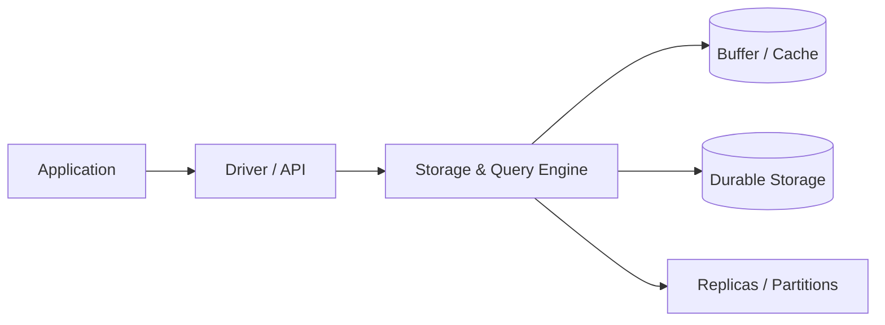

# Database Profile — MySQL

> **Level:** Intermediate → Expert  
> **Purpose:** selection and operational reference for MySQL within System Design.

## 1. Positioning

MySQL is chosen for a specific workload, not used as a universal answer. State the source-of-truth role, expected access paths, consistency contract, and failure model before selecting it.

## 2. Architecture and Working Model

**Caption:** durability, replication, and caching form separate layers with distinct failure behavior.

## 3. Production Use Cases

- Prefer MySQL when its data model matches the dominant query or key access path.
- Keep an authoritative invariant explicit and isolate derived uses.
- Load-test with the production statement mix, payload size, and isolation level.
- Plan backup/restore, failover, schema evolution, and capacity before launch.

## 4. Failure and Debugging

| Symptom | Likely layer | Evidence | Mitigation |
|---|---|---|---|
| Latency spike | lock/I/O/cache | query plan, waits, I/O | bound work, fix access path |
| Stale reads | replica lag | replication/LSN lag | route or read primary |
| Throughput plateau | resource limit | CPU, connections, queue | partition or scale constrained unit |
| Write failures | durability/consistency | quorum, disk, conflicts | preserve safety, repair later |

## 5. Trade-Offs

- Choose this database only when its dominant access pattern and guarantees fit the workload.
- Compare it with one relational alternative and one specialized alternative using latency, scale, operations, and cost.
- Revisit the decision when access patterns, durability requirements, team maturity, or unit economics change.

## 6. Interview Preparation

### Beginner
Explain what MySQL is optimized for and name one limitation.

### Intermediate
Describe a production schema, index, and replication/partition strategy for one workload.

### Advanced
Discuss a failure that invalidates availability but not durability, and the recovery evidence you would require.

### Expert
Compare MySQL with two alternatives under workload, organization, cost, and failure assumptions; state the condition that changes the decision.

## 7. Counter Questions

- **“Why not use the database you know?”** — Because the dominant access pattern and scale target differ; demonstrate with a workload matrix rather than preference.
- **“Is it strongly consistent?”** — Name the operation, topology, acknowledgement, and read path; product labels are not guarantees.
- **“How do you migrate?”** — Dual-write/CDC, backfill, verification, cutover, rollback, and old-path retirement.

## 8. Design Exercise

- [ ] Define a workload and quantify reads, writes, state, and retention.
- [ ] Select MySQL only if its semantics and limits fit.
- [ ] Design indexes/keys, failure handling, monitoring, and migration.
- [ ] Compare with one relational and one specialized alternative.

## 9. Revision Card

- **Role:** source of truth or derived store?\ State it.
- **Access path:** the dominant query/key determines the design.
- **Guarantee:** operation-level consistency and durability.
- **Bottleneck:** disk, CPU, memory, connections, coordinator, or partition.
- **Recovery:** backup, replica, rebuild, and reconciliation evidence.
