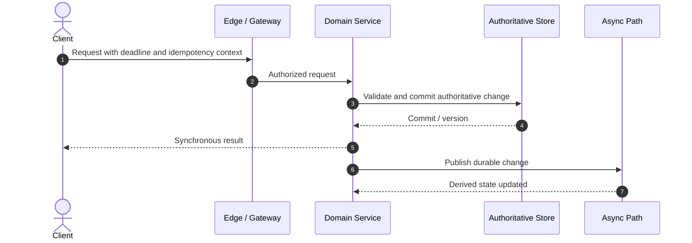
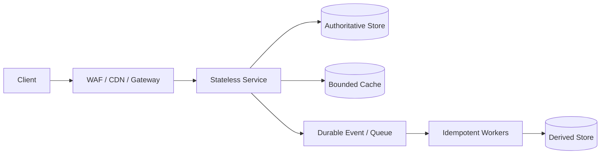

# 02 · Apache Kafka · Apache Kafka

> **Level:** Intermediate → Expert  
> **Interview Frequency:** ★★★★★  
> **Last Updated:** 2026

## 📋 Table of Contents
- [0. TL;DR](#0-tldr)
- [1. What and Why](#1-what-and-why)
- [2. Mental Model](#2-mental-model)
- [3. Theory: Beginner to Expert](#3-theory-beginner-to-expert)
- [4. Internal Working](#4-internal-working)
- [5. Production Architecture](#5-production-architecture)
- [6. Visual Learning](#6-visual-learning)
- [7. Worked Examples](#7-worked-examples)
- [8. Real-World Cases](#8-real-world-cases)
- [9. Failures and Debugging](#9-failures-and-debugging)
- [10. Scaling and Optimization](#10-scaling-and-optimization)
- [11. Security and Operations](#11-security-and-operations)
- [12. Trade-Offs](#12-trade-offs)
- [13. Interview Preparation](#13-interview-preparation)
- [14. Counter and Follow-Up Questions](#14-counter-and-follow-up-questions)
- [15. Production and Architecture Review](#15-production-and-architecture-review)
- [16. Hands-On Exercises](#16-hands-on-exercises)
- [17. Rapid-Fire Review](#17-rapid-fire-review)
- [18. Revision Card](#18-revision-card)

## 0. TL;DR

- Kafka is a partitioned, replicated commit log with consumer groups.
- Ordering exists only within a partition; key choice controls both locality and hot partitions.
- Producer idempotence and transactions help within a defined Kafka boundary; external databases remain outside it.

## 1. What and Why

Kafka supports high-throughput event transport, replayable streams, and independent consumer progress.

## 2. Mental Model

```text
PRODUCER → partition leader → replicated log → consumer group offset
         key → partition      each group owns its offsets
```

**Caption:** follow the data and the decision boundary; the diagram separates mechanism from product names.

## 3. Theory: Beginner to Expert

### 3.1 Beginner

Apache Kafka is a design concern, not a single component. Start by naming the invariant, the unit of work, and the resource being consumed. The correct beginner answer explains *why* the mechanism exists and which guarantee it provides.

### 3.2 Intermediate

Brokers, leaders, replicas, partitions, ISR, acks, batching, and consumer offsets define Kafka behavior. `acks=all` with a suitable minimum ISR strengthens durability. Producer retries can duplicate unless idempotence is enabled. Transactions can atomically write records and offsets to Kafka, but a classic database write needs outbox/CDC.

### 3.3 Advanced

At scale, the important questions change from “does it work?” to “which invariant survives delay, duplication, reordering, overload, and operator error?” State assumptions explicitly: failure detector time, topology, consistency model, retention, and geographic scope. An invariant that holds only in the happy path is not a production invariant.

### 3.4 Expert

Senior design distinguishes **safety** from **liveness** and **correctness** from **availability**. It also distinguishes a mechanism's advertised capability from a particular deployment's guarantee. Quantify the boundary: request rate, capacity per unit, queue depth, lag, recovery time, and the cost of redundancy. The expert answer explains when the design should be abandoned or evolved.

## 4. Internal Working



**Caption:** the synchronous path establishes the user-visible result; the asynchronous path maintains derived state and must not redefine the result retroactively.

### 4.1 Critical Decisions

1. **Boundary:** where validation, authorization, and transaction ownership live.
2. **Identity:** how retries and duplicates are recognized.
3. **Ordering:** what is ordered, by which key, and for how long.
4. **Backpressure:** how excess work is admitted, delayed, or rejected.
5. **Recovery:** what durable evidence permits automatic or operator-driven repair.

## 5. Production Architecture

Use schema evolution, partition keys with even distribution, bounded batches, lag alerts, and retention sized by replay needs. Keep consumer state idempotent. Avoid using Kafka as a synchronous request queue if immediate response is required.



**Caption:** every derived component must declare its rebuild path and tolerated staleness.

### 5.1 Production Checklist

- Define SLOs for availability, latency, durability, and freshness separately.
- Emit request count, error count, latency histogram, saturation, and dependency latency.
- Propagate trace context and a stable correlation identifier without leaking secrets.
- Bound timeouts, retries, queues, and batch sizes.
- Test failure of each dependency and the loss of a single availability zone.
- Document owner, runbook, rollback, and capacity review for every critical path.

## 6. Visual Learning

| View | What it reveals | Decision it supports |
|---|---|---|
| Architecture | Synchronous versus asynchronous ownership | Where to place queues and stores |
| Sequence | Exact ordering and possible duplicate work | Idempotency and transaction boundary |
| State diagram | Legal and illegal transitions | Recovery and compensation |
| Data-flow | Which side owns each fact | Consistency and deletion policy |

## 7. Worked Examples

### 7.1 Capacity arithmetic

Assume 20M user actions/day, a 5× peak factor, and 1 KiB per action.

- Average: `20,000,000 / 86,400 ≈ 231 requests/s`
- Peak: `231 × 5 ≈ 1,157 requests/s`
- Payload rate: `1,157 × 1,024 ≈ 1.18 MiB/s` (before protocol overhead)
- With 3 replicas, each stores roughly `20M × 1,024 × 3 ≈ 61 GiB` before indexes and checksums.

**Sanity check:** 1M actions/day is about 11.6/s, not 1,000/s. Always state whether the factor is global, regional, or per instance.

### 7.2 Failure walk-through

1. A dependency slows from 20 ms to 2 s.
2. Request threads wait and exhaust the service's concurrency budget.
3. Retries increase downstream calls from 10k/s to 30k/s.
4. The system sheds load only after the dependency is already overloaded.

**Prevention:** deadlines, bounded concurrency, jittered retry budgets, circuit breakers, and backpressure. A timeout without a caller-side deadline is only a lower bound, not a total-time guarantee.

### 7.3 Small-scale proof

Use a deterministic load of 100 RPS with 10 ms dependency latency. Record p50/p95/p99, error rate, queue depth, and recovery time after a 60-second induced failure. A design is not validated by average latency alone; the tail and recovery behavior matter.

## 8. Real-World Cases

- **E-commerce:** checkout uses a saga because cart, inventory, payment, and order have separate owners. The payment pivot changes compensation into retry-to-completion.
- **Banking:** a ledger favors immutable entries and reconciliation over a “last balance wins” row update.
- **Social feed:** a follower timeline can be pull-based for celebrities and push-based for ordinary authors; one algorithm cannot suit both cardinalities.
- **Streaming:** object storage and a CDN absorb video bytes; the control plane manages encoding and entitlement rather than carrying media.

These are patterns, not claims that every named company implements the same internals.

## 9. Failures and Debugging

### Partition hotspot
A celebrity or tenant key sends all traffic to one partition. Add a suffix/bucket key and merge downstream, or create a dedicated path. Monitor per-partition bytes and producer latency.

### 9.1 Debugging method

1. Establish user impact and the affected cohort.
2. Compare error rate and latency by region, tenant, version, and dependency.
3. Find the first changed signal in the timeline.
4. Form a falsifiable hypothesis and inspect the narrowest relevant trace/log sample.
5. Mitigate user impact before proving the root cause.
6. Preserve evidence, fix the cause, and add a regression test.

## 10. Scaling and Optimization

- **Partition first:** distribute by a stable key that matches the dominant access path.
- **Cache selectively:** cache expensive repeatable reads, not correctness-sensitive state by default.
- **Batch carefully:** batching improves throughput but increases latency and partial-failure windows.
- **Bound concurrency:** more threads or consumers do not create downstream capacity.
- **Reduce cardinality:** high-cardinality labels can destroy a metrics backend.
- **Prefer measured bottlenecks:** profile CPU, allocation, GC, I/O, locks, network, and database waits.

### 10.1 Optimization order

1. Remove accidental N+1 work and over-fetching.
2. Add the correct index or narrow the access path.
3. Introduce a bounded cache where staleness is acceptable.
4. Replicate reads if the write path and consistency permit.
5. Partition writes using a key with predictable distribution.
6. Move slow work asynchronously only if intermediate truth is represented correctly.

## 11. Security and Operations

- Authenticate the caller, authorize the object and action, and validate the payload independently.
- Enforce tenant scope in every query and cache key; never rely on a client-provided tenant alone.
- Encrypt transport and sensitive data at rest; separate data-encryption keys from application secrets.
- Rate-limit by authenticated principal and sensitive operation, not IP alone.
- Redact tokens, passwords, payment data, and personal data from logs and traces.
- Keep administrative paths separately authenticated, authorized, and audited.

## 12. Trade-Offs

['- [ ] Size partitions from throughput and retention.\n- [ ] Design key-based ordering with skew handling.\n- [ ] Compare idempotent producer and transactional boundaries.', '| Setting/choice | Benefit | Cost/risk |\n|---|---|---|\n| More partitions | Parallelism | More overhead, key constraints |\n| `acks=all` | Stronger broker durability | Latency/availability dependency |\n| Idempotent producer | Suppresses retry duplicates | Producer config support |\n| Long retention | Replay | Storage cost |']

## 13. Interview Preparation

### Beginner

#

### Intermediate

#

### Advanced / Senior

#

### FAANG / Expert

 

## 14. Counter and Follow-Up Questions

### “Why not the simpler alternative?”

- **Naive answer:** “Because the advanced design scales better.”
- **Trap:** Scalability without a bottleneck calculation is an assertion.
- **Expert answer:** Quantify both designs, identify the shared limiting resource, and pay only the operational complexity required before that limit is credible.

### “What if the network partitions?”

- **Naive answer:** “Retry until it heals.”
- **Trap:** Unbounded retry amplifies the outage.
- **Expert answer:** State the consistency choice, detection time, bounded retry budget, idempotency rule, and operator-visible reconciliation state.

### “Could you make it eventually consistent?”

- **Naive answer:** “Yes, that improves availability.”
- **Trap:** It may violate money, inventory, or authorization invariants.
- **Expert answer:** Name the invariant, maximum staleness, read-your-writes rule, conflict policy, and user-visible intermediate state before accepting eventual consistency.

### “What does exactly once mean?”

- **Naive answer:** “Messages are delivered exactly once.”
- **Trap:** Delivery and business effect are different boundaries.
- **Expert answer:** State the exact boundary and prove how duplicate or lost retries affect the business effect.

### “How would you know it failed?”

- **Naive answer:** “Look at CPU and logs.”
- **Trap:** Those signals may remain normal during a correctness failure.
- **Expert answer:** Combine user-success SLIs, dependency saturation, queue lag, consistency violations, and trace-based causal evidence.

## 15. Production and Architecture Review

### Incident discussion

A deployment causes 8% of writes to return success while an asynchronous projection is missing. Explain detection, mitigation, data repair, and prevention. A strong answer protects the authoritative write path, repairs derived data by replay, and adds an outbox/reconciliation check rather than disabling every consumer.

### Architecture review

Review a design that adds a cache in front of the authoritative database. Ask about hit ratio, key cardinality, invalidation, stampedes, negative caching, stale reads, and behavior during cache failure. The cache should reduce load without becoming an undocumented consistency boundary.

## 16. Hands-On Exercises

['Why does Kafka preserve order only per partition?', 'What does `acks=all` guarantee?', 'Can Kafka make DB and message atomic?', 'How do you handle schema evolution?']

## 17. Rapid-Fire Review

1. What invariant does the mechanism protect?
2. What is the smallest unit of ordering or ownership?
3. What happens on duplicate, delayed, and reordered work?
4. Which resource is measured first?
5. What is the maximum tolerable staleness?
6. Which alternative was rejected and why?
7. What signal detects failure?
8. How is recovery proven safe?

## 18. Revision Card

- **Invariant:** Apache Kafka preserves the business fact that defines this chapter.
- **Decision:** choose the boundary and guarantee before choosing the product.
- **Scale:** quantify throughput, state, latency, and skew.
- **Failure:** duplicate, delay, reorder, overload, and dependency loss are first-class.
- **Proof:** test the invariant and the recovery path, not only the happy path.

---
**Related:** [Section Index](../README.md) · **Standard:** [STANDARD.md](../STANDARD.md)
