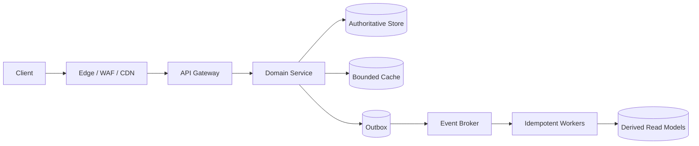
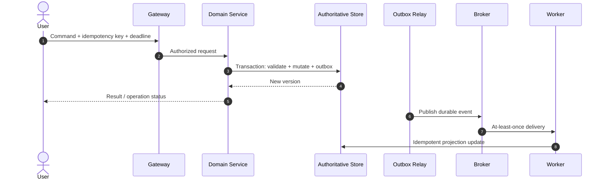

# 11 · Zoom Video Conferencing

> **Domain:** Real-time conferencing  
> **Difficulty:** Advanced system design  
> **Dominant difficulty:** Regional media sessions, signaling, and connection state dominate.  
> **Reference architecture:** yes; not a claim about proprietary internals

## 📋 Table of Contents
- [1. Framing and Assumptions](#1-framing-and-assumptions)
- [2. Requirements](#2-requirements)
- [3. Capacity Estimate](#3-capacity-estimate)
- [4. API and Error Semantics](#4-api-and-error-semantics)
- [5. Data Model and Ownership](#5-data-model-and-ownership)
- [6. Component Architecture](#6-component-architecture)
- [7. Critical Sequence](#7-critical-sequence)
- [8. Consistency and Paths](#8-consistency-and-paths)
- [9. Scaling and Hotspots](#9-scaling-and-hotspots)
- [10. Failures and Recovery](#10-failures-and-recovery)
- [11. Security and Abuse Controls](#11-security-and-abuse-controls)
- [12. Observability and Operations](#12-observability-and-operations)
- [13. Trade-Offs](#13-trade-offs)
- [14. Staged Improvements](#14-staged-improvements)
- [15. Debugging and Failure Diagnosis](#15-debugging-and-failure-diagnosis)
- [16. Hands-On Exercises](#16-hands-on-exercises)
- [17. Interview Questions](#17-interview-questions)
- [18. Revision Card](#18-revision-card)

## 1. Framing and Assumptions

**Invariant:** Regional media sessions, signaling, and connection state dominate..

Schedule, join, audio/video, screen share, chat, recording, participant controls.

### Non-functional requirements

300M DAU, 100M concurrent meetings, 20M concurrent media streams, p95 join < 5 s, 99.9% session establishment.

**Out of scope for the first design:** global multi-region active-active writes, custom cryptography, recommendation-model training, and manual back-office features. These become explicit follow-up questions rather than hidden complexity.

## 2. Requirements

### Functional

Schedule, join, audio/video, screen share, chat, recording, participant controls.

### Operational qualities

300M DAU, 100M concurrent meetings, 20M concurrent media streams, p95 join < 5 s, 99.9% session establishment.

### Clarifying questions

1. What is the exact write/read ratio, peak factor, and growth horizon?
2. Which user-visible action must remain strongly consistent?
3. Which derived experiences may lag, and for how long?
4. What are the tenancy, geography, retention, and audit constraints?
5. What is the acceptable RTO/RPO and cost of an outage?

## 3. Capacity Estimate

100M concurrent meetings imply at least 100M signaling sockets; media bandwidth at 1 Mbps video is 12.5 MB/s per 100k streams, before audio and overhead.

```text
Average request rate = daily operations / 86,400
Peak rate = average × stated peak factor
Concurrent requests ≈ peak RPS × average request latency
Bandwidth = RPS × average response bytes
State = retained items × bytes/item × replication/index factor
```

**Caption:** every factor must be tied to an assumption; “millions of users” is not a capacity estimate.

**Sensitivity:** a 10× traffic increase changes cache/origin load linearly, but may change partition count, hot-key behavior, and queue lag nonlinearly. The design should re-estimate at 10× and during failover.

## 4. API and Error Semantics

POST /meetings; POST /meetings/{id}/join; WebSocket signaling; POST /recordings; POST /media/session.

### Common error contract

```json
{{"code":"DOMAIN_CONFLICT","message":"safe summary","correlationId":"...","retryable":false}}
```

- `400` malformed input; `401` no valid identity; `403` insufficient permission.
- `404` resource absent; `409` state/invariant conflict; `429` quota exceeded.
- `503` dependency/unavailable budget exhausted; include `Retry-After` when known.
- Mutation requests accept an idempotency key; the result is retained for the domain’s retry window.

## 5. Data Model and Ownership

Meeting service owns schedule/participants; signaling service owns ephemeral state; media service owns session allocation; recording owns artifacts.

```mermaid
erDiagram
    CLIENT ||--o{{ RESOURCE : owns
    RESOURCE ||--o{{ EVENT : emits
    EVENT ||--o{{ PROJECTION : materializes
    CLIENT {
      string id PK
      string tenant_id
    }
    RESOURCE {
      string id PK
      string owner_id FK
      int version
    }
    EVENT {
      string id PK
      int sequence
      string type
    }
    PROJECTION {
      string key PK
      int version
    }
```

**Caption:** the authoritative record, immutable event, and rebuildable projection have different owners and recovery paths.

## 6. Component Architecture

Regional control plane → media nodes/SFU/TURN → TURN fallback; signaling broker; recording stream → object storage.



**Caption:** the request path owns correctness; derived stores improve latency or scale but have replay procedures.

## 7. Critical Sequence

Join authorizes user, reserves media capacity/region, establishes signaling and media token, media node negotiates; chat/control messages flow through regional signaling.



**Caption:** acknowledgment occurs after the authoritative commit; asynchronous work can repeat and therefore carries stable identity.

## 8. Consistency and Paths

Participant entitlement is authoritative. Live media is real-time and lossy under congestion; signaling can retry with sequence numbers. Recording becomes visible only after completion.

| Path | Freshness/guarantee | Degraded behavior |
|---|---|---|
| Primary write/read | Authoritative and immediately visible | Fail closed for protected mutation |
| Cached read | Explicit bounded staleness | Serve only allowed stale subset |
| Derived projection | Eventual, versioned | Show pending/retry state |
| Search/feed | Secondary index with freshness label | Fall back to source summary |

## 9. Scaling and Hotspots

Allocate media regionally near participants; SFU forwards selective streams while TURN relays when direct paths fail. Scale media on active ports/bandwidth, not CPU. Use session admission limits.

### Capacity protections

- Bound request body, page, batch, queue, and retry sizes.
- Partition by the dominant stable key; detect p95/p99 per-partition load.
- Use per-key single-flight and request coalescing for hot reads.
- Keep asynchronous lag and oldest-event age as leading indicators.
- Scale workers only while downstream capacity remains.

## 10. Failures and Recovery

Media node loss: reconnect clients to a replacement within session grace. Signaling partition: media may continue but control pauses. Duplicate join: stable participant/session ID. Recording loss: mark incomplete and allow retry.

### Failure drill

1. Remove one availability zone and the primary database from the test environment.
2. Measure user success, error-budget burn, and queue lag during 15 minutes.
3. Execute the runbook: protect writes, shed optional reads, scale/fail over, drain backlog.
4. Reconcile authoritative state to derived state and prove invariants.
5. Record time to mitigate, time to recover, and data-loss window.

## 11. Security and Abuse Controls

Meeting token, waiting-room authorization, passcode, recording consent, encrypted media, mute/kick audit, abuse and recording retention.

- Authenticate at the edge, authorize the resource/tenant at the owner.
- Validate size, content type, encoding, and pagination bounds.
- Use workload identity, secret manager access, encryption, and key rotation.
- Rate-limit by principal, tenant, route cost, and sensitive operation.
- Audit administrative changes and security decisions without sensitive payloads.
- Threat-model enumeration, replay, injection, object reference abuse, and dependency exhaustion.

## 12. Observability and Operations

Join success 99.9%; p95 join < 5 s; media interruption < 0.1% sessions; signaling lag p95 < 500 ms; recording durability 99.9%.

### Runbooks

- Protect critical path / shed optional enrichment.
- Database saturation and connection-pool exhaustion.
- Queue/partition lag and poison-event quarantine.
- Cache stampede or origin fallback overload.
- Partial deployment/configuration rollback.

## 13. Trade-Offs

Regional media beats one global SFU for latency and failure isolation. SFU beats mesh for bandwidth. Signaling over WebSocket beats polling. Asynchronous recording beats recording in request path.

| Decision | Chosen because | Cost accepted | Change condition |
|---|---|---|---|
| Synchronous core write | Invariant must complete before acknowledgment | Dependency coupling | Explicit pending model becomes viable |
| Derived asynchronous state | Reads outnumber writes / shapes vary | Bounded staleness | Freshness requirement changes |
| Partitioned data | Single-node limit credible | Routing/rebalance complexity | Measured limit remains distant |

## 14. Staged Improvements

['Add adaptive codec and simulcast.', 'Regional active-active control plane.', 'AI summaries/recording search.']

1. **Stage 1 — correctness:** establish authoritative state, invariant, idempotency, and audit.
2. **Stage 2 — scale:** add cache/read replicas, partition the first measured hotspot.
3. **Stage 3 — resilience:** multi-AZ, automated failover, chaos/game-day evidence.
4. **Stage 4 — global/optimized:** add multi-region only against measured RTO/RPO and residency needs.
5. **Stage 5 — advanced:** streaming, predictive scaling, or personalization with correctness guards.

## 15. Debugging and Failure Diagnosis

### Diagnostic drill

Start from the user-facing symptom and narrow by scope before changing infrastructure:

1. Confirm the affected operation, cohort, region, and time window from the request/error SLI.
2. Compare success rate, latency, saturation, and dependency timing by version, tenant, shard, and route.
3. Correlate the first bad deployment/config/event with traces and dependency spans; do not assume the newest release is causal.
4. Check the authoritative invariant separately from derived lag, cache freshness, and queue age.
5. Mitigate user impact first: shed optional work, route around a failed dependency, or roll back a proven bad change.
6. Preserve evidence, reconcile authoritative and derived state, then add a regression test and a targeted alert.

**Debug evidence table**

| Signal | Question it answers | Example interpretation |
|---|---|---|
| User success SLI | Are users actually failing? | Checkout errors rose globally |
| Per-route latency | Where is time spent? | DB span dominates p99 |
| Dependency saturation | Is the downstream constrained? | Connection pool at 100% |
| Queue/partition age | Is async work delayed? | Oldest event exceeds 5 minutes |
| Cache freshness/hit ratio | Is the read path diverging? | Hit ratio collapsed after deploy |
| Trace sample | Which dependency/operation failed? | Payment timeout followed by retry |
| Reconciliation | Can state be repaired safely? | Projection missing 12 events |

### Counterfactual recovery test

Ask: “If this dependency stays unavailable for 15 more minutes, what invariant remains protected, what user capability disappears, and how much backlog accumulates?” A good design has a named degradation, bounded resource growth, and an executable recovery—not merely an alert.

## 16. Hands-On Exercises

1. **Capacity worksheet:** Recalculate every rate, storage, bandwidth, and concurrency value with units; change one assumption and explain which component becomes the first bottleneck.
2. **Failure game day:** Inject the primary dependency delay, one availability-zone loss, and a ten-minute queue delay. Record user impact, protected invariant, mitigation, recovery time, and repair evidence.
3. **Invariant proof:** Write a concurrency or duplicate-delivery test for the defining business action. Demonstrate that the test fails before the chosen mechanism and passes afterward.
4. **Cost review:** Estimate monthly request, storage, egress, observability, and failover cost. Identify the largest cost uncertainty and the cheapest experiment to reduce it.
5. **Design review:** Redraw the design in ten minutes, then have a peer challenge the truth owner, partition key, consistency claim, retry budget, and failure recovery. Update the design with evidence.

## 17. Interview Questions

### Beginner

How does an SFU differ from a mesh?

### Intermediate

How handle network change?

### Advanced / Senior

Where is media state stored?

### FAANG / Expert

Why not global media nodes?

### Counter and follow-up prompts

- **“Why not use the simplest design?”** — Compare cost at the measured bottleneck, then name the operational condition that reverses the choice.
- **“What if this dependency partitions?”** — Name the invariant, detection time, retry budget, stale-data rule, and repair path.
- **“Where can this design lose data?”** — Bound the loss window by acknowledging only after durable commit.
- **“How do you know recovery worked?”** — Check invariants and reconciliation, not only green infrastructure.

## 18. Revision Card

- **Invariant:** Regional media sessions, signaling, and connection state dominate..
- **Truth/derived:** Meeting service owns schedule/participants; signaling service owns ephemeral state; media service owns session allocation; recording owns artifacts.
- **First bottleneck:** Allocate media regionally near participants; SFU forwards selective streams while TURN relays when direct paths fail. Scale media on active ports/bandwidth, not CPU. Use session admission limits.
- **Critical failure:** Media node loss: reconnect clients to a replacement within session grace. Signaling partition: media may continue but control pauses. Duplicate join: stable participant/session ID. Recording loss: mark incomplete and allow retry.
- **Key trade-off:** Regional media beats one global SFU for latency and failure isolation. SFU beats mesh for bandwidth. Signaling over WebSocket beats polling. Asynchronous recording beats recording in request path.

**Related:** [Case Index](./README.md) · **Curriculum:** [System Design](../README.md)
