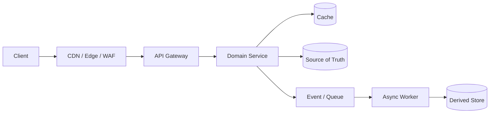

# 11 — Complete High-Level Design Case Studies

> Twenty end-to-end design discussions for Java backend, product-company, FAANG, and senior architecture interviews.

Each case follows the same repeatable structure: requirements → estimate → API → data → architecture → sequence → scale → bottlenecks → failures → trade-offs → production operation → interview prompts. The designs are **reference architectures**, not claims about proprietary internals.

## Case Index

| # | System | Dominant difficulty | Defining decision |
|---|---|---|---|
| 01 | [URL Shortener](./01-URL-Shortener.md) | Key generation and redirect read scale | Pre-generated keys + cache redirects |
| 02 | [WhatsApp](./02-WhatsApp.md) | Concurrent connections and message ordering | Partitioned conversation log + WebSocket fan-out |
| 03 | [Netflix](./03-Netflix.md) | Video delivery and personalization | CDN + streaming encoding pipeline |
| 04 | [YouTube](./04-YouTube.md) | Upload/transcode and feed fan-out | Asynchronous media pipeline + hybrid feed |
| 05 | [Uber](./05-Uber.md) | Matching supply/demand and location | Geo-partitioning + dispatch matching |
| 06 | [Instagram](./06-Instagram.md) | Media storage and social fan-out | Object storage + hybrid follower feed |
| 07 | [Twitter/X](./07-Twitter-X.md) | Celebrity spikes and timeline merge | Fan-out-on-read vs fan-out-on-write choice |
| 08 | [Facebook Feed](./08-Facebook-Feed.md) | Ranking and feed freshness | Pull-based hybrid feed + ranking service |
| 09 | [Google Drive](./09-Google-Drive.md) | File metadata and collaborative access | Sharded metadata + object storage + delta sync |
| 10 | [Dropbox](./10-Dropbox.md) | Sync conflicts and deduplication | Content-addressed chunks + file index |
| 11 | [Zoom](./11-Zoom.md) | Stateful media sessions and region routing | Regional session control + media servers |
| 12 | [Food Delivery](./12-Food-Delivery-System.md) | Matching, ETAs, and order state | Dispatch state machine + location stream |
| 13 | [E-Commerce](./13-E-Commerce-Platform.md) | Checkout across ownership boundaries | Saga + transactional outbox |
| 14 | [Payment Gateway](./14-Payment-Gateway.md) | Money correctness under retries | Double-entry ledger + idempotency |
| 15 | [Ride Sharing](./15-Ride-Sharing-Platform.md) | Real-time matching and surge pricing | Geospatial cells + optimistic matching |
| 16 | [Hotel Booking](./16-Hotel-Booking-System.md) | Overselling under contention | Inventory reservation + expiry |
| 17 | [Banking](./17-Banking-System.md) | Ledger correctness and audit | Immutable double-entry ledger |
| 18 | [Notification Service](./18-Notification-Service.md) | Multi-channel delivery and fan-out | Durable preference-aware dispatcher |
| 19 | [Distributed Rate Limiter](./19-Distributed-Rate-Limiter.md) | Global policy at high throughput | Partitioned token buckets + Redis coordination |
| 20 | [Chat System](./20-Chat-System.md) | Presence, ordering, and offline delivery | Ordered per-conversation log + durable inbox |

## How to Use a Case

1. Read only the requirements, then design for 10 minutes without the solution.
2. Draw the architecture and state the first bottleneck.
3. Compare your choices with the case's **defining decision**.
4. Read the failures and deliberately extend the design for each one.
5. Answer the interview prompts aloud in 45 minutes.

## Universal Design Skeleton

**Caption:** the same skeleton appears in every case, but the dominant bottleneck and the correct consistency boundary differ.

## Capacity Quick Formulas

| Quantity | Formula | Sanity check |
|---|---|---|
| Average RPS | daily actions ÷ 86,400 | 1M/day ≈ 12/s |
| Peak RPS | average RPS × peak factor | State factor and time window |
| Storage | objects/day × bytes/object × retention | Include replicas and index overhead |
| Bandwidth | RPS × bytes/response | Convert bits/bytes consistently |
| Connections | concurrent users × requests in flight × latency | Little's law: L = λW |
| Partitions | target throughput ÷ tested per-partition throughput | Leave headroom; avoid tiny partitions |
| Redis memory | live keys × average value + overhead | Include fragmentation and eviction headroom |

## Cross-Cutting Review

Every case is complete only when it answers:

- [ ] What is authoritative, and what is derived/rebuildable?
- [ ] What consistency is required for each read/write path?
- [ ] What is the first saturated resource?
- [ ] Which key/partition distributes load, and how is skew detected?
- [ ] What happens when the database, cache, queue, or identity provider fails?
- [ ] Which retries are safe, and how is amplification bounded?
- [ ] How are duplicate, missing, reordered, or poisoned messages handled?
- [ ] What signals detect failure, and what is the mitigation?
- [ ] Which controls stop enumeration, scraping, replay, and resource abuse?
- [ ] What did we give up compared with the rejected design?
