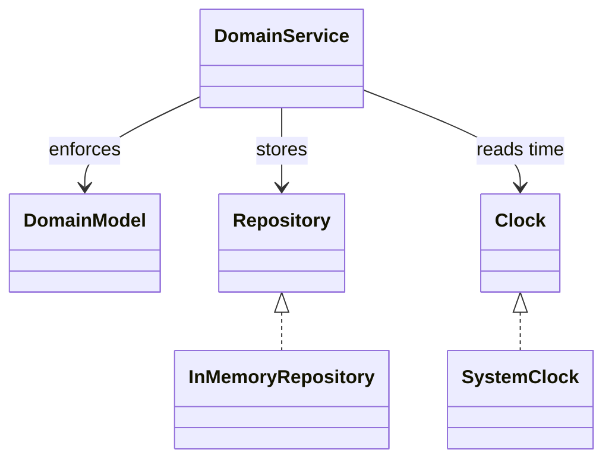
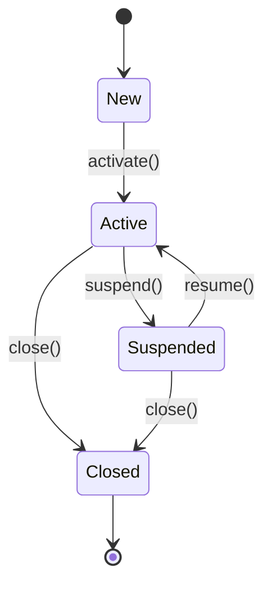
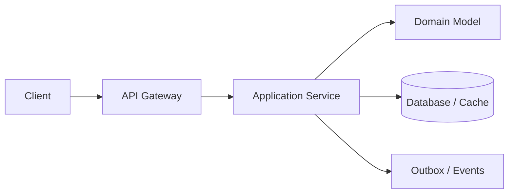

# 02 · UML and Modeling Techniques

> **Level:** Beginner → Advanced  
> **Invariant:** Every diagram must answer a named question and have a caption describing what to notice.  
> **Java target:** JDK 17

## 1. Requirements

Use UML selectively to communicate structure, state, sequence, and contracts without drawing implementation noise.

### Non-functional requirements

- Deterministic domain behavior and explicit error results.
- Bounded memory/time complexity stated for operations.
- Public behavior documented; concurrency guarantees are explicit.
- No framework, database, network, or clock dependency in the core model.

### Out of scope

Persistence, user-interface rendering, and distributed deployment are discussed only as LLD-to-HLD evolution.

## 2. Domain Model

Class, sequence, state, activity, and component diagrams have different audiences.



**Caption:** dependencies point toward domain abstractions; infrastructure implements ports so the model is testable.

### Responsibilities

| Type | Responsibility | Must not do |
|---|---|---|
| Application service | Orchestrate use case and transaction boundary | Put business rules in controllers |
| Domain model | Validate invariants and state transitions | Depend on framework/database |
| Repository port | Store/retrieve aggregate | Decide whether a command is valid |
| Clock port | Supply current instant | Hide clock calls in unrelated code |

## 3. State and Lifecycle

State diagrams expose illegal transitions; sequence diagrams expose ordering and timeouts.



**Caption:** terminal states reject further transitions; every transition is checked in the domain model rather than inferred by the caller.

## 4. Pattern Selection

Patterns are named in context, not used as decoration.

| Pattern | Why it fits here | Rejected alternative |
|---|---|---|
| Domain Model | Rules and lifecycle are nontrivial | Transaction Script for simple CRUD |
| Repository port | Storage is replaceable | Direct collection dependency |
| Strategy | Policy variants need runtime selection | Long conditional chain |
| State pattern | Transition rules vary by state | Scattered boolean flags |
| Factory/Builder | Construction needs validation | Constructor with many nullable fields |

## 5. Concurrency and Complexity

Document thread-safety and atomicity at operation boundaries.

### Complexity table

| Operation | Time | Space | Notes |
|---|---:|---:|---|
| Create | O(1) | O(1) | ID supplied/generated outside core |
| Lookup | O(1) average | O(1) | Hash index by identity |
| Update | O(1) average | O(1) | Domain validation before mutation |
| History/list | O(n) | O(n) returned | Bounded/paginated at application edge |

**Concurrency contract:** aggregate instances are not thread-safe unless the implementation explicitly says so. Repositories may synchronize their index. If concurrent commands target one aggregate, serialize by aggregate ID in the application service or use optimistic version checks.

## 6. Java 17 Implementation

The runnable source is under [`implementations/`](./implementations/). Public methods return values or typed domain exceptions; they do not print hidden side effects.

```java
// Representative style: validate first, mutate second, record third.
public Result execute(Command command) {
    Objects.requireNonNull(command, "command");
    DomainState before = state;
    requireAllowed(before, command);
    state = transition(before, command);
    return Result.success(before, state);
}
```

**Caption:** the transition is atomic with respect to the aggregate because validation happens before the state assignment.

## 7. LLD to HLD Evolution

Component diagrams become deployment views; sequence diagrams gain timeouts, retries, and async acknowledgments.



**Caption:** the same domain model can remain inside a service while its repository, clock, and event ports become distributed adapters.

## 8. Common Mistakes

A class diagram with 100 classes and no boundary; arrows that mean “uses” ambiguously; hiding data flow; diagrams that contradict code.

- Returning a mutable internal collection without defensive copying.
- Letting null bypass validation or create ambiguous “not found” behavior.
- Performing I/O inside a domain invariant.
- Retrying a non-idempotent command without a stable request identity.
- Using `double` for money or timestamps without an explicit representation contract.
- Assuming collection iteration order is a business guarantee.

## 9. Interview Preparation

### Beginner

Which diagram would you show to explain a timeout?

### Intermediate

How do you show idempotency?

### Advanced / Senior

Why include a legend?

### Expert / Follow-up

How do you keep a diagram current?

### Counter questions

- **“Why not getters/setters?”** — Setters permit invalid states; commands express allowed transitions.
- **“Why not a shared database singleton?”** — It couples lifecycle, concurrency, and test isolation.
- **“How would this scale?”** — First preserve aggregate invariants; only then partition storage and distribute coordination.

## 10. Hands-On Exercises

['- [ ] Draw class and state diagrams for one system.\n- [ ] Add sequence alternative for dependency failure.\n- [ ] Review diagram against tests.']

## 11. Revision Card

- **Invariant:** Every diagram must answer a named question and have a caption describing what to notice..
- **Core:** Class, sequence, state, activity, and component diagrams have different audiences.
- **State:** State diagrams expose illegal transitions; sequence diagrams expose ordering and timeouts.
- **Concurrency:** Document thread-safety and atomicity at operation boundaries.
- **Evolution:** Component diagrams become deployment views; sequence diagrams gain timeouts, retries, and async acknowledgments.

**Related:** [LLD Index](./README.md) · **Case Studies](../11-HLD-Case-Studies/README.md)
