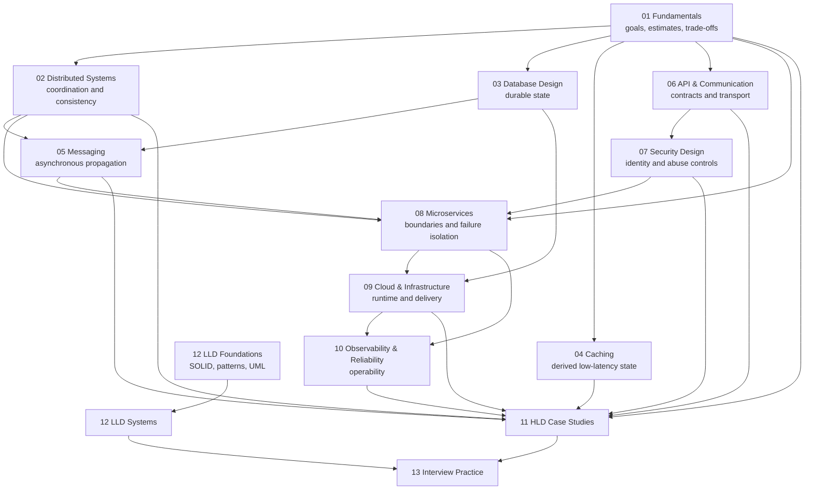

# Curriculum Map

> The curriculum is organized as a dependency graph, not a list of fashionable technologies. Learn the invariant before the implementation.

## Dependency Graph

**Caption:** fundamentals feed every area; HLD and LLD are application tracks, not isolated theory.

## Section Outcomes

### 01 — System Design Fundamentals

Turn an ambiguous prompt into explicit requirements and constraints; estimate traffic, storage, bandwidth, and connections; identify the first bottleneck; and explain horizontal versus vertical scaling, consistency, partitioning, reliability, and availability without treating them as interchangeable.

### 02 — Distributed Systems

Reason about delayed, duplicated, reordered, or lost messages; explain CAP/PACELC correctly; compare consensus and quorum protocols; distinguish safety from liveness; and choose a consistency and coordination mechanism.

### 03 — Database Design

Select SQL versus NoSQL from workload evidence; model ownership and access paths; reason about indexes, isolation, replication, partitioning, sharding, archival, and pooling; and compare PostgreSQL, MySQL, MongoDB, Cassandra, DynamoDB, Elasticsearch, and Redis honestly.

### 04 — Caching

Select cache-aside, write-through, write-back, or read-through; specify freshness semantics; handle eviction, invalidation, stampedes, hot keys, and warming; and operate a distributed cache without treating it as a second source of truth.

### 05 — Messaging and Event-Driven Systems

Choose between a queue and event log using routing, retention, ordering, and throughput needs; design retry/DLQ/idempotency behavior; explain event sourcing and CQRS; and state what “at least once” and “exactly once” mean at a given boundary.

### 06 — API and Communication Design

Select REST, GraphQL, gRPC, WebSockets, or SSE based on interaction and operational requirements; design gateways, proxies, load balancing, discovery, rate limiting, and circuit breakers; and understand latency and failure implications.

### 07 — Security Design

Distinguish authentication from authorization; explain JWT, OAuth 2.0, OpenID Connect, and SSO by role and flow; threat-model an API; protect keys and data; and design layered abuse controls rather than treating rate limiting as DDoS defense.

### 08 — Microservices Architecture

Define service boundaries from business capabilities and data ownership; plan monolith migration; design discovery, configuration, tracing, service mesh, saga, outbox, and resilience mechanisms; and explain their operational costs.

### 09 — Cloud and Infrastructure Design

Map application components to AWS, Azure, or GCP services; design containers and Kubernetes deployments; choose CI/CD and release strategies; and explain autoscaling, multi-region trade-offs, cost, and failure domains.

### 10 — Observability and Reliability Engineering

Design signals from user outcome inward; distinguish SLI, SLO, and SLA; create actionable alerts; run an incident; and plan disaster recovery with realistic RTO/RPO assumptions.

### 11 — HLD Case Studies

Conduct a 45-minute design across 20 product domains, with explicit assumptions, capacity, API, data, architecture, sequence, bottlenecks, failure recovery, and trade-offs.

### 12 — LLD Preparation

Translate requirements into classes, interfaces, state transitions, and testable behavior; apply SOLID and patterns deliberately; implement concurrent domain models; and recognize when an LLD abstraction becomes an HLD service boundary.

## Recommended Dependency Order

| Order | Material | Reason |
|---|---|---|
| 1 | 01 fundamentals | Establishes the method and vocabulary |
| 2 | 03 database + 04 caching | Durable and derived state shape most designs |
| 3 | 02 distributed systems | Explains why coordination fails |
| 4 | 05 messaging + 06 APIs | Adds asynchronous and external boundaries |
| 5 | 07 security | Becomes part of every request and data path |
| 6 | 08 microservices + 09 cloud | Places logic into an operable runtime |
| 7 | 10 observability | Makes the runtime diagnosable |
| 8 | 11 HLD cases | Integrates all prior tracks |
| 9 | 12 LLD | Deepens modeling and implementation; may run in parallel after SOLID/patterns |
| 10 | 13 practice | Converts knowledge into timed performance |

## Technology Selection Map

| If the requirement is… | Start with… | Then evaluate… |
|---|---|---|
| Relational joins, transactions, flexible query | PostgreSQL/MySQL | Read replicas, partitioning, archive tier |
| Known access paths and high write volume | Cassandra/DynamoDB | Partition key, quorum, hot partition |
| Flexible documents and aggregate reads | MongoDB | Write concern, replica set, indexing |
| Full-text and relevance search | Elasticsearch | Index freshness, shard sizing, source of truth |
| Sub-millisecond derived state | Redis | Eviction, persistence, stampede, topology |
| Durable high-throughput event history | Kafka | Partitions, retention, consumer lag, schema |
| Selective work distribution and flexible routing | RabbitMQ/SQS | Acknowledgement, visibility timeout, DLQ |
| Public resource-oriented API | REST | Pagination, idempotency, versioning |
| Client-shaped aggregate API | GraphQL | Resolver cost, N+1, complexity limits |
| Internal low-latency typed RPC | gRPC | Deadlines, retries, schema compatibility |
| Server-to-client live updates | WebSockets/SSE | Connection scale, ordering, reconnect |

## Completion Criteria

A topic is mastered only when you can:

1. Explain its invariant and mechanism in two minutes.
2. Draw its request and failure paths.
3. Quantify a realistic workload.
4. Diagnose a plausible incident with named signals.
5. Compare it with two alternatives.
6. Answer beginner, senior, and expert questions without hiding behind a product name.
