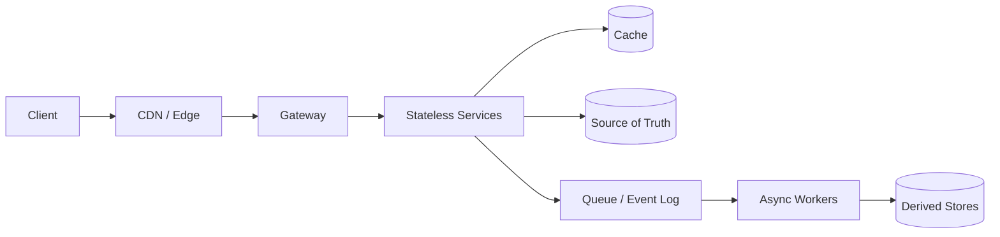

# System Design Interview Preparation Hub

> A production-grade curriculum for **Java backend, software, senior, and staff-level interviews**—from first principles to multi-region architecture, failure analysis, and leadership trade-offs.

This is the canonical System Design hub in this repository. It teaches the reasoning behind a design: how to gather requirements, estimate scale, select data, control failure, verify behavior, and defend trade-offs. Product and framework notes are links, not substitutes for architectural understanding.

## Start Here

| Your goal | Start with | Outcome |
|---|---|---|
| First system-design interview | [Curriculum](CURRICULUM.md) → [Learning Paths](LEARNING-PATHS.md) | A repeatable 45-minute method |
| Java backend in 8–12 weeks | [Java Backend Path](LEARNING-PATHS.md#path-b--java-backend-engineer-812-weeks) | Architecture plus Spring production mapping |
| Senior / staff interview | [Senior Path](LEARNING-PATHS.md#path-c--senior-staff-and-architecture-1014-weeks) | Multi-region, failure, and org trade-offs |
| FAANG / product company | [HLD Case Studies](11-HLD-Case-Studies/README.md) | 20 complete design discussions |
| LLD interview | [LLD Preparation](12-LLD-Preparation/README.md) | 8 modeled systems with Java 17 code |
| Last-minute review | [Quick Reference](QUICK-REFERENCE.md) | High-density formulas, tables, and traps |
| Know where you are weak | [Interview Checklist](INTERVIEW-CHECKLIST.md) | Leveled self-assessment |

## The Thirteen Curriculum Areas

| # | Area | What You Learn | Files |
|---|---|---|---|
| 01 | [System Design Fundamentals](01-System-Design-Fundamentals/README.md) | Scalability, availability, reliability, performance, capacity, consistency, partitioning, trade-offs | 6 chapters |
| 02 | [Distributed Systems](02-Distributed-Systems/README.md) | CAP/PACELC, transactions, consensus, quorum, partitions, clocks, locks | 7 chapters |
| 03 | [Database Design](03-Database-Design/README.md) | SQL/NoSQL, schemas, indexes, replication, sharding, transactions, comparisons | 13 chapters |
| 04 | [Caching](04-Caching/README.md) | Redis, patterns, eviction, invalidation, stampedes, hot keys, warming | 5 chapters |
| 05 | [Messaging & Event-Driven Systems](05-Messaging-and-Event-Driven-Systems/README.md) | Kafka, RabbitMQ, ActiveMQ, SQS, pub/sub, event sourcing, CQRS | 6 chapters |
| 06 | [API & Communication Design](06-API-and-Communication-Design/README.md) | REST, GraphQL, gRPC, WebSockets, SSE, gateway, balancing, discovery | 7 chapters |
| 07 | [Security Design](07-Security-Design/README.md) | AuthN/AuthZ, JWT, OAuth2, OIDC, SSO, API/DDoS security, secrets, encryption | 5 chapters |
| 08 | [Microservices Architecture](08-Microservices-Architecture/README.md) | Boundaries, discovery, config, tracing, mesh, saga, outbox, resilience | 6 chapters |
| 09 | [Cloud & Infrastructure Design](09-Cloud-and-Infrastructure-Design/README.md) | AWS, Azure, GCP, Docker, Kubernetes, CI/CD, releases, autoscaling | 6 chapters |
| 10 | [Observability & Reliability Engineering](10-Observability-and-Reliability-Engineering/README.md) | Monitoring, logs, metrics, traces, SLOs, SRE, incidents, DR | 5 chapters |
| 11 | [Complete HLD Case Studies](11-HLD-Case-Studies/README.md) | 20 end-to-end designs from URL shortener to banking | 20 cases |
| 12 | [Complete LLD Preparation](12-LLD-Preparation/README.md) | SOLID, patterns, UML, and 8 complete Java systems | 10 chapters + code |

## The 45-Minute Interview Loop

```text
Requirements (5m) → Estimate (3m) → API (4m) → Data (5m)
→ Architecture (10m) → Deep Dive (12m) → Failures (4m) → Trade-offs (2m)
```

**The invariant:** name the resource that saturates first, then explain how the design relieves it.



**Caption:** synchronous reads/writes use the source of truth; asynchronous work updates rebuildable derived stores.

## How to Study

1. Read the relevant theory chapter before looking at a case study.
2. Reproduce the estimate on paper—units and assumptions matter more than exact answers.
3. Draw the request path and ask what happens when every dependency fails.
4. Answer the interview questions aloud in 60–120 seconds.
5. Complete exercises, then revisit the same design at the next seniority level.
6. Use the [checklist](INTERVIEW-CHECKLIST.md) to record evidence, not merely “read.”

## Production-Grading Principles

- A design is incomplete without a **failure model**.
- A number without a unit or assumption is decoration.
- “Eventually consistent” is not an answer until staleness bounds and read-your-writes behavior are defined.
- “Exactly once” is not an answer until its boundary is stated.
- “Use Kafka/RabbitMQ/Redis/Kubernetes” is not an answer until the required guarantee is named.
- A scale-up without a partition or routing strategy is not a scale design.
- Every cache needs a source-of-truth, invalidation path, stampede policy, and failure behavior.
- Every asynchronous path needs idempotency, retry policy, ordering scope, and dead-letter handling.

## Related Repository Tracks

- [Spring Boot System Design](../SPRING_BOOT/12-System-Design-for-Java-Backend/README.md) — Spring-specific design-pattern implementation.
- [Database & Caching](../DATABASE_CACHING/README.md) — SQL/NoSQL engine and query internals.
- [Spring Security](../SPRING_BOOT/05-Spring-Security/README.md) and [OAuth2/OIDC](../SPRING_BOOT/07-OAuth2-OpenID-Connect/README.md) — Java security implementation.
- [Cloud & DevOps](../CLOUD_DEVOPS/README.md) — concise infrastructure track.
- [Design Patterns](../CORE_JAVA/09-Design-Patterns/README.md) and [SOLID](../CORE_JAVA/10-SOLID-Principles/README.md) — LLD foundations.
- [Java DSA System Design](../JAVA_DSA/dsa/systemdesign/README.md) — LRU/LFU, rate-limiter, and data-structure drills.

## Quality and Validation

The curriculum contract is in [STANDARD.md](STANDARD.md). Run:

```bash
python3 SYSTEM_DESIGN/scripts/validate_system_design.py
```

The validator checks structure, links, anchors, fences, required content markers, and Java source presence. Manual review remains necessary for factual correctness and design quality.

---

*Canonical hub for System Design interview preparation · Updated: 2026*
