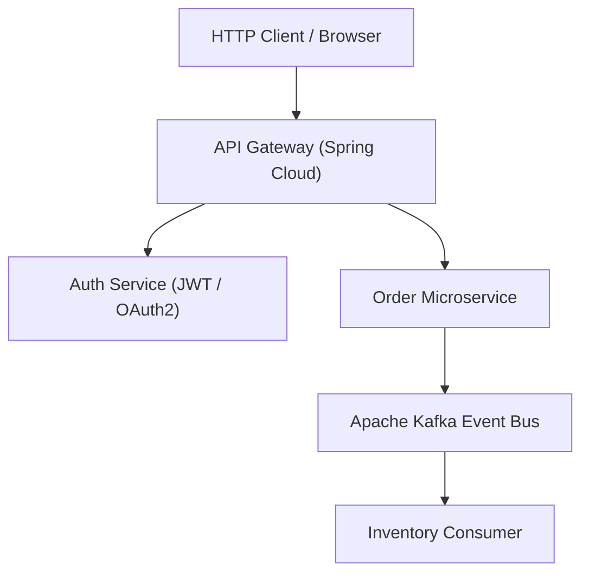

# Obsidian Knowledge Platform: Content Authoring & Contribution Guide

Welcome to the **Interview Ready with Java — Obsidian Knowledge Platform**. This guide explains how to add new chapters, link between topics, embed runnable code, and maintain the knowledge base.

---

## 1. Directory & File Placement

All documentation files live inside their respective topic domains:
* `CORE_JAVA/` — Core Java concepts, memory model, concurrency, design patterns.
* `SPRING_BOOT/` — Spring Framework, MVC, Data JPA, Security, Microservices.
* `SYSTEM_DESIGN/` — Distributed systems, HLD case studies, and LLD problems.
* `DATABASE_CACHING/` — SQL engines, B+ Trees, NoSQL, and Redis caching.
* `JAVA_DSA/` — Data structures, algorithms, problem patterns, and LeetCode solutions.
* `CLOUD_DEVOPS/` & `DOCKER_JAVA_BACKEND/` — Cloud infrastructure and containerization.

When you add a `.md` or `.MD` file anywhere in these directories, the platform **automatically discovers it, indexes it, and generates its URL route** without requiring manual configuration.

---

## 2. Document Template & Header Metadata

Every theoretical chapter follows a standardized structure for clarity and readability:

```markdown
# Chapter Title

> **Level:** Beginner → Intermediate  *(or Advanced / Expert)*
> **Interview Frequency:** ★★★★★
> **Prerequisites:** [Link to Prerequisite Chapter](../relative-path/README.md)
> **Last Updated:** 2026

---

## 📋 Table of Contents
- [0. TL;DR — The 30-Second Answer](#0-tldr--the-30-second-answer)
- [1. What & Why — The Problem This Solves](#1-what--why--the-problem-this-solves)
- [2. Mental Model & Visual Architecture](#2-mental-model--visual-architecture)
- [3. Deep Dive Theory](#3-deep-dive-theory)
- [4. Worked Examples (with Output + Dry Run)](#4-worked-examples-with-output--dry-run)
- [5. Common Pitfalls & Gotchas](#5-common-pitfalls--gotchas)
- [6. Interview Q&A & Counter-Questions](#6-interview-qa--counter-questions)
```

The metadata block (`Level`, `Interview Frequency`, `Prerequisites`, `Last Updated`) is automatically parsed and displayed as visual badges at the top of the chapter.

---

## 3. Linking Between Concepts & Obsidian Backlinks

### Standard Relative Links
Relative links resolve automatically to their canonical web URLs:
```markdown
[Read JVM Internals](../02-Java-Memory-Model/03-JVM-Internals.md)
[Explore Distributed Caching](../../SPRING_BOOT/10-Caching/README.md)
```

### Obsidian-Style Wiki Links
You can use double-bracket wiki links:
```markdown
[[01-OOP-Foundations-and-4-Pillars]]
[[01-OOP-Foundations-and-4-Pillars|OOP Foundations]]
```

### Automatic Backlink Discovery
Whenever you link from Document A to Document B, Document B's right-hand inspector will automatically list Document A under **"Linked Mentions"** with a live context preview. The interactive **Knowledge Graph** will also create a visual edge between them.

---

## 4. Code Blocks & Highlighting

Fence your code blocks with language identifiers for syntax highlighting:

````markdown
```java
public class RateLimiter {
    private final TokenBucket bucket;

    public RateLimiter(int capacity, int refillRate) {
        this.bucket = new TokenBucket(capacity, refillRate);
    }
}
```
````

Supported languages include: `java`, `sql`, `bash`, `yaml`, `json`, `xml`, `dockerfile`, `properties`, `markdown`.
The platform provides automatic line numbers and a one-click copy button.

---

## 5. Visual Diagrams (Mermaid.js)

Create interactive architecture diagrams using fenced Mermaid blocks:

````markdown

````

Mermaid diagrams render as vector graphics with pan/zoom support.

---

## 6. Obsidian Callouts

Use callouts to highlight tips, traps, and essential takeaways:

```markdown
> [!NOTE]
> Background context or implementation explanation.

> [!TIP]
> Production optimization heuristic.

> [!IMPORTANT]
> Must-know interview question or core invariant.

> [!WARNING]
> Concurrency race condition or common anti-pattern.

> [!CAUTION]
> Critical failure mode or data loss risk.
```

---

## 7. Math & Big-O Notation

Use LaTeX math syntax for algorithmic complexities and mathematical formulas:
* Inline math: `$O(n \log n)$` or `$O(1)$`
* Display math:
```markdown
$$
T(n) = 2T(n/2) + O(n) \implies O(n \log n)
$$
```

---

## 8. Development & Build Commands

```bash
# Start local development server with hot-reload
npm run dev

# Run static production build
npm run build

# Preview production build locally
npm run preview

# Verify all internal links and routes
node scripts/verify-links.mjs
```
